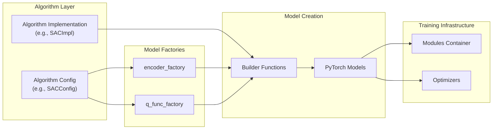

<!-- source: DeepWiki mcp.deepwiki.com · repo takuseno/d3rlpy · page 7 Model Components · fetched 2026-10-30 -->

# Model Components

<details>
<summary>Relevant source files</summary>

The following files were used as context for generating this wiki page:

- [d3rlpy/algos/qlearning/rebrac.py](d3rlpy/algos/qlearning/rebrac.py)
- [d3rlpy/algos/qlearning/torch/rebrac_impl.py](d3rlpy/algos/qlearning/torch/rebrac_impl.py)
- [d3rlpy/models/builders.py](d3rlpy/models/builders.py)
- [d3rlpy/models/encoders.py](d3rlpy/models/encoders.py)
- [d3rlpy/models/torch/encoders.py](d3rlpy/models/torch/encoders.py)
- [d3rlpy/models/torch/imitators.py](d3rlpy/models/torch/imitators.py)
- [d3rlpy/models/torch/policies.py](d3rlpy/models/torch/policies.py)
- [d3rlpy/models/torch/transformers.py](d3rlpy/models/torch/transformers.py)
- [d3rlpy/models/utility.py](d3rlpy/models/utility.py)
- [reproductions/offline/rebrac.py](reproductions/offline/rebrac.py)
- [tests/algos/transformer/algo_test.py](tests/algos/transformer/algo_test.py)
- [tests/algos/transformer/test_decision_transformer.py](tests/algos/transformer/test_decision_transformer.py)
- [tests/models/test_builders.py](tests/models/test_builders.py)
- [tests/models/test_encoders.py](tests/models/test_encoders.py)
- [tests/models/test_q_functions.py](tests/models/test_q_functions.py)
- [tests/models/torch/model_test.py](tests/models/torch/model_test.py)
- [tests/models/torch/test_encoders.py](tests/models/torch/test_encoders.py)
- [tests/models/torch/test_imitators.py](tests/models/torch/test_imitators.py)
- [tests/models/torch/test_policies.py](tests/models/torch/test_policies.py)
- [tests/models/torch/test_q_functions.py](tests/models/torch/test_q_functions.py)
- [tests/models/torch/test_transformers.py](tests/models/torch/test_transformers.py)

</details>


Model Components provide the neural network building blocks used throughout d3rlpy algorithms. This includes encoders for processing observations and actions, policy networks for action selection, Q-functions for value estimation, and transformer architectures for sequence modeling. For detailed information about specific model types, see [Encoders](#7.1), [Policies and Q-Functions](#7.2), and [Transformer Models](#7.3).

## Architecture Overview

The model component system uses a factory pattern to create PyTorch neural networks with consistent interfaces. All components inherit from `torch.nn.Module` and are organized into specialized categories based on their role in reinforcement learning algorithms.

### Model Component Hierarchy

```mermaid
graph TB
    subgraph "Factory Layer"
        EncFactory["EncoderFactory<br/>(Abstract Base)"]
        QFuncFactory["QFunctionFactory<br/>(Abstract Base)"]
        Builders["Builder Functions<br/>d3rlpy.models.builders"]
    end
    
    subgraph "Encoder Implementations"
        VecEnc["VectorEncoder<br/>Dense Networks"]
        PixelEnc["PixelEncoder<br/>CNN Networks"] 
        SimBaEnc["SimBaEncoder<br/>Residual Networks"]
        VecEncAction["VectorEncoderWithAction"]
        PixelEncAction["PixelEncoderWithAction"]
    end
    
    subgraph "Policy Networks"
        DetPolicy["DeterministicPolicy<br/>π(s) = a"]
        NormPolicy["NormalPolicy<br/>π(s) ~ N(μ,σ)"]
        CatPolicy["CategoricalPolicy<br/>π(s) ~ Categorical"]
        ResPolicy["DeterministicResidualPolicy"]
    end
    
    subgraph "Value Functions"
        MeanQ["ContinuousMeanQFunction<br/>Q(s,a) → ℝ"]
        QRQ["ContinuousQRQFunction<br/>Quantile Regression"]
        IQNQ["ContinuousIQNQFunction<br/>Implicit Quantile"]
        DiscMeanQ["DiscreteMeanQFunction<br/>Q(s) → ℝ^|A|"]
    end
    
    subgraph "Transformer Models"
        ContDT["ContinuousDecisionTransformer"]
        DiscDT["DiscreteDecisionTransformer"] 
        GatoTrans["GatoTransformer"]
        GPT2["GPT2<br/>Core Architecture"]
    end
    
    subgraph "Specialized Components"
        VAEEnc["VAEEncoder<br/>Variational Encoding"]
        VAEDec["VAEDecoder<br/>Action Generation"]
        ValFunc["ValueFunction<br/>V(s) → ℝ"]
    end
    
    %% Factory relationships
    EncFactory --> VecEnc
    EncFactory --> PixelEnc
    EncFactory --> SimBaEnc
    EncFactory --> VecEncAction
    EncFactory --> PixelEncAction
    
    Builders --> DetPolicy
    Builders --> NormPolicy
    Builders --> CatPolicy
    Builders --> MeanQ
    Builders --> ContDT
    Builders --> VAEEnc
    
    %% Component relationships
    VecEnc --> DetPolicy
    VecEnc --> NormPolicy
    VecEncAction --> MeanQ
    VecEncAction --> VAEEnc
    GPT2 --> ContDT
    GPT2 --> DiscDT
```



Sources: [d3rlpy/models/torch/policies.py:51-72](), [d3rlpy/models/torch/encoders.py:24-44](), [d3rlpy/models/builders.py:31-44](), [d3rlpy/models/encoders.py:29-58]()

## Core Component Types

### Encoder Components

Encoders process raw observations into feature representations. The system provides three main encoder types through factory classes:

| Encoder Type | Implementation | Use Case | Factory Class |
|-------------|----------------|----------|---------------|
| Vector | `VectorEncoder` | Low-dimensional observations | `VectorEncoderFactory` |
| Pixel | `PixelEncoder` | Image observations | `PixelEncoderFactory` |
| SimBa | `SimBaEncoder` | High-capacity dense networks | `SimBaEncoderFactory` |

Each encoder type has a corresponding "with action" variant (`EncoderWithAction`) for Q-function architectures that concatenate observations and actions.

### Policy Networks

Policy networks implement different action selection strategies:

```mermaid
graph LR
    subgraph "Policy Types"
        Det["DeterministicPolicy<br/>→ ActionOutput"]
        Norm["NormalPolicy<br/>→ ActionOutput"]
        Cat["CategoricalPolicy<br/>→ Categorical"]
        Res["DeterministicResidualPolicy<br/>→ ActionOutput"]
    end
    
    subgraph "Action Output"
        AO["ActionOutput<br/>{mu, squashed_mu, logstd}"]
        Dist["Distribution Objects<br/>GaussianDistribution<br/>SquashedGaussianDistribution"]
    end
    
    subgraph "Builder Functions"
        CreateDet["create_deterministic_policy()"]
        CreateNorm["create_normal_policy()"]
        CreateCat["create_categorical_policy()"]
        CreateRes["create_deterministic_residual_policy()"]
    end
    
    Det --> AO
    Norm --> AO
    Res --> AO
    Cat --> "Categorical"
    
    AO --> Dist
    
    CreateDet --> Det
    CreateNorm --> Norm
    CreateCat --> Cat
    CreateRes --> Res
```

Sources: [d3rlpy/models/torch/policies.py:24-35](), [d3rlpy/models/torch/policies.py:60-98](), [d3rlpy/models/builders.py:131-172]()

### Q-Function Architecture

Q-functions estimate state-action values using ensemble methods and different approximation techniques:

```mermaid
graph TB
    subgraph "Q-Function Types"
        MeanQ["MeanQFunction<br/>Single Value Output"]
        QRQ["QRQFunction<br/>Quantile Regression"]
        IQNQ["IQNQFunction<br/>Implicit Quantile Networks"]
    end
    
    subgraph "Ensemble Forwarders"
        ContEns["ContinuousEnsembleQFunctionForwarder"]
        DiscEns["DiscreteEnsembleQFunctionForwarder"]
    end
    
    subgraph "Factory System"
        MeanFactory["MeanQFunctionFactory"]
        QRFactory["QRQFunctionFactory"] 
        IQNFactory["IQNQFunctionFactory"]
    end
    
    subgraph "Builder Functions"
        CreateCont["create_continuous_q_function()"]
        CreateDisc["create_discrete_q_function()"]
    end
    
    MeanFactory --> MeanQ
    QRFactory --> QRQ
    IQNFactory --> IQNQ
    
    CreateCont --> ContEns
    CreateDisc --> DiscEns
    
    ContEns --> "n_ensembles × Q-Functions"
    DiscEns --> "n_ensembles × Q-Functions"
```

Sources: [d3rlpy/models/builders.py:47-83](), [d3rlpy/models/builders.py:85-128](), [tests/models/torch/test_q_functions.py:28-55]()

## Builder Pattern Implementation

The builder pattern centralizes model creation and configuration. Builder functions handle device placement, DDP wrapping, and ensemble creation:

### Key Builder Functions

```mermaid
graph TD
    subgraph "Policy Builders"
        PB1["create_deterministic_policy()"]
        PB2["create_normal_policy()"]
        PB3["create_categorical_policy()"]
        PB4["create_deterministic_residual_policy()"]
    end
    
    subgraph "Q-Function Builders"
        QB1["create_continuous_q_function()"]
        QB2["create_discrete_q_function()"]
    end
    
    subgraph "Transformer Builders"
        TB1["create_continuous_decision_transformer()"]
        TB2["create_discrete_decision_transformer()"]
    end
    
    subgraph "Specialized Builders"
        SB1["create_vae_encoder()"]
        SB2["create_vae_decoder()"]
        SB3["create_value_function()"]
        SB4["create_parameter()"]
    end
    
    subgraph "Common Operations"
        CO1["compute_output_size()"]
        CO2["Device Placement"]
        CO3["DDP Wrapping"]
        CO4["Ensemble Creation"]
    end
    
    PB1 --> CO1
    PB1 --> CO2
    QB1 --> CO3
    QB1 --> CO4
    TB1 --> CO1
    SB1 --> CO2
```



Sources: [d3rlpy/models/builders.py:131-149](), [d3rlpy/models/builders.py:175-198](), [d3rlpy/models/builders.py:314-356]()

### Builder Function Signature Pattern

All builder functions follow a consistent signature pattern:

```python
def create_*_*(
    observation_shape: Shape,
    action_size: int,  # if applicable
    encoder_factory: EncoderFactory,
    device: str,
    enable_ddp: bool,
    # additional parameters specific to model type
) -> ModelType
```

This pattern ensures consistent device handling and distributed training support across all model types.

Sources: [d3rlpy/models/builders.py:131-136](), [d3rlpy/models/builders.py:175-183](), [d3rlpy/models/builders.py:201-206]()

## Integration with Algorithm System

Model components integrate with the algorithm system through the implementation layer. Algorithm configurations specify encoder factories and other model factories, which are used by builder functions during algorithm initialization:



Sources: [d3rlpy/algos/qlearning/rebrac.py:108-176](), [reproductions/offline/rebrac.py:41-66]()

The model component system provides the foundational neural network building blocks that enable d3rlpy's algorithm implementations to work across different observation types and action spaces while maintaining consistent interfaces and supporting advanced features like distributed training and graph compilation.

---

