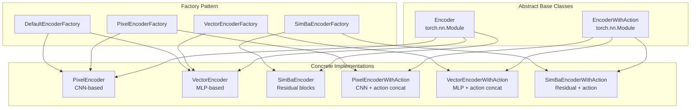
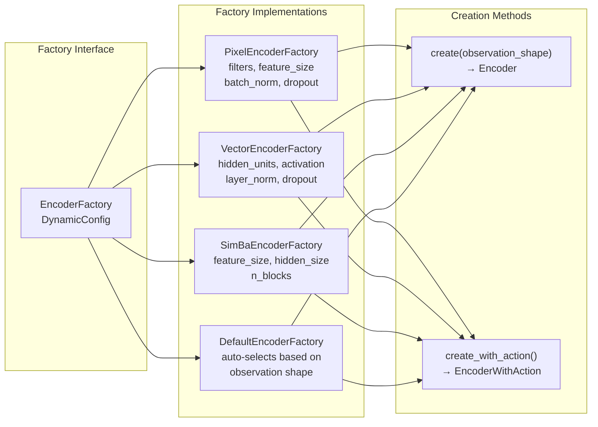
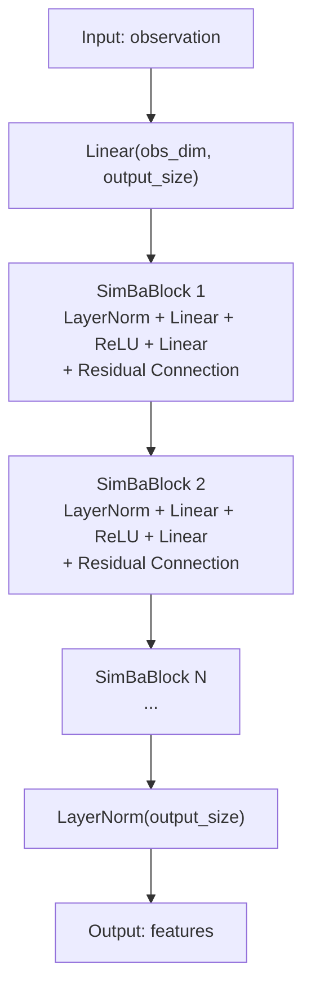
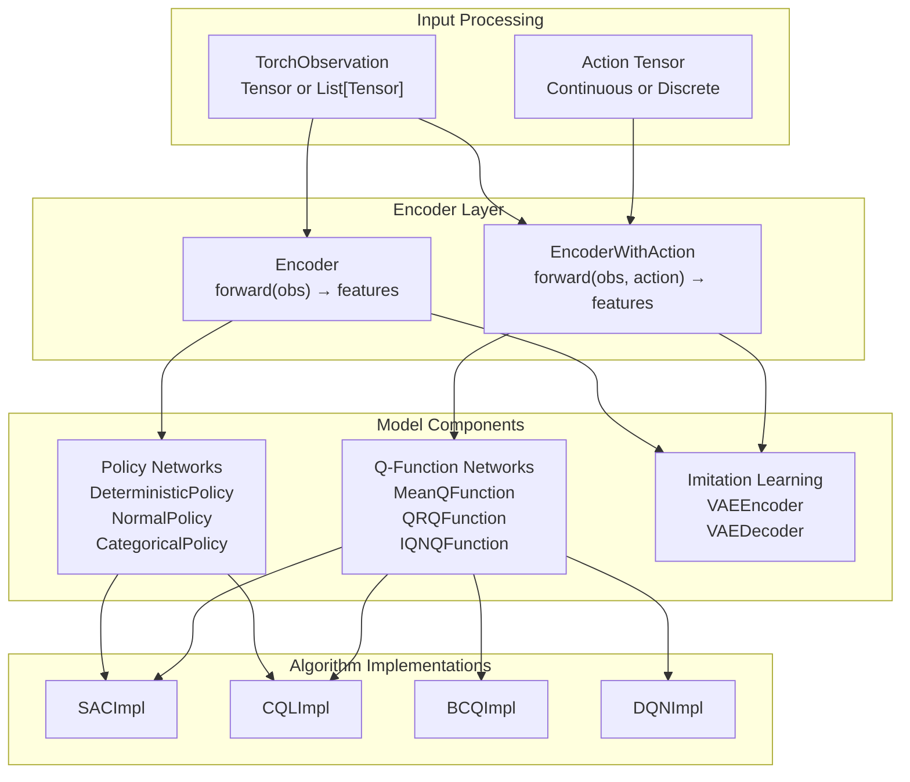

<!-- source: DeepWiki mcp.deepwiki.com · repo takuseno/d3rlpy · page 7.1 Encoders · fetched 2026-10-30 -->

# Encoders

<details>
<summary>Relevant source files</summary>

The following files were used as context for generating this wiki page:

- [d3rlpy/algos/qlearning/rebrac.py](d3rlpy/algos/qlearning/rebrac.py)
- [d3rlpy/algos/qlearning/torch/rebrac_impl.py](d3rlpy/algos/qlearning/torch/rebrac_impl.py)
- [d3rlpy/models/encoders.py](d3rlpy/models/encoders.py)
- [d3rlpy/models/torch/encoders.py](d3rlpy/models/torch/encoders.py)
- [d3rlpy/models/torch/imitators.py](d3rlpy/models/torch/imitators.py)
- [d3rlpy/models/torch/policies.py](d3rlpy/models/torch/policies.py)
- [reproductions/offline/rebrac.py](reproductions/offline/rebrac.py)
- [tests/models/test_encoders.py](tests/models/test_encoders.py)
- [tests/models/test_q_functions.py](tests/models/test_q_functions.py)
- [tests/models/torch/model_test.py](tests/models/torch/model_test.py)
- [tests/models/torch/test_encoders.py](tests/models/torch/test_encoders.py)
- [tests/models/torch/test_imitators.py](tests/models/torch/test_imitators.py)
- [tests/models/torch/test_policies.py](tests/models/torch/test_policies.py)
- [tests/models/torch/test_q_functions.py](tests/models/torch/test_q_functions.py)

</details>


## Purpose and Scope

Encoders in d3rlpy are neural network modules responsible for feature extraction from observations and actions. They serve as the foundation layer for all model components, transforming raw inputs into meaningful feature representations that can be consumed by policies, Q-functions, and other neural network modules. This page covers the encoder architecture, factory pattern, concrete implementations, and integration with the broader model system.

For information about how encoders integrate with policies and Q-functions, see [Policies and Q-Functions](#7.2). For details about the broader model component system, see [Model Components](#7).

## Encoder Architecture Overview

The encoder system in d3rlpy follows a clean abstraction hierarchy with two main base classes that define the core interfaces:



**Sources:** [d3rlpy/models/torch/encoders.py:24-44](), [d3rlpy/models/encoders.py:29-58]()

The `Encoder` base class defines the interface for observation-only encoders, while `EncoderWithAction` handles both observations and actions. Both classes extend `torch.nn.Module` and implement abstract `forward` methods that concrete implementations must define.

## Factory Pattern Implementation

d3rlpy uses the factory pattern to create encoders, allowing for flexible configuration and instantiation. The factory system provides a clean separation between configuration and implementation:



**Sources:** [d3rlpy/models/encoders.py:29-58](), [d3rlpy/models/encoders.py:62-105](), [d3rlpy/models/encoders.py:136-177]()

Each factory class inherits from `EncoderFactory` and implements two key methods:
- `create(observation_shape)`: Creates observation-only encoders
- `create_with_action(observation_shape, action_size, discrete_action)`: Creates encoders that process both observations and actions

## Encoder Implementations

### PixelEncoder

The `PixelEncoder` is designed for image-based observations and implements a convolutional neural network architecture:

| Component | Description | Default Configuration |
|-----------|-------------|----------------------|
| CNN Layers | Convolutional feature extraction | `[[32, 8, 4], [64, 4, 2], [64, 3, 1]]` |
| Feature Size | Final linear layer output size | `512` |
| Activation | Non-linearity function | `ReLU` |
| Batch Norm | Optional normalization | `False` |
| Dropout | Regularization technique | `None` |

The encoder follows the Nature DQN architecture by default, with three convolutional layers followed by a fully connected layer. The `PixelEncoderWithAction` variant concatenates action information with the flattened CNN output before the final linear layer.

**Sources:** [d3rlpy/models/torch/encoders.py:46-110](), [d3rlpy/models/torch/encoders.py:112-192]()

### VectorEncoder

The `VectorEncoder` handles vector-based observations using multi-layer perceptrons:

| Component | Description | Default Configuration |
|-----------|-------------|----------------------|
| Hidden Units | Layer sizes | `[256, 256]` |
| Activation | Non-linearity function | `ReLU` |
| Batch Norm | Optional normalization | `False` |
| Layer Norm | Alternative normalization | `False` |
| Dropout | Regularization technique | `None` |

The `VectorEncoderWithAction` variant concatenates action information with observations at the input layer, enabling the encoder to process state-action pairs jointly.

**Sources:** [d3rlpy/models/torch/encoders.py:194-235](), [d3rlpy/models/torch/encoders.py:237-293]()

### SimBaEncoder

The `SimBaEncoder` implements the SimpleBias architecture with residual connections:



**Sources:** [d3rlpy/models/torch/encoders.py:295-332](), [d3rlpy/models/torch/encoders.py:334-367]()

Each `SimBaBlock` implements a residual connection with layer normalization, expansion to a hidden size, and contraction back to the output size. This architecture has shown effectiveness in scaling up parameters for deep reinforcement learning.

## Integration with Model Components

Encoders serve as the foundation for higher-level model components throughout d3rlpy:



**Sources:** [d3rlpy/models/torch/policies.py:60-98](), [d3rlpy/models/torch/imitators.py:34-71](), [tests/models/torch/test_q_functions.py:37-45]()

Policies use observation-only encoders to process states before generating actions, while Q-functions typically use state-action encoders to evaluate state-action pairs. The encoder outputs are then fed into task-specific head networks that produce the final policy or value function outputs.

## Utility Functions

The encoder system includes several utility functions for integration and testing:

### compute_output_size

The `compute_output_size` function determines the feature dimensionality produced by an encoder:

```python
def compute_output_size(input_shapes: Sequence[Shape], encoder: nn.Module) -> int
```

This function creates dummy inputs based on the provided shapes, runs them through the encoder, and returns the output feature size. It's essential for properly configuring downstream network layers.

**Sources:** [d3rlpy/models/torch/encoders.py:369-382]()

### Configuration Registration

The encoder factory system uses dynamic configuration registration to enable serialization and deserialization:

```python
register_encoder_factory, make_encoder_field = generate_config_registration(
    EncoderFactory, lambda: DefaultEncoderFactory()
)
```

This mechanism allows algorithms to save and load encoder configurations as part of their overall model state.

**Sources:** [d3rlpy/models/encoders.py:318-327]()

---

