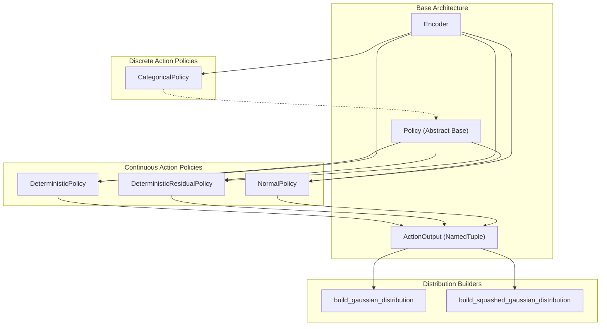
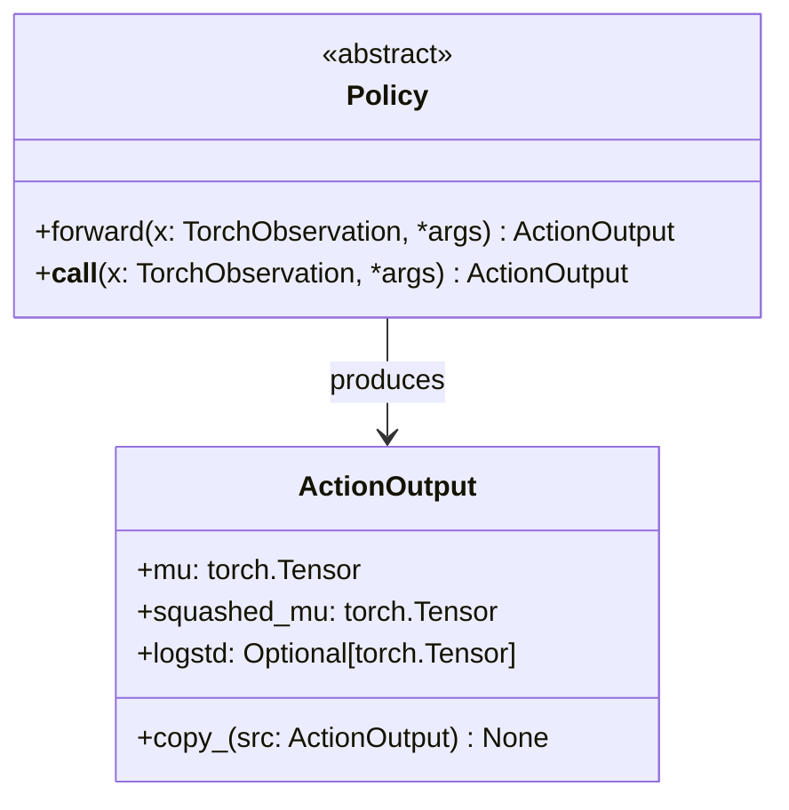
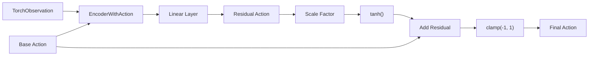
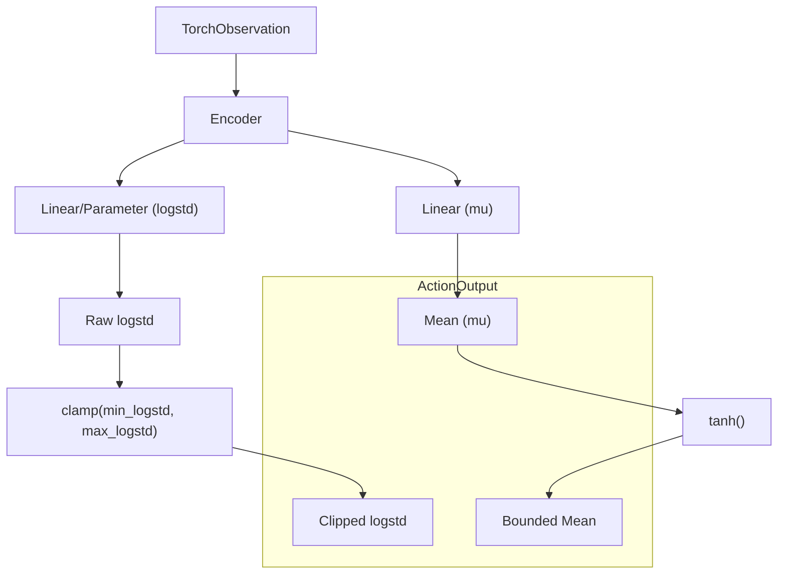
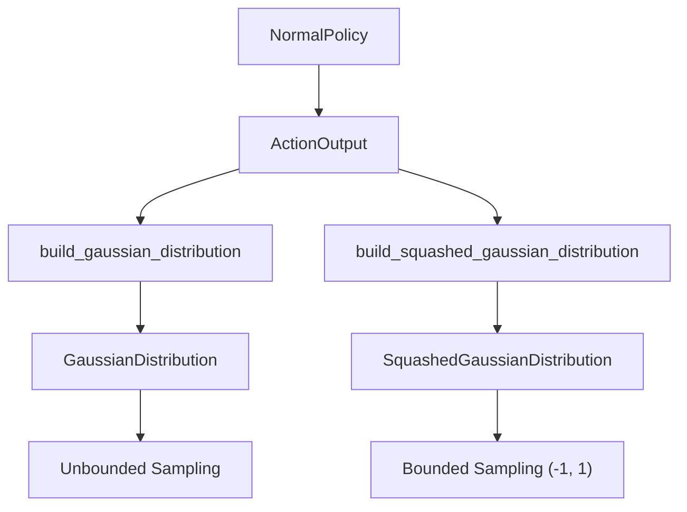
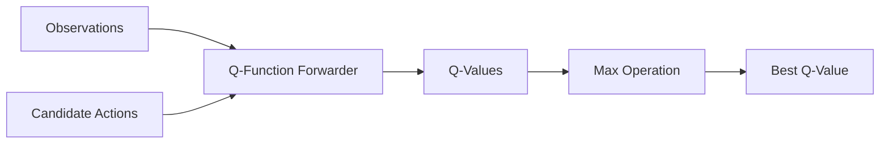
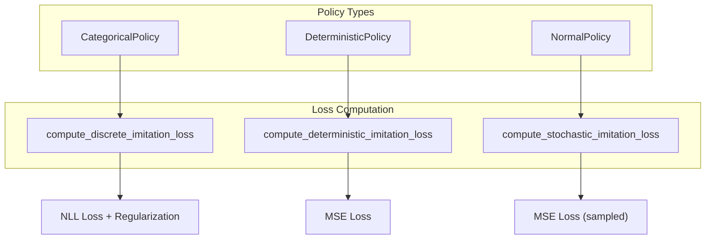
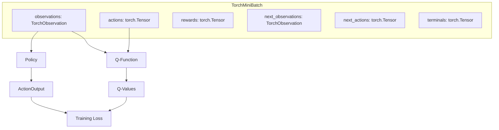

<!-- source: DeepWiki mcp.deepwiki.com · repo takuseno/d3rlpy · page 7.2 Policies and Q-Functions · fetched 2026-10-30 -->

# Policies and Q-Functions

Relevant source files

The following files were used as context for generating this wiki page:

- [d3rlpy/dataset/components.py](d3rlpy/dataset/components.py)
- [d3rlpy/dataset/mini_batch.py](d3rlpy/dataset/mini_batch.py)
- [d3rlpy/dataset/transition_pickers.py](d3rlpy/dataset/transition_pickers.py)
- [d3rlpy/models/torch/imitators.py](d3rlpy/models/torch/imitators.py)
- [d3rlpy/models/torch/policies.py](d3rlpy/models/torch/policies.py)
- [d3rlpy/ope/torch/fqe_impl.py](d3rlpy/ope/torch/fqe_impl.py)
- [d3rlpy/torch_utility.py](d3rlpy/torch_utility.py)
- [tests/algos/qlearning/algo_test.py](tests/algos/qlearning/algo_test.py)
- [tests/dataset/test_components.py](tests/dataset/test_components.py)
- [tests/dataset/test_mini_batch.py](tests/dataset/test_mini_batch.py)
- [tests/dataset/test_transition_pickers.py](tests/dataset/test_transition_pickers.py)
- [tests/models/torch/model_test.py](tests/models/torch/model_test.py)
- [tests/models/torch/test_imitators.py](tests/models/torch/test_imitators.py)
- [tests/models/torch/test_policies.py](tests/models/torch/test_policies.py)
- [tests/models/torch/test_q_functions.py](tests/models/torch/test_q_functions.py)
- [tests/test_torch_utility.py](tests/test_torch_utility.py)
- [tests/testing_utils.py](tests/testing_utils.py)

This document details the policy implementations and Q-function architectures used throughout d3rlpy for value-based learning. Policies are responsible for action selection, while Q-functions estimate state-action values. These components form the core building blocks for reinforcement learning algorithms.

For information about the encoder architectures that feed into policies and Q-functions, see [Encoders](#7.1). For transformer-based sequence models, see [Transformer Models](#7.3).

## Policy Architecture Overview

d3rlpy implements a hierarchical policy system where all policies inherit from a common base class but specialize for different action spaces and distributions.

Sources: [d3rlpy/models/torch/policies.py:1-162]()

## Policy Types and Implementations

### Base Policy Interface

The `Policy` abstract base class defines the common interface for all policy implementations:

The `ActionOutput` structure provides a standardized format for policy outputs across all implementations, containing both raw (`mu`) and bounded (`squashed_mu`) action predictions.

Sources: [d3rlpy/models/torch/policies.py:24-58]()

### Continuous Action Policies

| Policy Type | Use Case | Key Features |
|-------------|----------|--------------|
| `DeterministicPolicy` | Deterministic continuous control | Single action output, tanh squashing |
| `DeterministicResidualPolicy` | Policy improvement with base policy | Residual action learning with scaling |
| `NormalPolicy` | Stochastic continuous control | Gaussian distribution, configurable std |

#### DeterministicPolicy

Produces deterministic continuous actions using a simple linear layer after feature encoding:

Sources: [d3rlpy/models/torch/policies.py:60-73]()

#### DeterministicResidualPolicy

Implements residual policy learning where the policy outputs small corrections to an existing base action:

Sources: [d3rlpy/models/torch/policies.py:75-98]()

#### NormalPolicy

Outputs parameters for a Gaussian distribution, supporting both learned and fixed standard deviation:

Sources: [d3rlpy/models/torch/policies.py:100-146]()

### Discrete Action Policies

#### CategoricalPolicy

For discrete action spaces, outputs a categorical distribution over actions:

Sources: [d3rlpy/models/torch/policies.py:148-162]()

## Distribution Integration

d3rlpy provides utility functions to convert policy outputs into proper probability distributions:

| Function | Input | Output | Use Case |
|----------|-------|--------|----------|
| `build_gaussian_distribution` | `ActionOutput` | `GaussianDistribution` | Unbounded continuous actions |
| `build_squashed_gaussian_distribution` | `ActionOutput` | `SquashedGaussianDistribution` | Bounded continuous actions |

Sources: [d3rlpy/models/torch/policies.py:37-49]()

## Q-Function Integration

While Q-function implementations are not fully visible in the provided files, the testing infrastructure reveals key Q-function types:

| Q-Function Type | Purpose | Key Feature |
|-----------------|---------|-------------|
| `MeanQFunctionFactory` | Standard value estimation | Single Q-value output |
| `QRQFunctionFactory` | Distributional RL | Quantile-based value distribution |

The `compute_max_with_n_actions` function demonstrates Q-function usage for action selection:

Sources: [tests/models/torch/test_q_functions.py:10-56]()

## Usage in Algorithm Implementations

Policies and Q-functions are integrated into algorithm implementations through the imitation learning framework:

Sources: [d3rlpy/models/torch/imitators.py:176-205]()

## Data Flow and Tensor Processing

The `TorchMiniBatch` class provides the standardized data format for training policies and Q-functions:

Sources: [d3rlpy/torch_utility.py:203-276]()

---

