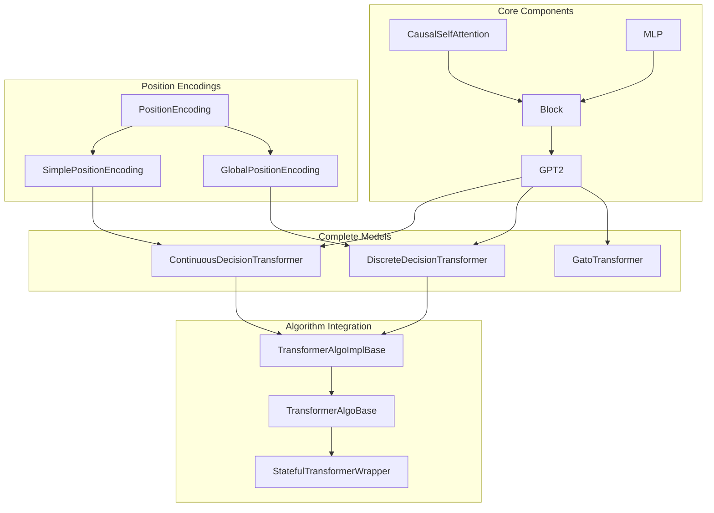
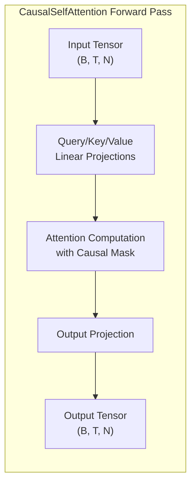
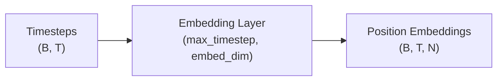
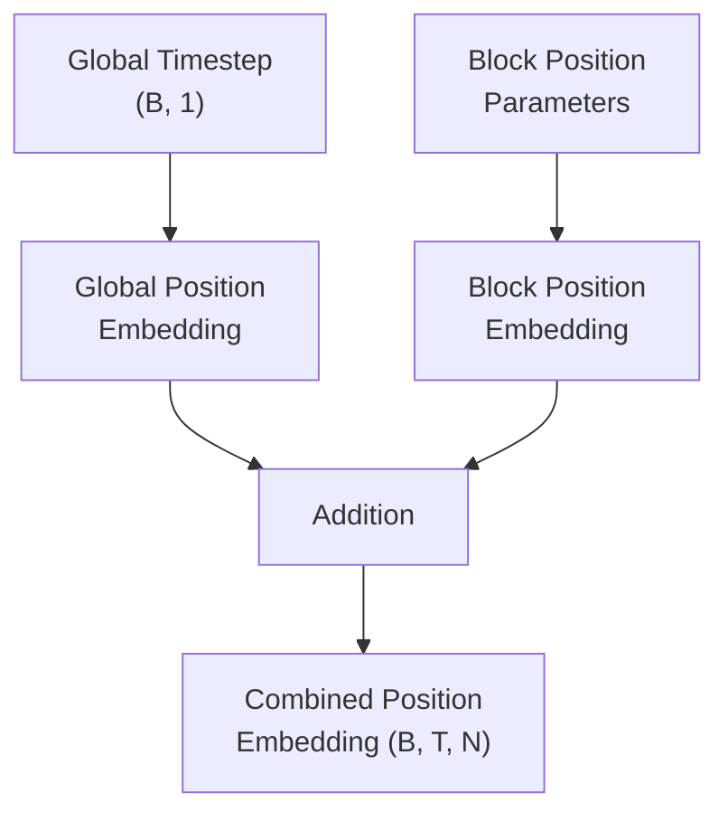
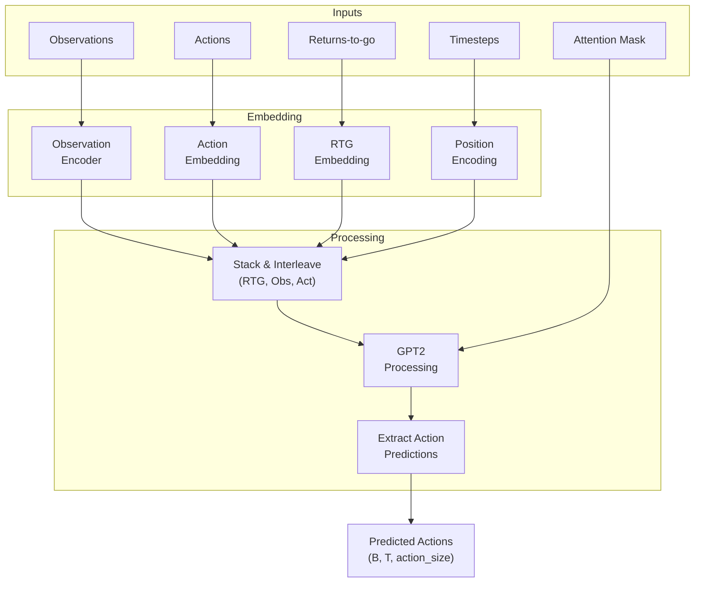
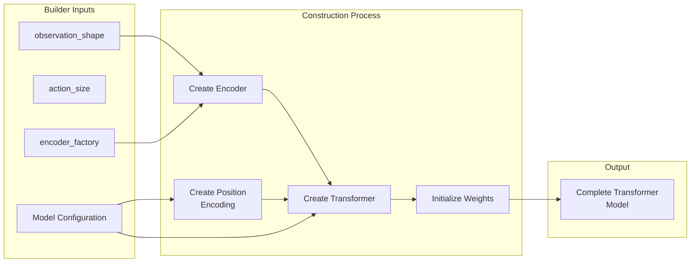
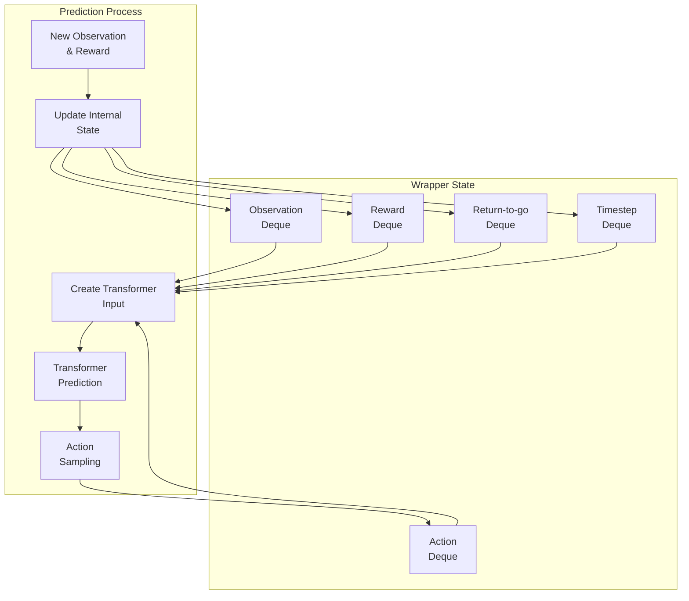

<!-- source: DeepWiki mcp.deepwiki.com · repo takuseno/d3rlpy · page 7.3 Transformer Models · fetched 2026-10-30 -->

# Transformer Models

Relevant source files

The following files were used as context for generating this wiki page:

- [d3rlpy/algos/qlearning/base.py](d3rlpy/algos/qlearning/base.py)
- [d3rlpy/algos/transformer/base.py](d3rlpy/algos/transformer/base.py)
- [d3rlpy/algos/transformer/decision_transformer.py](d3rlpy/algos/transformer/decision_transformer.py)
- [d3rlpy/algos/transformer/torch/decision_transformer_impl.py](d3rlpy/algos/transformer/torch/decision_transformer_impl.py)
- [d3rlpy/models/builders.py](d3rlpy/models/builders.py)
- [d3rlpy/models/torch/transformers.py](d3rlpy/models/torch/transformers.py)
- [d3rlpy/models/utility.py](d3rlpy/models/utility.py)
- [tests/algos/transformer/algo_test.py](tests/algos/transformer/algo_test.py)
- [tests/algos/transformer/test_decision_transformer.py](tests/algos/transformer/test_decision_transformer.py)
- [tests/models/test_builders.py](tests/models/test_builders.py)
- [tests/models/torch/test_transformers.py](tests/models/torch/test_transformers.py)

This document covers the transformer neural network architectures used in d3rlpy for sequence modeling approaches to reinforcement learning. These models enable algorithms like Decision Transformer that treat RL as a sequence prediction problem rather than traditional value-based or policy gradient methods.

For information about transformer-based algorithm implementations, see [Transformer Algorithms](#5.2). For encoder components used within transformers, see [Encoders](#7.1).

## Architecture Overview

The transformer models in d3rlpy follow a hierarchical design with core building blocks that compose into complete transformer architectures. The system supports both continuous and discrete action spaces through specialized implementations.

Sources: [d3rlpy/models/torch/transformers.py:1-546](), [d3rlpy/algos/transformer/base.py:1-552]()

## Core Transformer Components

### Attention Mechanism

The `CausalSelfAttention` class implements masked self-attention with causal masking to prevent the model from attending to future tokens in the sequence.

The attention mechanism uses a pre-computed causal mask created by `create_attention_mask()` and applies dropout for regularization.

Sources: [d3rlpy/models/torch/transformers.py:28-94]()

### Transformer Block

The `Block` class combines self-attention and feed-forward layers with residual connections and layer normalization, following the standard transformer architecture.

| Component | Purpose | Implementation |
|-----------|---------|----------------|
| `CausalSelfAttention` | Sequence modeling with causal masking | Multi-head attention with dropout |
| `MLP` | Feed-forward processing | Two-layer network with activation |
| `LayerNorm` | Normalization | Applied before attention and MLP |
| Residual Connections | Gradient flow | Skip connections around each component |

Sources: [d3rlpy/models/torch/transformers.py:123-168]()

### GPT2 Architecture

The `GPT2` class stacks multiple transformer blocks and applies final layer normalization and dropout. This forms the backbone of all transformer models in d3rlpy.

Sources: [d3rlpy/models/torch/transformers.py:212-255]()

## Position Encoding

Position encodings provide positional information to the transformer since attention mechanisms are permutation-invariant.

### Simple Position Encoding

`SimplePositionEncoding` uses a learned embedding table to encode timestep positions directly.

Sources: [d3rlpy/models/torch/transformers.py:176-184]()

### Global Position Encoding

`GlobalPositionEncoding` combines global timestep information with local block positions, suitable for structured sequence inputs like Decision Transformer's (return-to-go, state, action) tuples.

Sources: [d3rlpy/models/torch/transformers.py:187-210]()

## Decision Transformer Models

### Continuous Action Space

`ContinuousDecisionTransformer` processes sequences of (return-to-go, observation, action) tuples and predicts continuous actions using a tanh activation for bounded outputs.

The model uses a specific interleaving pattern where sequences are organized as `[rtg_1, obs_1, act_1, rtg_2, obs_2, act_2, ...]` to enable autoregressive prediction.

Sources: [d3rlpy/models/torch/transformers.py:267-360]()

### Discrete Action Space

`DiscreteDecisionTransformer` handles discrete actions using embedding layers for action tokens and outputs probability distributions over the action space.

Key differences from continuous version:
- Uses `nn.Embedding` for action tokens instead of linear projection
- Outputs both softmax probabilities and raw logits
- Applies embedding activation to the stacked inputs
- No output activation (relies on softmax for probabilities)

Sources: [d3rlpy/models/torch/transformers.py:362-461]()

## Model Builders

The `create_continuous_decision_transformer()` and `create_discrete_decision_transformer()` functions in the builders module construct complete transformer models with appropriate configurations.

The builders handle device placement, distributed data parallel (DDP) wrapping, and proper weight initialization using the `_init_weights()` function.

Sources: [d3rlpy/models/builders.py:314-404]()

## Integration with Algorithm Framework

Transformer models integrate with the algorithm system through the `TransformerAlgoBase` and `TransformerAlgoImplBase` classes, which provide the interface for training and inference.

### Stateful Wrapper

The `StatefulTransformerWrapper` enables transformer algorithms to maintain state across multiple prediction steps, essential for sequential decision-making in environments.

The wrapper maintains fixed-size deques for each input modality and automatically manages the sliding window of context as new observations arrive.

Sources: [d3rlpy/algos/transformer/base.py:81-206]()

## Model Initialization

All transformer models use the `_init_weights()` function for proper parameter initialization:
- Linear and embedding layers: Normal distribution with std=0.02
- Layer normalization: Bias initialized to 0, weight to 1

This follows standard transformer initialization practices for stable training.

Sources: [d3rlpy/models/torch/transformers.py:257-265]()

---

