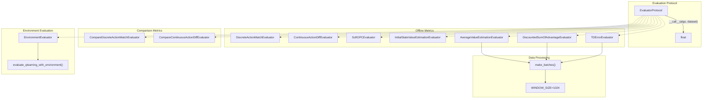
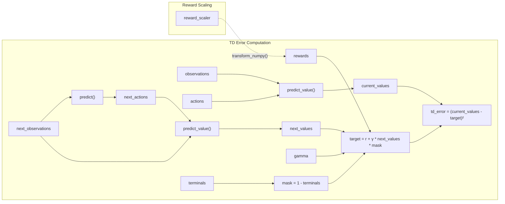
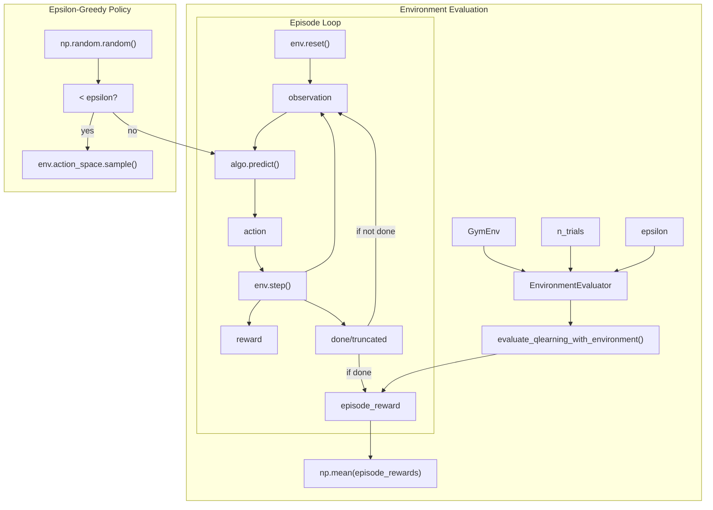
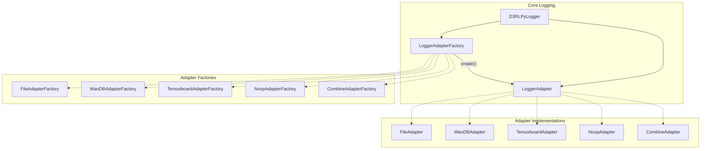
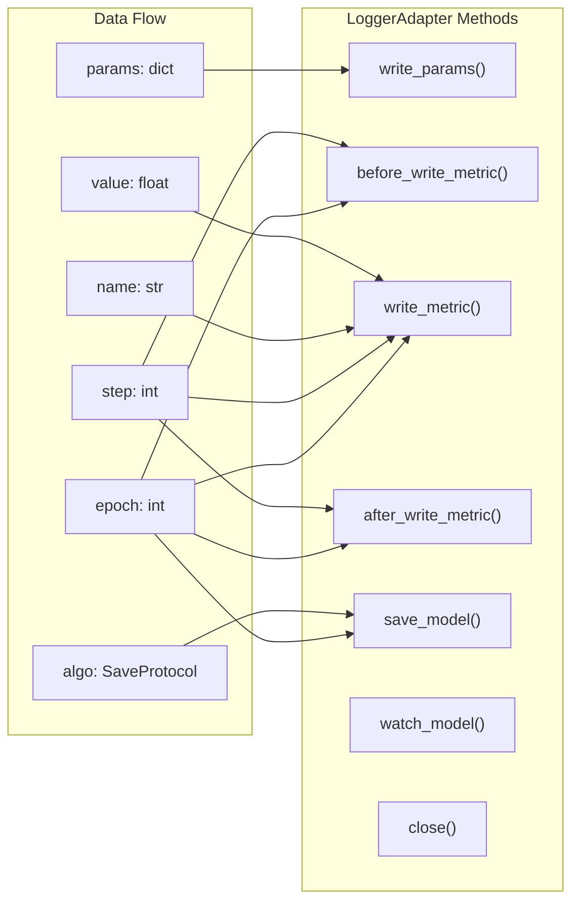
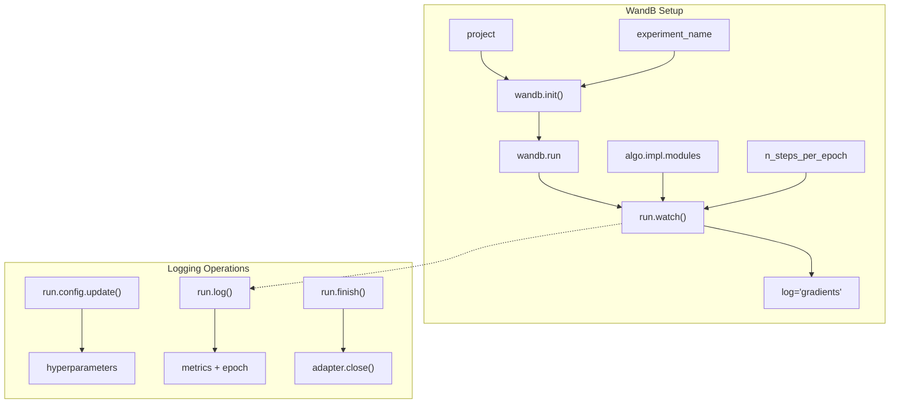
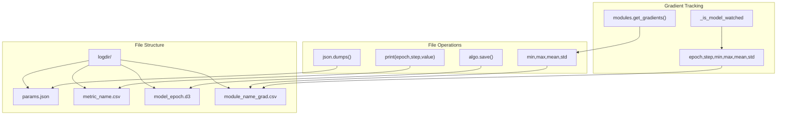
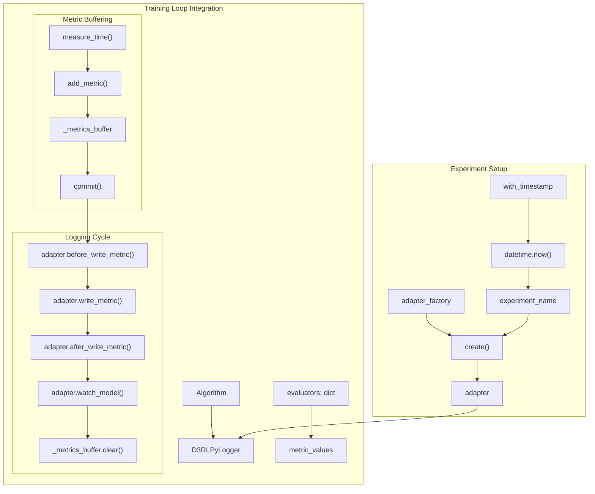

<!-- source: DeepWiki mcp.deepwiki.com · repo takuseno/d3rlpy · page 8 Training and Evaluation · fetched 2026-10-30 -->

# Training and Evaluation

Relevant source files

The following files were used as context for generating this wiki page:

- [d3rlpy/algos/transformer/inputs.py](d3rlpy/algos/transformer/inputs.py)
- [d3rlpy/logging/file_adapter.py](d3rlpy/logging/file_adapter.py)
- [d3rlpy/logging/logger.py](d3rlpy/logging/logger.py)
- [d3rlpy/logging/noop_adapter.py](d3rlpy/logging/noop_adapter.py)
- [d3rlpy/logging/tensorboard_adapter.py](d3rlpy/logging/tensorboard_adapter.py)
- [d3rlpy/logging/utils.py](d3rlpy/logging/utils.py)
- [d3rlpy/logging/wandb_adapter.py](d3rlpy/logging/wandb_adapter.py)
- [d3rlpy/metrics/evaluators.py](d3rlpy/metrics/evaluators.py)
- [d3rlpy/metrics/utility.py](d3rlpy/metrics/utility.py)
- [docs/references/metrics.rst](docs/references/metrics.rst)
- [tests/algos/transformer/test_inputs.py](tests/algos/transformer/test_inputs.py)
- [tests/dummy_env.py](tests/dummy_env.py)
- [tests/envs/test_wrappers.py](tests/envs/test_wrappers.py)
- [tests/logging/test_logger.py](tests/logging/test_logger.py)
- [tests/metrics/test_evaluators.py](tests/metrics/test_evaluators.py)
- [tests/metrics/test_utility.py](tests/metrics/test_utility.py)

This document covers d3rlpy's training and evaluation infrastructure, which provides comprehensive metrics, logging, and experiment tracking capabilities for reinforcement learning algorithms. The system supports both offline evaluation metrics and environment-based evaluation, along with flexible logging adapters for popular experiment tracking platforms.

For information about the core algorithm training loops, see [Algorithm System](#5). For data preprocessing and scaling during training, see [Data Preprocessing](#6.3).

## Overview

The training and evaluation system consists of two main components:

1. **Metrics and Evaluation**: A protocol-based system for computing various offline and online evaluation metrics
2. **Logging and Experiment Tracking**: An adapter-based logging system supporting multiple backends (WandB, TensorBoard, file-based)

These systems integrate seamlessly with d3rlpy's algorithm framework to provide comprehensive monitoring and evaluation during training.

## Metrics and Evaluation System

### Evaluation Protocol Architecture

The evaluation system is built around the `EvaluatorProtocol` which defines a standardized interface for all evaluation metrics.

Sources: [d3rlpy/metrics/evaluators.py:34-50](), [d3rlpy/metrics/evaluators.py:52-68]()

### Core Evaluation Metrics

#### TD Error Evaluation
The `TDErrorEvaluator` measures temporal difference error to detect Q-function overfitting:

Sources: [d3rlpy/metrics/evaluators.py:71-121](), [d3rlpy/metrics/evaluators.py:114-119]()

#### Value Estimation Metrics
Several evaluators assess the quality and scale of value function estimates:

| Evaluator | Formula | Purpose |
|-----------|---------|---------|
| `AverageValueEstimationEvaluator` | `E[max_a Q(s,a)]` | Detect value overestimation |
| `InitialStateValueEstimationEvaluator` | `E[Q(s_0, π(s_0))]` | Expected return from initial states |
| `DiscountedSumOfAdvantageEvaluator` | `Σ γ^t A(s_t, a_t)` | Policy improvement over dataset |

Sources: [d3rlpy/metrics/evaluators.py:191-226](), [d3rlpy/metrics/evaluators.py:229-271](), [d3rlpy/metrics/evaluators.py:124-188]()

### Environment-Based Evaluation

The `EnvironmentEvaluator` provides online evaluation by running the trained policy in an environment:

Sources: [d3rlpy/metrics/evaluators.py:506-548](), [d3rlpy/metrics/utility.py:12-71]()

## Logging and Experiment Tracking System

### Logger Architecture

The logging system uses an adapter pattern to support multiple experiment tracking backends:

Sources: [d3rlpy/logging/logger.py:143-167](), [d3rlpy/logging/logger.py:123-140]()

### Logger Adapter Protocol

All logging adapters implement the `LoggerAdapter` protocol:

Sources: [d3rlpy/logging/logger.py:61-121]()

### WandB Integration

The `WanDBAdapter` provides integration with Weights & Biases:

Sources: [d3rlpy/logging/wandb_adapter.py:25-43](), [d3rlpy/logging/wandb_adapter.py:52-70]()

### File-Based Logging

The `FileAdapter` saves metrics as CSV files and models as `.d3` files:

Sources: [d3rlpy/logging/file_adapter.py:47-82](), [d3rlpy/logging/file_adapter.py:90-121]()

## Training Integration

### Metric Collection and Reporting

The `D3RLPyLogger` manages the collection and reporting of metrics during training:

Sources: [d3rlpy/logging/logger.py:149-166](), [d3rlpy/logging/logger.py:175-198](), [d3rlpy/logging/logger.py:206-213]()

### Protocol Definitions

The logging system defines several protocols for type safety:

| Protocol | Purpose | Key Methods |
|----------|---------|-------------|
| `SaveProtocol` | Models that can be saved | `save(fname: str)` |
| `ModuleProtocol` | Neural network modules | `get_torch_modules()`, `get_gradients()` |
| `ImplProtocol` | Algorithm implementations | `modules: ModuleProtocol` |
| `AlgProtocol` | Algorithm interface | `impl: Optional[ImplProtocol]` |

Sources: [d3rlpy/logging/logger.py:40-59]()

The training and evaluation system provides comprehensive monitoring capabilities for d3rlpy algorithms, supporting both research and production use cases through its flexible adapter architecture and extensive metric collection.

---

