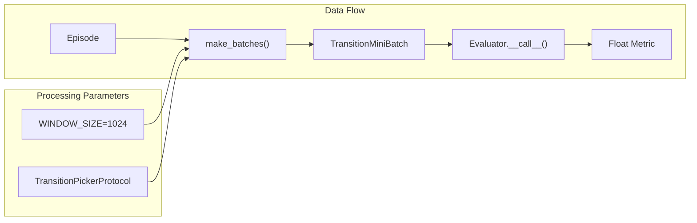
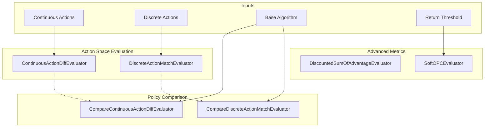
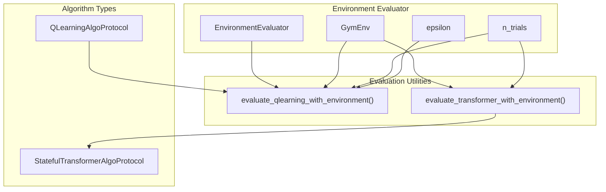

<!-- source: DeepWiki mcp.deepwiki.com · repo takuseno/d3rlpy · page 8.1 Metrics and Evaluation · fetched 2026-10-30 -->

# Metrics and Evaluation

<details>
<summary>Relevant source files</summary>

The following files were used as context for generating this wiki page:

- [d3rlpy/algos/transformer/inputs.py](d3rlpy/algos/transformer/inputs.py)
- [d3rlpy/metrics/evaluators.py](d3rlpy/metrics/evaluators.py)
- [d3rlpy/metrics/utility.py](d3rlpy/metrics/utility.py)
- [docs/references/metrics.rst](docs/references/metrics.rst)
- [tests/algos/transformer/test_inputs.py](tests/algos/transformer/test_inputs.py)
- [tests/dummy_env.py](tests/dummy_env.py)
- [tests/envs/test_wrappers.py](tests/envs/test_wrappers.py)
- [tests/metrics/test_evaluators.py](tests/metrics/test_evaluators.py)
- [tests/metrics/test_utility.py](tests/metrics/test_utility.py)

</details>


This document covers d3rlpy's metrics and evaluation system, which provides tools for assessing the performance of reinforcement learning algorithms both on offline datasets and in online environments. The system includes protocol-based evaluators, offline metrics for dataset analysis, and online evaluation utilities for environment interaction.

For information about logging and experiment tracking of these metrics, see [Logging and Experiment Tracking](#8.2).

## Evaluation Architecture

The d3rlpy evaluation system is built around a protocol-based architecture that defines a common interface for all evaluation metrics.

### Evaluation Protocol

```mermaid
graph TB
    subgraph "Protocol Layer"
        EP["EvaluatorProtocol"]
    end
    
    subgraph "Offline Evaluators"
        TDE["TDErrorEvaluator"]
        DSOA["DiscountedSumOfAdvantageEvaluator"] 
        AVE["AverageValueEstimationEvaluator"]
        ISVE["InitialStateValueEstimationEvaluator"]
        SOPC["SoftOPCEvaluator"]
        CAD["ContinuousActionDiffEvaluator"]
        DAM["DiscreteActionMatchEvaluator"]
        CCAD["CompareContinuousActionDiffEvaluator"]
        CDAM["CompareDiscreteActionMatchEvaluator"]
    end
    
    subgraph "Online Evaluators"
        ENV["EnvironmentEvaluator"]
    end
    
    subgraph "Input Types"
        ALG["QLearningAlgoProtocol"]
        DS["ReplayBufferBase"]
        GYMENV["GymEnv"]
    end
    
    EP --> TDE
    EP --> DSOA
    EP --> AVE
    EP --> ISVE
    EP --> SOPC
    EP --> CAD
    EP --> DAM
    EP --> CCAD
    EP --> CDAM
    EP --> ENV
    
    ALG --> TDE
    ALG --> ENV
    DS --> TDE
    GYMENV --> ENV
    
    style EP fill:#f9f9f9
    style ENV fill:#e8f5e8
```



All evaluators implement the `EvaluatorProtocol` which defines a callable interface taking an algorithm and dataset, returning a float metric value.

Sources: [d3rlpy/metrics/evaluators.py:34-49]()

### Evaluation Data Processing

The evaluation system processes episode data in batches to handle memory constraints and provide efficient computation.



The `make_batches` function splits episodes into manageable chunks, creating `TransitionMiniBatch` objects for evaluation.

Sources: [d3rlpy/metrics/evaluators.py:52-68](), [d3rlpy/metrics/evaluators.py:31]()

## Offline Evaluation Metrics

Offline metrics evaluate algorithm performance using pre-collected datasets without environment interaction.

### Value Function Analysis

| Evaluator | Purpose | Mathematical Formula |
|-----------|---------|---------------------|
| `TDErrorEvaluator` | Measures Q-function overfitting | $\mathbb{E}[(Q_\theta(s_t, a_t) - r_{t+1} - \gamma \max_a Q_\theta(s_{t+1}, a))^2]$ |
| `AverageValueEstimationEvaluator` | Assesses value estimation scale | $\mathbb{E}[\max_a Q_\theta(s_t, a)]$ |
| `InitialStateValueEstimationEvaluator` | Estimates policy performance from initial states | $\mathbb{E}[Q(s_0, \pi(s_0))]$ |

Sources: [d3rlpy/metrics/evaluators.py:71-121](), [d3rlpy/metrics/evaluators.py:191-227](), [d3rlpy/metrics/evaluators.py:229-271]()

### Policy Analysis 



Policy evaluators assess how well learned policies match dataset actions or compare against baseline policies.

Sources: [d3rlpy/metrics/evaluators.py:330-407](), [d3rlpy/metrics/evaluators.py:409-503]()

### Advanced Offline Metrics

The `DiscountedSumOfAdvantageEvaluator` computes the discounted sum of advantages to measure policy quality in action-value space:

$$\mathbb{E}_{s_t, a_t \sim D}[\sum_{t' = t} \gamma^{t' - t} A(s_{t'}, a_{t'})]$$

where $A(s_t, a_t) = Q_\theta (s_t, a_t) - \mathbb{E}_{a \sim \pi} [Q_\theta (s_t, a)]$

The `SoftOPCEvaluator` measures the gap between successful and all episodes:

$$\mathbb{E}_{s, a \sim D_{success}} [Q(s, a)] - \mathbb{E}_{s, a \sim D} [Q(s, a)]$$

Sources: [d3rlpy/metrics/evaluators.py:124-188](), [d3rlpy/metrics/evaluators.py:274-327]()

## Online Environment Evaluation

Online evaluation assesses algorithm performance through direct environment interaction.

### Environment Evaluation System



The `EnvironmentEvaluator` wraps utility functions to provide environment-based evaluation within the evaluator protocol framework.

Sources: [d3rlpy/metrics/evaluators.py:506-548](), [d3rlpy/metrics/utility.py:12-71]()

### Environment Evaluation Process

The evaluation utilities execute episodes in the environment using the trained policy:

1. **Episode Execution**: Run multiple trials with the learned policy
2. **Action Selection**: Use policy predictions with optional epsilon-greedy exploration
3. **Reward Accumulation**: Sum rewards over complete episodes
4. **Statistical Summary**: Return mean episode return across trials

For Q-learning algorithms, the process supports epsilon-greedy exploration. For transformer algorithms, it maintains episode state and provides sequential rewards.

Sources: [d3rlpy/metrics/utility.py:42-71](), [d3rlpy/metrics/utility.py:74-120]()

## Usage Patterns

### Integration with Algorithm Training

Evaluators are typically used during algorithm training to monitor performance:

```python
# Example from documentation
evaluators = {
    'td_error': d3rlpy.metrics.TDErrorEvaluator(test_episodes),
    'value_scale': d3rlpy.metrics.AverageValueEstimationEvaluator(test_episodes),
    'environment': d3rlpy.metrics.EnvironmentEvaluator(env),
}

dqn.fit(dataset, n_steps=100000, evaluators=evaluators)
```

### Custom Evaluator Implementation

Users can implement custom evaluators by following the `EvaluatorProtocol`:

```python
class CustomEvaluator(d3rlpy.metrics.EvaluatorProtocol):
    def __call__(self, algo: QLearningAlgoBase, dataset: ReplayBuffer) -> float:
        # Custom evaluation logic
        return metric_value
```

Sources: [docs/references/metrics.rst:10-38]()

### Batch Processing Configuration

Evaluators use a fixed `WINDOW_SIZE` of 1024 transitions per batch to balance memory usage and computational efficiency. This batching approach allows evaluation on large datasets without memory constraints.

Sources: [d3rlpy/metrics/evaluators.py:31](), [d3rlpy/metrics/evaluators.py:57-62]()

---

