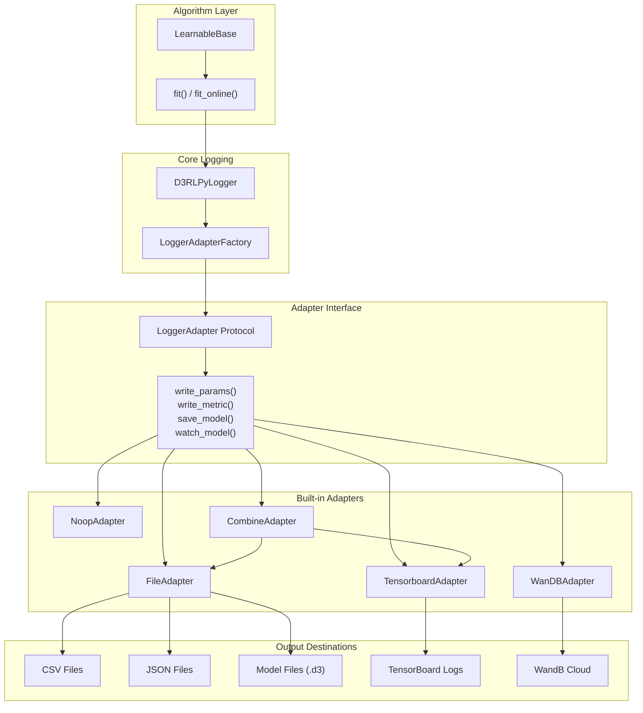
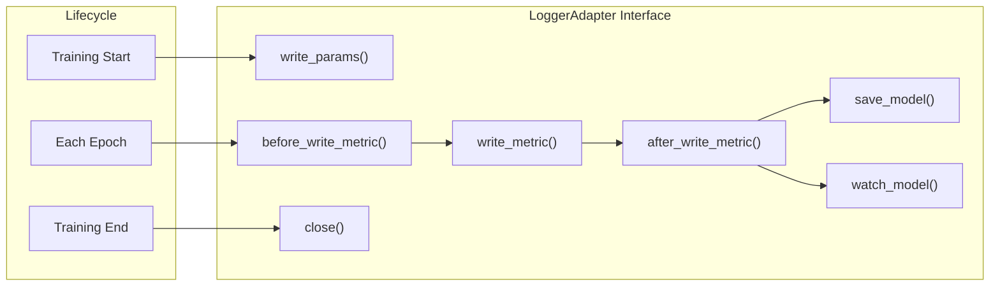
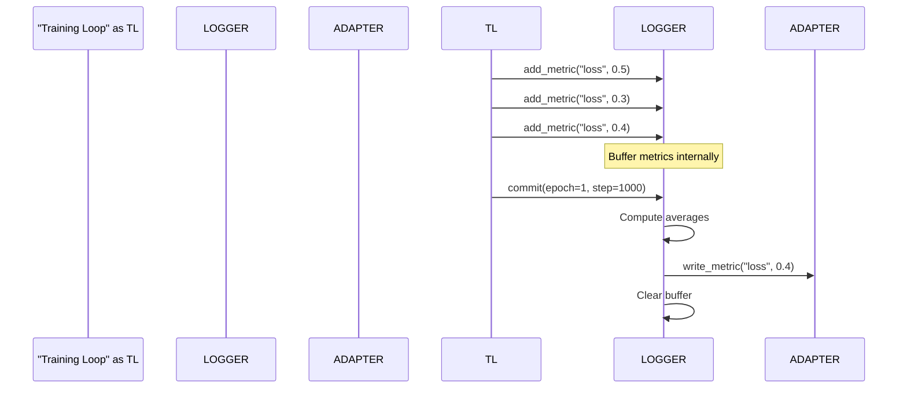
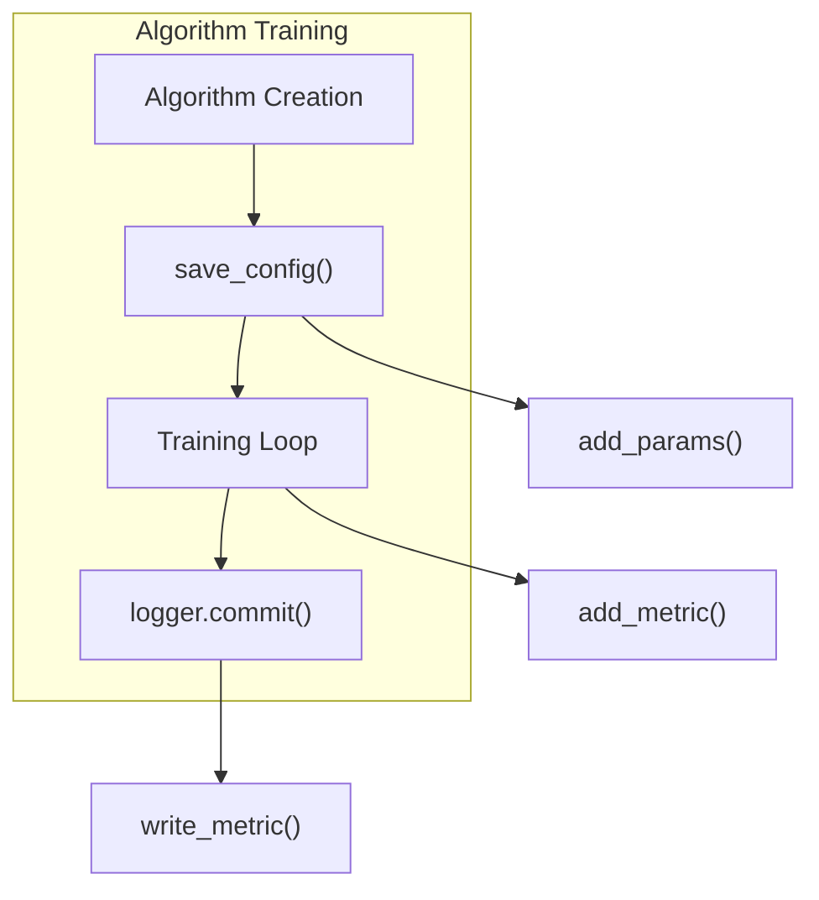

<!-- source: DeepWiki mcp.deepwiki.com · repo takuseno/d3rlpy · page 8.2 Logging and Experiment Tracking · fetched 2026-10-30 -->

# Logging and Experiment Tracking

<details>
<summary>Relevant source files</summary>

The following files were used as context for generating this wiki page:

- [d3rlpy/base.py](d3rlpy/base.py)
- [d3rlpy/logging/file_adapter.py](d3rlpy/logging/file_adapter.py)
- [d3rlpy/logging/logger.py](d3rlpy/logging/logger.py)
- [d3rlpy/logging/noop_adapter.py](d3rlpy/logging/noop_adapter.py)
- [d3rlpy/logging/tensorboard_adapter.py](d3rlpy/logging/tensorboard_adapter.py)
- [d3rlpy/logging/utils.py](d3rlpy/logging/utils.py)
- [d3rlpy/logging/wandb_adapter.py](d3rlpy/logging/wandb_adapter.py)
- [docs/references/logging.rst](docs/references/logging.rst)
- [tests/logging/test_logger.py](tests/logging/test_logger.py)

</details>


This document covers d3rlpy's logging and experiment tracking system, which provides a flexible adapter-based architecture for recording training metrics, hyperparameters, and model checkpoints. The system supports multiple backends including file-based logging, TensorBoard, and Weights & Biases integration.

For information about training metrics and evaluation protocols, see [Metrics and Evaluation](#8.1).

## System Architecture

The logging system uses the adapter pattern to support multiple logging backends through a unified interface. The core `D3RLPyLogger` class coordinates with various `LoggerAdapter` implementations to handle different output formats and services.

### Logging Architecture Overview



**Sources:** [d3rlpy/logging/logger.py:143-218](), [d3rlpy/base.py:139-149](), [d3rlpy/logging/utils.py:13-84]()

## Core Components

### D3RLPyLogger

The `D3RLPyLogger` class serves as the primary interface between algorithms and logging backends. It manages metric buffering, experiment naming, and adapter coordination.

| Method | Purpose | Usage |
|--------|---------|-------|
| `add_params()` | Log hyperparameters | Called once at training start |
| `add_metric()` | Buffer metric values | Called during training steps |
| `commit()` | Flush metrics to adapters | Called at epoch boundaries |
| `save_model()` | Save model checkpoints | Called periodically during training |
| `measure_time()` | Context manager for timing | Used around code blocks |

**Sources:** [d3rlpy/logging/logger.py:143-218]()

### LoggerAdapter Protocol

The `LoggerAdapter` protocol defines the interface that all logging backends must implement:



**Sources:** [d3rlpy/logging/logger.py:61-122]()

### LoggerAdapterFactory

Factory classes create `LoggerAdapter` instances with specific configurations. This pattern allows for lazy initialization and parameter customization.

**Sources:** [d3rlpy/logging/logger.py:123-141]()

## Built-in Adapters

### FileAdapter

The `FileAdapter` saves metrics as CSV files, hyperparameters as JSON, and models as `.d3` files in a specified directory structure.

| Output | Format | Filename Pattern |
|--------|--------|------------------|
| Hyperparameters | JSON | `params.json` |
| Metrics | CSV | `{metric_name}.csv` |
| Models | Binary | `model_{epoch}.d3` |
| Gradients | CSV | `{param_name}_grad.csv` |

**Sources:** [d3rlpy/logging/file_adapter.py:32-143]()

### TensorboardAdapter

The `TensorboardAdapter` integrates with TensorBoard for visualization using the `tensorboardX` library. It logs metrics as scalars and gradient histograms.

**Sources:** [d3rlpy/logging/tensorboard_adapter.py:16-102]()

### WanDBAdapter

The `WanDBAdapter` provides integration with Weights & Biases cloud platform, including automatic model watching and gradient tracking.

**Sources:** [d3rlpy/logging/wandb_adapter.py:13-105]()

### CombineAdapter

The `CombineAdapter` enables simultaneous logging to multiple backends by forwarding all calls to a list of underlying adapters.

**Sources:** [d3rlpy/logging/utils.py:13-84]()

## Usage Patterns

### Basic File Logging

```python
import d3rlpy

# Create algorithm
dqn = d3rlpy.algos.DQNConfig().create()

# Train with file logging
dqn.fit(
    dataset=dataset,
    n_steps=100000,
    logger_adapter=d3rlpy.logging.FileAdapterFactory(root_dir="logs")
)
```

### Multiple Loggers

```python
# Combine file and TensorBoard logging
logger_adapter = d3rlpy.logging.CombineAdapterFactory([
    d3rlpy.logging.FileAdapterFactory(root_dir="logs"),
    d3rlpy.logging.TensorboardAdapterFactory(root_dir="tensorboard")
])

dqn.fit(dataset=dataset, n_steps=100000, logger_adapter=logger_adapter)
```

**Sources:** [docs/references/logging.rst:10-37]()

## Implementation Details

### Custom Adapter Development

To create custom logging adapters, implement the `LoggerAdapter` protocol:

```python
class CustomAdapter(d3rlpy.logging.LoggerAdapter):
    def write_params(self, params: dict[str, Any]) -> None:
        # Save hyperparameters
        pass
    
    def write_metric(self, epoch: int, step: int, name: str, value: float) -> None:
        # Log individual metrics
        pass
    
    def save_model(self, epoch: int, algo: SaveProtocol) -> None:
        # Save model checkpoints
        pass
    
    # Implement other required methods...
```

**Sources:** [docs/references/logging.rst:46-73]()

### Metric Buffering and Aggregation

The `D3RLPyLogger` buffers metrics during training and computes averages before writing:



**Sources:** [d3rlpy/logging/logger.py:172-198]()

### Integration with Algorithm Base

The logging system integrates with algorithm training through the `save_config` function and training loops:



**Sources:** [d3rlpy/base.py:139-149](), [tests/logging/test_logger.py:75-120]()

---

