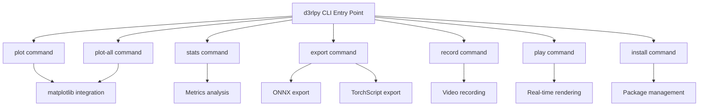
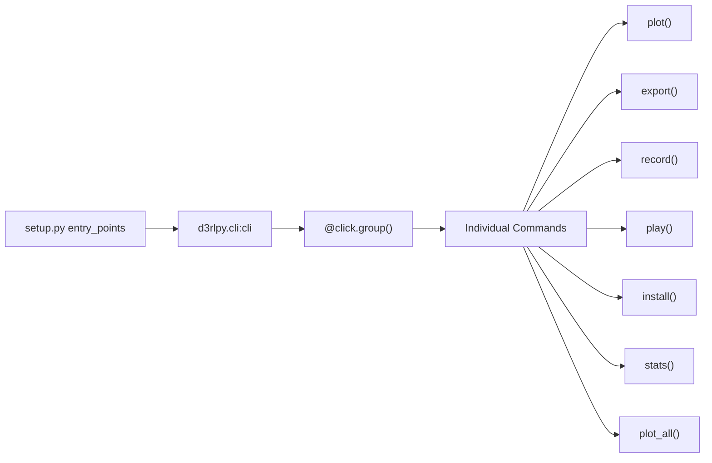
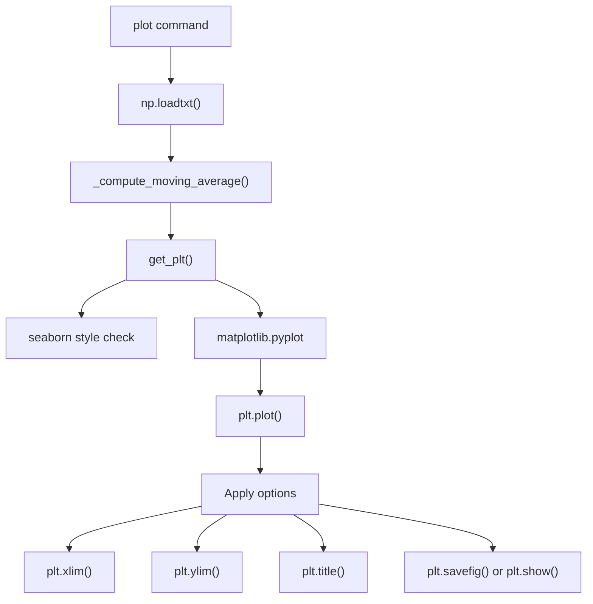
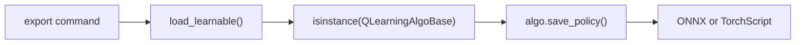
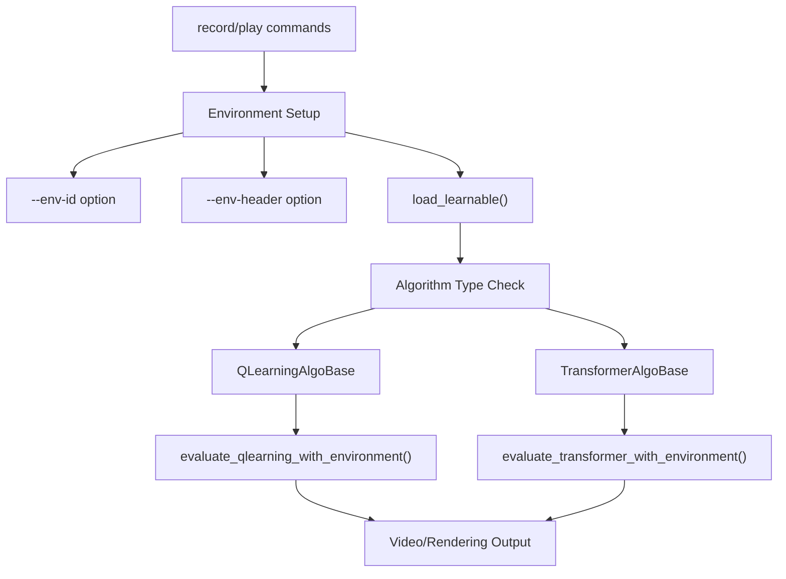
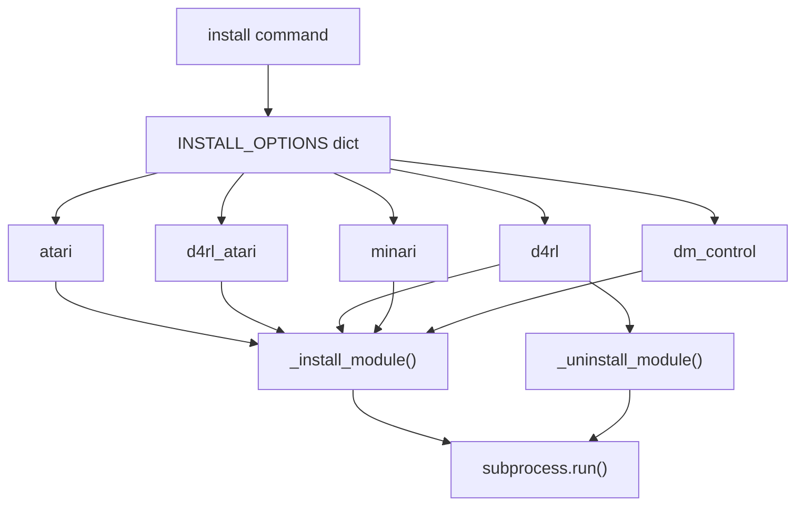
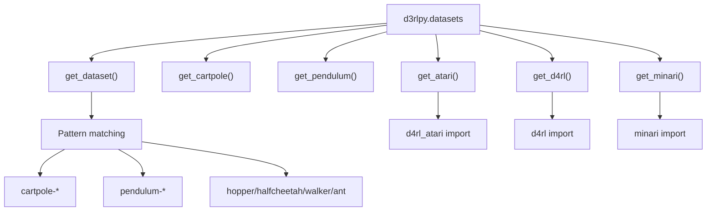
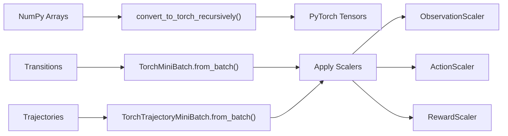
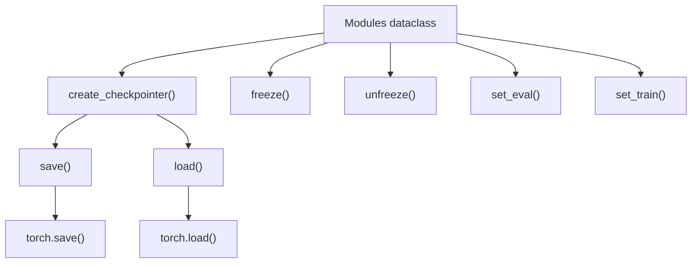
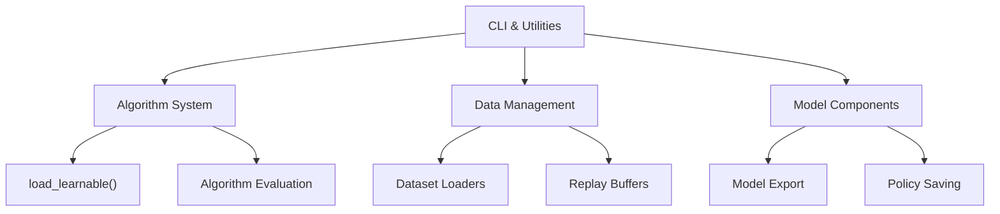

<!-- source: DeepWiki mcp.deepwiki.com · repo takuseno/d3rlpy · page 9 CLI and Utilities · fetched 2026-10-30 -->

# CLI and Utilities

Relevant source files

The following files were used as context for generating this wiki page:

- [d3rlpy/__init__.py](d3rlpy/__init__.py)
- [d3rlpy/cli.py](d3rlpy/cli.py)
- [d3rlpy/dataset/components.py](d3rlpy/dataset/components.py)
- [d3rlpy/dataset/mini_batch.py](d3rlpy/dataset/mini_batch.py)
- [d3rlpy/dataset/transition_pickers.py](d3rlpy/dataset/transition_pickers.py)
- [d3rlpy/datasets.py](d3rlpy/datasets.py)
- [d3rlpy/envs/wrappers.py](d3rlpy/envs/wrappers.py)
- [d3rlpy/ope/torch/fqe_impl.py](d3rlpy/ope/torch/fqe_impl.py)
- [d3rlpy/torch_utility.py](d3rlpy/torch_utility.py)
- [docs/cli.rst](docs/cli.rst)
- [examples/custom_algo.py](examples/custom_algo.py)
- [examples/deepmind_control.py](examples/deepmind_control.py)
- [mypy.ini](mypy.ini)
- [requirements.txt](requirements.txt)
- [setup.py](setup.py)
- [tests/algos/qlearning/algo_test.py](tests/algos/qlearning/algo_test.py)
- [tests/dataset/test_components.py](tests/dataset/test_components.py)
- [tests/dataset/test_mini_batch.py](tests/dataset/test_mini_batch.py)
- [tests/dataset/test_transition_pickers.py](tests/dataset/test_transition_pickers.py)
- [tests/test_datasets.py](tests/test_datasets.py)
- [tests/test_torch_utility.py](tests/test_torch_utility.py)
- [tests/testing_utils.py](tests/testing_utils.py)

This page covers the command-line interface (CLI) tools and utility functions provided by d3rlpy. The CLI enables users to interact with trained models, visualize training metrics, manage datasets, and install optional dependencies without writing Python code. The utilities provide supporting functions for data processing, model export, and package management.

For information about the core algorithm framework, see [Algorithm System](#5). For data processing pipelines, see [Data Management](#6).

## CLI Architecture

The d3rlpy CLI is built using the Click library and provides a unified entry point for various utility functions. The CLI commands are organized around common workflows like plotting metrics, evaluating models, and managing dependencies.

**CLI Command Flow**
Sources: [d3rlpy/cli.py:61-402](), [setup.py:51]()

## CLI Entry Point and Command Structure

The CLI is registered as a console script in the package setup and uses Click's group functionality to organize commands.

**CLI Module Structure**
Sources: [setup.py:51](), [d3rlpy/cli.py:61-64]()

The CLI entry point is defined in [setup.py:51]() as `"d3rlpy=d3rlpy.cli:cli"`, which maps the `d3rlpy` command to the `cli` function in [d3rlpy/cli.py:61-64]().

## Plotting and Visualization Commands

The CLI provides comprehensive plotting capabilities for analyzing training metrics and experiment results.

| Command | Purpose | Key Options |
|---------|---------|-------------|
| `plot` | Plot individual metric files | `--window`, `--show-steps`, `--save` |
| `plot-all` | Plot all metrics in a directory | `--title`, `--save` |
| `stats` | Show metric statistics | None |

### Plot Command Implementation

**Plot Command Flow**
Sources: [d3rlpy/cli.py:72-161](), [d3rlpy/cli.py:38-58]()

The plotting functions use [d3rlpy/cli.py:51-58]() for moving average computation and [d3rlpy/cli.py:38-48]() for matplotlib setup with optional seaborn styling.

## Model Export and Evaluation Commands

These commands enable model deployment and evaluation workflows.

### Export Command

The `export` command converts trained d3rlpy models to inference-ready formats:

**Model Export Flow**
Sources: [d3rlpy/cli.py:213-231]()

### Record and Play Commands

Both commands support model evaluation with different output modes:

**Evaluation Commands Flow**
Sources: [d3rlpy/cli.py:242-351](), [d3rlpy/cli.py:233-240]()

The environment creation function [d3rlpy/cli.py:233-240]() enables flexible environment setup through code execution.

## Package Management Utilities

The `install` command provides streamlined installation of optional dependencies.

**Package Installation Flow**
Sources: [d3rlpy/cli.py:364-402](), [d3rlpy/cli.py:353-362]()

The package management system uses [d3rlpy/cli.py:364-370]() to define available packages and their descriptions.

## Dataset Utilities

The dataset utilities provide functions for loading and managing various reinforcement learning datasets.

**Dataset Loading Architecture**
Sources: [d3rlpy/datasets.py:655-740](), [d3rlpy/datasets.py:35-48]()

The main dataset loading function [d3rlpy/datasets.py:655-740]() provides automatic dataset detection, while specialized loaders handle specific dataset types.

## Torch Utilities

The torch utilities provide essential functions for PyTorch operations and model management.

| Utility Category | Key Functions | Purpose |
|------------------|---------------|---------|
| Model Synchronization | `soft_sync`, `hard_sync` | Target network updates |
| Data Conversion | `convert_to_torch_recursively` | NumPy to PyTorch conversion |
| Batch Processing | `TorchMiniBatch`, `TorchTrajectoryMiniBatch` | Batched data handling |
| Model Management | `Modules`, `Checkpointer` | Model state management |

### Torch Data Processing Pipeline

**Torch Data Processing**
Sources: [d3rlpy/torch_utility.py:216-276](), [d3rlpy/torch_utility.py:302-340]()

### Model State Management

**Model Management Utilities**
Sources: [d3rlpy/torch_utility.py:442-484](), [d3rlpy/torch_utility.py:409-440]()

The `Modules` class [d3rlpy/torch_utility.py:442-484]() provides a unified interface for managing PyTorch modules and optimizers, while `Checkpointer` [d3rlpy/torch_utility.py:409-440]() handles serialization.

## Integration with Core Systems

The CLI and utilities integrate closely with d3rlpy's core systems:

**System Integration**
Sources: [d3rlpy/base.py:load_learnable](), [d3rlpy/datasets.py](), [d3rlpy/torch_utility.py]()

The utilities serve as the bridge between the command-line interface and d3rlpy's internal systems, enabling users to access core functionality through simple commands while maintaining the flexibility of the underlying Python API.

---

