# Page: Overview

# Overview

<details>
<summary>Relevant source files</summary>

The following files were used as context for generating this wiki page:

- [README.md](README.md)
- [ROADMAP.md](ROADMAP.md)
- [d3rlpy/_version.py](d3rlpy/_version.py)
- [d3rlpy/algos/__init__.py](d3rlpy/algos/__init__.py)
- [docker/Dockerfile](docker/Dockerfile)
- [docs/index.rst](docs/index.rst)
- [docs/installation.rst](docs/installation.rst)
- [docs/references/algos.rst](docs/references/algos.rst)
- [docs/requirements.txt](docs/requirements.txt)
- [scripts/build-docker](scripts/build-docker)

</details>


This document provides a high-level introduction to d3rlpy, covering its purpose, key features, and overall architecture. For specific algorithm implementations, see [Algorithm System](#5). For data handling details, see [Data Management](#6). For installation instructions, see [Installation and Setup](#2).

## Purpose and Scope

d3rlpy is an offline deep reinforcement learning library designed for practitioners and researchers. It provides state-of-the-art offline RL algorithms with intuitive APIs that require minimal deep learning expertise. The library supports both offline training from static datasets and online training with environment interaction.

The library's primary goals are:
- **Practical offline RL**: Enable powerful offline RL when online interaction is not feasible (e.g., robotics, medical applications)
- **User-friendly APIs**: Provide scikit-learn-style interfaces that abstract away deep learning complexity  
- **Beyond state-of-the-art performance**: Achieve superior results through distributional Q-functions and advanced optimization techniques
- **Scalability**: Support large-scale training with data-parallel distributed computing and GPU acceleration

Sources: [README.md:11-12](), [README.md:39-50](), [docs/index.rst:6-19]()

## Key Features

| Feature Category | Description | Key Benefits |
|-----------------|-------------|--------------|
| **Algorithm Support** | 25+ state-of-the-art algorithms including SAC, CQL, BCQ, Decision Transformer | Comprehensive coverage of offline and online RL methods |
| **Distributional Q-Functions** | First library to support distributional Q-functions across all algorithms | Enhanced performance and uncertainty estimation |
| **Data-Parallel Training** | Multi-GPU and multi-node distributed training support | Scalable training for large datasets |
| **Performance Optimization** | CudaGraph and `torch.compile` acceleration | Significant speedup in training and inference |
| **Flexible Data Support** | D4RL, Atari, Minari datasets plus custom data formats | Easy integration with existing datasets |

Sources: [README.md:37-50](), [README.md:88-112](), [README.md:114-117]()

## Overall Architecture

The d3rlpy architecture follows a layered design with clear separation of concerns:

### High-Level System Architecture

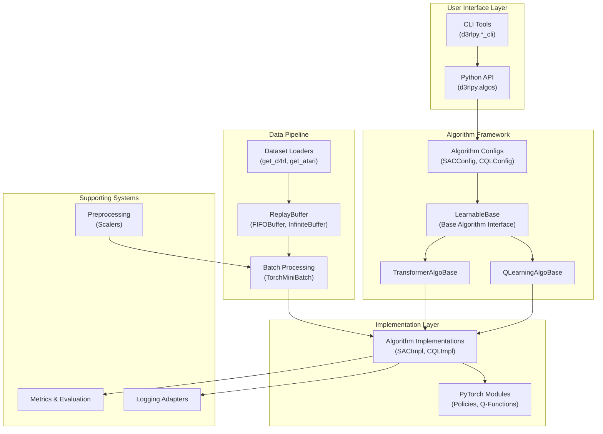

Sources: [README.md:13-29](), [docs/references/algos.rst:26-51](), [d3rlpy/algos/__init__.py:1-3]()

### Core Algorithm Framework

The algorithm framework implements a three-layer architecture that separates configuration, algorithm logic, and PyTorch implementation:

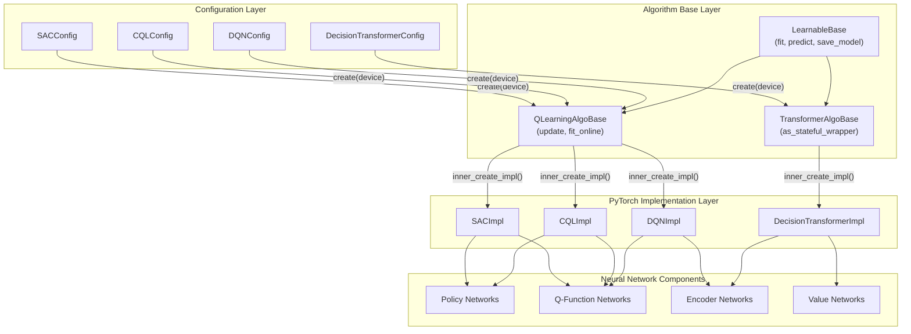

Sources: [docs/references/algos.rst:29-51](), [docs/references/algos.rst:390-407](), [README.md:18-19]()

## Supported Algorithms

d3rlpy provides comprehensive algorithm coverage across different RL paradigms:

### Algorithm Categories

| Category | Algorithms | Action Spaces |
|----------|------------|---------------|
| **Behavior Cloning** | BC, DiscreteBC | Discrete, Continuous |
| **Value-Based** | NFQ, DQN, DoubleDQN | Discrete |
| **Actor-Critic** | DDPG, TD3, SAC, DiscreteSAC | Both |
| **Offline RL** | BCQ, BEAR, CQL, AWAC, CRR, IQL, CalQL | Both |
| **Hybrid Methods** | PLAS, TD3+BC, PRDC, ReBRAC | Continuous |
| **Transformer-Based** | Decision Transformer, QDT, TACR | Both |

### Q-Function Support

d3rlpy is the first library to provide distributional Q-function support across all algorithms:
- Standard Q-function
- Quantile Regression
- Implicit Quantile Network (IQN)

Sources: [README.md:88-117](), [docs/references/algos.rst:54-462]()

## Data Processing Pipeline

The library implements a sophisticated data processing pipeline that handles various data sources and formats:

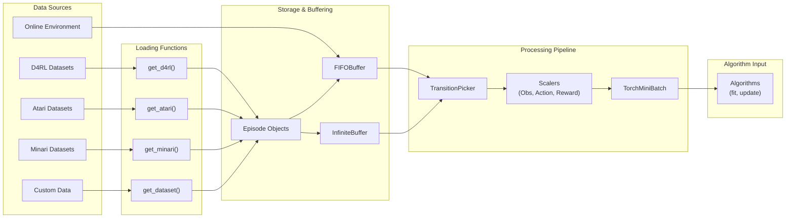

Sources: [README.md:131-143](), [README.md:150-173](), [README.md:16]()

## Usage Patterns

The library supports both offline and online training workflows through consistent APIs:

### Offline Training Example
```python
import d3rlpy

# Load dataset
dataset, env = d3rlpy.datasets.get_dataset("hopper-medium-v0")

# Configure algorithm
sac = d3rlpy.algos.SACConfig(compile_graph=True).create(device="cuda:0")

# Train offline
sac.fit(dataset, n_steps=1000000)
```

### Online Training Example  
```python
# Prepare environment and buffer
env = gym.make('Hopper-v3')
buffer = d3rlpy.dataset.create_fifo_replay_buffer(limit=1000000, env=env)

# Train online
sac.fit_online(env, buffer, n_steps=1000000)
```

### Prediction and Deployment
```python
# Make predictions
actions = sac.predict(observations)

# Save/load models
sac.save_model("model.d3")
sac = d3rlpy.load_learnable("model.d3")
```

Sources: [README.md:13-29](), [README.md:179-195]()

## Development and Ecosystem

d3rlpy includes comprehensive development infrastructure:

- **Testing**: Automated CI/CD with GitHub Actions
- **Documentation**: Full API documentation and tutorials
- **Containerization**: Docker images for reproducible environments  
- **Benchmarking**: Reproduction scripts and benchmark results
- **CLI Tools**: Command-line utilities for model management and evaluation

The library integrates with popular ML tools and frameworks:
- **Logging**: WandB, TensorBoard, file-based logging
- **Environments**: Gymnasium, D4RL, custom environments
- **Hardware**: CUDA acceleration, multi-GPU support

Sources: [README.md:82-86](), [README.md:120-122](), [README.md:197-203](), [docker/Dockerfile:1-42]()

---

# Page: Installation and Setup

# Installation and Setup

<details>
<summary>Relevant source files</summary>

The following files were used as context for generating this wiki page:

- [d3rlpy/__init__.py](d3rlpy/__init__.py)
- [d3rlpy/cli.py](d3rlpy/cli.py)
- [d3rlpy/datasets.py](d3rlpy/datasets.py)
- [d3rlpy/envs/wrappers.py](d3rlpy/envs/wrappers.py)
- [docker/Dockerfile](docker/Dockerfile)
- [docs/cli.rst](docs/cli.rst)
- [docs/index.rst](docs/index.rst)
- [docs/installation.rst](docs/installation.rst)
- [examples/custom_algo.py](examples/custom_algo.py)
- [examples/deepmind_control.py](examples/deepmind_control.py)
- [mypy.ini](mypy.ini)
- [requirements.txt](requirements.txt)
- [scripts/build-docker](scripts/build-docker)
- [setup.py](setup.py)
- [tests/test_datasets.py](tests/test_datasets.py)

</details>


This document covers the installation and setup procedures for d3rlpy, including dependency management, CLI configuration, and optional package installation. It focuses on the technical installation workflows and their underlying implementation.

For information about using d3rlpy after installation, see [Quick Start Tutorial](#3). For details about the CLI commands available after installation, see [CLI and Utilities](#9).

## Installation Methods Overview

D3rlpy supports multiple installation approaches, each implemented through different mechanisms in the codebase. The installation system is configured through several key files that define dependencies, entry points, and optional components.

### Installation Workflow Diagram

```mermaid
graph TD
    subgraph "Installation Methods"
        PIP["pip install d3rlpy"]
        CONDA["conda install -c conda-forge d3rlpy"]
        DOCKER["docker run takuseno/d3rlpy"]
        SOURCE["git clone + pip install -e ."]
    end
    
    subgraph "Core Setup Files"
        SETUP["setup.py"]
        REQ["requirements.txt"]
        DOCKERFILE["docker/Dockerfile"]
    end
    
    subgraph "Dependency Categories"
        CORE["Core Dependencies"]
        OPTIONAL["Optional Dependencies"]
        CLI_DEPS["CLI Dependencies"]
    end
    
    subgraph "Post-Installation"
        CLI_ENTRY["d3rlpy CLI command"]
        HEALTHCHECK["run_healthcheck()"]
        OPTIONAL_INSTALL["d3rlpy install <package>"]
    end
    
    PIP --> SETUP
    CONDA --> SETUP
    SOURCE --> SETUP
    DOCKER --> DOCKERFILE
    
    SETUP --> CORE
    SETUP --> CLI_DEPS
    REQ --> CORE
    
    SETUP --> CLI_ENTRY
    CLI_ENTRY --> OPTIONAL_INSTALL
    
    CORE --> HEALTHCHECK
    OPTIONAL_INSTALL --> OPTIONAL
    
    HEALTHCHECK --> "Ready to Use"
    OPTIONAL --> "Extended Functionality"
```

Sources: [setup.py:1-53](), [requirements.txt:1-11](), [docker/Dockerfile:1-43](), [d3rlpy/__init__.py:69-70]()

## Core Dependencies

The core dependencies are defined in `setup.py` and provide the essential functionality for d3rlpy's operation. These packages are automatically installed with any installation method.

| Package | Version Requirement | Purpose |
|---------|-------------------|----------|
| `torch` | `>=2.5.0` | PyTorch deep learning framework |
| `gymnasium` | `==1.0.0` | OpenAI Gym environment interface |
| `gym` | `>=0.26.0` | Legacy Gym compatibility |
| `tqdm` | `>=4.66.3` | Progress bars |
| `h5py` | No version specified | HDF5 file format support |
| `click` | No version specified | CLI framework |
| `structlog` | No version specified | Structured logging |
| `scikit-learn` | No version specified | Machine learning utilities |

Sources: [setup.py:35-47](), [requirements.txt:1-11]()

### Dependency Configuration Diagram

```mermaid
graph LR
    subgraph "setup.py Configuration"
        INSTALL_REQUIRES["install_requires"]
        PYTHON_REQUIRES["python_requires>=3.9.0"]
        ENTRY_POINTS["entry_points"]
    end
    
    subgraph "Core Dependencies"
        TORCH["torch>=2.5.0"]
        GYM_NEW["gymnasium==1.0.0"]
        GYM_OLD["gym>=0.26.0"]
        TQDM["tqdm>=4.66.3"]
        H5PY["h5py"]
        CLICK["click"]
        STRUCTLOG["structlog"]
        SKLEARN["scikit-learn"]
        OTHERS["colorama, typing-extensions, dataclasses-json"]
    end
    
    subgraph "CLI Entry Point"
        CLI_COMMAND["d3rlpy=d3rlpy.cli:cli"]
    end
    
    INSTALL_REQUIRES --> TORCH
    INSTALL_REQUIRES --> GYM_NEW
    INSTALL_REQUIRES --> GYM_OLD
    INSTALL_REQUIRES --> TQDM
    INSTALL_REQUIRES --> H5PY
    INSTALL_REQUIRES --> CLICK
    INSTALL_REQUIRES --> STRUCTLOG
    INSTALL_REQUIRES --> SKLEARN
    INSTALL_REQUIRES --> OTHERS
    
    ENTRY_POINTS --> CLI_COMMAND
    CLI_COMMAND --> "d3rlpy CLI available in PATH"
```

Sources: [setup.py:35-47](), [setup.py:49](), [setup.py:51]()

## PyPI Installation

The standard installation method uses PyPI and pip, configured through the `setup.py` file:

```bash
pip install d3rlpy
```

The setup configuration defines the package metadata, dependencies, and CLI entry points:

- **Package name**: `d3rlpy`
- **Python compatibility**: `>=3.9.0` 
- **Platform support**: Linux, macOS, Windows
- **CLI command**: `d3rlpy` (registered via `console_scripts`)

Sources: [setup.py:10-12](), [setup.py:49](), [setup.py:51](), [docs/installation.rst:16-18]()

## Conda Installation

D3rlpy is available through conda-forge:

```bash
conda install -c conda-forge d3rlpy
```

This method uses the same `setup.py` configuration but handles dependency resolution through conda's package manager.

Sources: [docs/installation.rst:23-25]()

## Docker Installation

The Docker setup provides a complete environment with all dependencies pre-installed. The configuration is defined in `docker/Dockerfile`:

### Docker Environment Specifications

- **Base image**: `pytorch/pytorch:2.5.1-cuda12.4-cudnn9-devel`
- **GPU support**: CUDA 12.4 with cuDNN 9
- **Pre-installed packages**: d4rl-atari, Cython
- **Exposed port**: 6006 (for TensorBoard)

```bash
docker run -it --gpus all --name d3rlpy takuseno/d3rlpy:latest bash
```

The Dockerfile installs d3rlpy from the GitHub master branch and includes additional system dependencies for rendering and scientific computing.

Sources: [docker/Dockerfile:1-43](), [docs/installation.rst:31-33]()

## Source Installation

For development or accessing the latest features, install from source:

```bash
git clone https://github.com/takuseno/d3rlpy
cd d3rlpy
pip install -e .
```

This method uses the same `setup.py` configuration but installs in editable mode, allowing modifications to take effect immediately.

Sources: [docs/installation.rst:41-45]()

## CLI Tool Setup

After installation, the `d3rlpy` command becomes available in the system PATH. The CLI is implemented through the Click framework and provides subcommands for various operations.

### CLI Command Structure

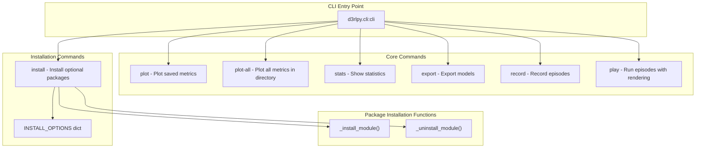

Sources: [d3rlpy/cli.py:61-63](), [d3rlpy/cli.py:373-401](), [setup.py:51]()

## Optional Package Installation

D3rlpy supports optional packages for extended functionality, installed through the CLI `install` command. The available packages are defined in the `INSTALL_OPTIONS` dictionary.

### Available Optional Packages

| Package | Description | Installation Command |
|---------|-------------|---------------------|
| `atari` | Atari 2600 environments for Gym | `d3rlpy install atari` |
| `d4rl_atari` | Datasets for Atari 2600 | `d3rlpy install d4rl_atari` |
| `d4rl` | D4RL benchmark datasets | `d3rlpy install d4rl` |
| `minari` | Minari dataset format | `d3rlpy install minari` |
| `dm_control` | DeepMind Control via Shimmy | `d3rlpy install dm_control` |

### Optional Package Installation Implementation

The installation system uses subprocess calls to pip for package management:

- **Installation function**: `_install_module()` in [d3rlpy/cli.py:353-357]()
- **Uninstallation function**: `_uninstall_module()` in [d3rlpy/cli.py:360-361]()
- **Package definitions**: `INSTALL_OPTIONS` dict in [d3rlpy/cli.py:364-370]()

Sources: [d3rlpy/cli.py:364-370](), [d3rlpy/cli.py:373-401](), [docs/cli.rst:138-152]()

### Optional Package Dependencies in Code

Several modules demonstrate conditional imports for optional packages:

```python
# d4rl-atari dependency check
try:
    import d4rl_atari  # type: ignore # noqa
    # ... d4rl-atari functionality
except ImportError as e:
    raise ImportError(
        "d4rl-atari is not installed.\n" "$ d3rlpy install d4rl_atari"
    ) from e
```

Sources: [d3rlpy/datasets.py:221-263](), [d3rlpy/datasets.py:417-462](), [d3rlpy/datasets.py:495-586]()

## Post-Installation Verification

After installation, d3rlpy runs an automatic health check to verify the setup. This process is implemented in the package initialization:

### Health Check Process

1. **Automatic execution**: Triggered during package import
2. **Implementation**: `run_healthcheck()` function
3. **GPU optimization**: Enables autograd compilation if CUDA is available
4. **Environment registration**: Registers Shimmy environments if available

```python
# run healthcheck
run_healthcheck()

if torch.cuda.is_available():
    # enable autograd compilation
    torch._dynamo.config.compiled_autograd = True
    torch.set_float32_matmul_precision("high")

# register Shimmy if available
try:
    import shimmy
    gymnasium.register_envs(shimmy)
    logging.LOG.info("Register Shimmy environments.")
except ImportError:
    pass
```

Sources: [d3rlpy/__init__.py:69-84](), [d3rlpy/healthcheck.py]()

## Environment Configuration

D3rlpy automatically configures various aspects of the runtime environment during initialization:

### Configuration Steps

1. **Random seed utilities**: Available via `d3rlpy.seed()` function
2. **GPU optimization**: Automatic PyTorch optimizations for CUDA
3. **Environment registration**: Optional Shimmy integration
4. **Type checking**: MyPy configuration for development

The MyPy configuration in `mypy.ini` defines strict type checking rules and handles imports for optional dependencies.

Sources: [d3rlpy/__init__.py:56-67](), [d3rlpy/__init__.py:72-84](), [mypy.ini:1-77]()

---

# Page: Quick Start Tutorial

# Quick Start Tutorial

<details>
<summary>Relevant source files</summary>

The following files were used as context for generating this wiki page:

- [README.md](README.md)
- [ROADMAP.md](ROADMAP.md)
- [d3rlpy/algos/__init__.py](d3rlpy/algos/__init__.py)
- [d3rlpy/notebook_utils.py](d3rlpy/notebook_utils.py)
- [docs/notebooks.rst](docs/notebooks.rst)
- [docs/references/algos.rst](docs/references/algos.rst)
- [docs/requirements.txt](docs/requirements.txt)
- [tutorials/atari.ipynb](tutorials/atari.ipynb)
- [tutorials/cartpole.ipynb](tutorials/cartpole.ipynb)
- [tutorials/online.ipynb](tutorials/online.ipynb)
- [tutorials/tpu.ipynb](tutorials/tpu.ipynb)

</details>


This document provides hands-on examples demonstrating the core workflows of d3rlpy for both offline and online reinforcement learning. It covers the essential steps from dataset loading to algorithm training and evaluation, with practical examples for continuous and discrete control tasks.

For comprehensive algorithm details, see [Algorithm System](#5). For data management concepts, see [Data Management](#6). For installation instructions, see [Installation and Setup](#2).

## Overview

d3rlpy follows a consistent pattern across all algorithms and domains:

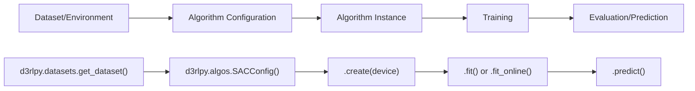

**Core Workflow Components**
- **Configuration**: Algorithm parameters defined via config classes
- **Creation**: Algorithm instances created with device specification
- **Training**: Offline training via `fit()` or online training via `fit_online()`
- **Inference**: Action prediction via `predict()`

Sources: [README.md:13-29](), [docs/references/algos.rst:11-21]()

## Offline Reinforcement Learning

### Continuous Control Example

This example demonstrates offline RL with continuous control using the SAC algorithm on D4RL datasets:

```python
import d3rlpy

# Load dataset and environment
dataset, env = d3rlpy.datasets.get_dataset("hopper-medium-v0")

# Configure algorithm
sac = d3rlpy.algos.SACConfig(compile_graph=True).create(device="cuda:0")

# Train offline
sac.fit(dataset, n_steps=1000000)

# Evaluate
actions = sac.predict(observations)
```

**Key Components**:
- `d3rlpy.datasets.get_dataset()`: Loads D4RL datasets
- `SACConfig`: Configuration class for Soft Actor-Critic
- `compile_graph=True`: Enables PyTorch compilation for speed
- `fit()`: Offline training method

Sources: [README.md:16-22](), [README.md:132-143]()

### Discrete Control Example

For discrete action spaces like Atari games, use discrete algorithm variants:

```python
import d3rlpy

# Load Atari dataset
dataset, env = d3rlpy.datasets.get_atari_transitions(
    'breakout',
    fraction=0.01,
    num_stack=4,
)

# Configure discrete CQL algorithm
cql = d3rlpy.algos.DiscreteCQLConfig(
    observation_scaler=d3rlpy.preprocessing.PixelObservationScaler(),
    reward_scaler=d3rlpy.preprocessing.ClipRewardScaler(-1.0, 1.0),
    compile_graph=True,
).create(device='cuda:0')

# Train with environment evaluation
cql.fit(
    dataset,
    n_steps=1000000,
    evaluators={"environment": d3rlpy.metrics.EnvironmentEvaluator(env, epsilon=0.001)},
)
```

**Key Components**:
- `get_atari_transitions()`: Loads Atari datasets with frame stacking
- `DiscreteCQLConfig`: CQL variant for discrete actions
- `PixelObservationScaler`: Preprocesses image observations
- `EnvironmentEvaluator`: Evaluates policy during training

Sources: [README.md:154-173](), [tutorials/atari.ipynb:35-77]()

## Online Reinforcement Learning

### Basic Online Training

Online RL requires environment interaction and replay buffer management:

```python
import d3rlpy
import gym

# Create environments
env = gym.make('Hopper-v3')
eval_env = gym.make('Hopper-v3')

# Configure algorithm
sac = d3rlpy.algos.SACConfig(compile_graph=True).create(device='cuda:0')

# Create replay buffer
buffer = d3rlpy.dataset.create_fifo_replay_buffer(limit=1000000, env=env)

# Train online
sac.fit_online(env, buffer, n_steps=1000000, eval_env=eval_env)
```

**Online Training Components**:
- `create_fifo_replay_buffer()`: Creates FIFO replay buffer
- `fit_online()`: Online training method with environment interaction
- `eval_env`: Separate environment for evaluation

Sources: [README.md:183-195]()

### Online Training with Exploration

For value-based methods, specify exploration strategy:

```python
import d3rlpy
import gym

# Setup environment
env = gym.make('CartPole-v1')
eval_env = gym.make('CartPole-v1')

# Configure DQN algorithm
dqn = d3rlpy.algos.DQNConfig(
    learning_rate=1e-3,
    target_update_interval=100,
).create(device='cuda:0')

# Setup exploration strategy
explorer = d3rlpy.algos.ConstantEpsilonGreedy(epsilon=0.3)

# Setup replay buffer
buffer = d3rlpy.dataset.create_fifo_replay_buffer(limit=50000, env=env)

# Train online with exploration
dqn.fit_online(
    env,
    buffer,
    explorer,
    eval_env=eval_env,
    n_steps=50000,
    n_steps_per_epoch=10000,
)
```

**Exploration Components**:
- `ConstantEpsilonGreedy`: Epsilon-greedy exploration strategy
- `explorer` parameter: Required for value-based online algorithms
- `target_update_interval`: Q-network target update frequency

Sources: [tutorials/online.ipynb:71-91]()

## Training Configuration

### Device Selection

All algorithms support CPU, GPU, and TPU devices:

```python
# CPU training
algo = d3rlpy.algos.SACConfig().create(device="cpu:0")

# GPU training
algo = d3rlpy.algos.SACConfig().create(device="cuda:0")

# Multi-GPU (second GPU)
algo = d3rlpy.algos.SACConfig().create(device="cuda:1")

# TPU training (requires torch_xla)
import torch_xla.core.xla_model as xm
device = xm.xla_device()
algo = d3rlpy.algos.SACConfig().create(device=str(device))
```

Sources: [docs/references/algos.rst:16-20](), [tutorials/tpu.ipynb:84-89]()

### Training Monitoring

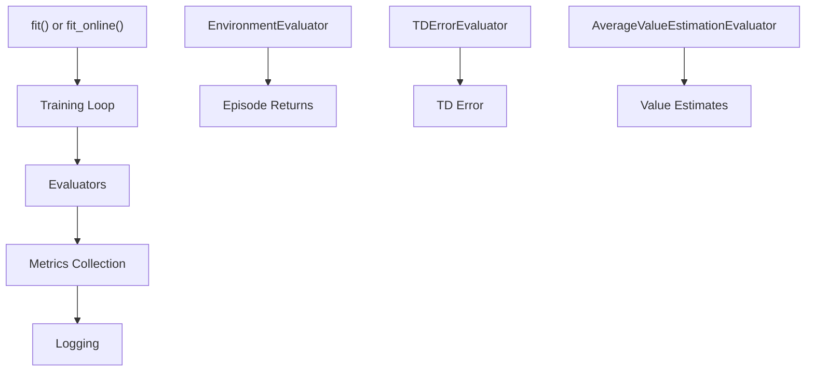

**Evaluator Usage**:
```python
# Environment evaluation
env_evaluator = d3rlpy.metrics.EnvironmentEvaluator(env)

# Multiple evaluators
evaluators = {
    "environment": d3rlpy.metrics.EnvironmentEvaluator(env),
    "td_error": d3rlpy.metrics.TDErrorEvaluator(),
}

algo.fit(dataset, evaluators=evaluators)
```

Sources: [tutorials/cartpole.ipynb:76-79](), [README.md:141-142]()

## Algorithm Selection Guide

| Task Type | Recommended Algorithms | Configuration Classes |
|-----------|----------------------|---------------------|
| Continuous Offline | CQL, SAC, IQL | `CQLConfig`, `SACConfig`, `IQLConfig` |
| Discrete Offline | DiscreteCQL, DiscreteSAC | `DiscreteCQLConfig`, `DiscreteSACConfig` |
| Continuous Online | SAC, TD3, DDPG | `SACConfig`, `TD3Config`, `DDPGConfig` |
| Discrete Online | DQN, DoubleDQN | `DQNConfig`, `DoubleDQNConfig` |
| Sequential Decision | DecisionTransformer | `DecisionTransformerConfig` |

Sources: [README.md:88-112]()

## Next Steps

After completing these basic examples:

1. **Advanced Algorithms**: Explore specialized algorithms in [Algorithm Implementations](#5.3)
2. **Data Processing**: Learn about preprocessing and data management in [Data Management](#6)
3. **Model Customization**: Understand neural network components in [Model Components](#7)
4. **Evaluation Metrics**: Study comprehensive evaluation in [Training and Evaluation](#8)
5. **Production Deployment**: See CLI tools and utilities in [CLI and Utilities](#9)

The [tutorials directory](https://github.com/takuseno/d3rlpy/tree/master/tutorials) contains interactive Jupyter notebooks for hands-on experimentation.

Sources: [README.md:198-203](), [docs/notebooks.rst:4-7]()

---

# Page: Core Architecture

# Core Architecture

<details>
<summary>Relevant source files</summary>

The following files were used as context for generating this wiki page:

- [d3rlpy/base.py](d3rlpy/base.py)
- [docs/references/logging.rst](docs/references/logging.rst)
- [tests/base_test.py](tests/base_test.py)

</details>


This document explains the foundational design patterns and base classes that underpin all d3rlpy algorithms. The core architecture provides a three-layer abstraction that separates configuration, algorithm logic, and PyTorch implementation details.

For comprehensive coverage of the algorithm framework that builds on these foundations, see [Algorithm System](#5). For details about the neural network components used in implementations, see [Model Components](#7).

## Architectural Overview

The d3rlpy architecture follows a consistent three-layer pattern that separates concerns between configuration, algorithm lifecycle management, and PyTorch implementation details.

### Core Architecture Layers

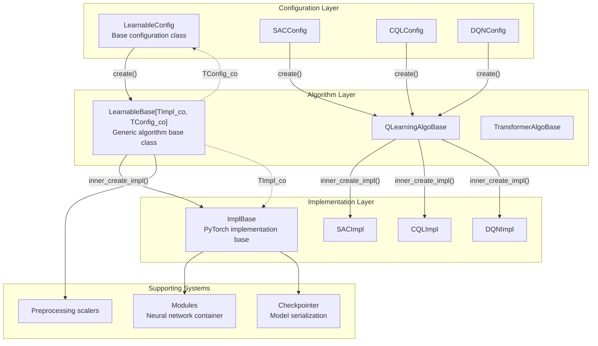

**Sources:** [d3rlpy/base.py:47-88](), [d3rlpy/base.py:207-231](), [d3rlpy/base.py:90-117]()

## Configuration Layer

The configuration layer uses dataclasses to define algorithm parameters and provides factory methods for creating algorithm instances.

### LearnableConfig Base Class

The `LearnableConfig` class serves as the base for all algorithm configurations, providing common parameters and the creation interface.

| Property | Type | Default | Purpose |
|----------|------|---------|---------|
| `batch_size` | `int` | 256 | Training batch size |
| `gamma` | `float` | 0.99 | Discount factor |
| `observation_scaler` | `Optional[ObservationScaler]` | None | Observation preprocessing |
| `action_scaler` | `Optional[ActionScaler]` | None | Action preprocessing |
| `reward_scaler` | `Optional[RewardScaler]` | None | Reward preprocessing |
| `compile_graph` | `bool` | False | Enable torch.compile optimization |

The `create()` method serves as the factory interface:

```python
def create(
    self, device: DeviceArg = False, enable_ddp: bool = False
) -> "LearnableBase[ImplBase, LearnableConfig]"
```

### Configuration Registration System

The architecture includes a dynamic configuration registration system that enables serialization and deserialization:

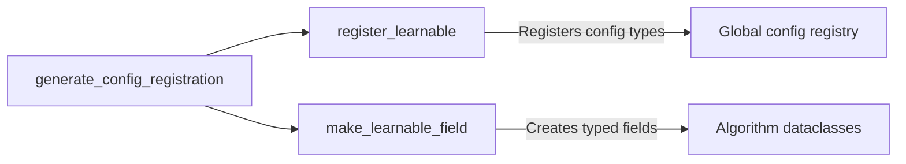

**Sources:** [d3rlpy/base.py:90-122](), [d3rlpy/base.py:120-122]()

## Algorithm Base Layer

The `LearnableBase` class provides the core algorithm interface and lifecycle management. It uses generic typing to maintain type safety across the configuration-algorithm-implementation chain.

### Generic Type System

```python
TImpl_co = TypeVar("TImpl_co", bound="ImplBase", covariant=True)
TConfig_co = TypeVar("TConfig_co", bound="LearnableConfig", covariant=True)

class LearnableBase(Generic[TImpl_co, TConfig_co], metaclass=ABCMeta):
```

This design ensures type safety while allowing algorithm-specific implementations to specialize the base types.

### Core Algorithm Properties

The algorithm layer exposes configuration properties and manages the implementation lifecycle:

| Property | Source | Purpose |
|----------|--------|---------|
| `config` | Configuration instance | Access to algorithm parameters |
| `impl` | Implementation instance | Access to PyTorch components |
| `observation_shape` | Implementation delegate | Input data shape |
| `action_size` | Implementation delegate | Output action dimensions |
| `grad_step` | Internal counter | Training progress tracking |

### Implementation Creation Workflow

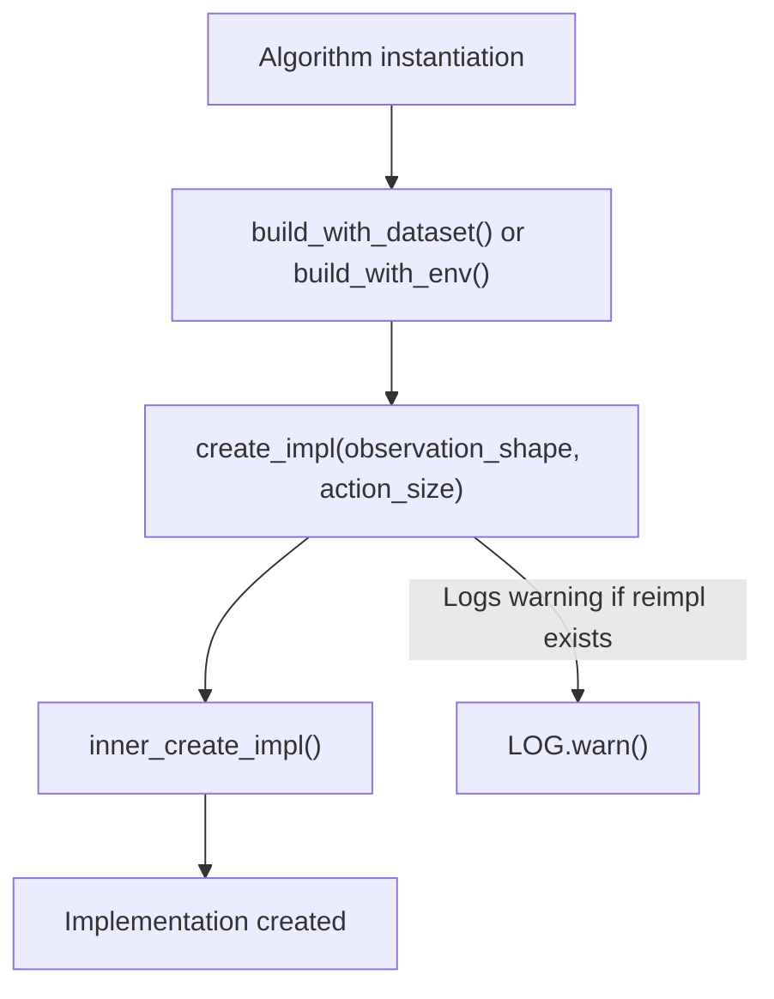

**Sources:** [d3rlpy/base.py:301-318](), [d3rlpy/base.py:320-329](), [d3rlpy/base.py:331-342]()

## Implementation Layer

The `ImplBase` class provides the PyTorch-specific implementation interface. All algorithm implementations inherit from this base to ensure consistent neural network management.

### Implementation Base Structure

```python
class ImplBase(metaclass=ABCMeta):
    _observation_shape: Shape
    _action_size: int
    _modules: Modules
    _checkpointer: Checkpointer
    _device: str
```

### Neural Network Management

The implementation layer uses the `Modules` container pattern for managing PyTorch components:

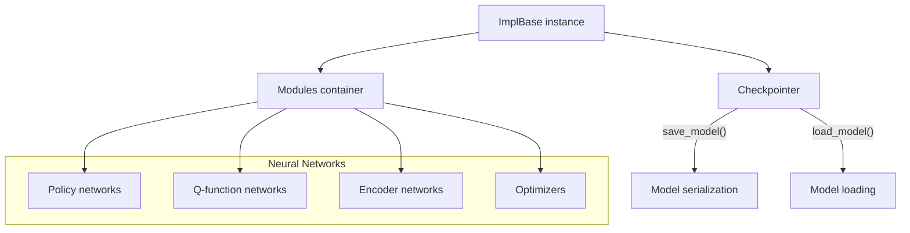

**Sources:** [d3rlpy/base.py:47-88](), [d3rlpy/base.py:63-64]()

## Lifecycle Management

The architecture provides comprehensive lifecycle management including creation, serialization, and reconstruction of algorithm instances.

### Serialization Architecture

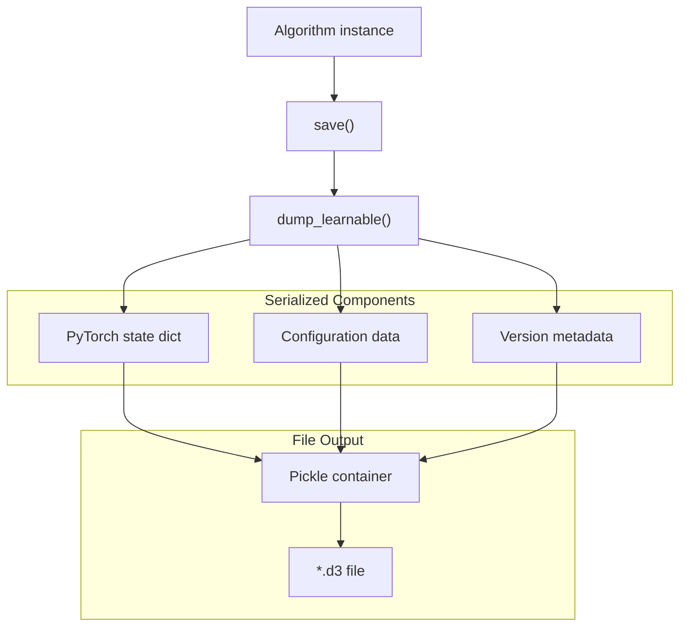

### Reconstruction Workflow

The architecture supports multiple reconstruction pathways:

| Method | Input | Purpose |
|--------|-------|---------|
| `load_learnable()` | `*.d3` file | Full algorithm reconstruction |
| `from_json()` | `params.json` | Configuration-based reconstruction |
| `load_model()` | `*.pt` file | Model weights only |

**Sources:** [d3rlpy/base.py:169-204](), [d3rlpy/base.py:232-275](), [d3rlpy/base.py:276-299]()

## Device and Compilation Handling

The architecture provides unified device management and performance optimization through compilation.

### Device Processing

```python
def _process_device(value: DeviceArg) -> str:
    if isinstance(value, bool):
        return "cuda:0" if value else "cpu:0"
    if isinstance(value, int):
        return f"cuda:{value}"
    if isinstance(value, str):
        return value
    if value is None:
        return "cpu:0"
```

### Compilation Support

The architecture integrates with PyTorch's compilation features:

```python
@property
def compiled(self) -> bool:
    return self._config.compile_graph and "cuda" in self._device
```

This enables CudaGraph optimization and `torch.compile` when running on CUDA devices with the `compile_graph` flag enabled.

**Sources:** [d3rlpy/base.py:151-166](), [d3rlpy/base.py:361-371]()

---

# Page: Algorithm System

# Algorithm System

<details>
<summary>Relevant source files</summary>

The following files were used as context for generating this wiki page:

- [README.md](README.md)
- [ROADMAP.md](ROADMAP.md)
- [d3rlpy/algos/__init__.py](d3rlpy/algos/__init__.py)
- [d3rlpy/algos/qlearning/base.py](d3rlpy/algos/qlearning/base.py)
- [d3rlpy/algos/transformer/base.py](d3rlpy/algos/transformer/base.py)
- [d3rlpy/algos/transformer/decision_transformer.py](d3rlpy/algos/transformer/decision_transformer.py)
- [d3rlpy/algos/transformer/torch/decision_transformer_impl.py](d3rlpy/algos/transformer/torch/decision_transformer_impl.py)
- [docs/references/algos.rst](docs/references/algos.rst)
- [docs/requirements.txt](docs/requirements.txt)

</details>


## Purpose and Scope

The Algorithm System is the core framework of d3rlpy that provides a unified interface for deep reinforcement learning algorithms. This system manages algorithm configuration, instantiation, training, and inference through a three-layer architecture: configuration classes, algorithm base classes, and PyTorch implementations.

This document covers the algorithm framework's architecture, base classes, and training interfaces. For specific algorithm implementations like SAC, CQL, and Decision Transformer, see [Algorithm Implementations](#5.3). For Q-learning specific details, see [Q-Learning Algorithms](#5.1). For transformer-based algorithms, see [Transformer Algorithms](#5.2).

## Architecture Overview

The Algorithm System follows a three-layer design pattern that separates configuration, algorithm logic, and PyTorch-specific implementation:

**Algorithm System Architecture**
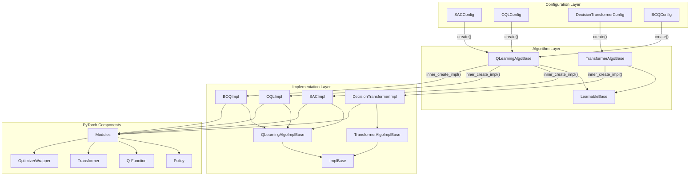

Sources: [d3rlpy/algos/qlearning/base.py:163-166](), [d3rlpy/algos/transformer/base.py:208-211](), [d3rlpy/base.py](), [d3rlpy/algos/transformer/decision_transformer.py:28-29]()

## Configuration System

All algorithms use dataclass-based configuration objects that define hyperparameters and factory objects for creating neural network components. The configuration system provides type safety and serialization capabilities.

**Configuration Class Structure**
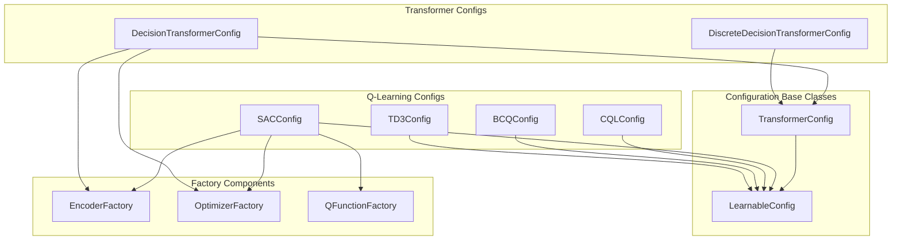

### Configuration Usage Pattern

Configuration objects are instantiated with hyperparameters and then used to create algorithm instances:

| Step | Code Pattern | Description |
|------|-------------|------------|
| 1. Configure | `config = SACConfig(batch_size=256, learning_rate=3e-4)` | Set hyperparameters |
| 2. Create | `algo = config.create(device="cuda:0")` | Instantiate algorithm |
| 3. Build | `algo.build_with_dataset(dataset)` | Build neural networks |
| 4. Train | `algo.fit(dataset, n_steps=100000)` | Execute training |

Sources: [d3rlpy/algos/transformer/decision_transformer.py:28-84](), [d3rlpy/base.py](), [README.md:18-19]()

## Algorithm Base Classes

The algorithm layer provides two main base classes that define the core interfaces for different algorithm families:

### QLearningAlgoBase

`QLearningAlgoBase` provides the interface for value-based algorithms that learn Q-functions. It implements both offline and online training methods.

**Key Methods:**
- `predict(x)` - Returns greedy actions
- `predict_value(x, action)` - Returns Q-values
- `sample_action(x)` - Returns stochastic actions
- `fit(dataset)` - Offline training
- `fit_online(env, buffer)` - Online training with environment interaction

### TransformerAlgoBase

`TransformerAlgoBase` provides the interface for sequence modeling algorithms like Decision Transformer. It handles trajectory-based training and stateful inference.

**Key Methods:**
- `predict(inpt)` - Returns actions from transformer input
- `fit(dataset)` - Offline training on trajectories
- `as_stateful_wrapper(target_return)` - Creates stateful wrapper for evaluation

**Algorithm Interface Comparison**
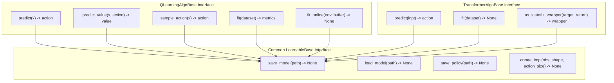

Sources: [d3rlpy/algos/qlearning/base.py:163-166](), [d3rlpy/algos/transformer/base.py:208-211](), [d3rlpy/algos/qlearning/base.py:256-368](), [d3rlpy/algos/transformer/base.py:347-374]()

## Implementation Layer

The implementation layer contains PyTorch-specific code that performs the actual neural network operations. Each algorithm has a corresponding implementation class that inherits from either `QLearningAlgoImplBase` or `TransformerAlgoImplBase`.

### Implementation Responsibilities

| Component | Responsibility | Key Methods |
|-----------|---------------|-------------|
| `QLearningAlgoImplBase` | Q-learning computations | `inner_update()`, `inner_predict_best_action()` |
| `TransformerAlgoImplBase` | Transformer computations | `inner_update()`, `inner_predict()` |
| `Modules` | PyTorch module container | Neural networks and optimizers |
| `ImplBase` | Common implementation logic | Device management, module access |

### Training Data Flow

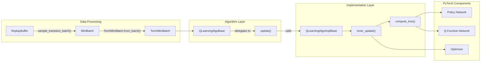

Sources: [d3rlpy/algos/qlearning/base.py:65-108](), [d3rlpy/algos/transformer/base.py:49-68](), [d3rlpy/algos/qlearning/base.py:859-880](), [d3rlpy/torch_utility.py]()

## Training Interfaces

The Algorithm System provides two primary training interfaces:

### Offline Training

Offline training uses pre-collected datasets and implements the standard supervised learning loop:

```python
# Training interface pattern
algo.fit(
    dataset=replay_buffer,
    n_steps=1000000,
    n_steps_per_epoch=10000,
    evaluators={"environment": evaluator}
)
```

**Offline Training Flow**
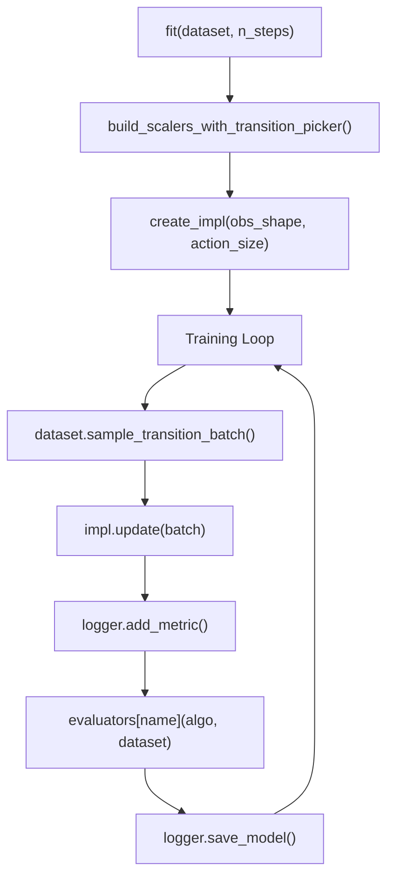

### Online Training

Online training interacts with environments to collect experience while simultaneously learning:

```python
# Online training pattern
algo.fit_online(
    env=environment,
    buffer=replay_buffer,
    n_steps=1000000,
    update_interval=1
)
```

**Online Training Flow**
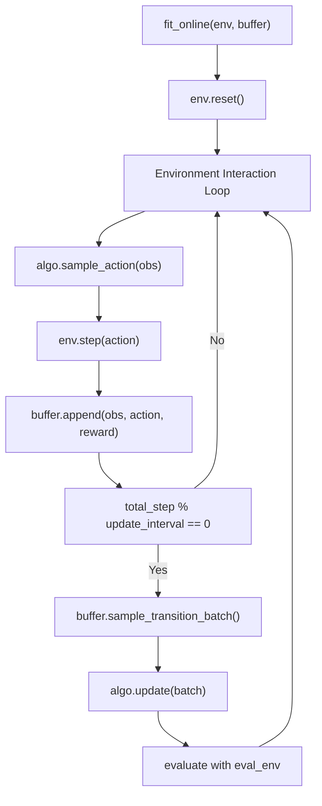

Sources: [d3rlpy/algos/qlearning/base.py:370-434](), [d3rlpy/algos/qlearning/base.py:592-777](), [d3rlpy/algos/transformer/base.py:376-509]()

## Algorithm Categories

The Algorithm System supports two main categories of algorithms, each with distinct characteristics:

### Q-Learning Algorithms

Q-learning algorithms learn value functions and are suitable for both offline and online training:

| Algorithm | Config Class | Implementation | Action Space |
|-----------|-------------|---------------|--------------|
| SAC | `SACConfig` | `SACImpl` | Continuous/Discrete |
| CQL | `CQLConfig` | `CQLImpl` | Continuous/Discrete |
| BCQ | `BCQConfig` | `BCQImpl` | Continuous/Discrete |
| TD3 | `TD3Config` | `TD3Impl` | Continuous |
| DQN | `DQNConfig` | `DQNImpl` | Discrete |

### Transformer Algorithms

Transformer algorithms model sequential decision-making and primarily support offline training:

| Algorithm | Config Class | Implementation | Action Space |
|-----------|-------------|---------------|--------------|
| Decision Transformer | `DecisionTransformerConfig` | `DecisionTransformerImpl` | Continuous |
| Discrete Decision Transformer | `DiscreteDecisionTransformerConfig` | `DiscreteDecisionTransformerImpl` | Discrete |

**Algorithm Category Characteristics**
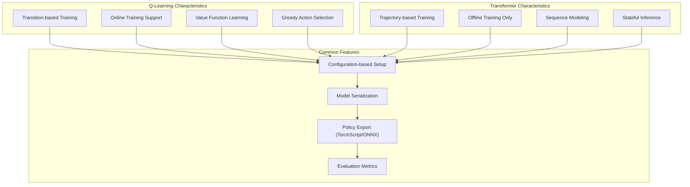

Sources: [docs/references/algos.rst:40-51](), [docs/references/algos.rst:353-462](), [d3rlpy/algos/transformer/decision_transformer.py:20-25](), [README.md:88-112]()

---

# Page: Q-Learning Algorithms

# Q-Learning Algorithms

<details>
<summary>Relevant source files</summary>

The following files were used as context for generating this wiki page:

- [README.md](README.md)
- [ROADMAP.md](ROADMAP.md)
- [d3rlpy/algos/__init__.py](d3rlpy/algos/__init__.py)
- [d3rlpy/algos/qlearning/base.py](d3rlpy/algos/qlearning/base.py)
- [d3rlpy/algos/transformer/base.py](d3rlpy/algos/transformer/base.py)
- [d3rlpy/algos/transformer/decision_transformer.py](d3rlpy/algos/transformer/decision_transformer.py)
- [d3rlpy/algos/transformer/torch/decision_transformer_impl.py](d3rlpy/algos/transformer/torch/decision_transformer_impl.py)
- [docs/references/algos.rst](docs/references/algos.rst)
- [docs/requirements.txt](docs/requirements.txt)

</details>


This document covers the Q-learning algorithm framework in d3rlpy, which provides the base classes and training workflows for value-based reinforcement learning algorithms. This includes both offline and online training capabilities, policy evaluation methods, and the core interfaces that all Q-learning algorithms implement.

For information about specific Q-learning algorithm implementations like SAC, CQL, and BCQ, see [Algorithm Implementations](#5.3). For transformer-based algorithms like Decision Transformer, see [Transformer Algorithms](#5.2).

## Architecture Overview

The Q-learning system is built on a two-layer architecture with configuration classes, algorithm base classes, and PyTorch implementation classes.

### Class Hierarchy

```mermaid
graph TB
    subgraph "Configuration Layer"
        CONFIG["LearnableConfig<br/>(Base Configuration)"]
        QL_CONFIG["Q-Learning Configs<br/>(SACConfig, CQLConfig, etc.)"]
    end
    
    subgraph "Algorithm Layer"
        LEARNABLE["LearnableBase<br/>(Generic Algorithm Interface)"]
        QL_ALGO["QLearningAlgoBase<br/>(Q-Learning Interface)"]
    end
    
    subgraph "Implementation Layer"
        IMPL_BASE["ImplBase<br/>(PyTorch Implementation Base)"]
        QL_IMPL["QLearningAlgoImplBase<br/>(Q-Learning Implementation)"]
        CONCRETE_IMPL["Concrete Implementations<br/>(SACImpl, CQLImpl, etc.)"]
    end
    
    subgraph "Core Components"
        MODULES["Modules<br/>(Neural Network Container)"]
        POLICY["Policy<br/>(Actor Network)"]
        QFUNC["Q-Function<br/>(Critic Networks)"]
        OPTIM["Optimizers<br/>(Policy & Q-Function)"]
    end
    
    CONFIG --> QL_CONFIG
    QL_CONFIG -->|"create()"| QL_ALGO
    LEARNABLE --> QL_ALGO
    QL_ALGO -->|"inner_create_impl()"| QL_IMPL
    IMPL_BASE --> QL_IMPL
    QL_IMPL --> CONCRETE_IMPL
    CONCRETE_IMPL --> MODULES
    MODULES --> POLICY
    MODULES --> QFUNC
    MODULES --> OPTIM
    
    style QL_ALGO fill:#e1f5fe
    style QL_IMPL fill:#f3e5f5
```

**Class Responsibilities**

| Class | Purpose | Key Methods |
|-------|---------|-------------|
| `QLearningAlgoBase` | User-facing algorithm interface | `fit()`, `fit_online()`, `predict()`, `predict_value()` |
| `QLearningAlgoImplBase` | PyTorch implementation interface | `inner_update()`, `inner_predict_best_action()` |
| Configuration Classes | Algorithm hyperparameters | `create()`, algorithm-specific parameters |

Sources: [d3rlpy/algos/qlearning/base.py:163-166](), [d3rlpy/algos/qlearning/base.py:65-66]()

## Training Workflows

The Q-learning framework supports both offline and online training modes with distinct data processing pipelines.

### Offline Training Workflow

```mermaid
graph TD
    DATASET["ReplayBufferBase<br/>(Offline Dataset)"]
    SAMPLE["sample_transition_batch()<br/>(Batch Sampling)"]
    CONVERT["TorchMiniBatch.from_batch()<br/>(PyTorch Conversion)"]
    UPDATE["impl.update()<br/>(Parameter Update)"]
    METRICS["Loss Metrics<br/>(Training Progress)"]
    EVAL["Evaluators<br/>(Performance Assessment)"]
    
    DATASET --> SAMPLE
    SAMPLE --> CONVERT
    CONVERT --> UPDATE
    UPDATE --> METRICS
    METRICS --> EVAL
    
    subgraph "fit() Method Flow"
        INIT_IMPL["Create Implementation<br/>(build models)"]
        TRAIN_LOOP["Training Loop<br/>(n_epochs)"]
        LOG["Logger<br/>(Experiment Tracking)"]
        SAVE["Save Model<br/>(Checkpointing)"]
        
        INIT_IMPL --> TRAIN_LOOP
        TRAIN_LOOP --> LOG
        LOG --> SAVE
    end
    
    SAMPLE -.-> INIT_IMPL
    UPDATE -.-> TRAIN_LOOP
```

### Online Training Workflow

```mermaid
graph TD
    ENV["GymEnv<br/>(Environment)"]
    EXPLORE["Explorer/sample_action()<br/>(Action Selection)"]
    STEP["env.step()<br/>(Environment Interaction)"]
    BUFFER["ReplayBufferBase<br/>(Experience Storage)"]
    SAMPLE["sample_transition_batch()<br/>(Experience Replay)"]
    UPDATE["impl.update()<br/>(Parameter Update)"]
    
    ENV --> EXPLORE
    EXPLORE --> STEP
    STEP --> BUFFER
    BUFFER --> SAMPLE
    SAMPLE --> UPDATE
    UPDATE -.->|"Policy Improvement"| EXPLORE
    
    subgraph "fit_online() Method Flow"
        RESET["env.reset()<br/>(Episode Start)"]
        COLLECT["Data Collection<br/>(Environment Steps)"]
        TRAIN["Training Updates<br/>(UTD Ratio Control)"]
        EVAL_ONLINE["Online Evaluation<br/>(Performance Tracking)"]
        
        RESET --> COLLECT
        COLLECT --> TRAIN
        TRAIN --> EVAL_ONLINE
        EVAL_ONLINE -.-> RESET
    end
    
    STEP -.-> COLLECT
    UPDATE -.-> TRAIN
```

Sources: [d3rlpy/algos/qlearning/base.py:370-434](), [d3rlpy/algos/qlearning/base.py:592-777]()

## Key Methods and Interfaces

### Core Algorithm Interface

The `QLearningAlgoBase` class provides the main user interface for Q-learning algorithms:

| Method | Purpose | Input/Output |
|--------|---------|--------------|
| `predict(x)` | Greedy action selection | `Observation` → `NDArray` |
| `sample_action(x)` | Stochastic action sampling | `Observation` → `NDArray` |
| `predict_value(x, action)` | Q-value estimation | `Observation, Action` → `NDArray` |
| `fit(dataset)` | Offline training | `ReplayBufferBase` → `List[Metrics]` |
| `fit_online(env)` | Online training | `GymEnv` → `None` |

### Implementation Interface

The `QLearningAlgoImplBase` class defines the PyTorch implementation contract:

```mermaid
graph LR
    subgraph "QLearningAlgoImplBase Methods"
        UPDATE["inner_update()<br/>(Training Step)"]
        PREDICT["inner_predict_best_action()<br/>(Policy Inference)"]
        SAMPLE["inner_sample_action()<br/>(Stochastic Policy)"]
        VALUE["inner_predict_value()<br/>(Q-Value Computation)"]
    end
    
    subgraph "Neural Network Components"
        POLICY_NET["policy<br/>(Actor Network)"]
        QFUNC_NET["q_function<br/>(Critic Networks)"]
        POLICY_OPT["policy_optim<br/>(Policy Optimizer)"]
        QFUNC_OPT["q_function_optim<br/>(Q-Function Optimizer)"]
    end
    
    UPDATE --> POLICY_OPT
    UPDATE --> QFUNC_OPT
    PREDICT --> POLICY_NET
    SAMPLE --> POLICY_NET
    VALUE --> QFUNC_NET
```

Sources: [d3rlpy/algos/qlearning/base.py:70-102](), [d3rlpy/algos/qlearning/base.py:104-154]()

## Data Processing Pipeline

The Q-learning algorithms process data through a standardized pipeline that handles preprocessing, batching, and device placement.

### Batch Processing Flow

```mermaid
graph TD
    TRANSITION["TransitionMiniBatch<br/>(Raw Data Batch)"]
    TORCH_BATCH["TorchMiniBatch.from_batch()<br/>(PyTorch Conversion)"]
    SCALING["Data Scaling<br/>(Observation/Action/Reward)"]
    DEVICE["Device Placement<br/>(CPU/GPU)"]
    ALGORITHM["Algorithm Update<br/>(Neural Network Training)"]
    
    TRANSITION --> TORCH_BATCH
    TORCH_BATCH --> SCALING
    SCALING --> DEVICE
    DEVICE --> ALGORITHM
    
    subgraph "TorchMiniBatch Components"
        OBS["observations<br/>(Processed States)"]
        ACT["actions<br/>(Processed Actions)"] 
        REW["rewards<br/>(Processed Rewards)"]
        NEXT_OBS["next_observations<br/>(Next States)"]
        TERM["terminals<br/>(Episode Endings)"]
        
        TORCH_BATCH --> OBS
        TORCH_BATCH --> ACT
        TORCH_BATCH --> REW
        TORCH_BATCH --> NEXT_OBS
        TORCH_BATCH --> TERM
    end
```

### Update Method Implementation

The `update()` method in `QLearningAlgoBase` orchestrates the data processing and parameter updates:

1. **Batch Conversion**: `TorchMiniBatch.from_batch()` converts raw data to PyTorch tensors
2. **Scaling Application**: Observation, action, and reward scalers are applied
3. **Implementation Delegation**: `self._impl.update()` performs the actual neural network updates
4. **Gradient Step Tracking**: `self._grad_step` is incremented for learning rate schedules

Sources: [d3rlpy/algos/qlearning/base.py:859-880]()

## Integration with Core Architecture

The Q-learning system integrates with d3rlpy's core architecture through several key interfaces:

### Data Management Integration

```mermaid
graph TB
    subgraph "Data Layer"
        DATASETS["d3rlpy.datasets<br/>(Dataset Loading)"]
        REPLAY["ReplayBufferBase<br/>(Experience Storage)"]
        PICKER["TransitionPicker<br/>(Sampling Strategy)"]
    end
    
    subgraph "Q-Learning Layer"
        QL_ALGO["QLearningAlgoBase<br/>(Algorithm Interface)"]
        QL_IMPL["QLearningAlgoImplBase<br/>(Implementation)"]
    end
    
    subgraph "Foundation Layer"
        LEARNABLE["LearnableBase<br/>(Lifecycle Management)"]
        SCALERS["Preprocessing Scalers<br/>(Data Normalization)"]
        LOGGER["D3RLPyLogger<br/>(Experiment Tracking)"]
    end
    
    DATASETS --> REPLAY
    REPLAY --> PICKER
    PICKER --> QL_ALGO
    QL_ALGO --> QL_IMPL
    LEARNABLE --> QL_ALGO
    SCALERS --> QL_ALGO
    LOGGER --> QL_ALGO
```

### Component Transfer Methods

The Q-learning base classes provide methods for transferring learned components between algorithms:

| Method | Purpose | Use Case |
|--------|---------|----------|
| `copy_policy_from()` | Transfer policy parameters | Offline → Online transfer |
| `copy_q_function_from()` | Transfer Q-function parameters | Pre-training scenarios |
| `copy_policy_optim_from()` | Transfer optimizer states | Warm-start training |
| `copy_q_function_optim_from()` | Transfer Q-function optimizer states | Continue training |

Sources: [d3rlpy/algos/qlearning/base.py:886-976]()

## Training Configuration

The Q-learning framework provides extensive configuration options for training behavior:

| Parameter | Purpose | Default Behavior |
|-----------|---------|------------------|
| `n_steps_per_epoch` | Training steps per epoch | 10,000 steps |
| `update_interval` | Online update frequency | Every step |
| `n_updates` | Updates per interval (UTD ratio) | 1 update |
| `update_start_step` | Delay before training starts | 0 steps |
| `random_steps` | Initial random exploration | 0 steps |

The training loops support extensive customization through callback functions and evaluator protocols, enabling integration with experiment tracking systems and custom evaluation metrics.

Sources: [d3rlpy/algos/qlearning/base.py:436-590](), [d3rlpy/algos/qlearning/base.py:614-643]()

---

# Page: Transformer Algorithms

# Transformer Algorithms

<details>
<summary>Relevant source files</summary>

The following files were used as context for generating this wiki page:

- [README.md](README.md)
- [ROADMAP.md](ROADMAP.md)
- [d3rlpy/algos/__init__.py](d3rlpy/algos/__init__.py)
- [d3rlpy/algos/qlearning/base.py](d3rlpy/algos/qlearning/base.py)
- [d3rlpy/algos/transformer/base.py](d3rlpy/algos/transformer/base.py)
- [d3rlpy/algos/transformer/decision_transformer.py](d3rlpy/algos/transformer/decision_transformer.py)
- [d3rlpy/algos/transformer/torch/decision_transformer_impl.py](d3rlpy/algos/transformer/torch/decision_transformer_impl.py)
- [docs/references/algos.rst](docs/references/algos.rst)
- [docs/requirements.txt](docs/requirements.txt)

</details>


This document covers the transformer-based algorithm system in d3rlpy, which provides sequence modeling approaches to reinforcement learning. These algorithms solve decision-making problems by treating them as sequence prediction tasks, using transformer architectures to model the relationship between observations, actions, rewards, and returns-to-go over time.

For Q-learning based algorithms, see [Q-Learning Algorithms](#5.1). For specific algorithm implementations beyond the transformer framework, see [Algorithm Implementations](#5.3).

## Overview

Transformer algorithms in d3rlpy are fundamentally different from Q-learning approaches. Instead of learning value functions, they learn to predict actions given sequences of past experiences. The primary implementation is the Decision Transformer, which predicts actions conditioned on desired returns-to-go.

The transformer system supports both continuous and discrete action spaces, and provides specialized evaluation interfaces through stateful wrappers that maintain context across sequential predictions.

Sources: [d3rlpy/algos/transformer/base.py:1-552](), [README.md:109-111](), [docs/references/algos.rst:352-463]()

## Architecture Overview

The transformer algorithm system follows a three-layer architecture similar to Q-learning algorithms but with sequence-specific components:

```mermaid
graph TD
    subgraph "Configuration Layer"
        DT_CFG["DecisionTransformerConfig"]
        DISCRETE_DT_CFG["DiscreteDecisionTransformerConfig"]
        TRANS_CFG["TransformerConfig"]
    end
    
    subgraph "Algorithm Layer"
        TRANS_BASE["TransformerAlgoBase"]
        DT_ALGO["DecisionTransformer"]
        DISCRETE_DT_ALGO["DiscreteDecisionTransformer"]
        STATEFUL_WRAPPER["StatefulTransformerWrapper"]
    end
    
    subgraph "Implementation Layer"
        TRANS_IMPL_BASE["TransformerAlgoImplBase"]
        DT_IMPL["DecisionTransformerImpl"]
        DISCRETE_DT_IMPL["DiscreteDecisionTransformerImpl"]
    end
    
    subgraph "PyTorch Components"
        DT_MODULES["DecisionTransformerModules"]
        DISCRETE_DT_MODULES["DiscreteDecisionTransformerModules"]
        CONTINUOUS_TRANSFORMER["ContinuousDecisionTransformer"]
        DISCRETE_TRANSFORMER["DiscreteDecisionTransformer"]
    end
    
    subgraph "Input Processing"
        TRANS_INPUT["TransformerInput"]
        TORCH_TRANS_INPUT["TorchTransformerInput"]
        TRAJ_BATCH["TorchTrajectoryMiniBatch"]
    end
    
    %% Configuration to algorithm
    DT_CFG -->|"create()"| DT_ALGO
    DISCRETE_DT_CFG -->|"create()"| DISCRETE_DT_ALGO
    TRANS_CFG --> TRANS_BASE
    
    %% Inheritance hierarchy
    TRANS_BASE --> DT_ALGO
    TRANS_BASE --> DISCRETE_DT_ALGO
    TRANS_BASE -->|"as_stateful_wrapper()"| STATEFUL_WRAPPER
    
    %% Algorithm to implementation
    DT_ALGO -->|"inner_create_impl()"| DT_IMPL
    DISCRETE_DT_ALGO -->|"inner_create_impl()"| DISCRETE_DT_IMPL
    TRANS_IMPL_BASE --> DT_IMPL
    TRANS_IMPL_BASE --> DISCRETE_DT_IMPL
    
    %% Implementation to modules
    DT_IMPL --> DT_MODULES
    DISCRETE_DT_IMPL --> DISCRETE_DT_MODULES
    DT_MODULES --> CONTINUOUS_TRANSFORMER
    DISCRETE_DT_MODULES --> DISCRETE_TRANSFORMER
    
    %% Input processing
    TRANS_INPUT --> TORCH_TRANS_INPUT
    TRAJ_BATCH --> DT_IMPL
    TRAJ_BATCH --> DISCRETE_DT_IMPL
```

**Transformer Algorithm Architecture**

This architecture enables sequence modeling for reinforcement learning by processing trajectories rather than individual transitions. The `StatefulTransformerWrapper` provides a Q-learning-like interface for evaluation while maintaining the transformer's sequential context requirements.

Sources: [d3rlpy/algos/transformer/base.py:71-552](), [d3rlpy/algos/transformer/decision_transformer.py:28-248](), [d3rlpy/algos/transformer/torch/decision_transformer_impl.py:30-197]()

## Base Classes

### TransformerConfig

`TransformerConfig` extends `LearnableConfig` with transformer-specific parameters that control sequence processing:

| Parameter | Type | Default | Description |
|-----------|------|---------|-------------|
| `context_size` | `int` | 20 | Maximum sequence length for attention |
| `max_timestep` | `int` | 1000 | Maximum environmental timestep for positional encoding |

Sources: [d3rlpy/algos/transformer/base.py:71-75]()

### TransformerAlgoImplBase

The implementation base class defines the core interface for transformer algorithms:

- `inner_predict(inpt: TorchTransformerInput) -> torch.Tensor`: Predicts next action given sequence input
- `inner_update(batch: TorchTrajectoryMiniBatch, grad_step: int) -> dict[str, float]`: Updates model parameters using trajectory batches

Unlike Q-learning implementations, transformer implementations work with trajectory data rather than single transitions.

Sources: [d3rlpy/algos/transformer/base.py:49-68]()

### TransformerAlgoBase

`TransformerAlgoBase` provides the main algorithm interface, including:

- **Training**: `fit()` method that samples trajectory batches using `sample_trajectory_batch()` instead of transition batches
- **Prediction**: `predict()` method that accepts `TransformerInput` containing sequence data
- **Policy Export**: `save_policy()` method for exporting transformer models
- **Stateful Wrapper**: `as_stateful_wrapper()` method for creating evaluation interfaces

Sources: [d3rlpy/algos/transformer/base.py:208-552]()

## Decision Transformer Implementation

Decision Transformer solves reinforcement learning as a sequence modeling problem by predicting actions conditioned on desired returns-to-go:

```mermaid
graph LR
    subgraph "Input Sequence"
        OBS["observations[t-k:t]"]
        ACT["actions[t-k:t-1]"]
        RTG["returns_to_go[t-k:t]"]
        TIME["timesteps[t-k:t]"]
    end
    
    subgraph "Transformer Processing"
        EMBED["Embeddings"]
        POS_ENC["Positional Encoding"]
        ATTN_BLOCKS["Attention Blocks"]
        OUTPUT["Action Prediction"]
    end
    
    subgraph "Training vs Inference"
        TEACHER_FORCE["Teacher Forcing\n(Training)"]
        AUTOREGRESSIVE["Autoregressive\n(Inference)"]
    end
    
    OBS --> EMBED
    ACT --> EMBED
    RTG --> EMBED
    TIME --> POS_ENC
    
    EMBED --> ATTN_BLOCKS
    POS_ENC --> ATTN_BLOCKS
    ATTN_BLOCKS --> OUTPUT
    
    OUTPUT --> TEACHER_FORCE
    OUTPUT --> AUTOREGRESSIVE
```

**Decision Transformer Processing Flow**

### Continuous vs Discrete Variants

The system provides separate implementations for different action spaces:

- **DecisionTransformer**: Continuous actions using MSE loss
- **DiscreteDecisionTransformer**: Discrete actions using cross-entropy loss with learning rate scheduling

| Feature | Continuous | Discrete |
|---------|------------|----------|
| Loss Function | MSE | Cross-entropy |
| Learning Rate | Fixed | Cosine decay with warmup |
| Action Output | Direct regression | Logits + softmax |
| Default Config | 3 layers, 1 head | 6 layers, 8 heads |

Sources: [d3rlpy/algos/transformer/decision_transformer.py:28-248](), [d3rlpy/algos/transformer/torch/decision_transformer_impl.py:36-197]()

## Stateful Wrapper for Evaluation

Transformer algorithms require maintaining context across multiple time steps during evaluation. The `StatefulTransformerWrapper` provides a Q-learning-like interface while handling this complexity:

```mermaid
graph TD
    subgraph "Wrapper State"
        OBS_DEQUE["observations: deque"]
        ACT_DEQUE["actions: deque"] 
        REW_DEQUE["rewards: deque"]
        RTG_DEQUE["returns_to_go: deque"]
        TIME_DEQUE["timesteps: deque"]
        TARGET_RTG["target_return: float"]
    end
    
    subgraph "Prediction Flow"
        PREDICT_CALL["predict(observation, reward)"]
        UPDATE_STATE["Update Internal State"]
        BUILD_INPUT["Build TransformerInput"]
        CALL_ALGO["algo.predict(input)"]
        SAMPLE_ACTION["action_sampler(logits)"]
        RETURN_ACTION["Return Action"]
    end
    
    subgraph "Action Sampling"
        IDENTITY["IdentityTransformerActionSampler"]
        SOFTMAX["SoftmaxTransformerActionSampler"] 
        GREEDY["GreedyTransformerActionSampler"]
    end
    
    PREDICT_CALL --> UPDATE_STATE
    UPDATE_STATE --> OBS_DEQUE
    UPDATE_STATE --> REW_DEQUE
    UPDATE_STATE --> RTG_DEQUE
    UPDATE_STATE --> TIME_DEQUE
    
    UPDATE_STATE --> BUILD_INPUT
    BUILD_INPUT --> CALL_ALGO
    CALL_ALGO --> SAMPLE_ACTION
    
    SAMPLE_ACTION --> IDENTITY
    SAMPLE_ACTION --> SOFTMAX
    SAMPLE_ACTION --> GREEDY
    
    SAMPLE_ACTION --> RETURN_ACTION
    RETURN_ACTION --> ACT_DEQUE
```

**Stateful Wrapper Prediction Flow**

The wrapper maintains fixed-size deques (controlled by `context_size`) and automatically handles:
- Return-to-go computation based on target return and observed rewards
- Padding for initial actions before any history exists  
- Timestep tracking with maximum bounds from `max_timestep`

Sources: [d3rlpy/algos/transformer/base.py:81-206]()

## Training and Data Processing

Transformer algorithms use trajectory-based sampling instead of transition-based sampling:

### Training Loop Differences

```mermaid
graph LR
    subgraph "Q-Learning Training"
        Q_SAMPLE["sample_transition_batch()"]
        Q_UPDATE["update(TransitionMiniBatch)"]
    end
    
    subgraph "Transformer Training"
        T_SAMPLE["sample_trajectory_batch()"]
        T_UPDATE["update(TrajectoryMiniBatch)"]
    end
    
    subgraph "Batch Processing"
        TRANS_BATCH["TransitionMiniBatch"]
        TRAJ_BATCH["TrajectoryMiniBatch"]
        TORCH_TRANS["TorchMiniBatch"]
        TORCH_TRAJ["TorchTrajectoryMiniBatch"]
    end
    
    Q_SAMPLE --> TRANS_BATCH
    T_SAMPLE --> TRAJ_BATCH
    TRANS_BATCH --> TORCH_TRANS
    TRAJ_BATCH --> TORCH_TRAJ
    
    TORCH_TRANS --> Q_UPDATE
    TORCH_TRAJ --> T_UPDATE
```

**Training Data Flow Comparison**

### Sequence Processing

Transformer training requires special handling for:
- **Context Length**: Trajectories are sampled with length equal to `context_size`
- **Masking**: Invalid positions in sequences are masked during loss computation
- **Returns-to-go**: Computed dynamically during batch conversion

The `TorchTrajectoryMiniBatch` provides the structured input that transformer implementations expect, containing observations, actions, rewards, returns-to-go, timesteps, and attention masks.

Sources: [d3rlpy/algos/transformer/base.py:460-530](), [d3rlpy/algos/transformer/torch/decision_transformer_impl.py:67-93]()

## Configuration and Usage

### Basic Usage Pattern

```python
# Configuration
config = DecisionTransformerConfig(
    context_size=20,
    max_timestep=1000,
    batch_size=64,
    learning_rate=1e-4
)

# Algorithm creation
dt = config.create(device="cuda:0")

# Training
dt.fit(
    dataset,
    n_steps=100000,
    eval_env=env,
    eval_target_return=500.0
)

# Evaluation wrapper
wrapper = dt.as_stateful_wrapper(target_return=500.0)
action = wrapper.predict(observation, reward)
```

### Key Configuration Differences

| Parameter | Q-Learning | Transformer | Notes |
|-----------|------------|-------------|-------|
| Batch Processing | Transitions | Trajectories | Fundamental difference |
| Context | Single step | Sequence window | `context_size` parameter |
| Evaluation | Direct predict | Stateful wrapper | Requires return target |
| Data Requirements | Any episodes | Complete trajectories | May need trajectory reconstruction |

The transformer system integrates with the same preprocessing, logging, and evaluation infrastructure as Q-learning algorithms, but operates on fundamentally different data structures and training paradigms.

Sources: [d3rlpy/algos/transformer/decision_transformer.py:28-248](), [docs/references/algos.rst:356-463]()

---

# Page: Algorithm Implementations

# Algorithm Implementations

<details>
<summary>Relevant source files</summary>

The following files were used as context for generating this wiki page:

- [d3rlpy/algos/qlearning/base.py](d3rlpy/algos/qlearning/base.py)
- [d3rlpy/algos/qlearning/torch/awac_impl.py](d3rlpy/algos/qlearning/torch/awac_impl.py)
- [d3rlpy/algos/qlearning/torch/bc_impl.py](d3rlpy/algos/qlearning/torch/bc_impl.py)
- [d3rlpy/algos/qlearning/torch/bcq_impl.py](d3rlpy/algos/qlearning/torch/bcq_impl.py)
- [d3rlpy/algos/qlearning/torch/bear_impl.py](d3rlpy/algos/qlearning/torch/bear_impl.py)
- [d3rlpy/algos/qlearning/torch/cql_impl.py](d3rlpy/algos/qlearning/torch/cql_impl.py)
- [d3rlpy/algos/qlearning/torch/crr_impl.py](d3rlpy/algos/qlearning/torch/crr_impl.py)
- [d3rlpy/algos/qlearning/torch/ddpg_impl.py](d3rlpy/algos/qlearning/torch/ddpg_impl.py)
- [d3rlpy/algos/qlearning/torch/dqn_impl.py](d3rlpy/algos/qlearning/torch/dqn_impl.py)
- [d3rlpy/algos/qlearning/torch/iql_impl.py](d3rlpy/algos/qlearning/torch/iql_impl.py)
- [d3rlpy/algos/qlearning/torch/plas_impl.py](d3rlpy/algos/qlearning/torch/plas_impl.py)
- [d3rlpy/algos/qlearning/torch/sac_impl.py](d3rlpy/algos/qlearning/torch/sac_impl.py)
- [d3rlpy/algos/qlearning/torch/td3_impl.py](d3rlpy/algos/qlearning/torch/td3_impl.py)
- [d3rlpy/algos/qlearning/torch/td3_plus_bc_impl.py](d3rlpy/algos/qlearning/torch/td3_plus_bc_impl.py)
- [d3rlpy/algos/transformer/base.py](d3rlpy/algos/transformer/base.py)
- [d3rlpy/algos/transformer/decision_transformer.py](d3rlpy/algos/transformer/decision_transformer.py)
- [d3rlpy/algos/transformer/torch/decision_transformer_impl.py](d3rlpy/algos/transformer/torch/decision_transformer_impl.py)

</details>


This document covers the specific PyTorch implementations of reinforcement learning algorithms in d3rlpy. These implementations inherit from the base algorithm classes and provide the concrete neural network architectures, loss functions, and update procedures for each algorithm.

For information about the base algorithm framework and lifecycle management, see [Algorithm System](#5). For details about Q-learning and transformer base classes, see [Q-Learning Algorithms](#5.1) and [Transformer Algorithms](#5.2).

## Implementation Architecture

Algorithm implementations in d3rlpy follow a three-layer architecture where configuration classes create algorithm instances, which delegate to PyTorch implementation classes that contain the actual neural network logic.

### Implementation Hierarchy

```mermaid
graph TD
    subgraph "Base Implementation Classes"
        QLEARN_IMPL["QLearningAlgoImplBase<br/>d3rlpy.algos.qlearning.base"]
        TRANS_IMPL["TransformerAlgoImplBase<br/>d3rlpy.algos.transformer.base"]
        IMPL_BASE["ImplBase<br/>d3rlpy.base"]
    end
    
    subgraph "Q-Learning Implementations"
        SAC_IMPL["SACImpl<br/>sac_impl.py"]
        CQL_IMPL["CQLImpl<br/>cql_impl.py"]
        BEAR_IMPL["BEARImpl<br/>bear_impl.py"]
        BCQ_IMPL["BCQImpl<br/>bcq_impl.py"]
        BC_IMPL["BCImpl<br/>bc_impl.py"]
        DQN_IMPL["DQNImpl<br/>dqn_impl.py"]
        DDPG_IMPL["DDPGImpl<br/>ddpg_impl.py"]
        TD3_IMPL["TD3Impl<br/>td3_impl.py"]
        IQL_IMPL["IQLImpl<br/>iql_impl.py"]
        CRR_IMPL["CRRImpl<br/>crr_impl.py"]
        AWAC_IMPL["AWACImpl<br/>awac_impl.py"]
    end
    
    subgraph "Transformer Implementations"
        DT_IMPL["DecisionTransformerImpl<br/>decision_transformer_impl.py"]
        DISCRETE_DT_IMPL["DiscreteDecisionTransformerImpl<br/>decision_transformer_impl.py"]
    end
    
    subgraph "Specialized Base Classes"
        DDPG_BASE["DDPGBaseImpl<br/>ddpg_impl.py"]
        BC_BASE["BCBaseImpl<br/>bc_impl.py"]
    end
    
    %% Inheritance relationships
    IMPL_BASE --> QLEARN_IMPL
    IMPL_BASE --> TRANS_IMPL
    
    QLEARN_IMPL --> SAC_IMPL
    QLEARN_IMPL --> CQL_IMPL
    QLEARN_IMPL --> DQN_IMPL
    QLEARN_IMPL --> DDPG_BASE
    QLEARN_IMPL --> BC_BASE
    
    DDPG_BASE --> DDPG_IMPL
    DDPG_BASE --> BEAR_IMPL
    DDPG_BASE --> BCQ_IMPL
    DDPG_BASE --> TD3_IMPL
    DDPG_BASE --> IQL_IMPL
    DDPG_BASE --> CRR_IMPL
    
    SAC_IMPL --> AWAC_IMPL
    CQL_IMPL --> SAC_IMPL
    
    BC_BASE --> BC_IMPL
    
    TRANS_IMPL --> DT_IMPL
    TRANS_IMPL --> DISCRETE_DT_IMPL
    
    style QLEARN_IMPL fill:#e1f5fe
    style TRANS_IMPL fill:#e1f5fe
    style DDPG_BASE fill:#f3e5f5
```

Sources: [d3rlpy/algos/qlearning/base.py:65-158](), [d3rlpy/algos/transformer/base.py:49-68](), [d3rlpy/algos/qlearning/torch/sac_impl.py:56-133](), [d3rlpy/algos/qlearning/torch/cql_impl.py:41-200](), [d3rlpy/algos/qlearning/torch/ddpg_impl.py:56-184]()

### Modules Pattern

All algorithm implementations use a consistent modules pattern to organize their PyTorch components. Each implementation contains a `Modules` dataclass that groups related neural networks and optimizers.

```mermaid
graph LR
    subgraph "Algorithm Implementation"
        ALGO_IMPL["AlgorithmImpl"]
        MODULES["_modules: AlgorithmModules"]
    end
    
    subgraph "Modules Components"
        POLICY["policy: Policy"]
        Q_FUNCS["q_funcs: nn.ModuleList"]
        TARG_Q_FUNCS["targ_q_funcs: nn.ModuleList"]
        ACTOR_OPTIM["actor_optim: OptimizerWrapper"]
        CRITIC_OPTIM["critic_optim: OptimizerWrapper"]
        SPECIAL["algorithm-specific components"]
    end
    
    ALGO_IMPL --> MODULES
    MODULES --> POLICY
    MODULES --> Q_FUNCS
    MODULES --> TARG_Q_FUNCS
    MODULES --> ACTOR_OPTIM
    MODULES --> CRITIC_OPTIM
    MODULES --> SPECIAL
    
    style MODULES fill:#e8f5e8
```

Sources: [d3rlpy/algos/qlearning/torch/sac_impl.py:43-47](), [d3rlpy/algos/qlearning/torch/ddpg_impl.py:37-44](), [d3rlpy/algos/qlearning/torch/dqn_impl.py:24-28]()

## Q-Learning Algorithm Implementations

### Core Q-Learning Implementations

#### SAC (Soft Actor-Critic)
`SACImpl` implements the Soft Actor-Critic algorithm with automatic temperature tuning. It uses a stochastic policy with entropy regularization.

Key components:
- `NormalPolicy` for stochastic action sampling
- `log_temp` parameter for entropy coefficient
- Temperature optimization with target entropy

```mermaid
graph TD
    subgraph "SACModules"
        SAC_POLICY["policy: NormalPolicy"]
        SAC_Q["q_funcs: nn.ModuleList"]
        SAC_TARG_Q["targ_q_funcs: nn.ModuleList"]
        SAC_LOG_TEMP["log_temp: Parameter"]
        SAC_ACTOR_OPT["actor_optim: OptimizerWrapper"]
        SAC_CRITIC_OPT["critic_optim: OptimizerWrapper"]
        SAC_TEMP_OPT["temp_optim: OptimizerWrapper"]
    end
    
    subgraph "SAC Loss Computation"
        SAC_ENTROPY["entropy regularization"]
        SAC_Q_LOSS["Q-function loss"]
        SAC_TEMP_LOSS["temperature loss"]
    end
    
    SAC_POLICY --> SAC_ENTROPY
    SAC_Q --> SAC_Q_LOSS
    SAC_LOG_TEMP --> SAC_TEMP_LOSS
```

Sources: [d3rlpy/algos/qlearning/torch/sac_impl.py:43-133]()

#### CQL (Conservative Q-Learning)
`CQLImpl` extends SAC with conservative Q-learning to prevent overestimation in offline settings. It adds a conservative penalty term to the Q-function loss.

Key features:
- Conservative loss computation using policy and random action samples
- Automatic alpha tuning for the conservative penalty
- Support for both soft and deterministic Q-backup

Sources: [d3rlpy/algos/qlearning/torch/cql_impl.py:41-200]()

#### BEAR (Bootstrapping Error Accumulation Reduction)
`BEARImpl` uses a VAE to model the behavior policy and constrains the learned policy using Maximum Mean Discrepancy (MMD).

Unique components:
- `VAEEncoder` and `VAEDecoder` for behavior modeling
- MMD computation with Gaussian or Laplacian kernels
- Dual optimization of policy and VAE

Sources: [d3rlpy/algos/qlearning/torch/bear_impl.py:61-315]()

#### BCQ (Batch-Constrained Q-Learning)
`BCQImpl` uses a VAE to generate candidate actions and selects the best action using Q-values, constraining the policy to stay close to the data distribution.

Key features:
- VAE-based action generation
- Residual policy for action refinement
- Delayed reinforcement learning after VAE pre-training

Sources: [d3rlpy/algos/qlearning/torch/bcq_impl.py:51-302]()

### Discrete Action Space Implementations

Several algorithms have specialized implementations for discrete action spaces:

```mermaid
graph TD
    subgraph "Discrete Implementations"
        DISC_SAC["DiscreteSACImpl<br/>categorical policy + entropy"]
        DISC_CQL["DiscreteCQLImpl<br/>conservative loss for discrete actions"]
        DISC_BCQ["DiscreteBCQImpl<br/>imitation + Q-value filtering"]
        DISC_BC["DiscreteBCImpl<br/>categorical policy imitation"]
        DQN["DQNImpl<br/>standard Q-learning"]
        DOUBLE_DQN["DoubleDQNImpl<br/>double Q-learning target"]
    end
    
    subgraph "Shared Components"
        CAT_POLICY["CategoricalPolicy"]
        DISCRETE_Q["DiscreteEnsembleQFunctionForwarder"]
    end
    
    DISC_SAC --> CAT_POLICY
    DISC_CQL --> DISCRETE_Q
    DISC_BCQ --> CAT_POLICY
    DISC_BC --> CAT_POLICY
    DQN --> DISCRETE_Q
    DOUBLE_DQN --> DISCRETE_Q
```

Sources: [d3rlpy/algos/qlearning/torch/sac_impl.py:146-332](), [d3rlpy/algos/qlearning/torch/cql_impl.py:237-292](), [d3rlpy/algos/qlearning/torch/bcq_impl.py:243-302](), [d3rlpy/algos/qlearning/torch/dqn_impl.py:36-143]()

### Behavioral Cloning Implementations

#### BC (Behavioral Cloning)
`BCImpl` provides pure imitation learning without Q-functions. It supports both deterministic and stochastic policies.

Policy types:
- `deterministic`: Uses `DeterministicPolicy` with MSE loss
- `stochastic`: Uses `NormalPolicy` with log-likelihood loss

Sources: [d3rlpy/algos/qlearning/torch/bc_impl.py:93-141]()

### Actor-Critic Implementations

#### DDPG (Deep Deterministic Policy Gradient)
`DDPGImpl` implements the basic actor-critic algorithm with deterministic policies.

#### TD3 (Twin Delayed Deep Deterministic Policy Gradient)
`TD3Impl` extends DDPG with target policy smoothing and delayed policy updates.

Key features:
- Target action smoothing with clipped noise
- Delayed policy updates based on `update_actor_interval`

Sources: [d3rlpy/algos/qlearning/torch/td3_impl.py:11-77]()

#### IQL (Implicit Q-Learning)
`IQLImpl` uses expectile regression for value function learning and weighted behavioral cloning for policy learning.

Unique components:
- `ValueFunction` for state value estimation
- Expectile loss for value function training
- Advantage-weighted policy learning

Sources: [d3rlpy/algos/qlearning/torch/iql_impl.py:36-125]()

## Transformer Algorithm Implementations

### Decision Transformer

`DecisionTransformerImpl` implements sequence modeling for reinforcement learning using transformer architectures.

```mermaid
graph TD
    subgraph "DecisionTransformerModules"
        DT_TRANSFORMER["transformer: ContinuousDecisionTransformer"]
        DT_OPTIM["optim: OptimizerWrapper"]
    end
    
    subgraph "Decision Transformer Process"
        DT_INPUT["TorchTransformerInput<br/>observations, actions, returns_to_go, timesteps"]
        DT_FORWARD["transformer forward pass"]
        DT_LOSS["MSE loss on predicted actions"]
        DT_UPDATE["gradient update"]
    end
    
    DT_INPUT --> DT_FORWARD
    DT_FORWARD --> DT_LOSS
    DT_LOSS --> DT_UPDATE
    DT_TRANSFORMER --> DT_FORWARD
```

Sources: [d3rlpy/algos/transformer/torch/decision_transformer_impl.py:36-93]()

### Discrete Decision Transformer

`DiscreteDecisionTransformerImpl` handles discrete action spaces with additional features:

- Learning rate scheduling with warmup and cosine decay
- Cross-entropy loss for discrete action prediction
- Token-based learning rate adjustment

Sources: [d3rlpy/algos/transformer/torch/decision_transformer_impl.py:101-197]()

## Algorithm-Specific Components

### Loss Computation Patterns

Each algorithm implementation defines specialized loss classes that extend base loss types:

```mermaid
graph TD
    subgraph "Loss Class Hierarchy"
        BASE_LOSS["Base Loss Classes"]
        SAC_LOSS["SACActorLoss<br/>actor_loss, temp_loss, temp"]
        CQL_LOSS["CQLCriticLoss<br/>critic_loss, conservative_loss, alpha"]
        BEAR_LOSS["BEARActorLoss<br/>extends SACActorLoss + mmd_loss, alpha"]
        IQL_LOSS["IQLCriticLoss<br/>critic_loss, q_loss, v_loss"]
        DQN_LOSS["DQNLoss<br/>loss"]
    end
    
    BASE_LOSS --> SAC_LOSS
    BASE_LOSS --> CQL_LOSS
    SAC_LOSS --> BEAR_LOSS
    BASE_LOSS --> IQL_LOSS
    BASE_LOSS --> DQN_LOSS
```

Sources: [d3rlpy/algos/qlearning/torch/sac_impl.py:50-54](), [d3rlpy/algos/qlearning/torch/cql_impl.py:35-39](), [d3rlpy/algos/qlearning/torch/bear_impl.py:55-59](), [d3rlpy/algos/qlearning/torch/dqn_impl.py:31-34]()

### Update Patterns

Algorithm implementations follow consistent update patterns:

1. **Gradient Computation**: `compute_grad` methods prepare gradients
2. **Component Updates**: Separate methods for updating actors, critics, etc.
3. **Target Updates**: Soft or hard synchronization of target networks
4. **Metric Collection**: Return dictionaries of training metrics

The `inner_update` method orchestrates these steps and handles algorithm-specific timing (e.g., delayed updates in TD3).

Sources: [d3rlpy/algos/qlearning/torch/ddpg_impl.py:140-147](), [d3rlpy/algos/qlearning/torch/td3_impl.py:63-76](), [d3rlpy/algos/transformer/torch/decision_transformer_impl.py:75-80]()

---

# Page: Data Management

# Data Management

<details>
<summary>Relevant source files</summary>

The following files were used as context for generating this wiki page:

- [d3rlpy/__init__.py](d3rlpy/__init__.py)
- [d3rlpy/cli.py](d3rlpy/cli.py)
- [d3rlpy/dataset/buffers.py](d3rlpy/dataset/buffers.py)
- [d3rlpy/dataset/components.py](d3rlpy/dataset/components.py)
- [d3rlpy/dataset/episode_generator.py](d3rlpy/dataset/episode_generator.py)
- [d3rlpy/dataset/io.py](d3rlpy/dataset/io.py)
- [d3rlpy/dataset/mini_batch.py](d3rlpy/dataset/mini_batch.py)
- [d3rlpy/dataset/replay_buffer.py](d3rlpy/dataset/replay_buffer.py)
- [d3rlpy/dataset/transition_pickers.py](d3rlpy/dataset/transition_pickers.py)
- [d3rlpy/dataset/utils.py](d3rlpy/dataset/utils.py)
- [d3rlpy/dataset/writers.py](d3rlpy/dataset/writers.py)
- [d3rlpy/datasets.py](d3rlpy/datasets.py)
- [d3rlpy/envs/wrappers.py](d3rlpy/envs/wrappers.py)
- [d3rlpy/ope/torch/fqe_impl.py](d3rlpy/ope/torch/fqe_impl.py)
- [d3rlpy/torch_utility.py](d3rlpy/torch_utility.py)
- [docs/cli.rst](docs/cli.rst)
- [examples/custom_algo.py](examples/custom_algo.py)
- [examples/deepmind_control.py](examples/deepmind_control.py)
- [mypy.ini](mypy.ini)
- [requirements.txt](requirements.txt)
- [setup.py](setup.py)
- [tests/algos/qlearning/algo_test.py](tests/algos/qlearning/algo_test.py)
- [tests/dataset/test_components.py](tests/dataset/test_components.py)
- [tests/dataset/test_mini_batch.py](tests/dataset/test_mini_batch.py)
- [tests/dataset/test_transition_pickers.py](tests/dataset/test_transition_pickers.py)
- [tests/test_datasets.py](tests/test_datasets.py)
- [tests/test_torch_utility.py](tests/test_torch_utility.py)
- [tests/testing_utils.py](tests/testing_utils.py)

</details>


This document covers d3rlpy's comprehensive data management system, which handles dataset acquisition, storage, sampling, and preprocessing for offline and online reinforcement learning. The system provides a unified interface for working with various data sources while supporting different algorithm requirements through configurable sampling strategies.

For information about data preprocessing and scaling, see [Data Preprocessing](#6.3). For details about specific dataset loading functions, see [Datasets and Loading](#6.1). For replay buffer implementations and data processing, see [Replay Buffers and Data Processing](#6.2).

## System Architecture Overview

The data management system follows a layered architecture that transforms raw data through several stages before reaching the training algorithms.

**Data Management System Architecture**
```mermaid
graph TB
    subgraph "Data Sources Layer"
        D4RL["D4RL Datasets"]
        ATARI["Atari Datasets"] 
        MINARI["Minari Datasets"]
        CUSTOM["Custom Data Files"]
        ENV["Online Environment"]
    end
    
    subgraph "Dataset Loading Layer"
        GET_D4RL["get_d4rl()"]
        GET_ATARI["get_atari()"]
        GET_MINARI["get_minari()"]
        GET_DATASET["get_dataset()"]
        LOAD_V1["load_v1()"]
    end
    
    subgraph "Episode Generation Layer"
        EPISODE_GEN["EpisodeGenerator"]
        EPISODES["Episode objects"]
    end
    
    subgraph "Buffer Management Layer"
        REPLAY_BUFFER["ReplayBuffer"]
        INFINITE_BUF["InfiniteBuffer"]
        FIFO_BUF["FIFOBuffer"]
        MIXED_BUF["MixedReplayBuffer"]
    end
    
    subgraph "Sampling Strategy Layer"
        BASIC_PICKER["BasicTransitionPicker"]
        FRAME_PICKER["FrameStackTransitionPicker"]
        MULTI_PICKER["MultiStepTransitionPicker"]
        BASIC_SLICER["BasicTrajectorySlicer"]
        FRAME_SLICER["FrameStackTrajectorySlicer"]
    end
    
    subgraph "Batch Processing Layer"
        TRANS_BATCH["TransitionMiniBatch"]
        TRAJ_BATCH["TrajectoryMiniBatch"]
        TORCH_BATCH["TorchMiniBatch"]
        TORCH_TRAJ["TorchTrajectoryMiniBatch"]
    end
    
    subgraph "Algorithm Integration"
        QL_ALGOS["Q-Learning Algorithms"]
        TRANS_ALGOS["Transformer Algorithms"]
    end
    
    %% Data flow connections
    D4RL --> GET_D4RL
    ATARI --> GET_ATARI
    MINARI --> GET_MINARI
    CUSTOM --> GET_DATASET
    CUSTOM --> LOAD_V1
    ENV --> REPLAY_BUFFER
    
    GET_D4RL --> EPISODE_GEN
    GET_ATARI --> EPISODE_GEN
    GET_MINARI --> EPISODE_GEN
    GET_DATASET --> EPISODE_GEN
    LOAD_V1 --> EPISODES
    
    EPISODE_GEN --> EPISODES
    EPISODES --> REPLAY_BUFFER
    
    REPLAY_BUFFER --> INFINITE_BUF
    REPLAY_BUFFER --> FIFO_BUF
    REPLAY_BUFFER --> MIXED_BUF
    
    INFINITE_BUF --> BASIC_PICKER
    FIFO_BUF --> BASIC_PICKER
    MIXED_BUF --> BASIC_PICKER
    
    BASIC_PICKER --> TRANS_BATCH
    FRAME_PICKER --> TRANS_BATCH
    MULTI_PICKER --> TRANS_BATCH
    BASIC_SLICER --> TRAJ_BATCH
    FRAME_SLICER --> TRAJ_BATCH
    
    TRANS_BATCH --> TORCH_BATCH
    TRAJ_BATCH --> TORCH_TRAJ
    
    TORCH_BATCH --> QL_ALGOS
    TORCH_TRAJ --> TRANS_ALGOS
```

Sources: [d3rlpy/datasets.py](), [d3rlpy/dataset/replay_buffer.py](), [d3rlpy/dataset/components.py](), [d3rlpy/torch_utility.py]()

## Core Data Structures

The system is built around several fundamental data structures that represent different aspects of reinforcement learning data.

**Core Data Structure Relationships**
```mermaid
graph TB
    subgraph "Raw Data Components"
        OBS["observations: ObservationSequence"]
        ACTIONS["actions: NDArray"]
        REWARDS["rewards: Float32NDArray"]
        TERMINALS["terminals: Float32NDArray"]
    end
    
    subgraph "Episode Level"
        EPISODE["Episode"]
        EPISODE_BASE["EpisodeBase Protocol"]
        SIGNATURE["Signature"]
        DATASET_INFO["DatasetInfo"]
    end
    
    subgraph "Transition Level" 
        TRANSITION["Transition"]
        PARTIAL_TRAJ["PartialTrajectory"]
    end
    
    subgraph "Batch Level"
        TRANS_MINI["TransitionMiniBatch"]
        TRAJ_MINI["TrajectoryMiniBatch"]
    end
    
    subgraph "PyTorch Integration"
        TORCH_MINI["TorchMiniBatch"]
        TORCH_TRAJ_MINI["TorchTrajectoryMiniBatch"]
    end
    
    %% Composition relationships
    OBS --> EPISODE
    ACTIONS --> EPISODE
    REWARDS --> EPISODE
    TERMINALS --> EPISODE
    
    EPISODE --> EPISODE_BASE
    SIGNATURE --> EPISODE
    DATASET_INFO --> EPISODE
    
    EPISODE --> TRANSITION
    EPISODE --> PARTIAL_TRAJ
    
    TRANSITION --> TRANS_MINI
    PARTIAL_TRAJ --> TRAJ_MINI
    
    TRANS_MINI --> TORCH_MINI
    TRAJ_MINI --> TORCH_TRAJ_MINI
```

The `Episode` class [d3rlpy/dataset/components.py:320-384]() serves as the fundamental container for trajectory data, implementing the `EpisodeBase` protocol. Each episode contains sequences of observations, actions, rewards, and a termination flag. The `Transition` class [d3rlpy/dataset/components.py:56-120]() represents individual timesteps extracted from episodes, while `PartialTrajectory` [d3rlpy/dataset/components.py:122-194]() represents subsequences used by transformer-based algorithms.

Sources: [d3rlpy/dataset/components.py:56-384](), [d3rlpy/dataset/mini_batch.py:19-231](), [d3rlpy/torch_utility.py:203-388]()

## Buffer Management System

The replay buffer system provides flexible storage and sampling mechanisms for both offline and online learning scenarios.

**Buffer Implementation Hierarchy**
```mermaid
graph TB
    subgraph "Buffer Protocols"
        BUFFER_PROTO["BufferProtocol"]
        REPLAY_BASE["ReplayBufferBase"]
    end
    
    subgraph "Buffer Implementations"
        INFINITE["InfiniteBuffer"]
        FIFO["FIFOBuffer"] 
        REPLAY_BUF["ReplayBuffer"]
        MIXED_BUF["MixedReplayBuffer"]
    end
    
    subgraph "Experience Writing"
        EXP_WRITER["ExperienceWriter"]
        WRITER_PREPROC["WriterPreprocessProtocol"]
        BASIC_PREPROC["BasicWriterPreprocess"]
        LAST_FRAME_PREPROC["LastFrameWriterPreprocess"]
    end
    
    subgraph "Sampling Components"
        TRANS_PICKER_PROTO["TransitionPickerProtocol"]
        TRAJ_SLICER_PROTO["TrajectorySlicerProtocol"]
    end
    
    %% Inheritance relationships
    BUFFER_PROTO --> INFINITE
    BUFFER_PROTO --> FIFO
    REPLAY_BASE --> REPLAY_BUF
    REPLAY_BASE --> MIXED_BUF
    
    %% Composition relationships
    INFINITE --> REPLAY_BUF
    FIFO --> REPLAY_BUF
    EXP_WRITER --> REPLAY_BUF
    TRANS_PICKER_PROTO --> REPLAY_BUF
    TRAJ_SLICER_PROTO --> REPLAY_BUF
    
    WRITER_PREPROC --> BASIC_PREPROC
    WRITER_PREPROC --> LAST_FRAME_PREPROC
    BASIC_PREPROC --> EXP_WRITER
    LAST_FRAME_PREPROC --> EXP_WRITER
```

The `ReplayBuffer` class [d3rlpy/dataset/replay_buffer.py:274-557]() serves as the main interface, wrapping either an `InfiniteBuffer` [d3rlpy/dataset/buffers.py:43-72]() for unlimited storage or a `FIFOBuffer` [d3rlpy/dataset/buffers.py:74-119]() for bounded capacity. The `MixedReplayBuffer` [d3rlpy/dataset/replay_buffer.py:559-707]() combines two buffers for mixing offline and online data.

For online learning, the `ExperienceWriter` [d3rlpy/dataset/writers.py:241-405]() handles incremental data collection with configurable preprocessing through the `WriterPreprocessProtocol` interface.

Sources: [d3rlpy/dataset/replay_buffer.py:43-707](), [d3rlpy/dataset/buffers.py:9-119](), [d3rlpy/dataset/writers.py:18-405]()

## Sampling Strategy System

Different reinforcement learning algorithms require different data sampling strategies, which are handled through pluggable picker and slicer components.

**Sampling Strategy Components**
```mermaid
graph TB
    subgraph "Transition Picking Strategies"
        BASIC_TRANS["BasicTransitionPicker"]
        FRAME_TRANS["FrameStackTransitionPicker"]
        MULTI_TRANS["MultiStepTransitionPicker"]
        SPARSE_TRANS["SparseRewardTransitionPicker"]
    end
    
    subgraph "Trajectory Slicing Strategies"
        BASIC_TRAJ["BasicTrajectorySlicer"]
        FRAME_TRAJ["FrameStackTrajectorySlicer"]
    end
    
    subgraph "Algorithm Types"
        Q_LEARNING["Q-Learning Algorithms"]
        TRANSFORMER["Transformer Algorithms"]
    end
    
    subgraph "Use Cases"
        STANDARD["Standard RL"]
        ATARI["Atari Games"]
        MULTI_STEP["Multi-step TD"]
        ANTMAZE["AntMaze Sparse Rewards"]
        SEQ_MODEL["Sequence Modeling"]
    end
    
    %% Strategy to algorithm mapping
    BASIC_TRANS --> Q_LEARNING
    FRAME_TRANS --> Q_LEARNING
    MULTI_TRANS --> Q_LEARNING
    SPARSE_TRANS --> Q_LEARNING
    
    BASIC_TRAJ --> TRANSFORMER
    FRAME_TRAJ --> TRANSFORMER
    
    %% Use case mapping
    STANDARD --> BASIC_TRANS
    STANDARD --> BASIC_TRAJ
    ATARI --> FRAME_TRANS
    ATARI --> FRAME_TRAJ
    MULTI_STEP --> MULTI_TRANS
    ANTMAZE --> SPARSE_TRANS
    SEQ_MODEL --> BASIC_TRAJ
```

The `BasicTransitionPicker` [d3rlpy/dataset/transition_pickers.py:43-73]() provides standard single-step sampling, while `FrameStackTransitionPicker` [d3rlpy/dataset/transition_pickers.py:109-165]() handles frame stacking for visual observations. The `MultiStepTransitionPicker` [d3rlpy/dataset/transition_pickers.py:168-226]() computes multi-step returns, and `SparseRewardTransitionPicker` [d3rlpy/dataset/transition_pickers.py:75-107]() handles special return calculations for sparse reward environments.

For transformer-based algorithms, trajectory slicers extract sequences from episodes. The `BasicTrajectorySlicer` provides standard sequential sampling, while `FrameStackTrajectorySlicer` handles frame stacking in the sequence dimension.

Sources: [d3rlpy/dataset/transition_pickers.py:27-226](), [d3rlpy/dataset/trajectory_slicers.py]()

## PyTorch Integration Pipeline

The final stage of the data pipeline converts numpy-based batches into PyTorch tensors with integrated preprocessing.

**PyTorch Data Conversion Pipeline**
```mermaid
graph LR
    subgraph "NumPy Domain"
        TRANS_BATCH["TransitionMiniBatch"]
        TRAJ_BATCH["TrajectoryMiniBatch"]
    end
    
    subgraph "Conversion Process"
        FROM_BATCH["TorchMiniBatch.from_batch()"]
        FROM_TRAJ["TorchTrajectoryMiniBatch.from_batch()"]
        CONVERT_TORCH["convert_to_torch_recursively()"]
        APPLY_SCALERS["Apply Scalers"]
    end
    
    subgraph "Preprocessing Components"
        OBS_SCALER["ObservationScaler"]
        ACT_SCALER["ActionScaler"] 
        REW_SCALER["RewardScaler"]
        COMPUTE_RTG["compute_returns_to_go"]
    end
    
    subgraph "PyTorch Domain"
        TORCH_BATCH["TorchMiniBatch"]
        TORCH_TRAJ["TorchTrajectoryMiniBatch"]
        TORCH_OBS["TorchObservation"]
        TORCH_TENSORS["torch.Tensor"]
    end
    
    %% Conversion flow
    TRANS_BATCH --> FROM_BATCH
    TRAJ_BATCH --> FROM_TRAJ
    
    FROM_BATCH --> CONVERT_TORCH
    FROM_TRAJ --> CONVERT_TORCH
    
    CONVERT_TORCH --> APPLY_SCALERS
    APPLY_SCALERS --> TORCH_BATCH
    APPLY_SCALERS --> TORCH_TRAJ
    
    %% Preprocessing integration
    OBS_SCALER --> APPLY_SCALERS
    ACT_SCALER --> APPLY_SCALERS
    REW_SCALER --> APPLY_SCALERS
    COMPUTE_RTG --> APPLY_SCALERS
    
    %% Output components
    TORCH_BATCH --> TORCH_OBS
    TORCH_BATCH --> TORCH_TENSORS
    TORCH_TRAJ --> TORCH_OBS
    TORCH_TRAJ --> TORCH_TENSORS
```

The `TorchMiniBatch.from_batch()` method [d3rlpy/torch_utility.py:216-276]() converts `TransitionMiniBatch` objects to PyTorch tensors, applying preprocessing and computing returns-to-go as needed. The `convert_to_torch_recursively()` function [d3rlpy/torch_utility.py:113-122]() handles the underlying tensor conversion, supporting both single arrays and nested sequences for tuple observations.

The conversion process integrates with the preprocessing system, automatically applying observation, action, and reward scalers when provided. For transformer algorithms, the `TorchTrajectoryMiniBatch` class [d3rlpy/torch_utility.py:290-388]() provides additional methods like `to_transition_batch()` for converting sequence data back to transition format when needed.

Sources: [d3rlpy/torch_utility.py:95-388](), [d3rlpy/dataset/mini_batch.py:62-106](), [d3rlpy/dataset/mini_batch.py:172-231]()

## Dataset Loading Interface

The top-level dataset loading functions provide a unified interface for acquiring data from various sources.

| Function | Purpose | Data Source | Return Type |
|----------|---------|-------------|-------------|
| `get_d4rl()` | Load D4RL datasets | D4RL package | `(ReplayBuffer, gym.Env)` |
| `get_atari()` | Load Atari datasets | d4rl-atari package | `(ReplayBuffer, gym.Env)` |
| `get_minari()` | Load Minari datasets | Minari package | `(ReplayBuffer, gymnasium.Env)` |
| `get_cartpole()` | Load cartpole datasets | Built-in datasets | `(ReplayBuffer, gym.Env)` |
| `get_pendulum()` | Load pendulum datasets | Built-in datasets | `(ReplayBuffer, gym.Env)` |
| `get_dataset()` | Auto-detect dataset type | Multiple sources | `(ReplayBuffer, gym.Env)` |

The `get_dataset()` function [d3rlpy/datasets.py:655-740]() provides automatic dataset type detection based on naming patterns, routing to the appropriate specialized loader. All functions return a tuple of a configured `ReplayBuffer` and the corresponding environment for evaluation.

For custom data, the `load_v1()` function [d3rlpy/dataset/io.py:84-117]() handles loading legacy dataset formats, while the `dump()` and `load()` functions [d3rlpy/dataset/io.py:15-81]() provide serialization for the current format.

Sources: [d3rlpy/datasets.py:58-740](), [d3rlpy/dataset/io.py:15-117]()

---

# Page: Datasets and Loading

# Datasets and Loading

<details>
<summary>Relevant source files</summary>

The following files were used as context for generating this wiki page:

- [d3rlpy/__init__.py](d3rlpy/__init__.py)
- [d3rlpy/cli.py](d3rlpy/cli.py)
- [d3rlpy/datasets.py](d3rlpy/datasets.py)
- [d3rlpy/envs/wrappers.py](d3rlpy/envs/wrappers.py)
- [docs/cli.rst](docs/cli.rst)
- [docs/references/dataset.rst](docs/references/dataset.rst)
- [docs/references/datasets.rst](docs/references/datasets.rst)
- [docs/tips.rst](docs/tips.rst)
- [examples/custom_algo.py](examples/custom_algo.py)
- [examples/deepmind_control.py](examples/deepmind_control.py)
- [mypy.ini](mypy.ini)
- [requirements.txt](requirements.txt)
- [setup.py](setup.py)
- [tests/test_datasets.py](tests/test_datasets.py)

</details>


This page covers d3rlpy's dataset acquisition and loading system, which provides unified interfaces for loading datasets from various sources including built-in datasets, D4RL, Atari environments, and Minari. For information about replay buffer management and data processing after loading, see [Replay Buffers and Data Processing](#6.2). For preprocessing and normalization of loaded data, see [Data Preprocessing](#6.3).

## Overview

The dataset loading system in d3rlpy provides a unified interface for acquiring datasets from multiple sources and converting them into `ReplayBuffer` objects that can be used with algorithms. The system handles automatic downloading, format conversion, and environment setup for various dataset types.

## Dataset Loading Architecture

```mermaid
graph TB
    subgraph "External Dataset Sources"
        D4RL["D4RL Datasets<br/>MuJoCo, Maze, etc."]
        ATARI["d4rl-atari<br/>Atari 2600 Games"]
        MINARI["Minari<br/>Robotics & Goal-Conditioned"]
        BUILTIN["Built-in Datasets<br/>CartPole, Pendulum"]
    end
    
    subgraph "Dataset Loading Functions"
        GET_D4RL["get_d4rl()"]
        GET_ATARI["get_atari()"]
        GET_ATARI_TRANS["get_atari_transitions()"]
        GET_MINARI["get_minari()"]
        GET_CARTPOLE["get_cartpole()"]
        GET_PENDULUM["get_pendulum()"]
        GET_DATASET["get_dataset()"]
    end
    
    subgraph "Data Structures"
        EPISODE["Episode"]
        EPISODE_GEN["EpisodeGenerator"]
        MDP_DATASET["MDPDataset"]
    end
    
    subgraph "Output"
        REPLAY_BUFFER["ReplayBuffer"]
        ENV["gym.Env"]
    end
    
    D4RL --> GET_D4RL
    ATARI --> GET_ATARI
    ATARI --> GET_ATARI_TRANS
    MINARI --> GET_MINARI
    BUILTIN --> GET_CARTPOLE
    BUILTIN --> GET_PENDULUM
    
    GET_D4RL --> MDP_DATASET
    GET_ATARI --> EPISODE_GEN
    GET_ATARI_TRANS --> EPISODE_GEN
    GET_MINARI --> MDP_DATASET
    GET_CARTPOLE --> EPISODE
    GET_PENDULUM --> EPISODE
    
    EPISODE_GEN --> EPISODE
    MDP_DATASET --> REPLAY_BUFFER
    EPISODE --> REPLAY_BUFFER
    
    GET_DATASET --> GET_D4RL
    GET_DATASET --> GET_ATARI
    GET_DATASET --> GET_CARTPOLE
    GET_DATASET --> GET_PENDULUM
    
    REPLAY_BUFFER --> ENV
```

**Dataset Loading Flow Diagram**

Sources: [d3rlpy/datasets.py:1-741]()

## Built-in Datasets

d3rlpy provides two built-in datasets that are automatically downloaded from cloud storage when first accessed.

### CartPole Dataset

The `get_cartpole()` function loads CartPole-v1 datasets with two variants:

| Function | Dataset Type | Description |
|----------|-------------|-------------|
| `get_cartpole(dataset_type="replay")` | Replay | Policy-generated trajectory data |
| `get_cartpole(dataset_type="random")` | Random | Random action trajectory data |

```python
import d3rlpy

# Load replay dataset
dataset, env = d3rlpy.datasets.get_cartpole(dataset_type="replay")

# Load random dataset  
dataset, env = d3rlpy.datasets.get_cartpole(dataset_type="random")
```

The function automatically downloads data to the `d3rlpy_data` directory and returns a tuple of (`ReplayBuffer`, `gym.Env`).

Sources: [d3rlpy/datasets.py:58-109]()

### Pendulum Dataset

The `get_pendulum()` function provides similar functionality for Pendulum-v1 environments:

```python
# Load pendulum datasets
dataset, env = d3rlpy.datasets.get_pendulum(dataset_type="replay")
dataset, env = d3rlpy.datasets.get_pendulum(dataset_type="random")
```

Both functions support optional `TransitionPickerProtocol` and `TrajectorySlicerProtocol` parameters for customizing data sampling behavior.

Sources: [d3rlpy/datasets.py:112-162]()

## External Dataset Integration

### D4RL Integration

The `get_d4rl()` function provides access to the D4RL dataset collection, which includes MuJoCo locomotion tasks, maze navigation, and other continuous control environments.

```python
# Load D4RL dataset
dataset, env = d3rlpy.datasets.get_d4rl('hopper-medium-v0')
```

The function handles environment wrapper compatibility issues and returns unwrapped environments with proper rendering configuration.

```mermaid
graph LR
    subgraph "D4RL Dataset Processing"
        RAW_DATA["Raw D4RL Dataset<br/>observations, actions, rewards, terminals, timeouts"]
        MDP_DATASET["MDPDataset"]
        WRAPPER_REMOVAL["Wrapper Removal<br/>NormalizedBoxEnv, MazeEnv"]
        TIME_LIMIT["TimeLimit Wrapper"]
    end
    
    RAW_DATA --> MDP_DATASET
    WRAPPER_REMOVAL --> TIME_LIMIT
    MDP_DATASET --> TIME_LIMIT
```

**D4RL Processing Pipeline**

Sources: [d3rlpy/datasets.py:385-462]()

### Atari Dataset Integration

d3rlpy provides two functions for Atari dataset loading through the d4rl-atari package:

#### Standard Atari Loading

```python
# Load single epoch Atari dataset
dataset, env = d3rlpy.datasets.get_atari('breakout-mixed-v0')
```

The `get_atari()` function supports frame stacking options:
- `num_stack`: Number of frames to stack
- `pre_stack`: Whether to pre-stack frames or stack at sampling time
- `sticky_action`: Enable sticky action mechanism

#### Multi-Epoch Atari Loading

```python
# Load 1% of transitions from all 50 epochs
dataset, env = d3rlpy.datasets.get_atari_transitions('breakout', fraction=0.01)
```

The `get_atari_transitions()` function samples transitions across all 50 training epochs, which is necessary for reproducing published Atari experiments.

Sources: [d3rlpy/datasets.py:188-382]()

### Minari Integration

The `get_minari()` function provides access to Minari datasets, which focus on robotics and goal-conditioned tasks:

```python
# Load Minari dataset
dataset, env = d3rlpy.datasets.get_minari('door-cloned-v1')

# Load with tuple observations for goal-conditioned tasks
dataset, env = d3rlpy.datasets.get_minari('door-cloned-v1', tuple_observation=True)
```

Minari datasets support different observation space types:
- `Box`: Standard vector observations
- `Dict` with goal conditioning: Automatically handled with `GoalConcatWrapper`

Sources: [d3rlpy/datasets.py:470-586]()

## Generic Dataset Loading

The `get_dataset()` function provides a unified interface that automatically detects dataset types:

```python
# Automatically detects dataset type
dataset, env = d3rlpy.datasets.get_dataset('hopper-medium-v0')  # D4RL
dataset, env = d3rlpy.datasets.get_dataset('breakout-mixed-v0')  # Atari
dataset, env = d3rlpy.datasets.get_dataset('cartpole-replay')   # Built-in
```

The function uses pattern matching to determine the appropriate loader:

| Pattern | Dataset Type | Example |
|---------|-------------|---------|
| `cartpole-*` | Built-in CartPole | `cartpole-replay` |
| `pendulum-*` | Built-in Pendulum | `pendulum-random` |
| `bullet-*` | D4RL PyBullet | `bullet-halfcheetah-medium-v0` |
| `hopper\|halfcheetah\|walker\|ant` | D4RL MuJoCo | `hopper-medium-v0` |

Sources: [d3rlpy/datasets.py:655-741]()

## Installation and Dependencies

Dataset loading requires additional packages that can be installed via the CLI:

```bash
# Install D4RL
$ d3rlpy install d4rl

# Install Atari support
$ d3rlpy install d4rl_atari

# Install Minari
$ d3rlpy install minari
```

The CLI `install` command handles package installation and dependency management:

```mermaid
graph TB
    subgraph "Installation Options"
        ATARI_PKG["atari<br/>gym[atari,accept-rom-license]"]
        D4RL_ATARI_PKG["d4rl_atari<br/>git+https://github.com/takuseno/d4rl-atari"]
        D4RL_PKG["d4rl<br/>git+https://github.com/takuseno/D4RL"]
        MINARI_PKG["minari<br/>minari[all]>=0.5.2"]
        DM_CONTROL_PKG["dm_control<br/>shimmy[dm-control]==2.0.0"]
    end
    
    subgraph "Dataset Functions"
        GET_ATARI_FUNC["get_atari()"]
        GET_D4RL_FUNC["get_d4rl()"]
        GET_MINARI_FUNC["get_minari()"]
    end
    
    ATARI_PKG --> D4RL_ATARI_PKG
    D4RL_ATARI_PKG --> GET_ATARI_FUNC
    D4RL_PKG --> GET_D4RL_FUNC
    MINARI_PKG --> GET_MINARI_FUNC
```

**Package Dependencies**

Sources: [d3rlpy/cli.py:364-402]()

## Data Formats and Return Types

All dataset loading functions return a consistent tuple format:

```python
(dataset: ReplayBuffer, env: gym.Env) = get_dataset_function(...)
```

The `ReplayBuffer` contains:
- Episodes or transitions depending on the source
- Configured transition pickers and trajectory slicers
- Proper buffer implementation (`InfiniteBuffer` or `FIFOBuffer`)

The `gym.Env` is configured with:
- Appropriate wrappers for the dataset type
- Proper observation and action spaces
- Rendering configuration when specified

Sources: [d3rlpy/datasets.py:16-30]()

## Constants and Configuration

The dataset system uses several constants for configuration:

| Constant | Value | Purpose |
|----------|-------|---------|
| `DATA_DIRECTORY` | `"d3rlpy_data"` | Local dataset storage directory |
| `DROPBOX_URL` | `"https://www.dropbox.com/s"` | Built-in dataset hosting |
| `ATARI_GAMES` | List of 52 games | Supported Atari game names |

Sources: [d3rlpy/datasets.py:50-652]()

---

# Page: Replay Buffers and Data Processing

# Replay Buffers and Data Processing

<details>
<summary>Relevant source files</summary>

The following files were used as context for generating this wiki page:

- [d3rlpy/dataset/buffers.py](d3rlpy/dataset/buffers.py)
- [d3rlpy/dataset/components.py](d3rlpy/dataset/components.py)
- [d3rlpy/dataset/episode_generator.py](d3rlpy/dataset/episode_generator.py)
- [d3rlpy/dataset/io.py](d3rlpy/dataset/io.py)
- [d3rlpy/dataset/mini_batch.py](d3rlpy/dataset/mini_batch.py)
- [d3rlpy/dataset/replay_buffer.py](d3rlpy/dataset/replay_buffer.py)
- [d3rlpy/dataset/transition_pickers.py](d3rlpy/dataset/transition_pickers.py)
- [d3rlpy/dataset/utils.py](d3rlpy/dataset/utils.py)
- [d3rlpy/dataset/writers.py](d3rlpy/dataset/writers.py)
- [d3rlpy/ope/torch/fqe_impl.py](d3rlpy/ope/torch/fqe_impl.py)
- [d3rlpy/torch_utility.py](d3rlpy/torch_utility.py)
- [tests/algos/qlearning/algo_test.py](tests/algos/qlearning/algo_test.py)
- [tests/dataset/test_components.py](tests/dataset/test_components.py)
- [tests/dataset/test_mini_batch.py](tests/dataset/test_mini_batch.py)
- [tests/dataset/test_transition_pickers.py](tests/dataset/test_transition_pickers.py)
- [tests/test_torch_utility.py](tests/test_torch_utility.py)
- [tests/testing_utils.py](tests/testing_utils.py)

</details>


This document covers the replay buffer system and data processing pipeline in d3rlpy, which handles experience storage, sampling, and conversion to PyTorch tensors for algorithm training. This system bridges the gap between raw episode data and the format required by reinforcement learning algorithms.

For information about dataset loading and acquisition, see [Datasets and Loading](#6.1). For data preprocessing and scaling, see [Data Preprocessing](#6.3).

## Overview

The replay buffer and data processing system consists of several interconnected components that manage the storage, sampling, and transformation of experience data. The system supports both offline training with pre-collected datasets and online training with real-time experience collection.

```mermaid
graph TB
    subgraph "Data Sources"
        EPISODES["Episode Objects"]
        ENV["Online Environment"]
    end
    
    subgraph "Replay Buffer Layer"
        RB["ReplayBuffer"]
        MRB["MixedReplayBuffer"]
    end
    
    subgraph "Storage Layer"
        FIFO["FIFOBuffer"]
        INF["InfiniteBuffer"]
    end
    
    subgraph "Sampling Layer"
        BASIC["BasicTransitionPicker"]
        FRAME["FrameStackTransitionPicker"]
        MULTI["MultiStepTransitionPicker"]
        SPARSE["SparseRewardTransitionPicker"]
    end
    
    subgraph "Batch Processing"
        TMB["TransitionMiniBatch"]
        TRMB["TrajectoryMiniBatch"]
    end
    
    subgraph "PyTorch Conversion"
        TORCH_MB["TorchMiniBatch"]
        TORCH_TRMB["TorchTrajectoryMiniBatch"]
    end
    
    subgraph "Algorithm Input"
        QLEARN["Q-Learning Algorithms"]
        TRANS["Transformer Algorithms"]
    end
    
    EPISODES --> RB
    ENV --> RB
    RB --> FIFO
    RB --> INF
    MRB --> RB
    
    RB --> BASIC
    RB --> FRAME
    RB --> MULTI
    RB --> SPARSE
    
    BASIC --> TMB
    FRAME --> TMB
    MULTI --> TMB
    SPARSE --> TMB
    
    TMB --> TORCH_MB
    TRMB --> TORCH_TRMB
    
    TORCH_MB --> QLEARN
    TORCH_TRMB --> TRANS
```

**Sources:** [d3rlpy/dataset/replay_buffer.py:1-833](), [d3rlpy/dataset/buffers.py:1-112](), [d3rlpy/dataset/transition_pickers.py:1-227]()

## Replay Buffer Architecture

The replay buffer system is built around the `ReplayBufferBase` interface, which defines the core operations for experience storage and sampling. The main implementation is `ReplayBuffer`, which coordinates between storage buffers, transition pickers, and experience writers.

```mermaid
graph TB
    subgraph "Interface Layer"
        RBB["ReplayBufferBase"]
    end
    
    subgraph "Implementation Layer"
        RB["ReplayBuffer"]
        MRB["MixedReplayBuffer"]
    end
    
    subgraph "Storage Components"
        BUF["BufferProtocol"]
        WRITER["ExperienceWriter"]
    end
    
    subgraph "Sampling Components"
        TPICKER["TransitionPickerProtocol"]
        TSLICER["TrajectorySlicerProtocol"]
    end
    
    RBB --> RB
    RBB --> MRB
    
    RB --> BUF
    RB --> WRITER
    RB --> TPICKER
    RB --> TSLICER
    
    MRB --> RB
```

**Core Methods:**
- `append()` - Add single transition to buffer
- `append_episode()` - Add complete episode to buffer
- `sample_transition_batch()` - Sample mini-batch of transitions
- `sample_trajectory_batch()` - Sample mini-batch of trajectories

**Sources:** [d3rlpy/dataset/replay_buffer.py:43-272](), [d3rlpy/dataset/replay_buffer.py:274-557]()

### ReplayBuffer Implementation

The `ReplayBuffer` class is the primary implementation that manages experience storage and sampling. It automatically detects data signatures and action spaces from provided episodes or environments.

```mermaid
graph LR
    subgraph "Initialization"
        EPISODES["episodes"]
        ENV["env"] 
        SIG["signatures"]
    end
    
    subgraph "ReplayBuffer Components"
        BUFFER["_buffer: BufferProtocol"]
        PICKER["_transition_picker"]
        SLICER["_trajectory_slicer"]  
        WRITER["_writer: ExperienceWriter"]
        INFO["_dataset_info: DatasetInfo"]
    end
    
    subgraph "Operations"
        APPEND["append()"]
        SAMPLE["sample_transition_batch()"]
        TRAJ["sample_trajectory_batch()"]
    end
    
    EPISODES --> BUFFER
    ENV --> BUFFER
    SIG --> BUFFER
    
    BUFFER --> APPEND
    PICKER --> SAMPLE
    SLICER --> TRAJ
```

**Key Features:**
- Automatic signature detection from episodes or environment
- Pluggable storage backends (`FIFOBuffer`, `InfiniteBuffer`)
- Configurable sampling strategies
- Support for both online and offline training

**Sources:** [d3rlpy/dataset/replay_buffer.py:274-557](), [d3rlpy/dataset/replay_buffer.py:342-455]()

### MixedReplayBuffer

The `MixedReplayBuffer` combines two replay buffers with configurable mixing ratios, commonly used for combining offline datasets with online experience.

```mermaid
graph LR
    subgraph "Primary Buffer"
        PRI["primary_replay_buffer"]
    end
    
    subgraph "Secondary Buffer"  
        SEC["secondary_replay_buffer"]
    end
    
    subgraph "MixedReplayBuffer"
        RATIO["secondary_mix_ratio"]
        SAMPLE["sample_transition_batch()"]
    end
    
    PRI --> SAMPLE
    SEC --> SAMPLE
    RATIO --> SAMPLE
    
    SAMPLE --> COMBINED["Combined Mini-batch"]
```

**Sources:** [d3rlpy/dataset/replay_buffer.py:559-745]()

## Buffer Storage Implementations

The storage layer provides different strategies for managing experience data with different memory and performance characteristics.

```mermaid
graph TB
    subgraph "Buffer Interface"
        BP["BufferProtocol"]
    end
    
    subgraph "Storage Implementations"
        FIFO["FIFOBuffer"]
        INF["InfiniteBuffer"]
    end
    
    subgraph "Storage Details"
        FIFO_IMPL["deque with maxlen"]
        INF_IMPL["list with unlimited size"]
    end
    
    BP --> FIFO
    BP --> INF
    
    FIFO --> FIFO_IMPL
    INF --> INF_IMPL
```

### InfiniteBuffer

Stores all transitions with unlimited capacity, suitable for offline datasets or when memory is not a constraint.

**Key Characteristics:**
- No size limit
- Simple list-based storage
- Preserves all historical data

**Sources:** [d3rlpy/dataset/buffers.py:43-72]()

### FIFOBuffer

First-in-first-out buffer with fixed capacity, automatically evicts oldest transitions when full. Used for online training with memory constraints.

**Key Characteristics:**
- Fixed capacity with automatic eviction
- Uses `collections.deque` for efficient operations
- Maintains episode boundaries correctly

**Sources:** [d3rlpy/dataset/buffers.py:74-112]()

## Transition Picking Strategies

Transition pickers define how individual transitions are extracted from episodes, enabling different training strategies and data augmentation techniques.

```mermaid
graph TB
    subgraph "TransitionPickerProtocol"
        TPROT["__call__(episode, index) -> Transition"]
    end
    
    subgraph "Basic Strategies"
        BASIC["BasicTransitionPicker"]
        SPARSE["SparseRewardTransitionPicker"]
    end
    
    subgraph "Advanced Strategies"
        FRAME["FrameStackTransitionPicker"]
        MULTI["MultiStepTransitionPicker"]
    end
    
    TPROT --> BASIC
    TPROT --> SPARSE
    TPROT --> FRAME
    TPROT --> MULTI
```

### BasicTransitionPicker

Standard transition extraction with no modifications, creates transitions with immediate next states and actions.

```python
# Basic transition structure
transition = Transition(
    observation=episode.observations[index],
    action=episode.actions[index], 
    reward=episode.rewards[index],
    next_observation=episode.observations[index + 1],
    next_action=episode.actions[index + 1],
    terminal=is_terminal,
    interval=1
)
```

**Sources:** [d3rlpy/dataset/transition_pickers.py:43-73]()

### FrameStackTransitionPicker

Stacks multiple consecutive frames for visual observations, commonly used in Atari environments.

**Key Features:**
- Stacks `n_frames` observations
- Zero-pads when insufficient history
- Maintains temporal relationships

**Sources:** [d3rlpy/dataset/transition_pickers.py:109-166]()

### MultiStepTransitionPicker

Creates transitions with multi-step discounted returns for improved learning efficiency.

**Key Features:**
- Computes n-step discounted rewards
- Adjusts next observation to n-steps ahead
- Handles episode boundaries correctly

**Sources:** [d3rlpy/dataset/transition_pickers.py:168-227]()

### SparseRewardTransitionPicker

Handles sparse reward environments by modifying return calculations for failed trajectories.

**Sources:** [d3rlpy/dataset/transition_pickers.py:75-107]()

## Data Processing Pipeline

The data processing pipeline converts raw episode data through several transformation stages to create algorithm-ready input.

```mermaid
graph LR
    subgraph "Raw Data"
        EP["Episode"]
    end
    
    subgraph "Transition Extraction"
        PICK["TransitionPicker"]
        TRANS["Transition"]
    end
    
    subgraph "Batch Creation"
        BATCH["TransitionMiniBatch"]
        TRAJ["TrajectoryMiniBatch"]
    end
    
    subgraph "PyTorch Conversion"
        TORCH["TorchMiniBatch"]
        TORCH_T["TorchTrajectoryMiniBatch"]
    end
    
    subgraph "Algorithm Input"
        ALG["Algorithm.update()"]
    end
    
    EP --> PICK
    PICK --> TRANS
    TRANS --> BATCH
    TRANS --> TRAJ
    BATCH --> TORCH
    TRAJ --> TORCH_T
    TORCH --> ALG
    TORCH_T --> ALG
```

### Mini-batch Creation

The `TransitionMiniBatch` and `TrajectoryMiniBatch` classes aggregate individual transitions into batched format for efficient processing.

**TransitionMiniBatch Structure:**
- `observations` - Batched observation arrays
- `actions` - Batched action arrays  
- `rewards` - Batched reward arrays
- `next_observations` - Batched next observation arrays
- `terminals` - Batched terminal flags
- `intervals` - Batched time intervals

**Sources:** [d3rlpy/dataset/mini_batch.py:19-137](), [d3rlpy/dataset/mini_batch.py:139-235]()

## PyTorch Conversion

The PyTorch conversion layer transforms numpy-based mini-batches into PyTorch tensors with optional preprocessing applied.

```mermaid
graph LR
    subgraph "Input"
        NUMPY["TransitionMiniBatch"]
        SCALERS["Scalers (optional)"]
    end
    
    subgraph "Conversion Process"
        CONVERT["convert_to_torch_recursively()"]
        SCALE["apply scalers"]
        RTG["compute returns_to_go"]
    end
    
    subgraph "Output"
        TORCH["TorchMiniBatch"]
    end
    
    NUMPY --> CONVERT
    SCALERS --> SCALE
    CONVERT --> SCALE
    SCALE --> RTG
    RTG --> TORCH
```

### TorchMiniBatch

The `TorchMiniBatch` class provides PyTorch tensor versions of transition data with device placement and optional preprocessing.

**Key Methods:**
- `from_batch()` - Convert numpy mini-batch to PyTorch
- `copy_()` - In-place copy between tensor batches
- Device-aware tensor management

**Preprocessing Support:**
- Observation scaling via `ObservationScaler`
- Action scaling via `ActionScaler`  
- Reward scaling via `RewardScaler`
- Returns-to-go computation with gamma discounting

**Sources:** [d3rlpy/torch_utility.py:203-288](), [d3rlpy/torch_utility.py:290-388]()

### TorchTrajectoryMiniBatch

Specialized for transformer-based algorithms that process sequences of transitions.

**Additional Features:**
- `to_transition_batch()` - Convert to transition format
- Mask handling for variable-length sequences
- Timestep encoding for positional information

**Sources:** [d3rlpy/torch_utility.py:290-388]()

### Utility Functions

The conversion system provides several utility functions for tensor operations:

- `convert_to_torch_recursively()` - Handle nested observation structures
- `copy_recursively()` - Deep copy tensor structures
- `get_device()` / `get_batch_size()` - Extract tensor metadata

**Sources:** [d3rlpy/torch_utility.py:95-184]()

---

# Page: Data Preprocessing

# Data Preprocessing

<details>
<summary>Relevant source files</summary>

The following files were used as context for generating this wiki page:

- [d3rlpy/dataset/components.py](d3rlpy/dataset/components.py)
- [d3rlpy/dataset/mini_batch.py](d3rlpy/dataset/mini_batch.py)
- [d3rlpy/dataset/transition_pickers.py](d3rlpy/dataset/transition_pickers.py)
- [d3rlpy/ope/torch/fqe_impl.py](d3rlpy/ope/torch/fqe_impl.py)
- [d3rlpy/preprocessing/action_scalers.py](d3rlpy/preprocessing/action_scalers.py)
- [d3rlpy/preprocessing/base.py](d3rlpy/preprocessing/base.py)
- [d3rlpy/preprocessing/observation_scalers.py](d3rlpy/preprocessing/observation_scalers.py)
- [d3rlpy/preprocessing/reward_scalers.py](d3rlpy/preprocessing/reward_scalers.py)
- [d3rlpy/torch_utility.py](d3rlpy/torch_utility.py)
- [tests/algos/qlearning/algo_test.py](tests/algos/qlearning/algo_test.py)
- [tests/dataset/test_components.py](tests/dataset/test_components.py)
- [tests/dataset/test_mini_batch.py](tests/dataset/test_mini_batch.py)
- [tests/dataset/test_transition_pickers.py](tests/dataset/test_transition_pickers.py)
- [tests/dummy_scalers.py](tests/dummy_scalers.py)
- [tests/preprocessing/test_action_scalers.py](tests/preprocessing/test_action_scalers.py)
- [tests/preprocessing/test_observation_scalers.py](tests/preprocessing/test_observation_scalers.py)
- [tests/preprocessing/test_reward_scalers.py](tests/preprocessing/test_reward_scalers.py)
- [tests/test_torch_utility.py](tests/test_torch_utility.py)
- [tests/testing_utils.py](tests/testing_utils.py)

</details>


Data preprocessing in d3rlpy provides a standardized system for normalizing and transforming observations, actions, and rewards during training and inference. The preprocessing system ensures data is properly scaled for neural network training while maintaining the ability to reverse transformations when needed.

For information about data loading and replay buffers, see [6.2](#6.2). For details about neural network model components, see [7](#7).

## Preprocessing Architecture

The preprocessing system is built around three main scaler types that transform different data modalities during the reinforcement learning pipeline:

```mermaid
graph TB
    subgraph "Scaler Base Classes"
        SCALER["Scaler<br/>(base.py)"]
        OBS_SCALER["ObservationScaler"]
        ACT_SCALER["ActionScaler"] 
        REW_SCALER["RewardScaler"]
    end
    
    subgraph "Observation Scalers"
        PIXEL["PixelObservationScaler<br/>(/255.0)"]
        MINMAX_OBS["MinMaxObservationScaler<br/>[-1, 1] range"]
        STD_OBS["StandardObservationScaler<br/>z-score"]
        TUPLE_OBS["TupleObservationScaler<br/>multiple obs"]
    end
    
    subgraph "Action Scalers"
        MINMAX_ACT["MinMaxActionScaler<br/>[-1, 1] range"]
    end
    
    subgraph "Reward Scalers"
        MULTIPLY["MultiplyRewardScaler<br/>constant multiplication"]
        CLIP["ClipRewardScaler<br/>value clipping"]
        MINMAX_REW["MinMaxRewardScaler<br/>[0, 1] range"]
        STD_REW["StandardRewardScaler<br/>z-score"]
        RETURN_REW["ReturnBasedRewardScaler<br/>return-based scaling"]
        SHIFT_REW["ConstantShiftRewardScaler<br/>constant shift"]
    end
    
    subgraph "Data Processing Pipeline"
        TRANS_BATCH["TransitionMiniBatch"]
        TRAJ_BATCH["TrajectoryMiniBatch"] 
        TORCH_BATCH["TorchMiniBatch"]
        TORCH_TRAJ["TorchTrajectoryMiniBatch"]
    end
    
    SCALER --> OBS_SCALER
    SCALER --> ACT_SCALER
    SCALER --> REW_SCALER
    
    OBS_SCALER --> PIXEL
    OBS_SCALER --> MINMAX_OBS
    OBS_SCALER --> STD_OBS
    OBS_SCALER --> TUPLE_OBS
    
    ACT_SCALER --> MINMAX_ACT
    
    REW_SCALER --> MULTIPLY
    REW_SCALER --> CLIP
    REW_SCALER --> MINMAX_REW
    REW_SCALER --> STD_REW
    REW_SCALER --> RETURN_REW
    REW_SCALER --> SHIFT_REW
    
    TRANS_BATCH --> TORCH_BATCH
    TRAJ_BATCH --> TORCH_TRAJ
    
    PIXEL -.-> TORCH_BATCH
    MINMAX_OBS -.-> TORCH_BATCH
    MINMAX_ACT -.-> TORCH_BATCH
    MINMAX_REW -.-> TORCH_BATCH
```

Sources: [d3rlpy/preprocessing/base.py:18-113](), [d3rlpy/preprocessing/observation_scalers.py:34-89](), [d3rlpy/preprocessing/action_scalers.py:29-31](), [d3rlpy/preprocessing/reward_scalers.py:29-32]()

## Scaler Interface

All scalers inherit from the abstract `Scaler` base class, which defines a consistent interface for data transformation:

| Method | Purpose | Input | Output |
|--------|---------|-------|--------|
| `fit_with_transition_picker` | Learn parameters from transitions | `episodes`, `transition_picker` | None |
| `fit_with_trajectory_slicer` | Learn parameters from trajectories | `episodes`, `trajectory_slicer` | None |
| `fit_with_env` | Learn parameters from environment | `env` | None |
| `transform` | Apply scaling to PyTorch tensors | `torch.Tensor` | `torch.Tensor` |
| `reverse_transform` | Reverse scaling for PyTorch tensors | `torch.Tensor` | `torch.Tensor` |
| `transform_numpy` | Apply scaling to numpy arrays | `NDArray` | `NDArray` |
| `reverse_transform_numpy` | Reverse scaling for numpy arrays | `NDArray` | `NDArray` |
| `built` (property) | Check if scaler is ready | None | `bool` |

Sources: [d3rlpy/preprocessing/base.py:18-113]()

## Data Flow Integration

The preprocessing system integrates seamlessly with d3rlpy's data processing pipeline through the `TorchMiniBatch` and `TorchTrajectoryMiniBatch` classes:

```mermaid
graph LR
    subgraph "Numpy Data"
        TRANS["TransitionMiniBatch<br/>numpy arrays"]
        TRAJ["TrajectoryMiniBatch<br/>numpy arrays"]
    end
    
    subgraph "Scaler Application"
        OBS_TRANSFORM["observation_scaler.transform()"]
        ACT_TRANSFORM["action_scaler.transform()"]
        REW_TRANSFORM["reward_scaler.transform()"]
    end
    
    subgraph "PyTorch Data"
        TORCH_TRANS["TorchMiniBatch<br/>torch tensors"]
        TORCH_TRAJ["TorchTrajectoryMiniBatch<br/>torch tensors"]
    end
    
    subgraph "Conversion Methods"
        FROM_BATCH["from_batch()"]
        CONVERT_TORCH["convert_to_torch_recursively()"]
    end
    
    TRANS --> FROM_BATCH
    TRAJ --> FROM_BATCH
    
    FROM_BATCH --> CONVERT_TORCH
    FROM_BATCH --> OBS_TRANSFORM
    FROM_BATCH --> ACT_TRANSFORM
    FROM_BATCH --> REW_TRANSFORM
    
    CONVERT_TORCH --> TORCH_TRANS
    OBS_TRANSFORM --> TORCH_TRANS
    ACT_TRANSFORM --> TORCH_TRANS
    REW_TRANSFORM --> TORCH_TRANS
    
    CONVERT_TORCH --> TORCH_TRAJ
    OBS_TRANSFORM --> TORCH_TRAJ
    ACT_TRANSFORM --> TORCH_TRAJ
    REW_TRANSFORM --> TORCH_TRAJ
```

Sources: [d3rlpy/torch_utility.py:216-276](), [d3rlpy/torch_utility.py:302-340]()

## Observation Scalers

### PixelObservationScaler

Normalizes pixel values by dividing by 255.0, converting uint8 pixel values to float32 in range [0, 1]:

```python
# Transform: x' = x / 255.0
# Reverse: x = x' * 255.0
```

This scaler requires no fitting and is always ready (`built=True`).

Sources: [d3rlpy/preprocessing/observation_scalers.py:38-89]()

### MinMaxObservationScaler

Normalizes observations to the range [-1, 1] using min-max scaling:

```python
# Transform: x' = (x - min) / (max - min) * 2.0 - 1.0
# Reverse: x = ((x' + 1.0) / 2.0) * (max - min) + min
```

Parameters learned during fitting:
- `minimum`: Minimum values per feature
- `maximum`: Maximum values per feature

Sources: [d3rlpy/preprocessing/observation_scalers.py:92-240]()

### StandardObservationScaler

Applies z-score standardization to observations:

```python
# Transform: x' = (x - mean) / (std + eps)
# Reverse: x = x' * (std + eps) + mean
```

Parameters:
- `mean`: Mean values per feature
- `std`: Standard deviation per feature  
- `eps`: Small constant to avoid division by zero (default: 1e-3)

Sources: [d3rlpy/preprocessing/observation_scalers.py:243-366]()

### TupleObservationScaler

Handles tuple observations by applying individual scalers to each observation component. Used for environments with multiple observation modalities.

Sources: [d3rlpy/preprocessing/observation_scalers.py:369-450]()

## Action Scalers

### MinMaxActionScaler

The primary action scaler normalizes continuous actions to the range [-1, 1]:

```python
# Transform: a' = (a - min) / (max - min) * 2.0 - 1.0  
# Reverse: a = ((a' + 1.0) / 2.0) * (max - min) + min
```

Can be fitted from:
- **Datasets**: Using `fit_with_transition_picker()` or `fit_with_trajectory_slicer()`
- **Environment**: Using `fit_with_env()` to extract action space bounds

Sources: [d3rlpy/preprocessing/action_scalers.py:34-182]()

## Reward Scalers

### MultiplyRewardScaler

Applies constant multiplication to rewards:

```python
# Transform: r' = r * multiplier
# Reverse: r = r' / multiplier
```

No fitting required - multiplier is specified at initialization.

Sources: [d3rlpy/preprocessing/reward_scalers.py:34-88]()

### ClipRewardScaler  

Clips rewards to a specified range with optional multiplication:

```python
# Transform: r' = multiplier * clip(r, low, high)
# Reverse: r = r' / multiplier
```

Parameters:
- `low`: Minimum clip value (optional)
- `high`: Maximum clip value (optional)
- `multiplier`: Constant multiplication factor

Sources: [d3rlpy/preprocessing/reward_scalers.py:90-146]()

### MinMaxRewardScaler

Normalizes rewards to range [0, 1]:

```python
# Transform: r' = multiplier * (r - min) / (max - min)
# Reverse: r = r' * (max - min) / multiplier + min
```

Sources: [d3rlpy/preprocessing/reward_scalers.py:148-240]()

### StandardRewardScaler

Applies z-score standardization to rewards:

```python  
# Transform: r' = multiplier * (r - mean) / (std + eps)
# Reverse: r = r' * (std + eps) / multiplier + mean
```

Sources: [d3rlpy/preprocessing/reward_scalers.py:242-333]()

### ReturnBasedRewardScaler

Normalizes rewards based on return scale, useful for environments with varying return magnitudes:

```python
# Transform: r' = multiplier * r / (return_max - return_min)
# Reverse: r = r' * (return_max - return_min) / multiplier
```

Parameters learned from episode returns:
- `return_max`: Maximum episode return
- `return_min`: Minimum episode return

Sources: [d3rlpy/preprocessing/reward_scalers.py:335-430]()

### ConstantShiftRewardScaler

Applies constant shift with optional multiplication:

```python
# If multiply_first=True: r' = r * multiplier + shift
# If multiply_first=False: r' = (r + shift) * multiplier
```

Useful for environments where reward distribution needs to be shifted (e.g., IQL paper implementations).

Sources: [d3rlpy/preprocessing/reward_scalers.py:432-509]()

## Fitting Strategies

Scalers can be fitted using three different strategies depending on the data source and algorithm requirements:

| Strategy | Use Case | Data Source |
|----------|----------|-------------|
| `fit_with_transition_picker` | Q-learning algorithms | Individual transitions from episodes |
| `fit_with_trajectory_slicer` | Transformer algorithms | Full trajectory sequences |
| `fit_with_env` | Environment-based fitting | Gym environment action/observation spaces |

The choice of fitting strategy depends on the algorithm type and whether you're using offline datasets or online environments.

Sources: [d3rlpy/preprocessing/base.py:19-54](), [d3rlpy/dataset/transition_pickers.py:27-41]()

---

# Page: Model Components

# Model Components

<details>
<summary>Relevant source files</summary>

The following files were used as context for generating this wiki page:

- [d3rlpy/algos/qlearning/rebrac.py](d3rlpy/algos/qlearning/rebrac.py)
- [d3rlpy/algos/qlearning/torch/rebrac_impl.py](d3rlpy/algos/qlearning/torch/rebrac_impl.py)
- [d3rlpy/models/builders.py](d3rlpy/models/builders.py)
- [d3rlpy/models/encoders.py](d3rlpy/models/encoders.py)
- [d3rlpy/models/torch/encoders.py](d3rlpy/models/torch/encoders.py)
- [d3rlpy/models/torch/imitators.py](d3rlpy/models/torch/imitators.py)
- [d3rlpy/models/torch/policies.py](d3rlpy/models/torch/policies.py)
- [d3rlpy/models/torch/transformers.py](d3rlpy/models/torch/transformers.py)
- [d3rlpy/models/utility.py](d3rlpy/models/utility.py)
- [reproductions/offline/rebrac.py](reproductions/offline/rebrac.py)
- [tests/algos/transformer/algo_test.py](tests/algos/transformer/algo_test.py)
- [tests/algos/transformer/test_decision_transformer.py](tests/algos/transformer/test_decision_transformer.py)
- [tests/models/test_builders.py](tests/models/test_builders.py)
- [tests/models/test_encoders.py](tests/models/test_encoders.py)
- [tests/models/test_q_functions.py](tests/models/test_q_functions.py)
- [tests/models/torch/model_test.py](tests/models/torch/model_test.py)
- [tests/models/torch/test_encoders.py](tests/models/torch/test_encoders.py)
- [tests/models/torch/test_imitators.py](tests/models/torch/test_imitators.py)
- [tests/models/torch/test_policies.py](tests/models/torch/test_policies.py)
- [tests/models/torch/test_q_functions.py](tests/models/torch/test_q_functions.py)
- [tests/models/torch/test_transformers.py](tests/models/torch/test_transformers.py)

</details>


Model Components provide the neural network building blocks used throughout d3rlpy algorithms. This includes encoders for processing observations and actions, policy networks for action selection, Q-functions for value estimation, and transformer architectures for sequence modeling. For detailed information about specific model types, see [Encoders](#7.1), [Policies and Q-Functions](#7.2), and [Transformer Models](#7.3).

## Architecture Overview

The model component system uses a factory pattern to create PyTorch neural networks with consistent interfaces. All components inherit from `torch.nn.Module` and are organized into specialized categories based on their role in reinforcement learning algorithms.

### Model Component Hierarchy

```mermaid
graph TB
    subgraph "Factory Layer"
        EncFactory["EncoderFactory<br/>(Abstract Base)"]
        QFuncFactory["QFunctionFactory<br/>(Abstract Base)"]
        Builders["Builder Functions<br/>d3rlpy.models.builders"]
    end
    
    subgraph "Encoder Implementations"
        VecEnc["VectorEncoder<br/>Dense Networks"]
        PixelEnc["PixelEncoder<br/>CNN Networks"] 
        SimBaEnc["SimBaEncoder<br/>Residual Networks"]
        VecEncAction["VectorEncoderWithAction"]
        PixelEncAction["PixelEncoderWithAction"]
    end
    
    subgraph "Policy Networks"
        DetPolicy["DeterministicPolicy<br/>π(s) = a"]
        NormPolicy["NormalPolicy<br/>π(s) ~ N(μ,σ)"]
        CatPolicy["CategoricalPolicy<br/>π(s) ~ Categorical"]
        ResPolicy["DeterministicResidualPolicy"]
    end
    
    subgraph "Value Functions"
        MeanQ["ContinuousMeanQFunction<br/>Q(s,a) → ℝ"]
        QRQ["ContinuousQRQFunction<br/>Quantile Regression"]
        IQNQ["ContinuousIQNQFunction<br/>Implicit Quantile"]
        DiscMeanQ["DiscreteMeanQFunction<br/>Q(s) → ℝ^|A|"]
    end
    
    subgraph "Transformer Models"
        ContDT["ContinuousDecisionTransformer"]
        DiscDT["DiscreteDecisionTransformer"] 
        GatoTrans["GatoTransformer"]
        GPT2["GPT2<br/>Core Architecture"]
    end
    
    subgraph "Specialized Components"
        VAEEnc["VAEEncoder<br/>Variational Encoding"]
        VAEDec["VAEDecoder<br/>Action Generation"]
        ValFunc["ValueFunction<br/>V(s) → ℝ"]
    end
    
    %% Factory relationships
    EncFactory --> VecEnc
    EncFactory --> PixelEnc
    EncFactory --> SimBaEnc
    EncFactory --> VecEncAction
    EncFactory --> PixelEncAction
    
    Builders --> DetPolicy
    Builders --> NormPolicy
    Builders --> CatPolicy
    Builders --> MeanQ
    Builders --> ContDT
    Builders --> VAEEnc
    
    %% Component relationships
    VecEnc --> DetPolicy
    VecEnc --> NormPolicy
    VecEncAction --> MeanQ
    VecEncAction --> VAEEnc
    GPT2 --> ContDT
    GPT2 --> DiscDT
```

Sources: [d3rlpy/models/torch/policies.py:51-72](), [d3rlpy/models/torch/encoders.py:24-44](), [d3rlpy/models/builders.py:31-44](), [d3rlpy/models/encoders.py:29-58]()

## Core Component Types

### Encoder Components

Encoders process raw observations into feature representations. The system provides three main encoder types through factory classes:

| Encoder Type | Implementation | Use Case | Factory Class |
|-------------|----------------|----------|---------------|
| Vector | `VectorEncoder` | Low-dimensional observations | `VectorEncoderFactory` |
| Pixel | `PixelEncoder` | Image observations | `PixelEncoderFactory` |
| SimBa | `SimBaEncoder` | High-capacity dense networks | `SimBaEncoderFactory` |

Each encoder type has a corresponding "with action" variant (`EncoderWithAction`) for Q-function architectures that concatenate observations and actions.

### Policy Networks

Policy networks implement different action selection strategies:

```mermaid
graph LR
    subgraph "Policy Types"
        Det["DeterministicPolicy<br/>→ ActionOutput"]
        Norm["NormalPolicy<br/>→ ActionOutput"]
        Cat["CategoricalPolicy<br/>→ Categorical"]
        Res["DeterministicResidualPolicy<br/>→ ActionOutput"]
    end
    
    subgraph "Action Output"
        AO["ActionOutput<br/>{mu, squashed_mu, logstd}"]
        Dist["Distribution Objects<br/>GaussianDistribution<br/>SquashedGaussianDistribution"]
    end
    
    subgraph "Builder Functions"
        CreateDet["create_deterministic_policy()"]
        CreateNorm["create_normal_policy()"]
        CreateCat["create_categorical_policy()"]
        CreateRes["create_deterministic_residual_policy()"]
    end
    
    Det --> AO
    Norm --> AO
    Res --> AO
    Cat --> "Categorical"
    
    AO --> Dist
    
    CreateDet --> Det
    CreateNorm --> Norm
    CreateCat --> Cat
    CreateRes --> Res
```

Sources: [d3rlpy/models/torch/policies.py:24-35](), [d3rlpy/models/torch/policies.py:60-98](), [d3rlpy/models/builders.py:131-172]()

### Q-Function Architecture

Q-functions estimate state-action values using ensemble methods and different approximation techniques:

```mermaid
graph TB
    subgraph "Q-Function Types"
        MeanQ["MeanQFunction<br/>Single Value Output"]
        QRQ["QRQFunction<br/>Quantile Regression"]
        IQNQ["IQNQFunction<br/>Implicit Quantile Networks"]
    end
    
    subgraph "Ensemble Forwarders"
        ContEns["ContinuousEnsembleQFunctionForwarder"]
        DiscEns["DiscreteEnsembleQFunctionForwarder"]
    end
    
    subgraph "Factory System"
        MeanFactory["MeanQFunctionFactory"]
        QRFactory["QRQFunctionFactory"] 
        IQNFactory["IQNQFunctionFactory"]
    end
    
    subgraph "Builder Functions"
        CreateCont["create_continuous_q_function()"]
        CreateDisc["create_discrete_q_function()"]
    end
    
    MeanFactory --> MeanQ
    QRFactory --> QRQ
    IQNFactory --> IQNQ
    
    CreateCont --> ContEns
    CreateDisc --> DiscEns
    
    ContEns --> "n_ensembles × Q-Functions"
    DiscEns --> "n_ensembles × Q-Functions"
```

Sources: [d3rlpy/models/builders.py:47-83](), [d3rlpy/models/builders.py:85-128](), [tests/models/torch/test_q_functions.py:28-55]()

## Builder Pattern Implementation

The builder pattern centralizes model creation and configuration. Builder functions handle device placement, DDP wrapping, and ensemble creation:

### Key Builder Functions

```mermaid
graph TD
    subgraph "Policy Builders"
        PB1["create_deterministic_policy()"]
        PB2["create_normal_policy()"]
        PB3["create_categorical_policy()"]
        PB4["create_deterministic_residual_policy()"]
    end
    
    subgraph "Q-Function Builders"
        QB1["create_continuous_q_function()"]
        QB2["create_discrete_q_function()"]
    end
    
    subgraph "Transformer Builders"
        TB1["create_continuous_decision_transformer()"]
        TB2["create_discrete_decision_transformer()"]
    end
    
    subgraph "Specialized Builders"
        SB1["create_vae_encoder()"]
        SB2["create_vae_decoder()"]
        SB3["create_value_function()"]
        SB4["create_parameter()"]
    end
    
    subgraph "Common Operations"
        CO1["compute_output_size()"]
        CO2["Device Placement"]
        CO3["DDP Wrapping"]
        CO4["Ensemble Creation"]
    end
    
    PB1 --> CO1
    PB1 --> CO2
    QB1 --> CO3
    QB1 --> CO4
    TB1 --> CO1
    SB1 --> CO2
```

Sources: [d3rlpy/models/builders.py:131-149](), [d3rlpy/models/builders.py:175-198](), [d3rlpy/models/builders.py:314-356]()

### Builder Function Signature Pattern

All builder functions follow a consistent signature pattern:

```python
def create_*_*(
    observation_shape: Shape,
    action_size: int,  # if applicable
    encoder_factory: EncoderFactory,
    device: str,
    enable_ddp: bool,
    # additional parameters specific to model type
) -> ModelType
```

This pattern ensures consistent device handling and distributed training support across all model types.

Sources: [d3rlpy/models/builders.py:131-136](), [d3rlpy/models/builders.py:175-183](), [d3rlpy/models/builders.py:201-206]()

## Integration with Algorithm System

Model components integrate with the algorithm system through the implementation layer. Algorithm configurations specify encoder factories and other model factories, which are used by builder functions during algorithm initialization:

```mermaid
graph LR
    subgraph "Algorithm Layer"
        AlgoConfig["Algorithm Config<br/>(e.g., SACConfig)"]
        AlgoImpl["Algorithm Implementation<br/>(e.g., SACImpl)"]
    end
    
    subgraph "Model Factories"
        EncFactory["encoder_factory"]
        QFactory["q_func_factory"]
    end
    
    subgraph "Model Creation"
        Builders["Builder Functions"]
        Models["PyTorch Models"]
    end
    
    subgraph "Training Infrastructure"
        Modules["Modules Container"]
        Optimizers["Optimizers"]
    end
    
    AlgoConfig --> EncFactory
    AlgoConfig --> QFactory
    AlgoImpl --> Builders
    EncFactory --> Builders
    QFactory --> Builders
    Builders --> Models
    Models --> Modules
    Models --> Optimizers
```

Sources: [d3rlpy/algos/qlearning/rebrac.py:108-176](), [reproductions/offline/rebrac.py:41-66]()

The model component system provides the foundational neural network building blocks that enable d3rlpy's algorithm implementations to work across different observation types and action spaces while maintaining consistent interfaces and supporting advanced features like distributed training and graph compilation.

---

# Page: Encoders

# Encoders

<details>
<summary>Relevant source files</summary>

The following files were used as context for generating this wiki page:

- [d3rlpy/algos/qlearning/rebrac.py](d3rlpy/algos/qlearning/rebrac.py)
- [d3rlpy/algos/qlearning/torch/rebrac_impl.py](d3rlpy/algos/qlearning/torch/rebrac_impl.py)
- [d3rlpy/models/encoders.py](d3rlpy/models/encoders.py)
- [d3rlpy/models/torch/encoders.py](d3rlpy/models/torch/encoders.py)
- [d3rlpy/models/torch/imitators.py](d3rlpy/models/torch/imitators.py)
- [d3rlpy/models/torch/policies.py](d3rlpy/models/torch/policies.py)
- [reproductions/offline/rebrac.py](reproductions/offline/rebrac.py)
- [tests/models/test_encoders.py](tests/models/test_encoders.py)
- [tests/models/test_q_functions.py](tests/models/test_q_functions.py)
- [tests/models/torch/model_test.py](tests/models/torch/model_test.py)
- [tests/models/torch/test_encoders.py](tests/models/torch/test_encoders.py)
- [tests/models/torch/test_imitators.py](tests/models/torch/test_imitators.py)
- [tests/models/torch/test_policies.py](tests/models/torch/test_policies.py)
- [tests/models/torch/test_q_functions.py](tests/models/torch/test_q_functions.py)

</details>


## Purpose and Scope

Encoders in d3rlpy are neural network modules responsible for feature extraction from observations and actions. They serve as the foundation layer for all model components, transforming raw inputs into meaningful feature representations that can be consumed by policies, Q-functions, and other neural network modules. This page covers the encoder architecture, factory pattern, concrete implementations, and integration with the broader model system.

For information about how encoders integrate with policies and Q-functions, see [Policies and Q-Functions](#7.2). For details about the broader model component system, see [Model Components](#7).

## Encoder Architecture Overview

The encoder system in d3rlpy follows a clean abstraction hierarchy with two main base classes that define the core interfaces:

```mermaid
graph TB
    subgraph "Abstract Base Classes"
        ENCODER[Encoder<br/>torch.nn.Module]
        ENCODER_ACTION[EncoderWithAction<br/>torch.nn.Module]
    end
    
    subgraph "Concrete Implementations"
        PIXEL[PixelEncoder<br/>CNN-based]
        VECTOR[VectorEncoder<br/>MLP-based]
        SIMBA[SimBaEncoder<br/>Residual blocks]
        PIXEL_ACTION[PixelEncoderWithAction<br/>CNN + action concat]
        VECTOR_ACTION[VectorEncoderWithAction<br/>MLP + action concat]
        SIMBA_ACTION[SimBaEncoderWithAction<br/>Residual + action]
    end
    
    subgraph "Factory Pattern"
        PIXEL_FACTORY[PixelEncoderFactory]
        VECTOR_FACTORY[VectorEncoderFactory]
        SIMBA_FACTORY[SimBaEncoderFactory]
        DEFAULT_FACTORY[DefaultEncoderFactory]
    end
    
    ENCODER --> PIXEL
    ENCODER --> VECTOR
    ENCODER --> SIMBA
    ENCODER_ACTION --> PIXEL_ACTION
    ENCODER_ACTION --> VECTOR_ACTION
    ENCODER_ACTION --> SIMBA_ACTION
    
    PIXEL_FACTORY --> PIXEL
    PIXEL_FACTORY --> PIXEL_ACTION
    VECTOR_FACTORY --> VECTOR
    VECTOR_FACTORY --> VECTOR_ACTION
    SIMBA_FACTORY --> SIMBA
    SIMBA_FACTORY --> SIMBA_ACTION
    DEFAULT_FACTORY --> PIXEL
    DEFAULT_FACTORY --> VECTOR
```

**Sources:** [d3rlpy/models/torch/encoders.py:24-44](), [d3rlpy/models/encoders.py:29-58]()

The `Encoder` base class defines the interface for observation-only encoders, while `EncoderWithAction` handles both observations and actions. Both classes extend `torch.nn.Module` and implement abstract `forward` methods that concrete implementations must define.

## Factory Pattern Implementation

d3rlpy uses the factory pattern to create encoders, allowing for flexible configuration and instantiation. The factory system provides a clean separation between configuration and implementation:

```mermaid
graph LR
    subgraph "Factory Interface"
        FACTORY_BASE[EncoderFactory<br/>DynamicConfig]
    end
    
    subgraph "Factory Implementations"
        PIXEL_FAC["PixelEncoderFactory<br/>filters, feature_size<br/>batch_norm, dropout"]
        VECTOR_FAC["VectorEncoderFactory<br/>hidden_units, activation<br/>layer_norm, dropout"]
        SIMBA_FAC["SimBaEncoderFactory<br/>feature_size, hidden_size<br/>n_blocks"]
        DEFAULT_FAC["DefaultEncoderFactory<br/>auto-selects based on<br/>observation shape"]
    end
    
    subgraph "Creation Methods"
        CREATE["create(observation_shape)<br/>→ Encoder"]
        CREATE_ACTION["create_with_action()<br/>→ EncoderWithAction"]
    end
    
    FACTORY_BASE --> PIXEL_FAC
    FACTORY_BASE --> VECTOR_FAC
    FACTORY_BASE --> SIMBA_FAC
    FACTORY_BASE --> DEFAULT_FAC
    
    PIXEL_FAC --> CREATE
    PIXEL_FAC --> CREATE_ACTION
    VECTOR_FAC --> CREATE
    VECTOR_FAC --> CREATE_ACTION
    SIMBA_FAC --> CREATE
    SIMBA_FAC --> CREATE_ACTION
    DEFAULT_FAC --> CREATE
    DEFAULT_FAC --> CREATE_ACTION
```

**Sources:** [d3rlpy/models/encoders.py:29-58](), [d3rlpy/models/encoders.py:62-105](), [d3rlpy/models/encoders.py:136-177]()

Each factory class inherits from `EncoderFactory` and implements two key methods:
- `create(observation_shape)`: Creates observation-only encoders
- `create_with_action(observation_shape, action_size, discrete_action)`: Creates encoders that process both observations and actions

## Encoder Implementations

### PixelEncoder

The `PixelEncoder` is designed for image-based observations and implements a convolutional neural network architecture:

| Component | Description | Default Configuration |
|-----------|-------------|----------------------|
| CNN Layers | Convolutional feature extraction | `[[32, 8, 4], [64, 4, 2], [64, 3, 1]]` |
| Feature Size | Final linear layer output size | `512` |
| Activation | Non-linearity function | `ReLU` |
| Batch Norm | Optional normalization | `False` |
| Dropout | Regularization technique | `None` |

The encoder follows the Nature DQN architecture by default, with three convolutional layers followed by a fully connected layer. The `PixelEncoderWithAction` variant concatenates action information with the flattened CNN output before the final linear layer.

**Sources:** [d3rlpy/models/torch/encoders.py:46-110](), [d3rlpy/models/torch/encoders.py:112-192]()

### VectorEncoder

The `VectorEncoder` handles vector-based observations using multi-layer perceptrons:

| Component | Description | Default Configuration |
|-----------|-------------|----------------------|
| Hidden Units | Layer sizes | `[256, 256]` |
| Activation | Non-linearity function | `ReLU` |
| Batch Norm | Optional normalization | `False` |
| Layer Norm | Alternative normalization | `False` |
| Dropout | Regularization technique | `None` |

The `VectorEncoderWithAction` variant concatenates action information with observations at the input layer, enabling the encoder to process state-action pairs jointly.

**Sources:** [d3rlpy/models/torch/encoders.py:194-235](), [d3rlpy/models/torch/encoders.py:237-293]()

### SimBaEncoder

The `SimBaEncoder` implements the SimpleBias architecture with residual connections:

```mermaid
graph TD
    INPUT["Input: observation"]
    LINEAR1["Linear(obs_dim, output_size)"]
    BLOCK1["SimBaBlock 1<br/>LayerNorm + Linear + ReLU + Linear<br/>+ Residual Connection"]
    BLOCK2["SimBaBlock 2<br/>LayerNorm + Linear + ReLU + Linear<br/>+ Residual Connection"]
    BLOCKN["SimBaBlock N<br/>..."]
    LAYERNORM["LayerNorm(output_size)"]
    OUTPUT["Output: features"]
    
    INPUT --> LINEAR1
    LINEAR1 --> BLOCK1
    BLOCK1 --> BLOCK2
    BLOCK2 --> BLOCKN
    BLOCKN --> LAYERNORM
    LAYERNORM --> OUTPUT
```

**Sources:** [d3rlpy/models/torch/encoders.py:295-332](), [d3rlpy/models/torch/encoders.py:334-367]()

Each `SimBaBlock` implements a residual connection with layer normalization, expansion to a hidden size, and contraction back to the output size. This architecture has shown effectiveness in scaling up parameters for deep reinforcement learning.

## Integration with Model Components

Encoders serve as the foundation for higher-level model components throughout d3rlpy:

```mermaid
graph TB
    subgraph "Input Processing"
        OBS["TorchObservation<br/>Tensor or List[Tensor]"]
        ACTION["Action Tensor<br/>Continuous or Discrete"]
    end
    
    subgraph "Encoder Layer"
        ENC["Encoder<br/>forward(obs) → features"]
        ENC_ACTION["EncoderWithAction<br/>forward(obs, action) → features"]
    end
    
    subgraph "Model Components"
        POLICY["Policy Networks<br/>DeterministicPolicy<br/>NormalPolicy<br/>CategoricalPolicy"]
        QFUNC["Q-Function Networks<br/>MeanQFunction<br/>QRQFunction<br/>IQNQFunction"]
        IMITATOR["Imitation Learning<br/>VAEEncoder<br/>VAEDecoder"]
    end
    
    subgraph "Algorithm Implementations"
        SAC["SACImpl"]
        CQL["CQLImpl"]
        BCQ["BCQImpl"]
        DQN["DQNImpl"]
    end
    
    OBS --> ENC
    OBS --> ENC_ACTION
    ACTION --> ENC_ACTION
    
    ENC --> POLICY
    ENC_ACTION --> QFUNC
    ENC --> IMITATOR
    ENC_ACTION --> IMITATOR
    
    POLICY --> SAC
    POLICY --> CQL
    QFUNC --> SAC
    QFUNC --> CQL
    QFUNC --> BCQ
    QFUNC --> DQN
```

**Sources:** [d3rlpy/models/torch/policies.py:60-98](), [d3rlpy/models/torch/imitators.py:34-71](), [tests/models/torch/test_q_functions.py:37-45]()

Policies use observation-only encoders to process states before generating actions, while Q-functions typically use state-action encoders to evaluate state-action pairs. The encoder outputs are then fed into task-specific head networks that produce the final policy or value function outputs.

## Utility Functions

The encoder system includes several utility functions for integration and testing:

### compute_output_size

The `compute_output_size` function determines the feature dimensionality produced by an encoder:

```python
def compute_output_size(input_shapes: Sequence[Shape], encoder: nn.Module) -> int
```

This function creates dummy inputs based on the provided shapes, runs them through the encoder, and returns the output feature size. It's essential for properly configuring downstream network layers.

**Sources:** [d3rlpy/models/torch/encoders.py:369-382]()

### Configuration Registration

The encoder factory system uses dynamic configuration registration to enable serialization and deserialization:

```python
register_encoder_factory, make_encoder_field = generate_config_registration(
    EncoderFactory, lambda: DefaultEncoderFactory()
)
```

This mechanism allows algorithms to save and load encoder configurations as part of their overall model state.

**Sources:** [d3rlpy/models/encoders.py:318-327]()

---

# Page: Policies and Q-Functions

# Policies and Q-Functions

<details>
<summary>Relevant source files</summary>

The following files were used as context for generating this wiki page:

- [d3rlpy/dataset/components.py](d3rlpy/dataset/components.py)
- [d3rlpy/dataset/mini_batch.py](d3rlpy/dataset/mini_batch.py)
- [d3rlpy/dataset/transition_pickers.py](d3rlpy/dataset/transition_pickers.py)
- [d3rlpy/models/torch/imitators.py](d3rlpy/models/torch/imitators.py)
- [d3rlpy/models/torch/policies.py](d3rlpy/models/torch/policies.py)
- [d3rlpy/ope/torch/fqe_impl.py](d3rlpy/ope/torch/fqe_impl.py)
- [d3rlpy/torch_utility.py](d3rlpy/torch_utility.py)
- [tests/algos/qlearning/algo_test.py](tests/algos/qlearning/algo_test.py)
- [tests/dataset/test_components.py](tests/dataset/test_components.py)
- [tests/dataset/test_mini_batch.py](tests/dataset/test_mini_batch.py)
- [tests/dataset/test_transition_pickers.py](tests/dataset/test_transition_pickers.py)
- [tests/models/torch/model_test.py](tests/models/torch/model_test.py)
- [tests/models/torch/test_imitators.py](tests/models/torch/test_imitators.py)
- [tests/models/torch/test_policies.py](tests/models/torch/test_policies.py)
- [tests/models/torch/test_q_functions.py](tests/models/torch/test_q_functions.py)
- [tests/test_torch_utility.py](tests/test_torch_utility.py)
- [tests/testing_utils.py](tests/testing_utils.py)

</details>


This document details the policy implementations and Q-function architectures used throughout d3rlpy for value-based learning. Policies are responsible for action selection, while Q-functions estimate state-action values. These components form the core building blocks for reinforcement learning algorithms.

For information about the encoder architectures that feed into policies and Q-functions, see [Encoders](#7.1). For transformer-based sequence models, see [Transformer Models](#7.3).

## Policy Architecture Overview

d3rlpy implements a hierarchical policy system where all policies inherit from a common base class but specialize for different action spaces and distributions.

```mermaid
graph TB
    subgraph "Base Architecture"
        Policy["Policy (Abstract Base)"]
        ActionOutput["ActionOutput (NamedTuple)"]
        Encoder["Encoder"]
    end
    
    subgraph "Continuous Action Policies"
        DeterministicPolicy["DeterministicPolicy"]
        DeterministicResidualPolicy["DeterministicResidualPolicy"] 
        NormalPolicy["NormalPolicy"]
    end
    
    subgraph "Discrete Action Policies"
        CategoricalPolicy["CategoricalPolicy"]
    end
    
    subgraph "Distribution Builders"
        build_gaussian["build_gaussian_distribution"]
        build_squashed["build_squashed_gaussian_distribution"]
    end
    
    Policy --> DeterministicPolicy
    Policy --> DeterministicResidualPolicy
    Policy --> NormalPolicy
    CategoricalPolicy -.-> Policy
    
    Encoder --> DeterministicPolicy
    Encoder --> DeterministicResidualPolicy
    Encoder --> NormalPolicy
    Encoder --> CategoricalPolicy
    
    DeterministicPolicy --> ActionOutput
    DeterministicResidualPolicy --> ActionOutput
    NormalPolicy --> ActionOutput
    
    ActionOutput --> build_gaussian
    ActionOutput --> build_squashed
```

Sources: [d3rlpy/models/torch/policies.py:1-162]()

## Policy Types and Implementations

### Base Policy Interface

The `Policy` abstract base class defines the common interface for all policy implementations:

```mermaid
classDiagram
    class Policy {
        <<abstract>>
        +forward(x: TorchObservation, *args) ActionOutput
        +__call__(x: TorchObservation, *args) ActionOutput
    }
    
    class ActionOutput {
        +mu: torch.Tensor
        +squashed_mu: torch.Tensor  
        +logstd: Optional[torch.Tensor]
        +copy_(src: ActionOutput) None
    }
    
    Policy --> ActionOutput : produces
```

The `ActionOutput` structure provides a standardized format for policy outputs across all implementations, containing both raw (`mu`) and bounded (`squashed_mu`) action predictions.

Sources: [d3rlpy/models/torch/policies.py:24-58]()

### Continuous Action Policies

| Policy Type | Use Case | Key Features |
|-------------|----------|--------------|
| `DeterministicPolicy` | Deterministic continuous control | Single action output, tanh squashing |
| `DeterministicResidualPolicy` | Policy improvement with base policy | Residual action learning with scaling |
| `NormalPolicy` | Stochastic continuous control | Gaussian distribution, configurable std |

#### DeterministicPolicy

Produces deterministic continuous actions using a simple linear layer after feature encoding:

```mermaid
graph LR
    obs["TorchObservation"] --> encoder["Encoder"]
    encoder --> fc["Linear Layer"]
    fc --> mu["Raw Actions (mu)"]
    mu --> tanh["tanh()"]
    tanh --> squashed["Bounded Actions (squashed_mu)"]
```

Sources: [d3rlpy/models/torch/policies.py:60-73]()

#### DeterministicResidualPolicy

Implements residual policy learning where the policy outputs small corrections to an existing base action:

```mermaid
graph LR
    obs["TorchObservation"] --> encoder["EncoderWithAction"]
    base_action["Base Action"] --> encoder
    encoder --> fc["Linear Layer"]
    fc --> residual["Residual Action"]
    residual --> scale["Scale Factor"]
    scale --> tanh_res["tanh()"]
    base_action --> add["Add Residual"]
    tanh_res --> add
    add --> clamp["clamp(-1, 1)"]
    clamp --> final["Final Action"]
```

Sources: [d3rlpy/models/torch/policies.py:75-98]()

#### NormalPolicy

Outputs parameters for a Gaussian distribution, supporting both learned and fixed standard deviation:

```mermaid
graph TB
    obs["TorchObservation"] --> encoder["Encoder"]
    encoder --> mu_layer["Linear (mu)"]
    encoder --> logstd_layer["Linear/Parameter (logstd)"]
    
    mu_layer --> mu["Mean (mu)"]
    logstd_layer --> logstd_raw["Raw logstd"]
    logstd_raw --> clamp["clamp(min_logstd, max_logstd)"]
    clamp --> logstd["Clipped logstd"]
    
    mu --> tanh["tanh()"]
    tanh --> squashed_mu["Bounded Mean"]
    
    subgraph "ActionOutput"
        mu
        squashed_mu
        logstd
    end
```

Sources: [d3rlpy/models/torch/policies.py:100-146]()

### Discrete Action Policies

#### CategoricalPolicy

For discrete action spaces, outputs a categorical distribution over actions:

```mermaid
graph LR
    obs["TorchObservation"] --> encoder["Encoder"]
    encoder --> fc["Linear Layer"]
    fc --> logits["Action Logits"]
    logits --> categorical["Categorical Distribution"]
```

Sources: [d3rlpy/models/torch/policies.py:148-162]()

## Distribution Integration

d3rlpy provides utility functions to convert policy outputs into proper probability distributions:

| Function | Input | Output | Use Case |
|----------|-------|--------|----------|
| `build_gaussian_distribution` | `ActionOutput` | `GaussianDistribution` | Unbounded continuous actions |
| `build_squashed_gaussian_distribution` | `ActionOutput` | `SquashedGaussianDistribution` | Bounded continuous actions |

```mermaid
graph TB
    policy["NormalPolicy"] --> action_output["ActionOutput"]
    
    action_output --> build_gaussian["build_gaussian_distribution"]
    action_output --> build_squashed["build_squashed_gaussian_distribution"]
    
    build_gaussian --> gaussian_dist["GaussianDistribution"]
    build_squashed --> squashed_dist["SquashedGaussianDistribution"]
    
    gaussian_dist --> sample1["Unbounded Sampling"]
    squashed_dist --> sample2["Bounded Sampling (-1, 1)"]
```

Sources: [d3rlpy/models/torch/policies.py:37-49]()

## Q-Function Integration

While Q-function implementations are not fully visible in the provided files, the testing infrastructure reveals key Q-function types:

| Q-Function Type | Purpose | Key Feature |
|-----------------|---------|-------------|
| `MeanQFunctionFactory` | Standard value estimation | Single Q-value output |
| `QRQFunctionFactory` | Distributional RL | Quantile-based value distribution |

The `compute_max_with_n_actions` function demonstrates Q-function usage for action selection:

```mermaid
graph LR
    observations["Observations"] --> q_func["Q-Function Forwarder"]
    actions["Candidate Actions"] --> q_func
    q_func --> q_values["Q-Values"]
    q_values --> max_op["Max Operation"]
    max_op --> best_q["Best Q-Value"]
```

Sources: [tests/models/torch/test_q_functions.py:10-56]()

## Usage in Algorithm Implementations

Policies and Q-functions are integrated into algorithm implementations through the imitation learning framework:

```mermaid
graph TB
    subgraph "Loss Computation"
        discrete_loss["compute_discrete_imitation_loss"]
        deterministic_loss["compute_deterministic_imitation_loss"] 
        stochastic_loss["compute_stochastic_imitation_loss"]
    end
    
    subgraph "Policy Types"
        cat_policy["CategoricalPolicy"]
        det_policy["DeterministicPolicy"]
        norm_policy["NormalPolicy"]
    end
    
    cat_policy --> discrete_loss
    det_policy --> deterministic_loss
    norm_policy --> stochastic_loss
    
    discrete_loss --> nll["NLL Loss + Regularization"]
    deterministic_loss --> mse1["MSE Loss"]
    stochastic_loss --> mse2["MSE Loss (sampled)"]
```

Sources: [d3rlpy/models/torch/imitators.py:176-205]()

## Data Flow and Tensor Processing

The `TorchMiniBatch` class provides the standardized data format for training policies and Q-functions:

```mermaid
graph TB
    subgraph "TorchMiniBatch"
        observations["observations: TorchObservation"]
        actions["actions: torch.Tensor"]
        rewards["rewards: torch.Tensor"]
        next_observations["next_observations: TorchObservation"]
        next_actions["next_actions: torch.Tensor"]
        terminals["terminals: torch.Tensor"]
    end
    
    observations --> policy["Policy"]
    policy --> action_output["ActionOutput"]
    
    observations --> q_func["Q-Function"]
    actions --> q_func
    q_func --> q_values["Q-Values"]
    
    action_output --> training_loss["Training Loss"]
    q_values --> training_loss
```

Sources: [d3rlpy/torch_utility.py:203-276]()

---

# Page: Transformer Models

# Transformer Models

<details>
<summary>Relevant source files</summary>

The following files were used as context for generating this wiki page:

- [d3rlpy/algos/qlearning/base.py](d3rlpy/algos/qlearning/base.py)
- [d3rlpy/algos/transformer/base.py](d3rlpy/algos/transformer/base.py)
- [d3rlpy/algos/transformer/decision_transformer.py](d3rlpy/algos/transformer/decision_transformer.py)
- [d3rlpy/algos/transformer/torch/decision_transformer_impl.py](d3rlpy/algos/transformer/torch/decision_transformer_impl.py)
- [d3rlpy/models/builders.py](d3rlpy/models/builders.py)
- [d3rlpy/models/torch/transformers.py](d3rlpy/models/torch/transformers.py)
- [d3rlpy/models/utility.py](d3rlpy/models/utility.py)
- [tests/algos/transformer/algo_test.py](tests/algos/transformer/algo_test.py)
- [tests/algos/transformer/test_decision_transformer.py](tests/algos/transformer/test_decision_transformer.py)
- [tests/models/test_builders.py](tests/models/test_builders.py)
- [tests/models/torch/test_transformers.py](tests/models/torch/test_transformers.py)

</details>


This document covers the transformer neural network architectures used in d3rlpy for sequence modeling approaches to reinforcement learning. These models enable algorithms like Decision Transformer that treat RL as a sequence prediction problem rather than traditional value-based or policy gradient methods.

For information about transformer-based algorithm implementations, see [Transformer Algorithms](#5.2). For encoder components used within transformers, see [Encoders](#7.1).

## Architecture Overview

The transformer models in d3rlpy follow a hierarchical design with core building blocks that compose into complete transformer architectures. The system supports both continuous and discrete action spaces through specialized implementations.

```mermaid
graph TB
    subgraph "Core Components"
        CSA["CausalSelfAttention"]
        MLP_COMP["MLP"]
        BLOCK["Block"]
        GPT2["GPT2"]
    end
    
    subgraph "Position Encodings"
        PE["PositionEncoding"]
        SPE["SimplePositionEncoding"]
        GPE["GlobalPositionEncoding"]
    end
    
    subgraph "Complete Models"
        CDT["ContinuousDecisionTransformer"]
        DDT["DiscreteDecisionTransformer"] 
        GATO["GatoTransformer"]
    end
    
    subgraph "Algorithm Integration"
        TRANS_BASE["TransformerAlgoBase"]
        TRANS_IMPL["TransformerAlgoImplBase"]
        WRAPPER["StatefulTransformerWrapper"]
    end
    
    CSA --> BLOCK
    MLP_COMP --> BLOCK
    BLOCK --> GPT2
    
    PE --> SPE
    PE --> GPE
    
    GPT2 --> CDT
    GPT2 --> DDT
    GPT2 --> GATO
    SPE --> CDT
    GPE --> DDT
    
    CDT --> TRANS_IMPL
    DDT --> TRANS_IMPL
    TRANS_IMPL --> TRANS_BASE
    TRANS_BASE --> WRAPPER
```

Sources: [d3rlpy/models/torch/transformers.py:1-546](), [d3rlpy/algos/transformer/base.py:1-552]()

## Core Transformer Components

### Attention Mechanism

The `CausalSelfAttention` class implements masked self-attention with causal masking to prevent the model from attending to future tokens in the sequence.

```mermaid
graph LR
    subgraph "CausalSelfAttention Forward Pass"
        INPUT["Input Tensor<br/>(B, T, N)"]
        QKV["Query/Key/Value<br/>Linear Projections"]
        ATTN["Attention Computation<br/>with Causal Mask"]
        PROJ["Output Projection"]
        OUTPUT["Output Tensor<br/>(B, T, N)"]
    end
    
    INPUT --> QKV
    QKV --> ATTN
    ATTN --> PROJ
    PROJ --> OUTPUT
```

The attention mechanism uses a pre-computed causal mask created by `create_attention_mask()` and applies dropout for regularization.

Sources: [d3rlpy/models/torch/transformers.py:28-94]()

### Transformer Block

The `Block` class combines self-attention and feed-forward layers with residual connections and layer normalization, following the standard transformer architecture.

| Component | Purpose | Implementation |
|-----------|---------|----------------|
| `CausalSelfAttention` | Sequence modeling with causal masking | Multi-head attention with dropout |
| `MLP` | Feed-forward processing | Two-layer network with activation |
| `LayerNorm` | Normalization | Applied before attention and MLP |
| Residual Connections | Gradient flow | Skip connections around each component |

Sources: [d3rlpy/models/torch/transformers.py:123-168]()

### GPT2 Architecture

The `GPT2` class stacks multiple transformer blocks and applies final layer normalization and dropout. This forms the backbone of all transformer models in d3rlpy.

Sources: [d3rlpy/models/torch/transformers.py:212-255]()

## Position Encoding

Position encodings provide positional information to the transformer since attention mechanisms are permutation-invariant.

### Simple Position Encoding

`SimplePositionEncoding` uses a learned embedding table to encode timestep positions directly.

```mermaid
graph LR
    TIMESTEPS["Timesteps<br/>(B, T)"] --> EMBED["Embedding Layer<br/>(max_timestep, embed_dim)"]
    EMBED --> POSITIONS["Position Embeddings<br/>(B, T, N)"]
```

Sources: [d3rlpy/models/torch/transformers.py:176-184]()

### Global Position Encoding

`GlobalPositionEncoding` combines global timestep information with local block positions, suitable for structured sequence inputs like Decision Transformer's (return-to-go, state, action) tuples.

```mermaid
graph TB
    GLOBAL["Global Timestep<br/>(B, 1)"] --> GLOBAL_EMBED["Global Position<br/>Embedding"]
    BLOCK_POS["Block Position<br/>Parameters"] --> BLOCK_EMBED["Block Position<br/>Embedding"]
    GLOBAL_EMBED --> ADD["Addition"]
    BLOCK_EMBED --> ADD
    ADD --> OUTPUT["Combined Position<br/>Embedding (B, T, N)"]
```

Sources: [d3rlpy/models/torch/transformers.py:187-210]()

## Decision Transformer Models

### Continuous Action Space

`ContinuousDecisionTransformer` processes sequences of (return-to-go, observation, action) tuples and predicts continuous actions using a tanh activation for bounded outputs.

```mermaid
graph TD
    subgraph "Inputs"
        OBS["Observations"]
        ACT["Actions"] 
        RTG["Returns-to-go"]
        TIME["Timesteps"]
        MASK["Attention Mask"]
    end
    
    subgraph "Embedding"
        OBS_ENC["Observation<br/>Encoder"]
        ACT_EMB["Action<br/>Embedding"]
        RTG_EMB["RTG<br/>Embedding"] 
        POS_ENC["Position<br/>Encoding"]
    end
    
    subgraph "Processing"
        STACK["Stack & Interleave<br/>(RTG, Obs, Act)"]
        GPT2_PROC["GPT2<br/>Processing"]
        EXTRACT["Extract Action<br/>Predictions"]
    end
    
    OBS --> OBS_ENC
    ACT --> ACT_EMB
    RTG --> RTG_EMB
    TIME --> POS_ENC
    
    OBS_ENC --> STACK
    ACT_EMB --> STACK
    RTG_EMB --> STACK
    POS_ENC --> STACK
    
    STACK --> GPT2_PROC
    MASK --> GPT2_PROC
    GPT2_PROC --> EXTRACT
    EXTRACT --> OUTPUT["Predicted Actions<br/>(B, T, action_size)"]
```

The model uses a specific interleaving pattern where sequences are organized as `[rtg_1, obs_1, act_1, rtg_2, obs_2, act_2, ...]` to enable autoregressive prediction.

Sources: [d3rlpy/models/torch/transformers.py:267-360]()

### Discrete Action Space

`DiscreteDecisionTransformer` handles discrete actions using embedding layers for action tokens and outputs probability distributions over the action space.

Key differences from continuous version:
- Uses `nn.Embedding` for action tokens instead of linear projection
- Outputs both softmax probabilities and raw logits
- Applies embedding activation to the stacked inputs
- No output activation (relies on softmax for probabilities)

Sources: [d3rlpy/models/torch/transformers.py:362-461]()

## Model Builders

The `create_continuous_decision_transformer()` and `create_discrete_decision_transformer()` functions in the builders module construct complete transformer models with appropriate configurations.

```mermaid
graph LR
    subgraph "Builder Inputs"
        OBS_SHAPE["observation_shape"]
        ACTION_SIZE["action_size"]
        ENC_FACTORY["encoder_factory"]
        CONFIG["Model Configuration"]
    end
    
    subgraph "Construction Process"
        CREATE_ENC["Create Encoder"]
        CREATE_POS["Create Position<br/>Encoding"]
        CREATE_TRANS["Create Transformer"]
        INIT_WEIGHTS["Initialize Weights"]
    end
    
    subgraph "Output"
        TRANSFORMER["Complete Transformer<br/>Model"]
    end
    
    OBS_SHAPE --> CREATE_ENC
    ENC_FACTORY --> CREATE_ENC
    CONFIG --> CREATE_POS
    CONFIG --> CREATE_TRANS
    
    CREATE_ENC --> CREATE_TRANS
    CREATE_POS --> CREATE_TRANS
    CREATE_TRANS --> INIT_WEIGHTS
    INIT_WEIGHTS --> TRANSFORMER
```

The builders handle device placement, distributed data parallel (DDP) wrapping, and proper weight initialization using the `_init_weights()` function.

Sources: [d3rlpy/models/builders.py:314-404]()

## Integration with Algorithm Framework

Transformer models integrate with the algorithm system through the `TransformerAlgoBase` and `TransformerAlgoImplBase` classes, which provide the interface for training and inference.

### Stateful Wrapper

The `StatefulTransformerWrapper` enables transformer algorithms to maintain state across multiple prediction steps, essential for sequential decision-making in environments.

```mermaid
graph TB
    subgraph "Wrapper State"
        OBS_QUEUE["Observation<br/>Deque"]
        ACT_QUEUE["Action<br/>Deque"] 
        REW_QUEUE["Reward<br/>Deque"]
        RTG_QUEUE["Return-to-go<br/>Deque"]
        TIME_QUEUE["Timestep<br/>Deque"]
    end
    
    subgraph "Prediction Process"
        NEW_OBS["New Observation<br/>& Reward"]
        UPDATE_STATE["Update Internal<br/>State"]
        CREATE_INPUT["Create Transformer<br/>Input"]
        PREDICT["Transformer<br/>Prediction"]
        SAMPLE["Action<br/>Sampling"]
    end
    
    NEW_OBS --> UPDATE_STATE
    UPDATE_STATE --> OBS_QUEUE
    UPDATE_STATE --> REW_QUEUE
    UPDATE_STATE --> RTG_QUEUE
    UPDATE_STATE --> TIME_QUEUE
    
    OBS_QUEUE --> CREATE_INPUT
    ACT_QUEUE --> CREATE_INPUT
    REW_QUEUE --> CREATE_INPUT
    RTG_QUEUE --> CREATE_INPUT
    TIME_QUEUE --> CREATE_INPUT
    
    CREATE_INPUT --> PREDICT
    PREDICT --> SAMPLE
    SAMPLE --> ACT_QUEUE
```

The wrapper maintains fixed-size deques for each input modality and automatically manages the sliding window of context as new observations arrive.

Sources: [d3rlpy/algos/transformer/base.py:81-206]()

## Model Initialization

All transformer models use the `_init_weights()` function for proper parameter initialization:
- Linear and embedding layers: Normal distribution with std=0.02
- Layer normalization: Bias initialized to 0, weight to 1

This follows standard transformer initialization practices for stable training.

Sources: [d3rlpy/models/torch/transformers.py:257-265]()

---

# Page: Training and Evaluation

# Training and Evaluation

<details>
<summary>Relevant source files</summary>

The following files were used as context for generating this wiki page:

- [d3rlpy/algos/transformer/inputs.py](d3rlpy/algos/transformer/inputs.py)
- [d3rlpy/logging/file_adapter.py](d3rlpy/logging/file_adapter.py)
- [d3rlpy/logging/logger.py](d3rlpy/logging/logger.py)
- [d3rlpy/logging/noop_adapter.py](d3rlpy/logging/noop_adapter.py)
- [d3rlpy/logging/tensorboard_adapter.py](d3rlpy/logging/tensorboard_adapter.py)
- [d3rlpy/logging/utils.py](d3rlpy/logging/utils.py)
- [d3rlpy/logging/wandb_adapter.py](d3rlpy/logging/wandb_adapter.py)
- [d3rlpy/metrics/evaluators.py](d3rlpy/metrics/evaluators.py)
- [d3rlpy/metrics/utility.py](d3rlpy/metrics/utility.py)
- [docs/references/metrics.rst](docs/references/metrics.rst)
- [tests/algos/transformer/test_inputs.py](tests/algos/transformer/test_inputs.py)
- [tests/dummy_env.py](tests/dummy_env.py)
- [tests/envs/test_wrappers.py](tests/envs/test_wrappers.py)
- [tests/logging/test_logger.py](tests/logging/test_logger.py)
- [tests/metrics/test_evaluators.py](tests/metrics/test_evaluators.py)
- [tests/metrics/test_utility.py](tests/metrics/test_utility.py)

</details>


This document covers d3rlpy's training and evaluation infrastructure, which provides comprehensive metrics, logging, and experiment tracking capabilities for reinforcement learning algorithms. The system supports both offline evaluation metrics and environment-based evaluation, along with flexible logging adapters for popular experiment tracking platforms.

For information about the core algorithm training loops, see [Algorithm System](#5). For data preprocessing and scaling during training, see [Data Preprocessing](#6.3).

## Overview

The training and evaluation system consists of two main components:

1. **Metrics and Evaluation**: A protocol-based system for computing various offline and online evaluation metrics
2. **Logging and Experiment Tracking**: An adapter-based logging system supporting multiple backends (WandB, TensorBoard, file-based)

These systems integrate seamlessly with d3rlpy's algorithm framework to provide comprehensive monitoring and evaluation during training.

## Metrics and Evaluation System

### Evaluation Protocol Architecture

The evaluation system is built around the `EvaluatorProtocol` which defines a standardized interface for all evaluation metrics.

```mermaid
graph TD
    subgraph "Evaluation Protocol"
        EP["EvaluatorProtocol"]
        EP --> |"__call__(algo, dataset)"| FLOAT["float"]
    end
    
    subgraph "Offline Metrics"
        TD["TDErrorEvaluator"]
        DSA["DiscountedSumOfAdvantageEvaluator"] 
        AVE["AverageValueEstimationEvaluator"]
        ISVE["InitialStateValueEstimationEvaluator"]
        SOPC["SoftOPCEvaluator"]
        CAD["ContinuousActionDiffEvaluator"]
        DAM["DiscreteActionMatchEvaluator"]
    end
    
    subgraph "Comparison Metrics"
        CCAD["CompareContinuousActionDiffEvaluator"]
        CDAM["CompareDiscreteActionMatchEvaluator"]
    end
    
    subgraph "Environment Evaluation"
        EE["EnvironmentEvaluator"]
        UTIL["evaluate_qlearning_with_environment()"]
        EE --> UTIL
    end
    
    EP -.-> TD
    EP -.-> DSA
    EP -.-> AVE
    EP -.-> ISVE
    EP -.-> SOPC
    EP -.-> CAD
    EP -.-> DAM
    EP -.-> CCAD
    EP -.-> CDAM
    EP -.-> EE
    
    subgraph "Data Processing"
        MB["make_batches()"]
        WS["WINDOW_SIZE=1024"]
        MB --> WS
    end
    
    TD --> MB
    DSA --> MB
    AVE --> MB
```

Sources: [d3rlpy/metrics/evaluators.py:34-50](), [d3rlpy/metrics/evaluators.py:52-68]()

### Core Evaluation Metrics

#### TD Error Evaluation
The `TDErrorEvaluator` measures temporal difference error to detect Q-function overfitting:

```mermaid
graph LR
    subgraph "TD Error Computation"
        OBS["observations"] --> PV["predict_value()"]
        ACT["actions"] --> PV
        PV --> VALUES["current_values"]
        
        N_OBS["next_observations"] --> PRED["predict()"]
        PRED --> N_ACT["next_actions"]
        N_OBS --> PV2["predict_value()"]
        N_ACT --> PV2
        PV2 --> N_VALUES["next_values"]
        
        REW["rewards"] --> TARGET["target = r + γ * next_values * mask"]
        N_VALUES --> TARGET
        GAMMA["gamma"] --> TARGET
        TERM["terminals"] --> MASK["mask = 1 - terminals"]
        MASK --> TARGET
        
        VALUES --> ERROR["td_error = (current_values - target)²"]
        TARGET --> ERROR
    end
    
    subgraph "Reward Scaling"
        REW_SCALER["reward_scaler"] -.-> |"transform_numpy()"| REW
    end
```

Sources: [d3rlpy/metrics/evaluators.py:71-121](), [d3rlpy/metrics/evaluators.py:114-119]()

#### Value Estimation Metrics
Several evaluators assess the quality and scale of value function estimates:

| Evaluator | Formula | Purpose |
|-----------|---------|---------|
| `AverageValueEstimationEvaluator` | `E[max_a Q(s,a)]` | Detect value overestimation |
| `InitialStateValueEstimationEvaluator` | `E[Q(s_0, π(s_0))]` | Expected return from initial states |
| `DiscountedSumOfAdvantageEvaluator` | `Σ γ^t A(s_t, a_t)` | Policy improvement over dataset |

Sources: [d3rlpy/metrics/evaluators.py:191-226](), [d3rlpy/metrics/evaluators.py:229-271](), [d3rlpy/metrics/evaluators.py:124-188]()

### Environment-Based Evaluation

The `EnvironmentEvaluator` provides online evaluation by running the trained policy in an environment:

```mermaid
graph TD
    subgraph "Environment Evaluation"
        ENV["GymEnv"] --> EE["EnvironmentEvaluator"]
        N_TRIALS["n_trials"] --> EE
        EPSILON["epsilon"] --> EE
        
        EE --> EVAL_FUNC["evaluate_qlearning_with_environment()"]
        
        subgraph "Episode Loop"
            RESET["env.reset()"] --> OBS["observation"]
            OBS --> PRED["algo.predict()"]
            PRED --> ACT["action"]
            ACT --> STEP["env.step()"]
            STEP --> REWARD["reward"]
            STEP --> DONE["done/truncated"]
            STEP --> OBS
            DONE --> |"if not done"| OBS
            DONE --> |"if done"| EPISODE_REWARD["episode_reward"]
        end
        
        EVAL_FUNC --> EPISODE_REWARD
        EPISODE_REWARD --> MEAN["np.mean(episode_rewards)"]
    end
    
    subgraph "Epsilon-Greedy Policy"
        RANDOM["np.random.random()"] --> CHECK["< epsilon?"]
        CHECK --> |"yes"| SAMPLE["env.action_space.sample()"]
        CHECK --> |"no"| PRED
    end
```

Sources: [d3rlpy/metrics/evaluators.py:506-548](), [d3rlpy/metrics/utility.py:12-71]()

## Logging and Experiment Tracking System

### Logger Architecture

The logging system uses an adapter pattern to support multiple experiment tracking backends:

```mermaid
graph TD
    subgraph "Core Logging"
        D3LOGGER["D3RLPyLogger"]
        ADAPTER_FACTORY["LoggerAdapterFactory"]
        ADAPTER["LoggerAdapter"]
        
        D3LOGGER --> ADAPTER_FACTORY
        ADAPTER_FACTORY --> |"create()"| ADAPTER
        D3LOGGER --> ADAPTER
    end
    
    subgraph "Adapter Implementations"
        FILE_ADAPTER["FileAdapter"]
        WANDB_ADAPTER["WanDBAdapter"] 
        TB_ADAPTER["TensorboardAdapter"]
        NOOP_ADAPTER["NoopAdapter"]
        COMBINE_ADAPTER["CombineAdapter"]
    end
    
    subgraph "Adapter Factories"
        FILE_FACTORY["FileAdapterFactory"]
        WANDB_FACTORY["WanDBAdapterFactory"]
        TB_FACTORY["TensorboardAdapterFactory"] 
        NOOP_FACTORY["NoopAdapterFactory"]
        COMBINE_FACTORY["CombineAdapterFactory"]
    end
    
    ADAPTER -.-> FILE_ADAPTER
    ADAPTER -.-> WANDB_ADAPTER
    ADAPTER -.-> TB_ADAPTER
    ADAPTER -.-> NOOP_ADAPTER
    ADAPTER -.-> COMBINE_ADAPTER
    
    ADAPTER_FACTORY -.-> FILE_FACTORY
    ADAPTER_FACTORY -.-> WANDB_FACTORY
    ADAPTER_FACTORY -.-> TB_FACTORY
    ADAPTER_FACTORY -.-> NOOP_FACTORY
    ADAPTER_FACTORY -.-> COMBINE_FACTORY
```

Sources: [d3rlpy/logging/logger.py:143-167](), [d3rlpy/logging/logger.py:123-140]()

### Logger Adapter Protocol

All logging adapters implement the `LoggerAdapter` protocol:

```mermaid
graph LR
    subgraph "LoggerAdapter Methods"
        WP["write_params()"]
        BWM["before_write_metric()"]
        WM["write_metric()"]
        AWM["after_write_metric()"]
        SM["save_model()"]
        WMD["watch_model()"]
        CLOSE["close()"]
    end
    
    subgraph "Data Flow"
        PARAMS["params: dict"] --> WP
        EPOCH["epoch: int"] --> BWM
        STEP["step: int"] --> BWM
        EPOCH --> WM
        STEP --> WM
        NAME["name: str"] --> WM
        VALUE["value: float"] --> WM
        EPOCH --> AWM
        STEP --> AWM
        EPOCH --> SM
        ALGO["algo: SaveProtocol"] --> SM
    end
```

Sources: [d3rlpy/logging/logger.py:61-121]()

### WandB Integration

The `WanDBAdapter` provides integration with Weights & Biases:

```mermaid
graph TD
    subgraph "WandB Setup"
        INIT["wandb.init()"] --> RUN["wandb.run"]
        PROJECT["project"] --> INIT
        EXP_NAME["experiment_name"] --> INIT
        
        RUN --> WATCH["run.watch()"]
        MODULES["algo.impl.modules"] --> WATCH
        WATCH --> GRADIENTS["log='gradients'"]
        N_STEPS["n_steps_per_epoch"] --> WATCH
    end
    
    subgraph "Logging Operations"
        CONFIG["run.config.update()"] --> PARAMS["hyperparameters"]
        LOG["run.log()"] --> METRICS["metrics + epoch"]
        FINISH["run.finish()"] --> CLOSE["adapter.close()"]
    end
    
    WATCH -.-> LOG
```

Sources: [d3rlpy/logging/wandb_adapter.py:25-43](), [d3rlpy/logging/wandb_adapter.py:52-70]()

### File-Based Logging

The `FileAdapter` saves metrics as CSV files and models as `.d3` files:

```mermaid
graph TD
    subgraph "File Structure"
        LOGDIR["logdir/"] --> PARAMS_JSON["params.json"]
        LOGDIR --> METRIC_CSV["metric_name.csv"]
        LOGDIR --> MODEL_D3["model_epoch.d3"]
        LOGDIR --> GRAD_CSV["module_name_grad.csv"]
    end
    
    subgraph "File Operations"
        JSON_DUMP["json.dumps()"] --> PARAMS_JSON
        CSV_WRITE["print(epoch,step,value)"] --> METRIC_CSV
        SAVE["algo.save()"] --> MODEL_D3
        GRAD_STATS["min,max,mean,std"] --> GRAD_CSV
    end
    
    subgraph "Gradient Tracking"
        GET_GRADS["modules.get_gradients()"] --> GRAD_STATS
        FIRST_CALL["_is_model_watched"] --> HEADER["epoch,step,min,max,mean,std"]
        HEADER --> GRAD_CSV
    end
```

Sources: [d3rlpy/logging/file_adapter.py:47-82](), [d3rlpy/logging/file_adapter.py:90-121]()

## Training Integration

### Metric Collection and Reporting

The `D3RLPyLogger` manages the collection and reporting of metrics during training:

```mermaid
graph TD
    subgraph "Training Loop Integration"
        ALGO["Algorithm"] --> LOGGER["D3RLPyLogger"]
        EVALUATORS["evaluators: dict"] --> METRICS["metric_values"]
        
        subgraph "Metric Buffering"
            ADD_METRIC["add_metric()"] --> BUFFER["_metrics_buffer"]
            MEASURE_TIME["measure_time()"] --> ADD_METRIC
            BUFFER --> COMMIT["commit()"]
        end
        
        subgraph "Logging Cycle"
            COMMIT --> BEFORE["adapter.before_write_metric()"]
            BEFORE --> WRITE["adapter.write_metric()"]
            WRITE --> AFTER["adapter.after_write_metric()"]
            AFTER --> WATCH["adapter.watch_model()"]
            WATCH --> CLEAR["_metrics_buffer.clear()"]
        end
    end
    
    subgraph "Experiment Setup"
        FACTORY["adapter_factory"] --> CREATE["create()"]
        EXP_NAME["experiment_name"] --> CREATE
        TIMESTAMP["with_timestamp"] --> DATE["datetime.now()"]
        DATE --> EXP_NAME
        CREATE --> ADAPTER["adapter"]
        ADAPTER --> LOGGER
    end
```

Sources: [d3rlpy/logging/logger.py:149-166](), [d3rlpy/logging/logger.py:175-198](), [d3rlpy/logging/logger.py:206-213]()

### Protocol Definitions

The logging system defines several protocols for type safety:

| Protocol | Purpose | Key Methods |
|----------|---------|-------------|
| `SaveProtocol` | Models that can be saved | `save(fname: str)` |
| `ModuleProtocol` | Neural network modules | `get_torch_modules()`, `get_gradients()` |
| `ImplProtocol` | Algorithm implementations | `modules: ModuleProtocol` |
| `AlgProtocol` | Algorithm interface | `impl: Optional[ImplProtocol]` |

Sources: [d3rlpy/logging/logger.py:40-59]()

The training and evaluation system provides comprehensive monitoring capabilities for d3rlpy algorithms, supporting both research and production use cases through its flexible adapter architecture and extensive metric collection.

---

# Page: Metrics and Evaluation

# Metrics and Evaluation

<details>
<summary>Relevant source files</summary>

The following files were used as context for generating this wiki page:

- [d3rlpy/algos/transformer/inputs.py](d3rlpy/algos/transformer/inputs.py)
- [d3rlpy/metrics/evaluators.py](d3rlpy/metrics/evaluators.py)
- [d3rlpy/metrics/utility.py](d3rlpy/metrics/utility.py)
- [docs/references/metrics.rst](docs/references/metrics.rst)
- [tests/algos/transformer/test_inputs.py](tests/algos/transformer/test_inputs.py)
- [tests/dummy_env.py](tests/dummy_env.py)
- [tests/envs/test_wrappers.py](tests/envs/test_wrappers.py)
- [tests/metrics/test_evaluators.py](tests/metrics/test_evaluators.py)
- [tests/metrics/test_utility.py](tests/metrics/test_utility.py)

</details>


This document covers d3rlpy's metrics and evaluation system, which provides tools for assessing the performance of reinforcement learning algorithms both on offline datasets and in online environments. The system includes protocol-based evaluators, offline metrics for dataset analysis, and online evaluation utilities for environment interaction.

For information about logging and experiment tracking of these metrics, see [Logging and Experiment Tracking](#8.2).

## Evaluation Architecture

The d3rlpy evaluation system is built around a protocol-based architecture that defines a common interface for all evaluation metrics.

### Evaluation Protocol

```mermaid
graph TB
    subgraph "Protocol Layer"
        EP["EvaluatorProtocol"]
    end
    
    subgraph "Offline Evaluators"
        TDE["TDErrorEvaluator"]
        DSOA["DiscountedSumOfAdvantageEvaluator"] 
        AVE["AverageValueEstimationEvaluator"]
        ISVE["InitialStateValueEstimationEvaluator"]
        SOPC["SoftOPCEvaluator"]
        CAD["ContinuousActionDiffEvaluator"]
        DAM["DiscreteActionMatchEvaluator"]
        CCAD["CompareContinuousActionDiffEvaluator"]
        CDAM["CompareDiscreteActionMatchEvaluator"]
    end
    
    subgraph "Online Evaluators"
        ENV["EnvironmentEvaluator"]
    end
    
    subgraph "Input Types"
        ALG["QLearningAlgoProtocol"]
        DS["ReplayBufferBase"]
        GYMENV["GymEnv"]
    end
    
    EP --> TDE
    EP --> DSOA
    EP --> AVE
    EP --> ISVE
    EP --> SOPC
    EP --> CAD
    EP --> DAM
    EP --> CCAD
    EP --> CDAM
    EP --> ENV
    
    ALG --> TDE
    ALG --> ENV
    DS --> TDE
    GYMENV --> ENV
    
    style EP fill:#f9f9f9
    style ENV fill:#e8f5e8
```

All evaluators implement the `EvaluatorProtocol` which defines a callable interface taking an algorithm and dataset, returning a float metric value.

Sources: [d3rlpy/metrics/evaluators.py:34-49]()

### Evaluation Data Processing

The evaluation system processes episode data in batches to handle memory constraints and provide efficient computation.

```mermaid
graph LR
    subgraph "Data Flow"
        EP["Episode"]
        MB["make_batches()"]
        TMB["TransitionMiniBatch"]
        EVAL["Evaluator.__call__()"]
        METRIC["Float Metric"]
    end
    
    subgraph "Processing Parameters"
        WS["WINDOW_SIZE=1024"]
        TP["TransitionPickerProtocol"]
    end
    
    EP --> MB
    WS --> MB
    TP --> MB
    MB --> TMB
    TMB --> EVAL
    EVAL --> METRIC
```

The `make_batches` function splits episodes into manageable chunks, creating `TransitionMiniBatch` objects for evaluation.

Sources: [d3rlpy/metrics/evaluators.py:52-68](), [d3rlpy/metrics/evaluators.py:31]()

## Offline Evaluation Metrics

Offline metrics evaluate algorithm performance using pre-collected datasets without environment interaction.

### Value Function Analysis

| Evaluator | Purpose | Mathematical Formula |
|-----------|---------|---------------------|
| `TDErrorEvaluator` | Measures Q-function overfitting | $\mathbb{E}[(Q_\theta(s_t, a_t) - r_{t+1} - \gamma \max_a Q_\theta(s_{t+1}, a))^2]$ |
| `AverageValueEstimationEvaluator` | Assesses value estimation scale | $\mathbb{E}[\max_a Q_\theta(s_t, a)]$ |
| `InitialStateValueEstimationEvaluator` | Estimates policy performance from initial states | $\mathbb{E}[Q(s_0, \pi(s_0))]$ |

Sources: [d3rlpy/metrics/evaluators.py:71-121](), [d3rlpy/metrics/evaluators.py:191-227](), [d3rlpy/metrics/evaluators.py:229-271]()

### Policy Analysis 

```mermaid
graph TB
    subgraph "Action Space Evaluation"
        CAD["ContinuousActionDiffEvaluator"]
        DAM["DiscreteActionMatchEvaluator"]
    end
    
    subgraph "Policy Comparison"
        CCAD["CompareContinuousActionDiffEvaluator"]
        CDAM["CompareDiscreteActionMatchEvaluator"]
    end
    
    subgraph "Advanced Metrics"
        DSOA["DiscountedSumOfAdvantageEvaluator"]
        SOPC["SoftOPCEvaluator"]
    end
    
    subgraph "Inputs"
        CONT_ACT["Continuous Actions"]
        DISC_ACT["Discrete Actions"]
        BASE_ALG["Base Algorithm"]
        THRESH["Return Threshold"]
    end
    
    CONT_ACT --> CAD
    DISC_ACT --> DAM
    BASE_ALG --> CCAD
    BASE_ALG --> CDAM
    THRESH --> SOPC
    
    CAD -.-> CCAD
    DAM -.-> CDAM
```

Policy evaluators assess how well learned policies match dataset actions or compare against baseline policies.

Sources: [d3rlpy/metrics/evaluators.py:330-407](), [d3rlpy/metrics/evaluators.py:409-503]()

### Advanced Offline Metrics

The `DiscountedSumOfAdvantageEvaluator` computes the discounted sum of advantages to measure policy quality in action-value space:

$$\mathbb{E}_{s_t, a_t \sim D}[\sum_{t' = t} \gamma^{t' - t} A(s_{t'}, a_{t'})]$$

where $A(s_t, a_t) = Q_\theta (s_t, a_t) - \mathbb{E}_{a \sim \pi} [Q_\theta (s_t, a)]$

The `SoftOPCEvaluator` measures the gap between successful and all episodes:

$$\mathbb{E}_{s, a \sim D_{success}} [Q(s, a)] - \mathbb{E}_{s, a \sim D} [Q(s, a)]$$

Sources: [d3rlpy/metrics/evaluators.py:124-188](), [d3rlpy/metrics/evaluators.py:274-327]()

## Online Environment Evaluation

Online evaluation assesses algorithm performance through direct environment interaction.

### Environment Evaluation System

```mermaid
graph TB
    subgraph "Environment Evaluator"
        EE["EnvironmentEvaluator"]
        ENV["GymEnv"]
        TRIALS["n_trials"]
        EPS["epsilon"]
    end
    
    subgraph "Evaluation Utilities"
        EQL["evaluate_qlearning_with_environment()"]
        ETR["evaluate_transformer_with_environment()"]
    end
    
    subgraph "Algorithm Types"
        QL_ALG["QLearningAlgoProtocol"]
        TR_ALG["StatefulTransformerAlgoProtocol"]
    end
    
    EE --> EQL
    ENV --> EQL
    TRIALS --> EQL
    EPS --> EQL
    QL_ALG --> EQL
    
    ETR --> TR_ALG
    ENV --> ETR
    TRIALS --> ETR
```

The `EnvironmentEvaluator` wraps utility functions to provide environment-based evaluation within the evaluator protocol framework.

Sources: [d3rlpy/metrics/evaluators.py:506-548](), [d3rlpy/metrics/utility.py:12-71]()

### Environment Evaluation Process

The evaluation utilities execute episodes in the environment using the trained policy:

1. **Episode Execution**: Run multiple trials with the learned policy
2. **Action Selection**: Use policy predictions with optional epsilon-greedy exploration
3. **Reward Accumulation**: Sum rewards over complete episodes
4. **Statistical Summary**: Return mean episode return across trials

For Q-learning algorithms, the process supports epsilon-greedy exploration. For transformer algorithms, it maintains episode state and provides sequential rewards.

Sources: [d3rlpy/metrics/utility.py:42-71](), [d3rlpy/metrics/utility.py:74-120]()

## Usage Patterns

### Integration with Algorithm Training

Evaluators are typically used during algorithm training to monitor performance:

```python
# Example from documentation
evaluators = {
    'td_error': d3rlpy.metrics.TDErrorEvaluator(test_episodes),
    'value_scale': d3rlpy.metrics.AverageValueEstimationEvaluator(test_episodes),
    'environment': d3rlpy.metrics.EnvironmentEvaluator(env),
}

dqn.fit(dataset, n_steps=100000, evaluators=evaluators)
```

### Custom Evaluator Implementation

Users can implement custom evaluators by following the `EvaluatorProtocol`:

```python
class CustomEvaluator(d3rlpy.metrics.EvaluatorProtocol):
    def __call__(self, algo: QLearningAlgoBase, dataset: ReplayBuffer) -> float:
        # Custom evaluation logic
        return metric_value
```

Sources: [docs/references/metrics.rst:10-38]()

### Batch Processing Configuration

Evaluators use a fixed `WINDOW_SIZE` of 1024 transitions per batch to balance memory usage and computational efficiency. This batching approach allows evaluation on large datasets without memory constraints.

Sources: [d3rlpy/metrics/evaluators.py:31](), [d3rlpy/metrics/evaluators.py:57-62]()

---

# Page: Logging and Experiment Tracking

# Logging and Experiment Tracking

<details>
<summary>Relevant source files</summary>

The following files were used as context for generating this wiki page:

- [d3rlpy/base.py](d3rlpy/base.py)
- [d3rlpy/logging/file_adapter.py](d3rlpy/logging/file_adapter.py)
- [d3rlpy/logging/logger.py](d3rlpy/logging/logger.py)
- [d3rlpy/logging/noop_adapter.py](d3rlpy/logging/noop_adapter.py)
- [d3rlpy/logging/tensorboard_adapter.py](d3rlpy/logging/tensorboard_adapter.py)
- [d3rlpy/logging/utils.py](d3rlpy/logging/utils.py)
- [d3rlpy/logging/wandb_adapter.py](d3rlpy/logging/wandb_adapter.py)
- [docs/references/logging.rst](docs/references/logging.rst)
- [tests/logging/test_logger.py](tests/logging/test_logger.py)

</details>


This document covers d3rlpy's logging and experiment tracking system, which provides a flexible adapter-based architecture for recording training metrics, hyperparameters, and model checkpoints. The system supports multiple backends including file-based logging, TensorBoard, and Weights & Biases integration.

For information about training metrics and evaluation protocols, see [Metrics and Evaluation](#8.1).

## System Architecture

The logging system uses the adapter pattern to support multiple logging backends through a unified interface. The core `D3RLPyLogger` class coordinates with various `LoggerAdapter` implementations to handle different output formats and services.

### Logging Architecture Overview

```mermaid
graph TB
    subgraph "Algorithm Layer"
        ALG["LearnableBase"]
        FIT["fit() / fit_online()"]
    end
    
    subgraph "Core Logging"
        LOGGER["D3RLPyLogger"]
        FACTORY["LoggerAdapterFactory"]
    end
    
    subgraph "Adapter Interface"
        ADAPTER["LoggerAdapter Protocol"]
        METHODS["write_params()<br/>write_metric()<br/>save_model()<br/>watch_model()"]
    end
    
    subgraph "Built-in Adapters"
        FILE["FileAdapter"]
        TB["TensorboardAdapter"] 
        WANDB["WanDBAdapter"]
        NOOP["NoopAdapter"]
        COMBINE["CombineAdapter"]
    end
    
    subgraph "Output Destinations"
        CSV["CSV Files"]
        JSON["JSON Files"]
        D3["Model Files (.d3)"]
        TBLOG["TensorBoard Logs"]
        WBCLOUD["WandB Cloud"]
    end
    
    ALG --> FIT
    FIT --> LOGGER
    LOGGER --> FACTORY
    FACTORY --> ADAPTER
    ADAPTER --> METHODS
    
    METHODS --> FILE
    METHODS --> TB
    METHODS --> WANDB
    METHODS --> NOOP
    METHODS --> COMBINE
    
    FILE --> CSV
    FILE --> JSON
    FILE --> D3
    TB --> TBLOG
    WANDB --> WBCLOUD
    COMBINE --> FILE
    COMBINE --> TB
```

**Sources:** [d3rlpy/logging/logger.py:143-218](), [d3rlpy/base.py:139-149](), [d3rlpy/logging/utils.py:13-84]()

## Core Components

### D3RLPyLogger

The `D3RLPyLogger` class serves as the primary interface between algorithms and logging backends. It manages metric buffering, experiment naming, and adapter coordination.

| Method | Purpose | Usage |
|--------|---------|-------|
| `add_params()` | Log hyperparameters | Called once at training start |
| `add_metric()` | Buffer metric values | Called during training steps |
| `commit()` | Flush metrics to adapters | Called at epoch boundaries |
| `save_model()` | Save model checkpoints | Called periodically during training |
| `measure_time()` | Context manager for timing | Used around code blocks |

**Sources:** [d3rlpy/logging/logger.py:143-218]()

### LoggerAdapter Protocol

The `LoggerAdapter` protocol defines the interface that all logging backends must implement:

```mermaid
graph LR
    subgraph "LoggerAdapter Interface"
        WP["write_params()"]
        BWM["before_write_metric()"]
        WM["write_metric()"]
        AWM["after_write_metric()"]
        SM["save_model()"]
        WMO["watch_model()"]
        CL["close()"]
    end
    
    subgraph "Lifecycle"
        START["Training Start"]
        EPOCH["Each Epoch"]
        END["Training End"]
    end
    
    START --> WP
    EPOCH --> BWM
    BWM --> WM
    WM --> AWM
    AWM --> SM
    AWM --> WMO
    END --> CL
```

**Sources:** [d3rlpy/logging/logger.py:61-122]()

### LoggerAdapterFactory

Factory classes create `LoggerAdapter` instances with specific configurations. This pattern allows for lazy initialization and parameter customization.

**Sources:** [d3rlpy/logging/logger.py:123-141]()

## Built-in Adapters

### FileAdapter

The `FileAdapter` saves metrics as CSV files, hyperparameters as JSON, and models as `.d3` files in a specified directory structure.

| Output | Format | Filename Pattern |
|--------|--------|------------------|
| Hyperparameters | JSON | `params.json` |
| Metrics | CSV | `{metric_name}.csv` |
| Models | Binary | `model_{epoch}.d3` |
| Gradients | CSV | `{param_name}_grad.csv` |

**Sources:** [d3rlpy/logging/file_adapter.py:32-143]()

### TensorboardAdapter

The `TensorboardAdapter` integrates with TensorBoard for visualization using the `tensorboardX` library. It logs metrics as scalars and gradient histograms.

**Sources:** [d3rlpy/logging/tensorboard_adapter.py:16-102]()

### WanDBAdapter

The `WanDBAdapter` provides integration with Weights & Biases cloud platform, including automatic model watching and gradient tracking.

**Sources:** [d3rlpy/logging/wandb_adapter.py:13-105]()

### CombineAdapter

The `CombineAdapter` enables simultaneous logging to multiple backends by forwarding all calls to a list of underlying adapters.

**Sources:** [d3rlpy/logging/utils.py:13-84]()

## Usage Patterns

### Basic File Logging

```python
import d3rlpy

# Create algorithm
dqn = d3rlpy.algos.DQNConfig().create()

# Train with file logging
dqn.fit(
    dataset=dataset,
    n_steps=100000,
    logger_adapter=d3rlpy.logging.FileAdapterFactory(root_dir="logs")
)
```

### Multiple Loggers

```python
# Combine file and TensorBoard logging
logger_adapter = d3rlpy.logging.CombineAdapterFactory([
    d3rlpy.logging.FileAdapterFactory(root_dir="logs"),
    d3rlpy.logging.TensorboardAdapterFactory(root_dir="tensorboard")
])

dqn.fit(dataset=dataset, n_steps=100000, logger_adapter=logger_adapter)
```

**Sources:** [docs/references/logging.rst:10-37]()

## Implementation Details

### Custom Adapter Development

To create custom logging adapters, implement the `LoggerAdapter` protocol:

```python
class CustomAdapter(d3rlpy.logging.LoggerAdapter):
    def write_params(self, params: dict[str, Any]) -> None:
        # Save hyperparameters
        pass
    
    def write_metric(self, epoch: int, step: int, name: str, value: float) -> None:
        # Log individual metrics
        pass
    
    def save_model(self, epoch: int, algo: SaveProtocol) -> None:
        # Save model checkpoints
        pass
    
    # Implement other required methods...
```

**Sources:** [docs/references/logging.rst:46-73]()

### Metric Buffering and Aggregation

The `D3RLPyLogger` buffers metrics during training and computes averages before writing:

```mermaid
sequenceDiagram
    participant "Training Loop" as TL
    participant "D3RLPyLogger" as LOGGER
    participant "LoggerAdapter" as ADAPTER
    
    TL->>LOGGER: add_metric("loss", 0.5)
    TL->>LOGGER: add_metric("loss", 0.3)
    TL->>LOGGER: add_metric("loss", 0.4)
    
    Note over LOGGER: Buffer metrics internally
    
    TL->>LOGGER: commit(epoch=1, step=1000)
    LOGGER->>LOGGER: Compute averages
    LOGGER->>ADAPTER: write_metric("loss", 0.4)
    LOGGER->>LOGGER: Clear buffer
```

**Sources:** [d3rlpy/logging/logger.py:172-198]()

### Integration with Algorithm Base

The logging system integrates with algorithm training through the `save_config` function and training loops:

```mermaid
graph TD
    subgraph "Algorithm Training"
        CREATE["Algorithm Creation"]
        SAVE_CONFIG["save_config()"]
        FIT_LOOP["Training Loop"]
        COMMIT["logger.commit()"]
    end
    
    CREATE --> SAVE_CONFIG
    SAVE_CONFIG --> FIT_LOOP
    FIT_LOOP --> COMMIT
    
    SAVE_CONFIG --> ADD_PARAMS["add_params()"]
    FIT_LOOP --> ADD_METRIC["add_metric()"]
    COMMIT --> WRITE_METRIC["write_metric()"]
```

**Sources:** [d3rlpy/base.py:139-149](), [tests/logging/test_logger.py:75-120]()

---

# Page: CLI and Utilities

# CLI and Utilities

<details>
<summary>Relevant source files</summary>

The following files were used as context for generating this wiki page:

- [d3rlpy/__init__.py](d3rlpy/__init__.py)
- [d3rlpy/cli.py](d3rlpy/cli.py)
- [d3rlpy/dataset/components.py](d3rlpy/dataset/components.py)
- [d3rlpy/dataset/mini_batch.py](d3rlpy/dataset/mini_batch.py)
- [d3rlpy/dataset/transition_pickers.py](d3rlpy/dataset/transition_pickers.py)
- [d3rlpy/datasets.py](d3rlpy/datasets.py)
- [d3rlpy/envs/wrappers.py](d3rlpy/envs/wrappers.py)
- [d3rlpy/ope/torch/fqe_impl.py](d3rlpy/ope/torch/fqe_impl.py)
- [d3rlpy/torch_utility.py](d3rlpy/torch_utility.py)
- [docs/cli.rst](docs/cli.rst)
- [examples/custom_algo.py](examples/custom_algo.py)
- [examples/deepmind_control.py](examples/deepmind_control.py)
- [mypy.ini](mypy.ini)
- [requirements.txt](requirements.txt)
- [setup.py](setup.py)
- [tests/algos/qlearning/algo_test.py](tests/algos/qlearning/algo_test.py)
- [tests/dataset/test_components.py](tests/dataset/test_components.py)
- [tests/dataset/test_mini_batch.py](tests/dataset/test_mini_batch.py)
- [tests/dataset/test_transition_pickers.py](tests/dataset/test_transition_pickers.py)
- [tests/test_datasets.py](tests/test_datasets.py)
- [tests/test_torch_utility.py](tests/test_torch_utility.py)
- [tests/testing_utils.py](tests/testing_utils.py)

</details>


This page covers the command-line interface (CLI) tools and utility functions provided by d3rlpy. The CLI enables users to interact with trained models, visualize training metrics, manage datasets, and install optional dependencies without writing Python code. The utilities provide supporting functions for data processing, model export, and package management.

For information about the core algorithm framework, see [Algorithm System](#5). For data processing pipelines, see [Data Management](#6).

## CLI Architecture

The d3rlpy CLI is built using the Click library and provides a unified entry point for various utility functions. The CLI commands are organized around common workflows like plotting metrics, evaluating models, and managing dependencies.

```mermaid
graph TD
    CLI["d3rlpy CLI Entry Point"] --> PLOT["plot command"]
    CLI --> PLOT_ALL["plot-all command"]
    CLI --> STATS["stats command"]
    CLI --> EXPORT["export command"]
    CLI --> RECORD["record command"]
    CLI --> PLAY["play command"]
    CLI --> INSTALL["install command"]
    
    PLOT --> MATPLOTLIB["matplotlib integration"]
    PLOT_ALL --> MATPLOTLIB
    
    EXPORT --> ONNX["ONNX export"]
    EXPORT --> TORCHSCRIPT["TorchScript export"]
    
    RECORD --> VIDEO["Video recording"]
    PLAY --> RENDERING["Real-time rendering"]
    
    INSTALL --> PACKAGES["Package management"]
    
    STATS --> METRICS["Metrics analysis"]
```

**CLI Command Flow**
Sources: [d3rlpy/cli.py:61-402](), [setup.py:51]()

## CLI Entry Point and Command Structure

The CLI is registered as a console script in the package setup and uses Click's group functionality to organize commands.

```mermaid
graph LR
    SETUP["setup.py entry_points"] --> CLI_MODULE["d3rlpy.cli:cli"]
    CLI_MODULE --> CLICK_GROUP["@click.group()"]
    CLICK_GROUP --> COMMANDS["Individual Commands"]
    
    COMMANDS --> PLOT_CMD["plot()"]
    COMMANDS --> EXPORT_CMD["export()"]
    COMMANDS --> RECORD_CMD["record()"]
    COMMANDS --> PLAY_CMD["play()"]
    COMMANDS --> INSTALL_CMD["install()"]
    COMMANDS --> STATS_CMD["stats()"]
    COMMANDS --> PLOT_ALL_CMD["plot_all()"]
```

**CLI Module Structure**
Sources: [setup.py:51](), [d3rlpy/cli.py:61-64]()

The CLI entry point is defined in [setup.py:51]() as `"d3rlpy=d3rlpy.cli:cli"`, which maps the `d3rlpy` command to the `cli` function in [d3rlpy/cli.py:61-64]().

## Plotting and Visualization Commands

The CLI provides comprehensive plotting capabilities for analyzing training metrics and experiment results.

| Command | Purpose | Key Options |
|---------|---------|-------------|
| `plot` | Plot individual metric files | `--window`, `--show-steps`, `--save` |
| `plot-all` | Plot all metrics in a directory | `--title`, `--save` |
| `stats` | Show metric statistics | None |

### Plot Command Implementation

```mermaid
graph TD
    PLOT_CMD["plot command"] --> LOAD_DATA["np.loadtxt()"]
    LOAD_DATA --> MOVING_AVG["_compute_moving_average()"]
    MOVING_AVG --> PLT_SETUP["get_plt()"]
    PLT_SETUP --> SEABORN_CHECK["seaborn style check"]
    PLT_SETUP --> MATPLOTLIB["matplotlib.pyplot"]
    
    MATPLOTLIB --> PLOT_LINES["plt.plot()"]
    PLOT_LINES --> OPTIONS["Apply options"]
    OPTIONS --> XLIM["plt.xlim()"]
    OPTIONS --> YLIM["plt.ylim()"]
    OPTIONS --> TITLE["plt.title()"]
    OPTIONS --> SAVE_OR_SHOW["plt.savefig() or plt.show()"]
```

**Plot Command Flow**
Sources: [d3rlpy/cli.py:72-161](), [d3rlpy/cli.py:38-58]()

The plotting functions use [d3rlpy/cli.py:51-58]() for moving average computation and [d3rlpy/cli.py:38-48]() for matplotlib setup with optional seaborn styling.

## Model Export and Evaluation Commands

These commands enable model deployment and evaluation workflows.

### Export Command

The `export` command converts trained d3rlpy models to inference-ready formats:

```mermaid
graph LR
    EXPORT["export command"] --> LOAD_MODEL["load_learnable()"]
    LOAD_MODEL --> TYPE_CHECK["isinstance(QLearningAlgoBase)"]
    TYPE_CHECK --> SAVE_POLICY["algo.save_policy()"]
    SAVE_POLICY --> FORMATS["ONNX or TorchScript"]
```

**Model Export Flow**
Sources: [d3rlpy/cli.py:213-231]()

### Record and Play Commands

Both commands support model evaluation with different output modes:

```mermaid
graph TD
    EVAL_CMD["record/play commands"] --> ENV_SETUP["Environment Setup"]
    ENV_SETUP --> ENV_ID["--env-id option"]
    ENV_SETUP --> ENV_HEADER["--env-header option"]
    
    ENV_SETUP --> LOAD_MODEL["load_learnable()"]
    LOAD_MODEL --> ALGO_TYPE["Algorithm Type Check"]
    
    ALGO_TYPE --> QLEARNING["QLearningAlgoBase"]
    ALGO_TYPE --> TRANSFORMER["TransformerAlgoBase"]
    
    QLEARNING --> Q_EVAL["evaluate_qlearning_with_environment()"]
    TRANSFORMER --> T_EVAL["evaluate_transformer_with_environment()"]
    
    Q_EVAL --> OUTPUT["Video/Rendering Output"]
    T_EVAL --> OUTPUT
```

**Evaluation Commands Flow**
Sources: [d3rlpy/cli.py:242-351](), [d3rlpy/cli.py:233-240]()

The environment creation function [d3rlpy/cli.py:233-240]() enables flexible environment setup through code execution.

## Package Management Utilities

The `install` command provides streamlined installation of optional dependencies.

```mermaid
graph TD
    INSTALL_CMD["install command"] --> INSTALL_OPTIONS["INSTALL_OPTIONS dict"]
    INSTALL_OPTIONS --> ATARI["atari"]
    INSTALL_OPTIONS --> D4RL_ATARI["d4rl_atari"]
    INSTALL_OPTIONS --> D4RL["d4rl"]
    INSTALL_OPTIONS --> MINARI["minari"]
    INSTALL_OPTIONS --> DM_CONTROL["dm_control"]
    
    ATARI --> PIP_INSTALL["_install_module()"]
    D4RL_ATARI --> PIP_INSTALL
    D4RL --> PIP_INSTALL
    D4RL --> PIP_UNINSTALL["_uninstall_module()"]
    MINARI --> PIP_INSTALL
    DM_CONTROL --> PIP_INSTALL
    
    PIP_INSTALL --> SUBPROCESS["subprocess.run()"]
    PIP_UNINSTALL --> SUBPROCESS
```

**Package Installation Flow**
Sources: [d3rlpy/cli.py:364-402](), [d3rlpy/cli.py:353-362]()

The package management system uses [d3rlpy/cli.py:364-370]() to define available packages and their descriptions.

## Dataset Utilities

The dataset utilities provide functions for loading and managing various reinforcement learning datasets.

```mermaid
graph TD
    DATASET_UTILS["d3rlpy.datasets"] --> GET_DATASET["get_dataset()"]
    DATASET_UTILS --> GET_CARTPOLE["get_cartpole()"]
    DATASET_UTILS --> GET_PENDULUM["get_pendulum()"]
    DATASET_UTILS --> GET_ATARI["get_atari()"]
    DATASET_UTILS --> GET_D4RL["get_d4rl()"]
    DATASET_UTILS --> GET_MINARI["get_minari()"]
    
    GET_DATASET --> AUTO_DETECT["Pattern matching"]
    AUTO_DETECT --> CARTPOLE_PATTERNS["cartpole-*"]
    AUTO_DETECT --> PENDULUM_PATTERNS["pendulum-*"]
    AUTO_DETECT --> D4RL_PATTERNS["hopper/halfcheetah/walker/ant"]
    
    GET_ATARI --> D4RL_ATARI["d4rl_atari import"]
    GET_D4RL --> D4RL_LIB["d4rl import"]
    GET_MINARI --> MINARI_LIB["minari import"]
```

**Dataset Loading Architecture**
Sources: [d3rlpy/datasets.py:655-740](), [d3rlpy/datasets.py:35-48]()

The main dataset loading function [d3rlpy/datasets.py:655-740]() provides automatic dataset detection, while specialized loaders handle specific dataset types.

## Torch Utilities

The torch utilities provide essential functions for PyTorch operations and model management.

| Utility Category | Key Functions | Purpose |
|------------------|---------------|---------|
| Model Synchronization | `soft_sync`, `hard_sync` | Target network updates |
| Data Conversion | `convert_to_torch_recursively` | NumPy to PyTorch conversion |
| Batch Processing | `TorchMiniBatch`, `TorchTrajectoryMiniBatch` | Batched data handling |
| Model Management | `Modules`, `Checkpointer` | Model state management |

### Torch Data Processing Pipeline

```mermaid
graph LR
    NUMPY_DATA["NumPy Arrays"] --> CONVERT["convert_to_torch_recursively()"]
    CONVERT --> TORCH_TENSORS["PyTorch Tensors"]
    
    TRANSITIONS["Transitions"] --> TORCH_BATCH["TorchMiniBatch.from_batch()"]
    TRAJECTORIES["Trajectories"] --> TORCH_TRAJ["TorchTrajectoryMiniBatch.from_batch()"]
    
    TORCH_BATCH --> SCALERS["Apply Scalers"]
    TORCH_TRAJ --> SCALERS
    
    SCALERS --> OBS_SCALER["ObservationScaler"]
    SCALERS --> ACT_SCALER["ActionScaler"]
    SCALERS --> REW_SCALER["RewardScaler"]
```

**Torch Data Processing**
Sources: [d3rlpy/torch_utility.py:216-276](), [d3rlpy/torch_utility.py:302-340]()

### Model State Management

```mermaid
graph TD
    MODULES["Modules dataclass"] --> CHECKPOINTER["create_checkpointer()"]
    CHECKPOINTER --> SAVE_STATE["save()"]
    CHECKPOINTER --> LOAD_STATE["load()"]
    
    MODULES --> FREEZE["freeze()"]
    MODULES --> UNFREEZE["unfreeze()"]
    MODULES --> SET_EVAL["set_eval()"]
    MODULES --> SET_TRAIN["set_train()"]
    
    SAVE_STATE --> TORCH_SAVE["torch.save()"]
    LOAD_STATE --> TORCH_LOAD["torch.load()"]
```

**Model Management Utilities**
Sources: [d3rlpy/torch_utility.py:442-484](), [d3rlpy/torch_utility.py:409-440]()

The `Modules` class [d3rlpy/torch_utility.py:442-484]() provides a unified interface for managing PyTorch modules and optimizers, while `Checkpointer` [d3rlpy/torch_utility.py:409-440]() handles serialization.

## Integration with Core Systems

The CLI and utilities integrate closely with d3rlpy's core systems:

```mermaid
graph TD
    CLI_UTILS["CLI & Utilities"] --> ALGORITHMS["Algorithm System"]
    CLI_UTILS --> DATA_MGMT["Data Management"]
    CLI_UTILS --> MODELS["Model Components"]
    
    ALGORITHMS --> LOAD_LEARNABLE["load_learnable()"]
    ALGORITHMS --> ALGO_EVAL["Algorithm Evaluation"]
    
    DATA_MGMT --> DATASET_LOADERS["Dataset Loaders"]
    DATA_MGMT --> REPLAY_BUFFERS["Replay Buffers"]
    
    MODELS --> MODEL_EXPORT["Model Export"]
    MODELS --> POLICY_SAVE["Policy Saving"]
```

**System Integration**
Sources: [d3rlpy/base.py:load_learnable](), [d3rlpy/datasets.py](), [d3rlpy/torch_utility.py]()

The utilities serve as the bridge between the command-line interface and d3rlpy's internal systems, enabling users to access core functionality through simple commands while maintaining the flexibility of the underlying Python API.

---

# Page: Example Reproductions

# Example Reproductions

<details>
<summary>Relevant source files</summary>

The following files were used as context for generating this wiki page:

- [README.md](README.md)
- [ROADMAP.md](ROADMAP.md)
- [d3rlpy/algos/__init__.py](d3rlpy/algos/__init__.py)
- [docs/references/algos.rst](docs/references/algos.rst)
- [docs/requirements.txt](docs/requirements.txt)
- [reproductions/offline/bcq.py](reproductions/offline/bcq.py)
- [reproductions/offline/bear.py](reproductions/offline/bear.py)
- [reproductions/offline/cql.py](reproductions/offline/cql.py)
- [reproductions/offline/discrete_cql.py](reproductions/offline/discrete_cql.py)
- [reproductions/offline/plas.py](reproductions/offline/plas.py)
- [reproductions/offline/plas_with_perturbation.py](reproductions/offline/plas_with_perturbation.py)

</details>


This document covers the example reproduction scripts provided with d3rlpy that demonstrate real-world usage patterns for training state-of-the-art offline reinforcement learning algorithms. These scripts serve as both benchmarking tools and practical examples showing proper algorithm configuration, hyperparameter tuning, and evaluation protocols.

For information about the underlying algorithm implementations, see [Algorithm System](#5). For basic usage tutorials, see [Quick Start Tutorial](#3). For details about training and evaluation systems, see [Training and Evaluation](#8).

## Purpose and Scope

The reproduction scripts in d3rlpy provide complete, runnable examples that reproduce the results from original research papers. Each script demonstrates:

- Proper algorithm configuration with paper-specific hyperparameters
- Dataset loading and preprocessing setup
- Training loop configuration with evaluation protocols
- Seed management for reproducible results
- GPU utilization and compilation optimizations

These scripts are located in the [reproductions/](reproductions/) directory and serve as both validation of d3rlpy's implementation quality and practical templates for users implementing their own training pipelines.

## Reproduction Script Architecture

### Common Structure Pattern

All reproduction scripts follow a consistent architectural pattern that demonstrates d3rlpy best practices:

```mermaid
graph TD
    subgraph "Script Execution Flow"
        ARGS["ArgumentParser<br/>--dataset, --seed, --gpu, --compile"]
        LOAD["Dataset Loading<br/>d3rlpy.datasets.get_dataset()"]
        SEED["Seed Management<br/>d3rlpy.seed(), d3rlpy.envs.seed_env()"]
        CONFIG["Algorithm Configuration<br/>AlgorithmConfig().create()"]
        TRAIN["Training Execution<br/>algorithm.fit()"]
        EVAL["Environment Evaluation<br/>d3rlpy.metrics.EnvironmentEvaluator"]
    end
    
    subgraph "Configuration Components"
        ENCODER["Encoder Factories<br/>VectorEncoderFactory"]
        OPTIM["Optimizer Settings<br/>Learning rates, batch sizes"]
        HYPERP["Algorithm Hyperparameters<br/>Paper-specific values"]
        DEVICE["Device Configuration<br/>GPU/CPU selection"]
    end
    
    subgraph "Output Artifacts"
        METRICS["Training Metrics<br/>Loss curves, scores"]
        MODELS["Saved Models<br/>Checkpoints at intervals"]
        LOGS["Experiment Logs<br/>Named by algorithm_dataset_seed"]
    end
    
    ARGS --> LOAD
    LOAD --> SEED
    SEED --> CONFIG
    CONFIG --> TRAIN
    
    ENCODER --> CONFIG
    OPTIM --> CONFIG
    HYPERP --> CONFIG
    DEVICE --> CONFIG
    
    TRAIN --> EVAL
    EVAL --> METRICS
    TRAIN --> MODELS
    TRAIN --> LOGS
```

**Script Execution Flow**
This diagram shows the standard execution pattern used across all reproduction scripts. Each script processes command-line arguments, loads the appropriate dataset, configures seeds for reproducibility, creates the algorithm with paper-specific settings, and executes training with environment evaluation.

Sources: [reproductions/offline/bear.py:6-57](), [reproductions/offline/cql.py:6-51](), [reproductions/offline/bcq.py:6-48]()

### Algorithm-Specific Configurations

Different algorithms require specific configuration patterns that reflect their original paper implementations:

```mermaid
graph LR
    subgraph "CQL Configuration Pattern"
        CQL_CONFIG["CQLConfig"]
        CQL_ENCODER["VectorEncoderFactory([256, 256, 256])"]
        CQL_WEIGHT["conservative_weight: 10.0 or 5.0"]
        CQL_SAMPLES["n_action_samples: 10"]
        CQL_LR["Learning rates: 1e-4, 3e-4, 1e-4"]
    end
    
    subgraph "BEAR Configuration Pattern" 
        BEAR_CONFIG["BEARConfig"]
        BEAR_VAE["VAE Encoder: [750, 750]"]
        BEAR_KERNEL["MMD kernel: gaussian or laplacian"]
        BEAR_MMD["mmd_sigma: 20.0"]
        BEAR_SAMPLES["n_action_samples: 100"]
    end
    
    subgraph "BCQ Configuration Pattern"
        BCQ_CONFIG["BCQConfig"]
        BCQ_VAE["Imitator: [750, 750]"]
        BCQ_RL["Actor/Critic: [400, 300]"]
        BCQ_LAM["lam: 0.75"]
        BCQ_FLEX["action_flexibility: 0.05"]
    end
    
    subgraph "PLAS Configuration Pattern"
        PLAS_CONFIG["PLASConfig/PLASWithPerturbationConfig"]
        PLAS_VAE["Imitator encoder sizing"]
        PLAS_WARMUP["warmup_steps: 500000"]
        PLAS_FLEX["Dataset-specific action_flexibility"]
    end
    
    CQL_CONFIG --> CQL_ENCODER
    CQL_CONFIG --> CQL_WEIGHT
    CQL_CONFIG --> CQL_SAMPLES
    CQL_CONFIG --> CQL_LR
    
    BEAR_CONFIG --> BEAR_VAE
    BEAR_CONFIG --> BEAR_KERNEL
    BEAR_CONFIG --> BEAR_MMD
    BEAR_CONFIG --> BEAR_SAMPLES
    
    BCQ_CONFIG --> BCQ_VAE
    BCQ_CONFIG --> BCQ_RL
    BCQ_CONFIG --> BCQ_LAM
    BCQ_CONFIG --> BCQ_FLEX
    
    PLAS_CONFIG --> PLAS_VAE
    PLAS_CONFIG --> PLAS_WARMUP
    PLAS_CONFIG --> PLAS_FLEX
```

**Algorithm Configuration Patterns**
This diagram illustrates the key configuration patterns for major offline RL algorithms. Each algorithm has specific hyperparameter requirements that reflect the original paper implementations and optimal performance characteristics.

Sources: [reproductions/offline/cql.py:20-38](), [reproductions/offline/bear.py:20-44](), [reproductions/offline/bcq.py:20-35](), [reproductions/offline/plas.py:20-37]()

## Specific Algorithm Examples

### Conservative Q-Learning (CQL)

The CQL reproduction script demonstrates advanced offline RL configuration with dataset-specific hyperparameter selection:

| Configuration Aspect | Implementation | Purpose |
|----------------------|----------------|---------|
| Encoder Architecture | `VectorEncoderFactory([256, 256, 256])` | Three-layer fully connected networks |
| Conservative Weight | `10.0` for medium datasets, `5.0` for others | Dataset-specific regularization strength |
| Learning Rates | Actor: `1e-4`, Critic: `3e-4`, Temperature: `1e-4` | Balanced learning across components |
| Action Sampling | `n_action_samples=10` | Conservative Q-function estimation |
| Training Steps | `500000` with `1000` steps per epoch | Extended training for convergence |

The script implements dataset-specific logic for optimal performance:

```python
if "medium-v0" in args.dataset:
    conservative_weight = 10.0
else:
    conservative_weight = 5.0
```

Sources: [reproductions/offline/cql.py:22-36]()

### Bootstrapping Error Accumulation Reduction (BEAR) 

The BEAR reproduction script showcases MMD-based policy constraint configuration:

| Configuration Aspect | Implementation | Purpose |
|----------------------|----------------|---------|
| VAE Encoder | `VectorEncoderFactory([750, 750])` | Large capacity for behavior modeling |
| MMD Kernel | `gaussian` for HalfCheetah, `laplacian` for others | Environment-specific kernel selection |
| MMD Parameters | `sigma=20.0`, `n_mmd_action_samples=4` | Maximum Mean Discrepancy tuning |
| Support Constraint | `alpha_threshold=0.05`, `n_target_samples=10` | Policy support constraint parameters |
| Warmup Period | `warmup_steps=40000` | Behavior cloning initialization |

The script includes environment-specific MMD kernel selection:

```python
if "halfcheetah" in args.dataset:
    kernel = "gaussian"
else:
    kernel = "laplacian"
```

Sources: [reproductions/offline/bear.py:22-44]()

### Batch Constrained Q-Learning (BCQ)

The BCQ reproduction script demonstrates VAE-based action constraint methodology:

| Configuration Aspect | Implementation | Purpose |
|----------------------|----------------|---------|
| VAE Encoder | `VectorEncoderFactory([750, 750])` | Behavior modeling capacity |
| RL Encoders | `VectorEncoderFactory([400, 300])` | Actor and critic network sizing |
| Constraint Parameter | `lam=0.75` | VAE reconstruction weight |
| Action Flexibility | `action_flexibility=0.05` | Perturbation magnitude |
| Action Sampling | `n_action_samples=100` | Extensive action sampling |

Sources: [reproductions/offline/bcq.py:20-34]()

### Policy in Latent Action Space (PLAS)

The PLAS reproduction scripts demonstrate sophisticated VAE-based policy learning with dataset-specific action flexibility:

| Dataset | Action Flexibility | Rationale |
|---------|-------------------|-----------|
| `walker2d-random-v0` | `0.05` | Conservative exploration in random data |
| `hopper-random-v0` | `0.5` | Higher flexibility for unstable dynamics |
| `halfcheetah-medium-v0` | `0.1` | Balanced constraint for medium quality data |
| `hopper-medium-expert-v0` | `0.01` | Minimal deviation from expert behavior |

The action flexibility mapping demonstrates dataset-aware hyperparameter selection:

```python
ACTION_FLEXIBILITY = {
    "walker2d-random-v0": 0.05,
    "hopper-random-v0": 0.5,
    "halfcheetah-random-v0": 0.01,
    # ... dataset-specific mappings
}
```

Sources: [reproductions/offline/plas_with_perturbation.py:5-18](), [reproductions/offline/plas.py:20-36]()

### Discrete CQL for Atari

The discrete CQL reproduction script demonstrates pixel-based offline RL configuration:

| Configuration Aspect | Implementation | Purpose |
|----------------------|----------------|---------|
| Dataset Loading | `get_atari_transitions(fraction=0.01)` | 1% subset for manageable training |
| Quantile Regression | `QRQFunctionFactory(n_quantiles=200)` | Distributional Q-function estimation |
| Pixel Scaling | `PixelObservationScaler()` | Pixel normalization to [0,1] |
| Reward Clipping | `ClipRewardScaler(-1.0, 1.0)` | Standard Atari reward preprocessing |
| Optimizer Tuning | `AdamFactory(eps=1e-2/32)` | Epsilon adjustment for stability |

Sources: [reproductions/offline/discrete_cql.py:25-37]()

## Usage and Execution

### Command Line Interface

All reproduction scripts support a consistent command-line interface:

```bash
# Basic execution with defaults
python reproductions/offline/cql.py

# Specify custom dataset and seed
python reproductions/offline/cql.py --dataset hopper-medium-expert-v0 --seed 42

# Enable GPU acceleration and graph compilation
python reproductions/offline/cql.py --gpu 0 --compile

# Full configuration example
python reproductions/offline/bear.py \
    --dataset halfcheetah-medium-v0 \
    --seed 1 \
    --gpu 0 \
    --compile
```

### Common Parameters

| Parameter | Type | Default | Purpose |
|-----------|------|---------|---------|
| `--dataset` | `str` | Algorithm-specific | D4RL dataset identifier |
| `--seed` | `int` | `1` | Random seed for reproducibility |
| `--gpu` | `int` | `None` | GPU device index (CPU if unspecified) |
| `--compile` | `flag` | `False` | Enable `torch.compile` optimization |

Sources: [reproductions/offline/bear.py:7-12](), [reproductions/offline/cql.py:7-12]()

### Reproducibility Practices

The scripts implement comprehensive reproducibility through multi-level seeding:

```mermaid
graph TD
    subgraph "Seeding Strategy"
        GLOBAL["d3rlpy.seed(args.seed)"]
        ENV["d3rlpy.envs.seed_env(env, args.seed)"]
        TORCH["PyTorch internal seeding"]
        NUMPY["NumPy random state"]
    end
    
    subgraph "Experiment Tracking"
        NAME["experiment_name generation"]
        FORMAT["f'{ALGORITHM}_{dataset}_{seed}'"]
        SAVE["save_interval=10 epochs"]
        EVAL["EnvironmentEvaluator integration"]
    end
    
    GLOBAL --> TORCH
    GLOBAL --> NUMPY
    ENV --> GLOBAL
    
    NAME --> FORMAT
    FORMAT --> SAVE
    SAVE --> EVAL
```

**Reproducibility and Experiment Management**
This diagram shows the comprehensive approach to ensuring reproducible results through multi-level seeding and systematic experiment naming conventions used across all reproduction scripts.

Sources: [reproductions/offline/bear.py:16-18](), [reproductions/offline/cql.py:16-18]()

### Training Configuration Patterns

The reproduction scripts demonstrate consistent training configuration:

| Setting | Value | Purpose |
|---------|-------|---------|
| Training Steps | `500000` (most) / `1000000` (PLAS) | Sufficient convergence time |
| Steps per Epoch | `1000` | Regular evaluation frequency |
| Save Interval | `10` epochs | Checkpoint preservation |
| Batch Size | Algorithm-specific (`32`-`256`) | Memory and stability balance |
| Environment Evaluation | `EnvironmentEvaluator(env)` | Performance monitoring |

Sources: [reproductions/offline/cql.py:40-47](), [reproductions/offline/bear.py:46-53]()

---

# Page: Development and Testing

# Development and Testing

<details>
<summary>Relevant source files</summary>

The following files were used as context for generating this wiki page:

- [.coveragerc](.coveragerc)
- [.github/workflows/format_check.yml](.github/workflows/format_check.yml)
- [.github/workflows/test.yml](.github/workflows/test.yml)
- [CONTRIBUTING.md](CONTRIBUTING.md)
- [dev.requirements.txt](dev.requirements.txt)
- [scripts/test](scripts/test)
- [tests/base_test.py](tests/base_test.py)

</details>


## Purpose and Scope

This document covers the development and testing infrastructure of d3rlpy, including continuous integration pipelines, testing frameworks, code quality tools, and development workflows. This system ensures code reliability, maintains consistent formatting, and provides tools for contributors to develop and test the library effectively.

For information about algorithm-specific testing patterns, see the individual algorithm documentation in [Algorithm System](#5). For CLI testing tools, see [CLI and Utilities](#9).

## CI/CD Pipeline Architecture

The d3rlpy project uses GitHub Actions to automate testing and quality assurance across multiple platforms and Python versions.

### Continuous Integration Workflows

```mermaid
graph TD
    subgraph "GitHub Actions Triggers"
        PUSH["Push Events"]
        PR["Pull Request Events"]
    end
    
    subgraph "Test Workflow (.github/workflows/test.yml)"
        TEST_JOB["test job"]
        SETUP_PY["Setup Python 3.10"]
        CACHE_PIP["Cache pip dependencies"]  
        INSTALL_DEPS["Install Dependencies"]
        UNIT_TESTS["pytest Unit Tests"]
        UPLOAD_COV["Upload Coverage to Codecov"]
    end
    
    subgraph "Format Check Workflow (.github/workflows/format_check.yml)"
        FORMAT_JOB["format check job"]
        SETUP_PY2["Setup Python 3.9"]
        CACHE_PIP2["Cache pip dependencies"]
        INSTALL_DEPS2["Install Dependencies"] 
        STATIC_ANALYSIS["./scripts/lint"]
    end
    
    subgraph "Matrix Strategy"
        UBUNTU["ubuntu-22.04"]
        MACOS["macos-latest"]
    end
    
    subgraph "Dependencies"
        TORCH_CPU["torch CPU (Windows)"]
        LIBOMP["libomp (macOS)"]
        DEV_REQS["dev.requirements.txt"]
        PACKAGE_INSTALL["pip install -e ."]
    end
    
    PUSH --> TEST_JOB
    PUSH --> FORMAT_JOB
    PR --> TEST_JOB  
    PR --> FORMAT_JOB
    
    TEST_JOB --> SETUP_PY
    SETUP_PY --> CACHE_PIP
    CACHE_PIP --> INSTALL_DEPS
    INSTALL_DEPS --> UNIT_TESTS
    UNIT_TESTS --> UPLOAD_COV
    
    FORMAT_JOB --> SETUP_PY2
    SETUP_PY2 --> CACHE_PIP2
    CACHE_PIP2 --> INSTALL_DEPS2
    INSTALL_DEPS2 --> STATIC_ANALYSIS
    
    TEST_JOB --> UBUNTU
    TEST_JOB --> MACOS
    
    INSTALL_DEPS --> TORCH_CPU
    INSTALL_DEPS --> LIBOMP
    INSTALL_DEPS --> DEV_REQS
    INSTALL_DEPS --> PACKAGE_INSTALL
```

The CI system runs two main workflows on every push and pull request:

**Test Workflow**: Executes comprehensive unit tests across Ubuntu and macOS platforms, generating coverage reports and uploading them to Codecov. The workflow includes platform-specific dependency handling, such as installing `libomp` for macOS compatibility.

**Format Check Workflow**: Runs static analysis and format checking using the `./scripts/lint` script to ensure code quality standards.

Sources: [.github/workflows/test.yml:1-55](), [.github/workflows/format_check.yml:1-35]()

### Test Execution Pipeline

```mermaid
graph LR
    subgraph "Test Script (scripts/test)"
        TEST_SCRIPT["./scripts/test"]
        CREATE_DIR["mkdir -p test_data"]
        SET_FLAGS["TEST_PERFORMANCE flag"]
        PYTEST_CMD["pytest with coverage"]
        CLEANUP["rm -r test_data"]
    end
    
    subgraph "pytest Configuration"
        COV_REPORT["--cov-report=xml"]
        COV_TARGET["--cov=d3rlpy"]
        COV_CONFIG["--cov-config=.coveragerc"]
        TEST_DIR["tests directory"]
        NO_WARNINGS["-p no:warnings"]
        VERBOSE["-v"]
    end
    
    subgraph "Coverage Configuration (.coveragerc)"
        OMIT_CLI["omit = d3rlpy/cli.py"]
    end
    
    TEST_SCRIPT --> CREATE_DIR
    CREATE_DIR --> SET_FLAGS
    SET_FLAGS --> PYTEST_CMD
    PYTEST_CMD --> CLEANUP
    
    PYTEST_CMD --> COV_REPORT
    PYTEST_CMD --> COV_TARGET
    PYTEST_CMD --> COV_CONFIG
    PYTEST_CMD --> TEST_DIR
    PYTEST_CMD --> NO_WARNINGS
    PYTEST_CMD --> VERBOSE
    
    COV_CONFIG --> OMIT_CLI
```

The test execution follows a structured pipeline that creates temporary directories, configures coverage reporting, and executes pytest with comprehensive coverage analysis while excluding CLI components from coverage requirements.

Sources: [scripts/test:1-34](), [.coveragerc:1-3]()

## Testing Framework

### Core Testing Dependencies

The testing framework is built on pytest with additional tools for coverage, type checking, and code quality:

| Tool | Purpose | Configuration |
|------|---------|---------------|
| `pytest` | Test runner and framework | Command-line flags in test script |
| `pytest-cov` | Coverage reporting | `.coveragerc` configuration |
| `mypy` | Static type checking | Used in lint script |
| `ruff` | Linting and formatting | Used in lint script |
| `black` | Code formatting | Used in lint script |
| `docformatter` | Docstring formatting | Used in lint script |

Sources: [dev.requirements.txt:1-15]()

### Test Utility Framework

```mermaid
graph TD
    subgraph "Base Test Utilities (tests/base_test.py)"
        CHECK_RECONST["_check_reconst_algo()"]
        FROM_JSON_TEST["from_json_tester()"]
        LOAD_LEARNABLE_TEST["load_learnable_tester()"]
    end
    
    subgraph "Algorithm Reconstruction Testing"
        COMPARE_TYPES["Compare algorithm types"]
        CHECK_SHAPES["Check observation shapes"]  
        CHECK_ACTION_SIZE["Check action sizes"]
        CHECK_SCALERS["Check scaler types"]
    end
    
    subgraph "JSON Serialization Testing"
        CREATE_IMPL["algo.create_impl()"]
        SAVE_CONFIG["save_config()"]
        LOAD_FROM_JSON["algo.from_json()"]
        VALIDATE_RECONST["_check_reconst_algo()"]
    end
    
    subgraph "D3 File Testing"
        SAVE_D3["algo.save(.d3)"]
        LOAD_D3["load_learnable()"]
        COMPARE_WEIGHTS["Compare model weights"]
    end
    
    subgraph "Dependencies"
        D3RLPY_BASE["d3rlpy.base classes"]
        D3RLPY_LOGGING["d3rlpy.logging"]
        FILE_ADAPTER["FileAdapterFactory"]
    end
    
    FROM_JSON_TEST --> CREATE_IMPL
    CREATE_IMPL --> SAVE_CONFIG
    SAVE_CONFIG --> LOAD_FROM_JSON
    LOAD_FROM_JSON --> VALIDATE_RECONST
    
    LOAD_LEARNABLE_TEST --> SAVE_D3
    SAVE_D3 --> LOAD_D3
    LOAD_D3 --> COMPARE_WEIGHTS
    
    CHECK_RECONST --> COMPARE_TYPES
    CHECK_RECONST --> CHECK_SHAPES
    CHECK_RECONST --> CHECK_ACTION_SIZE
    CHECK_RECONST --> CHECK_SCALERS
    
    FROM_JSON_TEST --> D3RLPY_LOGGING
    FROM_JSON_TEST --> FILE_ADAPTER
    LOAD_LEARNABLE_TEST --> D3RLPY_BASE
```

The test utility framework provides standardized patterns for testing algorithm serialization, deserialization, and reconstruction. The `_check_reconst_algo` function validates that reconstructed algorithms maintain identical properties including observation shapes, action sizes, and scaler configurations.

Sources: [tests/base_test.py:17-102]()

### Algorithm Testing Patterns

The framework defines two primary testing patterns for algorithm persistence:

**JSON Configuration Testing**: The `from_json_tester` function validates that algorithms can be saved as JSON configuration files and reconstructed with identical properties. This pattern uses the `FileAdapterFactory` and `D3RLPyLogger` to simulate the standard logging workflow.

**Binary Model Testing**: The `load_learnable_tester` function tests the complete save/load cycle for `.d3` files, including neural network weights. It compares the binary representation of model parameters to ensure exact reconstruction.

Sources: [tests/base_test.py:55-102]()

## Development Workflow

### Local Development Setup

The development workflow follows these standardized steps:

```mermaid
graph TD
    subgraph "Initial Setup"
        CLONE["git clone d3rlpy"]
        INSTALL_EDITABLE["pip install -e ."]
        INSTALL_DEV_DEPS["pip install -r dev.requirements.txt"]
    end
    
    subgraph "Development Scripts"
        TEST_SCRIPT["./scripts/test"]
        LINT_SCRIPT["./scripts/lint"]
    end
    
    subgraph "Code Quality Tools"
        RUFF_TOOL["ruff (linting & formatting)"]
        BLACK_TOOL["black (code formatting)"]
        DOCFORMATTER_TOOL["docformatter (docstring formatting)"]
        MYPY_TOOL["mypy (type checking)"]
    end
    
    subgraph "Testing Options"
        BASIC_TEST["./scripts/test"]
        PERF_TEST["./scripts/test -p"]
        CREATE_TESTDATA["mkdir -p test_data"]
        PYTEST_RUN["pytest with coverage"]
        CLEANUP_TESTDATA["rm -r test_data"]
    end
    
    CLONE --> INSTALL_EDITABLE
    INSTALL_EDITABLE --> INSTALL_DEV_DEPS
    INSTALL_DEV_DEPS --> TEST_SCRIPT
    INSTALL_DEV_DEPS --> LINT_SCRIPT
    
    LINT_SCRIPT --> RUFF_TOOL
    LINT_SCRIPT --> BLACK_TOOL  
    LINT_SCRIPT --> DOCFORMATTER_TOOL
    LINT_SCRIPT --> MYPY_TOOL
    
    TEST_SCRIPT --> BASIC_TEST
    TEST_SCRIPT --> PERF_TEST
    BASIC_TEST --> CREATE_TESTDATA
    CREATE_TESTDATA --> PYTEST_RUN
    PYTEST_RUN --> CLEANUP_TESTDATA
```

The development setup emphasizes editable installation to enable rapid iteration, comprehensive dependency management through `dev.requirements.txt`, and standardized scripts for testing and quality assurance.

Sources: [CONTRIBUTING.md:10-39](), [scripts/test:1-34]()

### Code Quality Standards

The project enforces strict code quality standards through automated tools:

**Formatting**: `ruff` and `black` ensure consistent code style across the codebase, while `docformatter` standardizes docstring formatting.

**Type Safety**: Full type annotation coverage is enforced and validated by `mypy` static analysis.

**Testing**: Comprehensive test coverage is required, with coverage reports generated automatically and uploaded to external services for tracking.

The `./scripts/lint` command executes all quality checks locally before submission, mirroring the CI/CD format check workflow.

Sources: [CONTRIBUTING.md:32-38](), [.github/workflows/format_check.yml:28-30]()

## Performance Testing

The testing framework includes optional performance testing capabilities controlled by the `TEST_PERFORMANCE` environment variable. When enabled via the `-p` flag in the test script, additional performance benchmarks are executed to validate algorithmic efficiency and resource usage.

```bash
# Standard testing
./scripts/test

# With performance testing  
./scripts/test -p
```

Sources: [scripts/test:17-30]()

---

# Page: API Reference

# API Reference

<details>
<summary>Relevant source files</summary>

The following files were used as context for generating this wiki page:

- [docs/references/dataset.rst](docs/references/dataset.rst)
- [docs/references/datasets.rst](docs/references/datasets.rst)
- [docs/references/index.rst](docs/references/index.rst)
- [docs/references/off_policy_evaluation.rst](docs/references/off_policy_evaluation.rst)
- [docs/tips.rst](docs/tips.rst)

</details>


This page provides comprehensive API documentation for all public classes, methods, and functions in d3rlpy. The API is organized by functional area to help you quickly locate the components you need for your reinforcement learning projects.

For algorithm usage examples and tutorials, see [Quick Start Tutorial](#3). For architectural concepts behind these APIs, see [Core Architecture](#4) and [Algorithm System](#5). For data handling patterns, see [Data Management](#6).

## API Organization

The d3rlpy API is structured around several core modules that correspond to different aspects of reinforcement learning:

```mermaid
graph TB
    subgraph "Core Algorithm APIs"
        ALGOS["d3rlpy.algos<br/>Algorithm Configurations"]
        MODELS["d3rlpy.models<br/>Neural Network Components"]
        OPTIM["d3rlpy.optimizers<br/>Optimizer Factories"]
    end
    
    subgraph "Data Management APIs"
        DATASET["d3rlpy.dataset<br/>Replay Buffers & Transitions"]
        DATASETS["d3rlpy.datasets<br/>Dataset Loading Functions"]
        PREPROC["d3rlpy.preprocessing<br/>Data Scalers"]
    end
    
    subgraph "Evaluation & Training APIs"
        METRICS["d3rlpy.metrics<br/>Evaluation Metrics"]
        OPE["d3rlpy.ope<br/>Off-Policy Evaluation"]
        LOGGING["d3rlpy.logging<br/>Experiment Tracking"]
    end
    
    subgraph "Supporting APIs"
        ONLINE["d3rlpy.online<br/>Online Training"]
        ENVS["d3rlpy.envs<br/>Environment Utilities"]
        CLI["d3rlpy.cli<br/>Command Line Interface"]
    end
    
    ALGOS --> MODELS
    ALGOS --> OPTIM
    ALGOS --> DATASET
    DATASET --> DATASETS
    DATASET --> PREPROC
    ALGOS --> METRICS
    METRICS --> OPE
    ALGOS --> LOGGING
```

**Sources:** [docs/references/index.rst:7-21]()

## Core Algorithm API

The algorithm API forms the heart of d3rlpy, providing configuration-based interfaces for all supported reinforcement learning algorithms.

### Algorithm Configuration Pattern

All algorithms in d3rlpy follow a consistent configuration-creation pattern:

```mermaid
graph LR
    CONFIG["AlgorithmConfig<br/>(e.g., SACConfig)"]
    LEARNABLE["LearnableBase<br/>(e.g., SAC)"]
    IMPL["ImplBase<br/>(e.g., SACImpl)"]
    MODULES["Modules<br/>(PyTorch Components)"]
    
    CONFIG -->|"create()"| LEARNABLE
    LEARNABLE -->|"inner_create_impl()"| IMPL
    IMPL -->|"build()"| MODULES
    
    LEARNABLE -->|"fit()"| TRAINING["Training Methods"]
    LEARNABLE -->|"predict()"| INFERENCE["Inference Methods"]
```

**Sources:** [docs/references/index.rst:10]()

### Q-Learning Algorithm Configurations

The `d3rlpy.algos` module provides configuration classes for Q-learning based algorithms:

| Algorithm | Configuration Class | Description |
|-----------|-------------------|-------------|
| DQN | `DQNConfig` | Deep Q-Network for discrete actions |
| CQL | `CQLConfig` | Conservative Q-Learning for offline RL |
| SAC | `SACConfig` | Soft Actor-Critic for continuous control |
| BEAR | `BEARConfig` | Bootstrapping Error Accumulation Reduction |
| BCQ | `BCQConfig` | Batch-Constrained Q-Learning |
| AWR | `AWRConfig` | Advantage-Weighted Regression |
| AWAC | `AWACConfig` | Advantage-Weighted Actor-Critic |
| TD3 | `TD3Config` | Twin Delayed Deep Deterministic Policy Gradient |
| TD3+BC | `TD3PlusBCConfig` | TD3 with Behavior Cloning |

**Sources:** [docs/references/index.rst:10]()

### Transformer Algorithm Configurations

For sequence modeling approaches:

| Algorithm | Configuration Class | Description |
|-----------|-------------------|-------------|
| Decision Transformer | `DecisionTransformerConfig` | Sequence modeling for RL |
| Trajectory Transformer | `TrajectedTransformerConfig` | Trajectory-based sequence modeling |

**Sources:** [docs/references/index.rst:10]()

### Algorithm Base Classes

The inheritance hierarchy for algorithm implementations:

```mermaid
graph TB
    LEARNABLE["LearnableBase<br/>Generic algorithm interface"]
    QL_BASE["QLearningAlgoBase<br/>Q-learning algorithms"]
    TRANS_BASE["TransformerAlgoBase<br/>Transformer algorithms"]
    
    LEARNABLE --> QL_BASE
    LEARNABLE --> TRANS_BASE
    
    subgraph "Q-Learning Algorithms"
        SAC["SAC"]
        CQL["CQL"]
        DQN["DQN"]
        BCQ["BCQ"]
        BEAR["BEAR"]
    end
    
    subgraph "Transformer Algorithms"
        DT["DecisionTransformer"]
        TT["TrajectoryTransformer"]
    end
    
    QL_BASE --> SAC
    QL_BASE --> CQL
    QL_BASE --> DQN
    QL_BASE --> BCQ
    QL_BASE --> BEAR
    
    TRANS_BASE --> DT
    TRANS_BASE --> TT
```

**Sources:** [docs/references/index.rst:10]()

## Data Management API

### Dataset Loading Functions

The `d3rlpy.datasets` module provides functions to load standard RL datasets:

| Function | Purpose | Return Type |
|----------|---------|-------------|
| `get_d4rl()` | Load D4RL datasets | `(ReplayBuffer, gym.Env)` |
| `get_atari()` | Load Atari datasets | `(ReplayBuffer, gym.Env)` |
| `get_minari()` | Load Minari datasets | `(ReplayBuffer, gym.Env)` |
| `get_cartpole()` | Load CartPole dataset | `(ReplayBuffer, gym.Env)` |
| `get_pendulum()` | Load Pendulum dataset | `(ReplayBuffer, gym.Env)` |
| `get_dataset()` | Load custom datasets | `(ReplayBuffer, gym.Env)` |

**Sources:** [docs/references/datasets.rst:9-20]()

### Replay Buffer System

The replay buffer API follows a modular design with interchangeable components:

```mermaid
graph TB
    subgraph "Main Interfaces"
        RB["ReplayBuffer<br/>Main interface"]
        MRB["MixedReplayBuffer<br/>Multi-source buffer"]
        MDPDataset["MDPDataset<br/>Legacy shortcut"]
    end
    
    subgraph "Buffer Components"
        INFINITE["InfiniteBuffer<br/>Unlimited storage"]
        FIFO["FIFOBuffer<br/>Fixed-size FIFO"]
        PROTOCOL["BufferProtocol<br/>Interface"]
    end
    
    subgraph "Sampling Components"
        BASIC_PICKER["BasicTransitionPicker<br/>Standard transitions"]
        FRAME_PICKER["FrameStackTransitionPicker<br/>Frame stacking"]
        MULTI_PICKER["MultiStepTransitionPicker<br/>N-step returns"]
        SPARSE_PICKER["SparseRewardTransitionPicker<br/>Sparse rewards"]
    end
    
    subgraph "Trajectory Components"
        BASIC_SLICER["BasicTrajectorySlicer<br/>Standard trajectories"]
        FRAME_SLICER["FrameStackTrajectorySlicer<br/>Frame stacked trajectories"]
    end
    
    RB --> INFINITE
    RB --> FIFO
    RB --> BASIC_PICKER
    RB --> FRAME_PICKER
    RB --> MULTI_PICKER
    RB --> SPARSE_PICKER
    RB --> BASIC_SLICER
    RB --> FRAME_SLICER
    
    INFINITE -.-> PROTOCOL
    FIFO -.-> PROTOCOL
```

**Sources:** [docs/references/dataset.rst:69-142](), [docs/references/dataset.rst:144-156](), [docs/references/dataset.rst:159-197](), [docs/references/dataset.rst:199-268]()

### Data Structures

Core data structures for representing RL experiences:

| Class | Purpose | Key Fields |
|-------|---------|------------|
| `Episode` | Single episode container | `observations`, `actions`, `rewards`, `terminated` |
| `Transition` | Single transition | `observation`, `action`, `reward`, `next_observation`, `terminal` |
| `PartialTrajectory` | Trajectory slice | `observations`, `actions`, `returns_to_go`, `timesteps`, `masks` |
| `TransitionMiniBatch` | Batch of transitions | Batched transition data |
| `TrajectoryMiniBatch` | Batch of trajectories | Batched trajectory data |

**Sources:** [docs/references/dataset.rst:59-60]()

## Model Components API

### Encoder Factories

The `d3rlpy.models` module provides encoder factories for feature extraction:

```mermaid
graph TB
    subgraph "Encoder Factory Interfaces"
        OBS_ENC["ObservationEncoderFactory<br/>Observation processing"]
        ACT_ENC["ActionEncoderFactory<br/>Action processing"]
    end
    
    subgraph "Concrete Implementations"
        DEFAULT["DefaultEncoderFactory<br/>MLP/CNN encoder"]
        PIXEL["PixelEncoderFactory<br/>CNN for images"]
        VECTOR["VectorEncoderFactory<br/>MLP for vectors"]
    end
    
    subgraph "Configuration Options"
        ACTIVATION["activation: str<br/>Activation function"]
        BATCH_NORM["use_batch_norm: bool<br/>Batch normalization"]
        DROPOUT["dropout_rate: float<br/>Dropout rate"]
        LAYER_NORM["use_layer_norm: bool<br/>Layer normalization"]
    end
    
    OBS_ENC --> DEFAULT
    OBS_ENC --> PIXEL
    OBS_ENC --> VECTOR
    
    DEFAULT --> ACTIVATION
    DEFAULT --> BATCH_NORM
    DEFAULT --> DROPOUT
    DEFAULT --> LAYER_NORM
```

**Sources:** [docs/references/index.rst:16](), [docs/tips.rst:65-78]()

### Q-Function Factories

Q-function architectures for value estimation:

| Factory Class | Architecture | Use Case |
|---------------|-------------|----------|
| `MeanQFunctionFactory` | Standard Q-network | Basic value estimation |
| `QRQFunctionFactory` | Quantile Regression | Distributional RL |
| `IQNQFunctionFactory` | Implicit Quantile Networks | Advanced distributional RL |
| `FQFQFunctionFactory` | Fully Parameterized Quantile Function | State-of-the-art distributional RL |

**Sources:** [docs/references/index.rst:11](), [docs/tips.rst:69]()

### Policy Architectures

Policy network implementations:

| Class | Algorithm Family | Action Space |
|-------|-----------------|--------------|
| `DeterministicPolicy` | DDPG, TD3 | Continuous |
| `StochasticPolicy` | SAC | Continuous |
| `CategoricalPolicy` | DQN variants | Discrete |
| `SquashedNormalPolicy` | SAC variants | Continuous with bounds |

**Sources:** [docs/references/index.rst:16]()

## Preprocessing API

### Scaler System

The `d3rlpy.preprocessing` module provides data normalization:

```mermaid
graph LR
    subgraph "Scaler Types"
        OBS_SCALER["ObservationScaler<br/>Normalize observations"]
        ACT_SCALER["ActionScaler<br/>Normalize actions"]
        REW_SCALER["RewardScaler<br/>Normalize rewards"]
    end
    
    subgraph "Observation Scalers"
        STANDARD["StandardObservationScaler<br/>Zero mean, unit variance"]
        MINMAX["MinMaxObservationScaler<br/>Min-max normalization"]
        PIXEL["PixelObservationScaler<br/>Divide by 255"]
    end
    
    subgraph "Action Scalers"
        MINMAX_ACT["MinMaxActionScaler<br/>Min-max for actions"]
    end
    
    subgraph "Reward Scalers"
        STANDARD_REW["StandardRewardScaler<br/>Standardize rewards"]
        MINMAX_REW["MinMaxRewardScaler<br/>Min-max for rewards"]
    end
    
    OBS_SCALER --> STANDARD
    OBS_SCALER --> MINMAX
    OBS_SCALER --> PIXEL
    
    ACT_SCALER --> MINMAX_ACT
    REW_SCALER --> STANDARD_REW
    REW_SCALER --> MINMAX_REW
```

**Sources:** [docs/references/index.rst:14](), [docs/tips.rst:50]()

## Metrics and Evaluation API

### Evaluation Metrics

The `d3rlpy.metrics` module provides comprehensive evaluation tools:

| Metric Category | Classes | Purpose |
|----------------|---------|---------|
| Environment Evaluation | `EnvironmentEvaluator` | Test in actual environment |
| Value Estimation | `InitialStateValueEstimationEvaluator` | Estimate state values |
| Policy Evaluation | `SoftOPCEvaluator` | Off-policy confidence intervals |
| Scoring Functions | `scorer` decorators | Custom evaluation metrics |

**Sources:** [docs/references/index.rst:17](), [docs/references/off_policy_evaluation.rst:26-29]()

### Off-Policy Evaluation

The `d3rlpy.ope` module provides methods to evaluate policies without environment interaction:

```mermaid
graph TB
    subgraph "OPE Algorithms"
        FQE["FQE<br/>Fitted Q Evaluation"]
        DISCRETE_FQE["DiscreteFQE<br/>Discrete action FQE"]
    end
    
    subgraph "Input Requirements"
        POLICY["Trained Policy<br/>Algorithm to evaluate"]
        DATASET["Evaluation Dataset<br/>Offline data"]
        CONFIG["OPE Configuration<br/>Hyperparameters"]
    end
    
    subgraph "Evaluation Outputs"
        VALUE_EST["Value Estimates<br/>Policy performance"]
        CONFIDENCE["Confidence Intervals<br/>Uncertainty bounds"]
        METRICS["OPE Metrics<br/>Evaluation scores"]
    end
    
    POLICY --> FQE
    DATASET --> FQE
    CONFIG --> FQE
    
    POLICY --> DISCRETE_FQE
    DATASET --> DISCRETE_FQE
    CONFIG --> DISCRETE_FQE
    
    FQE --> VALUE_EST
    FQE --> CONFIDENCE
    FQE --> METRICS
    
    DISCRETE_FQE --> VALUE_EST
    DISCRETE_FQE --> CONFIDENCE
    DISCRETE_FQE --> METRICS
```

**Sources:** [docs/references/off_policy_evaluation.rst:37-51]()

## Logging API

### Experiment Tracking

The `d3rlpy.logging` module provides adapters for popular experiment tracking tools:

| Adapter Class | Platform | Features |
|---------------|----------|----------|
| `FileAdapterFactory` | Local files | CSV/JSON logging |
| `TensorBoardAdapterFactory` | TensorBoard | Scalar/histogram tracking |  
| `WandbAdapterFactory` | Weights & Biases | Cloud-based tracking |

**Sources:** [docs/references/index.rst:19]()

## Utilities and CLI API

### Environment Utilities

The `d3rlpy.envs` module provides environment management functions:

| Function | Purpose |
|----------|---------|
| `seed_env()` | Set environment random seed |
| `AsyncBatchEnv` | Parallel environment execution |

**Sources:** [docs/tips.rst:21]()

### Command Line Interface

The `d3rlpy.cli` module provides command-line tools:

| Command | Purpose |
|---------|---------|
| `d3rlpy plot` | Generate training plots |
| `d3rlpy export` | Model format conversion |
| `d3rlpy eval` | Policy evaluation |

**Sources:** [docs/references/index.rst:20]()

### Core Utilities

Top-level utility functions:

| Function | Purpose |
|----------|---------|
| `seed()` | Set global random seeds |
| `load_learnable()` | Load saved algorithms |
| `save_learnable()` | Save algorithm state |

**Sources:** [docs/tips.rst:17](), [docs/references/off_policy_evaluation.rst:14]()