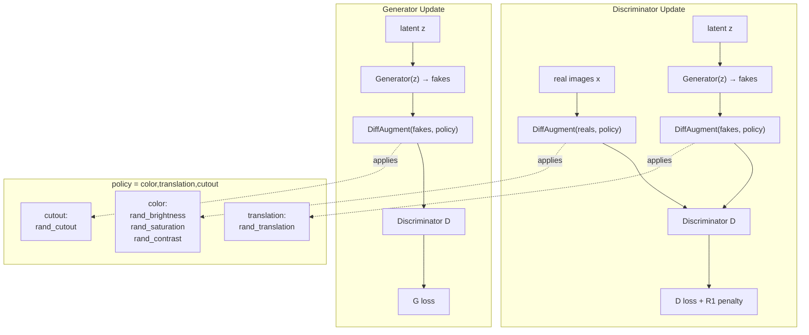
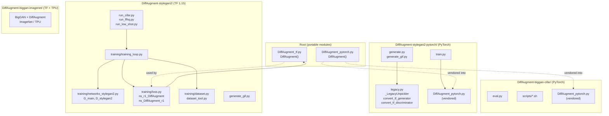

<!-- source: DeepWiki mcp.deepwiki.com · repo mit-han-lab/data-efficient-gans · page 1 Overview · fetched 2026-10-30 -->

# Overview

<details>
<summary>Relevant source files</summary>

The following files were used as context for generating this wiki page:

- [README.md](README.md)
- [imgs/interp.gif](imgs/interp.gif)
- [imgs/method.jpg](imgs/method.jpg)
- [imgs/obama.gif](imgs/obama.gif)

</details>


This page introduces the `data-efficient-gans` repository, explains the DiffAugment technique, maps the repository's sub-systems to their code locations, and shows how to integrate DiffAugment into an existing GAN training loop. For details on any sub-system, see the linked pages below.

---

## What is DiffAugment?

**Differentiable Augmentation (DiffAugment)** is a technique for improving data efficiency in GAN training. The core idea is simple: instead of passing images directly to the discriminator `D`, every input — both real and generated — is first passed through a differentiable augmentation transform `T`. This applies to both the discriminator update and the generator update.

The requirement that `T` be differentiable is the key constraint: because the generator update requires gradients to flow back through `T`, the augmentation operations must support gradient computation with respect to their inputs.

The implemented augmentation policy `'color,translation,cutout'` applies three families of transforms:

| Policy name | Operations |
|---|---|
| `color` | random brightness, saturation, contrast |
| `translation` | random translation with reflection padding |
| `cutout` | random rectangular mask |

The `DiffAugment` function is the single entry point for all transforms. It is provided as two portable modules at the repository root:

| File | Framework |
|---|---|
| `DiffAugment_pytorch.py` | PyTorch |
| `DiffAugment_tf.py` | TensorFlow |

These files have no dependencies beyond the respective framework and can be dropped into any existing codebase.

Sources: [README.md:37-102](), [DiffAugment_pytorch.py](), [DiffAugment_tf.py]()

---

## How DiffAugment Slots Into a GAN Training Loop

The change to an existing GAN codebase is minimal: replace every `D(x)` with `D(T(x))` where `T` is the `DiffAugment` call.

**DiffAugment training loop integration (PyTorch)**

```python
from DiffAugment_pytorch import DiffAugment
policy = 'color,translation,cutout'

# Discriminator update
real_scores = Discriminator(DiffAugment(reals, policy=policy))
fake_scores = Discriminator(DiffAugment(fakes, policy=policy))

# Generator update
fake_scores = Discriminator(DiffAugment(Generator(z), policy=policy))
```

The `DiffAugment` function signature is:
```
DiffAugment(x, policy='', channels_first=True)
```

It accepts a batch tensor `x`, a comma-separated `policy` string, and a `channels_first` flag for NCHW vs. NHWC layout compatibility.

**Diagram: DiffAugment in the GAN training loop**



Sources: [README.md:69-98](), [DiffAugment_pytorch.py]()

---

## Repository Structure

The repository is divided into a shared core at the root and four sub-systems, each targeting a different GAN architecture and/or framework.

| Sub-directory | Architecture | Framework | GPU/TPU |
|---|---|---|---|
| *(root)* | portable DiffAugment modules | PyTorch + TensorFlow | — |
| `DiffAugment-stylegan2/` | StyleGAN2 | TensorFlow 1.15 | GPU |
| `DiffAugment-stylegan2-pytorch/` | StyleGAN2 | PyTorch | GPU |
| `DiffAugment-biggan-cifar/` | BigGAN | PyTorch | GPU |
| `DiffAugment-biggan-imagenet/` | BigGAN | TensorFlow | TPU |

**Diagram: Sub-system map with key code entry points**



Sources: [README.md:1-67]()

---

## The Four Sub-systems

### 1. DiffAugment-stylegan2 (TensorFlow)

The primary reference implementation. Supports unconditional generation on CIFAR-10/100, FFHQ, LSUN, and the custom 100-shot datasets (Obama, grumpy cats, pandas, etc.). Training is launched via `run_low_shot.py`, `run_cifar.py`, or `run_ffhq.py`. Data flows through `dataset_tool.py` to produce TFRecord files, then through a `tf.data` pipeline at runtime.

See page [3](#3) for the full breakdown of this sub-system.

### 2. DiffAugment-stylegan2-pytorch (PyTorch)

A PyTorch port of StyleGAN2 + DiffAugment. Entry point is `train.py`. Includes `legacy.py` for converting TensorFlow `.pkl` checkpoints to PyTorch format, enabling use of pre-trained models from the TF sub-system.

See page [4](#4) for details.

### 3. DiffAugment-biggan-cifar (PyTorch)

BigGAN + DiffAugment for CIFAR-10 and CIFAR-100, running on GPU. Evaluation via `eval.py`, training via shell scripts in `scripts/`.

See page [5](#5) for details.

### 4. DiffAugment-biggan-imagenet (TensorFlow + TPU)

BigGAN + DiffAugment targeting ImageNet-scale training on Google Cloud TPUs.

---

## Supported Datasets

| Dataset | How to reference | Sub-system |
|---|---|---|
| CIFAR-10 / CIFAR-100 | `--dataset=cifar10` | stylegan2 (TF), biggan-cifar |
| FFHQ | TFRecord path | stylegan2 (TF) |
| LSUN | LMDB path | stylegan2 (TF) |
| 100-shot-obama | `--dataset=100-shot-obama` | stylegan2 (TF/PyTorch) |
| 100-shot-grumpy_cat | `--dataset=100-shot-grumpy_cat` | stylegan2 (TF/PyTorch) |
| 100-shot-panda | `--dataset=100-shot-panda` | stylegan2 (TF/PyTorch) |
| AnimalFace (cats/dogs) | folder path | stylegan2 (TF/PyTorch) |
| ImageNet | TFRecord path | biggan-imagenet |

Predefined datasets are downloaded automatically from `data-efficient-gans.mit.edu/datasets/` when referenced by name. In the PyTorch sub-system, a dataset URL can be passed directly:

```bash
python train.py --data=https://data-efficient-gans.mit.edu/datasets/100-shot-obama.zip
```

Sources: [README.md:42-67]()

---

## Quick-start Commands

**Generate a GIF from a pre-trained model (TF sub-system):**
```bash
cd DiffAugment-stylegan2
python generate_gif.py -r mit-han-lab:DiffAugment-stylegan2-100-shot-obama.pkl -o obama.gif
```

**Train from scratch on 100-shot data (TF sub-system):**
```bash
python run_low_shot.py --dataset=100-shot-obama --num-gpus=4
```

**Train from scratch (PyTorch sub-system):**
```bash
cd DiffAugment-stylegan2-pytorch
python train.py --outdir=training-runs \
    --data=https://data-efficient-gans.mit.edu/datasets/100-shot-obama.zip \
    --gpus=1
```

The `mit-han-lab:` prefix in the TF sub-system is a shorthand resolved by `dnnlib`'s `get_path_or_url` utility to `https://data-efficient-gans.mit.edu/models/`. See page [6](#6) for details on the shared `dnnlib` utilities.

Sources: [README.md:42-67]()

---

## Policy Selection Guidance

| Dataset size | Recommended policy |
|---|---|
| ~100 images | `'color,translation,cutout'` (all three) |
| Hundreds to low thousands | `'color,translation'` or experiment |
| Large datasets (tens of thousands+) | A subset: `'color'`, `'translation'`, or `'cutout'` individually |

The vendored copies of `DiffAugment_pytorch.py` in `DiffAugment-stylegan2-pytorch/` and `DiffAugment-biggan-cifar/` are identical to the root `DiffAugment_pytorch.py`. The `DiffAugment_tf.py` at the root is used directly (not vendored) by `DiffAugment-stylegan2/training/loss.py`.

Sources: [README.md:74-99]()

---

