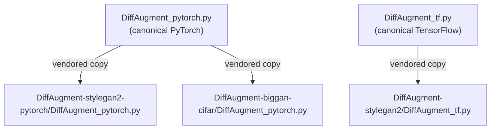
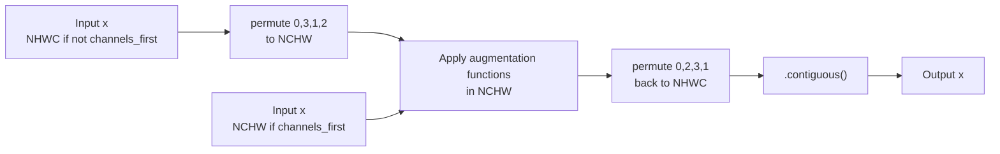
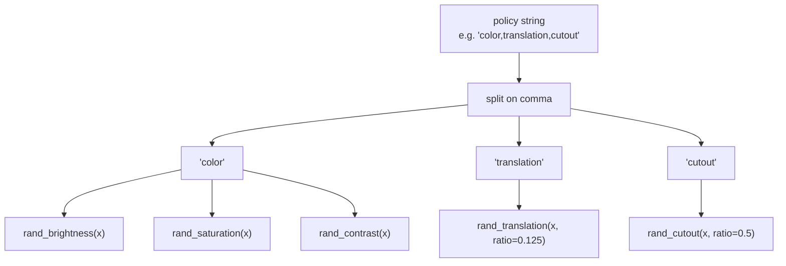
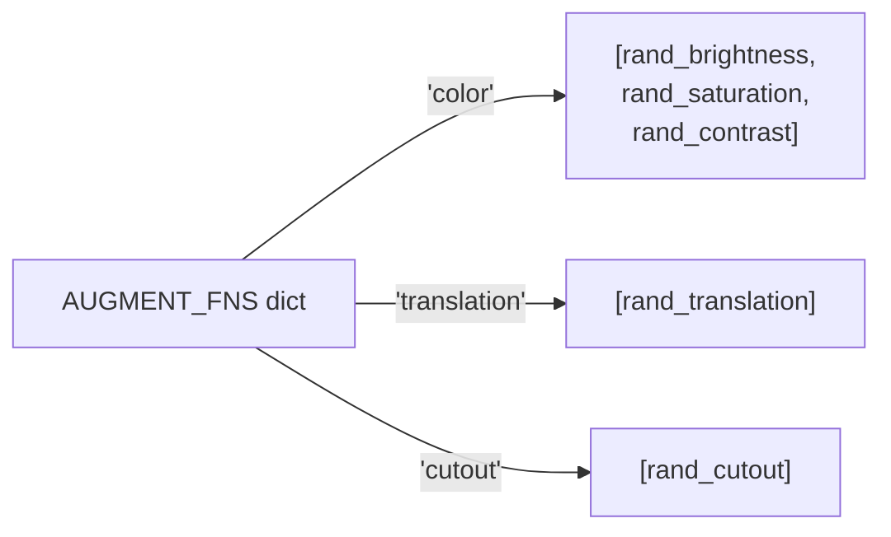

<!-- source: DeepWiki mcp.deepwiki.com · repo mit-han-lab/data-efficient-gans · page 2 DiffAugment Core Module · fetched 2026-10-30 -->

# DiffAugment Core Module

<details>
<summary>Relevant source files</summary>

The following files were used as context for generating this wiki page:

- [DiffAugment-biggan-cifar/DiffAugment_pytorch.py](DiffAugment-biggan-cifar/DiffAugment_pytorch.py)
- [DiffAugment-stylegan2-pytorch/DiffAugment_pytorch.py](DiffAugment-stylegan2-pytorch/DiffAugment_pytorch.py)
- [DiffAugment-stylegan2/DiffAugment_tf.py](DiffAugment-stylegan2/DiffAugment_tf.py)
- [DiffAugment_pytorch.py](DiffAugment_pytorch.py)
- [DiffAugment_tf.py](DiffAugment_tf.py)

</details>


This page documents the two portable, self-contained augmentation modules — `DiffAugment_pytorch.py` and `DiffAugment_tf.py` — that form the foundation of the entire repository. These files implement the `DiffAugment` function and all underlying augmentation primitives. They are the only files you need to add DiffAugment to an existing GAN.

For information on how DiffAugment is wired into specific training loops, see the sub-system pages: [DiffAugment-stylegan2 (TensorFlow)](#3) and [DiffAugment-stylegan2-pytorch](#4).

---

## File Layout

The canonical versions of the two modules live at the repository root. Each sub-system also carries a vendored copy, allowing each sub-system to be used independently without cross-directory imports.

**File distribution diagram:**



All four vendored copies are byte-for-byte identical to the canonical versions. There is no shared import path; each sub-system reads from its local copy.

Sources: [DiffAugment_pytorch.py:1-77](), [DiffAugment_tf.py:1-74](), [DiffAugment-stylegan2-pytorch/DiffAugment_pytorch.py:1-76](), [DiffAugment-biggan-cifar/DiffAugment_pytorch.py:1-77](), [DiffAugment-stylegan2/DiffAugment_tf.py:1-74]()

---

## The `DiffAugment` Function

Both modules expose an identically-named entry point, `DiffAugment`, with the same logical signature. Callers pass a batch of images and a comma-separated policy string; the function applies each named policy's augmentation functions in order and returns the transformed batch.

### PyTorch signature

[DiffAugment_pytorch.py:9-19]()

```
DiffAugment(x, policy='', channels_first=True)
```

| Parameter | Type | Default | Description |
|---|---|---|---|
| `x` | `torch.Tensor` | — | Image batch, shape `(N, C, H, W)` or `(N, H, W, C)` |
| `policy` | `str` | `''` | Comma-separated list of policy names, e.g. `'color,translation,cutout'` |
| `channels_first` | `bool` | `True` | If `False`, input is `NHWC`; the function transposes internally before and after |

### TensorFlow signature

[DiffAugment_tf.py:8-17]()

```
DiffAugment(x, policy='', channels_first=False)
```

| Parameter | Type | Default | Description |
|---|---|---|---|
| `x` | `tf.Tensor` | — | Image batch |
| `policy` | `str` | `''` | Same comma-separated format |
| `channels_first` | `bool` | `False` | TF default is `NHWC`; set `True` for `NCHW` |

> **Note:** The default for `channels_first` is *inverted* between the two modules — `True` for PyTorch (which prefers `NCHW`) and `False` for TensorFlow (which prefers `NHWC`).

If `policy` is an empty string, the function is a no-op and returns `x` unchanged.

Sources: [DiffAugment_pytorch.py:9-19](), [DiffAugment_tf.py:8-17]()

---

## Channel Layout Handling

The channel transposition logic is symmetric: if the input is not in the module's native layout, it is transposed to that layout before augmentation and transposed back afterward.

**PyTorch transposition diagram:**



In TensorFlow, `tf.transpose` is used equivalently with `[0, 2, 3, 1]` and `[0, 3, 1, 2]` index permutations [DiffAugment_tf.py:11-16]().

The final `.contiguous()` call in the PyTorch version [DiffAugment_pytorch.py:18]() ensures memory layout is contiguous after any gather-based indexing performed during translation and cutout.

Sources: [DiffAugment_pytorch.py:9-19](), [DiffAugment_tf.py:8-17]()

---

## Augmentation Policies

The `AUGMENT_FNS` dictionary [DiffAugment_pytorch.py:72-76]() maps each policy name to an ordered list of functions. The `DiffAugment` function iterates over the comma-separated policy names and, for each, calls every function in its list sequentially.



Sources: [DiffAugment_pytorch.py:72-76](), [DiffAugment_pytorch.py:13-15]()

---

### Policy: `color`

The `color` policy applies three independent per-batch random color transformations in sequence. Each magnitude is sampled independently per image in the batch.

| Function | PyTorch location | Operation | Magnitude range |
|---|---|---|---|
| `rand_brightness` | [DiffAugment_pytorch.py:22-24]() | Adds a scalar offset to all pixels | Uniform(`-0.5`, `+0.5`) |
| `rand_saturation` | [DiffAugment_pytorch.py:27-30]() | Scales deviation from per-channel mean | Uniform(`0`, `2`) |
| `rand_contrast` | [DiffAugment_pytorch.py:33-36]() | Scales deviation from global image mean | Uniform(`0.5`, `1.5`) |

**Brightness** adds a per-image scalar `(rand - 0.5)` to the entire image tensor [DiffAugment_pytorch.py:23]().

**Saturation** computes the mean across the channel dimension (`dim=1`) to approximate a grayscale value, then scales the color deviation by a random factor in `[0, 2]`. At 0 the image becomes grayscale; at 2 saturation is doubled [DiffAugment_pytorch.py:28-29]().

**Contrast** computes the global per-image mean across all spatial and channel dimensions (`dim=[1,2,3]`), then scales the deviation by a random factor in `[0.5, 1.5]` [DiffAugment_pytorch.py:34-35]().

All three operations are differentiable with respect to `x`.

Sources: [DiffAugment_pytorch.py:22-36](), [DiffAugment_tf.py:20-37]()

---

### Policy: `translation`

`rand_translation` applies a random integer pixel shift independently to each image in the batch [DiffAugment_pytorch.py:39-52]().

| Parameter | Default | Meaning |
|---|---|---|
| `ratio` | `0.125` | Maximum shift as a fraction of image size |

**Mechanism:**

1. Shift bounds are computed as `int(H * ratio + 0.5)` and `int(W * ratio + 0.5)`.
2. Per-image integer shifts are sampled from `[-shift, +shift]` for both axes independently.
3. The image is padded by 1 pixel on each side using `F.pad` [DiffAugment_pytorch.py:50]().
4. A coordinate grid (`grid_batch`, `grid_x`, `grid_y`) is constructed with `torch.meshgrid`.
5. Grid coordinates are offset by the translation amounts and clamped to the padded image bounds [DiffAugment_pytorch.py:48-49]().
6. The output is gathered from the padded image using advanced indexing [DiffAugment_pytorch.py:51]().

The 1-pixel padding ensures that translated pixels outside the original image boundary are filled with a constant (zero) rather than wrapped. The operation is differentiable because it uses indexing on a padded tensor rather than any non-differentiable branch.

Sources: [DiffAugment_pytorch.py:39-52](), [DiffAugment_tf.py:40-50]()

---

### Policy: `cutout`

`rand_cutout` zeros out a randomly-positioned rectangular region in each image [DiffAugment_pytorch.py:55-69]().

| Parameter | Default | Meaning |
|---|---|---|
| `ratio` | `0.5` | Cutout box side length as a fraction of image size |

**Mechanism:**

1. Cutout size is computed as `int(H * ratio + 0.5)` × `int(W * ratio + 0.5)` — for a 32×32 image with `ratio=0.5` this is 16×16.
2. Random offsets are sampled to position the box center.
3. A coordinate grid of shape `(N, cutout_H, cutout_W)` is built and clamped to image bounds [DiffAugment_pytorch.py:64-65]().
4. A mask tensor of ones, same spatial shape as `x`, is created; the cutout coordinates are set to 0 [DiffAugment_pytorch.py:66-67]().
5. The mask is broadcast over the channel dimension and multiplied with `x` [DiffAugment_pytorch.py:68]().

The multiplication with a mask (rather than an in-place fill) preserves differentiability through the operation.

Sources: [DiffAugment_pytorch.py:55-69](), [DiffAugment_tf.py:53-66]()

---

## `AUGMENT_FNS` Registry

The `AUGMENT_FNS` dictionary is the sole routing table between policy name strings and their implementation functions.



To add a new policy, add a new key to `AUGMENT_FNS` and include the corresponding function(s). The `DiffAugment` function needs no changes — it reads from this dict at runtime [DiffAugment_pytorch.py:13-15]().

Sources: [DiffAugment_pytorch.py:72-76](), [DiffAugment_tf.py:69-73]()

---

## PyTorch vs TensorFlow Implementation Differences

The two modules implement identical augmentation logic but adapt to their framework's conventions.

| Aspect | PyTorch (`DiffAugment_pytorch.py`) | TensorFlow (`DiffAugment_tf.py`) |
|---|---|---|
| Native layout | `NCHW` (`channels_first=True`) | `NHWC` (`channels_first=False`) |
| Layout transposition | `tensor.permute(...)` | `tf.transpose(...)` |
| Random sampling | `torch.rand`, `torch.randint` | `tf.random.uniform` |
| Grid construction | `torch.meshgrid` | `tf.meshgrid(indexing='ij')` |
| Padding | `F.pad` | `tf.pad` |
| Gather / indexing | Advanced tensor indexing | `tf.gather_nd` with `batch_dims=1` |
| Cutout mask zeroing | `scatter_`-style index assignment | `tf.scatter_nd` |
| Memory contiguity | `.contiguous()` after permutes | Not required |
| Differentiable? | Yes | Yes |

Sources: [DiffAugment_pytorch.py:1-77](), [DiffAugment_tf.py:1-74]()

---

## Integration Recipe

To drop DiffAugment into an existing GAN training loop, copy the appropriate single file and wrap the discriminator's image inputs.

**Minimum change (PyTorch):**

```
# copy DiffAugment_pytorch.py alongside your training script
from DiffAugment_pytorch import DiffAugment

policy = 'color,translation,cutout'

# In D update:
real_aug = DiffAugment(real_images, policy=policy)
fake_aug = DiffAugment(fake_images.detach(), policy=policy)
d_loss = criterion(D(real_aug), D(fake_aug))

# In G update:
fake_aug = DiffAugment(fake_images, policy=policy)
g_loss = criterion(D(fake_aug))
```

Key points:

- Apply `DiffAugment` to **both real and fake** images before passing them to the discriminator. Applying to only one breaks the symmetry the discriminator relies on.
- Apply `DiffAugment` in the **G update** as well (without `.detach()`), so gradients can flow back through the augmentation into the generator.
- The augmentation is applied **after** the generator produces images; the generator weights are not directly exposed to the augmented view during the D update.
- If your discriminator consumes `NHWC` tensors, pass `channels_first=False`.

The TensorFlow integration is identical in structure; import from `DiffAugment_tf.py` instead.

Sources: [DiffAugment_pytorch.py:9-19](), [DiffAugment_tf.py:8-17]()

---

