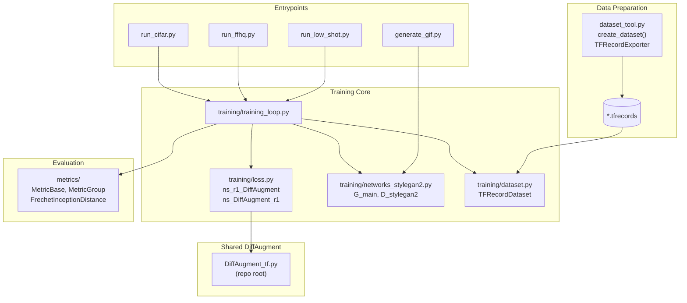
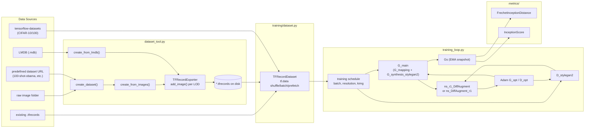

<!-- source: DeepWiki mcp.deepwiki.com · repo mit-han-lab/data-efficient-gans · page 3 DiffAugment-stylegan2 (TensorFlow) · fetched 2026-10-30 -->

# DiffAugment-stylegan2 (TensorFlow)

<details>
<summary>Relevant source files</summary>

The following files were used as context for generating this wiki page:

- [DiffAugment-stylegan2/README.md](DiffAugment-stylegan2/README.md)

</details>


This page covers the `DiffAugment-stylegan2/` sub-directory — a TensorFlow 1.15 implementation of StyleGAN2 with DiffAugment integrated into its training loss. It documents supported datasets, available pre-trained models, prerequisites, and the overall structure of key scripts and components. For details on specific subsystems, see the child pages: [Data Preparation](#3.1), [Training Data Pipeline](#3.2), [Training Scripts](#3.3), [Network Architecture and Training Internals](#3.4), [Evaluation and Metrics](#3.5), and [Generating Images and GIFs](#3.6). For the standalone DiffAugment TensorFlow module (`DiffAugment_tf.py`) shared across sub-systems, see [DiffAugment Core Module](#2). For the PyTorch-based StyleGAN2 variant, see [DiffAugment-stylegan2-pytorch](#4).

---

## Purpose and Scope

`DiffAugment-stylegan2/` applies differentiable augmentation to the StyleGAN2 training loop to improve data efficiency. The augmentation is inserted into the discriminator loss function rather than into the network architecture, making it straightforward to add to an existing StyleGAN2 codebase. This sub-system targets unconditional image generation across three dataset scales: large datasets (FFHQ, LSUN), medium datasets (CIFAR-10, CIFAR-100), and small low-shot datasets (100-shot-obama, AnimalFace, etc.).

---

## Prerequisites

| Requirement | Detail |
|---|---|
| Framework | TensorFlow 1.15 with GPU support |
| `tensorflow-datasets` | Version ≤ 2.1.0 (required for CIFAR datasets) |
| Recommended GPU count | 4 or 8 GPUs with ≥ 12 GB DRAM |
| Custom ops fallback | Pass `--impl=ref` to training scripts if `nvcc` is unavailable |

Sources: [DiffAugment-stylegan2/README.md:1-8]()

---

## Sub-system Component Map

**Diagram: Key files and their roles within `DiffAugment-stylegan2/`**



Sources: [DiffAugment-stylegan2/README.md:1-154]()

---

## Supported Datasets

Three classes of datasets are supported, each with a dedicated training entrypoint.

### CIFAR-10 and CIFAR-100

Loaded via `tensorflow-datasets`; no manual download required. Supports training on the full dataset or a partial sample (e.g., 10%, 20%).

**Training command (full data):**
```bash
python run_cifar.py --dataset=cifar10 --num-gpus=4 --DiffAugment=color,cutout
```

**Training command (partial data):**
```bash
python run_cifar.py --dataset=cifar10 --num-samples=5000 --num-gpus=4 --DiffAugment=color,translation,cutout
```

### FFHQ and LSUN

These datasets require manual download. FFHQ is available from NVIDIA as `.tfrecords` files (e.g., `ffhq-r08.tfrecords` for 256×256). LSUN is available in LMDB format. Both are passed as a folder path to `run_ffhq.py`.

**Training command:**
```bash
python run_ffhq.py --dataset=PATH_TO_FOLDER --num-samples=10000 --num-gpus=8 --resolution=256 --DiffAugment=color,translation,cutout
```

### Low-Shot Datasets

Named datasets such as `100-shot-obama`, `100-shot-grumpy_cat`, `100-shot-panda`, `AnimalFace-cat`, and `AnimalFace-dog` are automatically downloaded. A local folder of images can also be passed directly.

**Training command:**
```bash
python run_low_shot.py --dataset=100-shot-obama --num-gpus=4 --DiffAugment=color,translation,cutout
```

For AnimalFace datasets, training is extended:
```bash
python run_low_shot.py --dataset=AnimalFace-cat --num-gpus=4 --DiffAugment=color,translation,cutout --total-kimg=500
```

Sources: [DiffAugment-stylegan2/README.md:22-131]()

---

## DiffAugment Policies Used

| Policy string | Transformations applied |
|---|---|
| `color,cutout` | Used for CIFAR full-data experiments |
| `color,translation,cutout` | Used for partial data, FFHQ, LSUN, and low-shot experiments |
| `""` (empty string) | Disables DiffAugment; runs the StyleGAN2 baseline |

The policy string is passed via `--DiffAugment=` and forwarded into `training/loss.py`, which calls `DiffAugment_tf.py` from the repo root. See [DiffAugment Core Module](#2) for the definition of each transformation.

Sources: [DiffAugment-stylegan2/README.md:27-38]()

---

## Pre-Trained Models

All pre-trained models are referenced using the `mit-han-lab:` shorthand (resolved by `dnnlib.util.open_url`; see [Shared Utilities](#6)) and are automatically downloaded when specified via `--resume=`.

### CIFAR Models

| Model name | Dataset | IS (10k) | FID (10k) |
|---|---|---|---|
| `mit-han-lab:stylegan2-cifar10.pkl` | CIFAR-10 (100%) | 9.18 | 11.07 |
| `mit-han-lab:DiffAugment-stylegan2-cifar10.pkl` | CIFAR-10 (100%) | **9.40** | **9.89** |
| `mit-han-lab:stylegan2-cifar10-0.2.pkl` | CIFAR-10 (20%) | 8.28 | 23.08 |
| `mit-han-lab:DiffAugment-stylegan2-cifar10-0.2.pkl` | CIFAR-10 (20%) | **9.21** | **12.15** |
| `mit-han-lab:stylegan2-cifar10-0.1.pkl` | CIFAR-10 (10%) | 7.33 | 36.02 |
| `mit-han-lab:DiffAugment-stylegan2-cifar10-0.1.pkl` | CIFAR-10 (10%) | **8.84** | **14.50** |
| `mit-han-lab:stylegan2-cifar100.pkl` | CIFAR-100 (100%) | 9.51 | 16.54 |
| `mit-han-lab:DiffAugment-stylegan2-cifar100.pkl` | CIFAR-100 (100%) | **10.04** | **15.22** |
| `mit-han-lab:stylegan2-cifar100-0.2.pkl` | CIFAR-100 (20%) | 7.86 | 32.30 |
| `mit-han-lab:DiffAugment-stylegan2-cifar100-0.2.pkl` | CIFAR-100 (20%) | **9.82** | **16.65** |
| `mit-han-lab:stylegan2-cifar100-0.1.pkl` | CIFAR-100 (10%) | 7.01 | 45.87 |
| `mit-han-lab:DiffAugment-stylegan2-cifar100-0.1.pkl` | CIFAR-100 (10%) | **9.06** | **20.75** |

### FFHQ and LSUN Models

| Model name | Dataset | FID (50k train) |
|---|---|---|
| `mit-han-lab:stylegan2-ffhq.pkl` | FFHQ (70k) | **3.81** |
| `mit-han-lab:DiffAugment-stylegan2-ffhq.pkl` | FFHQ (70k) | 4.24 |
| `mit-han-lab:DiffAugment-stylegan2-ffhq-30k.pkl` | FFHQ (30k) | **5.05** |
| `mit-han-lab:DiffAugment-stylegan2-ffhq-10k.pkl` | FFHQ (10k) | **7.86** |
| `mit-han-lab:DiffAugment-stylegan2-ffhq-5k.pkl` | FFHQ (5k) | **10.45** |
| `mit-han-lab:DiffAugment-stylegan2-ffhq-1k.pkl` | FFHQ (1k) | **25.66** |
| `mit-han-lab:DiffAugment-stylegan2-lsun-cat-30k.pkl` | LSUN-Cat (30k) | **9.68** |
| `mit-han-lab:DiffAugment-stylegan2-lsun-cat-10k.pkl` | LSUN-Cat (10k) | **12.07** |
| `mit-han-lab:DiffAugment-stylegan2-lsun-cat-5k.pkl` | LSUN-Cat (5k) | **16.11** |
| `mit-han-lab:DiffAugment-stylegan2-lsun-cat-1k.pkl` | LSUN-Cat (1k) | **42.26** |

### Low-Shot Models

| Model name | Dataset | FID (5k train) |
|---|---|---|
| `mit-han-lab:stylegan2-100-shot-obama.pkl` | 100-shot-obama | 80.20 |
| `mit-han-lab:DiffAugment-stylegan2-100-shot-obama.pkl` | 100-shot-obama | **46.87** |
| `mit-han-lab:stylegan2-100-shot-grumpy_cat.pkl` | 100-shot-grumpy_cat | 48.90 |
| `mit-han-lab:DiffAugment-stylegan2-100-shot-grumpy_cat.pkl` | 100-shot-grumpy_cat | **27.08** |
| `mit-han-lab:stylegan2-100-shot-panda.pkl` | 100-shot-panda | 34.27 |
| `mit-han-lab:DiffAugment-stylegan2-100-shot-panda.pkl` | 100-shot-panda | **12.06** |
| `mit-han-lab:stylegan2-AnimalFace-cat.pkl` | AnimalFace-cat | 71.71 |
| `mit-han-lab:DiffAugment-stylegan2-AnimalFace-cat.pkl` | AnimalFace-cat | **42.44** |
| `mit-han-lab:stylegan2-AnimalFace-dog.pkl` | AnimalFace-dog | 130.19 |
| `mit-han-lab:DiffAugment-stylegan2-AnimalFace-dog.pkl` | AnimalFace-dog | **58.85** |

Sources: [DiffAugment-stylegan2/README.md:40-154]()

---

## Evaluation Mode

Each training script supports an `--eval` flag that skips training and runs metric computation against a loaded checkpoint.

| Script | Eval command pattern |
|---|---|
| `run_cifar.py` | `python run_cifar.py --dataset=cifar10 --resume=WHICH_MODEL --eval` |
| `run_ffhq.py` | `python run_ffhq.py --dataset=PATH --resume=WHICH_MODEL --num-gpus=N --eval` |
| `run_low_shot.py` | `python run_low_shot.py --dataset=WHICH_DATASET --resume=WHICH_MODEL --eval` |

Use `--num-repeats=N` on CIFAR to compute means and standard deviations over multiple runs. A standard deviation under 1% relative to the reported value is expected.

Sources: [DiffAugment-stylegan2/README.md:42-65]()

---

## High-Level Data and Training Flow

**Diagram: End-to-end flow from raw data to trained checkpoint**



Sources: [DiffAugment-stylegan2/README.md:1-154]()

---

## Generating an Interpolation GIF

A latent-space interpolation animation can be produced from any checkpoint without running training:

```bash
python generate_gif.py --resume=mit-han-lab:DiffAugment-stylegan2-100-shot-obama.pkl --output=obama.gif
```

The `--resume` argument accepts a local `.pkl` path or any `mit-han-lab:` model shorthand. Details of the generation process are covered in [Generating Images and GIFs](#3.6).

Sources: [DiffAugment-stylegan2/README.md:10-21]()

---

## Preparing Custom Low-Shot Datasets

Any folder of images can be passed directly to `run_low_shot.py` as `--dataset`. The pipeline will:

1. Resize images to the specified `--resolution` (default 256).
2. Cache the result as `*.tfrecords` and `*.pkl` files in the same folder.
3. Run training for `--total-kimg` thousand images (default 300k).

> **Note:** If training images in the folder change after an initial run, manually delete the cached `*.tfrecords` and `*.pkl` files before restarting training.

Sources: [DiffAugment-stylegan2/README.md:126-131]()

---

