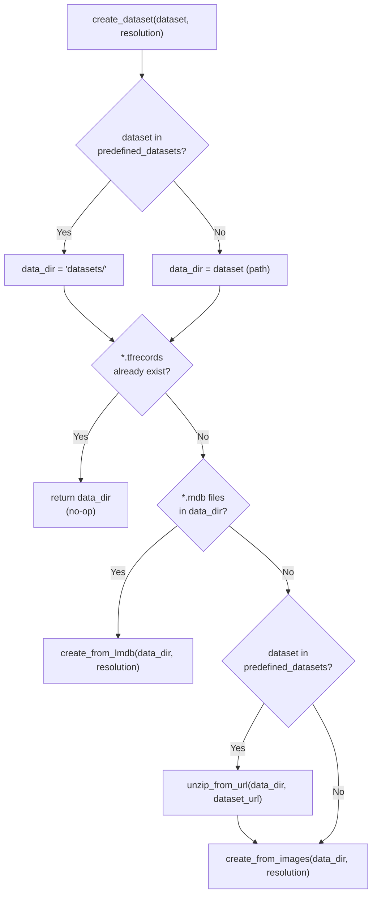
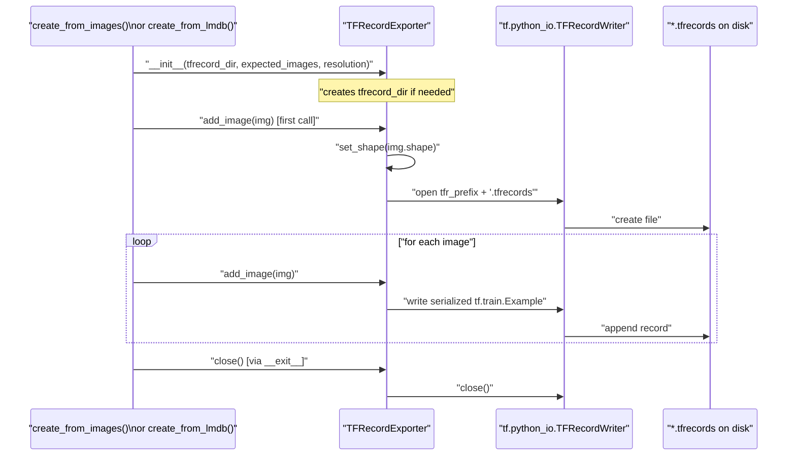
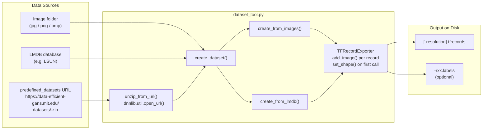

<!-- source: DeepWiki mcp.deepwiki.com · repo mit-han-lab/data-efficient-gans · page 3.1 Data Preparation · fetched 2026-10-30 -->

# Data Preparation

Relevant source files

The following files were used as context for generating this wiki page:

- [DiffAugment-stylegan2/training/dataset_tool.py](DiffAugment-stylegan2/training/dataset_tool.py)

This page covers how raw data sources are converted into multi-resolution TFRecord files suitable for consumption by the StyleGAN2 training pipeline. The primary file is `DiffAugment-stylegan2/training/dataset_tool.py`.

For how the resulting TFRecord files are read at training time (shuffle, batch, prefetch), see the Training Data Pipeline page [3.2](#3.2). For the training scripts that invoke `create_dataset()` as part of their startup sequence, see Training Scripts [3.3](#3.3).

---

## Overview

The TensorFlow StyleGAN2 sub-system does not read raw images on the fly during training. Instead, images are pre-converted into TFRecord files on disk. `dataset_tool.py` is the tool responsible for this conversion. It accepts three kinds of data sources:

| Source type | How detected | Handler |
|---|---|---|
| Raw image folder (jpg/png/bmp) | Files with image extension | `create_from_images()` |
| LMDB database (e.g. LSUN) | Presence of `*.mdb` files | `create_from_lmdb()` |
| Predefined downloadable dataset | Name in `predefined_datasets` list | `unzip_from_url()` → `create_from_images()` |

CIFAR-10 and CIFAR-100 are handled differently — they are loaded directly from TensorFlow Datasets at runtime and do not go through `dataset_tool.py`. That path is documented in [3.2](#3.2).

---

## `create_dataset()` — Main Entry Point

[DiffAugment-stylegan2/training/dataset_tool.py:182-201]()

`create_dataset(dataset, resolution=None)` is the top-level function called by training scripts. It:

1. Checks whether `dataset` is a name in `predefined_datasets`. If so, sets `data_dir = 'datasets/<dataset>'` and creates that directory.
2. Otherwise, treats `dataset` as a path to an existing directory.
3. Short-circuits immediately if matching `*.tfrecords` files already exist in `data_dir` (no re-processing).
4. Detects LMDB format by looking for `*.mdb` files, and routes to `create_from_lmdb()`.
5. For predefined datasets with no local images yet, calls `unzip_from_url()` to download and extract the zip archive.
6. Falls through to `create_from_images()` for plain image folders.

**Diagram: `create_dataset()` dispatch logic**

Sources: [DiffAugment-stylegan2/training/dataset_tool.py:182-201]()

---

## Predefined Datasets

[DiffAugment-stylegan2/training/dataset_tool.py:204-214]()

The `predefined_datasets` list names datasets that can be automatically downloaded from `https://data-efficient-gans.mit.edu/datasets/<name>.zip`. Passing any of these names as the `dataset` argument to `create_dataset()` will trigger an automatic download if the local folder is empty.

| Dataset name | Description |
|---|---|
| `100-shot-obama` | 100 images of Barack Obama |
| `100-shot-grumpy_cat` | 100 images of Grumpy Cat |
| `100-shot-panda` | 100 images of pandas |
| `100-shot-bridge_of_sighs` | 100 images, Bridge of Sighs |
| `100-shot-medici_fountain` | 100 images, Medici Fountain |
| `100-shot-temple_of_heaven` | 100 images, Temple of Heaven |
| `100-shot-wuzhen` | 100 images, Wuzhen |
| `AnimalFace-cat` | AnimalFace cat subset |
| `AnimalFace-dog` | AnimalFace dog subset |

The download is performed by `unzip_from_url()` [DiffAugment-stylegan2/training/dataset_tool.py:106-109](), which calls `dnnlib.util.open_url()` (with `.stylegan2-cache` as the local cache directory) and then extracts the zip file to `data_dir`. For details on `dnnlib.util.open_url`, see [6](#6).

Sources: [DiffAugment-stylegan2/training/dataset_tool.py:106-109](), [DiffAugment-stylegan2/training/dataset_tool.py:204-214]()

---

## `create_from_images()` — Image Folder to TFRecords

[DiffAugment-stylegan2/training/dataset_tool.py:147-179]()

Accepts a directory of flat image files (jpg, jpeg, png, bmp). Key behaviors:

- Collects all supported image files using `glob` and sorts them.
- Reads the first image to detect resolution and channel count. If `resolution` is not specified, the first image's height is used.
- Validates that resolution is a power of two and channels are 1 or 3.
- Optionally shuffles the write order via `TFRecordExporter.choose_shuffled_order()` (default: `shuffle=True`).
- Converts images from HWC layout to CHW layout (`img.transpose([2, 0, 1])`).
- Writes all images to a single `.tfrecords` file via `TFRecordExporter.add_image()`.
- Returns `tfrecord_dir`.

Sources: [DiffAugment-stylegan2/training/dataset_tool.py:147-179]()

---

## `create_from_lmdb()` — LMDB to TFRecords

[DiffAugment-stylegan2/training/dataset_tool.py:112-144]()

Accepts a path to an LMDB database (commonly used for LSUN datasets). Key behaviors:

- Requires `lmdb` and `cv2` Python packages.
- Opens the LMDB in read-only mode and reads `txn.stat()['entries']` to determine total image count.
- Decodes each entry with `cv2.imdecode()`, falling back to `PIL.Image` if that fails.
- Center-crops each image to a square, resizes to `resolution × resolution` using `PIL.Image.ANTIALIAS`.
- Converts BGR (OpenCV) to RGB.
- Transposes to CHW and calls `TFRecordExporter.add_image()`.
- Supports a `max_images` argument to cap the number of images written.
- Returns `tfrecord_dir`.

Sources: [DiffAugment-stylegan2/training/dataset_tool.py:112-144]()

---

## `TFRecordExporter` — TFRecord Writer

[DiffAugment-stylegan2/training/dataset_tool.py:29-103]()

`TFRecordExporter` is the class that manages writing images to TFRecord files on disk. It is used as a context manager (`with TFRecordExporter(...) as tfr:`).

**Diagram: `TFRecordExporter` internals and call sequence**

### Key methods

| Method | Description |
|---|---|
| `__init__(tfrecord_dir, expected_images, resolution, ...)` | Creates output directory, sets the file prefix. If `resolution` is given, appends `-<resolution>` to the prefix. |
| `set_shape(shape)` | Called on first `add_image()`. Computes `resolution_log2`, validates the shape is square and power-of-two, opens the TFRecord writer. |
| `add_image(img)` | Serializes a CHW NumPy array as a `tf.train.Example` with `shape` and `data` fields. Iterates over `self.tfr_writers` for multi-LOD output. |
| `add_labels(labels)` | Saves a `(N,)` int32 NumPy array as `<prefix>-rxx.labels` beside the TFRecord file. |
| `choose_shuffled_order()` | Returns a shuffled index array (fixed seed 123) for deterministic shuffling. |
| `close()` | Flushes and closes all TFRecord writers. Called automatically by `__exit__`. |

### TFRecord record format

Each record is a serialized `tf.train.Example` containing two features:

| Feature key | Type | Content |
|---|---|---|
| `shape` | `Int64List` | `[C, H, W]` of the image |
| `data` | `BytesList` | Raw uint8 bytes of the CHW array |

The `add_image()` method also applies 2× box-filter downsampling when writing multi-LOD TFRecords (iterating over `self.tfr_writers`), though in practice the current code typically configures a single writer per dataset [DiffAugment-stylegan2/training/dataset_tool.py:80-88]().

Sources: [DiffAugment-stylegan2/training/dataset_tool.py:29-103]()

---

## End-to-End Data Flow

**Diagram: Data sources to TFRecords**

Sources: [DiffAugment-stylegan2/training/dataset_tool.py:106-214]()

---

## File Naming Conventions

The output file name is constructed from the directory name and, optionally, the target resolution:

- **Without resolution**: `<dir>/<dir_basename>.tfrecords`  
  Example: `datasets/100-shot-obama/100-shot-obama.tfrecords`

- **With resolution**: `<dir>/<dir_basename>-<resolution>.tfrecords`  
  Example: `datasets/AnimalFace-dog/AnimalFace-dog-256.tfrecords`

The `tfr_prefix` is set in `TFRecordExporter.__init__()` [DiffAugment-stylegan2/training/dataset_tool.py:31-33]().

`create_dataset()` uses a `glob` pattern to detect pre-existing files and skip re-processing [DiffAugment-stylegan2/training/dataset_tool.py:193-194]().

Sources: [DiffAugment-stylegan2/training/dataset_tool.py:29-48](), [DiffAugment-stylegan2/training/dataset_tool.py:182-201]()

---

