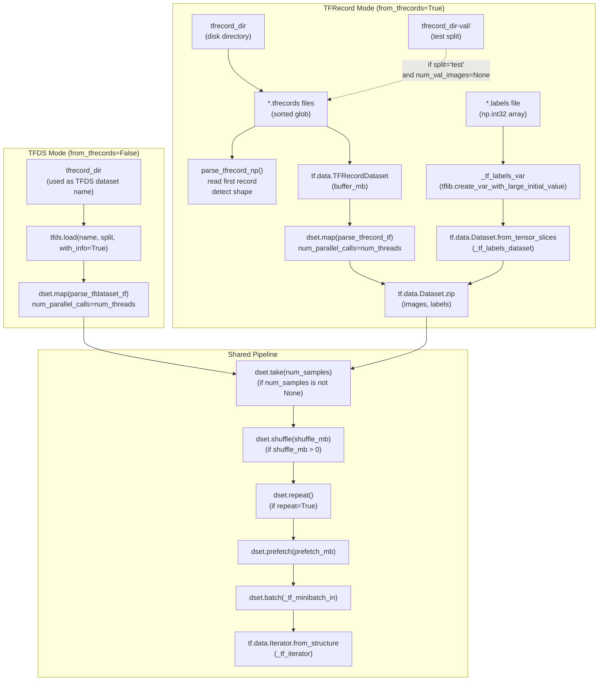
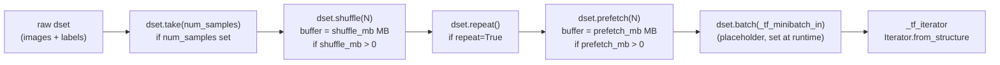
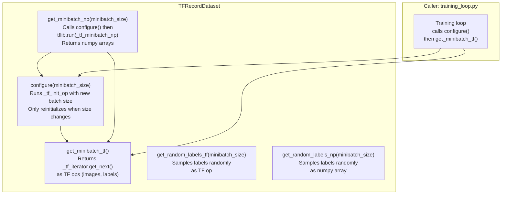

<!-- source: DeepWiki mcp.deepwiki.com · repo mit-han-lab/data-efficient-gans · page 3.2 Training Data Pipeline · fetched 2026-10-30 -->

# Training Data Pipeline

<details>
<summary>Relevant source files</summary>

The following files were used as context for generating this wiki page:

- [DiffAugment-stylegan2/training/dataset.py](DiffAugment-stylegan2/training/dataset.py)

</details>


This page documents the **runtime** data pipeline used during training in the `DiffAugment-stylegan2` (TensorFlow) sub-system. It covers the `TFRecordDataset` class in [DiffAugment-stylegan2/training/dataset.py](), which reads prepared data and streams minibatches to the training loop.

For how raw images, LMDB databases, and downloadable datasets are converted into the on-disk TFRecord format that this pipeline reads, see the Data Preparation page ([3.1](#3.1)). For how the training loop calls into this pipeline, see Network Architecture and Training Internals ([3.4](#3.4)).

---

## Overview

The pipeline is encapsulated in a single class, `TFRecordDataset`, which supports two distinct data source modes:

| Mode | `from_tfrecords` | Source |
|---|---|---|
| TFRecord mode | `True` | Pre-built `.tfrecords` files on disk (see [3.1](#3.1)) |
| TFDS mode | `False` | Streamed directly from `tensorflow_datasets` (e.g., CIFAR-10/100) |

Both modes produce a unified interface: a `tf.data` pipeline that yields `(images, labels)` pairs in `[N, C, H, W]` format.

The helper function `load_dataset()` at the bottom of the file is the normal entry point used by callers such as `training_loop.py`; it instantiates `TFRecordDataset` by name and returns it.

Sources: [DiffAugment-stylegan2/training/dataset.py:1-20]()

---

## TFRecordDataset Class

**Class:** `TFRecordDataset` ([DiffAugment-stylegan2/training/dataset.py:22-232]())

### Constructor Parameters

| Parameter | Type | Default | Description |
|---|---|---|---|
| `tfrecord_dir` | `str` | — | Directory containing `.tfrecords` files, or TFDS dataset name if `from_tfrecords=False` |
| `split` | `str` | `'train'` | `'train'` or `'test'` |
| `from_tfrecords` | `bool` | `False` | Whether to load from disk TFRecords or from `tensorflow_datasets` |
| `tfds_data_dir` | `str` | `None` | Directory for TFDS cache; passed to `tfds.load` |
| `resolution` | `int` | `None` | Target resolution; `None` = autodetect from files |
| `label_file` | `str` | `None` | Path to `.labels` file; `None` = autodetect |
| `max_label_size` | `int` | `0` | `0` = no labels, `'full'` or positive int = use class labels |
| `num_samples` | `int` | `None` | Cap on number of training images; `None` = use all |
| `num_val_images` | `int` | `None` | Number of images to split off as validation; `None` = use a separate `-val` directory |
| `repeat` | `bool` | `True` | Whether to repeat the dataset indefinitely |
| `shuffle_mb` | `int` | `4096` | Shuffle buffer in MB; `0` = disable |
| `prefetch_mb` | `int` | `2048` | Prefetch buffer in MB; `0` = disable |
| `buffer_mb` | `int` | `256` | Read buffer in MB for `TFRecordDataset` |
| `num_threads` | `int` | `2` | Parallel threads for `dset.map()` calls |

Sources: [DiffAugment-stylegan2/training/dataset.py:23-37]()

---

## Data Source Modes

### Diagram: Two Data Paths into the Unified tf.data Pipeline



Sources: [DiffAugment-stylegan2/training/dataset.py:60-161]()

---

## Resolution Detection

After the data source is set up, the constructor determines the dataset's spatial dimensions.

**TFRecord mode:** The constructor lists all `*.tfrecords` files in the directory, reads the first record from each using `parse_tfrecord_np()`, and collects their shapes. It then selects:
- The shape with the **maximum number of elements** (i.e., the highest resolution) if `resolution=None`.
- The shape whose max spatial dimension matches the requested `resolution` if one is specified.

[DiffAugment-stylegan2/training/dataset.py:84-91]()

**TFDS mode:** Shape is read directly from `tf.compat.v1.data.get_output_shapes(dset)`.

[DiffAugment-stylegan2/training/dataset.py:124-124]()

**Resize flag:** If the stored resolution differs from the requested `resolution`, a `resize=True` flag is passed to the parse functions, which apply `tf.image.resize` during mapping.

After detection, the constructor sets three key attributes:

```
self.resolution       # int, e.g. 256
self.resolution_log2  # int, e.g. 8  (ceil(log2(resolution)))
self.shape            # [channels, height, width]
```

[DiffAugment-stylegan2/training/dataset.py:126-133]()

---

## Label Handling

### TFRecord mode

Labels are stored in a separate `.labels` file alongside the TFRecords. The constructor:

1. **Autodetects** the label file by globbing for `*.labels` in the data directory ([DiffAugment-stylegan2/training/dataset.py:75-82]()).
2. Loads it into `self._np_labels` as a flat `np.int32` array.
3. Wraps it in a TensorFlow variable (`_tf_labels_var`) so it can be read on the GPU.
4. Creates `_tf_labels_dataset` by slicing that variable, then zips it with the image dataset.

If `max_label_size == 0` or no label file is found, `self.label_size` is set to `0` and a zero-filled array is used.

### TFDS mode

Labels are embedded in each TFDS record (`record['label']`). `parse_tfdataset_tf()` extracts both `image` and `label` together. `self.label_size` is set from `info.features['label'].num_classes`.

### Train/Test Split of Labels

When `num_val_images` is specified, the label array is also sliced to match the image split:

```
test  split: _np_labels[:num_val_images]
train split: _np_labels[num_val_images:]
```

[DiffAugment-stylegan2/training/dataset.py:105-113]()

---

## Record Parsing Functions

Three parsing functions handle the raw data-to-tensor conversion:

| Function | Used in | Input | Output |
|---|---|---|---|
| `parse_tfrecord_tf(record, resize)` | `dset.map()`, TFRecord mode | Serialized `tf.train.Example` | `uint8` tensor `[C, H, W]` |
| `parse_tfdataset_tf(record, resize)` | `dset.map()`, TFDS mode | Dict `{'image': ..., 'label': ...}` | `(image, label)` tensors |
| `parse_tfrecord_np(record)` (static) | Constructor, shape probing | Raw bytes string | `np.ndarray [C, H, W]` |

**Key detail:** Both TF parse functions transpose from `[H, W, C]` (TF convention) to `[C, H, W]` (the training code's expected format). `parse_tfrecord_tf` does this via `tf.reshape` with the stored `shape` feature; `parse_tfdataset_tf` does it via `tf.transpose(image, [2, 0, 1])`.

Sources: [DiffAugment-stylegan2/training/dataset.py:205-232]()

---

## Shuffle, Repeat, Prefetch, and Batch

The pipeline applies these `tf.data` transformations in a fixed order:

**Diagram: tf.data Transformation Order**



Buffer sizes are computed from megabyte budgets and the per-item byte size:
```
buffer_count = ((mb << 20) - 1) // bytes_per_item + 1
```

The `batch()` call uses `_tf_minibatch_in`, a `tf.placeholder` of type `int64`, which allows the batch size to be changed at runtime without rebuilding the graph.

Sources: [DiffAugment-stylegan2/training/dataset.py:147-161]()

---

## Public Interface

### Diagram: Public API of TFRecordDataset



### `configure(minibatch_size)`

[DiffAugment-stylegan2/training/dataset.py:167-171]()

Reinitializes the iterator with the new batch size by running `_tf_init_op`. It caches `_cur_minibatch` so re-calling with the same size is a no-op.

### `get_minibatch_tf()`

[DiffAugment-stylegan2/training/dataset.py:174-175]()

Returns `_tf_iterator.get_next()` — a pair of TensorFlow ops `(images, labels)`. Must be called after `configure()`. Used in the main training graph.

### `get_minibatch_np(minibatch_size)`

[DiffAugment-stylegan2/training/dataset.py:178-183]()

Calls `configure()` and then evaluates the minibatch ops via `tflib.run()`, returning `(images, labels)` as NumPy arrays. Caches the TF op in `_tf_minibatch_np` so it is only built once.

### `get_random_labels_tf(minibatch_size)` / `get_random_labels_np(minibatch_size)`

[DiffAugment-stylegan2/training/dataset.py:185-202]()

Used when the generator needs class-conditional labels sampled independently of the image order (e.g., for the generator's conditioning input). For TFRecord mode, labels are gathered from `_tf_labels_var`. For TFDS mode and the unconditional case, uniform random integers or zeros are returned.

---

## `load_dataset()` Helper

[DiffAugment-stylegan2/training/dataset.py:238-254]()

```
load_dataset(class_name=None, data_dir=None, verbose=False, **kwargs)
```

This function is the standard call site used by the training loop. It:

1. Defaults `class_name` to `training.dataset.TFRecordDataset` when `tfrecord_dir` is present in `kwargs`.
2. Prepends `data_dir` to `kwargs['tfrecord_dir']` if `data_dir` is given.
3. Instantiates the class by name via `dnnlib.util.get_obj_by_name()` (see [6](#6) for dnnlib utilities).
4. Optionally prints shape, dynamic range, and label size if `verbose=True`.

---

## Key Internal Attributes

| Attribute | Description |
|---|---|
| `self.name` | Dataset name (basename of `tfrecord_dir`, or TFDS name) |
| `self.shape` | `[C, H, W]` — image shape |
| `self.resolution` | Spatial resolution (assumes square images) |
| `self.resolution_log2` | `ceil(log2(resolution))` |
| `self.dtype` | Always `'uint8'` |
| `self.dynamic_range` | Always `[0, 255]` |
| `self.label_size` | Number of label classes; `0` if unlabeled |
| `self.num_samples` | Total number of usable images |
| `self._np_labels` | Label array in NumPy (TFRecord mode only) |
| `self._tf_labels_var` | TF variable wrapping `_np_labels` |
| `self._tf_iterator` | The stateful `tf.data.Iterator` |
| `self._tf_init_op` | Op to reinitialize the iterator with a new batch size |
| `self._cur_minibatch` | Cached batch size to avoid redundant reinitializations |

Sources: [DiffAugment-stylegan2/training/dataset.py:39-57]()

---

