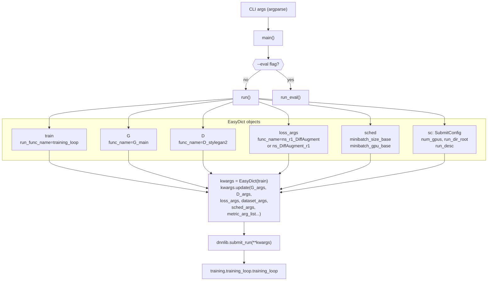
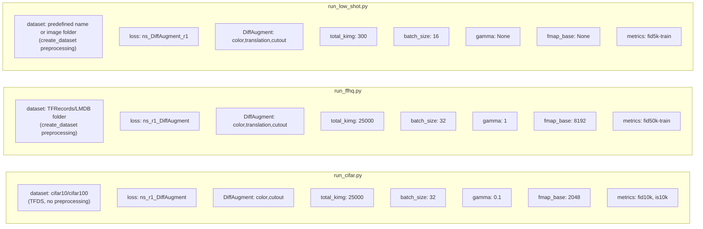

<!-- source: DeepWiki mcp.deepwiki.com · repo mit-han-lab/data-efficient-gans · page 3.3 Training Scripts · fetched 2026-10-30 -->

# Training Scripts

<details>
<summary>Relevant source files</summary>

The following files were used as context for generating this wiki page:

- [DiffAugment-stylegan2/README.md](DiffAugment-stylegan2/README.md)
- [DiffAugment-stylegan2/run_cifar.py](DiffAugment-stylegan2/run_cifar.py)
- [DiffAugment-stylegan2/run_ffhq.py](DiffAugment-stylegan2/run_ffhq.py)
- [DiffAugment-stylegan2/run_low_shot.py](DiffAugment-stylegan2/run_low_shot.py)
- [imgs/low-shot-comparison.jpg](imgs/low-shot-comparison.jpg)
- [imgs/low-shot-interp.jpg](imgs/low-shot-interp.jpg)

</details>


This page covers the three training entrypoint scripts in the `DiffAugment-stylegan2/` sub-system: `run_cifar.py`, `run_ffhq.py`, and `run_low_shot.py`. Each script parses command-line arguments, assembles `EasyDict` configuration objects, and dispatches the training loop via `dnnlib.submit_run`.

For the training loop and network internals that these scripts invoke, see [Network Architecture and Training Internals](#3.4). For how datasets are preprocessed into TFRecords before training, see [Data Preparation](#3.1). For evaluation metrics invoked at the end of a run, see [Evaluation and Metrics](#3.5).

---

## Overview

All three scripts follow the same structural pattern. Each contains:

- A `main()` function that parses arguments and branches on `--eval`.
- A `run()` function that builds configuration objects and calls `dnnlib.submit_run`.
- A `run_eval()` function that directly invokes `MetricGroup.run` against a checkpoint.

**Script-to-Dataset Mapping**

| Script | Target Dataset(s) | Data Source |
|---|---|---|
| `run_cifar.py` | CIFAR-10, CIFAR-100 | TensorFlow Datasets (TFDS); no preprocessing needed |
| `run_ffhq.py` | FFHQ, LSUN (via TFRecords or LMDB) | `dataset_tool.create_dataset()` converts to TFRecords |
| `run_low_shot.py` | 100-shot datasets, AnimalFace, custom image folders | `dataset_tool.create_dataset()` converts to TFRecords |

---

## Common Configuration Pattern

All three `run()` functions construct the same set of `EasyDict` objects before dispatching. The objects mirror the parameter names accepted by `training.training_loop.training_loop`.

**Configuration Object Assembly**

```
run_cifar.py / run_ffhq.py / run_low_shot.py → run()
```

Each `run()` creates:

| Variable | `EasyDict` Key | Resolved Target |
|---|---|---|
| `train` | `run_func_name` | `'training.training_loop.training_loop'` |
| `G` | `func_name` | `'training.networks_stylegan2.G_main'` |
| `D` | `func_name` | `'training.networks_stylegan2.D_stylegan2'` |
| `G_opt` | `beta1`, `beta2`, `epsilon` | Adam optimizer params |
| `D_opt` | `beta1`, `beta2`, `epsilon` | Adam optimizer params |
| `loss_args` | `func_name` | `'training.loss.ns_r1_DiffAugment'` or `'training.loss.ns_DiffAugment_r1'` |
| `sched` | *(empty, filled in)* | `TrainingSchedule` params |
| `grid` | `size`, `layout` | Snapshot grid config |
| `sc` | `num_gpus`, etc. | `dnnlib.SubmitConfig` |
| `tf_config` | `rnd.np_random_seed` | `1000` |

After building these, all three scripts merge them into a single `kwargs` dict and call `dnnlib.submit_run(**kwargs)`. The `run_func_name` field tells `dnnlib` which Python function to invoke in the spawned process.

[DiffAugment-stylegan2/run_cifar.py:23-90]()

Sources: `DiffAugment-stylegan2/run_cifar.py`, `DiffAugment-stylegan2/run_ffhq.py`, `DiffAugment-stylegan2/run_low_shot.py`

---

## Dispatch Flow

**Title: run() → dnnlib.submit_run dispatch**



Sources: `DiffAugment-stylegan2/run_cifar.py:23-90`, `DiffAugment-stylegan2/run_ffhq.py:24-94`, `DiffAugment-stylegan2/run_low_shot.py:24-94`

---

## `run_cifar.py`

### Purpose

Trains StyleGAN2 on CIFAR-10 or CIFAR-100. CIFAR datasets are loaded directly from TensorFlow Datasets — no TFRecord preprocessing step is needed. The `dataset` argument is passed verbatim as `tfrecord_dir` in `dataset_args`.

### CLI Arguments

[DiffAugment-stylegan2/run_cifar.py:124-160]()

| Argument | Default | Notes |
|---|---|---|
| `--dataset` | `cifar10` | `cifar10` or `cifar100` |
| `--resolution` | `None` | Optional; passed to dataset args |
| `--DiffAugment` | `color,cutout` | Full data default; use `color,translation,cutout` for partial data |
| `--num-gpus` | `1` | Recommend 4–8 for paper results |
| `--batch-size` | `None` (→ 32) | Must be divisible by `num-gpus` |
| `--total-kimg` | `25000` | ~2 days training |
| `--ema-kimg` | `1000` | EMA generator half-life |
| `--num-samples` | `None` | Limit dataset size (e.g. 5000 for 10%) |
| `--gamma` | `0.1` | R1 regularization weight |
| `--fmap-base` | `2048` | Feature map base for G and D |
| `--fmap-max` | `None` | Cap on feature maps |
| `--latent-size` | `None` | Defaults to StyleGAN2 standard (512) |
| `--mirror-augment` | `True` | Horizontal flip augmentation |
| `--impl` | `cuda` | Use `ref` if `nvcc` is unavailable |
| `--metrics` | `fid10k,is10k` | Comma-separated metric names |
| `--resume` | `None` | Checkpoint path or `mit-han-lab:...` shorthand |
| `--resume-kimg` | `0` | Training progress offset |
| `--num-repeats` | `1` | Evaluation repeat count |
| `--eval` | `False` | Switch to evaluation mode |

### Loss Function

`run_cifar.py` uses `ns_r1_DiffAugment` — the non-saturating loss with R1 penalty applied before DiffAugment. [DiffAugment-stylegan2/run_cifar.py:29]()

### Dataset Args

```python
dataset_args = EasyDict(tfrecord_dir=dataset, resolution=resolution)
```

No `from_tfrecords=True` flag is set. The TFDS source (`cifar10`, `cifar100`) is handled differently from TFRecord files by the data pipeline. [DiffAugment-stylegan2/run_cifar.py:41]()

### Eval Mode

`run_eval()` calls `tflib.init_tf()`, constructs a `dataset_args` with `shuffle_mb=0`, and passes it to `MetricGroup.run(resume, ...)`. [DiffAugment-stylegan2/run_cifar.py:95-100]()

---

## `run_ffhq.py`

### Purpose

Trains StyleGAN2 on FFHQ or LSUN. The dataset path points to a folder containing `.tfrecords` files or an LMDB `.mdb` file. A preprocessing call converts the source to TFRecords if not already done.

### Dataset Preprocessing

Unlike `run_cifar.py`, `run_ffhq.py` calls `dataset_tool.create_dataset(dataset, resolution)` before building any training config. This function (documented in [Data Preparation](#3.1)) converts the source to TFRecords and returns the directory path. [DiffAugment-stylegan2/run_ffhq.py:37]()

```python
dataset = dataset_tool.create_dataset(dataset, resolution)
```

### CLI Arguments

[DiffAugment-stylegan2/run_ffhq.py:129-165]()

| Argument | Default | Notes |
|---|---|---|
| `--dataset` | *(required)* | Path to `.tfrecords` folder or LMDB folder |
| `--DiffAugment` | `color,translation,cutout` | Full augmentation policy |
| `--gamma` | `1` | Higher than CIFAR default (0.1) |
| `--fmap-base` | `8192` | Higher capacity for 256×256 images |
| `--total-kimg` | `25000` | Same as CIFAR |
| `--ema-kimg` | `None` | Not set by default |
| `--metrics` | `fid50k-train` | Uses train-set FID |
| `--resolution` | `None` | Optional; if multiple TFRecord files, the highest-res one is used |
| `--num-samples` | `None` | Restricts to N samples (e.g. 10000 for 10k FFHQ) |

All other arguments mirror `run_cifar.py`.

### Dataset Args

```python
dataset_args = EasyDict(tfrecord_dir=dataset, resolution=resolution, from_tfrecords=True)
```

The `from_tfrecords=True` flag signals the data pipeline to treat the directory as pre-built TFRecords rather than a TFDS source. [DiffAugment-stylegan2/run_ffhq.py:45]()

### Eval Mode

`run_eval()` calls `dataset_tool.create_dataset()` again before running metrics (so it can be invoked directly without a prior training run). [DiffAugment-stylegan2/run_ffhq.py:99-105]()

---

## `run_low_shot.py`

### Purpose

Trains StyleGAN2 on small datasets — the 100-shot collections (obama, grumpy_cat, panda, etc.), AnimalFace datasets, or any custom image folder. This script uses a different loss function and has lower default training length and batch size compared to the other two.

### Key Differences from `run_ffhq.py`

**Loss Function**: `run_low_shot.py` uses `ns_DiffAugment_r1` instead of `ns_r1_DiffAugment`. The order matters: DiffAugment is applied before the R1 penalty computation in this variant. [DiffAugment-stylegan2/run_low_shot.py:30]()

**Default Values Optimized for Small Data:**

| Parameter | `run_low_shot.py` | `run_ffhq.py` |
|---|---|---|
| `--total-kimg` | `300` | `25000` |
| `--batch-size` | `16` | `None` (→ 32) |
| `--resolution` | `256` | `None` |
| `--gamma` | `None` | `1` |
| `--fmap-base` | `None` | `8192` |
| `--metrics` | `fid5k-train` | `fid50k-train` |
| `--DiffAugment` | `color,translation,cutout` | `color,translation,cutout` |

### Dataset Auto-Download

When `--dataset` is one of the predefined names (`100-shot-obama`, `100-shot-grumpy_cat`, `100-shot-panda`, `AnimalFace-cat`, etc.), `dataset_tool.create_dataset()` automatically downloads and prepares it. Custom image folders are resized and converted to TFRecords at the specified resolution. [DiffAugment-stylegan2/run_low_shot.py:37]()

### Caching Note

TFRecord and `.pkl` cache files are stored alongside the training images. If training images change, these cached files must be deleted manually before rerunning.

### Resuming from a Pre-Trained Model

`run_low_shot.py` supports fine-tuning from an FFHQ pre-trained model via `--resume` and optionally `--fmap-base=8192` to match the pre-trained model capacity.

### Eval Mode

[DiffAugment-stylegan2/run_low_shot.py:99-105]()

`run_eval()` includes `resolution` in the `dataset_args` (unlike `run_cifar.py`), which is needed for custom-resolution image folders.

---

## Cross-Script Comparison

**Title: Argument and configuration differences across the three training scripts**



Sources: `DiffAugment-stylegan2/run_cifar.py`, `DiffAugment-stylegan2/run_ffhq.py`, `DiffAugment-stylegan2/run_low_shot.py`

---

## Evaluation Mode

Each script has a `--eval` flag. When set, `main()` dispatches to `run_eval()` instead of `run()`. The eval path:

1. Optionally preprocesses the dataset (ffhq and low_shot only).
2. Calls `tflib.init_tf()` directly.
3. Constructs `dataset_args` with `shuffle_mb=0` to disable shuffling.
4. Instantiates a `MetricGroup` from the requested metric names via `metric_defaults`.
5. Calls `MetricGroup.run(resume, dataset_args=..., num_gpus=...)`.

The `--num-repeats` argument controls how many times metrics are computed; the mean and standard deviation are reported when `num_repeats > 1`.

**Eval invocation examples (from README):**

```
python run_cifar.py --dataset=cifar10 --resume=mit-han-lab:DiffAugment-stylegan2-cifar10.pkl --eval

python run_ffhq.py --dataset=PATH_TO_TFRECORDS --resume=mit-han-lab:DiffAugment-stylegan2-ffhq.pkl --num-gpus=8 --eval

python run_low_shot.py --dataset=100-shot-obama --resume=mit-han-lab:DiffAugment-stylegan2-100-shot-obama.pkl --eval
```

The `mit-han-lab:` prefix is a shorthand resolved by `dnnlib.open_url` (see [Shared Utilities](#6)) to the hosted model URL.

Sources: `DiffAugment-stylegan2/run_cifar.py:95-100`, `DiffAugment-stylegan2/run_ffhq.py:99-105`, `DiffAugment-stylegan2/run_low_shot.py:99-105`, `DiffAugment-stylegan2/README.md`

---

## The `desc` String and Run Directory Naming

Each `run()` function builds a `desc` string incrementally from the active options. This string becomes `submit_config.run_desc` and is appended to the run output directory path under `result_dir`.

For example, with `run_cifar.py --dataset=cifar10 --DiffAugment=color,cutout --num-gpus=4`:

```
desc = "DiffAugment-stylegan2-cifar10-4gpu-color-cutout"
```

With no DiffAugment (`--DiffAugment=""`):

```
desc = "stylegan2-cifar10-4gpu"
```

[DiffAugment-stylegan2/run_cifar.py:40-76]()

Sources: `DiffAugment-stylegan2/run_cifar.py:40-90`, `DiffAugment-stylegan2/run_ffhq.py:44-80`, `DiffAugment-stylegan2/run_low_shot.py:44-80`

---

## Helper Functions

All three scripts share identical helper utilities defined locally:

- `_str_to_bool(v)` — Converts string representations of booleans (`yes`, `true`, `1`, `no`, `false`, `0`) to Python `bool`. Used for `--mirror-augment`. [DiffAugment-stylegan2/run_cifar.py:105-113]()
- `_parse_comma_sep(s)` — Splits a comma-separated string into a list; returns `[]` for `None`, `"none"`, or `""`. Used for `--metrics`. [DiffAugment-stylegan2/run_cifar.py:116-119]()

---

