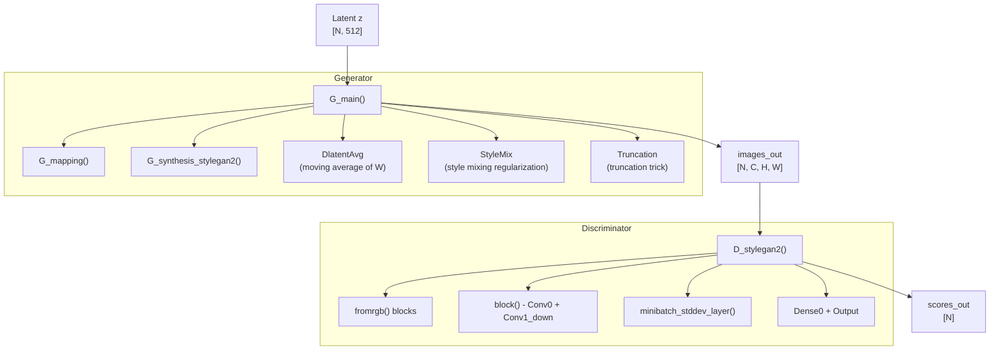
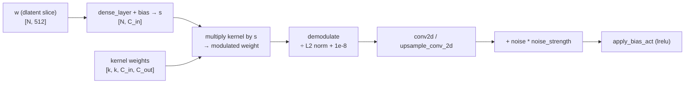
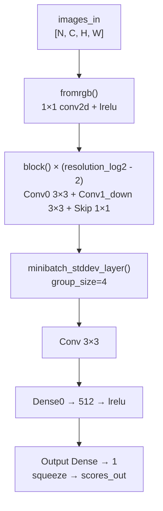
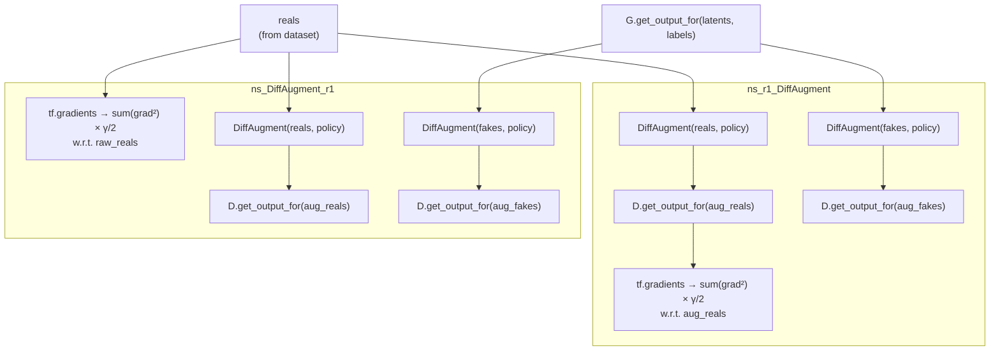
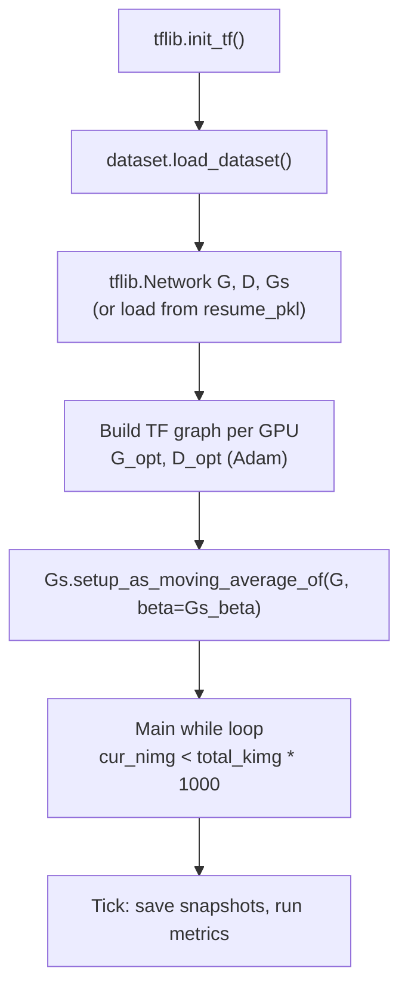

<!-- source: DeepWiki mcp.deepwiki.com · repo mit-han-lab/data-efficient-gans · page 3.4 Network Architecture and Training Internals · fetched 2026-10-30 -->

# Network Architecture and Training Internals

<details>
<summary>Relevant source files</summary>

The following files were used as context for generating this wiki page:

- [DiffAugment-stylegan2/DiffAugment_tf.py](DiffAugment-stylegan2/DiffAugment_tf.py)
- [DiffAugment-stylegan2/training/loss.py](DiffAugment-stylegan2/training/loss.py)
- [DiffAugment-stylegan2/training/networks_stylegan2.py](DiffAugment-stylegan2/training/networks_stylegan2.py)
- [DiffAugment-stylegan2/training/training_loop.py](DiffAugment-stylegan2/training/training_loop.py)
- [DiffAugment_pytorch.py](DiffAugment_pytorch.py)
- [DiffAugment_tf.py](DiffAugment_tf.py)

</details>


This page documents the generator and discriminator architectures, the two DiffAugment-integrated loss functions, and the training loop mechanics for the TensorFlow StyleGAN2 sub-system located in `DiffAugment-stylegan2/`. It covers the code in `training/networks_stylegan2.py`, `training/loss.py`, and `training/training_loop.py`.

For data preparation and the runtime dataset pipeline, see [3.1](#3.1) and [3.2](#3.2). For the training entrypoints that invoke the loop described here, see [3.3](#3.3). For evaluation and metrics, see [3.5](#3.5).

---

## Network Architecture Overview

**Architecture diagram: generator and discriminator call graph**



Sources: [DiffAugment-stylegan2/training/networks_stylegan2.py:160-253](), [DiffAugment-stylegan2/training/networks_stylegan2.py:422-505]()

---

## Generator: `G_main`

`G_main` [DiffAugment-stylegan2/training/networks_stylegan2.py:160-253]() is the top-level generator function. It is not a class — it is a plain function registered as a `tflib.Network` build function. It owns no weights of its own; instead it manages two sub-networks stored in a `dnnlib.EasyDict` called `components`.

| Sub-network | Build function key | Purpose |
|---|---|---|
| `components.mapping` | `G_mapping` | Maps `z` → `w` (disentangled latent space) |
| `components.synthesis` | `G_synthesis_stylegan2` | Maps `w` → image |

### Behavior controlled by `G_main` flags

| Flag | Training | Validation/Inference |
|---|---|---|
| `dlatent_avg_beta` | Tracks EMA of `w` in `dlatent_avg` variable | Disabled (set to `None`) |
| `style_mixing_prob` | Randomly replaces half of layers' `w` with a second random `w` | Disabled |
| `truncation_psi` | Disabled during training | Applied: `w = lerp(dlatent_avg, w, psi)` |
| `truncation_cutoff` | Disabled | Limits truncation to first N layers |

The `lod` (level-of-detail) variable is a non-trainable `tf.Variable` that was used in progressive growing. In this codebase's configs, `lod_initial_resolution=None` keeps `lod=0.0`, meaning the network trains at full resolution from the start.

Sources: [DiffAugment-stylegan2/training/networks_stylegan2.py:160-253]()

---

## Generator: `G_mapping`

`G_mapping` [DiffAugment-stylegan2/training/networks_stylegan2.py:261-311]() is an 8-layer fully-connected network (MLP) that maps the input latent `z` into the disentangled intermediate latent `w`.

**Processing steps:**

1. **Label embedding** (if `label_size > 0`): one-hot label is projected and concatenated to `z`.
2. **Latent normalization**: `z` is pixel-normalized — divided by its own RMS value.
3. **8× Dense layers** (`Dense0`–`Dense7`): each applies `dense_layer` + `apply_bias_act` with `lrelu`. The mapping layers use `mapping_lrmul=0.01`, i.e. a 100× reduced learning rate.
4. **Broadcast**: the final `[N, 512]` `w` is tiled to `[N, num_layers, 512]` so each synthesis layer can receive its own copy.

Key default parameters:

| Parameter | Default |
|---|---|
| `latent_size` | 512 |
| `dlatent_size` | 512 |
| `mapping_layers` | 8 |
| `mapping_fmaps` | 512 |
| `mapping_lrmul` | 0.01 |
| `normalize_latents` | `True` |

Sources: [DiffAugment-stylegan2/training/networks_stylegan2.py:261-311]()

---

## Generator: `G_synthesis_stylegan2`

`G_synthesis_stylegan2` [DiffAugment-stylegan2/training/networks_stylegan2.py:319-414]() converts the broadcast `w` tensor `[N, num_layers, 512]` into an image.

### Feature map count

The channel count at each resolution level is computed by:

```
nf(stage) = clip(fmap_base / 2^(stage * fmap_decay), fmap_min, fmap_max)
```

Default: `fmap_base=16384`, `fmap_decay=1.0`, `fmap_max=512`. This results in 512 channels at low resolutions tapering toward `fmap_min` at high resolutions.

### Building blocks

| Block | Description |
|---|---|
| `layer(x, layer_idx, ...)` | One modulated conv2d + noise injection + bias/activation |
| `block(x, res)` | Two `layer()` calls: `Conv0_up` (upsample) + `Conv1`; optional residual skip |
| `torgb(x, y, res)` | 1×1 modulated conv to 3 channels, accumulated into `y` (skip architecture) |
| `upsample(y)` | Upsamples `y` using bilinear filter for skip accumulation |

The default architecture is `'skip'`: each resolution block outputs via `torgb` and those outputs are progressively summed into the final image.

### Noise injection

Each `layer()` adds a scaled noise tensor: either a fresh `tf.random_normal` (when `randomize_noise=True`) or a stored non-trainable variable `noise{i}`. The scale is a trainable scalar `noise_strength` initialized to zero.

### Modulated convolution

Each synthesis `layer()` calls `modulated_conv2d_layer` [DiffAugment-stylegan2/training/networks_stylegan2.py:96-134](). This is the core StyleGAN2 operation:

1. A style vector `s` is produced from the current `w` slice via a small dense layer.
2. The convolution weight `w` is scaled (modulated) by `s`.
3. The modulated weight is demodulated by dividing by its own L2 norm, ensuring unit variance in activations.
4. When `fused_modconv=True`, the per-sample weight scaling is implemented as a grouped convolution for efficiency.

**Modulated convolution diagram:**



Sources: [DiffAugment-stylegan2/training/networks_stylegan2.py:96-134](), [DiffAugment-stylegan2/training/networks_stylegan2.py:319-414]()

---

## Discriminator: `D_stylegan2`

`D_stylegan2` [DiffAugment-stylegan2/training/networks_stylegan2.py:422-505]() is the mirror of the synthesis network. It processes images top-down from full resolution to 4×4 using residual blocks, then produces a scalar score.

### Architecture (default: `'resnet'`)



### Minibatch standard deviation layer

`minibatch_stddev_layer` [DiffAugment-stylegan2/training/networks_stylegan2.py:140-152]() computes the average standard deviation across a group of `group_size=4` samples and appends it as an extra feature map channel. This encourages the generator to produce varied outputs and is a standard ProGAN/StyleGAN technique.

Steps:
1. Split batch into groups of 4.
2. Compute per-feature standard deviation within each group.
3. Average across spatial positions and feature maps.
4. Tile result back to full batch size and append as a new channel.

### Weight initialization: `get_weight`

All weight tensors are created through `get_weight` [DiffAugment-stylegan2/training/networks_stylegan2.py:23-37](). It implements **equalized learning rate**:

- Weights are initialized from `N(0, 1/lrmul)`.
- At runtime, they are multiplied by `he_std * lrmul` (the He initialization constant).
- This ensures consistent gradient magnitudes regardless of layer size.

Sources: [DiffAugment-stylegan2/training/networks_stylegan2.py:140-152](), [DiffAugment-stylegan2/training/networks_stylegan2.py:422-505](), [DiffAugment-stylegan2/training/networks_stylegan2.py:23-37]()

---

## Loss Functions

Both loss functions live in `DiffAugment-stylegan2/training/loss.py` and return a triple `(G_loss, D_loss, D_reg)`. They differ only in **where DiffAugment is applied relative to the R1 gradient penalty**.

### `ns_r1_DiffAugment` vs `ns_DiffAugment_r1`

| | `ns_r1_DiffAugment` | `ns_DiffAugment_r1` |
|---|---|---|
| **Augment before D** | Yes — both reals and fakes are augmented before `D.get_output_for` | Yes — same |
| **R1 gradient penalty w.r.t.** | Augmented reals (`reals` after `DiffAugment`) | Un-augmented reals (raw `reals`) |
| **Typical use** | Default for most configs | Alternative; penalizes gradient of original data |

The non-saturating GAN losses are:

```
G_loss = softplus(-fake_scores)
D_loss = softplus(fake_scores) + softplus(-real_scores)
```

### R1 Gradient Penalty

Both functions compute an R1 penalty:

```
D_reg = 0.5 * gamma * sum(grad(real_scores, reals)^2)
```

The default `gamma=10`. The gradient is computed by `tf.gradients(tf.reduce_sum(real_scores), [reals])`. The penalty is returned as `D_reg` separately so the training loop can apply **lazy regularization** (see below).

**Loss function diagram:**



Sources: [DiffAugment-stylegan2/training/loss.py:1-61]()

---

## Training Loop

`training_loop` [DiffAugment-stylegan2/training/training_loop.py:108-336]() is the main training script. It is called by the run scripts (see [3.3](#3.3)) via `dnnlib.submit_run`.

### Setup sequence



### Networks constructed

| Variable | Role |
|---|---|
| `G` | Generator being trained |
| `D` | Discriminator being trained |
| `Gs` | EMA copy of `G` used for inference/snapshots |

`Gs` is updated every step via `Gs.setup_as_moving_average_of(G, beta=Gs_beta)`. The beta decays as `0.5^(minibatch_size / (G_ema_kimg * 1000))`. Before `ema_start_kimg` images have been seen, `Gs_beta_mul_in=0` freezes the EMA copy at initial weights.

### Training schedule: `training_schedule`

`training_schedule` [DiffAugment-stylegan2/training/training_loop.py:49-102]() returns a `dnnlib.EasyDict` with per-step values:

| Field | Description |
|---|---|
| `s.lod` | Current level-of-detail (0.0 = full resolution) |
| `s.resolution` | Current training resolution |
| `s.minibatch_size` | Total minibatch size across all GPUs |
| `s.minibatch_gpu` | Per-GPU sample count |
| `s.G_lrate` | Generator learning rate |
| `s.D_lrate` | Discriminator learning rate |
| `s.tick_kimg` | kimg between progress snapshots |

When `lod_initial_resolution=None` (typical for CIFAR/low-shot configs), `s.lod` is always 0.0 and the resolution is fixed from the start.

### Image preprocessing: `process_reals`

`process_reals` [DiffAugment-stylegan2/training/training_loop.py:23-43]() applies just-in-time transformations to real images pulled from the dataset:

1. Cast to `float32` and rescale from dataset dynamic range to `[-1, 1]`.
2. Optional random horizontal flip (`mirror_augment`).
3. LOD fade crossfade (blends with a blurred version at the current `lod` fractional part).
4. LOD upscale (nearest-neighbor upsampling to match full network input size during progressive phases).

**Note:** DiffAugment is **not** applied here. It is applied inside the loss function.

### Lazy regularization

When `lazy_regularization=True`, the R1 penalty is computed only every `D_reg_interval=4` minibatches:

[DiffAugment-stylegan2/training/training_loop.py:220-225]()

```
if lazy_regularization:
    D_loss = tf.cond(run_D_reg_in,
        lambda: D_loss + D_reg * D_reg_interval,
        lambda: D_loss)
```

When the penalty is applied, it is scaled by `D_reg_interval` to maintain the same expected gradient magnitude as if it were applied every step.

### Per-tick operations

At each tick (controlled by `tick_kimg`), the loop:
- Saves a fake image grid generated by `Gs`.
- Saves a `.pkl` checkpoint of `(G, D, Gs)`.
- Runs the metric group (FID, IS) against the checkpoint.
- Writes TensorBoard summaries.

Sources: [DiffAugment-stylegan2/training/training_loop.py:108-336](), [DiffAugment-stylegan2/training/training_loop.py:23-43](), [DiffAugment-stylegan2/training/training_loop.py:49-102]()

---

## Key Hyperparameters Summary

| Parameter | Location | Default | Notes |
|---|---|---|---|
| `gamma` (R1 penalty) | `loss.py` functions | `10` | Set per training script |
| `policy` (DiffAugment) | `loss.py` functions | `''` (empty) | e.g. `'color,translation,cutout'` |
| `G_ema_kimg` | `training_loop` | `10` | Half-life of Gs EMA in kimg |
| `lazy_regularization` | `training_loop` | `False` | Enabled in some FFHQ configs |
| `D_reg_interval` | `training_loop` | `4` | Only relevant if lazy_reg enabled |
| `style_mixing_prob` | `G_main` | `0.9` | Disabled at inference |
| `truncation_psi` | `G_main` | `None` train / script-defined val | Applied only at inference |
| `mapping_lrmul` | `G_mapping` | `0.01` | Reduces mapping net learning rate |
| `mbstd_group_size` | `D_stylegan2` | `4` | Groups for minibatch stddev |
| `fused_modconv` | synthesis / D | `True` | Grouped conv implementation |
| `architecture` (G) | `G_synthesis_stylegan2` | `'skip'` | skip / resnet / orig |
| `architecture` (D) | `D_stylegan2` | `'resnet'` | resnet / skip / orig |

Sources: [DiffAugment-stylegan2/training/networks_stylegan2.py:160-176](), [DiffAugment-stylegan2/training/networks_stylegan2.py:319-335](), [DiffAugment-stylegan2/training/networks_stylegan2.py:422-439](), [DiffAugment-stylegan2/training/training_loop.py:108-137](), [DiffAugment-stylegan2/training/loss.py:14-59]()

---

