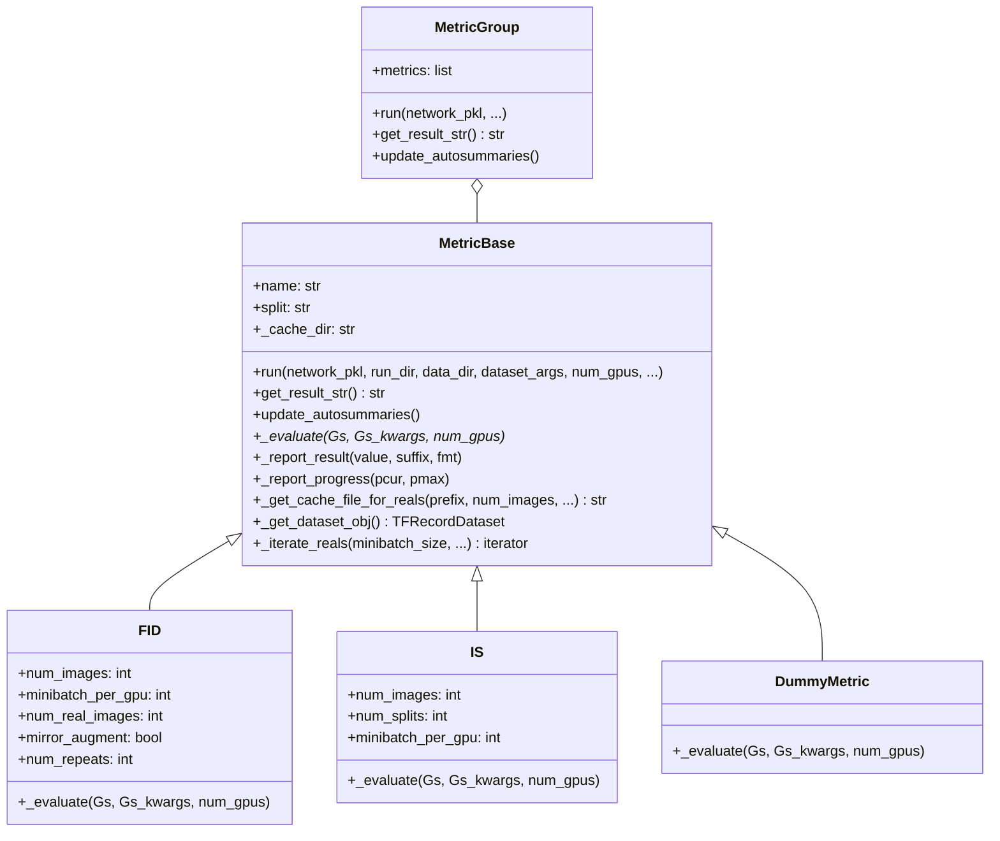
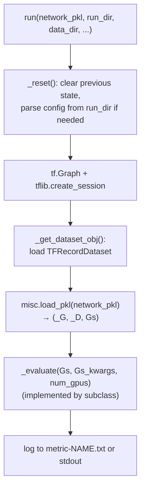
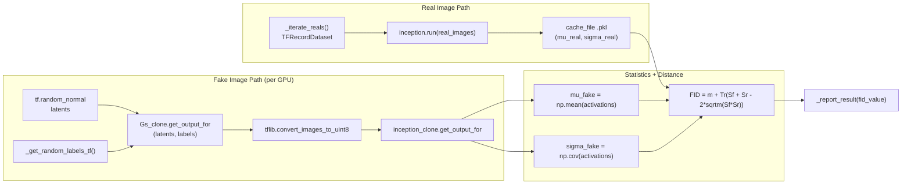
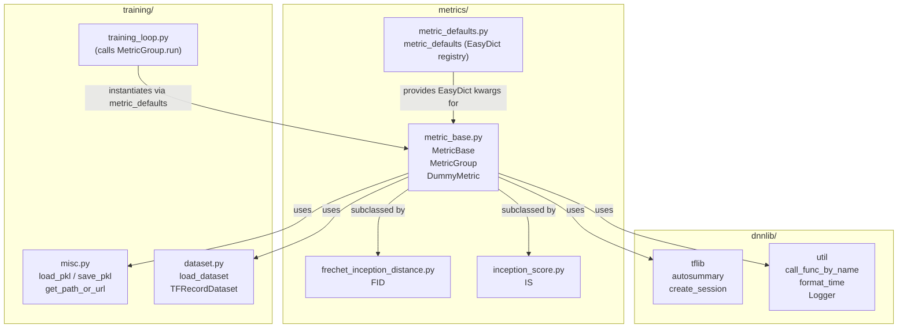

<!-- source: DeepWiki mcp.deepwiki.com · repo mit-han-lab/data-efficient-gans · page 3.5 Evaluation and Metrics · fetched 2026-10-30 -->

# Evaluation and Metrics

<details>
<summary>Relevant source files</summary>

The following files were used as context for generating this wiki page:

- [DiffAugment-biggan-cifar/dnnlib/util.py](DiffAugment-biggan-cifar/dnnlib/util.py)
- [DiffAugment-biggan-cifar/eval.py](DiffAugment-biggan-cifar/eval.py)
- [DiffAugment-stylegan2/metrics/frechet_inception_distance.py](DiffAugment-stylegan2/metrics/frechet_inception_distance.py)
- [DiffAugment-stylegan2/metrics/metric_base.py](DiffAugment-stylegan2/metrics/metric_base.py)
- [DiffAugment-stylegan2/metrics/metric_defaults.py](DiffAugment-stylegan2/metrics/metric_defaults.py)
- [DiffAugment-stylegan2/training/misc.py](DiffAugment-stylegan2/training/misc.py)

</details>


## Purpose and Scope

This page documents the evaluation framework used by the **DiffAugment-stylegan2 (TensorFlow)** sub-system, located in `DiffAugment-stylegan2/metrics/`. It covers:

- The `MetricBase` / `MetricGroup` class hierarchy
- The `metric_defaults` registry
- The `FID` (Fréchet Inception Distance) and `IS` (Inception Score) implementations
- How metrics are invoked during training and how to run standalone evaluation against a saved checkpoint

For information on the training loop that calls these metrics, see [3.4](#3.4). For the training scripts that configure which metrics to run, see [3.3](#3.3). For the BigGAN-CIFAR metric evaluation entrypoint (`eval.py`), see [5](#5).

---

## Component Overview

**Metric class hierarchy and registry flow:**



Sources: [DiffAugment-stylegan2/metrics/metric_base.py:1-185](), [DiffAugment-stylegan2/metrics/frechet_inception_distance.py:1-86]()

---

## The `metric_defaults` Registry

[DiffAugment-stylegan2/metrics/metric_defaults.py]() defines a single `EasyDict` named `metric_defaults`. It maps a short string name to a configuration object that carries enough information for `dnnlib.util.call_func_by_name` to instantiate the metric class.

| Name | `func_name` | `num_images` | `split` | Notes |
|---|---|---|---|---|
| `fid10k` | `metrics.frechet_inception_distance.FID` | 10,000 | `test` | Default for most evaluations |
| `fid5k-train` | `metrics.frechet_inception_distance.FID` | 5,000 | `train` | Used for CIFAR-style datasets |
| `fid50k-train` | `metrics.frechet_inception_distance.FID` | 50,000 | `train` | Large-scale evaluation |
| `is10k` | `metrics.inception_score.IS` | 10,000 | `train` | `num_splits=10`, `minibatch_per_gpu=8` |

All entries set `minibatch_per_gpu=8`.

The training scripts (see [3.3](#3.3)) pass a list of these names when constructing a `MetricGroup`. For example, `run_cifar.py` typically selects `fid10k` or `fid5k-train` depending on dataset size.

Sources: [DiffAugment-stylegan2/metrics/metric_defaults.py:1-18]()

---

## `MetricBase`

[DiffAugment-stylegan2/metrics/metric_base.py:23-158]()

`MetricBase` is the abstract base class for all metrics. All state needed to run one evaluation pass is reset at the start of each `run()` call via `_reset()`.

### Instantiation

```
MetricBase(name, split='test', cache_dir='.stylegan2-cache')
```

- `name` — used for log file naming and summary keys.
- `split` — either `'test'` or `'train'`, forwarded to `dataset.load_dataset()` when opening the real-image dataset.
- `cache_dir` — filesystem path where real-image activation statistics are cached as `.pkl` files.

### The `run()` Method

[DiffAugment-stylegan2/metrics/metric_base.py:61-83]()



Key details:

- The checkpoint pickle is expected to unpack as a 3-tuple `(_G, _D, Gs)`, where `Gs` is the exponential moving average generator. If `disable_ema=True` is passed, `_G` is used instead.
- If `run_dir` is provided and `dataset_args` is not, the method calls `misc.parse_config_for_previous_run(run_dir)` to reconstruct dataset arguments from the saved `submit_config.pkl`.
- Results are written to `<run_dir>/metric-<name>.txt` (appending), or to stdout if `run_dir` is `None`.

### Dataset and Real-Image Iteration

`_get_dataset_obj()` lazily opens a `TFRecordDataset` using `dataset.load_dataset()` with `shuffle_mb=0` and `repeat=False` so images are consumed in a deterministic order.

`_iterate_reals(minibatch_size, mirror_augment, num_samples)` is a generator that yields numpy image arrays from the dataset. It stops when `OutOfRangeError` is raised (end of dataset) or `num_samples` images have been yielded.

### Caching Real-Image Statistics

`_get_cache_file_for_reals(prefix, num_images, extension, mirror_augment)` constructs a cache path of the form:

```
<cache_dir>/<prefix>-<dataset_name>-<split>[-<num_images>][-flip].<extension>
```

For example: `.stylegan2-cache/fid-ffhq-test-10000.pkl`

This cache is used by `FID._evaluate()` to avoid recomputing Inception activations for real images on repeated evaluations.

Sources: [DiffAugment-stylegan2/metrics/metric_base.py:23-158]()

---

## `MetricGroup`

[DiffAugment-stylegan2/metrics/metric_base.py:162-176]()

`MetricGroup` holds a flat list of `MetricBase` instances. It is instantiated with a `metric_kwarg_list`, which is a list of `EasyDict` objects taken directly from `metric_defaults`.

```python
# Conceptual usage from the training loop
metric_group = MetricGroup(
    [metric_defaults['fid10k'], metric_defaults['is10k']],
    name=..., split=...
)
```

Each `EasyDict` in the list carries `func_name`, which `dnnlib.util.call_func_by_name` uses to dynamically instantiate the correct subclass.

| Method | Behavior |
|---|---|
| `run(*args, **kwargs)` | Calls `metric.run(...)` sequentially for each metric |
| `get_result_str()` | Joins result strings from all metrics with a space |
| `update_autosummaries()` | Calls `update_autosummaries()` on each metric |

Sources: [DiffAugment-stylegan2/metrics/metric_base.py:162-176]()

---

## FID Implementation

[DiffAugment-stylegan2/metrics/frechet_inception_distance.py:20-86]()

The `FID` class computes the Fréchet Inception Distance between the distribution of real images and the distribution of generated images. The mathematical definition used is:

> FID = ||μ_real − μ_fake||² + Tr(Σ_real + Σ_fake − 2·√(Σ_real·Σ_fake))

### `_evaluate()` Walkthrough

**Step 1 — Load InceptionV3 feature extractor**

The network is loaded via `misc.load_pkl` from a CloudFront URL:
`http://d36zk2xti64re0.cloudfront.net/stylegan1/networks/metrics/inception_v3_features.pkl`

This is a frozen TensorFlow network that outputs 2048-dimensional feature vectors.

**Step 2 — Compute or load real-image statistics**

[DiffAugment-stylegan2/metrics/frechet_inception_distance.py:37-50]()

The cache file path is obtained from `_get_cache_file_for_reals(prefix='fid', ...)`. If the file exists, `(mu_real, sigma_real)` are loaded directly. Otherwise, all real images are passed through InceptionV3 and `(mu_real, sigma_real)` are computed and saved.

**Step 3 — Build multi-GPU TensorFlow graph for fakes**

[DiffAugment-stylegan2/metrics/frechet_inception_distance.py:53-64]()

One sub-graph is placed on each GPU. Each sub-graph:
1. Samples `minibatch_per_gpu` latent vectors from a normal distribution.
2. Samples random labels via `_get_random_labels_tf()`.
3. Runs `Gs_clone.get_output_for(latents, labels, **Gs_kwargs)` to generate images.
4. Converts images to uint8 with `tflib.convert_images_to_uint8`.
5. Passes images through a cloned InceptionV3 to get activations.

**Step 4 — Collect activations and compute statistics**

[DiffAugment-stylegan2/metrics/frechet_inception_distance.py:66-84]()

Generated in batches until `num_images` activations are collected. `mu_fake` and `sigma_fake` are computed with `np.mean` and `np.cov`.

**Step 5 — Compute FID**

`scipy.linalg.sqrtm` computes the matrix square root. The final scalar is reported via `_report_result()`.

If `num_repeats > 1`, the evaluation is repeated and the mean and standard deviation are both reported.

**Grayscale handling:** If `Gs.output_shape[1] == 1`, images are repeated along the channel axis 3× before being passed to InceptionV3 (which requires 3-channel input).

### FID Evaluation Data Flow



Sources: [DiffAugment-stylegan2/metrics/frechet_inception_distance.py:29-85]()

---

## Invoking Metrics from the Training Loop

During training, `training_loop.py` constructs a `MetricGroup` from the metric names configured in the training script. Metrics are run periodically at snapshot intervals by calling:

```python
metric_group.run(
    network_pkl,
    run_dir=run_dir,
    data_dir=data_dir,
    dataset_args=dataset_args,
    mirror_augment=mirror_augment,
    num_gpus=num_gpus,
    tf_config=tf_config
)
```

After each run, `metric_group.update_autosummaries()` pushes values into TensorFlow's autosummary system under the key prefix `Metrics/`.

Result strings are appended to `<run_dir>/metric-<name>.txt`.

Sources: [DiffAugment-stylegan2/metrics/metric_base.py:61-98]()

---

## Standalone Evaluation

To evaluate a saved checkpoint without launching a full training run, call `MetricBase.run()` directly from a script. The minimum required arguments are:

| Argument | Description |
|---|---|
| `network_pkl` | Path or `mit-han-lab:` URL to a `.pkl` checkpoint |
| `run_dir` | (Optional) Training run directory; used to auto-load `dataset_args` |
| `data_dir` | Root directory for datasets |
| `dataset_args` | `EasyDict` with dataset configuration (required if `run_dir` is omitted) |
| `num_gpus` | Number of GPUs to use for generation |

Example using the `mit-han-lab:` shorthand (resolved via `misc.get_path_or_url`):

```
# The shorthand expands to https://data-efficient-gans.mit.edu/models/
network_pkl = "mit-han-lab:DiffAugment-stylegan2-100-shot-obama.pkl"
```

The `mit-han-lab:` prefix is handled by `misc.get_path_or_url` [DiffAugment-stylegan2/training/misc.py:38-39](), which substitutes the base URL before passing to `dnnlib.util.open_url`.

Sources: [DiffAugment-stylegan2/metrics/metric_base.py:61-83](), [DiffAugment-stylegan2/training/misc.py:22-39]()

---

## Summary: Files and Classes



Sources: [DiffAugment-stylegan2/metrics/metric_base.py:1-185](), [DiffAugment-stylegan2/metrics/metric_defaults.py:1-18](), [DiffAugment-stylegan2/metrics/frechet_inception_distance.py:1-86](), [DiffAugment-stylegan2/training/misc.py:1-39]()

---

