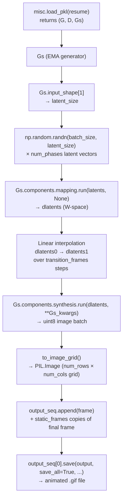
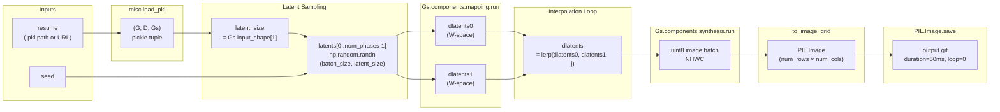

<!-- source: DeepWiki mcp.deepwiki.com · repo mit-han-lab/data-efficient-gans · page 3.6 Generating Images and GIFs · fetched 2026-10-30 -->

# Generating Images and GIFs

<details>
<summary>Relevant source files</summary>

The following files were used as context for generating this wiki page:

- [DiffAugment-biggan-cifar/dnnlib/util.py](DiffAugment-biggan-cifar/dnnlib/util.py)
- [DiffAugment-biggan-cifar/eval.py](DiffAugment-biggan-cifar/eval.py)
- [DiffAugment-stylegan2/generate_gif.py](DiffAugment-stylegan2/generate_gif.py)
- [DiffAugment-stylegan2/training/misc.py](DiffAugment-stylegan2/training/misc.py)

</details>


## Purpose and Scope

This page documents `DiffAugment-stylegan2/generate_gif.py`, the script that produces animated GIF outputs from a trained TensorFlow StyleGAN2 checkpoint. It covers how the checkpoint is loaded, how latent vectors are sampled and mapped to disentangled latents, how frames are generated via linear interpolation in W-space, and how those frames are assembled into a looping GIF.

This page applies only to the **TensorFlow** sub-system (`DiffAugment-stylegan2/`). For the equivalent functionality in the PyTorch sub-system, see [4.1](#4.1). For details on the training loop that produces the checkpoints consumed here, see [3.3](#3.3) and [3.4](#3.4).

---

## Overview

`generate_gif.py` takes a saved `.pkl` checkpoint and produces a smoothly animated GIF by interpolating between random points in the disentangled latent space (W-space). The generator's two-stage design—mapping network followed by synthesis network—is exploited directly: `G_mapping` is called to convert Z-space latents to W-space, and `G_synthesis` is called per-frame to render images from interpolated W-space vectors.

**GIF generation pipeline at a glance:**



Sources: [DiffAugment-stylegan2/generate_gif.py:1-63]()

---

## Entry Points

### Command-Line Interface

`generate_gif.py` is invoked directly as a script. `main()` parses arguments and delegates to `run()`.

[DiffAugment-stylegan2/generate_gif.py:42-63]()

| Argument | Flag | Default | Description |
|---|---|---|---|
| `resume` | `-r` / `--resume` | *(required)* | Path or URL to a `.pkl` checkpoint |
| `output` | `-o` / `--output` | *(required)* | Output filename (`.gif` extension appended if missing) |
| `num_rows` | `--num-rows` | `2` | Rows in the image grid |
| `num_cols` | `--num-cols` | `3` | Columns in the image grid |
| `resolution` | `--resolution` | `128` | Output resolution per cell (pixels) |
| `num_phases` | `--num-phases` | `5` | Number of latent anchor points to cycle through |
| `transition_frames` | `--transition-frames` | `20` | Frames rendered between each pair of anchor points |
| `static_frames` | `--static-frames` | `5` | Frames held at each anchor after transition completes |
| `seed` | `--seed` | `1000` | NumPy/TF random seed for reproducibility |

**Example invocation:**

```
python generate_gif.py \
    -r mit-han-lab:obama-snapshot.pkl \
    -o obama.gif \
    --num-rows 2 --num-cols 3 \
    --num-phases 5 --transition-frames 20 --static-frames 5
```

The `mit-han-lab:` prefix is expanded to `https://data-efficient-gans.mit.edu/models/` by `misc.get_path_or_url`. See [6](#6) for more on this URL shorthand.

Sources: [DiffAugment-stylegan2/generate_gif.py:42-63](), [DiffAugment-stylegan2/training/misc.py:38-39]()

---

## The `run()` Function

[DiffAugment-stylegan2/generate_gif.py:12-39]()

### Step 1 — TF Initialization and Checkpoint Loading

```python
tflib.init_tf({'rnd.np_random_seed': seed})
_, _, Gs = misc.load_pkl(resume)
```

`misc.load_pkl` [DiffAugment-stylegan2/training/misc.py:28-30]() uses Python's `pickle.load` with `encoding='latin1'` for compatibility with older checkpoints. The checkpoint file is a 3-tuple `(G, D, Gs)`:

| Tuple element | Meaning |
|---|---|
| `G` | The training-time generator |
| `D` | The discriminator |
| `Gs` | The **EMA (exponential moving average) generator** — used for inference |

Only `Gs` is used for generation.

### Step 2 — Latent Sampling

```python
batch_size = num_rows * num_cols
latent_size = Gs.input_shape[1]
latents = [np.random.randn(batch_size, latent_size) for _ in range(num_phases)]
```

`Gs.input_shape[1]` reads the expected Z-space dimensionality from the network's TF graph (512 for standard StyleGAN2 configurations). `num_phases` random anchor points are sampled; the GIF cycles through all of them in sequence.

### Step 3 — Synthesis Kwargs

```python
Gs_kwargs = dnnlib.EasyDict()
Gs_kwargs.output_transform = dict(func=tflib.convert_images_to_uint8, nchw_to_nhwc=True)
Gs_kwargs.randomize_noise = False
```

- `output_transform` converts float32 NCHW tensors (range `[-1, 1]`) to uint8 NHWC arrays suitable for PIL.
- `randomize_noise = False` makes synthesis deterministic, so frames only change due to latent interpolation, not stochastic noise inputs.

### Step 4 — Latent Interpolation and Frame Generation

```python
for i in range(num_phases):
    dlatents0 = Gs.components.mapping.run(latents[i - 1], None)
    dlatents1 = Gs.components.mapping.run(latents[i], None)
    for j in range(transition_frames):
        dlatents = (dlatents0 * (transition_frames - j) + dlatents1 * j) / transition_frames
        output_seq.append(to_image_grid(Gs.components.synthesis.run(dlatents, **Gs_kwargs)))
    output_seq.extend([to_image_grid(Gs.components.synthesis.run(dlatents1, **Gs_kwargs))] * static_frames)
```

The interpolation happens in **W-space** (after the mapping network), not Z-space. This is the standard StyleGAN2 approach for smooth semantic transitions. When `i == 0`, `latents[i - 1]` wraps to `latents[-1]`, so the animation loops seamlessly.

**Frame count formula:**

| Segment | Frames |
|---|---|
| Per phase transition | `transition_frames` |
| Per phase static hold | `static_frames` |
| **Total frames** | `num_phases × (transition_frames + static_frames)` |

With defaults: `5 × (20 + 5) = 125 frames`.

### Step 5 — Grid Assembly (`to_image_grid`)

```python
def to_image_grid(outputs):
    outputs = np.reshape(outputs, [num_rows, num_cols, *outputs.shape[1:]])
    outputs = np.concatenate(outputs, axis=1)
    outputs = np.concatenate(outputs, axis=1)
    return Image.fromarray(outputs).resize(
        (resolution * num_cols, resolution * num_rows), Image.ANTIALIAS
    )
```

The batch of `num_rows × num_cols` images is reshaped, concatenated along height and width axes, then rescaled to the target resolution with antialiasing.

### Step 6 — GIF Export

```python
output_seq[0].save(output, save_all=True, append_images=output_seq[1:],
                   optimize=False, duration=50, loop=0)
```

- `duration=50` sets each frame to 50 ms (20 fps).
- `loop=0` means the GIF loops indefinitely.
- `.gif` is appended to `output` if not already present.

Sources: [DiffAugment-stylegan2/generate_gif.py:12-39]()

---

## Data Flow Diagram

**`run()` internal data flow with code symbols:**



Sources: [DiffAugment-stylegan2/generate_gif.py:12-39](), [DiffAugment-stylegan2/training/misc.py:22-39]()

---

## Dependencies

| Symbol | Source | Role |
|---|---|---|
| `misc.load_pkl` | `DiffAugment-stylegan2/training/misc.py` | Loads `.pkl` checkpoint; handles URLs via `dnnlib.util.open_url` |
| `misc.get_path_or_url` | `DiffAugment-stylegan2/training/misc.py` | Expands `mit-han-lab:` shorthand to full URL |
| `tflib.init_tf` | `dnnlib.tflib` | Initializes a TF session with the given options |
| `tflib.convert_images_to_uint8` | `dnnlib.tflib` | Output transform used in `Gs_kwargs.output_transform` |
| `dnnlib.EasyDict` | `dnnlib` | Attribute-access dict for `Gs_kwargs` |
| `Gs.components.mapping` | TF graph sub-network | G_mapping: Z → W |
| `Gs.components.synthesis` | TF graph sub-network | G_synthesis: W → image |
| `PIL.Image` | `Pillow` | GIF assembly and export |
| `numpy` | standard | Latent sampling and interpolation arithmetic |

Sources: [DiffAugment-stylegan2/generate_gif.py:1-11](), [DiffAugment-stylegan2/training/misc.py:22-39]()

---

## Notes and Constraints

- The script requires a TensorFlow 1.15 environment. It will not run under TF 2.x without compatibility shims.
- The checkpoint must be a 3-tuple `(G, D, Gs)` as saved by `training_loop.py`. Snapshots saved during training match this format.
- Noise inputs are held constant (`randomize_noise = False`) throughout the GIF to prevent flickering unrelated to the latent walk.
- Interpolation is **linear** in W-space. Spherical interpolation (slerp) is not used here; for smoother traversals at high curvatures, the caller would need to modify the interpolation arithmetic in `run()` [DiffAugment-stylegan2/generate_gif.py:33-34]().
- The `latents[i - 1]` index at `i=0` wraps to `latents[-1]` (the last anchor), making the animation a seamless loop.

---

