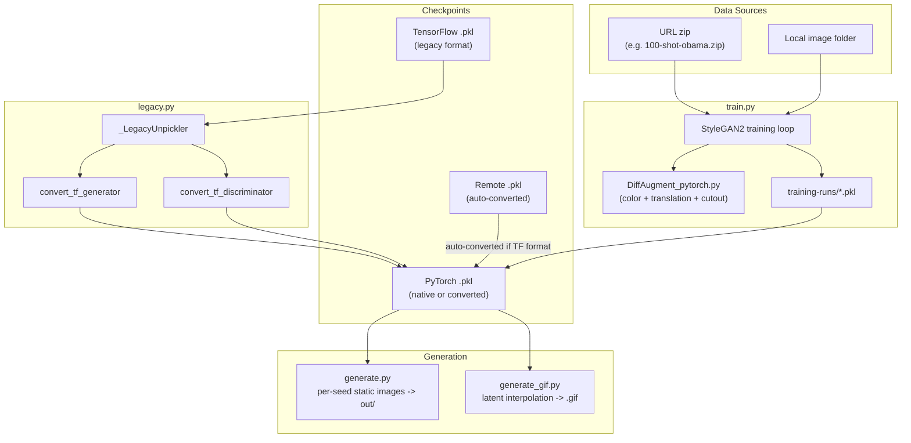
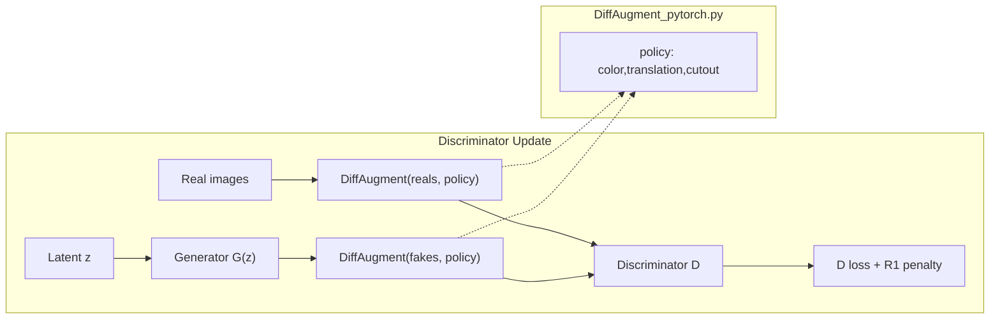

<!-- source: DeepWiki mcp.deepwiki.com · repo mit-han-lab/data-efficient-gans · page 4 DiffAugment-stylegan2-pytorch · fetched 2026-10-30 -->

# DiffAugment-stylegan2-pytorch

Relevant source files

The following files were used as context for generating this wiki page:

- [DiffAugment-stylegan2-pytorch/LICENSE.txt](DiffAugment-stylegan2-pytorch/LICENSE.txt)
- [DiffAugment-stylegan2-pytorch/README.md](DiffAugment-stylegan2-pytorch/README.md)

This page covers the PyTorch implementation of StyleGAN2 + DiffAugment, located under `DiffAugment-stylegan2-pytorch/`. It describes the sub-system's relationship to the upstream `stylegan2-ada-pytorch` codebase, what it can and cannot reproduce relative to the TensorFlow reference implementation, and a summary of its scripts and components.

> For the TensorFlow StyleGAN2 sub-system that is used to fully reproduce paper results, see [DiffAugment-stylegan2 (TensorFlow)](#3). For documentation of the standalone DiffAugment augmentation module, see [DiffAugment Core Module](#2).

---

## Purpose and Scope

`DiffAugment-stylegan2-pytorch/` provides a minimal-modification fork of [stylegan2-ada-pytorch](https://github.com/NVlabs/stylegan2-ada-pytorch) that integrates DiffAugment into the PyTorch StyleGAN2 training loop. Its primary goals are:

- Training StyleGAN2 models with DiffAugment on low-shot datasets using PyTorch.
- Generating images and GIFs from pre-trained checkpoints (both PyTorch-native and TensorFlow legacy formats).
- Converting TensorFlow-format `.pkl` checkpoints to PyTorch-compatible format.

**Important disclaimer:** This sub-system does not fully reproduce the paper's reported results. It uses a different set of hyperparameters and a different evaluation protocol compared to the TensorFlow reference implementation. To reproduce the paper's numbers exactly, use the TensorFlow sub-system documented in [DiffAugment-stylegan2 (TensorFlow)](#3).

Sources: [DiffAugment-stylegan2-pytorch/README.md:1-30]()

---

## Relationship to Upstream Codebase

The directory is built directly on top of `stylegan2-ada-pytorch` (NVIDIA). Changes are intentionally minimal: the primary additions are:

1. A vendored copy of `DiffAugment_pytorch.py` with the augmentation policy logic.
2. Integration of `DiffAugment` into the training loss computation inside `train.py`.
3. `legacy.py`, which adds TensorFlow-to-PyTorch checkpoint conversion.
4. `generate_gif.py` for latent interpolation animation output.

Everything else — network architecture, data loading, training loop infrastructure — is inherited from `stylegan2-ada-pytorch` without modification.

Sources: [DiffAugment-stylegan2-pytorch/README.md:1-5]()

---

## Sub-System Components

The following table maps each script/module to its role:

| File | Role |
|---|---|
| `train.py` | Training entrypoint; invokes the StyleGAN2 loop with DiffAugment enabled |
| `generate.py` | Static image generation from a checkpoint, one image per seed |
| `generate_gif.py` | Latent interpolation animation, outputs a `.gif` |
| `legacy.py` | Detects and converts TensorFlow `.pkl` checkpoints to PyTorch format |
| `DiffAugment_pytorch.py` | Vendored copy of the core DiffAugment module (color, translation, cutout) |

Sources: [DiffAugment-stylegan2-pytorch/README.md:1-30]()

---

**Diagram: Component Relationships in DiffAugment-stylegan2-pytorch**

Sources: [DiffAugment-stylegan2-pytorch/README.md:1-30]()

---

## DiffAugment Integration Point

The default augmentation policy applied during training is `color,translation,cutout`. This matches the policy used in the TensorFlow sub-system and is passed to the `DiffAugment` function from `DiffAugment_pytorch.py`. In the training loop inside `train.py`, both real and generated images are augmented before being passed to the discriminator — mirroring the pattern described in [DiffAugment Core Module](#2).

**Diagram: DiffAugment in the PyTorch Training Loop**

Sources: [DiffAugment-stylegan2-pytorch/README.md:6-10]()

---

## Dataset and Model Inputs

### Datasets

Datasets can be provided as:

- A **remote URL** pointing to a `.zip` of images (e.g., `https://data-efficient-gans.mit.edu/datasets/100-shot-obama.zip`). `train.py` accepts this directly via the `--data` argument.
- A **local image folder** path passed to `--data`.

For larger datasets such as CIFAR and FFHQ, the `stylegan2-ada-pytorch` dataset preparation guidelines apply.

### Pre-trained Models

Pre-trained `.pkl` files are hosted at `https://data-efficient-gans.mit.edu/models/`. These are in TensorFlow format and are automatically detected and converted to PyTorch format at load time. The conversion is handled transparently by `legacy.py` when `generate.py` or `generate_gif.py` loads the network.

| Model | Description |
|---|---|
| `DiffAugment-stylegan2-100-shot-obama.pkl` | 100-shot Obama, StyleGAN2 + DiffAugment |
| *(others at `data-efficient-gans.mit.edu/models/`)* | Additional low-shot datasets |

Sources: [DiffAugment-stylegan2-pytorch/README.md:12-19]()

---

## Comparison with TensorFlow Sub-System

| Aspect | PyTorch (`DiffAugment-stylegan2-pytorch/`) | TensorFlow (`DiffAugment-stylegan2/`) |
|---|---|---|
| Framework | PyTorch | TensorFlow 1.15 |
| Base codebase | `stylegan2-ada-pytorch` (NVIDIA) | Original StyleGAN2 (NVIDIA) |
| Reproduces paper results | **No** | **Yes** |
| Hyperparameters | Different from paper | Matches paper |
| Evaluation protocol | Different from paper | Matches paper |
| Checkpoint format | PyTorch `.pkl` (auto-converts TF) | TensorFlow `.pkl` |
| DiffAugment module | `DiffAugment_pytorch.py` (vendored) | `DiffAugment_tf.py` (vendored) |
| Data pipeline | `stylegan2-ada-pytorch` loaders | TFRecords pipeline |

Sources: [DiffAugment-stylegan2-pytorch/README.md:27-29]()

---

## Child Pages

Detailed documentation for this sub-system is split across the following child pages:

- **[Training and Generation (4.1)](#4.1)** — Covers `train.py`, `generate.py`, and `generate_gif.py` arguments and behavior in detail.
- **[TF-to-PyTorch Model Conversion (4.2)](#4.2)** — Covers `legacy.py`: `_LegacyUnpickler`, `_collect_tf_params`, `_populate_module_params`, `convert_tf_generator`, `convert_tf_discriminator`, and the automatic conversion path.

---

