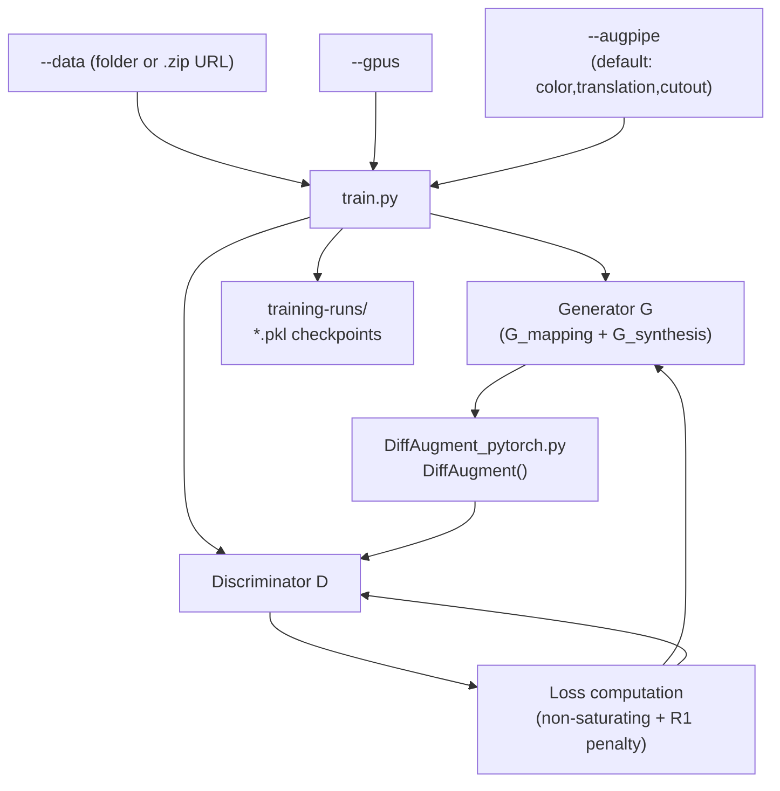
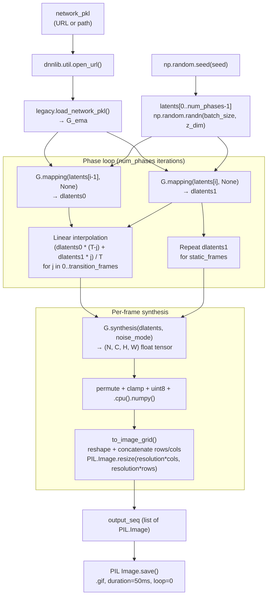

<!-- source: DeepWiki mcp.deepwiki.com · repo mit-han-lab/data-efficient-gans · page 4.1 Training and Generation · fetched 2026-10-30 -->

# Training and Generation

<details>
<summary>Relevant source files</summary>

The following files were used as context for generating this wiki page:

- [DiffAugment-biggan-imagenet/dnnlib/util.py](DiffAugment-biggan-imagenet/dnnlib/util.py)
- [DiffAugment-stylegan2-pytorch/README.md](DiffAugment-stylegan2-pytorch/README.md)
- [DiffAugment-stylegan2-pytorch/generate_gif.py](DiffAugment-stylegan2-pytorch/generate_gif.py)

</details>


This page covers the three user-facing scripts in `DiffAugment-stylegan2-pytorch/`: `train.py`, `generate.py`, and `generate_gif.py`. Together they form the full workflow for training a StyleGAN2 model with DiffAugment and producing images or animations from the resulting checkpoints.

For model conversion from TensorFlow `.pkl` checkpoints (which both generation scripts can consume automatically), see [4.2](#4.2). For the equivalent TensorFlow-based training scripts (`run_cifar.py`, `run_ffhq.py`, `run_low_shot.py`), see [3.3](#3.3). For the DiffAugment augmentation functions themselves, see [2](#2).

---

## Overview

**Script summary:**

| Script | Purpose | Output |
|---|---|---|
| `train.py` | Train StyleGAN2 + DiffAugment | `.pkl` checkpoints in `--outdir` |
| `generate.py` | Decode a list of seeds to images | Per-seed `.png` files in `--outdir` |
| `generate_gif.py` | Latent-space interpolation across phases | Animated `.gif` file |

All three scripts accept a `--network` (or `--data` for training) argument that can be a local path or an HTTPS URL. Remote URLs are downloaded and cached via `dnnlib.util.open_url`.

Sources: [DiffAugment-stylegan2-pytorch/README.md:1-30]()

---

## `train.py` — Training

### Invocation

```
python train.py --outdir=training-runs \
    --data=https://data-efficient-gans.mit.edu/datasets/100-shot-obama.zip \
    --gpus=1
```

### Key arguments

| Argument | Default | Description |
|---|---|---|
| `--outdir` | required | Directory where checkpoints and logs are written |
| `--data` | required | Path to image folder or `.zip` URL |
| `--gpus` | 1 | Number of GPUs |
| `--augpipe` | `"color,translation,cutout"` | DiffAugment policy string, passed to `DiffAugment_pytorch.py` |
| `--resume` | — | Path or URL to a `.pkl` checkpoint to resume from |
| `--mirror` | false | Enable x-axis mirroring |
| `--kimg` | — | Total training duration in kilo-images |
| `--snap` | — | Snapshot interval in kilo-images |

The default `--augpipe` value applies the full *Color + Translation + Cutout* policy that all paper results are based on.

`--data` accepts both local folder paths and remote `.zip` URLs (e.g., `https://data-efficient-gans.mit.edu/datasets/100-shot-obama.zip`). The vendored `DiffAugment_pytorch.py` inside this sub-directory is the active copy used during training.

Sources: [DiffAugment-stylegan2-pytorch/README.md:7-10]()

### Training data flow

**Diagram: train.py data flow**



Sources: [DiffAugment-stylegan2-pytorch/README.md:7-10]()

---

## `generate.py` — Static Image Generation

### Invocation

```
python generate.py --outdir=out \
    --seeds=1-16 \
    --network=https://data-efficient-gans.mit.edu/models/DiffAugment-stylegan2-100-shot-obama.pkl
```

### Key arguments

| Argument | Description |
|---|---|
| `--network` | Local `.pkl` path or remote URL (TF or PyTorch format) |
| `--outdir` | Output directory for `.png` files |
| `--seeds` | Comma-separated or range of integer seeds, e.g. `1-16` or `0,5,9` |
| `--trunc` | Truncation ψ (float, e.g. `0.7`) |
| `--noise-mode` | `const`, `random`, or `none` |
| `--class` | Class label index (for conditional models) |

Each seed deterministically sets `z` and produces one image. Images are written as `seed{N:04d}.png`.

If the `.pkl` contains a TF-format model, `legacy.load_network_pkl` transparently converts it; see [4.2](#4.2) for how that conversion works.

Sources: [DiffAugment-stylegan2-pytorch/README.md:14-17]()

---

## `generate_gif.py` — Latent Interpolation GIF

### Invocation

```
python generate_gif.py \
    --output=obama.gif \
    --seed=0 \
    --num-rows=1 \
    --num-cols=8 \
    --network=https://data-efficient-gans.mit.edu/models/DiffAugment-stylegan2-100-shot-obama.pkl
```

### CLI parameters

| Argument | Type | Default | Description |
|---|---|---|---|
| `--network` | str | required | Local path or URL to `.pkl` checkpoint |
| `--output` | str | required | Output file path (`.gif` appended if missing) |
| `--seed` | int | `0` | Master RNG seed for latent vectors |
| `--num-rows` | int | `1` | Rows in the image grid |
| `--num-cols` | int | `8` | Columns in the image grid |
| `--resolution` | int | `128` | Pixel size of each cell in the output grid |
| `--num-phases` | int | `5` | Number of latent anchors to interpolate between |
| `--transition-frames` | int | `20` | Frames per transition between anchors |
| `--static-frames` | int | `5` | Hold frames at each anchor |
| `--trunc` | float | `1.0` | Truncation ψ passed to `G.mapping()` |
| `--noise-mode` | str | `const` | `const`, `random`, or `none`, passed to `G.synthesis()` |

Sources: [DiffAugment-stylegan2-pytorch/generate_gif.py:15-38]()

### How interpolation works

The script samples `num_phases` random latent vectors in Z-space, maps each through `G.mapping()` into W-space, then linearly interpolates in W-space between consecutive anchors.

**Step-by-step:**

1. `np.random.seed(seed)` is called once; `num_phases` latent arrays of shape `(batch_size, z_dim)` are sampled [DiffAugment-stylegan2-pytorch/generate_gif.py:57-62]().
2. For each phase transition, `G.mapping(latents[i-1])` and `G.mapping(latents[i])` produce `dlatents0` and `dlatents1` in W-space [DiffAugment-stylegan2-pytorch/generate_gif.py:76-77]().
3. `transition_frames` intermediate frames are generated by linear interpolation: `(dlatents0 * (T - j) + dlatents1 * j) / T` [DiffAugment-stylegan2-pytorch/generate_gif.py:78-80]().
4. `static_frames` copies of the destination anchor image are appended [DiffAugment-stylegan2-pytorch/generate_gif.py:81]().
5. The pixel grid is assembled by `to_image_grid()`, which reshapes to `[num_rows, num_cols, H, W, C]` and concatenates along the spatial axes [DiffAugment-stylegan2-pytorch/generate_gif.py:64-68]().
6. `G.synthesis(dlatents, noise_mode=noise_mode)` decodes each interpolated W-space vector into pixels [DiffAugment-stylegan2-pytorch/generate_gif.py:71-72]().
7. The frame list is saved as an animated GIF via `PIL.Image.save(..., save_all=True, duration=50, loop=0)` [DiffAugment-stylegan2-pytorch/generate_gif.py:85]().

**Diagram: generate_gif.py execution pipeline**



Sources: [DiffAugment-stylegan2-pytorch/generate_gif.py:48-91]()

### Total frame count

The total number of frames in the output GIF is:

```
total_frames = num_phases * (transition_frames + static_frames)
```

With defaults (`num_phases=5`, `transition_frames=20`, `static_frames=5`), this produces 125 frames at 50 ms per frame (approximately 6.25 seconds, looping).

Sources: [DiffAugment-stylegan2-pytorch/generate_gif.py:75-85]()

---

## Model Loading in Generation Scripts

Both `generate.py` and `generate_gif.py` share the same model-loading pattern:

```python
with dnnlib.util.open_url(network_pkl) as f:
    G = legacy.load_network_pkl(f)['G_ema'].to(device)
```

The `'G_ema'` key selects the exponential moving average generator, which generally produces cleaner outputs than the instantaneous generator weights. If the pickle is in TF format, `legacy.load_network_pkl` automatically converts it before returning. See [4.2](#4.2) for the full conversion logic.

Sources: [DiffAugment-stylegan2-pytorch/generate_gif.py:50-51](), [DiffAugment-stylegan2-pytorch/README.md:14-15]()

---

