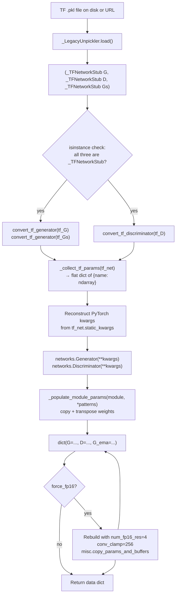
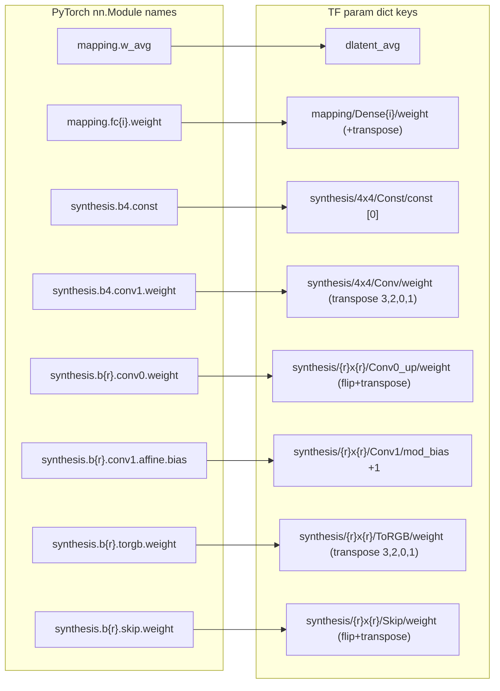
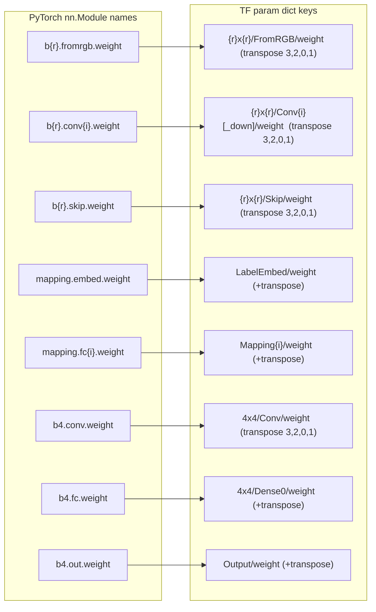

<!-- source: DeepWiki mcp.deepwiki.com · repo mit-han-lab/data-efficient-gans · page 4.2 TF-to-PyTorch Model Conversion · fetched 2026-10-30 -->

# TF-to-PyTorch Model Conversion

<details>
<summary>Relevant source files</summary>

The following files were used as context for generating this wiki page:

- [DiffAugment-stylegan2-pytorch/README.md](DiffAugment-stylegan2-pytorch/README.md)
- [DiffAugment-stylegan2-pytorch/legacy.py](DiffAugment-stylegan2-pytorch/legacy.py)

</details>


This page covers the model conversion logic in `DiffAugment-stylegan2-pytorch/legacy.py`. It explains how pre-trained TensorFlow StyleGAN2 checkpoints (`.pkl` files) are detected and translated into compatible PyTorch `nn.Module` instances. For information about how those converted models are then used to generate images, see [Training and Generation](#4.1). For an overview of the entire PyTorch sub-system, see [DiffAugment-stylegan2-pytorch](#4).

---

## Overview

The TensorFlow version of StyleGAN2 serializes networks using Python's `pickle` module, but the objects stored are instances of `dnnlib.tflib.network.Network` — a TF-specific class. When this pickle is loaded in an environment without TensorFlow (or with a different class hierarchy), the deserialization fails unless the class reference is intercepted.

`legacy.py` solves this with a two-phase approach:

1. **Detection** — Intercept the pickle deserialization and replace unknown TF class references with a neutral stub.
2. **Conversion** — Read the parameter values from the stub and copy them, with appropriate transpositions, into freshly constructed PyTorch `nn.Module` instances.

**Key public functions:**

| Function | Role |
|---|---|
| `load_network_pkl(f, force_fp16)` | Top-level loader; detects format and dispatches conversion |
| `convert_tf_generator(tf_G)` | Converts TF generator stub → PyTorch `Generator` |
| `convert_tf_discriminator(tf_D)` | Converts TF discriminator stub → PyTorch `Discriminator` |
| `convert_network_pickle(source, dest, force_fp16)` | CLI wrapper around `load_network_pkl` |

**Internal helpers:**

| Function / Class | Role |
|---|---|
| `_LegacyUnpickler` | `pickle.Unpickler` subclass; intercepts TF class lookups |
| `_TFNetworkStub` | `EasyDict` subclass used as a neutral container for TF network data |
| `_collect_tf_params(tf_net)` | Flattens a stub's parameter tree into a `{name: ndarray}` dict |
| `_populate_module_params(module, *patterns)` | Copies ndarray values into a PyTorch module using regex-based name mapping |

Sources: [DiffAugment-stylegan2-pytorch/legacy.py:1-341]()

---

## Conversion Pipeline

**Diagram: End-to-end conversion flow from TF pickle to PyTorch modules**



Sources: [DiffAugment-stylegan2-pytorch/legacy.py:20-60]()

---

## TF Format Detection: `_LegacyUnpickler`

Python's `pickle` module calls `find_class(module, name)` for every object it needs to reconstruct. `_LegacyUnpickler` overrides this method to intercept the TF-specific class:

[DiffAugment-stylegan2-pytorch/legacy.py:67-71]()

When the pickle contains a reference to `dnnlib.tflib.network.Network`, `find_class` returns `_TFNetworkStub` instead of trying to import the actual TF class. All other class lookups fall through to the standard `super().find_class(module, name)`.

`_TFNetworkStub` is a bare subclass of `dnnlib.EasyDict`, which means the unpickled TF network object behaves as a plain dictionary. The TF pickle format stores the following attributes on each network object that are consumed later:

| Attribute | Used by |
|---|---|
| `version` | Version guard in `convert_tf_generator` / `convert_tf_discriminator` |
| `static_kwargs` | Architecture hyperparameters (e.g., `latent_size`, `resolution`) |
| `variables` | List of `(name, ndarray)` pairs for this network's own parameters |
| `components` | Dict of child `_TFNetworkStub` objects (e.g., `mapping`, `synthesis`) |

Sources: [DiffAugment-stylegan2-pytorch/legacy.py:64-71]()

---

## Parameter Collection: `_collect_tf_params`

`_collect_tf_params` recursively walks the `_TFNetworkStub` tree (via `tf_net.components`) and accumulates every `(name, ndarray)` pair into a single flat dictionary, prepending the component path as a prefix:

[DiffAugment-stylegan2-pytorch/legacy.py:75-84]()

**Example of resulting keys for a generator stub:**

```
dlatent_avg
mapping/Dense0/weight
mapping/Dense0/bias
synthesis/4x4/Const/const
synthesis/4x4/Conv/weight
synthesis/8x8/Conv0_up/weight
synthesis/1024x1024/ToRGB/bias
```

This flat dict is the only interface between the TF pickle data and the PyTorch weight transfer step.

Sources: [DiffAugment-stylegan2-pytorch/legacy.py:75-84]()

---

## Weight Transfer: `_populate_module_params`

`_populate_module_params` iterates over every named parameter and buffer in a PyTorch `nn.Module` and matches each name against a list of `(regex_pattern, value_fn)` pairs:

[DiffAugment-stylegan2-pytorch/legacy.py:88-105]()

- The patterns are supplied as alternating positional arguments: `pattern0, value_fn0, pattern1, value_fn1, ...`
- Each `value_fn` is a lambda that receives the regex capture groups and returns an `ndarray` (drawn from `tf_params`).
- If `value_fn` is `None`, the parameter is intentionally skipped (e.g., `resample_filter` buffers are computed, not stored).
- Values are written into the tensor in-place via `tensor.copy_(torch.from_numpy(np.array(value)))`.
- If no pattern matches a parameter name, an `AssertionError` is raised, making the mapping exhaustive by construction.

**Important:** TensorFlow stores convolution weights in `[H, W, in, out]` order, while PyTorch expects `[out, in, H, W]`. Every convolution weight transfer includes `.transpose(3, 2, 0, 1)`. Dense/linear weights use `.transpose()` to swap the two axes.

Sources: [DiffAugment-stylegan2-pytorch/legacy.py:88-105]()

---

## Generator Conversion: `convert_tf_generator`

[DiffAugment-stylegan2-pytorch/legacy.py:109-213]()

### Kwarg Mapping

`convert_tf_generator` reads `tf_G.static_kwargs` and remaps each TF hyperparameter name to its PyTorch equivalent:

| TF kwarg | PyTorch kwarg | Default |
|---|---|---|
| `latent_size` | `z_dim` | 512 |
| `label_size` | `c_dim` | 0 |
| `dlatent_size` | `w_dim` | 512 |
| `resolution` | `img_resolution` | 1024 |
| `num_channels` | `img_channels` | 3 |
| `mapping_layers` | `mapping_kwargs.num_layers` | 8 |
| `mapping_lrmul` | `mapping_kwargs.lr_multiplier` | 0.01 |
| `fmap_base` | `synthesis_kwargs.channel_base` | (inferred) |
| `fmap_max` | `synthesis_kwargs.channel_max` | 512 |
| `num_fp16_res` | `synthesis_kwargs.num_fp16_res` | 0 |
| `architecture` | `synthesis_kwargs.architecture` | `'skip'` |
| `resample_kernel` | `synthesis_kwargs.resample_filter` | `[1,3,3,1]` |
| `use_noise` | `synthesis_kwargs.use_noise` | True |
| `nonlinearity` | `synthesis_kwargs.activation` | `'lrelu'` |

If `fmap_base` is absent from the pickle, `channel_base` is inferred from the shape of the top-level synthesis weight (`synthesis/{res}x{res}/Conv1/weight`). Any kwargs present in the TF pickle but not in the known set raise a `ValueError`.

### Architecture Variant Detection

The presence of `ToRGB_lod*` keys in the parameter dict indicates an older `'orig'` architecture variant. These keys are renamed to the resolution-keyed format (`{r}x{r}/ToRGB/...`) and `synthesis_kwargs.architecture` is set to `'orig'` accordingly.

### Parameter Patterns for Generator

**Diagram: PyTorch parameter name → TF parameter name mapping (Generator)**



> **Note on bias adjustment:** Modulation affine biases (`affine.bias`) have `+1` added during transfer. This accounts for a difference in how the TF and PyTorch implementations initialize the style scale.

Sources: [DiffAugment-stylegan2-pytorch/legacy.py:109-213]()

---

## Discriminator Conversion: `convert_tf_discriminator`

[DiffAugment-stylegan2-pytorch/legacy.py:217-306]()

### Kwarg Mapping

| TF kwarg | PyTorch kwarg | Default |
|---|---|---|
| `label_size` | `c_dim` | 0 |
| `resolution` | `img_resolution` | 1024 |
| `num_channels` | `img_channels` | 3 |
| `architecture` | `architecture` | `'resnet'` |
| `fmap_base` | `channel_base` | (inferred) |
| `fmap_max` | `channel_max` | 512 |
| `num_fp16_res` | `num_fp16_res` | 0 |
| `mapping_fmaps` | `cmap_dim` | None |
| `nonlinearity` | `block_kwargs.activation` | `'lrelu'` |
| `resample_kernel` | `block_kwargs.resample_filter` | `[1,3,3,1]` |
| `mbstd_group_size` | `epilogue_kwargs.mbstd_group_size` | None |
| `mbstd_num_features` | `epilogue_kwargs.mbstd_num_channels` | 1 |

The same `'orig'` architecture detection applies: `FromRGB_lod*` keys trigger renaming and set `kwargs.architecture = 'orig'`.

### Parameter Patterns for Discriminator

**Diagram: PyTorch parameter name → TF parameter name mapping (Discriminator)**



> `conv1`'s downsampled variant is named `Conv1_down` in TF. The pattern `["","_down"][int(i)]` in the lambda selects the suffix based on the layer index.

Sources: [DiffAugment-stylegan2-pytorch/legacy.py:217-306]()

---

## `force_fp16` Option

After conversion, `load_network_pkl` optionally rebuilds the `G`, `D`, and `G_ema` modules with FP16 precision enabled:

[DiffAugment-stylegan2-pytorch/legacy.py:44-59]()

When `force_fp16=True`:

- For generator networks: `synthesis_kwargs.num_fp16_res = 4`, `synthesis_kwargs.conv_clamp = 256`
- For the discriminator: `num_fp16_res = 4`, `conv_clamp = 256`
- A new module is constructed from the updated `init_kwargs`, then `misc.copy_params_and_buffers` transfers the already-converted weights into it.

This is only applied when the new kwargs differ from the originals — networks already configured for FP16 are left unchanged.

Sources: [DiffAugment-stylegan2-pytorch/legacy.py:44-59]()

---

## Automatic Conversion in `generate.py`

The `load_network_pkl` function is used directly by `generate.py` and `generate_gif.py`. Because `_LegacyUnpickler` transparently returns a native PyTorch dict when the source is already in PyTorch format, callers do not need to know whether the source `.pkl` is TF or PyTorch:

```
generate.py  →  dnnlib.util.open_url(network)  →  load_network_pkl(f)
                                                        ↳ auto-detects format
                                                        ↳ converts if TF
                                                        ↳ returns {G, D, G_ema}
```

The README documents this behavior explicitly: *"The code will automatically convert a TensorFlow StyleGAN2 model to the compatible PyTorch version."*

Sources: [DiffAugment-stylegan2-pytorch/README.md:14-16](), [DiffAugment-stylegan2-pytorch/legacy.py:20-60]()

---

## CLI Usage

`legacy.py` is also a standalone command-line tool via the `convert_network_pickle` Click command:

[DiffAugment-stylegan2-pytorch/legacy.py:310-338]()

```
python legacy.py \
    --source=https://nvlabs-fi-cdn.nvidia.com/stylegan2/networks/stylegan2-cat-config-f.pkl \
    --dest=stylegan2-cat-config-f.pkl \
    --force-fp16=False
```

| Option | Type | Description |
|---|---|---|
| `--source` | `PATH` | Input pickle (local path or URL) |
| `--dest` | `PATH` | Output pickle (always PyTorch format) |
| `--force-fp16` | `BOOL` | Rebuild networks with FP16 config (default: False) |

The source URL is opened via `dnnlib.util.open_url`, which handles caching and remote fetching (see [Shared Utilities](#6)). The output is written with `pickle.dump`, producing a standard PyTorch-native `.pkl` containing `{G, D, G_ema, training_set_kwargs, augment_pipe}`.

**Supported input formats:**
- TensorFlow StyleGAN2 (config F)
- TensorFlow StyleGAN2-ADA
- Native PyTorch StyleGAN2-ADA (passed through unchanged)

**Not supported:**
- StyleGAN2 configs A–D
- StyleGAN2-ADA comparison methods
- StyleGAN1

Sources: [DiffAugment-stylegan2-pytorch/legacy.py:310-338]()

---

