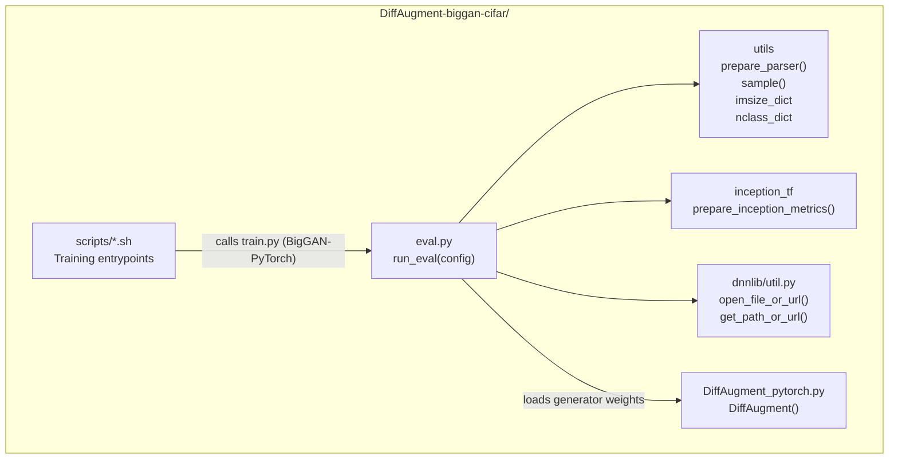
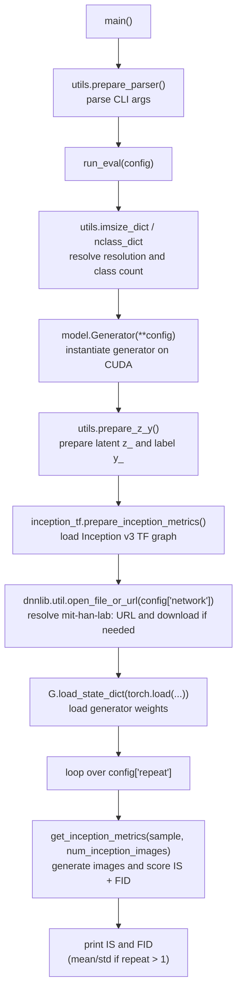
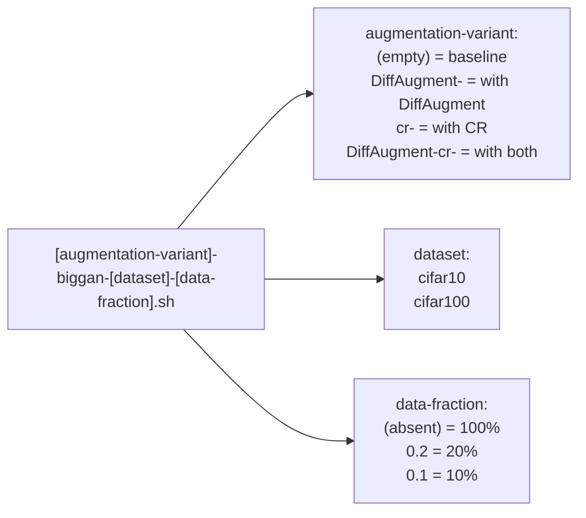
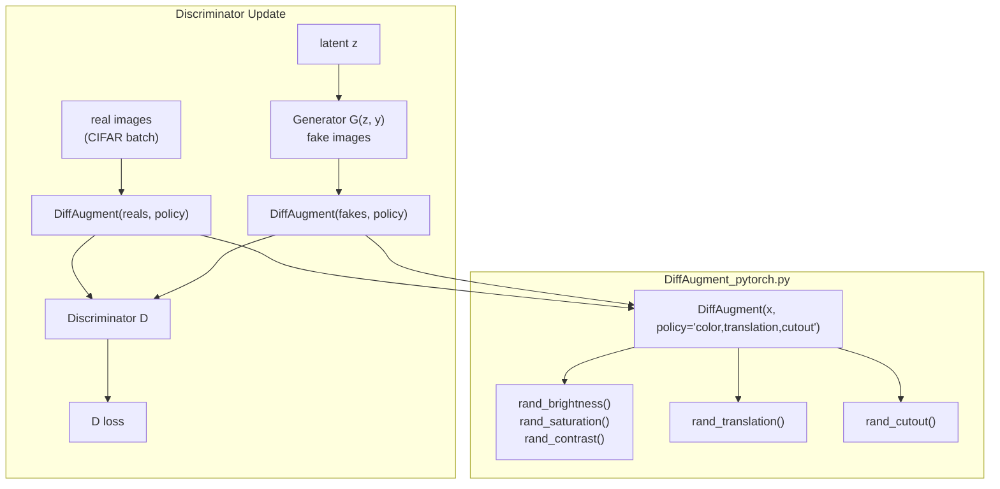
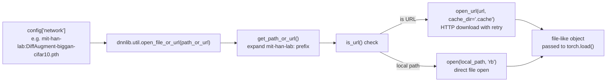

<!-- source: DeepWiki mcp.deepwiki.com · repo mit-han-lab/data-efficient-gans · page 5 DiffAugment-biggan-cifar · fetched 2026-10-30 -->

# DiffAugment-biggan-cifar

<details>
<summary>Relevant source files</summary>

The following files were used as context for generating this wiki page:

- [DiffAugment-biggan-cifar/DiffAugment_pytorch.py](DiffAugment-biggan-cifar/DiffAugment_pytorch.py)
- [DiffAugment-biggan-cifar/README.md](DiffAugment-biggan-cifar/README.md)
- [DiffAugment-biggan-cifar/dnnlib/util.py](DiffAugment-biggan-cifar/dnnlib/util.py)
- [DiffAugment-biggan-cifar/eval.py](DiffAugment-biggan-cifar/eval.py)
- [DiffAugment-stylegan2-pytorch/DiffAugment_pytorch.py](DiffAugment-stylegan2-pytorch/DiffAugment_pytorch.py)
- [DiffAugment-stylegan2/training/misc.py](DiffAugment-stylegan2/training/misc.py)

</details>


This page documents the `DiffAugment-biggan-cifar/` sub-system: a PyTorch BigGAN implementation augmented with DiffAugment for class-conditional image generation on CIFAR-10 and CIFAR-100. It covers the evaluation entrypoint, pre-trained model catalogue, training scripts, IS/FID metric pipeline, and the DiffAugment integration.

For the portable DiffAugment augmentation functions themselves, see [DiffAugment Core Module](#2). For the unconditional StyleGAN2 variant in PyTorch, see [DiffAugment-stylegan2-pytorch](#4).

---

## Overview

This sub-system is built on top of the [BigGAN-PyTorch](https://github.com/ajbrock/BigGAN-PyTorch) codebase. It adds DiffAugment to the BigGAN discriminator update path and provides pre-trained checkpoints, training shell scripts, and a standalone evaluation script.

**Component map:**



Sources: [DiffAugment-biggan-cifar/eval.py:1-60](), [DiffAugment-biggan-cifar/README.md:1-63]()

---

## Dependencies

| Dependency | Version | Purpose |
|---|---|---|
| PyTorch | >= 1.0.1 (tested 1.4.0) | Generator/Discriminator, training |
| TensorFlow | 1.14 or 1.15 (GPU) | IS and FID calculation via `inception_tf` |
| GPU DRAM | >= 12 GB × 2 | Recommended for training and evaluation |

The IS/FID calculation borrows the official TensorFlow Inception v3 implementation from the StyleGAN2 repo.

Sources: [DiffAugment-biggan-cifar/README.md:3-9](), [DiffAugment-biggan-cifar/README.md:62-63]()

---

## Pre-Trained Models

Models are referenced via the `mit-han-lab:` shorthand, which `get_path_or_url()` in [DiffAugment-biggan-cifar/dnnlib/util.py:435-436]() expands to `https://data-efficient-gans.mit.edu/models/`.

### CIFAR-10 Models

| Model name | Data fraction | IS (10k) | FID (10k) |
|---|---|---|---|
| `mit-han-lab:biggan-cifar10.pth` | 100% | 9.06 | 9.59 |
| `mit-han-lab:DiffAugment-biggan-cifar10.pth` | 100% | **9.16** | **8.70** |
| `mit-han-lab:cr-biggan-cifar10.pth` | 100% | **9.20** | 9.06 |
| `mit-han-lab:DiffAugment-cr-biggan-cifar10.pth` | 100% | 9.17 | **8.49** |
| `mit-han-lab:biggan-cifar10-0.2.pth` | 20% | 8.41 | 21.58 |
| `mit-han-lab:DiffAugment-biggan-cifar10-0.2.pth` | 20% | **8.65** | **14.04** |
| `mit-han-lab:cr-biggan-cifar10-0.2.pth` | 20% | 8.43 | 20.62 |
| `mit-han-lab:DiffAugment-cr-biggan-cifar10-0.2.pth` | 20% | **8.61** | **12.84** |
| `mit-han-lab:biggan-cifar10-0.1.pth` | 10% | 7.62 | 39.78 |
| `mit-han-lab:DiffAugment-biggan-cifar10-0.1.pth` | 10% | **8.09** | **22.40** |
| `mit-han-lab:cr-biggan-cifar10-0.1.pth` | 10% | 7.66 | 37.45 |
| `mit-han-lab:DiffAugment-cr-biggan-cifar10-0.1.pth` | 10% | **8.49** | **18.70** |

### CIFAR-100 Models

| Model name | Data fraction | IS (10k) | FID (10k) |
|---|---|---|---|
| `mit-han-lab:biggan-cifar100.pth` | 100% | **10.92** | 12.87 |
| `mit-han-lab:DiffAugment-biggan-cifar100.pth` | 100% | 10.66 | **12.00** |
| `mit-han-lab:cr-biggan-cifar100.pth` | 100% | **10.95** | 11.26 |
| `mit-han-lab:DiffAugment-cr-biggan-cifar100.pth` | 100% | 10.81 | **11.25** |
| `mit-han-lab:biggan-cifar100-0.2.pth` | 20% | 9.11 | 33.11 |
| `mit-han-lab:DiffAugment-biggan-cifar100-0.2.pth` | 20% | **9.47** | **22.14** |
| `mit-han-lab:cr-biggan-cifar100-0.2.pth` | 20% | 8.44 | 36.91 |
| `mit-han-lab:DiffAugment-cr-biggan-cifar100-0.2.pth` | 20% | **9.12** | **20.28** |
| `mit-han-lab:biggan-cifar100-0.1.pth` | 10% | 5.94 | 66.71 |
| `mit-han-lab:DiffAugment-biggan-cifar100-0.1.pth` | 10% | **8.38** | **33.70** |
| `mit-han-lab:cr-biggan-cifar100-0.1.pth` | 10% | 7.91 | 47.16 |
| `mit-han-lab:DiffAugment-cr-biggan-cifar100-0.1.pth` | 10% | **8.70** | **26.90** |

Model name prefixes:
- `biggan-*` — baseline BigGAN, no DiffAugment
- `DiffAugment-biggan-*` — BigGAN with DiffAugment
- `cr-biggan-*` — BigGAN with Consistency Regularization
- `DiffAugment-cr-biggan-*` — BigGAN with both DiffAugment and CR

Suffix `-0.2` / `-0.1` indicates 20% or 10% of the training data was used.

Sources: [DiffAugment-biggan-cifar/README.md:19-46](), [DiffAugment-biggan-cifar/dnnlib/util.py:435-436]()

---

## Evaluation: `eval.py`

The `eval.py` script is the single entry point for evaluating any pre-trained or locally trained checkpoint.

**Usage:**

```bash
CUDA_VISIBLE_DEVICES=0,1 python eval.py --dataset=WHICH_DATASET --network=WHICH_MODEL
```

- `--dataset`: `C10` (CIFAR-10, default) or `C100` (CIFAR-100)
- `--network`: local path to a `.pth` file (typically `weights/G_ema_best.pth`) or a `mit-han-lab:` shorthand
- `--repeat`: number of evaluation runs for computing mean and standard deviation

**Execution flow:**



Sources: [DiffAugment-biggan-cifar/eval.py:11-60]()

### Key function: `run_eval`

[DiffAugment-biggan-cifar/eval.py:11-49]()

| Step | Code construct | Notes |
|---|---|---|
| Config resolution | `utils.imsize_dict`, `utils.nclass_dict` | Maps `C10`/`C100` to pixel size and class count |
| Activation lookup | `utils.activation_dict[config['G_nl']]` | Resolves activation name to callable |
| Generator instantiation | `model.Generator(**config)` | Model module is imported dynamically via `__import__(config['model'])` |
| Latent preparation | `utils.prepare_z_y(...)` | Creates noise `z_` and class label `y_` tensors |
| Metric setup | `inception_tf.prepare_inception_metrics(...)` | Loads TF Inception graph; returns `get_inception_metrics` callable |
| Checkpoint loading | `dnnlib.util.open_file_or_url(config['network'])` | Handles both local paths and `mit-han-lab:` URLs |
| Sampling | `utils.sample` via `functools.partial` | Partial-applied generator call |
| Scoring | `get_inception_metrics(sample, num_inception_images, num_splits=10)` | Returns `(IS, IS_std, FID)` |

The `--repeat` flag collects multiple `(IS, FID)` pairs and prints mean and standard deviation. A standard deviation of less than 1% relative is expected across runs.

Sources: [DiffAugment-biggan-cifar/eval.py:11-49](), [DiffAugment-biggan-cifar/README.md:48]()

---

## Training Scripts

The `scripts/` directory contains a complete set of bash scripts for reproducing every pre-trained model. Scripts follow the same naming convention as the model files.

**Example:**

```bash
CUDA_VISIBLE_DEVICES=0,1 bash scripts/DiffAugment-biggan-cifar10-0.1.sh
```

Script naming format:



Training typically takes approximately 1 day on 2 GPUs (>= 12 GB DRAM each). The scripts invoke the BigGAN-PyTorch `train.py` loop with appropriate hyperparameter flags.

After training, the generator weights are saved to the `weights/` directory. The best checkpoint is typically `weights/G_ema_best.pth`, which is the file to pass to `eval.py --network`.

Sources: [DiffAugment-biggan-cifar/README.md:52-58]()

---

## DiffAugment Integration

`DiffAugment_pytorch.py` is a vendored copy of the core DiffAugment module (see [DiffAugment Core Module](#2)) placed directly inside `DiffAugment-biggan-cifar/`. It is identical to the root-level `DiffAugment_pytorch.py`.

**DiffAugment call site in the training loop (BigGAN discriminator path):**



The `DiffAugment` function in [DiffAugment-biggan-cifar/DiffAugment_pytorch.py:9-19]() accepts a comma-separated `policy` string. The standard policy used in this sub-system is `'color,translation,cutout'`.

The `AUGMENT_FNS` registry at [DiffAugment-biggan-cifar/DiffAugment_pytorch.py:72-76]() maps each policy name to its list of transform functions:

| Policy key | Functions |
|---|---|
| `color` | `rand_brightness`, `rand_saturation`, `rand_contrast` |
| `translation` | `rand_translation` |
| `cutout` | `rand_cutout` |

Sources: [DiffAugment-biggan-cifar/DiffAugment_pytorch.py:1-77]()

---

## IS and FID Metrics

Metrics are computed using the `inception_tf` module, which wraps the official TensorFlow Inception v3 implementation borrowed from the StyleGAN2 repo.

`inception_tf.prepare_inception_metrics(dataset, parallel, config)` returns a `get_inception_metrics` callable. When invoked, it:

1. Calls the `sample` partial (wrapping `utils.sample`) repeatedly to generate `num_inception_images` images from the current generator
2. Computes **Inception Score (IS)** using `num_splits=10` across the generated images
3. Computes **FID** against pre-computed CIFAR-10 or CIFAR-100 statistics

The `get_inception_metrics` call at [DiffAugment-biggan-cifar/eval.py:40]() returns `(IS, IS_std, FID)`.

`num_inception_images` defaults to 10,000 — all reported metrics in the model table use 10k samples (denoted `is10k` / `fid10k`).

Sources: [DiffAugment-biggan-cifar/eval.py:28-49](), [DiffAugment-biggan-cifar/README.md:19-48](), [DiffAugment-biggan-cifar/README.md:62-63]()

---

## Model Download and Caching

Model resolution follows the same `mit-han-lab:` shorthand used throughout the repository. The function `get_path_or_url` in [DiffAugment-biggan-cifar/dnnlib/util.py:435-436]() replaces the prefix with `https://data-efficient-gans.mit.edu/models/`. The resolved URL is then fetched by `open_url` in [DiffAugment-biggan-cifar/dnnlib/util.py:346-415](), which caches the download under `.cache/` using an MD5-keyed filename to avoid re-downloading.



Sources: [DiffAugment-biggan-cifar/dnnlib/util.py:418-436](), [DiffAugment-biggan-cifar/eval.py:30]()

---

