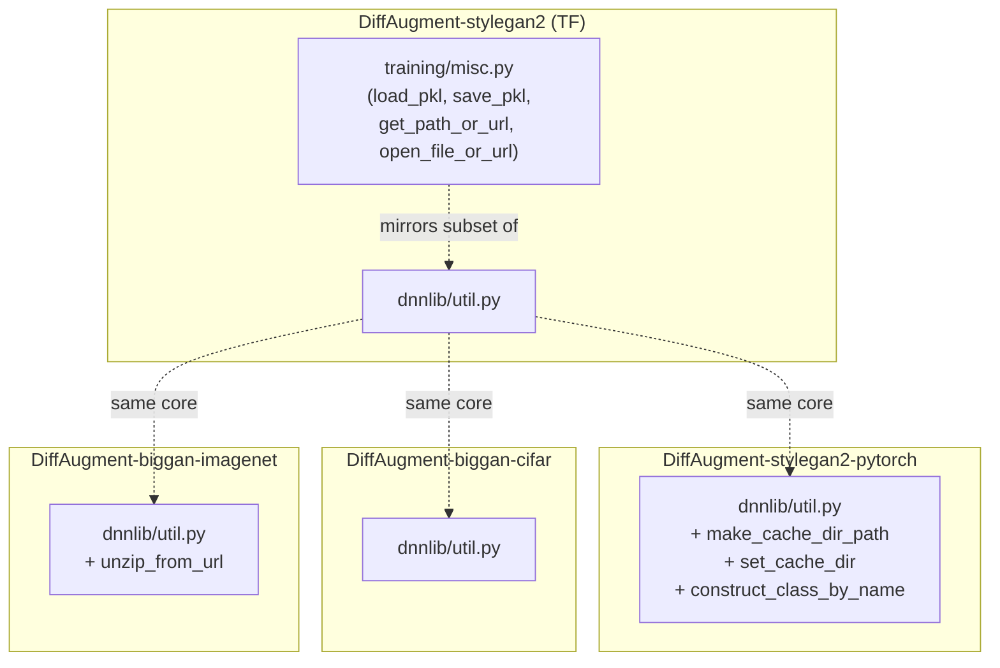
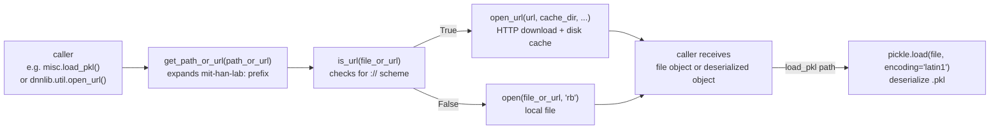
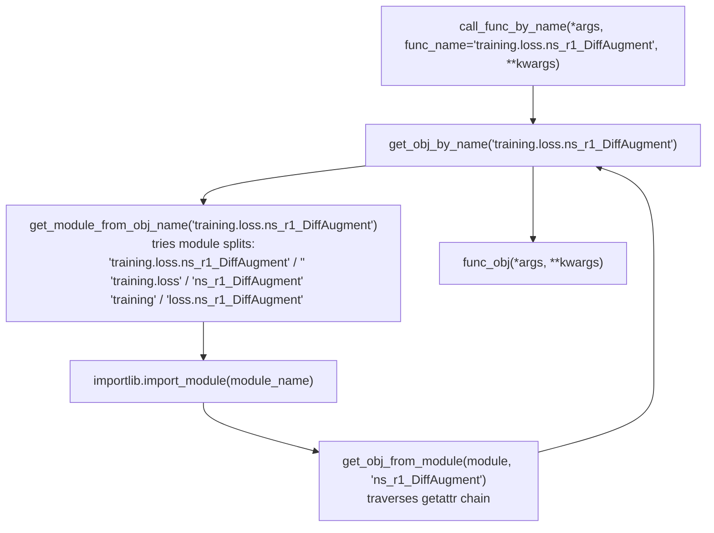

<!-- source: DeepWiki mcp.deepwiki.com · repo mit-han-lab/data-efficient-gans · page 6 Shared Utilities · fetched 2026-10-30 -->

# Shared Utilities

<details>
<summary>Relevant source files</summary>

The following files were used as context for generating this wiki page:

- [DiffAugment-biggan-cifar/dnnlib/util.py](DiffAugment-biggan-cifar/dnnlib/util.py)
- [DiffAugment-biggan-cifar/eval.py](DiffAugment-biggan-cifar/eval.py)
- [DiffAugment-biggan-imagenet/dnnlib/util.py](DiffAugment-biggan-imagenet/dnnlib/util.py)
- [DiffAugment-stylegan2-pytorch/dnnlib/util.py](DiffAugment-stylegan2-pytorch/dnnlib/util.py)
- [DiffAugment-stylegan2-pytorch/generate_gif.py](DiffAugment-stylegan2-pytorch/generate_gif.py)
- [DiffAugment-stylegan2/training/misc.py](DiffAugment-stylegan2/training/misc.py)

</details>


This page documents the `dnnlib` utility layer that is vendored into each sub-system of the repository. It covers the general-purpose classes and functions used across the TensorFlow StyleGAN2, PyTorch StyleGAN2, BigGAN-CIFAR, and BigGAN-ImageNet sub-systems: configuration containers (`EasyDict`), output logging (`Logger`), remote model/data access (`open_url`, `load_pkl`, `save_pkl`, `get_path_or_url`), and dynamic Python object loading (`get_obj_by_name`, `call_func_by_name`).

For how the TF StyleGAN2 sub-system additionally uses `misc.py` image utilities (grid creation, dynamic range adjustment), see [DiffAugment-stylegan2 Network Architecture and Training Internals](#3.4). For dataset downloading in the PyTorch sub-system, see [DiffAugment-stylegan2-pytorch Training and Generation](#4.1).

---

## Location and Vendoring

`dnnlib/util.py` is not a single shared module. Each sub-system contains its own local copy. The copies share the same structure and most functions, but have small differences in cache management and a few extra helpers.

| Sub-system | File | Notable differences |
|---|---|---|
| DiffAugment-stylegan2 (TF) | `DiffAugment-stylegan2/dnnlib/` | Base version; also uses `training/misc.py` for pkl/URL helpers |
| DiffAugment-stylegan2-pytorch | `DiffAugment-stylegan2-pytorch/dnnlib/util.py` | Adds `make_cache_dir_path`, `set_cache_dir`, `construct_class_by_name`, `return_filename` option |
| DiffAugment-biggan-cifar | `DiffAugment-biggan-cifar/dnnlib/util.py` | Identical to TF version for the utilities described here |
| DiffAugment-biggan-imagenet | `DiffAugment-biggan-imagenet/dnnlib/util.py` | Adds `unzip_from_url` for dataset extraction |

The `dnnlib` package is imported throughout all sub-systems. For example, `DiffAugment-stylegan2-pytorch/generate_gif.py` calls `dnnlib.util.open_url` directly [DiffAugment-stylegan2-pytorch/generate_gif.py:50](), and `DiffAugment-biggan-cifar/eval.py` calls `dnnlib.util.open_file_or_url` [DiffAugment-biggan-cifar/eval.py:30]().

**Diagram: dnnlib utility layout across sub-systems**



Sources: [DiffAugment-biggan-cifar/dnnlib/util.py:1-10](), [DiffAugment-stylegan2-pytorch/dnnlib/util.py:1-10](), [DiffAugment-biggan-imagenet/dnnlib/util.py:1-10](), [DiffAugment-stylegan2/training/misc.py:1-40]()

---

## EasyDict

`EasyDict` is a `dict` subclass that allows both key-based and attribute-based access to its contents. It is used throughout training scripts to assemble configuration objects.

[DiffAugment-biggan-cifar/dnnlib/util.py:35-49]()

```
d = EasyDict(lr=0.001)
d.lr         # → 0.001
d['lr']      # → 0.001
d.new_key = 5   # equivalent to d['new_key'] = 5
```

All three accessor patterns (`__getattr__`, `__setattr__`, `__delattr__`) delegate to the underlying dict. A missing key raises `AttributeError` rather than `KeyError`, which is consistent with attribute-access semantics.

The TF StyleGAN2 training scripts (`run_cifar.py`, `run_ffhq.py`, `run_low_shot.py`) use `EasyDict` objects to package network kwargs, dataset kwargs, and loss kwargs before passing them to `dnnlib.submit_run`. See [Training Scripts](#3.3) for details.

Sources: [DiffAugment-biggan-cifar/dnnlib/util.py:35-49](), [DiffAugment-stylegan2-pytorch/dnnlib/util.py:40-53]()

---

## Logger

`Logger` replaces `sys.stdout` and `sys.stderr` so that all printed output is simultaneously written to a log file and to the original stdout.

[DiffAugment-biggan-cifar/dnnlib/util.py:51-105]()

| Parameter | Type | Default | Description |
|---|---|---|---|
| `file_name` | `str` | `None` | Path to the log file. If `None`, no file is written. |
| `file_mode` | `str` | `"w"` | File open mode (`"w"` overwrites, `"a"` appends). |
| `should_flush` | `bool` | `True` | If `True`, every `write()` call triggers an immediate flush. |

`Logger` is a context manager. On `__exit__` (or explicit `close()`), `sys.stdout` and `sys.stderr` are restored to their pre-Logger values. Multiple nested loggers are safe because `close()` checks whether `sys.stdout is self` before restoring.

The PyTorch version [DiffAugment-stylegan2-pytorch/dnnlib/util.py:56-113]() additionally handles the case where `write()` is called with a `bytes` argument, decoding it to a string first.

Sources: [DiffAugment-biggan-cifar/dnnlib/util.py:51-105](), [DiffAugment-stylegan2-pytorch/dnnlib/util.py:56-113]()

---

## URL and File Helpers

These functions form the main interface for loading models and datasets from remote URLs or local paths.

**Diagram: call chain for remote model loading**



Sources: [DiffAugment-biggan-cifar/dnnlib/util.py:418-436](), [DiffAugment-stylegan2/training/misc.py:20-39]()

### `get_path_or_url`

[DiffAugment-biggan-cifar/dnnlib/util.py:435-436]()

```
get_path_or_url('mit-han-lab:DiffAugment-stylegan2-100-shot-obama.pkl')
# → 'https://data-efficient-gans.mit.edu/models/DiffAugment-stylegan2-100-shot-obama.pkl'
```

The `mit-han-lab:` prefix is a shorthand used in run scripts and documentation. It expands to `https://data-efficient-gans.mit.edu/models/`. This expansion happens before any URL check or file open.

### `is_url`

[DiffAugment-biggan-cifar/dnnlib/util.py:328-343]()

Validates that a string is a properly formed URL with scheme and netloc. The `allow_file_urls` parameter controls whether `file:///` paths are accepted. Returns `False` for bare file paths.

### `open_url`

[DiffAugment-biggan-cifar/dnnlib/util.py:346-415]()

Downloads a URL and returns a binary file object. Key behaviors:

| Feature | Detail |
|---|---|
| **Cache key** | MD5 hash of the URL string |
| **Cache file name** | `{md5}_{original_filename}` stored under `cache_dir` |
| **Atomic write** | Written first to a temp file with a UUID name, then renamed atomically |
| **Retry logic** | Up to `num_attempts` (default 10) retries on network error |
| **Google Drive** | Detects virus-check redirect cookies and quota errors, follows the real download link |
| **Return type** | `io.BytesIO` if no `cache_dir`; otherwise opens and returns the cached file |
| **`return_path` option** | Returns the local cache path string instead of a file object (BigGAN/TF versions) |

The PyTorch version [DiffAugment-stylegan2-pytorch/dnnlib/util.py:382-478]() extends this with:
- A `return_filename` flag (replaces `return_path`)
- A `cache` flag to disable caching entirely
- Uses `make_cache_dir_path('downloads')` as the default cache directory if none is specified

### `open_file_or_url`

[DiffAugment-biggan-cifar/dnnlib/util.py:418-422]()

Convenience wrapper: calls `get_path_or_url` first, then either `open_url` or `open(file, 'rb')` depending on whether the result is a URL.

### `load_pkl` and `save_pkl`

[DiffAugment-biggan-cifar/dnnlib/util.py:425-432]()

| Function | Behavior |
|---|---|
| `load_pkl(file_or_url)` | Opens the file or URL via `open_file_or_url`, then calls `pickle.load(..., encoding='latin1')`. The `latin1` encoding allows loading pickles created by Python 2 or older TensorFlow checkpoints. |
| `save_pkl(obj, filename)` | Opens `filename` in binary write mode and calls `pickle.dump` with `protocol=pickle.HIGHEST_PROTOCOL`. |

The TF StyleGAN2 sub-system also provides identical `load_pkl`/`save_pkl` wrappers in `DiffAugment-stylegan2/training/misc.py` [DiffAugment-stylegan2/training/misc.py:21-35](), which use `.stylegan2-cache` as the cache directory.

### `unzip_from_url` (BigGAN-ImageNet only)

[DiffAugment-biggan-imagenet/dnnlib/util.py:419-425]()

Downloads a `.zip` file from `url + '.zip'`, extracts it to `cache_dir`, and returns the local path. The `mit-han-lab:` prefix is resolved via `get_path_or_url` before the download. Used for dataset preparation in the ImageNet BigGAN sub-system.

---

## Cache Directory Management (PyTorch sub-system)

The PyTorch version of `dnnlib/util.py` adds a configurable cache directory mechanism absent from the other versions.

[DiffAugment-stylegan2-pytorch/dnnlib/util.py:118-133]()

`make_cache_dir_path(*paths)` resolves the cache root in priority order:

1. Module-level `_dnnlib_cache_dir` variable set by `set_cache_dir(path)`
2. `DNNLIB_CACHE_DIR` environment variable
3. `$HOME/.cache/dnnlib/`
4. `$USERPROFILE/.cache/dnnlib/` (Windows)
5. `tempfile.gettempdir()/.cache/dnnlib/`

`open_url` uses `make_cache_dir_path('downloads')` as its default cache location when no explicit `cache_dir` is passed.

Sources: [DiffAugment-stylegan2-pytorch/dnnlib/util.py:118-133](), [DiffAugment-stylegan2-pytorch/dnnlib/util.py:382-420]()

---

## Dynamic Object Loading

These functions allow any Python object (class, function, or value) to be referenced and invoked by its fully-qualified dotted name as a string. This is used by the TF StyleGAN2 training loop to dispatch network constructors, loss functions, and other callables from `EasyDict` configuration objects.

**Diagram: dynamic object resolution chain**



Sources: [DiffAugment-biggan-cifar/dnnlib/util.py:194-256]()

### `get_module_from_obj_name(obj_name)`

[DiffAugment-biggan-cifar/dnnlib/util.py:194-232]()

Splits the dotted name at every position and tries each `(module_name, local_name)` split from longest to shortest until `importlib.import_module` and `getattr` both succeed. Before splitting, it expands convenience aliases:
- `np.` → `numpy.`
- `tf.` → `tensorflow.`

### `get_obj_from_module(module, obj_name)`

[DiffAugment-biggan-cifar/dnnlib/util.py:235-242]()

Traverses a dotted attribute path on an already-imported module. An empty `obj_name` returns the module itself.

### `get_obj_by_name(name)`

[DiffAugment-biggan-cifar/dnnlib/util.py:245-248]()

Combines `get_module_from_obj_name` and `get_obj_from_module` into a single call. Returns any Python object reachable by its fully-qualified name.

### `call_func_by_name(*args, func_name, **kwargs)`

[DiffAugment-biggan-cifar/dnnlib/util.py:251-256]()

Resolves the object by `func_name`, asserts it is callable, and calls it with the provided positional and keyword arguments.

### `construct_class_by_name` (PyTorch sub-system only)

[DiffAugment-stylegan2-pytorch/dnnlib/util.py:287-289]()

Thin alias over `call_func_by_name` with the parameter renamed to `class_name` for readability when constructing class instances.

---

## misc.py Utilities (TF StyleGAN2 only)

`DiffAugment-stylegan2/training/misc.py` provides additional utilities specific to the TF StyleGAN2 training pipeline. These overlap with `dnnlib/util.py` in the URL/pickle area but also include image manipulation helpers.

| Function | Purpose |
|---|---|
| `open_file_or_url(file_or_url)` | Resolves `mit-han-lab:` prefix, then opens URL or local file. Uses `.stylegan2-cache` for HTTP cache. |
| `load_pkl(file_or_url)` | Wraps `open_file_or_url` + `pickle.load` with `latin1` encoding. |
| `save_pkl(obj, filename)` | Wraps `pickle.dump` with `HIGHEST_PROTOCOL`. |
| `get_path_or_url(path_or_url)` | Expands `mit-han-lab:` to `https://data-efficient-gans.mit.edu/models/`. |
| `adjust_dynamic_range(data, drange_in, drange_out)` | Linearly rescales an array between two value ranges. |
| `create_image_grid(images, grid_size)` | Arranges a batch of images into an H×W grid array. |
| `convert_to_pil_image(image, drange)` | Converts a CHW numpy array to a `PIL.Image`, rescaling dynamic range. |
| `save_image_grid(images, filename, ...)` | Combines `create_image_grid` and `convert_to_pil_image` and saves to disk. |
| `apply_mirror_augment(minibatch)` | Randomly flips 50% of images in a batch horizontally. |
| `setup_snapshot_image_grid(training_set, ...)` | Selects a representative grid of real images for snapshot exports during training. |

Sources: [DiffAugment-stylegan2/training/misc.py:20-103]()

---

## Function Reference Summary

| Symbol | File(s) | Description |
|---|---|---|
| `EasyDict` | `dnnlib/util.py` (all) | Dict with attribute-style access |
| `Logger` | `dnnlib/util.py` (all) | stdout/stderr tee to file |
| `get_path_or_url` | `dnnlib/util.py` (all), `training/misc.py` | Expands `mit-han-lab:` shorthand |
| `is_url` | `dnnlib/util.py` (all) | Validates URL strings |
| `open_url` | `dnnlib/util.py` (all) | Downloads URL, caches to disk |
| `open_file_or_url` | `dnnlib/util.py` (all), `training/misc.py` | Opens local file or remote URL |
| `load_pkl` | `dnnlib/util.py` (all), `training/misc.py` | Loads pickle from file or URL |
| `save_pkl` | `dnnlib/util.py` (all), `training/misc.py` | Saves pickle to file |
| `unzip_from_url` | `dnnlib/util.py` (ImageNet only) | Downloads and extracts a zip archive |
| `set_cache_dir` | `dnnlib/util.py` (PyTorch only) | Sets global dnnlib cache root |
| `make_cache_dir_path` | `dnnlib/util.py` (PyTorch only) | Resolves cache directory path |
| `get_module_from_obj_name` | `dnnlib/util.py` (all) | Splits dotted name into module + attr |
| `get_obj_from_module` | `dnnlib/util.py` (all) | Traverses attribute chain on a module |
| `get_obj_by_name` | `dnnlib/util.py` (all) | Resolves any Python object by dotted name |
| `call_func_by_name` | `dnnlib/util.py` (all) | Resolves and calls a function by name |
| `construct_class_by_name` | `dnnlib/util.py` (PyTorch only) | Alias of `call_func_by_name` for classes |
| `format_time` | `dnnlib/util.py` (all) | Converts seconds to human-readable string |
| `is_pickleable` | `dnnlib/util.py` (all) | Tests whether an object can be pickled |