# Page: Overview

# Overview

<details>
<summary>Relevant source files</summary>

The following files were used as context for generating this wiki page:

- [README.md](README.md)
- [imgs/interp.gif](imgs/interp.gif)
- [imgs/method.jpg](imgs/method.jpg)
- [imgs/obama.gif](imgs/obama.gif)

</details>


This page introduces the `data-efficient-gans` repository, explains the DiffAugment technique, maps the repository's sub-systems to their code locations, and shows how to integrate DiffAugment into an existing GAN training loop. For details on any sub-system, see the linked pages below.

---

## What is DiffAugment?

**Differentiable Augmentation (DiffAugment)** is a technique for improving data efficiency in GAN training. The core idea is simple: instead of passing images directly to the discriminator `D`, every input — both real and generated — is first passed through a differentiable augmentation transform `T`. This applies to both the discriminator update and the generator update.

The requirement that `T` be differentiable is the key constraint: because the generator update requires gradients to flow back through `T`, the augmentation operations must support gradient computation with respect to their inputs.

The implemented augmentation policy `'color,translation,cutout'` applies three families of transforms:

| Policy name | Operations |
|---|---|
| `color` | random brightness, saturation, contrast |
| `translation` | random translation with reflection padding |
| `cutout` | random rectangular mask |

The `DiffAugment` function is the single entry point for all transforms. It is provided as two portable modules at the repository root:

| File | Framework |
|---|---|
| `DiffAugment_pytorch.py` | PyTorch |
| `DiffAugment_tf.py` | TensorFlow |

These files have no dependencies beyond the respective framework and can be dropped into any existing codebase.

Sources: [README.md:37-102](), [DiffAugment_pytorch.py](), [DiffAugment_tf.py]()

---

## How DiffAugment Slots Into a GAN Training Loop

The change to an existing GAN codebase is minimal: replace every `D(x)` with `D(T(x))` where `T` is the `DiffAugment` call.

**DiffAugment training loop integration (PyTorch)**

```python
from DiffAugment_pytorch import DiffAugment
policy = 'color,translation,cutout'

# Discriminator update
real_scores = Discriminator(DiffAugment(reals, policy=policy))
fake_scores = Discriminator(DiffAugment(fakes, policy=policy))

# Generator update
fake_scores = Discriminator(DiffAugment(Generator(z), policy=policy))
```

The `DiffAugment` function signature is:
```
DiffAugment(x, policy='', channels_first=True)
```

It accepts a batch tensor `x`, a comma-separated `policy` string, and a `channels_first` flag for NCHW vs. NHWC layout compatibility.

**Diagram: DiffAugment in the GAN training loop**

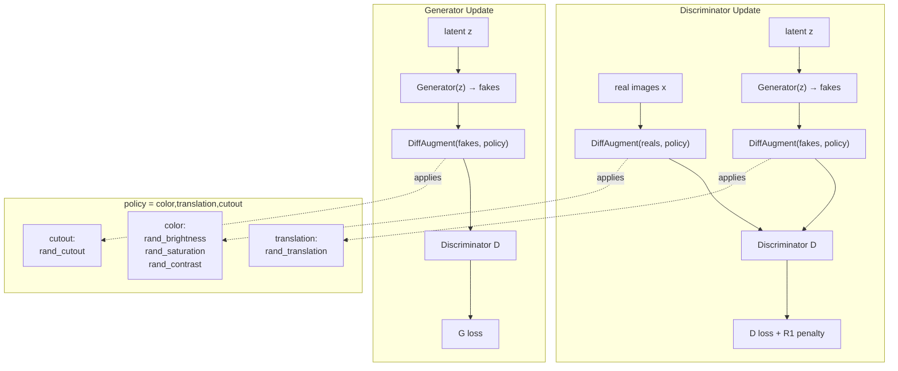

Sources: [README.md:69-98](), [DiffAugment_pytorch.py]()

---

## Repository Structure

The repository is divided into a shared core at the root and four sub-systems, each targeting a different GAN architecture and/or framework.

| Sub-directory | Architecture | Framework | GPU/TPU |
|---|---|---|---|
| *(root)* | portable DiffAugment modules | PyTorch + TensorFlow | — |
| `DiffAugment-stylegan2/` | StyleGAN2 | TensorFlow 1.15 | GPU |
| `DiffAugment-stylegan2-pytorch/` | StyleGAN2 | PyTorch | GPU |
| `DiffAugment-biggan-cifar/` | BigGAN | PyTorch | GPU |
| `DiffAugment-biggan-imagenet/` | BigGAN | TensorFlow | TPU |

**Diagram: Sub-system map with key code entry points**

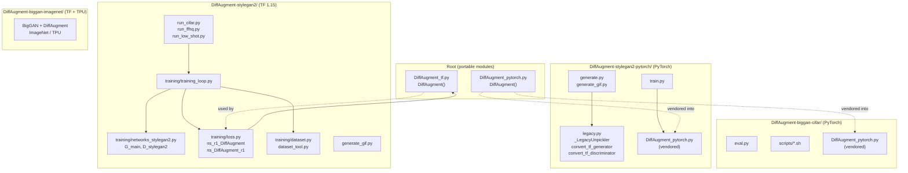

Sources: [README.md:1-67]()

---

## The Four Sub-systems

### 1. DiffAugment-stylegan2 (TensorFlow)

The primary reference implementation. Supports unconditional generation on CIFAR-10/100, FFHQ, LSUN, and the custom 100-shot datasets (Obama, grumpy cats, pandas, etc.). Training is launched via `run_low_shot.py`, `run_cifar.py`, or `run_ffhq.py`. Data flows through `dataset_tool.py` to produce TFRecord files, then through a `tf.data` pipeline at runtime.

See page [3](#3) for the full breakdown of this sub-system.

### 2. DiffAugment-stylegan2-pytorch (PyTorch)

A PyTorch port of StyleGAN2 + DiffAugment. Entry point is `train.py`. Includes `legacy.py` for converting TensorFlow `.pkl` checkpoints to PyTorch format, enabling use of pre-trained models from the TF sub-system.

See page [4](#4) for details.

### 3. DiffAugment-biggan-cifar (PyTorch)

BigGAN + DiffAugment for CIFAR-10 and CIFAR-100, running on GPU. Evaluation via `eval.py`, training via shell scripts in `scripts/`.

See page [5](#5) for details.

### 4. DiffAugment-biggan-imagenet (TensorFlow + TPU)

BigGAN + DiffAugment targeting ImageNet-scale training on Google Cloud TPUs.

---

## Supported Datasets

| Dataset | How to reference | Sub-system |
|---|---|---|
| CIFAR-10 / CIFAR-100 | `--dataset=cifar10` | stylegan2 (TF), biggan-cifar |
| FFHQ | TFRecord path | stylegan2 (TF) |
| LSUN | LMDB path | stylegan2 (TF) |
| 100-shot-obama | `--dataset=100-shot-obama` | stylegan2 (TF/PyTorch) |
| 100-shot-grumpy_cat | `--dataset=100-shot-grumpy_cat` | stylegan2 (TF/PyTorch) |
| 100-shot-panda | `--dataset=100-shot-panda` | stylegan2 (TF/PyTorch) |
| AnimalFace (cats/dogs) | folder path | stylegan2 (TF/PyTorch) |
| ImageNet | TFRecord path | biggan-imagenet |

Predefined datasets are downloaded automatically from `data-efficient-gans.mit.edu/datasets/` when referenced by name. In the PyTorch sub-system, a dataset URL can be passed directly:

```bash
python train.py --data=https://data-efficient-gans.mit.edu/datasets/100-shot-obama.zip
```

Sources: [README.md:42-67]()

---

## Quick-start Commands

**Generate a GIF from a pre-trained model (TF sub-system):**
```bash
cd DiffAugment-stylegan2
python generate_gif.py -r mit-han-lab:DiffAugment-stylegan2-100-shot-obama.pkl -o obama.gif
```

**Train from scratch on 100-shot data (TF sub-system):**
```bash
python run_low_shot.py --dataset=100-shot-obama --num-gpus=4
```

**Train from scratch (PyTorch sub-system):**
```bash
cd DiffAugment-stylegan2-pytorch
python train.py --outdir=training-runs \
    --data=https://data-efficient-gans.mit.edu/datasets/100-shot-obama.zip \
    --gpus=1
```

The `mit-han-lab:` prefix in the TF sub-system is a shorthand resolved by `dnnlib`'s `get_path_or_url` utility to `https://data-efficient-gans.mit.edu/models/`. See page [6](#6) for details on the shared `dnnlib` utilities.

Sources: [README.md:42-67]()

---

## Policy Selection Guidance

| Dataset size | Recommended policy |
|---|---|
| ~100 images | `'color,translation,cutout'` (all three) |
| Hundreds to low thousands | `'color,translation'` or experiment |
| Large datasets (tens of thousands+) | A subset: `'color'`, `'translation'`, or `'cutout'` individually |

The vendored copies of `DiffAugment_pytorch.py` in `DiffAugment-stylegan2-pytorch/` and `DiffAugment-biggan-cifar/` are identical to the root `DiffAugment_pytorch.py`. The `DiffAugment_tf.py` at the root is used directly (not vendored) by `DiffAugment-stylegan2/training/loss.py`.

Sources: [README.md:74-99]()

---

# Page: DiffAugment Core Module

# DiffAugment Core Module

<details>
<summary>Relevant source files</summary>

The following files were used as context for generating this wiki page:

- [DiffAugment-biggan-cifar/DiffAugment_pytorch.py](DiffAugment-biggan-cifar/DiffAugment_pytorch.py)
- [DiffAugment-stylegan2-pytorch/DiffAugment_pytorch.py](DiffAugment-stylegan2-pytorch/DiffAugment_pytorch.py)
- [DiffAugment-stylegan2/DiffAugment_tf.py](DiffAugment-stylegan2/DiffAugment_tf.py)
- [DiffAugment_pytorch.py](DiffAugment_pytorch.py)
- [DiffAugment_tf.py](DiffAugment_tf.py)

</details>


This page documents the two portable, self-contained augmentation modules — `DiffAugment_pytorch.py` and `DiffAugment_tf.py` — that form the foundation of the entire repository. These files implement the `DiffAugment` function and all underlying augmentation primitives. They are the only files you need to add DiffAugment to an existing GAN.

For information on how DiffAugment is wired into specific training loops, see the sub-system pages: [DiffAugment-stylegan2 (TensorFlow)](#3) and [DiffAugment-stylegan2-pytorch](#4).

---

## File Layout

The canonical versions of the two modules live at the repository root. Each sub-system also carries a vendored copy, allowing each sub-system to be used independently without cross-directory imports.

**File distribution diagram:**

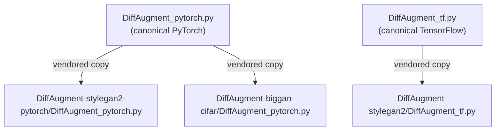

All four vendored copies are byte-for-byte identical to the canonical versions. There is no shared import path; each sub-system reads from its local copy.

Sources: [DiffAugment_pytorch.py:1-77](), [DiffAugment_tf.py:1-74](), [DiffAugment-stylegan2-pytorch/DiffAugment_pytorch.py:1-76](), [DiffAugment-biggan-cifar/DiffAugment_pytorch.py:1-77](), [DiffAugment-stylegan2/DiffAugment_tf.py:1-74]()

---

## The `DiffAugment` Function

Both modules expose an identically-named entry point, `DiffAugment`, with the same logical signature. Callers pass a batch of images and a comma-separated policy string; the function applies each named policy's augmentation functions in order and returns the transformed batch.

### PyTorch signature

[DiffAugment_pytorch.py:9-19]()

```
DiffAugment(x, policy='', channels_first=True)
```

| Parameter | Type | Default | Description |
|---|---|---|---|
| `x` | `torch.Tensor` | — | Image batch, shape `(N, C, H, W)` or `(N, H, W, C)` |
| `policy` | `str` | `''` | Comma-separated list of policy names, e.g. `'color,translation,cutout'` |
| `channels_first` | `bool` | `True` | If `False`, input is `NHWC`; the function transposes internally before and after |

### TensorFlow signature

[DiffAugment_tf.py:8-17]()

```
DiffAugment(x, policy='', channels_first=False)
```

| Parameter | Type | Default | Description |
|---|---|---|---|
| `x` | `tf.Tensor` | — | Image batch |
| `policy` | `str` | `''` | Same comma-separated format |
| `channels_first` | `bool` | `False` | TF default is `NHWC`; set `True` for `NCHW` |

> **Note:** The default for `channels_first` is *inverted* between the two modules — `True` for PyTorch (which prefers `NCHW`) and `False` for TensorFlow (which prefers `NHWC`).

If `policy` is an empty string, the function is a no-op and returns `x` unchanged.

Sources: [DiffAugment_pytorch.py:9-19](), [DiffAugment_tf.py:8-17]()

---

## Channel Layout Handling

The channel transposition logic is symmetric: if the input is not in the module's native layout, it is transposed to that layout before augmentation and transposed back afterward.

**PyTorch transposition diagram:**

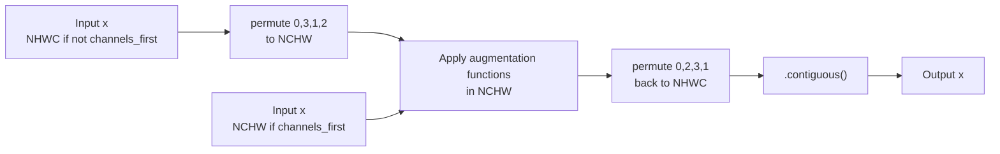

In TensorFlow, `tf.transpose` is used equivalently with `[0, 2, 3, 1]` and `[0, 3, 1, 2]` index permutations [DiffAugment_tf.py:11-16]().

The final `.contiguous()` call in the PyTorch version [DiffAugment_pytorch.py:18]() ensures memory layout is contiguous after any gather-based indexing performed during translation and cutout.

Sources: [DiffAugment_pytorch.py:9-19](), [DiffAugment_tf.py:8-17]()

---

## Augmentation Policies

The `AUGMENT_FNS` dictionary [DiffAugment_pytorch.py:72-76]() maps each policy name to an ordered list of functions. The `DiffAugment` function iterates over the comma-separated policy names and, for each, calls every function in its list sequentially.

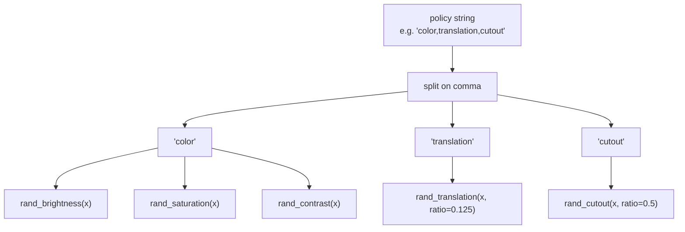

Sources: [DiffAugment_pytorch.py:72-76](), [DiffAugment_pytorch.py:13-15]()

---

### Policy: `color`

The `color` policy applies three independent per-batch random color transformations in sequence. Each magnitude is sampled independently per image in the batch.

| Function | PyTorch location | Operation | Magnitude range |
|---|---|---|---|
| `rand_brightness` | [DiffAugment_pytorch.py:22-24]() | Adds a scalar offset to all pixels | Uniform(`-0.5`, `+0.5`) |
| `rand_saturation` | [DiffAugment_pytorch.py:27-30]() | Scales deviation from per-channel mean | Uniform(`0`, `2`) |
| `rand_contrast` | [DiffAugment_pytorch.py:33-36]() | Scales deviation from global image mean | Uniform(`0.5`, `1.5`) |

**Brightness** adds a per-image scalar `(rand - 0.5)` to the entire image tensor [DiffAugment_pytorch.py:23]().

**Saturation** computes the mean across the channel dimension (`dim=1`) to approximate a grayscale value, then scales the color deviation by a random factor in `[0, 2]`. At 0 the image becomes grayscale; at 2 saturation is doubled [DiffAugment_pytorch.py:28-29]().

**Contrast** computes the global per-image mean across all spatial and channel dimensions (`dim=[1,2,3]`), then scales the deviation by a random factor in `[0.5, 1.5]` [DiffAugment_pytorch.py:34-35]().

All three operations are differentiable with respect to `x`.

Sources: [DiffAugment_pytorch.py:22-36](), [DiffAugment_tf.py:20-37]()

---

### Policy: `translation`

`rand_translation` applies a random integer pixel shift independently to each image in the batch [DiffAugment_pytorch.py:39-52]().

| Parameter | Default | Meaning |
|---|---|---|
| `ratio` | `0.125` | Maximum shift as a fraction of image size |

**Mechanism:**

1. Shift bounds are computed as `int(H * ratio + 0.5)` and `int(W * ratio + 0.5)`.
2. Per-image integer shifts are sampled from `[-shift, +shift]` for both axes independently.
3. The image is padded by 1 pixel on each side using `F.pad` [DiffAugment_pytorch.py:50]().
4. A coordinate grid (`grid_batch`, `grid_x`, `grid_y`) is constructed with `torch.meshgrid`.
5. Grid coordinates are offset by the translation amounts and clamped to the padded image bounds [DiffAugment_pytorch.py:48-49]().
6. The output is gathered from the padded image using advanced indexing [DiffAugment_pytorch.py:51]().

The 1-pixel padding ensures that translated pixels outside the original image boundary are filled with a constant (zero) rather than wrapped. The operation is differentiable because it uses indexing on a padded tensor rather than any non-differentiable branch.

Sources: [DiffAugment_pytorch.py:39-52](), [DiffAugment_tf.py:40-50]()

---

### Policy: `cutout`

`rand_cutout` zeros out a randomly-positioned rectangular region in each image [DiffAugment_pytorch.py:55-69]().

| Parameter | Default | Meaning |
|---|---|---|
| `ratio` | `0.5` | Cutout box side length as a fraction of image size |

**Mechanism:**

1. Cutout size is computed as `int(H * ratio + 0.5)` × `int(W * ratio + 0.5)` — for a 32×32 image with `ratio=0.5` this is 16×16.
2. Random offsets are sampled to position the box center.
3. A coordinate grid of shape `(N, cutout_H, cutout_W)` is built and clamped to image bounds [DiffAugment_pytorch.py:64-65]().
4. A mask tensor of ones, same spatial shape as `x`, is created; the cutout coordinates are set to 0 [DiffAugment_pytorch.py:66-67]().
5. The mask is broadcast over the channel dimension and multiplied with `x` [DiffAugment_pytorch.py:68]().

The multiplication with a mask (rather than an in-place fill) preserves differentiability through the operation.

Sources: [DiffAugment_pytorch.py:55-69](), [DiffAugment_tf.py:53-66]()

---

## `AUGMENT_FNS` Registry

The `AUGMENT_FNS` dictionary is the sole routing table between policy name strings and their implementation functions.

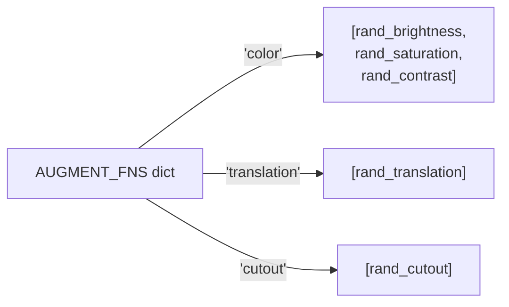

To add a new policy, add a new key to `AUGMENT_FNS` and include the corresponding function(s). The `DiffAugment` function needs no changes — it reads from this dict at runtime [DiffAugment_pytorch.py:13-15]().

Sources: [DiffAugment_pytorch.py:72-76](), [DiffAugment_tf.py:69-73]()

---

## PyTorch vs TensorFlow Implementation Differences

The two modules implement identical augmentation logic but adapt to their framework's conventions.

| Aspect | PyTorch (`DiffAugment_pytorch.py`) | TensorFlow (`DiffAugment_tf.py`) |
|---|---|---|
| Native layout | `NCHW` (`channels_first=True`) | `NHWC` (`channels_first=False`) |
| Layout transposition | `tensor.permute(...)` | `tf.transpose(...)` |
| Random sampling | `torch.rand`, `torch.randint` | `tf.random.uniform` |
| Grid construction | `torch.meshgrid` | `tf.meshgrid(indexing='ij')` |
| Padding | `F.pad` | `tf.pad` |
| Gather / indexing | Advanced tensor indexing | `tf.gather_nd` with `batch_dims=1` |
| Cutout mask zeroing | `scatter_`-style index assignment | `tf.scatter_nd` |
| Memory contiguity | `.contiguous()` after permutes | Not required |
| Differentiable? | Yes | Yes |

Sources: [DiffAugment_pytorch.py:1-77](), [DiffAugment_tf.py:1-74]()

---

## Integration Recipe

To drop DiffAugment into an existing GAN training loop, copy the appropriate single file and wrap the discriminator's image inputs.

**Minimum change (PyTorch):**

```
# copy DiffAugment_pytorch.py alongside your training script
from DiffAugment_pytorch import DiffAugment

policy = 'color,translation,cutout'

# In D update:
real_aug = DiffAugment(real_images, policy=policy)
fake_aug = DiffAugment(fake_images.detach(), policy=policy)
d_loss = criterion(D(real_aug), D(fake_aug))

# In G update:
fake_aug = DiffAugment(fake_images, policy=policy)
g_loss = criterion(D(fake_aug))
```

Key points:

- Apply `DiffAugment` to **both real and fake** images before passing them to the discriminator. Applying to only one breaks the symmetry the discriminator relies on.
- Apply `DiffAugment` in the **G update** as well (without `.detach()`), so gradients can flow back through the augmentation into the generator.
- The augmentation is applied **after** the generator produces images; the generator weights are not directly exposed to the augmented view during the D update.
- If your discriminator consumes `NHWC` tensors, pass `channels_first=False`.

The TensorFlow integration is identical in structure; import from `DiffAugment_tf.py` instead.

Sources: [DiffAugment_pytorch.py:9-19](), [DiffAugment_tf.py:8-17]()

---

# Page: DiffAugment-stylegan2 (TensorFlow)

# DiffAugment-stylegan2 (TensorFlow)

<details>
<summary>Relevant source files</summary>

The following files were used as context for generating this wiki page:

- [DiffAugment-stylegan2/README.md](DiffAugment-stylegan2/README.md)

</details>


This page covers the `DiffAugment-stylegan2/` sub-directory — a TensorFlow 1.15 implementation of StyleGAN2 with DiffAugment integrated into its training loss. It documents supported datasets, available pre-trained models, prerequisites, and the overall structure of key scripts and components. For details on specific subsystems, see the child pages: [Data Preparation](#3.1), [Training Data Pipeline](#3.2), [Training Scripts](#3.3), [Network Architecture and Training Internals](#3.4), [Evaluation and Metrics](#3.5), and [Generating Images and GIFs](#3.6). For the standalone DiffAugment TensorFlow module (`DiffAugment_tf.py`) shared across sub-systems, see [DiffAugment Core Module](#2). For the PyTorch-based StyleGAN2 variant, see [DiffAugment-stylegan2-pytorch](#4).

---

## Purpose and Scope

`DiffAugment-stylegan2/` applies differentiable augmentation to the StyleGAN2 training loop to improve data efficiency. The augmentation is inserted into the discriminator loss function rather than into the network architecture, making it straightforward to add to an existing StyleGAN2 codebase. This sub-system targets unconditional image generation across three dataset scales: large datasets (FFHQ, LSUN), medium datasets (CIFAR-10, CIFAR-100), and small low-shot datasets (100-shot-obama, AnimalFace, etc.).

---

## Prerequisites

| Requirement | Detail |
|---|---|
| Framework | TensorFlow 1.15 with GPU support |
| `tensorflow-datasets` | Version ≤ 2.1.0 (required for CIFAR datasets) |
| Recommended GPU count | 4 or 8 GPUs with ≥ 12 GB DRAM |
| Custom ops fallback | Pass `--impl=ref` to training scripts if `nvcc` is unavailable |

Sources: [DiffAugment-stylegan2/README.md:1-8]()

---

## Sub-system Component Map

**Diagram: Key files and their roles within `DiffAugment-stylegan2/`**

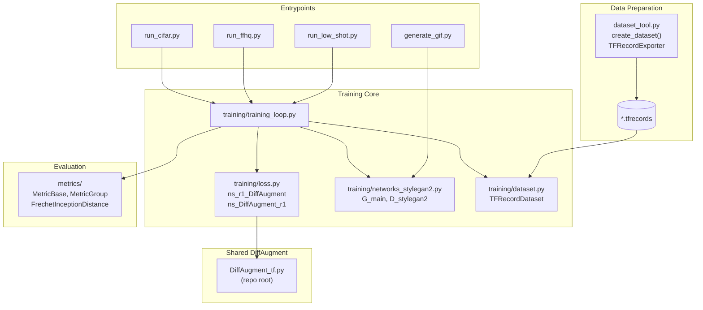

Sources: [DiffAugment-stylegan2/README.md:1-154]()

---

## Supported Datasets

Three classes of datasets are supported, each with a dedicated training entrypoint.

### CIFAR-10 and CIFAR-100

Loaded via `tensorflow-datasets`; no manual download required. Supports training on the full dataset or a partial sample (e.g., 10%, 20%).

**Training command (full data):**
```bash
python run_cifar.py --dataset=cifar10 --num-gpus=4 --DiffAugment=color,cutout
```

**Training command (partial data):**
```bash
python run_cifar.py --dataset=cifar10 --num-samples=5000 --num-gpus=4 --DiffAugment=color,translation,cutout
```

### FFHQ and LSUN

These datasets require manual download. FFHQ is available from NVIDIA as `.tfrecords` files (e.g., `ffhq-r08.tfrecords` for 256×256). LSUN is available in LMDB format. Both are passed as a folder path to `run_ffhq.py`.

**Training command:**
```bash
python run_ffhq.py --dataset=PATH_TO_FOLDER --num-samples=10000 --num-gpus=8 --resolution=256 --DiffAugment=color,translation,cutout
```

### Low-Shot Datasets

Named datasets such as `100-shot-obama`, `100-shot-grumpy_cat`, `100-shot-panda`, `AnimalFace-cat`, and `AnimalFace-dog` are automatically downloaded. A local folder of images can also be passed directly.

**Training command:**
```bash
python run_low_shot.py --dataset=100-shot-obama --num-gpus=4 --DiffAugment=color,translation,cutout
```

For AnimalFace datasets, training is extended:
```bash
python run_low_shot.py --dataset=AnimalFace-cat --num-gpus=4 --DiffAugment=color,translation,cutout --total-kimg=500
```

Sources: [DiffAugment-stylegan2/README.md:22-131]()

---

## DiffAugment Policies Used

| Policy string | Transformations applied |
|---|---|
| `color,cutout` | Used for CIFAR full-data experiments |
| `color,translation,cutout` | Used for partial data, FFHQ, LSUN, and low-shot experiments |
| `""` (empty string) | Disables DiffAugment; runs the StyleGAN2 baseline |

The policy string is passed via `--DiffAugment=` and forwarded into `training/loss.py`, which calls `DiffAugment_tf.py` from the repo root. See [DiffAugment Core Module](#2) for the definition of each transformation.

Sources: [DiffAugment-stylegan2/README.md:27-38]()

---

## Pre-Trained Models

All pre-trained models are referenced using the `mit-han-lab:` shorthand (resolved by `dnnlib.util.open_url`; see [Shared Utilities](#6)) and are automatically downloaded when specified via `--resume=`.

### CIFAR Models

| Model name | Dataset | IS (10k) | FID (10k) |
|---|---|---|---|
| `mit-han-lab:stylegan2-cifar10.pkl` | CIFAR-10 (100%) | 9.18 | 11.07 |
| `mit-han-lab:DiffAugment-stylegan2-cifar10.pkl` | CIFAR-10 (100%) | **9.40** | **9.89** |
| `mit-han-lab:stylegan2-cifar10-0.2.pkl` | CIFAR-10 (20%) | 8.28 | 23.08 |
| `mit-han-lab:DiffAugment-stylegan2-cifar10-0.2.pkl` | CIFAR-10 (20%) | **9.21** | **12.15** |
| `mit-han-lab:stylegan2-cifar10-0.1.pkl` | CIFAR-10 (10%) | 7.33 | 36.02 |
| `mit-han-lab:DiffAugment-stylegan2-cifar10-0.1.pkl` | CIFAR-10 (10%) | **8.84** | **14.50** |
| `mit-han-lab:stylegan2-cifar100.pkl` | CIFAR-100 (100%) | 9.51 | 16.54 |
| `mit-han-lab:DiffAugment-stylegan2-cifar100.pkl` | CIFAR-100 (100%) | **10.04** | **15.22** |
| `mit-han-lab:stylegan2-cifar100-0.2.pkl` | CIFAR-100 (20%) | 7.86 | 32.30 |
| `mit-han-lab:DiffAugment-stylegan2-cifar100-0.2.pkl` | CIFAR-100 (20%) | **9.82** | **16.65** |
| `mit-han-lab:stylegan2-cifar100-0.1.pkl` | CIFAR-100 (10%) | 7.01 | 45.87 |
| `mit-han-lab:DiffAugment-stylegan2-cifar100-0.1.pkl` | CIFAR-100 (10%) | **9.06** | **20.75** |

### FFHQ and LSUN Models

| Model name | Dataset | FID (50k train) |
|---|---|---|
| `mit-han-lab:stylegan2-ffhq.pkl` | FFHQ (70k) | **3.81** |
| `mit-han-lab:DiffAugment-stylegan2-ffhq.pkl` | FFHQ (70k) | 4.24 |
| `mit-han-lab:DiffAugment-stylegan2-ffhq-30k.pkl` | FFHQ (30k) | **5.05** |
| `mit-han-lab:DiffAugment-stylegan2-ffhq-10k.pkl` | FFHQ (10k) | **7.86** |
| `mit-han-lab:DiffAugment-stylegan2-ffhq-5k.pkl` | FFHQ (5k) | **10.45** |
| `mit-han-lab:DiffAugment-stylegan2-ffhq-1k.pkl` | FFHQ (1k) | **25.66** |
| `mit-han-lab:DiffAugment-stylegan2-lsun-cat-30k.pkl` | LSUN-Cat (30k) | **9.68** |
| `mit-han-lab:DiffAugment-stylegan2-lsun-cat-10k.pkl` | LSUN-Cat (10k) | **12.07** |
| `mit-han-lab:DiffAugment-stylegan2-lsun-cat-5k.pkl` | LSUN-Cat (5k) | **16.11** |
| `mit-han-lab:DiffAugment-stylegan2-lsun-cat-1k.pkl` | LSUN-Cat (1k) | **42.26** |

### Low-Shot Models

| Model name | Dataset | FID (5k train) |
|---|---|---|
| `mit-han-lab:stylegan2-100-shot-obama.pkl` | 100-shot-obama | 80.20 |
| `mit-han-lab:DiffAugment-stylegan2-100-shot-obama.pkl` | 100-shot-obama | **46.87** |
| `mit-han-lab:stylegan2-100-shot-grumpy_cat.pkl` | 100-shot-grumpy_cat | 48.90 |
| `mit-han-lab:DiffAugment-stylegan2-100-shot-grumpy_cat.pkl` | 100-shot-grumpy_cat | **27.08** |
| `mit-han-lab:stylegan2-100-shot-panda.pkl` | 100-shot-panda | 34.27 |
| `mit-han-lab:DiffAugment-stylegan2-100-shot-panda.pkl` | 100-shot-panda | **12.06** |
| `mit-han-lab:stylegan2-AnimalFace-cat.pkl` | AnimalFace-cat | 71.71 |
| `mit-han-lab:DiffAugment-stylegan2-AnimalFace-cat.pkl` | AnimalFace-cat | **42.44** |
| `mit-han-lab:stylegan2-AnimalFace-dog.pkl` | AnimalFace-dog | 130.19 |
| `mit-han-lab:DiffAugment-stylegan2-AnimalFace-dog.pkl` | AnimalFace-dog | **58.85** |

Sources: [DiffAugment-stylegan2/README.md:40-154]()

---

## Evaluation Mode

Each training script supports an `--eval` flag that skips training and runs metric computation against a loaded checkpoint.

| Script | Eval command pattern |
|---|---|
| `run_cifar.py` | `python run_cifar.py --dataset=cifar10 --resume=WHICH_MODEL --eval` |
| `run_ffhq.py` | `python run_ffhq.py --dataset=PATH --resume=WHICH_MODEL --num-gpus=N --eval` |
| `run_low_shot.py` | `python run_low_shot.py --dataset=WHICH_DATASET --resume=WHICH_MODEL --eval` |

Use `--num-repeats=N` on CIFAR to compute means and standard deviations over multiple runs. A standard deviation under 1% relative to the reported value is expected.

Sources: [DiffAugment-stylegan2/README.md:42-65]()

---

## High-Level Data and Training Flow

**Diagram: End-to-end flow from raw data to trained checkpoint**

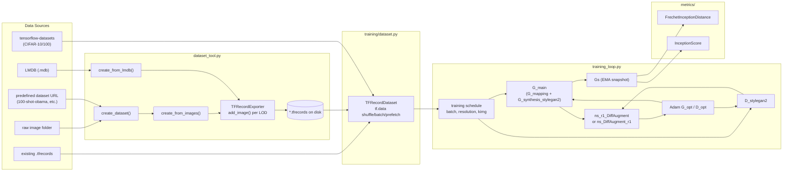

Sources: [DiffAugment-stylegan2/README.md:1-154]()

---

## Generating an Interpolation GIF

A latent-space interpolation animation can be produced from any checkpoint without running training:

```bash
python generate_gif.py --resume=mit-han-lab:DiffAugment-stylegan2-100-shot-obama.pkl --output=obama.gif
```

The `--resume` argument accepts a local `.pkl` path or any `mit-han-lab:` model shorthand. Details of the generation process are covered in [Generating Images and GIFs](#3.6).

Sources: [DiffAugment-stylegan2/README.md:10-21]()

---

## Preparing Custom Low-Shot Datasets

Any folder of images can be passed directly to `run_low_shot.py` as `--dataset`. The pipeline will:

1. Resize images to the specified `--resolution` (default 256).
2. Cache the result as `*.tfrecords` and `*.pkl` files in the same folder.
3. Run training for `--total-kimg` thousand images (default 300k).

> **Note:** If training images in the folder change after an initial run, manually delete the cached `*.tfrecords` and `*.pkl` files before restarting training.

Sources: [DiffAugment-stylegan2/README.md:126-131]()

---

# Page: Data Preparation

# Data Preparation

<details>
<summary>Relevant source files</summary>

The following files were used as context for generating this wiki page:

- [DiffAugment-stylegan2/training/dataset_tool.py](DiffAugment-stylegan2/training/dataset_tool.py)

</details>


This page covers how raw data sources are converted into multi-resolution TFRecord files suitable for consumption by the StyleGAN2 training pipeline. The primary file is `DiffAugment-stylegan2/training/dataset_tool.py`.

For how the resulting TFRecord files are read at training time (shuffle, batch, prefetch), see the Training Data Pipeline page [3.2](#3.2). For the training scripts that invoke `create_dataset()` as part of their startup sequence, see Training Scripts [3.3](#3.3).

---

## Overview

The TensorFlow StyleGAN2 sub-system does not read raw images on the fly during training. Instead, images are pre-converted into TFRecord files on disk. `dataset_tool.py` is the tool responsible for this conversion. It accepts three kinds of data sources:

| Source type | How detected | Handler |
|---|---|---|
| Raw image folder (jpg/png/bmp) | Files with image extension | `create_from_images()` |
| LMDB database (e.g. LSUN) | Presence of `*.mdb` files | `create_from_lmdb()` |
| Predefined downloadable dataset | Name in `predefined_datasets` list | `unzip_from_url()` → `create_from_images()` |

CIFAR-10 and CIFAR-100 are handled differently — they are loaded directly from TensorFlow Datasets at runtime and do not go through `dataset_tool.py`. That path is documented in [3.2](#3.2).

---

## `create_dataset()` — Main Entry Point

[DiffAugment-stylegan2/training/dataset_tool.py:182-201]()

`create_dataset(dataset, resolution=None)` is the top-level function called by training scripts. It:

1. Checks whether `dataset` is a name in `predefined_datasets`. If so, sets `data_dir = 'datasets/<dataset>'` and creates that directory.
2. Otherwise, treats `dataset` as a path to an existing directory.
3. Short-circuits immediately if matching `*.tfrecords` files already exist in `data_dir` (no re-processing).
4. Detects LMDB format by looking for `*.mdb` files, and routes to `create_from_lmdb()`.
5. For predefined datasets with no local images yet, calls `unzip_from_url()` to download and extract the zip archive.
6. Falls through to `create_from_images()` for plain image folders.

**Diagram: `create_dataset()` dispatch logic**

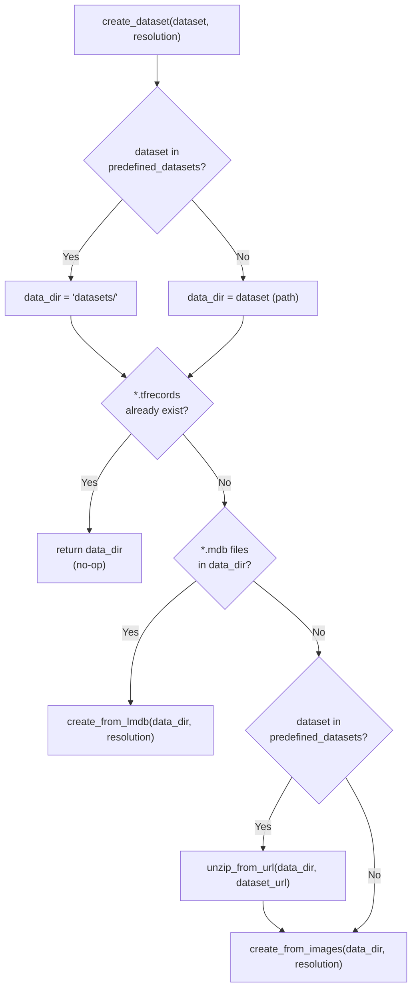

Sources: [DiffAugment-stylegan2/training/dataset_tool.py:182-201]()

---

## Predefined Datasets

[DiffAugment-stylegan2/training/dataset_tool.py:204-214]()

The `predefined_datasets` list names datasets that can be automatically downloaded from `https://data-efficient-gans.mit.edu/datasets/<name>.zip`. Passing any of these names as the `dataset` argument to `create_dataset()` will trigger an automatic download if the local folder is empty.

| Dataset name | Description |
|---|---|
| `100-shot-obama` | 100 images of Barack Obama |
| `100-shot-grumpy_cat` | 100 images of Grumpy Cat |
| `100-shot-panda` | 100 images of pandas |
| `100-shot-bridge_of_sighs` | 100 images, Bridge of Sighs |
| `100-shot-medici_fountain` | 100 images, Medici Fountain |
| `100-shot-temple_of_heaven` | 100 images, Temple of Heaven |
| `100-shot-wuzhen` | 100 images, Wuzhen |
| `AnimalFace-cat` | AnimalFace cat subset |
| `AnimalFace-dog` | AnimalFace dog subset |

The download is performed by `unzip_from_url()` [DiffAugment-stylegan2/training/dataset_tool.py:106-109](), which calls `dnnlib.util.open_url()` (with `.stylegan2-cache` as the local cache directory) and then extracts the zip file to `data_dir`. For details on `dnnlib.util.open_url`, see [6](#6).

Sources: [DiffAugment-stylegan2/training/dataset_tool.py:106-109](), [DiffAugment-stylegan2/training/dataset_tool.py:204-214]()

---

## `create_from_images()` — Image Folder to TFRecords

[DiffAugment-stylegan2/training/dataset_tool.py:147-179]()

Accepts a directory of flat image files (jpg, jpeg, png, bmp). Key behaviors:

- Collects all supported image files using `glob` and sorts them.
- Reads the first image to detect resolution and channel count. If `resolution` is not specified, the first image's height is used.
- Validates that resolution is a power of two and channels are 1 or 3.
- Optionally shuffles the write order via `TFRecordExporter.choose_shuffled_order()` (default: `shuffle=True`).
- Converts images from HWC layout to CHW layout (`img.transpose([2, 0, 1])`).
- Writes all images to a single `.tfrecords` file via `TFRecordExporter.add_image()`.
- Returns `tfrecord_dir`.

Sources: [DiffAugment-stylegan2/training/dataset_tool.py:147-179]()

---

## `create_from_lmdb()` — LMDB to TFRecords

[DiffAugment-stylegan2/training/dataset_tool.py:112-144]()

Accepts a path to an LMDB database (commonly used for LSUN datasets). Key behaviors:

- Requires `lmdb` and `cv2` Python packages.
- Opens the LMDB in read-only mode and reads `txn.stat()['entries']` to determine total image count.
- Decodes each entry with `cv2.imdecode()`, falling back to `PIL.Image` if that fails.
- Center-crops each image to a square, resizes to `resolution × resolution` using `PIL.Image.ANTIALIAS`.
- Converts BGR (OpenCV) to RGB.
- Transposes to CHW and calls `TFRecordExporter.add_image()`.
- Supports a `max_images` argument to cap the number of images written.
- Returns `tfrecord_dir`.

Sources: [DiffAugment-stylegan2/training/dataset_tool.py:112-144]()

---

## `TFRecordExporter` — TFRecord Writer

[DiffAugment-stylegan2/training/dataset_tool.py:29-103]()

`TFRecordExporter` is the class that manages writing images to TFRecord files on disk. It is used as a context manager (`with TFRecordExporter(...) as tfr:`).

**Diagram: `TFRecordExporter` internals and call sequence**

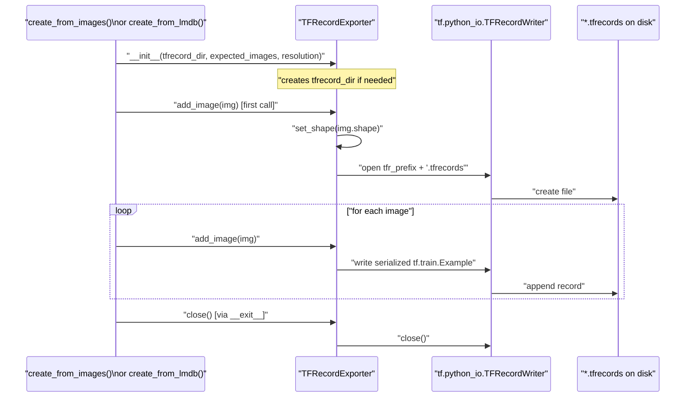

### Key methods

| Method | Description |
|---|---|
| `__init__(tfrecord_dir, expected_images, resolution, ...)` | Creates output directory, sets the file prefix. If `resolution` is given, appends `-<resolution>` to the prefix. |
| `set_shape(shape)` | Called on first `add_image()`. Computes `resolution_log2`, validates the shape is square and power-of-two, opens the TFRecord writer. |
| `add_image(img)` | Serializes a CHW NumPy array as a `tf.train.Example` with `shape` and `data` fields. Iterates over `self.tfr_writers` for multi-LOD output. |
| `add_labels(labels)` | Saves a `(N,)` int32 NumPy array as `<prefix>-rxx.labels` beside the TFRecord file. |
| `choose_shuffled_order()` | Returns a shuffled index array (fixed seed 123) for deterministic shuffling. |
| `close()` | Flushes and closes all TFRecord writers. Called automatically by `__exit__`. |

### TFRecord record format

Each record is a serialized `tf.train.Example` containing two features:

| Feature key | Type | Content |
|---|---|---|
| `shape` | `Int64List` | `[C, H, W]` of the image |
| `data` | `BytesList` | Raw uint8 bytes of the CHW array |

The `add_image()` method also applies 2× box-filter downsampling when writing multi-LOD TFRecords (iterating over `self.tfr_writers`), though in practice the current code typically configures a single writer per dataset [DiffAugment-stylegan2/training/dataset_tool.py:80-88]().

Sources: [DiffAugment-stylegan2/training/dataset_tool.py:29-103]()

---

## End-to-End Data Flow

**Diagram: Data sources to TFRecords**

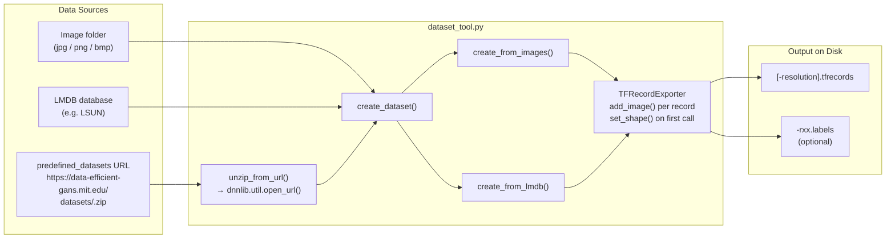

Sources: [DiffAugment-stylegan2/training/dataset_tool.py:106-214]()

---

## File Naming Conventions

The output file name is constructed from the directory name and, optionally, the target resolution:

- **Without resolution**: `<dir>/<dir_basename>.tfrecords`  
  Example: `datasets/100-shot-obama/100-shot-obama.tfrecords`

- **With resolution**: `<dir>/<dir_basename>-<resolution>.tfrecords`  
  Example: `datasets/AnimalFace-dog/AnimalFace-dog-256.tfrecords`

The `tfr_prefix` is set in `TFRecordExporter.__init__()` [DiffAugment-stylegan2/training/dataset_tool.py:31-33]().

`create_dataset()` uses a `glob` pattern to detect pre-existing files and skip re-processing [DiffAugment-stylegan2/training/dataset_tool.py:193-194]().

Sources: [DiffAugment-stylegan2/training/dataset_tool.py:29-48](), [DiffAugment-stylegan2/training/dataset_tool.py:182-201]()

---

# Page: Training Data Pipeline

# Training Data Pipeline

<details>
<summary>Relevant source files</summary>

The following files were used as context for generating this wiki page:

- [DiffAugment-stylegan2/training/dataset.py](DiffAugment-stylegan2/training/dataset.py)

</details>


This page documents the **runtime** data pipeline used during training in the `DiffAugment-stylegan2` (TensorFlow) sub-system. It covers the `TFRecordDataset` class in [DiffAugment-stylegan2/training/dataset.py](), which reads prepared data and streams minibatches to the training loop.

For how raw images, LMDB databases, and downloadable datasets are converted into the on-disk TFRecord format that this pipeline reads, see the Data Preparation page ([3.1](#3.1)). For how the training loop calls into this pipeline, see Network Architecture and Training Internals ([3.4](#3.4)).

---

## Overview

The pipeline is encapsulated in a single class, `TFRecordDataset`, which supports two distinct data source modes:

| Mode | `from_tfrecords` | Source |
|---|---|---|
| TFRecord mode | `True` | Pre-built `.tfrecords` files on disk (see [3.1](#3.1)) |
| TFDS mode | `False` | Streamed directly from `tensorflow_datasets` (e.g., CIFAR-10/100) |

Both modes produce a unified interface: a `tf.data` pipeline that yields `(images, labels)` pairs in `[N, C, H, W]` format.

The helper function `load_dataset()` at the bottom of the file is the normal entry point used by callers such as `training_loop.py`; it instantiates `TFRecordDataset` by name and returns it.

Sources: [DiffAugment-stylegan2/training/dataset.py:1-20]()

---

## TFRecordDataset Class

**Class:** `TFRecordDataset` ([DiffAugment-stylegan2/training/dataset.py:22-232]())

### Constructor Parameters

| Parameter | Type | Default | Description |
|---|---|---|---|
| `tfrecord_dir` | `str` | — | Directory containing `.tfrecords` files, or TFDS dataset name if `from_tfrecords=False` |
| `split` | `str` | `'train'` | `'train'` or `'test'` |
| `from_tfrecords` | `bool` | `False` | Whether to load from disk TFRecords or from `tensorflow_datasets` |
| `tfds_data_dir` | `str` | `None` | Directory for TFDS cache; passed to `tfds.load` |
| `resolution` | `int` | `None` | Target resolution; `None` = autodetect from files |
| `label_file` | `str` | `None` | Path to `.labels` file; `None` = autodetect |
| `max_label_size` | `int` | `0` | `0` = no labels, `'full'` or positive int = use class labels |
| `num_samples` | `int` | `None` | Cap on number of training images; `None` = use all |
| `num_val_images` | `int` | `None` | Number of images to split off as validation; `None` = use a separate `-val` directory |
| `repeat` | `bool` | `True` | Whether to repeat the dataset indefinitely |
| `shuffle_mb` | `int` | `4096` | Shuffle buffer in MB; `0` = disable |
| `prefetch_mb` | `int` | `2048` | Prefetch buffer in MB; `0` = disable |
| `buffer_mb` | `int` | `256` | Read buffer in MB for `TFRecordDataset` |
| `num_threads` | `int` | `2` | Parallel threads for `dset.map()` calls |

Sources: [DiffAugment-stylegan2/training/dataset.py:23-37]()

---

## Data Source Modes

### Diagram: Two Data Paths into the Unified tf.data Pipeline

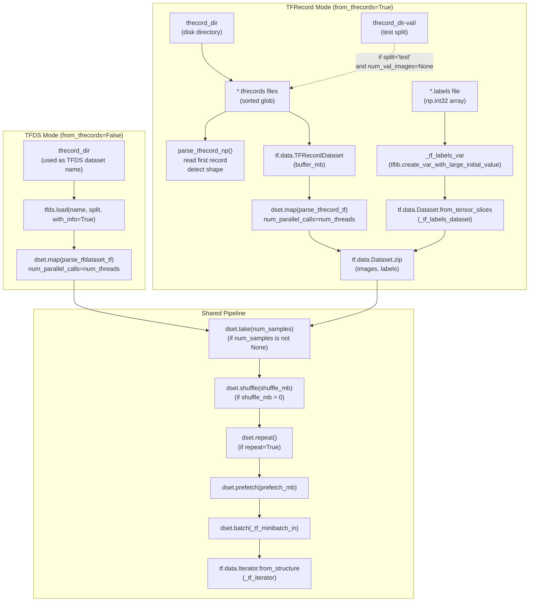

Sources: [DiffAugment-stylegan2/training/dataset.py:60-161]()

---

## Resolution Detection

After the data source is set up, the constructor determines the dataset's spatial dimensions.

**TFRecord mode:** The constructor lists all `*.tfrecords` files in the directory, reads the first record from each using `parse_tfrecord_np()`, and collects their shapes. It then selects:
- The shape with the **maximum number of elements** (i.e., the highest resolution) if `resolution=None`.
- The shape whose max spatial dimension matches the requested `resolution` if one is specified.

[DiffAugment-stylegan2/training/dataset.py:84-91]()

**TFDS mode:** Shape is read directly from `tf.compat.v1.data.get_output_shapes(dset)`.

[DiffAugment-stylegan2/training/dataset.py:124-124]()

**Resize flag:** If the stored resolution differs from the requested `resolution`, a `resize=True` flag is passed to the parse functions, which apply `tf.image.resize` during mapping.

After detection, the constructor sets three key attributes:

```
self.resolution       # int, e.g. 256
self.resolution_log2  # int, e.g. 8  (ceil(log2(resolution)))
self.shape            # [channels, height, width]
```

[DiffAugment-stylegan2/training/dataset.py:126-133]()

---

## Label Handling

### TFRecord mode

Labels are stored in a separate `.labels` file alongside the TFRecords. The constructor:

1. **Autodetects** the label file by globbing for `*.labels` in the data directory ([DiffAugment-stylegan2/training/dataset.py:75-82]()).
2. Loads it into `self._np_labels` as a flat `np.int32` array.
3. Wraps it in a TensorFlow variable (`_tf_labels_var`) so it can be read on the GPU.
4. Creates `_tf_labels_dataset` by slicing that variable, then zips it with the image dataset.

If `max_label_size == 0` or no label file is found, `self.label_size` is set to `0` and a zero-filled array is used.

### TFDS mode

Labels are embedded in each TFDS record (`record['label']`). `parse_tfdataset_tf()` extracts both `image` and `label` together. `self.label_size` is set from `info.features['label'].num_classes`.

### Train/Test Split of Labels

When `num_val_images` is specified, the label array is also sliced to match the image split:

```
test  split: _np_labels[:num_val_images]
train split: _np_labels[num_val_images:]
```

[DiffAugment-stylegan2/training/dataset.py:105-113]()

---

## Record Parsing Functions

Three parsing functions handle the raw data-to-tensor conversion:

| Function | Used in | Input | Output |
|---|---|---|---|
| `parse_tfrecord_tf(record, resize)` | `dset.map()`, TFRecord mode | Serialized `tf.train.Example` | `uint8` tensor `[C, H, W]` |
| `parse_tfdataset_tf(record, resize)` | `dset.map()`, TFDS mode | Dict `{'image': ..., 'label': ...}` | `(image, label)` tensors |
| `parse_tfrecord_np(record)` (static) | Constructor, shape probing | Raw bytes string | `np.ndarray [C, H, W]` |

**Key detail:** Both TF parse functions transpose from `[H, W, C]` (TF convention) to `[C, H, W]` (the training code's expected format). `parse_tfrecord_tf` does this via `tf.reshape` with the stored `shape` feature; `parse_tfdataset_tf` does it via `tf.transpose(image, [2, 0, 1])`.

Sources: [DiffAugment-stylegan2/training/dataset.py:205-232]()

---

## Shuffle, Repeat, Prefetch, and Batch

The pipeline applies these `tf.data` transformations in a fixed order:

**Diagram: tf.data Transformation Order**

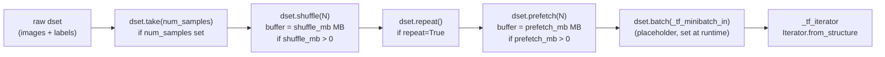

Buffer sizes are computed from megabyte budgets and the per-item byte size:
```
buffer_count = ((mb << 20) - 1) // bytes_per_item + 1
```

The `batch()` call uses `_tf_minibatch_in`, a `tf.placeholder` of type `int64`, which allows the batch size to be changed at runtime without rebuilding the graph.

Sources: [DiffAugment-stylegan2/training/dataset.py:147-161]()

---

## Public Interface

### Diagram: Public API of TFRecordDataset

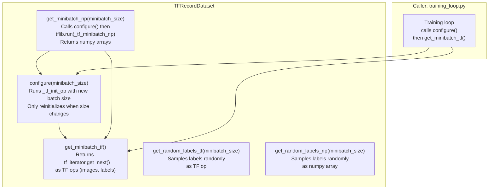

### `configure(minibatch_size)`

[DiffAugment-stylegan2/training/dataset.py:167-171]()

Reinitializes the iterator with the new batch size by running `_tf_init_op`. It caches `_cur_minibatch` so re-calling with the same size is a no-op.

### `get_minibatch_tf()`

[DiffAugment-stylegan2/training/dataset.py:174-175]()

Returns `_tf_iterator.get_next()` — a pair of TensorFlow ops `(images, labels)`. Must be called after `configure()`. Used in the main training graph.

### `get_minibatch_np(minibatch_size)`

[DiffAugment-stylegan2/training/dataset.py:178-183]()

Calls `configure()` and then evaluates the minibatch ops via `tflib.run()`, returning `(images, labels)` as NumPy arrays. Caches the TF op in `_tf_minibatch_np` so it is only built once.

### `get_random_labels_tf(minibatch_size)` / `get_random_labels_np(minibatch_size)`

[DiffAugment-stylegan2/training/dataset.py:185-202]()

Used when the generator needs class-conditional labels sampled independently of the image order (e.g., for the generator's conditioning input). For TFRecord mode, labels are gathered from `_tf_labels_var`. For TFDS mode and the unconditional case, uniform random integers or zeros are returned.

---

## `load_dataset()` Helper

[DiffAugment-stylegan2/training/dataset.py:238-254]()

```
load_dataset(class_name=None, data_dir=None, verbose=False, **kwargs)
```

This function is the standard call site used by the training loop. It:

1. Defaults `class_name` to `training.dataset.TFRecordDataset` when `tfrecord_dir` is present in `kwargs`.
2. Prepends `data_dir` to `kwargs['tfrecord_dir']` if `data_dir` is given.
3. Instantiates the class by name via `dnnlib.util.get_obj_by_name()` (see [6](#6) for dnnlib utilities).
4. Optionally prints shape, dynamic range, and label size if `verbose=True`.

---

## Key Internal Attributes

| Attribute | Description |
|---|---|
| `self.name` | Dataset name (basename of `tfrecord_dir`, or TFDS name) |
| `self.shape` | `[C, H, W]` — image shape |
| `self.resolution` | Spatial resolution (assumes square images) |
| `self.resolution_log2` | `ceil(log2(resolution))` |
| `self.dtype` | Always `'uint8'` |
| `self.dynamic_range` | Always `[0, 255]` |
| `self.label_size` | Number of label classes; `0` if unlabeled |
| `self.num_samples` | Total number of usable images |
| `self._np_labels` | Label array in NumPy (TFRecord mode only) |
| `self._tf_labels_var` | TF variable wrapping `_np_labels` |
| `self._tf_iterator` | The stateful `tf.data.Iterator` |
| `self._tf_init_op` | Op to reinitialize the iterator with a new batch size |
| `self._cur_minibatch` | Cached batch size to avoid redundant reinitializations |

Sources: [DiffAugment-stylegan2/training/dataset.py:39-57]()

---

# Page: Training Scripts

# Training Scripts

<details>
<summary>Relevant source files</summary>

The following files were used as context for generating this wiki page:

- [DiffAugment-stylegan2/README.md](DiffAugment-stylegan2/README.md)
- [DiffAugment-stylegan2/run_cifar.py](DiffAugment-stylegan2/run_cifar.py)
- [DiffAugment-stylegan2/run_ffhq.py](DiffAugment-stylegan2/run_ffhq.py)
- [DiffAugment-stylegan2/run_low_shot.py](DiffAugment-stylegan2/run_low_shot.py)
- [imgs/low-shot-comparison.jpg](imgs/low-shot-comparison.jpg)
- [imgs/low-shot-interp.jpg](imgs/low-shot-interp.jpg)

</details>


This page covers the three training entrypoint scripts in the `DiffAugment-stylegan2/` sub-system: `run_cifar.py`, `run_ffhq.py`, and `run_low_shot.py`. Each script parses command-line arguments, assembles `EasyDict` configuration objects, and dispatches the training loop via `dnnlib.submit_run`.

For the training loop and network internals that these scripts invoke, see [Network Architecture and Training Internals](#3.4). For how datasets are preprocessed into TFRecords before training, see [Data Preparation](#3.1). For evaluation metrics invoked at the end of a run, see [Evaluation and Metrics](#3.5).

---

## Overview

All three scripts follow the same structural pattern. Each contains:

- A `main()` function that parses arguments and branches on `--eval`.
- A `run()` function that builds configuration objects and calls `dnnlib.submit_run`.
- A `run_eval()` function that directly invokes `MetricGroup.run` against a checkpoint.

**Script-to-Dataset Mapping**

| Script | Target Dataset(s) | Data Source |
|---|---|---|
| `run_cifar.py` | CIFAR-10, CIFAR-100 | TensorFlow Datasets (TFDS); no preprocessing needed |
| `run_ffhq.py` | FFHQ, LSUN (via TFRecords or LMDB) | `dataset_tool.create_dataset()` converts to TFRecords |
| `run_low_shot.py` | 100-shot datasets, AnimalFace, custom image folders | `dataset_tool.create_dataset()` converts to TFRecords |

---

## Common Configuration Pattern

All three `run()` functions construct the same set of `EasyDict` objects before dispatching. The objects mirror the parameter names accepted by `training.training_loop.training_loop`.

**Configuration Object Assembly**

```
run_cifar.py / run_ffhq.py / run_low_shot.py → run()
```

Each `run()` creates:

| Variable | `EasyDict` Key | Resolved Target |
|---|---|---|
| `train` | `run_func_name` | `'training.training_loop.training_loop'` |
| `G` | `func_name` | `'training.networks_stylegan2.G_main'` |
| `D` | `func_name` | `'training.networks_stylegan2.D_stylegan2'` |
| `G_opt` | `beta1`, `beta2`, `epsilon` | Adam optimizer params |
| `D_opt` | `beta1`, `beta2`, `epsilon` | Adam optimizer params |
| `loss_args` | `func_name` | `'training.loss.ns_r1_DiffAugment'` or `'training.loss.ns_DiffAugment_r1'` |
| `sched` | *(empty, filled in)* | `TrainingSchedule` params |
| `grid` | `size`, `layout` | Snapshot grid config |
| `sc` | `num_gpus`, etc. | `dnnlib.SubmitConfig` |
| `tf_config` | `rnd.np_random_seed` | `1000` |

After building these, all three scripts merge them into a single `kwargs` dict and call `dnnlib.submit_run(**kwargs)`. The `run_func_name` field tells `dnnlib` which Python function to invoke in the spawned process.

[DiffAugment-stylegan2/run_cifar.py:23-90]()

Sources: `DiffAugment-stylegan2/run_cifar.py`, `DiffAugment-stylegan2/run_ffhq.py`, `DiffAugment-stylegan2/run_low_shot.py`

---

## Dispatch Flow

**Title: run() → dnnlib.submit_run dispatch**

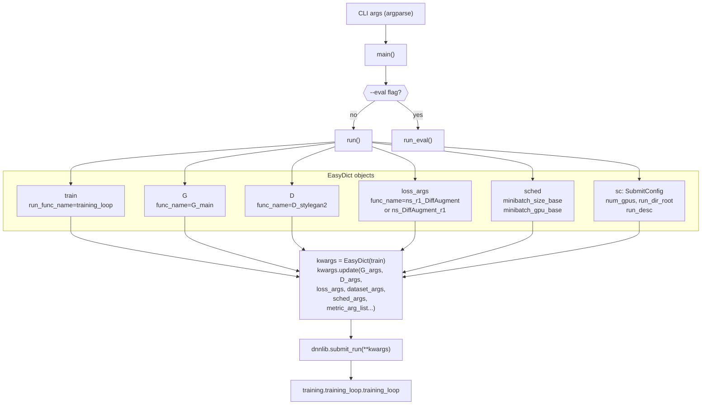

Sources: `DiffAugment-stylegan2/run_cifar.py:23-90`, `DiffAugment-stylegan2/run_ffhq.py:24-94`, `DiffAugment-stylegan2/run_low_shot.py:24-94`

---

## `run_cifar.py`

### Purpose

Trains StyleGAN2 on CIFAR-10 or CIFAR-100. CIFAR datasets are loaded directly from TensorFlow Datasets — no TFRecord preprocessing step is needed. The `dataset` argument is passed verbatim as `tfrecord_dir` in `dataset_args`.

### CLI Arguments

[DiffAugment-stylegan2/run_cifar.py:124-160]()

| Argument | Default | Notes |
|---|---|---|
| `--dataset` | `cifar10` | `cifar10` or `cifar100` |
| `--resolution` | `None` | Optional; passed to dataset args |
| `--DiffAugment` | `color,cutout` | Full data default; use `color,translation,cutout` for partial data |
| `--num-gpus` | `1` | Recommend 4–8 for paper results |
| `--batch-size` | `None` (→ 32) | Must be divisible by `num-gpus` |
| `--total-kimg` | `25000` | ~2 days training |
| `--ema-kimg` | `1000` | EMA generator half-life |
| `--num-samples` | `None` | Limit dataset size (e.g. 5000 for 10%) |
| `--gamma` | `0.1` | R1 regularization weight |
| `--fmap-base` | `2048` | Feature map base for G and D |
| `--fmap-max` | `None` | Cap on feature maps |
| `--latent-size` | `None` | Defaults to StyleGAN2 standard (512) |
| `--mirror-augment` | `True` | Horizontal flip augmentation |
| `--impl` | `cuda` | Use `ref` if `nvcc` is unavailable |
| `--metrics` | `fid10k,is10k` | Comma-separated metric names |
| `--resume` | `None` | Checkpoint path or `mit-han-lab:...` shorthand |
| `--resume-kimg` | `0` | Training progress offset |
| `--num-repeats` | `1` | Evaluation repeat count |
| `--eval` | `False` | Switch to evaluation mode |

### Loss Function

`run_cifar.py` uses `ns_r1_DiffAugment` — the non-saturating loss with R1 penalty applied before DiffAugment. [DiffAugment-stylegan2/run_cifar.py:29]()

### Dataset Args

```python
dataset_args = EasyDict(tfrecord_dir=dataset, resolution=resolution)
```

No `from_tfrecords=True` flag is set. The TFDS source (`cifar10`, `cifar100`) is handled differently from TFRecord files by the data pipeline. [DiffAugment-stylegan2/run_cifar.py:41]()

### Eval Mode

`run_eval()` calls `tflib.init_tf()`, constructs a `dataset_args` with `shuffle_mb=0`, and passes it to `MetricGroup.run(resume, ...)`. [DiffAugment-stylegan2/run_cifar.py:95-100]()

---

## `run_ffhq.py`

### Purpose

Trains StyleGAN2 on FFHQ or LSUN. The dataset path points to a folder containing `.tfrecords` files or an LMDB `.mdb` file. A preprocessing call converts the source to TFRecords if not already done.

### Dataset Preprocessing

Unlike `run_cifar.py`, `run_ffhq.py` calls `dataset_tool.create_dataset(dataset, resolution)` before building any training config. This function (documented in [Data Preparation](#3.1)) converts the source to TFRecords and returns the directory path. [DiffAugment-stylegan2/run_ffhq.py:37]()

```python
dataset = dataset_tool.create_dataset(dataset, resolution)
```

### CLI Arguments

[DiffAugment-stylegan2/run_ffhq.py:129-165]()

| Argument | Default | Notes |
|---|---|---|
| `--dataset` | *(required)* | Path to `.tfrecords` folder or LMDB folder |
| `--DiffAugment` | `color,translation,cutout` | Full augmentation policy |
| `--gamma` | `1` | Higher than CIFAR default (0.1) |
| `--fmap-base` | `8192` | Higher capacity for 256×256 images |
| `--total-kimg` | `25000` | Same as CIFAR |
| `--ema-kimg` | `None` | Not set by default |
| `--metrics` | `fid50k-train` | Uses train-set FID |
| `--resolution` | `None` | Optional; if multiple TFRecord files, the highest-res one is used |
| `--num-samples` | `None` | Restricts to N samples (e.g. 10000 for 10k FFHQ) |

All other arguments mirror `run_cifar.py`.

### Dataset Args

```python
dataset_args = EasyDict(tfrecord_dir=dataset, resolution=resolution, from_tfrecords=True)
```

The `from_tfrecords=True` flag signals the data pipeline to treat the directory as pre-built TFRecords rather than a TFDS source. [DiffAugment-stylegan2/run_ffhq.py:45]()

### Eval Mode

`run_eval()` calls `dataset_tool.create_dataset()` again before running metrics (so it can be invoked directly without a prior training run). [DiffAugment-stylegan2/run_ffhq.py:99-105]()

---

## `run_low_shot.py`

### Purpose

Trains StyleGAN2 on small datasets — the 100-shot collections (obama, grumpy_cat, panda, etc.), AnimalFace datasets, or any custom image folder. This script uses a different loss function and has lower default training length and batch size compared to the other two.

### Key Differences from `run_ffhq.py`

**Loss Function**: `run_low_shot.py` uses `ns_DiffAugment_r1` instead of `ns_r1_DiffAugment`. The order matters: DiffAugment is applied before the R1 penalty computation in this variant. [DiffAugment-stylegan2/run_low_shot.py:30]()

**Default Values Optimized for Small Data:**

| Parameter | `run_low_shot.py` | `run_ffhq.py` |
|---|---|---|
| `--total-kimg` | `300` | `25000` |
| `--batch-size` | `16` | `None` (→ 32) |
| `--resolution` | `256` | `None` |
| `--gamma` | `None` | `1` |
| `--fmap-base` | `None` | `8192` |
| `--metrics` | `fid5k-train` | `fid50k-train` |
| `--DiffAugment` | `color,translation,cutout` | `color,translation,cutout` |

### Dataset Auto-Download

When `--dataset` is one of the predefined names (`100-shot-obama`, `100-shot-grumpy_cat`, `100-shot-panda`, `AnimalFace-cat`, etc.), `dataset_tool.create_dataset()` automatically downloads and prepares it. Custom image folders are resized and converted to TFRecords at the specified resolution. [DiffAugment-stylegan2/run_low_shot.py:37]()

### Caching Note

TFRecord and `.pkl` cache files are stored alongside the training images. If training images change, these cached files must be deleted manually before rerunning.

### Resuming from a Pre-Trained Model

`run_low_shot.py` supports fine-tuning from an FFHQ pre-trained model via `--resume` and optionally `--fmap-base=8192` to match the pre-trained model capacity.

### Eval Mode

[DiffAugment-stylegan2/run_low_shot.py:99-105]()

`run_eval()` includes `resolution` in the `dataset_args` (unlike `run_cifar.py`), which is needed for custom-resolution image folders.

---

## Cross-Script Comparison

**Title: Argument and configuration differences across the three training scripts**

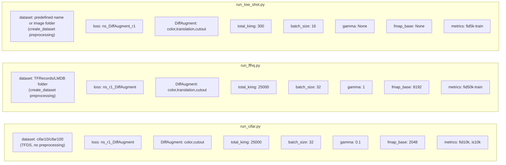

Sources: `DiffAugment-stylegan2/run_cifar.py`, `DiffAugment-stylegan2/run_ffhq.py`, `DiffAugment-stylegan2/run_low_shot.py`

---

## Evaluation Mode

Each script has a `--eval` flag. When set, `main()` dispatches to `run_eval()` instead of `run()`. The eval path:

1. Optionally preprocesses the dataset (ffhq and low_shot only).
2. Calls `tflib.init_tf()` directly.
3. Constructs `dataset_args` with `shuffle_mb=0` to disable shuffling.
4. Instantiates a `MetricGroup` from the requested metric names via `metric_defaults`.
5. Calls `MetricGroup.run(resume, dataset_args=..., num_gpus=...)`.

The `--num-repeats` argument controls how many times metrics are computed; the mean and standard deviation are reported when `num_repeats > 1`.

**Eval invocation examples (from README):**

```
python run_cifar.py --dataset=cifar10 --resume=mit-han-lab:DiffAugment-stylegan2-cifar10.pkl --eval

python run_ffhq.py --dataset=PATH_TO_TFRECORDS --resume=mit-han-lab:DiffAugment-stylegan2-ffhq.pkl --num-gpus=8 --eval

python run_low_shot.py --dataset=100-shot-obama --resume=mit-han-lab:DiffAugment-stylegan2-100-shot-obama.pkl --eval
```

The `mit-han-lab:` prefix is a shorthand resolved by `dnnlib.open_url` (see [Shared Utilities](#6)) to the hosted model URL.

Sources: `DiffAugment-stylegan2/run_cifar.py:95-100`, `DiffAugment-stylegan2/run_ffhq.py:99-105`, `DiffAugment-stylegan2/run_low_shot.py:99-105`, `DiffAugment-stylegan2/README.md`

---

## The `desc` String and Run Directory Naming

Each `run()` function builds a `desc` string incrementally from the active options. This string becomes `submit_config.run_desc` and is appended to the run output directory path under `result_dir`.

For example, with `run_cifar.py --dataset=cifar10 --DiffAugment=color,cutout --num-gpus=4`:

```
desc = "DiffAugment-stylegan2-cifar10-4gpu-color-cutout"
```

With no DiffAugment (`--DiffAugment=""`):

```
desc = "stylegan2-cifar10-4gpu"
```

[DiffAugment-stylegan2/run_cifar.py:40-76]()

Sources: `DiffAugment-stylegan2/run_cifar.py:40-90`, `DiffAugment-stylegan2/run_ffhq.py:44-80`, `DiffAugment-stylegan2/run_low_shot.py:44-80`

---

## Helper Functions

All three scripts share identical helper utilities defined locally:

- `_str_to_bool(v)` — Converts string representations of booleans (`yes`, `true`, `1`, `no`, `false`, `0`) to Python `bool`. Used for `--mirror-augment`. [DiffAugment-stylegan2/run_cifar.py:105-113]()
- `_parse_comma_sep(s)` — Splits a comma-separated string into a list; returns `[]` for `None`, `"none"`, or `""`. Used for `--metrics`. [DiffAugment-stylegan2/run_cifar.py:116-119]()

---

# Page: Network Architecture and Training Internals

# Network Architecture and Training Internals

<details>
<summary>Relevant source files</summary>

The following files were used as context for generating this wiki page:

- [DiffAugment-stylegan2/DiffAugment_tf.py](DiffAugment-stylegan2/DiffAugment_tf.py)
- [DiffAugment-stylegan2/training/loss.py](DiffAugment-stylegan2/training/loss.py)
- [DiffAugment-stylegan2/training/networks_stylegan2.py](DiffAugment-stylegan2/training/networks_stylegan2.py)
- [DiffAugment-stylegan2/training/training_loop.py](DiffAugment-stylegan2/training/training_loop.py)
- [DiffAugment_pytorch.py](DiffAugment_pytorch.py)
- [DiffAugment_tf.py](DiffAugment_tf.py)

</details>


This page documents the generator and discriminator architectures, the two DiffAugment-integrated loss functions, and the training loop mechanics for the TensorFlow StyleGAN2 sub-system located in `DiffAugment-stylegan2/`. It covers the code in `training/networks_stylegan2.py`, `training/loss.py`, and `training/training_loop.py`.

For data preparation and the runtime dataset pipeline, see [3.1](#3.1) and [3.2](#3.2). For the training entrypoints that invoke the loop described here, see [3.3](#3.3). For evaluation and metrics, see [3.5](#3.5).

---

## Network Architecture Overview

**Architecture diagram: generator and discriminator call graph**

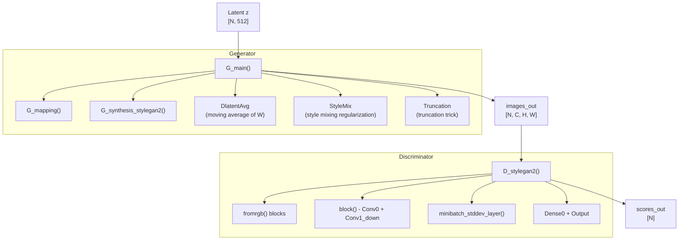

Sources: [DiffAugment-stylegan2/training/networks_stylegan2.py:160-253](), [DiffAugment-stylegan2/training/networks_stylegan2.py:422-505]()

---

## Generator: `G_main`

`G_main` [DiffAugment-stylegan2/training/networks_stylegan2.py:160-253]() is the top-level generator function. It is not a class — it is a plain function registered as a `tflib.Network` build function. It owns no weights of its own; instead it manages two sub-networks stored in a `dnnlib.EasyDict` called `components`.

| Sub-network | Build function key | Purpose |
|---|---|---|
| `components.mapping` | `G_mapping` | Maps `z` → `w` (disentangled latent space) |
| `components.synthesis` | `G_synthesis_stylegan2` | Maps `w` → image |

### Behavior controlled by `G_main` flags

| Flag | Training | Validation/Inference |
|---|---|---|
| `dlatent_avg_beta` | Tracks EMA of `w` in `dlatent_avg` variable | Disabled (set to `None`) |
| `style_mixing_prob` | Randomly replaces half of layers' `w` with a second random `w` | Disabled |
| `truncation_psi` | Disabled during training | Applied: `w = lerp(dlatent_avg, w, psi)` |
| `truncation_cutoff` | Disabled | Limits truncation to first N layers |

The `lod` (level-of-detail) variable is a non-trainable `tf.Variable` that was used in progressive growing. In this codebase's configs, `lod_initial_resolution=None` keeps `lod=0.0`, meaning the network trains at full resolution from the start.

Sources: [DiffAugment-stylegan2/training/networks_stylegan2.py:160-253]()

---

## Generator: `G_mapping`

`G_mapping` [DiffAugment-stylegan2/training/networks_stylegan2.py:261-311]() is an 8-layer fully-connected network (MLP) that maps the input latent `z` into the disentangled intermediate latent `w`.

**Processing steps:**

1. **Label embedding** (if `label_size > 0`): one-hot label is projected and concatenated to `z`.
2. **Latent normalization**: `z` is pixel-normalized — divided by its own RMS value.
3. **8× Dense layers** (`Dense0`–`Dense7`): each applies `dense_layer` + `apply_bias_act` with `lrelu`. The mapping layers use `mapping_lrmul=0.01`, i.e. a 100× reduced learning rate.
4. **Broadcast**: the final `[N, 512]` `w` is tiled to `[N, num_layers, 512]` so each synthesis layer can receive its own copy.

Key default parameters:

| Parameter | Default |
|---|---|
| `latent_size` | 512 |
| `dlatent_size` | 512 |
| `mapping_layers` | 8 |
| `mapping_fmaps` | 512 |
| `mapping_lrmul` | 0.01 |
| `normalize_latents` | `True` |

Sources: [DiffAugment-stylegan2/training/networks_stylegan2.py:261-311]()

---

## Generator: `G_synthesis_stylegan2`

`G_synthesis_stylegan2` [DiffAugment-stylegan2/training/networks_stylegan2.py:319-414]() converts the broadcast `w` tensor `[N, num_layers, 512]` into an image.

### Feature map count

The channel count at each resolution level is computed by:

```
nf(stage) = clip(fmap_base / 2^(stage * fmap_decay), fmap_min, fmap_max)
```

Default: `fmap_base=16384`, `fmap_decay=1.0`, `fmap_max=512`. This results in 512 channels at low resolutions tapering toward `fmap_min` at high resolutions.

### Building blocks

| Block | Description |
|---|---|
| `layer(x, layer_idx, ...)` | One modulated conv2d + noise injection + bias/activation |
| `block(x, res)` | Two `layer()` calls: `Conv0_up` (upsample) + `Conv1`; optional residual skip |
| `torgb(x, y, res)` | 1×1 modulated conv to 3 channels, accumulated into `y` (skip architecture) |
| `upsample(y)` | Upsamples `y` using bilinear filter for skip accumulation |

The default architecture is `'skip'`: each resolution block outputs via `torgb` and those outputs are progressively summed into the final image.

### Noise injection

Each `layer()` adds a scaled noise tensor: either a fresh `tf.random_normal` (when `randomize_noise=True`) or a stored non-trainable variable `noise{i}`. The scale is a trainable scalar `noise_strength` initialized to zero.

### Modulated convolution

Each synthesis `layer()` calls `modulated_conv2d_layer` [DiffAugment-stylegan2/training/networks_stylegan2.py:96-134](). This is the core StyleGAN2 operation:

1. A style vector `s` is produced from the current `w` slice via a small dense layer.
2. The convolution weight `w` is scaled (modulated) by `s`.
3. The modulated weight is demodulated by dividing by its own L2 norm, ensuring unit variance in activations.
4. When `fused_modconv=True`, the per-sample weight scaling is implemented as a grouped convolution for efficiency.

**Modulated convolution diagram:**

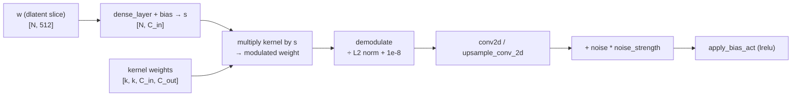

Sources: [DiffAugment-stylegan2/training/networks_stylegan2.py:96-134](), [DiffAugment-stylegan2/training/networks_stylegan2.py:319-414]()

---

## Discriminator: `D_stylegan2`

`D_stylegan2` [DiffAugment-stylegan2/training/networks_stylegan2.py:422-505]() is the mirror of the synthesis network. It processes images top-down from full resolution to 4×4 using residual blocks, then produces a scalar score.

### Architecture (default: `'resnet'`)

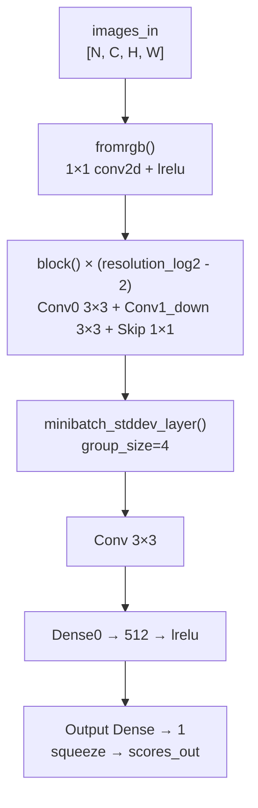

### Minibatch standard deviation layer

`minibatch_stddev_layer` [DiffAugment-stylegan2/training/networks_stylegan2.py:140-152]() computes the average standard deviation across a group of `group_size=4` samples and appends it as an extra feature map channel. This encourages the generator to produce varied outputs and is a standard ProGAN/StyleGAN technique.

Steps:
1. Split batch into groups of 4.
2. Compute per-feature standard deviation within each group.
3. Average across spatial positions and feature maps.
4. Tile result back to full batch size and append as a new channel.

### Weight initialization: `get_weight`

All weight tensors are created through `get_weight` [DiffAugment-stylegan2/training/networks_stylegan2.py:23-37](). It implements **equalized learning rate**:

- Weights are initialized from `N(0, 1/lrmul)`.
- At runtime, they are multiplied by `he_std * lrmul` (the He initialization constant).
- This ensures consistent gradient magnitudes regardless of layer size.

Sources: [DiffAugment-stylegan2/training/networks_stylegan2.py:140-152](), [DiffAugment-stylegan2/training/networks_stylegan2.py:422-505](), [DiffAugment-stylegan2/training/networks_stylegan2.py:23-37]()

---

## Loss Functions

Both loss functions live in `DiffAugment-stylegan2/training/loss.py` and return a triple `(G_loss, D_loss, D_reg)`. They differ only in **where DiffAugment is applied relative to the R1 gradient penalty**.

### `ns_r1_DiffAugment` vs `ns_DiffAugment_r1`

| | `ns_r1_DiffAugment` | `ns_DiffAugment_r1` |
|---|---|---|
| **Augment before D** | Yes — both reals and fakes are augmented before `D.get_output_for` | Yes — same |
| **R1 gradient penalty w.r.t.** | Augmented reals (`reals` after `DiffAugment`) | Un-augmented reals (raw `reals`) |
| **Typical use** | Default for most configs | Alternative; penalizes gradient of original data |

The non-saturating GAN losses are:

```
G_loss = softplus(-fake_scores)
D_loss = softplus(fake_scores) + softplus(-real_scores)
```

### R1 Gradient Penalty

Both functions compute an R1 penalty:

```
D_reg = 0.5 * gamma * sum(grad(real_scores, reals)^2)
```

The default `gamma=10`. The gradient is computed by `tf.gradients(tf.reduce_sum(real_scores), [reals])`. The penalty is returned as `D_reg` separately so the training loop can apply **lazy regularization** (see below).

**Loss function diagram:**

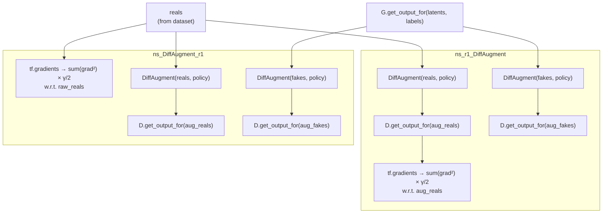

Sources: [DiffAugment-stylegan2/training/loss.py:1-61]()

---

## Training Loop

`training_loop` [DiffAugment-stylegan2/training/training_loop.py:108-336]() is the main training script. It is called by the run scripts (see [3.3](#3.3)) via `dnnlib.submit_run`.

### Setup sequence

```mermaid
flowchart TD
    init["tflib.init_tf()"]
    load_ds["dataset.load_dataset()"]
    build_net["tflib.Network G, D, Gs\n(or load from resume_pkl)"]
    build_graph["Build TF graph per GPU\nG_opt, D_opt (Adam)"]
    ema_op["Gs.setup_as_moving_average_of(G, beta=Gs_beta)"]
    train_loop["Main while loop\ncur_nimg < total_kimg * 1000"]
    tick["Tick: save snapshots, run metrics"]

    init --> load_ds --> build_net --> build_graph --> ema_op --> train_loop --> tick
```

### Networks constructed

| Variable | Role |
|---|---|
| `G` | Generator being trained |
| `D` | Discriminator being trained |
| `Gs` | EMA copy of `G` used for inference/snapshots |

`Gs` is updated every step via `Gs.setup_as_moving_average_of(G, beta=Gs_beta)`. The beta decays as `0.5^(minibatch_size / (G_ema_kimg * 1000))`. Before `ema_start_kimg` images have been seen, `Gs_beta_mul_in=0` freezes the EMA copy at initial weights.

### Training schedule: `training_schedule`

`training_schedule` [DiffAugment-stylegan2/training/training_loop.py:49-102]() returns a `dnnlib.EasyDict` with per-step values:

| Field | Description |
|---|---|
| `s.lod` | Current level-of-detail (0.0 = full resolution) |
| `s.resolution` | Current training resolution |
| `s.minibatch_size` | Total minibatch size across all GPUs |
| `s.minibatch_gpu` | Per-GPU sample count |
| `s.G_lrate` | Generator learning rate |
| `s.D_lrate` | Discriminator learning rate |
| `s.tick_kimg` | kimg between progress snapshots |

When `lod_initial_resolution=None` (typical for CIFAR/low-shot configs), `s.lod` is always 0.0 and the resolution is fixed from the start.

### Image preprocessing: `process_reals`

`process_reals` [DiffAugment-stylegan2/training/training_loop.py:23-43]() applies just-in-time transformations to real images pulled from the dataset:

1. Cast to `float32` and rescale from dataset dynamic range to `[-1, 1]`.
2. Optional random horizontal flip (`mirror_augment`).
3. LOD fade crossfade (blends with a blurred version at the current `lod` fractional part).
4. LOD upscale (nearest-neighbor upsampling to match full network input size during progressive phases).

**Note:** DiffAugment is **not** applied here. It is applied inside the loss function.

### Lazy regularization

When `lazy_regularization=True`, the R1 penalty is computed only every `D_reg_interval=4` minibatches:

[DiffAugment-stylegan2/training/training_loop.py:220-225]()

```
if lazy_regularization:
    D_loss = tf.cond(run_D_reg_in,
        lambda: D_loss + D_reg * D_reg_interval,
        lambda: D_loss)
```

When the penalty is applied, it is scaled by `D_reg_interval` to maintain the same expected gradient magnitude as if it were applied every step.

### Per-tick operations

At each tick (controlled by `tick_kimg`), the loop:
- Saves a fake image grid generated by `Gs`.
- Saves a `.pkl` checkpoint of `(G, D, Gs)`.
- Runs the metric group (FID, IS) against the checkpoint.
- Writes TensorBoard summaries.

Sources: [DiffAugment-stylegan2/training/training_loop.py:108-336](), [DiffAugment-stylegan2/training/training_loop.py:23-43](), [DiffAugment-stylegan2/training/training_loop.py:49-102]()

---

## Key Hyperparameters Summary

| Parameter | Location | Default | Notes |
|---|---|---|---|
| `gamma` (R1 penalty) | `loss.py` functions | `10` | Set per training script |
| `policy` (DiffAugment) | `loss.py` functions | `''` (empty) | e.g. `'color,translation,cutout'` |
| `G_ema_kimg` | `training_loop` | `10` | Half-life of Gs EMA in kimg |
| `lazy_regularization` | `training_loop` | `False` | Enabled in some FFHQ configs |
| `D_reg_interval` | `training_loop` | `4` | Only relevant if lazy_reg enabled |
| `style_mixing_prob` | `G_main` | `0.9` | Disabled at inference |
| `truncation_psi` | `G_main` | `None` train / script-defined val | Applied only at inference |
| `mapping_lrmul` | `G_mapping` | `0.01` | Reduces mapping net learning rate |
| `mbstd_group_size` | `D_stylegan2` | `4` | Groups for minibatch stddev |
| `fused_modconv` | synthesis / D | `True` | Grouped conv implementation |
| `architecture` (G) | `G_synthesis_stylegan2` | `'skip'` | skip / resnet / orig |
| `architecture` (D) | `D_stylegan2` | `'resnet'` | resnet / skip / orig |

Sources: [DiffAugment-stylegan2/training/networks_stylegan2.py:160-176](), [DiffAugment-stylegan2/training/networks_stylegan2.py:319-335](), [DiffAugment-stylegan2/training/networks_stylegan2.py:422-439](), [DiffAugment-stylegan2/training/training_loop.py:108-137](), [DiffAugment-stylegan2/training/loss.py:14-59]()

---

# Page: Evaluation and Metrics

# Evaluation and Metrics

<details>
<summary>Relevant source files</summary>

The following files were used as context for generating this wiki page:

- [DiffAugment-biggan-cifar/dnnlib/util.py](DiffAugment-biggan-cifar/dnnlib/util.py)
- [DiffAugment-biggan-cifar/eval.py](DiffAugment-biggan-cifar/eval.py)
- [DiffAugment-stylegan2/metrics/frechet_inception_distance.py](DiffAugment-stylegan2/metrics/frechet_inception_distance.py)
- [DiffAugment-stylegan2/metrics/metric_base.py](DiffAugment-stylegan2/metrics/metric_base.py)
- [DiffAugment-stylegan2/metrics/metric_defaults.py](DiffAugment-stylegan2/metrics/metric_defaults.py)
- [DiffAugment-stylegan2/training/misc.py](DiffAugment-stylegan2/training/misc.py)

</details>


## Purpose and Scope

This page documents the evaluation framework used by the **DiffAugment-stylegan2 (TensorFlow)** sub-system, located in `DiffAugment-stylegan2/metrics/`. It covers:

- The `MetricBase` / `MetricGroup` class hierarchy
- The `metric_defaults` registry
- The `FID` (Fréchet Inception Distance) and `IS` (Inception Score) implementations
- How metrics are invoked during training and how to run standalone evaluation against a saved checkpoint

For information on the training loop that calls these metrics, see [3.4](#3.4). For the training scripts that configure which metrics to run, see [3.3](#3.3). For the BigGAN-CIFAR metric evaluation entrypoint (`eval.py`), see [5](#5).

---

## Component Overview

**Metric class hierarchy and registry flow:**

```mermaid
classDiagram
    class MetricBase {
        +name: str
        +split: str
        +_cache_dir: str
        +run(network_pkl, run_dir, data_dir, dataset_args, num_gpus, ...)
        +get_result_str() str
        +update_autosummaries()
        +_evaluate(Gs, Gs_kwargs, num_gpus)*
        +_report_result(value, suffix, fmt)
        +_report_progress(pcur, pmax)
        +_get_cache_file_for_reals(prefix, num_images, ...) str
        +_get_dataset_obj() TFRecordDataset
        +_iterate_reals(minibatch_size, ...) iterator
    }

    class FID {
        +num_images: int
        +minibatch_per_gpu: int
        +num_real_images: int
        +mirror_augment: bool
        +num_repeats: int
        +_evaluate(Gs, Gs_kwargs, num_gpus)
    }

    class IS {
        +num_images: int
        +num_splits: int
        +minibatch_per_gpu: int
        +_evaluate(Gs, Gs_kwargs, num_gpus)
    }

    class DummyMetric {
        +_evaluate(Gs, Gs_kwargs, num_gpus)
    }

    class MetricGroup {
        +metrics: list
        +run(network_pkl, ...)
        +get_result_str() str
        +update_autosummaries()
    }

    MetricBase <|-- FID
    MetricBase <|-- IS
    MetricBase <|-- DummyMetric
    MetricGroup o-- MetricBase
```

Sources: [DiffAugment-stylegan2/metrics/metric_base.py:1-185](), [DiffAugment-stylegan2/metrics/frechet_inception_distance.py:1-86]()

---

## The `metric_defaults` Registry

[DiffAugment-stylegan2/metrics/metric_defaults.py]() defines a single `EasyDict` named `metric_defaults`. It maps a short string name to a configuration object that carries enough information for `dnnlib.util.call_func_by_name` to instantiate the metric class.

| Name | `func_name` | `num_images` | `split` | Notes |
|---|---|---|---|---|
| `fid10k` | `metrics.frechet_inception_distance.FID` | 10,000 | `test` | Default for most evaluations |
| `fid5k-train` | `metrics.frechet_inception_distance.FID` | 5,000 | `train` | Used for CIFAR-style datasets |
| `fid50k-train` | `metrics.frechet_inception_distance.FID` | 50,000 | `train` | Large-scale evaluation |
| `is10k` | `metrics.inception_score.IS` | 10,000 | `train` | `num_splits=10`, `minibatch_per_gpu=8` |

All entries set `minibatch_per_gpu=8`.

The training scripts (see [3.3](#3.3)) pass a list of these names when constructing a `MetricGroup`. For example, `run_cifar.py` typically selects `fid10k` or `fid5k-train` depending on dataset size.

Sources: [DiffAugment-stylegan2/metrics/metric_defaults.py:1-18]()

---

## `MetricBase`

[DiffAugment-stylegan2/metrics/metric_base.py:23-158]()

`MetricBase` is the abstract base class for all metrics. All state needed to run one evaluation pass is reset at the start of each `run()` call via `_reset()`.

### Instantiation

```
MetricBase(name, split='test', cache_dir='.stylegan2-cache')
```

- `name` — used for log file naming and summary keys.
- `split` — either `'test'` or `'train'`, forwarded to `dataset.load_dataset()` when opening the real-image dataset.
- `cache_dir` — filesystem path where real-image activation statistics are cached as `.pkl` files.

### The `run()` Method

[DiffAugment-stylegan2/metrics/metric_base.py:61-83]()

```mermaid
flowchart TD
    A["run(network_pkl, run_dir, data_dir, ...)"]
    B["_reset(): clear previous state,\nparse config from run_dir if needed"]
    C["tf.Graph + tflib.create_session"]
    D["_get_dataset_obj():\nload TFRecordDataset"]
    E["misc.load_pkl(network_pkl)\n→ (_G, _D, Gs)"]
    F["_evaluate(Gs, Gs_kwargs, num_gpus)\n(implemented by subclass)"]
    G["log to metric-NAME.txt or stdout"]

    A --> B --> C --> D --> E --> F --> G
```

Key details:

- The checkpoint pickle is expected to unpack as a 3-tuple `(_G, _D, Gs)`, where `Gs` is the exponential moving average generator. If `disable_ema=True` is passed, `_G` is used instead.
- If `run_dir` is provided and `dataset_args` is not, the method calls `misc.parse_config_for_previous_run(run_dir)` to reconstruct dataset arguments from the saved `submit_config.pkl`.
- Results are written to `<run_dir>/metric-<name>.txt` (appending), or to stdout if `run_dir` is `None`.

### Dataset and Real-Image Iteration

`_get_dataset_obj()` lazily opens a `TFRecordDataset` using `dataset.load_dataset()` with `shuffle_mb=0` and `repeat=False` so images are consumed in a deterministic order.

`_iterate_reals(minibatch_size, mirror_augment, num_samples)` is a generator that yields numpy image arrays from the dataset. It stops when `OutOfRangeError` is raised (end of dataset) or `num_samples` images have been yielded.

### Caching Real-Image Statistics

`_get_cache_file_for_reals(prefix, num_images, extension, mirror_augment)` constructs a cache path of the form:

```
<cache_dir>/<prefix>-<dataset_name>-<split>[-<num_images>][-flip].<extension>
```

For example: `.stylegan2-cache/fid-ffhq-test-10000.pkl`

This cache is used by `FID._evaluate()` to avoid recomputing Inception activations for real images on repeated evaluations.

Sources: [DiffAugment-stylegan2/metrics/metric_base.py:23-158]()

---

## `MetricGroup`

[DiffAugment-stylegan2/metrics/metric_base.py:162-176]()

`MetricGroup` holds a flat list of `MetricBase` instances. It is instantiated with a `metric_kwarg_list`, which is a list of `EasyDict` objects taken directly from `metric_defaults`.

```python
# Conceptual usage from the training loop
metric_group = MetricGroup(
    [metric_defaults['fid10k'], metric_defaults['is10k']],
    name=..., split=...
)
```

Each `EasyDict` in the list carries `func_name`, which `dnnlib.util.call_func_by_name` uses to dynamically instantiate the correct subclass.

| Method | Behavior |
|---|---|
| `run(*args, **kwargs)` | Calls `metric.run(...)` sequentially for each metric |
| `get_result_str()` | Joins result strings from all metrics with a space |
| `update_autosummaries()` | Calls `update_autosummaries()` on each metric |

Sources: [DiffAugment-stylegan2/metrics/metric_base.py:162-176]()

---

## FID Implementation

[DiffAugment-stylegan2/metrics/frechet_inception_distance.py:20-86]()

The `FID` class computes the Fréchet Inception Distance between the distribution of real images and the distribution of generated images. The mathematical definition used is:

> FID = ||μ_real − μ_fake||² + Tr(Σ_real + Σ_fake − 2·√(Σ_real·Σ_fake))

### `_evaluate()` Walkthrough

**Step 1 — Load InceptionV3 feature extractor**

The network is loaded via `misc.load_pkl` from a CloudFront URL:
`http://d36zk2xti64re0.cloudfront.net/stylegan1/networks/metrics/inception_v3_features.pkl`

This is a frozen TensorFlow network that outputs 2048-dimensional feature vectors.

**Step 2 — Compute or load real-image statistics**

[DiffAugment-stylegan2/metrics/frechet_inception_distance.py:37-50]()

The cache file path is obtained from `_get_cache_file_for_reals(prefix='fid', ...)`. If the file exists, `(mu_real, sigma_real)` are loaded directly. Otherwise, all real images are passed through InceptionV3 and `(mu_real, sigma_real)` are computed and saved.

**Step 3 — Build multi-GPU TensorFlow graph for fakes**

[DiffAugment-stylegan2/metrics/frechet_inception_distance.py:53-64]()

One sub-graph is placed on each GPU. Each sub-graph:
1. Samples `minibatch_per_gpu` latent vectors from a normal distribution.
2. Samples random labels via `_get_random_labels_tf()`.
3. Runs `Gs_clone.get_output_for(latents, labels, **Gs_kwargs)` to generate images.
4. Converts images to uint8 with `tflib.convert_images_to_uint8`.
5. Passes images through a cloned InceptionV3 to get activations.

**Step 4 — Collect activations and compute statistics**

[DiffAugment-stylegan2/metrics/frechet_inception_distance.py:66-84]()

Generated in batches until `num_images` activations are collected. `mu_fake` and `sigma_fake` are computed with `np.mean` and `np.cov`.

**Step 5 — Compute FID**

`scipy.linalg.sqrtm` computes the matrix square root. The final scalar is reported via `_report_result()`.

If `num_repeats > 1`, the evaluation is repeated and the mean and standard deviation are both reported.

**Grayscale handling:** If `Gs.output_shape[1] == 1`, images are repeated along the channel axis 3× before being passed to InceptionV3 (which requires 3-channel input).

### FID Evaluation Data Flow

```mermaid
flowchart LR
    subgraph RealPath["Real Image Path"]
        RI["_iterate_reals()\nTFRecordDataset"]
        RINC["inception.run(real_images)"]
        RCACHE["cache_file .pkl\n(mu_real, sigma_real)"]
        RI --> RINC --> RCACHE
    end

    subgraph FakePath["Fake Image Path (per GPU)"]
        LAT["tf.random_normal\nlatents"]
        LBL["_get_random_labels_tf()"]
        GS["Gs_clone.get_output_for\n(latents, labels)"]
        CONV["tflib.convert_images_to_uint8"]
        FINC["inception_clone.get_output_for"]
        LAT --> GS
        LBL --> GS
        GS --> CONV --> FINC
    end

    subgraph Compute["Statistics + Distance"]
        MU_F["mu_fake = np.mean(activations)"]
        SIG_F["sigma_fake = np.cov(activations)"]
        DIST["FID = m + Tr(Sf + Sr - 2*sqrtm(Sf*Sr))"]
        FINC --> MU_F & SIG_F
        RCACHE --> DIST
        MU_F & SIG_F --> DIST
    end

    DIST --> RR["_report_result(fid_value)"]
```

Sources: [DiffAugment-stylegan2/metrics/frechet_inception_distance.py:29-85]()

---

## Invoking Metrics from the Training Loop

During training, `training_loop.py` constructs a `MetricGroup` from the metric names configured in the training script. Metrics are run periodically at snapshot intervals by calling:

```python
metric_group.run(
    network_pkl,
    run_dir=run_dir,
    data_dir=data_dir,
    dataset_args=dataset_args,
    mirror_augment=mirror_augment,
    num_gpus=num_gpus,
    tf_config=tf_config
)
```

After each run, `metric_group.update_autosummaries()` pushes values into TensorFlow's autosummary system under the key prefix `Metrics/`.

Result strings are appended to `<run_dir>/metric-<name>.txt`.

Sources: [DiffAugment-stylegan2/metrics/metric_base.py:61-98]()

---

## Standalone Evaluation

To evaluate a saved checkpoint without launching a full training run, call `MetricBase.run()` directly from a script. The minimum required arguments are:

| Argument | Description |
|---|---|
| `network_pkl` | Path or `mit-han-lab:` URL to a `.pkl` checkpoint |
| `run_dir` | (Optional) Training run directory; used to auto-load `dataset_args` |
| `data_dir` | Root directory for datasets |
| `dataset_args` | `EasyDict` with dataset configuration (required if `run_dir` is omitted) |
| `num_gpus` | Number of GPUs to use for generation |

Example using the `mit-han-lab:` shorthand (resolved via `misc.get_path_or_url`):

```
# The shorthand expands to https://data-efficient-gans.mit.edu/models/
network_pkl = "mit-han-lab:DiffAugment-stylegan2-100-shot-obama.pkl"
```

The `mit-han-lab:` prefix is handled by `misc.get_path_or_url` [DiffAugment-stylegan2/training/misc.py:38-39](), which substitutes the base URL before passing to `dnnlib.util.open_url`.

Sources: [DiffAugment-stylegan2/metrics/metric_base.py:61-83](), [DiffAugment-stylegan2/training/misc.py:22-39]()

---

## Summary: Files and Classes

```mermaid
graph TD
    subgraph "metrics/"
        MB["metric_base.py\nMetricBase\nMetricGroup\nDummyMetric"]
        MD["metric_defaults.py\nmetric_defaults (EasyDict registry)"]
        FID_F["frechet_inception_distance.py\nFID"]
        IS_F["inception_score.py\nIS"]
    end

    subgraph "training/"
        MISC["misc.py\nload_pkl / save_pkl\nget_path_or_url"]
        DS["dataset.py\nload_dataset\nTFRecordDataset"]
        TL["training_loop.py\n(calls MetricGroup.run)"]
    end

    subgraph "dnnlib/"
        TFLIB["tflib\nautosummary\ncreate_session"]
        UTIL["util\ncall_func_by_name\nformat_time\nLogger"]
    end

    MD -->|"provides EasyDict kwargs for"| MB
    MB -->|"subclassed by"| FID_F
    MB -->|"subclassed by"| IS_F
    MB -->|"uses"| MISC
    MB -->|"uses"| DS
    MB -->|"uses"| TFLIB
    MB -->|"uses"| UTIL
    TL -->|"instantiates via metric_defaults"| MB
```

Sources: [DiffAugment-stylegan2/metrics/metric_base.py:1-185](), [DiffAugment-stylegan2/metrics/metric_defaults.py:1-18](), [DiffAugment-stylegan2/metrics/frechet_inception_distance.py:1-86](), [DiffAugment-stylegan2/training/misc.py:1-39]()

---

# Page: Generating Images and GIFs

# Generating Images and GIFs

<details>
<summary>Relevant source files</summary>

The following files were used as context for generating this wiki page:

- [DiffAugment-biggan-cifar/dnnlib/util.py](DiffAugment-biggan-cifar/dnnlib/util.py)
- [DiffAugment-biggan-cifar/eval.py](DiffAugment-biggan-cifar/eval.py)
- [DiffAugment-stylegan2/generate_gif.py](DiffAugment-stylegan2/generate_gif.py)
- [DiffAugment-stylegan2/training/misc.py](DiffAugment-stylegan2/training/misc.py)

</details>


## Purpose and Scope

This page documents `DiffAugment-stylegan2/generate_gif.py`, the script that produces animated GIF outputs from a trained TensorFlow StyleGAN2 checkpoint. It covers how the checkpoint is loaded, how latent vectors are sampled and mapped to disentangled latents, how frames are generated via linear interpolation in W-space, and how those frames are assembled into a looping GIF.

This page applies only to the **TensorFlow** sub-system (`DiffAugment-stylegan2/`). For the equivalent functionality in the PyTorch sub-system, see [4.1](#4.1). For details on the training loop that produces the checkpoints consumed here, see [3.3](#3.3) and [3.4](#3.4).

---

## Overview

`generate_gif.py` takes a saved `.pkl` checkpoint and produces a smoothly animated GIF by interpolating between random points in the disentangled latent space (W-space). The generator's two-stage design—mapping network followed by synthesis network—is exploited directly: `G_mapping` is called to convert Z-space latents to W-space, and `G_synthesis` is called per-frame to render images from interpolated W-space vectors.

**GIF generation pipeline at a glance:**

```mermaid
flowchart TD
    A["misc.load_pkl(resume)\nreturns (G, D, Gs)"] --> B["Gs (EMA generator)"]
    B --> C["Gs.input_shape[1]\n→ latent_size"]
    C --> D["np.random.randn(batch_size, latent_size)\n× num_phases latent vectors"]
    D --> E["Gs.components.mapping.run(latents, None)\n→ dlatents (W-space)"]
    E --> F["Linear interpolation\ndlatents0 → dlatents1\nover transition_frames steps"]
    F --> G["Gs.components.synthesis.run(dlatents, **Gs_kwargs)\n→ uint8 image batch"]
    G --> H["to_image_grid()\n→ PIL.Image (num_rows × num_cols grid)"]
    H --> I["output_seq.append(frame)\n+ static_frames copies of final frame"]
    I --> J["output_seq[0].save(output, save_all=True, ...)\n→ animated .gif file"]
```

Sources: [DiffAugment-stylegan2/generate_gif.py:1-63]()

---

## Entry Points

### Command-Line Interface

`generate_gif.py` is invoked directly as a script. `main()` parses arguments and delegates to `run()`.

[DiffAugment-stylegan2/generate_gif.py:42-63]()

| Argument | Flag | Default | Description |
|---|---|---|---|
| `resume` | `-r` / `--resume` | *(required)* | Path or URL to a `.pkl` checkpoint |
| `output` | `-o` / `--output` | *(required)* | Output filename (`.gif` extension appended if missing) |
| `num_rows` | `--num-rows` | `2` | Rows in the image grid |
| `num_cols` | `--num-cols` | `3` | Columns in the image grid |
| `resolution` | `--resolution` | `128` | Output resolution per cell (pixels) |
| `num_phases` | `--num-phases` | `5` | Number of latent anchor points to cycle through |
| `transition_frames` | `--transition-frames` | `20` | Frames rendered between each pair of anchor points |
| `static_frames` | `--static-frames` | `5` | Frames held at each anchor after transition completes |
| `seed` | `--seed` | `1000` | NumPy/TF random seed for reproducibility |

**Example invocation:**

```
python generate_gif.py \
    -r mit-han-lab:obama-snapshot.pkl \
    -o obama.gif \
    --num-rows 2 --num-cols 3 \
    --num-phases 5 --transition-frames 20 --static-frames 5
```

The `mit-han-lab:` prefix is expanded to `https://data-efficient-gans.mit.edu/models/` by `misc.get_path_or_url`. See [6](#6) for more on this URL shorthand.

Sources: [DiffAugment-stylegan2/generate_gif.py:42-63](), [DiffAugment-stylegan2/training/misc.py:38-39]()

---

## The `run()` Function

[DiffAugment-stylegan2/generate_gif.py:12-39]()

### Step 1 — TF Initialization and Checkpoint Loading

```python
tflib.init_tf({'rnd.np_random_seed': seed})
_, _, Gs = misc.load_pkl(resume)
```

`misc.load_pkl` [DiffAugment-stylegan2/training/misc.py:28-30]() uses Python's `pickle.load` with `encoding='latin1'` for compatibility with older checkpoints. The checkpoint file is a 3-tuple `(G, D, Gs)`:

| Tuple element | Meaning |
|---|---|
| `G` | The training-time generator |
| `D` | The discriminator |
| `Gs` | The **EMA (exponential moving average) generator** — used for inference |

Only `Gs` is used for generation.

### Step 2 — Latent Sampling

```python
batch_size = num_rows * num_cols
latent_size = Gs.input_shape[1]
latents = [np.random.randn(batch_size, latent_size) for _ in range(num_phases)]
```

`Gs.input_shape[1]` reads the expected Z-space dimensionality from the network's TF graph (512 for standard StyleGAN2 configurations). `num_phases` random anchor points are sampled; the GIF cycles through all of them in sequence.

### Step 3 — Synthesis Kwargs

```python
Gs_kwargs = dnnlib.EasyDict()
Gs_kwargs.output_transform = dict(func=tflib.convert_images_to_uint8, nchw_to_nhwc=True)
Gs_kwargs.randomize_noise = False
```

- `output_transform` converts float32 NCHW tensors (range `[-1, 1]`) to uint8 NHWC arrays suitable for PIL.
- `randomize_noise = False` makes synthesis deterministic, so frames only change due to latent interpolation, not stochastic noise inputs.

### Step 4 — Latent Interpolation and Frame Generation

```python
for i in range(num_phases):
    dlatents0 = Gs.components.mapping.run(latents[i - 1], None)
    dlatents1 = Gs.components.mapping.run(latents[i], None)
    for j in range(transition_frames):
        dlatents = (dlatents0 * (transition_frames - j) + dlatents1 * j) / transition_frames
        output_seq.append(to_image_grid(Gs.components.synthesis.run(dlatents, **Gs_kwargs)))
    output_seq.extend([to_image_grid(Gs.components.synthesis.run(dlatents1, **Gs_kwargs))] * static_frames)
```

The interpolation happens in **W-space** (after the mapping network), not Z-space. This is the standard StyleGAN2 approach for smooth semantic transitions. When `i == 0`, `latents[i - 1]` wraps to `latents[-1]`, so the animation loops seamlessly.

**Frame count formula:**

| Segment | Frames |
|---|---|
| Per phase transition | `transition_frames` |
| Per phase static hold | `static_frames` |
| **Total frames** | `num_phases × (transition_frames + static_frames)` |

With defaults: `5 × (20 + 5) = 125 frames`.

### Step 5 — Grid Assembly (`to_image_grid`)

```python
def to_image_grid(outputs):
    outputs = np.reshape(outputs, [num_rows, num_cols, *outputs.shape[1:]])
    outputs = np.concatenate(outputs, axis=1)
    outputs = np.concatenate(outputs, axis=1)
    return Image.fromarray(outputs).resize(
        (resolution * num_cols, resolution * num_rows), Image.ANTIALIAS
    )
```

The batch of `num_rows × num_cols` images is reshaped, concatenated along height and width axes, then rescaled to the target resolution with antialiasing.

### Step 6 — GIF Export

```python
output_seq[0].save(output, save_all=True, append_images=output_seq[1:],
                   optimize=False, duration=50, loop=0)
```

- `duration=50` sets each frame to 50 ms (20 fps).
- `loop=0` means the GIF loops indefinitely.
- `.gif` is appended to `output` if not already present.

Sources: [DiffAugment-stylegan2/generate_gif.py:12-39]()

---

## Data Flow Diagram

**`run()` internal data flow with code symbols:**

```mermaid
flowchart LR
    subgraph "Inputs"
        R["resume\n(.pkl path or URL)"]
        S["seed"]
    end

    subgraph "misc.load_pkl"
        PKL["(G, D, Gs)\npickle tuple"]
    end

    subgraph "Latent Sampling"
        LS["latent_size\n= Gs.input_shape[1]"]
        LV["latents[0..num_phases-1]\nnp.random.randn\n(batch_size, latent_size)"]
    end

    subgraph "Gs.components.mapping.run"
        DL0["dlatents0\n(W-space)"]
        DL1["dlatents1\n(W-space)"]
    end

    subgraph "Interpolation Loop"
        INTERP["dlatents\n= lerp(dlatents0, dlatents1, j)"]
    end

    subgraph "Gs.components.synthesis.run"
        IMG["uint8 image batch\nNHWC"]
    end

    subgraph "to_image_grid"
        GRID["PIL.Image\n(num_rows × num_cols)"]
    end

    subgraph "PIL.Image.save"
        GIF["output.gif\nduration=50ms, loop=0"]
    end

    R --> PKL --> LS --> LV
    S --> LV
    LV --> DL0
    LV --> DL1
    DL0 --> INTERP
    DL1 --> INTERP
    INTERP --> IMG --> GRID --> GIF
```

Sources: [DiffAugment-stylegan2/generate_gif.py:12-39](), [DiffAugment-stylegan2/training/misc.py:22-39]()

---

## Dependencies

| Symbol | Source | Role |
|---|---|---|
| `misc.load_pkl` | `DiffAugment-stylegan2/training/misc.py` | Loads `.pkl` checkpoint; handles URLs via `dnnlib.util.open_url` |
| `misc.get_path_or_url` | `DiffAugment-stylegan2/training/misc.py` | Expands `mit-han-lab:` shorthand to full URL |
| `tflib.init_tf` | `dnnlib.tflib` | Initializes a TF session with the given options |
| `tflib.convert_images_to_uint8` | `dnnlib.tflib` | Output transform used in `Gs_kwargs.output_transform` |
| `dnnlib.EasyDict` | `dnnlib` | Attribute-access dict for `Gs_kwargs` |
| `Gs.components.mapping` | TF graph sub-network | G_mapping: Z → W |
| `Gs.components.synthesis` | TF graph sub-network | G_synthesis: W → image |
| `PIL.Image` | `Pillow` | GIF assembly and export |
| `numpy` | standard | Latent sampling and interpolation arithmetic |

Sources: [DiffAugment-stylegan2/generate_gif.py:1-11](), [DiffAugment-stylegan2/training/misc.py:22-39]()

---

## Notes and Constraints

- The script requires a TensorFlow 1.15 environment. It will not run under TF 2.x without compatibility shims.
- The checkpoint must be a 3-tuple `(G, D, Gs)` as saved by `training_loop.py`. Snapshots saved during training match this format.
- Noise inputs are held constant (`randomize_noise = False`) throughout the GIF to prevent flickering unrelated to the latent walk.
- Interpolation is **linear** in W-space. Spherical interpolation (slerp) is not used here; for smoother traversals at high curvatures, the caller would need to modify the interpolation arithmetic in `run()` [DiffAugment-stylegan2/generate_gif.py:33-34]().
- The `latents[i - 1]` index at `i=0` wraps to `latents[-1]` (the last anchor), making the animation a seamless loop.

---

# Page: DiffAugment-stylegan2-pytorch

# DiffAugment-stylegan2-pytorch

<details>
<summary>Relevant source files</summary>

The following files were used as context for generating this wiki page:

- [DiffAugment-stylegan2-pytorch/LICENSE.txt](DiffAugment-stylegan2-pytorch/LICENSE.txt)
- [DiffAugment-stylegan2-pytorch/README.md](DiffAugment-stylegan2-pytorch/README.md)

</details>


This page covers the PyTorch implementation of StyleGAN2 + DiffAugment, located under `DiffAugment-stylegan2-pytorch/`. It describes the sub-system's relationship to the upstream `stylegan2-ada-pytorch` codebase, what it can and cannot reproduce relative to the TensorFlow reference implementation, and a summary of its scripts and components.

> For the TensorFlow StyleGAN2 sub-system that is used to fully reproduce paper results, see [DiffAugment-stylegan2 (TensorFlow)](#3). For documentation of the standalone DiffAugment augmentation module, see [DiffAugment Core Module](#2).

---

## Purpose and Scope

`DiffAugment-stylegan2-pytorch/` provides a minimal-modification fork of [stylegan2-ada-pytorch](https://github.com/NVlabs/stylegan2-ada-pytorch) that integrates DiffAugment into the PyTorch StyleGAN2 training loop. Its primary goals are:

- Training StyleGAN2 models with DiffAugment on low-shot datasets using PyTorch.
- Generating images and GIFs from pre-trained checkpoints (both PyTorch-native and TensorFlow legacy formats).
- Converting TensorFlow-format `.pkl` checkpoints to PyTorch-compatible format.

**Important disclaimer:** This sub-system does not fully reproduce the paper's reported results. It uses a different set of hyperparameters and a different evaluation protocol compared to the TensorFlow reference implementation. To reproduce the paper's numbers exactly, use the TensorFlow sub-system documented in [DiffAugment-stylegan2 (TensorFlow)](#3).

Sources: [DiffAugment-stylegan2-pytorch/README.md:1-30]()

---

## Relationship to Upstream Codebase

The directory is built directly on top of `stylegan2-ada-pytorch` (NVIDIA). Changes are intentionally minimal: the primary additions are:

1. A vendored copy of `DiffAugment_pytorch.py` with the augmentation policy logic.
2. Integration of `DiffAugment` into the training loss computation inside `train.py`.
3. `legacy.py`, which adds TensorFlow-to-PyTorch checkpoint conversion.
4. `generate_gif.py` for latent interpolation animation output.

Everything else — network architecture, data loading, training loop infrastructure — is inherited from `stylegan2-ada-pytorch` without modification.

Sources: [DiffAugment-stylegan2-pytorch/README.md:1-5]()

---

## Sub-System Components

The following table maps each script/module to its role:

| File | Role |
|---|---|
| `train.py` | Training entrypoint; invokes the StyleGAN2 loop with DiffAugment enabled |
| `generate.py` | Static image generation from a checkpoint, one image per seed |
| `generate_gif.py` | Latent interpolation animation, outputs a `.gif` |
| `legacy.py` | Detects and converts TensorFlow `.pkl` checkpoints to PyTorch format |
| `DiffAugment_pytorch.py` | Vendored copy of the core DiffAugment module (color, translation, cutout) |

Sources: [DiffAugment-stylegan2-pytorch/README.md:1-30]()

---

**Diagram: Component Relationships in DiffAugment-stylegan2-pytorch**

```mermaid
flowchart TD
    subgraph "Data Sources"
        DURL["URL zip\n(e.g. 100-shot-obama.zip)"]
        DLOCAL["Local image folder"]
    end

    subgraph "Checkpoints"
        PKL_TF["TensorFlow .pkl\n(legacy format)"]
        PKL_PT["PyTorch .pkl\n(native or converted)"]
        PKL_REMOTE["Remote .pkl\n(auto-converted)"]
    end

    subgraph "train.py"
        TRAIN["StyleGAN2 training loop"]
        DA["DiffAugment_pytorch.py\n(color + translation + cutout)"]
        OUT_PKL["training-runs/*.pkl"]
        TRAIN --> DA
        TRAIN --> OUT_PKL
    end

    subgraph "legacy.py"
        UNPICKLE["_LegacyUnpickler"]
        CONV_G["convert_tf_generator"]
        CONV_D["convert_tf_discriminator"]
        PKL_TF --> UNPICKLE --> CONV_G & CONV_D --> PKL_PT
    end

    subgraph "Generation"
        GEN["generate.py\nper-seed static images -> out/"]
        GIF["generate_gif.py\nlatent interpolation -> .gif"]
    end

    DURL --> TRAIN
    DLOCAL --> TRAIN
    PKL_REMOTE -->|"auto-converted if TF format"| PKL_PT
    OUT_PKL --> PKL_PT
    PKL_PT --> GEN
    PKL_PT --> GIF
```

Sources: [DiffAugment-stylegan2-pytorch/README.md:1-30]()

---

## DiffAugment Integration Point

The default augmentation policy applied during training is `color,translation,cutout`. This matches the policy used in the TensorFlow sub-system and is passed to the `DiffAugment` function from `DiffAugment_pytorch.py`. In the training loop inside `train.py`, both real and generated images are augmented before being passed to the discriminator — mirroring the pattern described in [DiffAugment Core Module](#2).

**Diagram: DiffAugment in the PyTorch Training Loop**

```mermaid
flowchart LR
    subgraph "Discriminator Update"
        R["Real images"]
        Z["Latent z"]
        G["Generator G(z)"]
        DA_R["DiffAugment(reals, policy)"]
        DA_F["DiffAugment(fakes, policy)"]
        D["Discriminator D"]
        LOSS["D loss + R1 penalty"]

        R --> DA_R --> D
        Z --> G --> DA_F --> D
        D --> LOSS
    end

    subgraph "DiffAugment_pytorch.py"
        POL["policy: color,translation,cutout"]
        DA_R -.-> POL
        DA_F -.-> POL
    end
```

Sources: [DiffAugment-stylegan2-pytorch/README.md:6-10]()

---

## Dataset and Model Inputs

### Datasets

Datasets can be provided as:

- A **remote URL** pointing to a `.zip` of images (e.g., `https://data-efficient-gans.mit.edu/datasets/100-shot-obama.zip`). `train.py` accepts this directly via the `--data` argument.
- A **local image folder** path passed to `--data`.

For larger datasets such as CIFAR and FFHQ, the `stylegan2-ada-pytorch` dataset preparation guidelines apply.

### Pre-trained Models

Pre-trained `.pkl` files are hosted at `https://data-efficient-gans.mit.edu/models/`. These are in TensorFlow format and are automatically detected and converted to PyTorch format at load time. The conversion is handled transparently by `legacy.py` when `generate.py` or `generate_gif.py` loads the network.

| Model | Description |
|---|---|
| `DiffAugment-stylegan2-100-shot-obama.pkl` | 100-shot Obama, StyleGAN2 + DiffAugment |
| *(others at `data-efficient-gans.mit.edu/models/`)* | Additional low-shot datasets |

Sources: [DiffAugment-stylegan2-pytorch/README.md:12-19]()

---

## Comparison with TensorFlow Sub-System

| Aspect | PyTorch (`DiffAugment-stylegan2-pytorch/`) | TensorFlow (`DiffAugment-stylegan2/`) |
|---|---|---|
| Framework | PyTorch | TensorFlow 1.15 |
| Base codebase | `stylegan2-ada-pytorch` (NVIDIA) | Original StyleGAN2 (NVIDIA) |
| Reproduces paper results | **No** | **Yes** |
| Hyperparameters | Different from paper | Matches paper |
| Evaluation protocol | Different from paper | Matches paper |
| Checkpoint format | PyTorch `.pkl` (auto-converts TF) | TensorFlow `.pkl` |
| DiffAugment module | `DiffAugment_pytorch.py` (vendored) | `DiffAugment_tf.py` (vendored) |
| Data pipeline | `stylegan2-ada-pytorch` loaders | TFRecords pipeline |

Sources: [DiffAugment-stylegan2-pytorch/README.md:27-29]()

---

## Child Pages

Detailed documentation for this sub-system is split across the following child pages:

- **[Training and Generation (4.1)](#4.1)** — Covers `train.py`, `generate.py`, and `generate_gif.py` arguments and behavior in detail.
- **[TF-to-PyTorch Model Conversion (4.2)](#4.2)** — Covers `legacy.py`: `_LegacyUnpickler`, `_collect_tf_params`, `_populate_module_params`, `convert_tf_generator`, `convert_tf_discriminator`, and the automatic conversion path.

---

# Page: Training and Generation

# Training and Generation

<details>
<summary>Relevant source files</summary>

The following files were used as context for generating this wiki page:

- [DiffAugment-biggan-imagenet/dnnlib/util.py](DiffAugment-biggan-imagenet/dnnlib/util.py)
- [DiffAugment-stylegan2-pytorch/README.md](DiffAugment-stylegan2-pytorch/README.md)
- [DiffAugment-stylegan2-pytorch/generate_gif.py](DiffAugment-stylegan2-pytorch/generate_gif.py)

</details>


This page covers the three user-facing scripts in `DiffAugment-stylegan2-pytorch/`: `train.py`, `generate.py`, and `generate_gif.py`. Together they form the full workflow for training a StyleGAN2 model with DiffAugment and producing images or animations from the resulting checkpoints.

For model conversion from TensorFlow `.pkl` checkpoints (which both generation scripts can consume automatically), see [4.2](#4.2). For the equivalent TensorFlow-based training scripts (`run_cifar.py`, `run_ffhq.py`, `run_low_shot.py`), see [3.3](#3.3). For the DiffAugment augmentation functions themselves, see [2](#2).

---

## Overview

**Script summary:**

| Script | Purpose | Output |
|---|---|---|
| `train.py` | Train StyleGAN2 + DiffAugment | `.pkl` checkpoints in `--outdir` |
| `generate.py` | Decode a list of seeds to images | Per-seed `.png` files in `--outdir` |
| `generate_gif.py` | Latent-space interpolation across phases | Animated `.gif` file |

All three scripts accept a `--network` (or `--data` for training) argument that can be a local path or an HTTPS URL. Remote URLs are downloaded and cached via `dnnlib.util.open_url`.

Sources: [DiffAugment-stylegan2-pytorch/README.md:1-30]()

---

## `train.py` — Training

### Invocation

```
python train.py --outdir=training-runs \
    --data=https://data-efficient-gans.mit.edu/datasets/100-shot-obama.zip \
    --gpus=1
```

### Key arguments

| Argument | Default | Description |
|---|---|---|
| `--outdir` | required | Directory where checkpoints and logs are written |
| `--data` | required | Path to image folder or `.zip` URL |
| `--gpus` | 1 | Number of GPUs |
| `--augpipe` | `"color,translation,cutout"` | DiffAugment policy string, passed to `DiffAugment_pytorch.py` |
| `--resume` | — | Path or URL to a `.pkl` checkpoint to resume from |
| `--mirror` | false | Enable x-axis mirroring |
| `--kimg` | — | Total training duration in kilo-images |
| `--snap` | — | Snapshot interval in kilo-images |

The default `--augpipe` value applies the full *Color + Translation + Cutout* policy that all paper results are based on.

`--data` accepts both local folder paths and remote `.zip` URLs (e.g., `https://data-efficient-gans.mit.edu/datasets/100-shot-obama.zip`). The vendored `DiffAugment_pytorch.py` inside this sub-directory is the active copy used during training.

Sources: [DiffAugment-stylegan2-pytorch/README.md:7-10]()

### Training data flow

**Diagram: train.py data flow**

```mermaid
flowchart TD
    DA["--data (folder or .zip URL)"]
    GPU["--gpus"]
    AUG["--augpipe\n(default: color,translation,cutout)"]

    TRAINPY["train.py"]
    DIFFAUG["DiffAugment_pytorch.py\nDiffAugment()"]
    GNET["Generator G\n(G_mapping + G_synthesis)"]
    DNET["Discriminator D"]
    LOSS["Loss computation\n(non-saturating + R1 penalty)"]
    CKPT["training-runs/\n*.pkl checkpoints"]

    DA --> TRAINPY
    GPU --> TRAINPY
    AUG --> TRAINPY

    TRAINPY --> GNET
    TRAINPY --> DNET
    GNET --> DIFFAUG
    DIFFAUG --> DNET
    DNET --> LOSS
    LOSS --> GNET
    LOSS --> DNET
    TRAINPY --> CKPT
```

Sources: [DiffAugment-stylegan2-pytorch/README.md:7-10]()

---

## `generate.py` — Static Image Generation

### Invocation

```
python generate.py --outdir=out \
    --seeds=1-16 \
    --network=https://data-efficient-gans.mit.edu/models/DiffAugment-stylegan2-100-shot-obama.pkl
```

### Key arguments

| Argument | Description |
|---|---|
| `--network` | Local `.pkl` path or remote URL (TF or PyTorch format) |
| `--outdir` | Output directory for `.png` files |
| `--seeds` | Comma-separated or range of integer seeds, e.g. `1-16` or `0,5,9` |
| `--trunc` | Truncation ψ (float, e.g. `0.7`) |
| `--noise-mode` | `const`, `random`, or `none` |
| `--class` | Class label index (for conditional models) |

Each seed deterministically sets `z` and produces one image. Images are written as `seed{N:04d}.png`.

If the `.pkl` contains a TF-format model, `legacy.load_network_pkl` transparently converts it; see [4.2](#4.2) for how that conversion works.

Sources: [DiffAugment-stylegan2-pytorch/README.md:14-17]()

---

## `generate_gif.py` — Latent Interpolation GIF

### Invocation

```
python generate_gif.py \
    --output=obama.gif \
    --seed=0 \
    --num-rows=1 \
    --num-cols=8 \
    --network=https://data-efficient-gans.mit.edu/models/DiffAugment-stylegan2-100-shot-obama.pkl
```

### CLI parameters

| Argument | Type | Default | Description |
|---|---|---|---|
| `--network` | str | required | Local path or URL to `.pkl` checkpoint |
| `--output` | str | required | Output file path (`.gif` appended if missing) |
| `--seed` | int | `0` | Master RNG seed for latent vectors |
| `--num-rows` | int | `1` | Rows in the image grid |
| `--num-cols` | int | `8` | Columns in the image grid |
| `--resolution` | int | `128` | Pixel size of each cell in the output grid |
| `--num-phases` | int | `5` | Number of latent anchors to interpolate between |
| `--transition-frames` | int | `20` | Frames per transition between anchors |
| `--static-frames` | int | `5` | Hold frames at each anchor |
| `--trunc` | float | `1.0` | Truncation ψ passed to `G.mapping()` |
| `--noise-mode` | str | `const` | `const`, `random`, or `none`, passed to `G.synthesis()` |

Sources: [DiffAugment-stylegan2-pytorch/generate_gif.py:15-38]()

### How interpolation works

The script samples `num_phases` random latent vectors in Z-space, maps each through `G.mapping()` into W-space, then linearly interpolates in W-space between consecutive anchors.

**Step-by-step:**

1. `np.random.seed(seed)` is called once; `num_phases` latent arrays of shape `(batch_size, z_dim)` are sampled [DiffAugment-stylegan2-pytorch/generate_gif.py:57-62]().
2. For each phase transition, `G.mapping(latents[i-1])` and `G.mapping(latents[i])` produce `dlatents0` and `dlatents1` in W-space [DiffAugment-stylegan2-pytorch/generate_gif.py:76-77]().
3. `transition_frames` intermediate frames are generated by linear interpolation: `(dlatents0 * (T - j) + dlatents1 * j) / T` [DiffAugment-stylegan2-pytorch/generate_gif.py:78-80]().
4. `static_frames` copies of the destination anchor image are appended [DiffAugment-stylegan2-pytorch/generate_gif.py:81]().
5. The pixel grid is assembled by `to_image_grid()`, which reshapes to `[num_rows, num_cols, H, W, C]` and concatenates along the spatial axes [DiffAugment-stylegan2-pytorch/generate_gif.py:64-68]().
6. `G.synthesis(dlatents, noise_mode=noise_mode)` decodes each interpolated W-space vector into pixels [DiffAugment-stylegan2-pytorch/generate_gif.py:71-72]().
7. The frame list is saved as an animated GIF via `PIL.Image.save(..., save_all=True, duration=50, loop=0)` [DiffAugment-stylegan2-pytorch/generate_gif.py:85]().

**Diagram: generate_gif.py execution pipeline**

```mermaid
flowchart TD
    PKL["network_pkl\n(URL or path)"]
    OPENURL["dnnlib.util.open_url()"]
    LOADPKL["legacy.load_network_pkl()\n→ G_ema"]

    PKL --> OPENURL --> LOADPKL

    SEED["np.random.seed(seed)"]
    LATENTS["latents[0..num_phases-1]\nnp.random.randn(batch_size, z_dim)"]
    SEED --> LATENTS

    subgraph "Phase loop (num_phases iterations)"
        MAP0["G.mapping(latents[i-1], None)\n→ dlatents0"]
        MAP1["G.mapping(latents[i], None)\n→ dlatents1"]
        INTERP["Linear interpolation\n(dlatents0 * (T-j) + dlatents1 * j) / T\nfor j in 0..transition_frames"]
        STATIC["Repeat dlatents1\nfor static_frames"]
    end

    subgraph "Per-frame synthesis"
        SYNTH["G.synthesis(dlatents, noise_mode)\n→ (N, C, H, W) float tensor"]
        TONP["permute + clamp + uint8 + .cpu().numpy()"]
        GRID["to_image_grid()\nreshape + concatenate rows/cols\nPIL.Image.resize(resolution*cols, resolution*rows)"]
    end

    LOADPKL --> MAP0
    LOADPKL --> MAP1
    LATENTS --> MAP0
    LATENTS --> MAP1
    MAP0 --> INTERP
    MAP1 --> INTERP
    MAP1 --> STATIC

    INTERP --> SYNTH
    STATIC --> SYNTH
    SYNTH --> TONP --> GRID

    GRID --> FRAMES["output_seq (list of PIL.Image)"]
    FRAMES --> GIF["PIL Image.save()\n.gif, duration=50ms, loop=0"]
```

Sources: [DiffAugment-stylegan2-pytorch/generate_gif.py:48-91]()

### Total frame count

The total number of frames in the output GIF is:

```
total_frames = num_phases * (transition_frames + static_frames)
```

With defaults (`num_phases=5`, `transition_frames=20`, `static_frames=5`), this produces 125 frames at 50 ms per frame (approximately 6.25 seconds, looping).

Sources: [DiffAugment-stylegan2-pytorch/generate_gif.py:75-85]()

---

## Model Loading in Generation Scripts

Both `generate.py` and `generate_gif.py` share the same model-loading pattern:

```python
with dnnlib.util.open_url(network_pkl) as f:
    G = legacy.load_network_pkl(f)['G_ema'].to(device)
```

The `'G_ema'` key selects the exponential moving average generator, which generally produces cleaner outputs than the instantaneous generator weights. If the pickle is in TF format, `legacy.load_network_pkl` automatically converts it before returning. See [4.2](#4.2) for the full conversion logic.

Sources: [DiffAugment-stylegan2-pytorch/generate_gif.py:50-51](), [DiffAugment-stylegan2-pytorch/README.md:14-15]()

---

# Page: TF-to-PyTorch Model Conversion

# TF-to-PyTorch Model Conversion

<details>
<summary>Relevant source files</summary>

The following files were used as context for generating this wiki page:

- [DiffAugment-stylegan2-pytorch/README.md](DiffAugment-stylegan2-pytorch/README.md)
- [DiffAugment-stylegan2-pytorch/legacy.py](DiffAugment-stylegan2-pytorch/legacy.py)

</details>


This page covers the model conversion logic in `DiffAugment-stylegan2-pytorch/legacy.py`. It explains how pre-trained TensorFlow StyleGAN2 checkpoints (`.pkl` files) are detected and translated into compatible PyTorch `nn.Module` instances. For information about how those converted models are then used to generate images, see [Training and Generation](#4.1). For an overview of the entire PyTorch sub-system, see [DiffAugment-stylegan2-pytorch](#4).

---

## Overview

The TensorFlow version of StyleGAN2 serializes networks using Python's `pickle` module, but the objects stored are instances of `dnnlib.tflib.network.Network` — a TF-specific class. When this pickle is loaded in an environment without TensorFlow (or with a different class hierarchy), the deserialization fails unless the class reference is intercepted.

`legacy.py` solves this with a two-phase approach:

1. **Detection** — Intercept the pickle deserialization and replace unknown TF class references with a neutral stub.
2. **Conversion** — Read the parameter values from the stub and copy them, with appropriate transpositions, into freshly constructed PyTorch `nn.Module` instances.

**Key public functions:**

| Function | Role |
|---|---|
| `load_network_pkl(f, force_fp16)` | Top-level loader; detects format and dispatches conversion |
| `convert_tf_generator(tf_G)` | Converts TF generator stub → PyTorch `Generator` |
| `convert_tf_discriminator(tf_D)` | Converts TF discriminator stub → PyTorch `Discriminator` |
| `convert_network_pickle(source, dest, force_fp16)` | CLI wrapper around `load_network_pkl` |

**Internal helpers:**

| Function / Class | Role |
|---|---|
| `_LegacyUnpickler` | `pickle.Unpickler` subclass; intercepts TF class lookups |
| `_TFNetworkStub` | `EasyDict` subclass used as a neutral container for TF network data |
| `_collect_tf_params(tf_net)` | Flattens a stub's parameter tree into a `{name: ndarray}` dict |
| `_populate_module_params(module, *patterns)` | Copies ndarray values into a PyTorch module using regex-based name mapping |

Sources: [DiffAugment-stylegan2-pytorch/legacy.py:1-341]()

---

## Conversion Pipeline

**Diagram: End-to-end conversion flow from TF pickle to PyTorch modules**

```mermaid
flowchart TD
    PKL["TF .pkl file on disk or URL"]
    UNP["_LegacyUnpickler.load()"]
    STUB["(_TFNetworkStub G, _TFNetworkStub D, _TFNetworkStub Gs)"]
    DET{"isinstance check:\nall three are _TFNetworkStub?"}
    CONV_G["convert_tf_generator(tf_G)\nconvert_tf_generator(tf_Gs)"]
    CONV_D["convert_tf_discriminator(tf_D)"]
    COLLECT["_collect_tf_params(tf_net)\n→ flat dict of {name: ndarray}"]
    KWARGS["Reconstruct PyTorch kwargs\nfrom tf_net.static_kwargs"]
    BUILD_NET["networks.Generator(**kwargs)\nnetworks.Discriminator(**kwargs)"]
    POP["_populate_module_params(module, *patterns)\ncopy + transpose weights"]
    OUT["dict(G=..., D=..., G_ema=...)"]
    FP16{"force_fp16?"}
    REBUILD["Rebuild with num_fp16_res=4\nconv_clamp=256\nmisc.copy_params_and_buffers"]

    PKL --> UNP --> STUB --> DET
    DET -- yes --> CONV_G & CONV_D
    CONV_G --> COLLECT --> KWARGS --> BUILD_NET --> POP
    CONV_D --> COLLECT
    POP --> OUT
    OUT --> FP16
    FP16 -- yes --> REBUILD --> OUT
    FP16 -- no --> DONE["Return data dict"]
    REBUILD --> DONE
```

Sources: [DiffAugment-stylegan2-pytorch/legacy.py:20-60]()

---

## TF Format Detection: `_LegacyUnpickler`

Python's `pickle` module calls `find_class(module, name)` for every object it needs to reconstruct. `_LegacyUnpickler` overrides this method to intercept the TF-specific class:

[DiffAugment-stylegan2-pytorch/legacy.py:67-71]()

When the pickle contains a reference to `dnnlib.tflib.network.Network`, `find_class` returns `_TFNetworkStub` instead of trying to import the actual TF class. All other class lookups fall through to the standard `super().find_class(module, name)`.

`_TFNetworkStub` is a bare subclass of `dnnlib.EasyDict`, which means the unpickled TF network object behaves as a plain dictionary. The TF pickle format stores the following attributes on each network object that are consumed later:

| Attribute | Used by |
|---|---|
| `version` | Version guard in `convert_tf_generator` / `convert_tf_discriminator` |
| `static_kwargs` | Architecture hyperparameters (e.g., `latent_size`, `resolution`) |
| `variables` | List of `(name, ndarray)` pairs for this network's own parameters |
| `components` | Dict of child `_TFNetworkStub` objects (e.g., `mapping`, `synthesis`) |

Sources: [DiffAugment-stylegan2-pytorch/legacy.py:64-71]()

---

## Parameter Collection: `_collect_tf_params`

`_collect_tf_params` recursively walks the `_TFNetworkStub` tree (via `tf_net.components`) and accumulates every `(name, ndarray)` pair into a single flat dictionary, prepending the component path as a prefix:

[DiffAugment-stylegan2-pytorch/legacy.py:75-84]()

**Example of resulting keys for a generator stub:**

```
dlatent_avg
mapping/Dense0/weight
mapping/Dense0/bias
synthesis/4x4/Const/const
synthesis/4x4/Conv/weight
synthesis/8x8/Conv0_up/weight
synthesis/1024x1024/ToRGB/bias
```

This flat dict is the only interface between the TF pickle data and the PyTorch weight transfer step.

Sources: [DiffAugment-stylegan2-pytorch/legacy.py:75-84]()

---

## Weight Transfer: `_populate_module_params`

`_populate_module_params` iterates over every named parameter and buffer in a PyTorch `nn.Module` and matches each name against a list of `(regex_pattern, value_fn)` pairs:

[DiffAugment-stylegan2-pytorch/legacy.py:88-105]()

- The patterns are supplied as alternating positional arguments: `pattern0, value_fn0, pattern1, value_fn1, ...`
- Each `value_fn` is a lambda that receives the regex capture groups and returns an `ndarray` (drawn from `tf_params`).
- If `value_fn` is `None`, the parameter is intentionally skipped (e.g., `resample_filter` buffers are computed, not stored).
- Values are written into the tensor in-place via `tensor.copy_(torch.from_numpy(np.array(value)))`.
- If no pattern matches a parameter name, an `AssertionError` is raised, making the mapping exhaustive by construction.

**Important:** TensorFlow stores convolution weights in `[H, W, in, out]` order, while PyTorch expects `[out, in, H, W]`. Every convolution weight transfer includes `.transpose(3, 2, 0, 1)`. Dense/linear weights use `.transpose()` to swap the two axes.

Sources: [DiffAugment-stylegan2-pytorch/legacy.py:88-105]()

---

## Generator Conversion: `convert_tf_generator`

[DiffAugment-stylegan2-pytorch/legacy.py:109-213]()

### Kwarg Mapping

`convert_tf_generator` reads `tf_G.static_kwargs` and remaps each TF hyperparameter name to its PyTorch equivalent:

| TF kwarg | PyTorch kwarg | Default |
|---|---|---|
| `latent_size` | `z_dim` | 512 |
| `label_size` | `c_dim` | 0 |
| `dlatent_size` | `w_dim` | 512 |
| `resolution` | `img_resolution` | 1024 |
| `num_channels` | `img_channels` | 3 |
| `mapping_layers` | `mapping_kwargs.num_layers` | 8 |
| `mapping_lrmul` | `mapping_kwargs.lr_multiplier` | 0.01 |
| `fmap_base` | `synthesis_kwargs.channel_base` | (inferred) |
| `fmap_max` | `synthesis_kwargs.channel_max` | 512 |
| `num_fp16_res` | `synthesis_kwargs.num_fp16_res` | 0 |
| `architecture` | `synthesis_kwargs.architecture` | `'skip'` |
| `resample_kernel` | `synthesis_kwargs.resample_filter` | `[1,3,3,1]` |
| `use_noise` | `synthesis_kwargs.use_noise` | True |
| `nonlinearity` | `synthesis_kwargs.activation` | `'lrelu'` |

If `fmap_base` is absent from the pickle, `channel_base` is inferred from the shape of the top-level synthesis weight (`synthesis/{res}x{res}/Conv1/weight`). Any kwargs present in the TF pickle but not in the known set raise a `ValueError`.

### Architecture Variant Detection

The presence of `ToRGB_lod*` keys in the parameter dict indicates an older `'orig'` architecture variant. These keys are renamed to the resolution-keyed format (`{r}x{r}/ToRGB/...`) and `synthesis_kwargs.architecture` is set to `'orig'` accordingly.

### Parameter Patterns for Generator

**Diagram: PyTorch parameter name → TF parameter name mapping (Generator)**

```mermaid
flowchart LR
    subgraph PyTorch["PyTorch nn.Module names"]
        PW1["mapping.w_avg"]
        PW2["mapping.fc{i}.weight"]
        PW3["synthesis.b4.const"]
        PW4["synthesis.b4.conv1.weight"]
        PW5["synthesis.b{r}.conv0.weight"]
        PW6["synthesis.b{r}.conv1.affine.bias"]
        PW7["synthesis.b{r}.torgb.weight"]
        PW8["synthesis.b{r}.skip.weight"]
    end
    subgraph TF["TF param dict keys"]
        TW1["dlatent_avg"]
        TW2["mapping/Dense{i}/weight  (+transpose)"]
        TW3["synthesis/4x4/Const/const [0]"]
        TW4["synthesis/4x4/Conv/weight  (transpose 3,2,0,1)"]
        TW5["synthesis/{r}x{r}/Conv0_up/weight  (flip+transpose)"]
        TW6["synthesis/{r}x{r}/Conv1/mod_bias  +1"]
        TW7["synthesis/{r}x{r}/ToRGB/weight  (transpose 3,2,0,1)"]
        TW8["synthesis/{r}x{r}/Skip/weight  (flip+transpose)"]
    end
    PW1 --> TW1
    PW2 --> TW2
    PW3 --> TW3
    PW4 --> TW4
    PW5 --> TW5
    PW6 --> TW6
    PW7 --> TW7
    PW8 --> TW8
```

> **Note on bias adjustment:** Modulation affine biases (`affine.bias`) have `+1` added during transfer. This accounts for a difference in how the TF and PyTorch implementations initialize the style scale.

Sources: [DiffAugment-stylegan2-pytorch/legacy.py:109-213]()

---

## Discriminator Conversion: `convert_tf_discriminator`

[DiffAugment-stylegan2-pytorch/legacy.py:217-306]()

### Kwarg Mapping

| TF kwarg | PyTorch kwarg | Default |
|---|---|---|
| `label_size` | `c_dim` | 0 |
| `resolution` | `img_resolution` | 1024 |
| `num_channels` | `img_channels` | 3 |
| `architecture` | `architecture` | `'resnet'` |
| `fmap_base` | `channel_base` | (inferred) |
| `fmap_max` | `channel_max` | 512 |
| `num_fp16_res` | `num_fp16_res` | 0 |
| `mapping_fmaps` | `cmap_dim` | None |
| `nonlinearity` | `block_kwargs.activation` | `'lrelu'` |
| `resample_kernel` | `block_kwargs.resample_filter` | `[1,3,3,1]` |
| `mbstd_group_size` | `epilogue_kwargs.mbstd_group_size` | None |
| `mbstd_num_features` | `epilogue_kwargs.mbstd_num_channels` | 1 |

The same `'orig'` architecture detection applies: `FromRGB_lod*` keys trigger renaming and set `kwargs.architecture = 'orig'`.

### Parameter Patterns for Discriminator

**Diagram: PyTorch parameter name → TF parameter name mapping (Discriminator)**

```mermaid
flowchart LR
    subgraph DPT["PyTorch nn.Module names"]
        DP1["b{r}.fromrgb.weight"]
        DP2["b{r}.conv{i}.weight"]
        DP3["b{r}.skip.weight"]
        DP4["mapping.embed.weight"]
        DP5["mapping.fc{i}.weight"]
        DP6["b4.conv.weight"]
        DP7["b4.fc.weight"]
        DP8["b4.out.weight"]
    end
    subgraph DTF["TF param dict keys"]
        DT1["{r}x{r}/FromRGB/weight  (transpose 3,2,0,1)"]
        DT2["{r}x{r}/Conv{i}[_down]/weight  (transpose 3,2,0,1)"]
        DT3["{r}x{r}/Skip/weight  (transpose 3,2,0,1)"]
        DT4["LabelEmbed/weight  (+transpose)"]
        DT5["Mapping{i}/weight  (+transpose)"]
        DT6["4x4/Conv/weight  (transpose 3,2,0,1)"]
        DT7["4x4/Dense0/weight  (+transpose)"]
        DT8["Output/weight  (+transpose)"]
    end
    DP1 --> DT1
    DP2 --> DT2
    DP3 --> DT3
    DP4 --> DT4
    DP5 --> DT5
    DP6 --> DT6
    DP7 --> DT7
    DP8 --> DT8
```

> `conv1`'s downsampled variant is named `Conv1_down` in TF. The pattern `["","_down"][int(i)]` in the lambda selects the suffix based on the layer index.

Sources: [DiffAugment-stylegan2-pytorch/legacy.py:217-306]()

---

## `force_fp16` Option

After conversion, `load_network_pkl` optionally rebuilds the `G`, `D`, and `G_ema` modules with FP16 precision enabled:

[DiffAugment-stylegan2-pytorch/legacy.py:44-59]()

When `force_fp16=True`:

- For generator networks: `synthesis_kwargs.num_fp16_res = 4`, `synthesis_kwargs.conv_clamp = 256`
- For the discriminator: `num_fp16_res = 4`, `conv_clamp = 256`
- A new module is constructed from the updated `init_kwargs`, then `misc.copy_params_and_buffers` transfers the already-converted weights into it.

This is only applied when the new kwargs differ from the originals — networks already configured for FP16 are left unchanged.

Sources: [DiffAugment-stylegan2-pytorch/legacy.py:44-59]()

---

## Automatic Conversion in `generate.py`

The `load_network_pkl` function is used directly by `generate.py` and `generate_gif.py`. Because `_LegacyUnpickler` transparently returns a native PyTorch dict when the source is already in PyTorch format, callers do not need to know whether the source `.pkl` is TF or PyTorch:

```
generate.py  →  dnnlib.util.open_url(network)  →  load_network_pkl(f)
                                                        ↳ auto-detects format
                                                        ↳ converts if TF
                                                        ↳ returns {G, D, G_ema}
```

The README documents this behavior explicitly: *"The code will automatically convert a TensorFlow StyleGAN2 model to the compatible PyTorch version."*

Sources: [DiffAugment-stylegan2-pytorch/README.md:14-16](), [DiffAugment-stylegan2-pytorch/legacy.py:20-60]()

---

## CLI Usage

`legacy.py` is also a standalone command-line tool via the `convert_network_pickle` Click command:

[DiffAugment-stylegan2-pytorch/legacy.py:310-338]()

```
python legacy.py \
    --source=https://nvlabs-fi-cdn.nvidia.com/stylegan2/networks/stylegan2-cat-config-f.pkl \
    --dest=stylegan2-cat-config-f.pkl \
    --force-fp16=False
```

| Option | Type | Description |
|---|---|---|
| `--source` | `PATH` | Input pickle (local path or URL) |
| `--dest` | `PATH` | Output pickle (always PyTorch format) |
| `--force-fp16` | `BOOL` | Rebuild networks with FP16 config (default: False) |

The source URL is opened via `dnnlib.util.open_url`, which handles caching and remote fetching (see [Shared Utilities](#6)). The output is written with `pickle.dump`, producing a standard PyTorch-native `.pkl` containing `{G, D, G_ema, training_set_kwargs, augment_pipe}`.

**Supported input formats:**
- TensorFlow StyleGAN2 (config F)
- TensorFlow StyleGAN2-ADA
- Native PyTorch StyleGAN2-ADA (passed through unchanged)

**Not supported:**
- StyleGAN2 configs A–D
- StyleGAN2-ADA comparison methods
- StyleGAN1

Sources: [DiffAugment-stylegan2-pytorch/legacy.py:310-338]()

---

# Page: DiffAugment-biggan-cifar

# DiffAugment-biggan-cifar

<details>
<summary>Relevant source files</summary>

The following files were used as context for generating this wiki page:

- [DiffAugment-biggan-cifar/DiffAugment_pytorch.py](DiffAugment-biggan-cifar/DiffAugment_pytorch.py)
- [DiffAugment-biggan-cifar/README.md](DiffAugment-biggan-cifar/README.md)
- [DiffAugment-biggan-cifar/dnnlib/util.py](DiffAugment-biggan-cifar/dnnlib/util.py)
- [DiffAugment-biggan-cifar/eval.py](DiffAugment-biggan-cifar/eval.py)
- [DiffAugment-stylegan2-pytorch/DiffAugment_pytorch.py](DiffAugment-stylegan2-pytorch/DiffAugment_pytorch.py)
- [DiffAugment-stylegan2/training/misc.py](DiffAugment-stylegan2/training/misc.py)

</details>


This page documents the `DiffAugment-biggan-cifar/` sub-system: a PyTorch BigGAN implementation augmented with DiffAugment for class-conditional image generation on CIFAR-10 and CIFAR-100. It covers the evaluation entrypoint, pre-trained model catalogue, training scripts, IS/FID metric pipeline, and the DiffAugment integration.

For the portable DiffAugment augmentation functions themselves, see [DiffAugment Core Module](#2). For the unconditional StyleGAN2 variant in PyTorch, see [DiffAugment-stylegan2-pytorch](#4).

---

## Overview

This sub-system is built on top of the [BigGAN-PyTorch](https://github.com/ajbrock/BigGAN-PyTorch) codebase. It adds DiffAugment to the BigGAN discriminator update path and provides pre-trained checkpoints, training shell scripts, and a standalone evaluation script.

**Component map:**

```mermaid
flowchart TD
    subgraph "DiffAugment-biggan-cifar/"
        eval["eval.py\nrun_eval(config)"]
        scripts["scripts/*.sh\nTraining entrypoints"]
        da["DiffAugment_pytorch.py\nDiffAugment()"]
        dnnlib["dnnlib/util.py\nopen_file_or_url()\nget_path_or_url()"]
        inception["inception_tf\nprepare_inception_metrics()"]
        utils["utils\nprepare_parser()\nsample()\nimsize_dict\nnclass_dict"]
    end

    scripts -->|"calls train.py (BigGAN-PyTorch)"| eval
    eval --> utils
    eval --> inception
    eval --> dnnlib
    eval -->|"loads generator weights"| da
```

Sources: [DiffAugment-biggan-cifar/eval.py:1-60](), [DiffAugment-biggan-cifar/README.md:1-63]()

---

## Dependencies

| Dependency | Version | Purpose |
|---|---|---|
| PyTorch | >= 1.0.1 (tested 1.4.0) | Generator/Discriminator, training |
| TensorFlow | 1.14 or 1.15 (GPU) | IS and FID calculation via `inception_tf` |
| GPU DRAM | >= 12 GB × 2 | Recommended for training and evaluation |

The IS/FID calculation borrows the official TensorFlow Inception v3 implementation from the StyleGAN2 repo.

Sources: [DiffAugment-biggan-cifar/README.md:3-9](), [DiffAugment-biggan-cifar/README.md:62-63]()

---

## Pre-Trained Models

Models are referenced via the `mit-han-lab:` shorthand, which `get_path_or_url()` in [DiffAugment-biggan-cifar/dnnlib/util.py:435-436]() expands to `https://data-efficient-gans.mit.edu/models/`.

### CIFAR-10 Models

| Model name | Data fraction | IS (10k) | FID (10k) |
|---|---|---|---|
| `mit-han-lab:biggan-cifar10.pth` | 100% | 9.06 | 9.59 |
| `mit-han-lab:DiffAugment-biggan-cifar10.pth` | 100% | **9.16** | **8.70** |
| `mit-han-lab:cr-biggan-cifar10.pth` | 100% | **9.20** | 9.06 |
| `mit-han-lab:DiffAugment-cr-biggan-cifar10.pth` | 100% | 9.17 | **8.49** |
| `mit-han-lab:biggan-cifar10-0.2.pth` | 20% | 8.41 | 21.58 |
| `mit-han-lab:DiffAugment-biggan-cifar10-0.2.pth` | 20% | **8.65** | **14.04** |
| `mit-han-lab:cr-biggan-cifar10-0.2.pth` | 20% | 8.43 | 20.62 |
| `mit-han-lab:DiffAugment-cr-biggan-cifar10-0.2.pth` | 20% | **8.61** | **12.84** |
| `mit-han-lab:biggan-cifar10-0.1.pth` | 10% | 7.62 | 39.78 |
| `mit-han-lab:DiffAugment-biggan-cifar10-0.1.pth` | 10% | **8.09** | **22.40** |
| `mit-han-lab:cr-biggan-cifar10-0.1.pth` | 10% | 7.66 | 37.45 |
| `mit-han-lab:DiffAugment-cr-biggan-cifar10-0.1.pth` | 10% | **8.49** | **18.70** |

### CIFAR-100 Models

| Model name | Data fraction | IS (10k) | FID (10k) |
|---|---|---|---|
| `mit-han-lab:biggan-cifar100.pth` | 100% | **10.92** | 12.87 |
| `mit-han-lab:DiffAugment-biggan-cifar100.pth` | 100% | 10.66 | **12.00** |
| `mit-han-lab:cr-biggan-cifar100.pth` | 100% | **10.95** | 11.26 |
| `mit-han-lab:DiffAugment-cr-biggan-cifar100.pth` | 100% | 10.81 | **11.25** |
| `mit-han-lab:biggan-cifar100-0.2.pth` | 20% | 9.11 | 33.11 |
| `mit-han-lab:DiffAugment-biggan-cifar100-0.2.pth` | 20% | **9.47** | **22.14** |
| `mit-han-lab:cr-biggan-cifar100-0.2.pth` | 20% | 8.44 | 36.91 |
| `mit-han-lab:DiffAugment-cr-biggan-cifar100-0.2.pth` | 20% | **9.12** | **20.28** |
| `mit-han-lab:biggan-cifar100-0.1.pth` | 10% | 5.94 | 66.71 |
| `mit-han-lab:DiffAugment-biggan-cifar100-0.1.pth` | 10% | **8.38** | **33.70** |
| `mit-han-lab:cr-biggan-cifar100-0.1.pth` | 10% | 7.91 | 47.16 |
| `mit-han-lab:DiffAugment-cr-biggan-cifar100-0.1.pth` | 10% | **8.70** | **26.90** |

Model name prefixes:
- `biggan-*` — baseline BigGAN, no DiffAugment
- `DiffAugment-biggan-*` — BigGAN with DiffAugment
- `cr-biggan-*` — BigGAN with Consistency Regularization
- `DiffAugment-cr-biggan-*` — BigGAN with both DiffAugment and CR

Suffix `-0.2` / `-0.1` indicates 20% or 10% of the training data was used.

Sources: [DiffAugment-biggan-cifar/README.md:19-46](), [DiffAugment-biggan-cifar/dnnlib/util.py:435-436]()

---

## Evaluation: `eval.py`

The `eval.py` script is the single entry point for evaluating any pre-trained or locally trained checkpoint.

**Usage:**

```bash
CUDA_VISIBLE_DEVICES=0,1 python eval.py --dataset=WHICH_DATASET --network=WHICH_MODEL
```

- `--dataset`: `C10` (CIFAR-10, default) or `C100` (CIFAR-100)
- `--network`: local path to a `.pth` file (typically `weights/G_ema_best.pth`) or a `mit-han-lab:` shorthand
- `--repeat`: number of evaluation runs for computing mean and standard deviation

**Execution flow:**

```mermaid
flowchart TD
    A["main()"] --> B["utils.prepare_parser()\nparse CLI args"]
    B --> C["run_eval(config)"]
    C --> D["utils.imsize_dict / nclass_dict\nresolve resolution and class count"]
    D --> E["model.Generator(**config)\ninstantiate generator on CUDA"]
    E --> F["utils.prepare_z_y()\nprepare latent z_ and label y_"]
    F --> G["inception_tf.prepare_inception_metrics()\nload Inception v3 TF graph"]
    G --> H["dnnlib.util.open_file_or_url(config['network'])\nresolve mit-han-lab: URL and download if needed"]
    H --> I["G.load_state_dict(torch.load(...))\nload generator weights"]
    I --> J["loop over config['repeat']"]
    J --> K["get_inception_metrics(sample, num_inception_images)\ngenerate images and score IS + FID"]
    K --> L["print IS and FID\n(mean/std if repeat > 1)"]
```

Sources: [DiffAugment-biggan-cifar/eval.py:11-60]()

### Key function: `run_eval`

[DiffAugment-biggan-cifar/eval.py:11-49]()

| Step | Code construct | Notes |
|---|---|---|
| Config resolution | `utils.imsize_dict`, `utils.nclass_dict` | Maps `C10`/`C100` to pixel size and class count |
| Activation lookup | `utils.activation_dict[config['G_nl']]` | Resolves activation name to callable |
| Generator instantiation | `model.Generator(**config)` | Model module is imported dynamically via `__import__(config['model'])` |
| Latent preparation | `utils.prepare_z_y(...)` | Creates noise `z_` and class label `y_` tensors |
| Metric setup | `inception_tf.prepare_inception_metrics(...)` | Loads TF Inception graph; returns `get_inception_metrics` callable |
| Checkpoint loading | `dnnlib.util.open_file_or_url(config['network'])` | Handles both local paths and `mit-han-lab:` URLs |
| Sampling | `utils.sample` via `functools.partial` | Partial-applied generator call |
| Scoring | `get_inception_metrics(sample, num_inception_images, num_splits=10)` | Returns `(IS, IS_std, FID)` |

The `--repeat` flag collects multiple `(IS, FID)` pairs and prints mean and standard deviation. A standard deviation of less than 1% relative is expected across runs.

Sources: [DiffAugment-biggan-cifar/eval.py:11-49](), [DiffAugment-biggan-cifar/README.md:48]()

---

## Training Scripts

The `scripts/` directory contains a complete set of bash scripts for reproducing every pre-trained model. Scripts follow the same naming convention as the model files.

**Example:**

```bash
CUDA_VISIBLE_DEVICES=0,1 bash scripts/DiffAugment-biggan-cifar10-0.1.sh
```

Script naming format:

```mermaid
flowchart LR
    A["[augmentation-variant]-biggan-[dataset]-[data-fraction].sh"]
    B["augmentation-variant:\n(empty) = baseline\nDiffAugment- = with DiffAugment\ncr- = with CR\nDiffAugment-cr- = with both"]
    C["dataset:\ncifar10\ncifar100"]
    D["data-fraction:\n(absent) = 100%\n0.2 = 20%\n0.1 = 10%"]
    A --> B
    A --> C
    A --> D
```

Training typically takes approximately 1 day on 2 GPUs (>= 12 GB DRAM each). The scripts invoke the BigGAN-PyTorch `train.py` loop with appropriate hyperparameter flags.

After training, the generator weights are saved to the `weights/` directory. The best checkpoint is typically `weights/G_ema_best.pth`, which is the file to pass to `eval.py --network`.

Sources: [DiffAugment-biggan-cifar/README.md:52-58]()

---

## DiffAugment Integration

`DiffAugment_pytorch.py` is a vendored copy of the core DiffAugment module (see [DiffAugment Core Module](#2)) placed directly inside `DiffAugment-biggan-cifar/`. It is identical to the root-level `DiffAugment_pytorch.py`.

**DiffAugment call site in the training loop (BigGAN discriminator path):**

```mermaid
flowchart TD
    subgraph "Discriminator Update"
        R["real images\n(CIFAR batch)"]
        Z["latent z"]
        G["Generator G(z, y)\nfake images"]
        DA_R["DiffAugment(reals, policy)"]
        DA_F["DiffAugment(fakes, policy)"]
        D["Discriminator D"]
        LOSS["D loss"]
        R --> DA_R --> D
        Z --> G --> DA_F --> D
        D --> LOSS
    end

    subgraph "DiffAugment_pytorch.py"
        FN["DiffAugment(x, policy='color,translation,cutout')"]
        C["rand_brightness()\nrand_saturation()\nrand_contrast()"]
        T["rand_translation()"]
        CUT["rand_cutout()"]
        FN --> C
        FN --> T
        FN --> CUT
    end

    DA_R --> FN
    DA_F --> FN
```

The `DiffAugment` function in [DiffAugment-biggan-cifar/DiffAugment_pytorch.py:9-19]() accepts a comma-separated `policy` string. The standard policy used in this sub-system is `'color,translation,cutout'`.

The `AUGMENT_FNS` registry at [DiffAugment-biggan-cifar/DiffAugment_pytorch.py:72-76]() maps each policy name to its list of transform functions:

| Policy key | Functions |
|---|---|
| `color` | `rand_brightness`, `rand_saturation`, `rand_contrast` |
| `translation` | `rand_translation` |
| `cutout` | `rand_cutout` |

Sources: [DiffAugment-biggan-cifar/DiffAugment_pytorch.py:1-77]()

---

## IS and FID Metrics

Metrics are computed using the `inception_tf` module, which wraps the official TensorFlow Inception v3 implementation borrowed from the StyleGAN2 repo.

`inception_tf.prepare_inception_metrics(dataset, parallel, config)` returns a `get_inception_metrics` callable. When invoked, it:

1. Calls the `sample` partial (wrapping `utils.sample`) repeatedly to generate `num_inception_images` images from the current generator
2. Computes **Inception Score (IS)** using `num_splits=10` across the generated images
3. Computes **FID** against pre-computed CIFAR-10 or CIFAR-100 statistics

The `get_inception_metrics` call at [DiffAugment-biggan-cifar/eval.py:40]() returns `(IS, IS_std, FID)`.

`num_inception_images` defaults to 10,000 — all reported metrics in the model table use 10k samples (denoted `is10k` / `fid10k`).

Sources: [DiffAugment-biggan-cifar/eval.py:28-49](), [DiffAugment-biggan-cifar/README.md:19-48](), [DiffAugment-biggan-cifar/README.md:62-63]()

---

## Model Download and Caching

Model resolution follows the same `mit-han-lab:` shorthand used throughout the repository. The function `get_path_or_url` in [DiffAugment-biggan-cifar/dnnlib/util.py:435-436]() replaces the prefix with `https://data-efficient-gans.mit.edu/models/`. The resolved URL is then fetched by `open_url` in [DiffAugment-biggan-cifar/dnnlib/util.py:346-415](), which caches the download under `.cache/` using an MD5-keyed filename to avoid re-downloading.

```mermaid
flowchart LR
    A["config['network']\ne.g. mit-han-lab:DiffAugment-biggan-cifar10.pth"]
    B["dnnlib.util.open_file_or_url(path_or_url)"]
    C["get_path_or_url()\nexpand mit-han-lab: prefix"]
    D["is_url() check"]
    E["open_url(url, cache_dir='.cache')\nHTTP download with retry"]
    F["open(local_path, 'rb')\ndirect file open"]
    G["file-like object\npassed to torch.load()"]

    A --> B --> C --> D
    D -->|"is URL"| E --> G
    D -->|"local path"| F --> G
```

Sources: [DiffAugment-biggan-cifar/dnnlib/util.py:418-436](), [DiffAugment-biggan-cifar/eval.py:30]()

---

# Page: Shared Utilities

# Shared Utilities

<details>
<summary>Relevant source files</summary>

The following files were used as context for generating this wiki page:

- [DiffAugment-biggan-cifar/dnnlib/util.py](DiffAugment-biggan-cifar/dnnlib/util.py)
- [DiffAugment-biggan-cifar/eval.py](DiffAugment-biggan-cifar/eval.py)
- [DiffAugment-biggan-imagenet/dnnlib/util.py](DiffAugment-biggan-imagenet/dnnlib/util.py)
- [DiffAugment-stylegan2-pytorch/dnnlib/util.py](DiffAugment-stylegan2-pytorch/dnnlib/util.py)
- [DiffAugment-stylegan2-pytorch/generate_gif.py](DiffAugment-stylegan2-pytorch/generate_gif.py)
- [DiffAugment-stylegan2/training/misc.py](DiffAugment-stylegan2/training/misc.py)

</details>


This page documents the `dnnlib` utility layer that is vendored into each sub-system of the repository. It covers the general-purpose classes and functions used across the TensorFlow StyleGAN2, PyTorch StyleGAN2, BigGAN-CIFAR, and BigGAN-ImageNet sub-systems: configuration containers (`EasyDict`), output logging (`Logger`), remote model/data access (`open_url`, `load_pkl`, `save_pkl`, `get_path_or_url`), and dynamic Python object loading (`get_obj_by_name`, `call_func_by_name`).

For how the TF StyleGAN2 sub-system additionally uses `misc.py` image utilities (grid creation, dynamic range adjustment), see [DiffAugment-stylegan2 Network Architecture and Training Internals](#3.4). For dataset downloading in the PyTorch sub-system, see [DiffAugment-stylegan2-pytorch Training and Generation](#4.1).

---

## Location and Vendoring

`dnnlib/util.py` is not a single shared module. Each sub-system contains its own local copy. The copies share the same structure and most functions, but have small differences in cache management and a few extra helpers.

| Sub-system | File | Notable differences |
|---|---|---|
| DiffAugment-stylegan2 (TF) | `DiffAugment-stylegan2/dnnlib/` | Base version; also uses `training/misc.py` for pkl/URL helpers |
| DiffAugment-stylegan2-pytorch | `DiffAugment-stylegan2-pytorch/dnnlib/util.py` | Adds `make_cache_dir_path`, `set_cache_dir`, `construct_class_by_name`, `return_filename` option |
| DiffAugment-biggan-cifar | `DiffAugment-biggan-cifar/dnnlib/util.py` | Identical to TF version for the utilities described here |
| DiffAugment-biggan-imagenet | `DiffAugment-biggan-imagenet/dnnlib/util.py` | Adds `unzip_from_url` for dataset extraction |

The `dnnlib` package is imported throughout all sub-systems. For example, `DiffAugment-stylegan2-pytorch/generate_gif.py` calls `dnnlib.util.open_url` directly [DiffAugment-stylegan2-pytorch/generate_gif.py:50](), and `DiffAugment-biggan-cifar/eval.py` calls `dnnlib.util.open_file_or_url` [DiffAugment-biggan-cifar/eval.py:30]().

**Diagram: dnnlib utility layout across sub-systems**

```mermaid
graph TD
    subgraph "DiffAugment-stylegan2 (TF)"
        TF_DNNLIB["dnnlib/util.py"]
        TF_MISC["training/misc.py\n(load_pkl, save_pkl,\nget_path_or_url, open_file_or_url)"]
    end
    subgraph "DiffAugment-stylegan2-pytorch"
        PT_DNNLIB["dnnlib/util.py\n+ make_cache_dir_path\n+ set_cache_dir\n+ construct_class_by_name"]
    end
    subgraph "DiffAugment-biggan-cifar"
        BG_DNNLIB["dnnlib/util.py"]
    end
    subgraph "DiffAugment-biggan-imagenet"
        BGI_DNNLIB["dnnlib/util.py\n+ unzip_from_url"]
    end

    TF_DNNLIB -. "same core" .-> PT_DNNLIB
    TF_DNNLIB -. "same core" .-> BG_DNNLIB
    TF_DNNLIB -. "same core" .-> BGI_DNNLIB
    TF_MISC -. "mirrors subset of" .-> TF_DNNLIB
```

Sources: [DiffAugment-biggan-cifar/dnnlib/util.py:1-10](), [DiffAugment-stylegan2-pytorch/dnnlib/util.py:1-10](), [DiffAugment-biggan-imagenet/dnnlib/util.py:1-10](), [DiffAugment-stylegan2/training/misc.py:1-40]()

---

## EasyDict

`EasyDict` is a `dict` subclass that allows both key-based and attribute-based access to its contents. It is used throughout training scripts to assemble configuration objects.

[DiffAugment-biggan-cifar/dnnlib/util.py:35-49]()

```
d = EasyDict(lr=0.001)
d.lr         # → 0.001
d['lr']      # → 0.001
d.new_key = 5   # equivalent to d['new_key'] = 5
```

All three accessor patterns (`__getattr__`, `__setattr__`, `__delattr__`) delegate to the underlying dict. A missing key raises `AttributeError` rather than `KeyError`, which is consistent with attribute-access semantics.

The TF StyleGAN2 training scripts (`run_cifar.py`, `run_ffhq.py`, `run_low_shot.py`) use `EasyDict` objects to package network kwargs, dataset kwargs, and loss kwargs before passing them to `dnnlib.submit_run`. See [Training Scripts](#3.3) for details.

Sources: [DiffAugment-biggan-cifar/dnnlib/util.py:35-49](), [DiffAugment-stylegan2-pytorch/dnnlib/util.py:40-53]()

---

## Logger

`Logger` replaces `sys.stdout` and `sys.stderr` so that all printed output is simultaneously written to a log file and to the original stdout.

[DiffAugment-biggan-cifar/dnnlib/util.py:51-105]()

| Parameter | Type | Default | Description |
|---|---|---|---|
| `file_name` | `str` | `None` | Path to the log file. If `None`, no file is written. |
| `file_mode` | `str` | `"w"` | File open mode (`"w"` overwrites, `"a"` appends). |
| `should_flush` | `bool` | `True` | If `True`, every `write()` call triggers an immediate flush. |

`Logger` is a context manager. On `__exit__` (or explicit `close()`), `sys.stdout` and `sys.stderr` are restored to their pre-Logger values. Multiple nested loggers are safe because `close()` checks whether `sys.stdout is self` before restoring.

The PyTorch version [DiffAugment-stylegan2-pytorch/dnnlib/util.py:56-113]() additionally handles the case where `write()` is called with a `bytes` argument, decoding it to a string first.

Sources: [DiffAugment-biggan-cifar/dnnlib/util.py:51-105](), [DiffAugment-stylegan2-pytorch/dnnlib/util.py:56-113]()

---

## URL and File Helpers

These functions form the main interface for loading models and datasets from remote URLs or local paths.

**Diagram: call chain for remote model loading**

```mermaid
flowchart LR
    A["caller\ne.g. misc.load_pkl()\nor dnnlib.util.open_url()"]
    B["get_path_or_url(path_or_url)\nexpands mit-han-lab: prefix"]
    C["is_url(file_or_url)\nchecks for :// scheme"]
    D["open_url(url, cache_dir, ...)\nHTTP download + disk cache"]
    E["open(file_or_url, 'rb')\nlocal file"]
    F["pickle.load(file, encoding='latin1')\ndeserialize .pkl"]
    G["caller receives\nfile object or deserialized object"]

    A --> B --> C
    C -->|"True"| D --> G
    C -->|"False"| E --> G
    G -->|"load_pkl path"| F
```

Sources: [DiffAugment-biggan-cifar/dnnlib/util.py:418-436](), [DiffAugment-stylegan2/training/misc.py:20-39]()

### `get_path_or_url`

[DiffAugment-biggan-cifar/dnnlib/util.py:435-436]()

```
get_path_or_url('mit-han-lab:DiffAugment-stylegan2-100-shot-obama.pkl')
# → 'https://data-efficient-gans.mit.edu/models/DiffAugment-stylegan2-100-shot-obama.pkl'
```

The `mit-han-lab:` prefix is a shorthand used in run scripts and documentation. It expands to `https://data-efficient-gans.mit.edu/models/`. This expansion happens before any URL check or file open.

### `is_url`

[DiffAugment-biggan-cifar/dnnlib/util.py:328-343]()

Validates that a string is a properly formed URL with scheme and netloc. The `allow_file_urls` parameter controls whether `file:///` paths are accepted. Returns `False` for bare file paths.

### `open_url`

[DiffAugment-biggan-cifar/dnnlib/util.py:346-415]()

Downloads a URL and returns a binary file object. Key behaviors:

| Feature | Detail |
|---|---|
| **Cache key** | MD5 hash of the URL string |
| **Cache file name** | `{md5}_{original_filename}` stored under `cache_dir` |
| **Atomic write** | Written first to a temp file with a UUID name, then renamed atomically |
| **Retry logic** | Up to `num_attempts` (default 10) retries on network error |
| **Google Drive** | Detects virus-check redirect cookies and quota errors, follows the real download link |
| **Return type** | `io.BytesIO` if no `cache_dir`; otherwise opens and returns the cached file |
| **`return_path` option** | Returns the local cache path string instead of a file object (BigGAN/TF versions) |

The PyTorch version [DiffAugment-stylegan2-pytorch/dnnlib/util.py:382-478]() extends this with:
- A `return_filename` flag (replaces `return_path`)
- A `cache` flag to disable caching entirely
- Uses `make_cache_dir_path('downloads')` as the default cache directory if none is specified

### `open_file_or_url`

[DiffAugment-biggan-cifar/dnnlib/util.py:418-422]()

Convenience wrapper: calls `get_path_or_url` first, then either `open_url` or `open(file, 'rb')` depending on whether the result is a URL.

### `load_pkl` and `save_pkl`

[DiffAugment-biggan-cifar/dnnlib/util.py:425-432]()

| Function | Behavior |
|---|---|
| `load_pkl(file_or_url)` | Opens the file or URL via `open_file_or_url`, then calls `pickle.load(..., encoding='latin1')`. The `latin1` encoding allows loading pickles created by Python 2 or older TensorFlow checkpoints. |
| `save_pkl(obj, filename)` | Opens `filename` in binary write mode and calls `pickle.dump` with `protocol=pickle.HIGHEST_PROTOCOL`. |

The TF StyleGAN2 sub-system also provides identical `load_pkl`/`save_pkl` wrappers in `DiffAugment-stylegan2/training/misc.py` [DiffAugment-stylegan2/training/misc.py:21-35](), which use `.stylegan2-cache` as the cache directory.

### `unzip_from_url` (BigGAN-ImageNet only)

[DiffAugment-biggan-imagenet/dnnlib/util.py:419-425]()

Downloads a `.zip` file from `url + '.zip'`, extracts it to `cache_dir`, and returns the local path. The `mit-han-lab:` prefix is resolved via `get_path_or_url` before the download. Used for dataset preparation in the ImageNet BigGAN sub-system.

---

## Cache Directory Management (PyTorch sub-system)

The PyTorch version of `dnnlib/util.py` adds a configurable cache directory mechanism absent from the other versions.

[DiffAugment-stylegan2-pytorch/dnnlib/util.py:118-133]()

`make_cache_dir_path(*paths)` resolves the cache root in priority order:

1. Module-level `_dnnlib_cache_dir` variable set by `set_cache_dir(path)`
2. `DNNLIB_CACHE_DIR` environment variable
3. `$HOME/.cache/dnnlib/`
4. `$USERPROFILE/.cache/dnnlib/` (Windows)
5. `tempfile.gettempdir()/.cache/dnnlib/`

`open_url` uses `make_cache_dir_path('downloads')` as its default cache location when no explicit `cache_dir` is passed.

Sources: [DiffAugment-stylegan2-pytorch/dnnlib/util.py:118-133](), [DiffAugment-stylegan2-pytorch/dnnlib/util.py:382-420]()

---

## Dynamic Object Loading

These functions allow any Python object (class, function, or value) to be referenced and invoked by its fully-qualified dotted name as a string. This is used by the TF StyleGAN2 training loop to dispatch network constructors, loss functions, and other callables from `EasyDict` configuration objects.

**Diagram: dynamic object resolution chain**

```mermaid
flowchart TD
    A["call_func_by_name(*args, func_name='training.loss.ns_r1_DiffAugment', **kwargs)"]
    B["get_obj_by_name('training.loss.ns_r1_DiffAugment')"]
    C["get_module_from_obj_name('training.loss.ns_r1_DiffAugment')\ntries module splits:\n  'training.loss.ns_r1_DiffAugment' / ''\n  'training.loss' / 'ns_r1_DiffAugment'\n  'training' / 'loss.ns_r1_DiffAugment'"]
    D["importlib.import_module(module_name)"]
    E["get_obj_from_module(module, 'ns_r1_DiffAugment')\ntraverses getattr chain"]
    F["func_obj(*args, **kwargs)"]

    A --> B --> C --> D --> E --> B --> F
```

Sources: [DiffAugment-biggan-cifar/dnnlib/util.py:194-256]()

### `get_module_from_obj_name(obj_name)`

[DiffAugment-biggan-cifar/dnnlib/util.py:194-232]()

Splits the dotted name at every position and tries each `(module_name, local_name)` split from longest to shortest until `importlib.import_module` and `getattr` both succeed. Before splitting, it expands convenience aliases:
- `np.` → `numpy.`
- `tf.` → `tensorflow.`

### `get_obj_from_module(module, obj_name)`

[DiffAugment-biggan-cifar/dnnlib/util.py:235-242]()

Traverses a dotted attribute path on an already-imported module. An empty `obj_name` returns the module itself.

### `get_obj_by_name(name)`

[DiffAugment-biggan-cifar/dnnlib/util.py:245-248]()

Combines `get_module_from_obj_name` and `get_obj_from_module` into a single call. Returns any Python object reachable by its fully-qualified name.

### `call_func_by_name(*args, func_name, **kwargs)`

[DiffAugment-biggan-cifar/dnnlib/util.py:251-256]()

Resolves the object by `func_name`, asserts it is callable, and calls it with the provided positional and keyword arguments.

### `construct_class_by_name` (PyTorch sub-system only)

[DiffAugment-stylegan2-pytorch/dnnlib/util.py:287-289]()

Thin alias over `call_func_by_name` with the parameter renamed to `class_name` for readability when constructing class instances.

---

## misc.py Utilities (TF StyleGAN2 only)

`DiffAugment-stylegan2/training/misc.py` provides additional utilities specific to the TF StyleGAN2 training pipeline. These overlap with `dnnlib/util.py` in the URL/pickle area but also include image manipulation helpers.

| Function | Purpose |
|---|---|
| `open_file_or_url(file_or_url)` | Resolves `mit-han-lab:` prefix, then opens URL or local file. Uses `.stylegan2-cache` for HTTP cache. |
| `load_pkl(file_or_url)` | Wraps `open_file_or_url` + `pickle.load` with `latin1` encoding. |
| `save_pkl(obj, filename)` | Wraps `pickle.dump` with `HIGHEST_PROTOCOL`. |
| `get_path_or_url(path_or_url)` | Expands `mit-han-lab:` to `https://data-efficient-gans.mit.edu/models/`. |
| `adjust_dynamic_range(data, drange_in, drange_out)` | Linearly rescales an array between two value ranges. |
| `create_image_grid(images, grid_size)` | Arranges a batch of images into an H×W grid array. |
| `convert_to_pil_image(image, drange)` | Converts a CHW numpy array to a `PIL.Image`, rescaling dynamic range. |
| `save_image_grid(images, filename, ...)` | Combines `create_image_grid` and `convert_to_pil_image` and saves to disk. |
| `apply_mirror_augment(minibatch)` | Randomly flips 50% of images in a batch horizontally. |
| `setup_snapshot_image_grid(training_set, ...)` | Selects a representative grid of real images for snapshot exports during training. |

Sources: [DiffAugment-stylegan2/training/misc.py:20-103]()

---

## Function Reference Summary

| Symbol | File(s) | Description |
|---|---|---|
| `EasyDict` | `dnnlib/util.py` (all) | Dict with attribute-style access |
| `Logger` | `dnnlib/util.py` (all) | stdout/stderr tee to file |
| `get_path_or_url` | `dnnlib/util.py` (all), `training/misc.py` | Expands `mit-han-lab:` shorthand |
| `is_url` | `dnnlib/util.py` (all) | Validates URL strings |
| `open_url` | `dnnlib/util.py` (all) | Downloads URL, caches to disk |
| `open_file_or_url` | `dnnlib/util.py` (all), `training/misc.py` | Opens local file or remote URL |
| `load_pkl` | `dnnlib/util.py` (all), `training/misc.py` | Loads pickle from file or URL |
| `save_pkl` | `dnnlib/util.py` (all), `training/misc.py` | Saves pickle to file |
| `unzip_from_url` | `dnnlib/util.py` (ImageNet only) | Downloads and extracts a zip archive |
| `set_cache_dir` | `dnnlib/util.py` (PyTorch only) | Sets global dnnlib cache root |
| `make_cache_dir_path` | `dnnlib/util.py` (PyTorch only) | Resolves cache directory path |
| `get_module_from_obj_name` | `dnnlib/util.py` (all) | Splits dotted name into module + attr |
| `get_obj_from_module` | `dnnlib/util.py` (all) | Traverses attribute chain on a module |
| `get_obj_by_name` | `dnnlib/util.py` (all) | Resolves any Python object by dotted name |
| `call_func_by_name` | `dnnlib/util.py` (all) | Resolves and calls a function by name |
| `construct_class_by_name` | `dnnlib/util.py` (PyTorch only) | Alias of `call_func_by_name` for classes |
| `format_time` | `dnnlib/util.py` (all) | Converts seconds to human-readable string |
| `is_pickleable` | `dnnlib/util.py` (all) | Tests whether an object can be pickled |