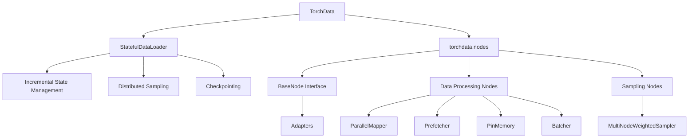
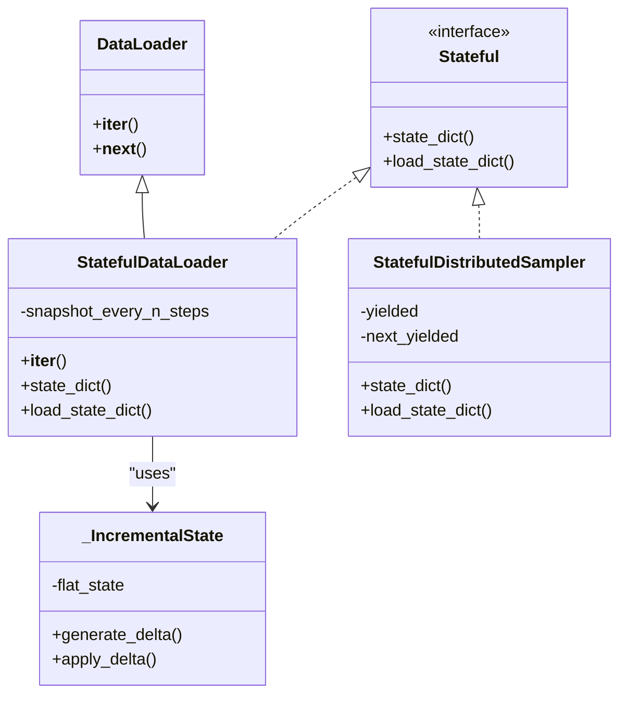
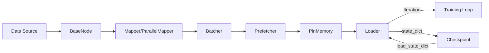
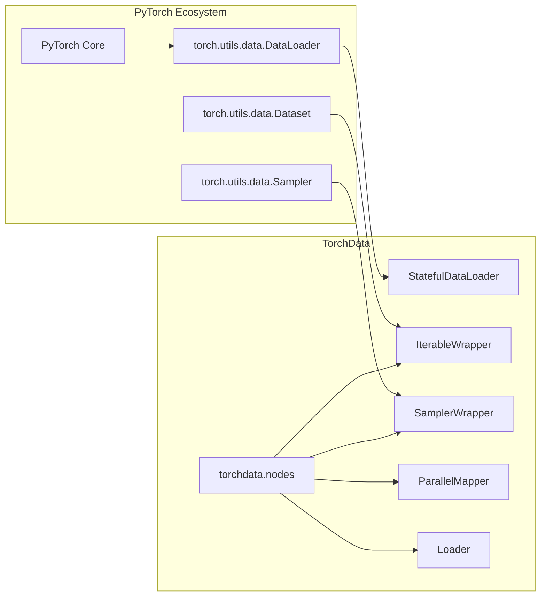

<!-- source: DeepWiki mcp.deepwiki.com · repo pytorch/data · page 1 Overview · fetched 2026-10-21 -->

# Overview

Relevant source files

The following files were used as context for generating this wiki page:

- [README.md](README.md)
- [docs/source/getting_started_with_torchdata_nodes.rst](docs/source/getting_started_with_torchdata_nodes.rst)
- [docs/source/index.rst](docs/source/index.rst)
- [docs/source/migrate_to_nodes_from_utils.rst](docs/source/migrate_to_nodes_from_utils.rst)
- [docs/source/stateful_dataloader_tutorial.rst](docs/source/stateful_dataloader_tutorial.rst)
- [docs/source/torchdata.nodes.rst](docs/source/torchdata.nodes.rst)
- [docs/source/what_is_torchdata_nodes.rst](docs/source/what_is_torchdata_nodes.rst)
- [setup.py](setup.py)
- [version.txt](version.txt)

TorchData is a Python library that extends PyTorch's data loading capabilities to make them more scalable and performant. This document provides a high-level overview of the TorchData repository, its purpose, architecture, and main components.

## Purpose and Scope

TorchData aims to enhance PyTorch's existing `torch.utils.data.DataLoader` and `torch.utils.data.Dataset/IterableDataset` by adding features that address common challenges in data loading for machine learning workflows. It focuses on two main components:

1. **StatefulDataLoader**: A drop-in replacement for the standard PyTorch DataLoader that adds checkpointing capabilities
2. **torchdata.nodes**: A framework of composable iterators that allows for flexible construction of data processing pipelines

For detailed instructions on installation, see [Installation and Getting Started](#1.2).

Sources: [README.md:8-32]()

## Core Architecture

The TorchData library consists of two primary systems: StatefulDataLoader and the nodes framework. These systems can be used independently or together, depending on your requirements.

**Core Architecture Diagram: TorchData Main Components**

Sources: [README.md:8-32](), [docs/source/index.rst:12-32]()

## Key Components

### StatefulDataLoader

`StatefulDataLoader` extends PyTorch's `DataLoader` by adding state management capabilities through `state_dict()` and `load_state_dict()` methods. This enables:

- Mid-epoch checkpointing for resuming training from exact positions
- Tracking custom iteration progress
- Capturing custom states from dataloader workers (e.g., token buffers, RNG states)

The StatefulDataLoader is designed as a drop-in replacement for the standard DataLoader, meaning it maintains the same interface while adding the stateful functionality.

**Class Diagram: StatefulDataLoader Architecture**

Sources: [README.md:19-25](), [docs/source/stateful_dataloader_tutorial.rst:1-27]()

### torchdata.nodes Framework

The `torchdata.nodes` framework provides a library of composable iterators (not iterables) that allow you to chain together common data loading and preprocessing operations. It follows a streaming programming model but also supports the traditional "sampler + Map-style" approach if needed.

Key features of the nodes framework include:

- `BaseNode` interface that all nodes implement
- Explicit state handling for checkpointing and resumption
- Parallel processing capabilities (both thread and process-based)
- Memory optimization through prefetching and pinning

**Flow Diagram: Data Processing Pipeline with torchdata.nodes**

Sources: [README.md:27-32](), [docs/source/what_is_torchdata_nodes.rst:1-167]()

## Relationship to PyTorch Ecosystem

TorchData is designed to integrate seamlessly with the existing PyTorch ecosystem, extending and enhancing its data loading capabilities rather than replacing them.

**Component Diagram: TorchData Integration with PyTorch**

Sources: [README.md:8-17](), [docs/source/getting_started_with_torchdata_nodes.rst:26-58]()

## Key Advantages

### 1. Stateful Operations

TorchData's state management capabilities allow for checkpointing and resuming data loading at precise points, which is critical for long-running training workloads that may be interrupted.

### 2. Flexible Parallelism

The nodes framework supports both thread-based and process-based parallelism, allowing users to choose the most appropriate method for their specific workload:

- **Multi-processing**: Similar to PyTorch's DataLoader, good for CPU-bound operations
- **Multi-threading**: Can be more efficient for I/O-bound operations and reduces memory overhead

### 3. Composable Design

The nodes framework provides a composable approach to building data pipelines, allowing for flexible combinations of data loading, preprocessing, and augmentation steps.

Sources: [docs/source/what_is_torchdata_nodes.rst:94-112]()

## Version Compatibility

TorchData maintains compatibility with specific versions of PyTorch and Python:

| `torch` | `torchdata` | `python` |
|---------|-------------|----------|
| `master` / `nightly` | `main` / `nightly` | `>=3.9`, `<=3.13` |
| `2.6.0` | `0.11.0` | `>=3.9`, `<=3.13` |
| `2.5.0` | `0.10.0` | `>=3.9`, `<=3.12` |
| `2.5.0` | `0.9.0` | `>=3.9`, `<=3.12` |
| `2.4.0` | `0.8.0` | `>=3.8`, `<=3.12` |
| `2.0.0` | `0.6.0` | `>=3.8`, `<=3.11` |
| `1.13.1` | `0.5.1` | `>=3.7`, `<=3.10` |

Sources: [README.md:36-51](), [setup.py:117-130]()

## Feature Status

The features in TorchData are classified into different development stages:

- **Stable**: Long-term maintained features with good performance and documentation
- **Beta**: Features that may change based on user feedback, but the team is committed to seeing them through to stability
- **Prototype**: Early-stage features for feedback and testing

Currently, both the StatefulDataLoader and torchdata.nodes framework are in Beta status.

Sources: [docs/source/index.rst:12-32]()

## Conclusion

TorchData extends PyTorch's data loading capabilities with stateful operations and a flexible, composable nodes framework. It aims to address common challenges in data loading for machine learning, particularly around checkpointing, parallelism, and complex data pipeline construction. The library is designed to integrate seamlessly with the existing PyTorch ecosystem while adding valuable new capabilities.

---

