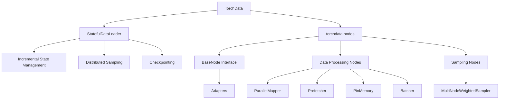
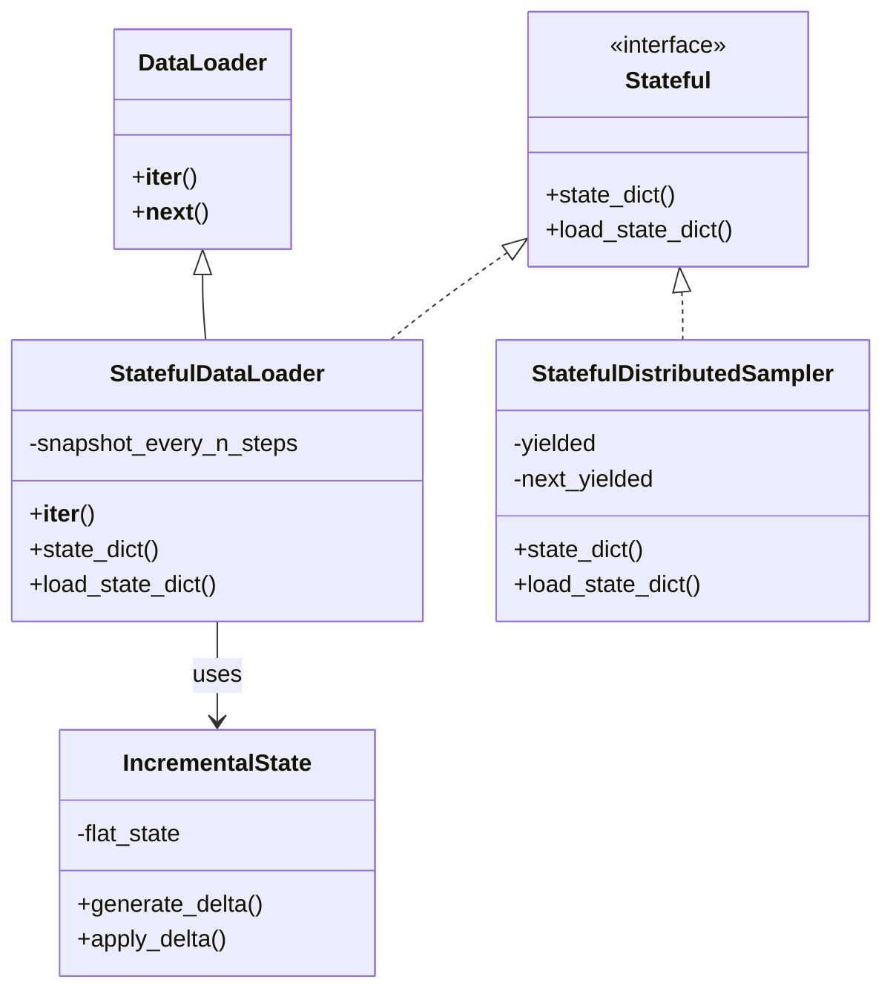
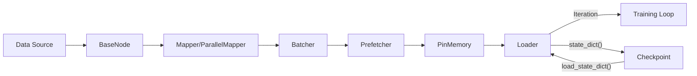
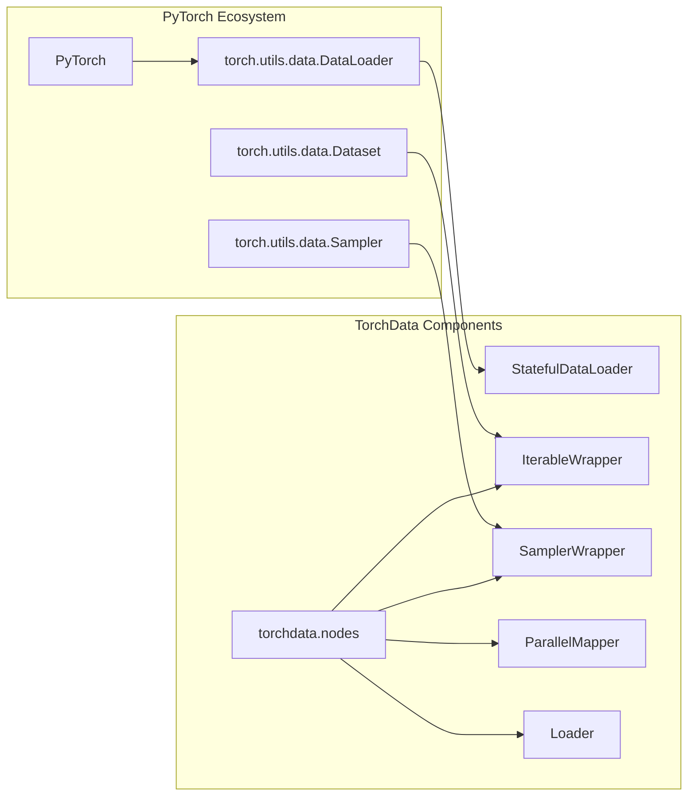

<!-- source: DeepWiki mcp.deepwiki.com · repo pytorch/data · page 1.1 Key Features and Components · fetched 2026-10-21 -->

# Key Features and Components

<details>
<summary>Relevant source files</summary>

The following files were used as context for generating this wiki page:

- [README.md](README.md)
- [docs/source/getting_started_with_torchdata_nodes.rst](docs/source/getting_started_with_torchdata_nodes.rst)
- [docs/source/index.rst](docs/source/index.rst)
- [docs/source/migrate_to_nodes_from_utils.rst](docs/source/migrate_to_nodes_from_utils.rst)
- [docs/source/stateful_dataloader_tutorial.rst](docs/source/stateful_dataloader_tutorial.rst)
- [docs/source/torchdata.nodes.rst](docs/source/torchdata.nodes.rst)
- [docs/source/what_is_torchdata_nodes.rst](docs/source/what_is_torchdata_nodes.rst)
- [setup.py](setup.py)
- [version.txt](version.txt)

</details>


## Purpose and Scope

This document provides an overview of the primary features and components of the TorchData library. It summarizes the core architectural elements and explains how they relate to each other. For installation instructions, see [Installation and Getting Started](#1.2).

## Overview of TorchData

TorchData is an extension library for PyTorch that enhances data loading capabilities by providing scalable and performant solutions beyond the standard `torch.utils.data` module. It consists of two primary systems:

1. `StatefulDataLoader`: A drop-in replacement for PyTorch's DataLoader with checkpointing capabilities
2. `torchdata.nodes`: A framework of composable iterators for building flexible data processing pipelines

## Core Architecture Diagram



Sources: [README.md:8-32]()

## StatefulDataLoader

The `StatefulDataLoader` is a drop-in replacement for PyTorch's standard DataLoader that adds state management capabilities. It provides functionality to checkpoint and resume data loading operations, which is particularly valuable for long-running training processes.

### Key Features of StatefulDataLoader

1. **State Management**: Enables mid-epoch checkpointing through `state_dict()` and `load_state_dict()` methods
2. **Custom State Tracking**: Allows tracking custom iteration progress and worker-specific states (like token buffers and RNG states)
3. **Compatibility**: Works as a direct replacement for `torch.utils.data.DataLoader`
4. **Distributed Training Support**: Handles state properly in distributed training scenarios



Sources: [README.md:14-25](), [docs/source/stateful_dataloader_tutorial.rst:1-29]()

## torchdata.nodes Framework

The `torchdata.nodes` framework provides a library of composable iterators (not iterables) that enable the construction of flexible data loading and processing pipelines. It follows a streaming programming model but also supports the "sampler + Map-style" approach.

### Key Features of torchdata.nodes

1. **Composable Iterators**: Chain together common data loading and pre-processing operations
2. **Parallelism Options**: Supports both multi-threading and multi-processing approaches
3. **State Management**: First-class support for checkpointing through `state_dict`/`load_state_dict` interface
4. **Performance Optimizations**: Includes prefetching and memory management optimizations

### Core Components of torchdata.nodes

#### BaseNode Interface

The foundation of the nodes framework is the `BaseNode` interface, which all nodes must implement. It defines the core operations:

- `next()`: Get the next item
- `reset(initial_state)`: Reset the node to its initial state or a provided state
- `get_state()`: Retrieve the current state for checkpointing

#### Adapters

Adapters bridge existing PyTorch data structures with the nodes framework:

- `IterableWrapper`: Wraps any iterable (including generators) to convert it to a BaseNode
- `SamplerWrapper`: Converts a PyTorch Sampler to a BaseNode

#### Processing Nodes

These nodes handle data transformation and processing:

- `ParallelMapper`: Applies a mapping function in parallel using either threads or processes
- `Batcher`: Groups items into batches
- `Prefetcher`: Prefetches data to improve throughput
- `PinMemory`: Pins memory for faster GPU transfer



Sources: [README.md:27-32](), [docs/source/what_is_torchdata_nodes.rst:1-167](), [docs/source/getting_started_with_torchdata_nodes.rst:1-58]()

## Component Relationships with PyTorch Ecosystem

The following diagram illustrates how TorchData components integrate with the PyTorch ecosystem:



Sources: [README.md:8-32]()

## Version Compatibility

TorchData is designed to work with specific versions of PyTorch and Python:

| torch | torchdata | python |
|-------|-----------|--------|
| master / nightly | main / nightly | >=3.9, <=3.13 |
| 2.6.0 | 0.11.0 | >=3.9, <=3.13 |
| 2.5.0 | 0.10.0 | >=3.9, <=3.12 |
| 2.5.0 | 0.9.0 | >=3.9, <=3.12 |
| 2.4.0 | 0.8.0 | >=3.8, <=3.12 |
| 2.0.0 | 0.6.0 | >=3.8, <=3.11 |
| 1.13.1 | 0.5.1 | >=3.7, <=3.10 |
| 1.12.1 | 0.4.1 | >=3.7, <=3.10 |
| 1.12.0 | 0.4.0 | >=3.7, <=3.10 |
| 1.11.0 | 0.3.0 | >=3.7, <=3.10 |

Sources: [README.md:38-52](), [version.txt:1-2](), [setup.py:101-138]()

## Why Use TorchData?

### Advantages Over Standard PyTorch DataLoading

1. **Mid-Epoch Checkpointing**: Both systems in TorchData provide robust checkpoint and resumption capabilities, critical for long-running workloads.

2. **Flexible Parallel Processing**: `torchdata.nodes` offers both multi-threading and multi-processing options, whereas standard `DataLoader` only supports multi-processing.

3. **Multi-Dataset Handling**: The `torchdata.nodes` framework makes it easier to combine multiple datasets with different sampling strategies.

4. **Composable Pipeline Design**: The nodes-based approach allows you to build complex data processing pipelines with simple, reusable components.

5. **Performance Optimizations**: With Free-Threaded Python (3.13+), the threading model can be more efficient than the multiprocessing approach, especially for I/O-bound operations.

Sources: [docs/source/what_is_torchdata_nodes.rst:25-111]()

### When to Use Each Component

- **StatefulDataLoader**: When you need checkpoint capabilities but want to maintain compatibility with existing code that uses PyTorch's DataLoader.

- **torchdata.nodes Framework**: When you need more flexible data processing pipelines, better performance control, or are working with multiple datasets.

## Usage Examples

Basic examples of using both components:

**StatefulDataLoader**:
```python
from torchdata.stateful_dataloader import StatefulDataLoader

dataloader = StatefulDataLoader(dataset, num_workers=2)
for i, batch in enumerate(dataloader):
    # Process batch
    if i == 10:
        state_dict = dataloader.state_dict()
        # Save checkpoint

# Resume from checkpoint
dataloader = StatefulDataLoader(dataset, num_workers=2)
dataloader.load_state_dict(state_dict)
```

**torchdata.nodes**:
```python
from torchdata.nodes import IterableWrapper, ParallelMapper, Loader

node = IterableWrapper(range(10))
node = ParallelMapper(node, map_fn=lambda x: x**2, num_workers=3, method="thread")
loader = Loader(node)
result = list(loader)  # [0, 1, 4, 9, 16, 25, 36, 49, 64, 81]
```

Sources: [docs/source/getting_started_with_torchdata_nodes.rst:10-25](), [docs/source/stateful_dataloader_tutorial.rst:4-26]()

---

