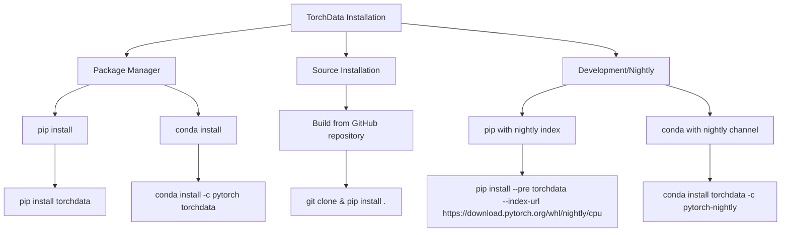
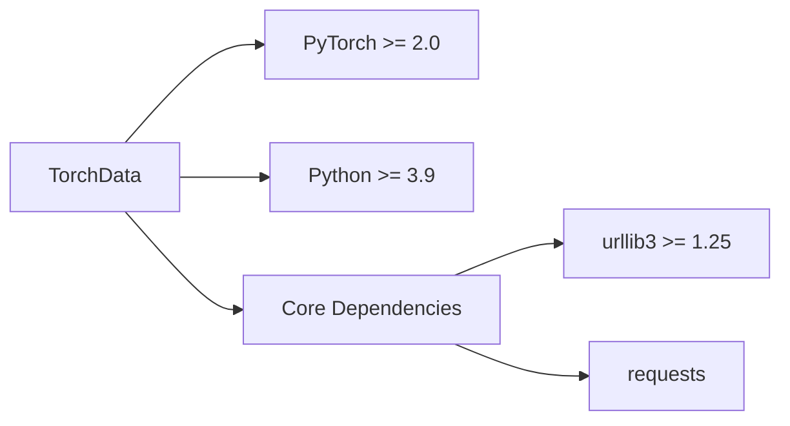
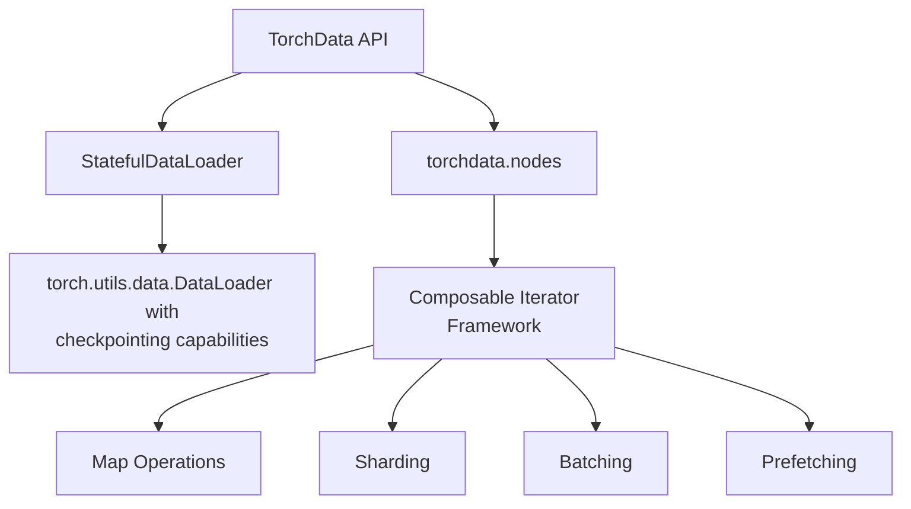

<!-- source: DeepWiki mcp.deepwiki.com · repo pytorch/data · page 1.2 Installation and Getting Started · fetched 2026-10-21 -->

# Installation and Getting Started

<details>
<summary>Relevant source files</summary>

The following files were used as context for generating this wiki page:

- [README.md](README.md)
- [packaging/torchdata/meta.yaml](packaging/torchdata/meta.yaml)
- [setup.py](setup.py)
- [test/_utils/_common_utils_for_test.py](test/_utils/_common_utils_for_test.py)
- [version.txt](version.txt)

</details>


This document provides comprehensive instructions for installing TorchData and guides users through initial setup and basic usage. TorchData is a PyTorch extension library that provides composable data loading and processing primitives designed to enable flexible and high-performance data pipelines. For details about the specific components of TorchData, see [Key Features and Components](#1.1) and for in-depth usage of StatefulDataLoader, see [StatefulDataLoader](#2).

## Version Compatibility

Before installation, ensure compatibility between TorchData, PyTorch, and Python versions. The table below shows the supported version combinations:

| `torch` | `torchdata` | `python` |
| ------- | ----------- | -------- |
| `master` / `nightly` | `main` / `nightly` | `>=3.9`, `<=3.13` |
| `2.6.0` | `0.11.0` | `>=3.9`, `<=3.13` |
| `2.5.0` | `0.10.0` | `>=3.9`, `<=3.12` |
| `2.5.0` | `0.9.0` | `>=3.9`, `<=3.12` |
| `2.4.0` | `0.8.0` | `>=3.8`, `<=3.12` |
| `2.0.0` | `0.6.0` | `>=3.8`, `<=3.11` |
| `1.13.1` | `0.5.1` | `>=3.7`, `<=3.10` |
| `1.12.1` | `0.4.1` | `>=3.7`, `<=3.10` |

Sources: [README.md:36-51]()

## Installation Methods

TorchData can be installed through several methods, as illustrated in the following diagram:



Sources: [README.md:52-107](), [setup.py:100-138]()

### Using pip

For most users, installing via pip is the simplest approach:

```bash
pip install torchdata
```

### Using conda

For conda users, install from the PyTorch channel:

```bash
conda install -c pytorch torchdata
```

### From Source

For the latest features or to contribute, you can install from source:

1. Clone the repository
2. Install from the local copy:

```bash
pip install .
```

If you encounter build errors, installing the nightly version of PyTorch may resolve compatibility issues.

### From Nightly Builds

For access to the latest developments (potentially unstable):

Using pip:
```bash
pip install --pre torchdata --index-url https://download.pytorch.org/whl/nightly/cpu
```

Using conda:
```bash
conda install torchdata -c pytorch-nightly
```

Sources: [README.md:52-107](), [setup.py:100-138]()

## Environment Setup

Before installing TorchData, it's recommended to set up a dedicated environment:

### Using conda
```bash
conda create --name torchdata
conda activate torchdata
```

### Using venv
```bash
python -m venv torchdata-env
source torchdata-env/bin/activate  # On Windows, use: torchdata-env\Scripts\activate
```

Sources: [README.md:52-68]()

## Dependencies

TorchData relies on the following key dependencies:



Sources: [setup.py:69-73](), [packaging/torchdata/meta.yaml:10-24]()

## Verifying Installation

After installation, you can verify TorchData is working correctly by importing its main components:

```python
import torchdata
from torchdata.stateful_dataloader import StatefulDataLoader

print(f"TorchData version: {torchdata.__version__}")
```

Sources: [packaging/torchdata/meta.yaml:32-34]()

## Getting Started

Once TorchData is installed, you can begin using its two primary components:



Sources: [README.md:8-32]()

### Using StatefulDataLoader

StatefulDataLoader is a drop-in replacement for PyTorch's DataLoader that adds checkpointing functionality:

```python
from torchdata.stateful_dataloader import StatefulDataLoader
import torch.utils.data as data

# Create a dataset
dataset = data.TensorDataset(torch.randn(100, 3), torch.randint(0, 2, (100,)))

# Use StatefulDataLoader instead of DataLoader
dataloader = StatefulDataLoader(
    dataset,
    batch_size=16,
    shuffle=True
)

# Train with checkpointing
for epoch in range(epochs):
    for batch_idx, (data, target) in enumerate(dataloader):
        # Training code here
        
        # Periodically save state
        if batch_idx % save_interval == 0:
            checkpoint = {
                "model": model.state_dict(),
                "optimizer": optimizer.state_dict(),
                "dataloader": dataloader.state_dict(),  # Save dataloader state
            }
            torch.save(checkpoint, f"checkpoint_e{epoch}_b{batch_idx}.pt")
```

### Using torchdata.nodes

The nodes framework provides composable iterators for building efficient data pipelines:

```python
from torchdata.nodes import IterableWrapper, Mapper, Batcher, Prefetcher

# Create a simple pipeline
data_source = range(1000)
pipeline = IterableWrapper(data_source)
pipeline = Mapper(pipeline, lambda x: x * 2)    # Map operation
pipeline = Batcher(pipeline, batch_size=32)     # Batch data
pipeline = Prefetcher(pipeline)                 # Prefetch batches

# Iterate through the pipeline
for batch in pipeline:
    # Use batch for training
    pass
```

## Platform Support

TorchData is compatible with the following platforms:

- Linux
- macOS (including Apple Silicon M1)
- Windows

Sources: [setup.py:122-124](), [test/_utils/_common_utils_for_test.py:17-21]()

## Next Steps

To learn more about TorchData's capabilities:

1. For in-depth usage of StatefulDataLoader, see [StatefulDataLoader](#2)
2. For details on the nodes framework, see [torchdata.nodes Framework](#3)
3. For contributing to TorchData, see [Development and Contribution](#4)

---

