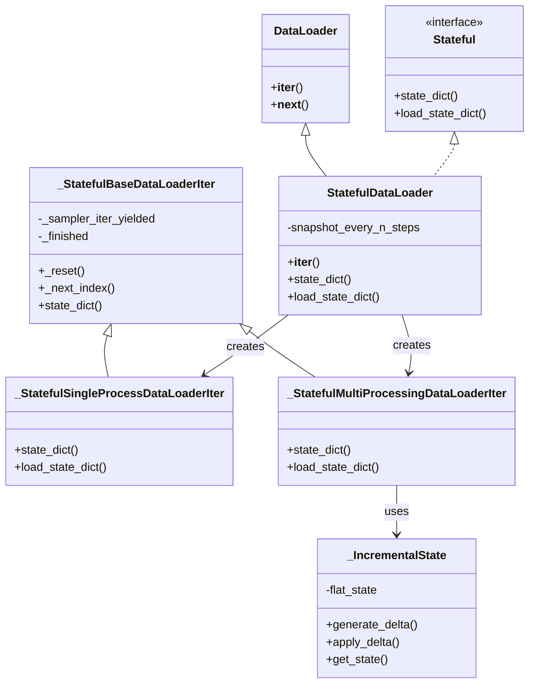
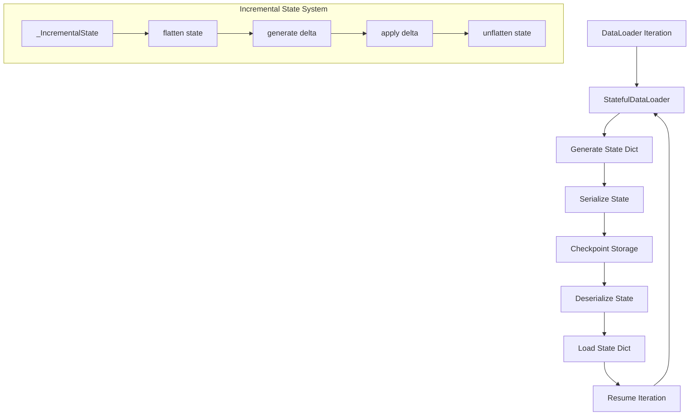
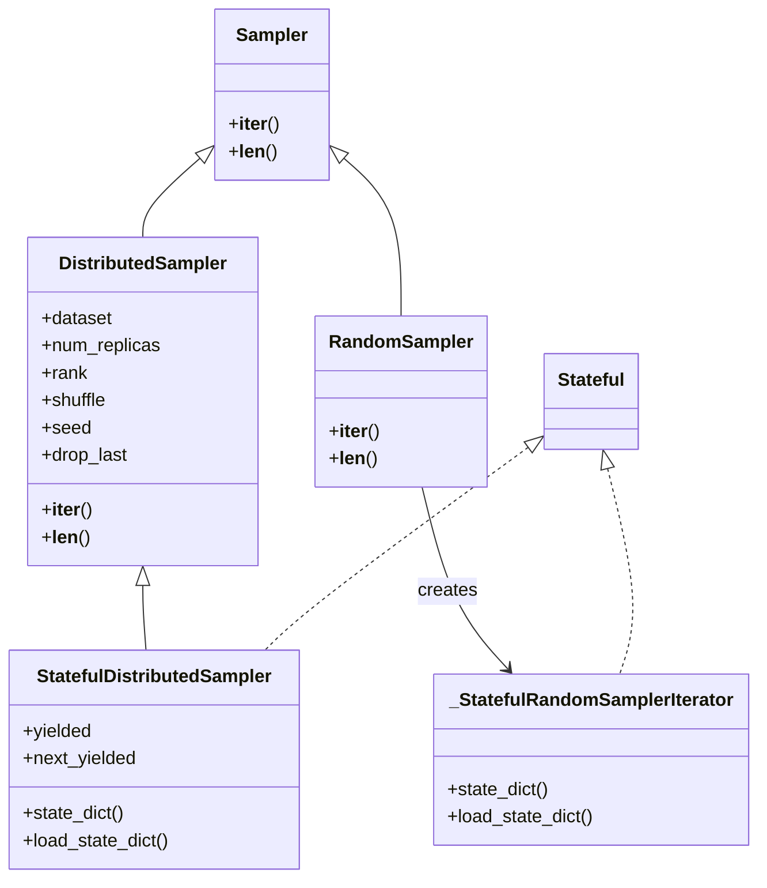
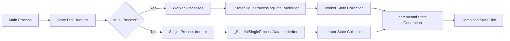
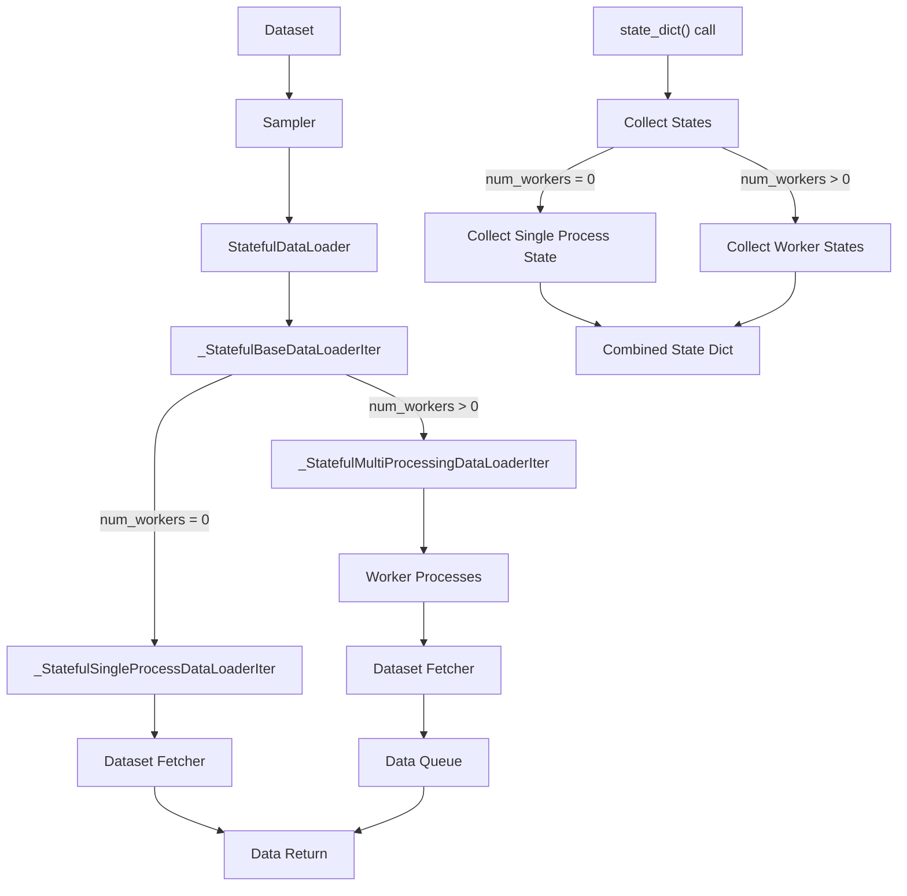

<!-- source: DeepWiki mcp.deepwiki.com · repo pytorch/data · page 2 StatefulDataLoader · fetched 2026-10-21 -->

# StatefulDataLoader

<details>
<summary>Relevant source files</summary>

The following files were used as context for generating this wiki page:

- [.github/workflows/stateful_dataloader_ci.yml](.github/workflows/stateful_dataloader_ci.yml)
- [test/stateful_dataloader/test_dataloader.py](test/stateful_dataloader/test_dataloader.py)
- [test/stateful_dataloader/test_incremental_state.py](test/stateful_dataloader/test_incremental_state.py)
- [test/stateful_dataloader/test_sampler.py](test/stateful_dataloader/test_sampler.py)
- [test/stateful_dataloader/test_state_dict.py](test/stateful_dataloader/test_state_dict.py)
- [torchdata/stateful_dataloader/__init__.py](torchdata/stateful_dataloader/__init__.py)
- [torchdata/stateful_dataloader/incremental_state.py](torchdata/stateful_dataloader/incremental_state.py)
- [torchdata/stateful_dataloader/sampler.py](torchdata/stateful_dataloader/sampler.py)
- [torchdata/stateful_dataloader/stateful.py](torchdata/stateful_dataloader/stateful.py)
- [torchdata/stateful_dataloader/stateful_dataloader.py](torchdata/stateful_dataloader/stateful_dataloader.py)
- [torchdata/stateful_dataloader/worker.py](torchdata/stateful_dataloader/worker.py)

</details>


The StatefulDataLoader is a drop-in replacement for PyTorch's DataLoader that adds checkpointing and state management capabilities. It enables mid-epoch resumption of data loading through the implementation of state serialization and deserialization methods.

## Overview

StatefulDataLoader maintains the same API as the PyTorch DataLoader while adding the ability to save and restore the internal state of data loading processes. This is particularly useful for long-running training jobs where checkpointing is needed to resume from the exact position in the data iteration sequence.

Sources: [torchdata/stateful_dataloader/stateful_dataloader.py:93-188](). [torchdata/stateful_dataloader/__init__.py:8-10]()

## Architecture



Sources: [torchdata/stateful_dataloader/stateful_dataloader.py:93-188](), [torchdata/stateful_dataloader/stateful_dataloader.py:429-580](), [torchdata/stateful_dataloader/incremental_state.py:60-110]()

## Key Features

### Incremental State Management

StatefulDataLoader uses an incremental state system that efficiently tracks changes to the dataloader's state. Instead of serializing the entire state on every checkpoint, it generates deltas (changes) between states, making state transfer more efficient.



Sources: [torchdata/stateful_dataloader/incremental_state.py:60-110](), [torchdata/stateful_dataloader/incremental_state.py:113-181]()

### Distributed Sampling

StatefulDataLoader supports distributed training through `StatefulDistributedSampler`, which extends PyTorch's DistributedSampler with state management capabilities.



Sources: [torchdata/stateful_dataloader/sampler.py:77-112](), [torchdata/stateful_dataloader/sampler.py:182-217]()

### Worker State Management

StatefulDataLoader handles complex state management across multiple worker processes:



Sources: [torchdata/stateful_dataloader/stateful_dataloader.py:415-426](), [torchdata/stateful_dataloader/stateful_dataloader.py:429-580](), [torchdata/stateful_dataloader/worker.py:71-270]()

## Usage

### Basic Usage

StatefulDataLoader can be used as a direct replacement for torch's DataLoader:

```python
from torchdata.stateful_dataloader import StatefulDataLoader

# Create a StatefulDataLoader
dataloader = StatefulDataLoader(
    dataset=my_dataset,
    batch_size=32,
    shuffle=True
)

# Train for a few batches
for i, batch in enumerate(dataloader):
    if i > 10:
        break
    # Process batch...

# Save the state
state_dict = dataloader.state_dict()
torch.save(state_dict, "dataloader_checkpoint.pt")

# Resume from the saved state
new_dataloader = StatefulDataLoader(
    dataset=my_dataset,
    batch_size=32,
    shuffle=True
)
new_dataloader.load_state_dict(torch.load("dataloader_checkpoint.pt"))

# Continue training from where you left off
for batch in new_dataloader:
    # Process batch...
```

### Configuration Options

StatefulDataLoader accepts all the parameters of PyTorch's DataLoader plus:

| Parameter | Description | Default |
|-----------|-------------|---------|
| `snapshot_every_n_steps` | How often to transfer state from workers to the dataloader | 1 |

The `snapshot_every_n_steps` parameter is particularly useful for controlling the overhead of state transfer when working with large states or many workers.

Sources: [torchdata/stateful_dataloader/stateful_dataloader.py:93-188](), [torchdata/stateful_dataloader/stateful_dataloader.py:212-213]()

## Implementation Details

### Stateful Interface

The `Stateful` protocol defines the interface for objects that can serialize and deserialize their state:

```python
@runtime_checkable
class Stateful(Protocol):
    def state_dict(self) -> Dict[str, Any]:
        ...

    def load_state_dict(self, state_dict: Dict[str, Any]) -> None:
        ...
```

Sources: [torchdata/stateful_dataloader/stateful.py:10-16]()

### State Dictionary Structure

The state dictionary contains information about:

1. The current iterator position
2. Sampler state (if applicable)
3. Dataset state (if the dataset implements `Stateful`)
4. Worker states (for multi-processing)

### Data Flow and Processing



Sources: [torchdata/stateful_dataloader/stateful_dataloader.py:381-409](), [torchdata/stateful_dataloader/stateful_dataloader.py:581-714]()

### Incremental State Management

The `_IncrementalState` class provides efficient state tracking by:

1. Flattening nested dictionaries
2. Tracking changes between states
3. Generating delta updates
4. Applying deltas to restore states

This approach minimizes the amount of data transferred between workers and the main process.

Sources: [torchdata/stateful_dataloader/incremental_state.py:18-53](), [torchdata/stateful_dataloader/incremental_state.py:60-110]()

### Worker Communication

For multi-process data loading, StatefulDataLoader handles communication with worker processes through:

1. Queue-based message passing
2. Incremental state deltas to minimize transfer overhead
3. Proper synchronization to ensure state consistency

Sources: [torchdata/stateful_dataloader/worker.py:71-270](), [torchdata/stateful_dataloader/stateful_dataloader.py:581-714]()

## Testing and Compatibility

StatefulDataLoader is extensively tested across different platforms (Windows, macOS, Linux) and Python versions (3.9-3.13). The tests verify the correct behavior in various scenarios:

- Single-process vs multi-process data loading
- Different types of datasets (Map-style, Iterable)
- Different samplers
- Interrupted iterations
- State saving and loading

Sources: [test/stateful_dataloader/test_state_dict.py:23-1116](), [test/stateful_dataloader/test_sampler.py:19-237](), [.github/workflows/stateful_dataloader_ci.yml:1-106]()

---

