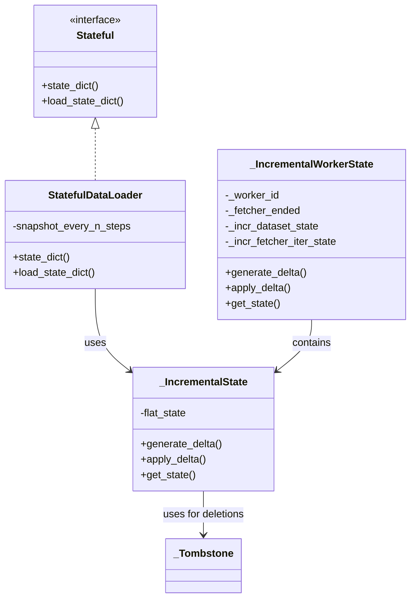
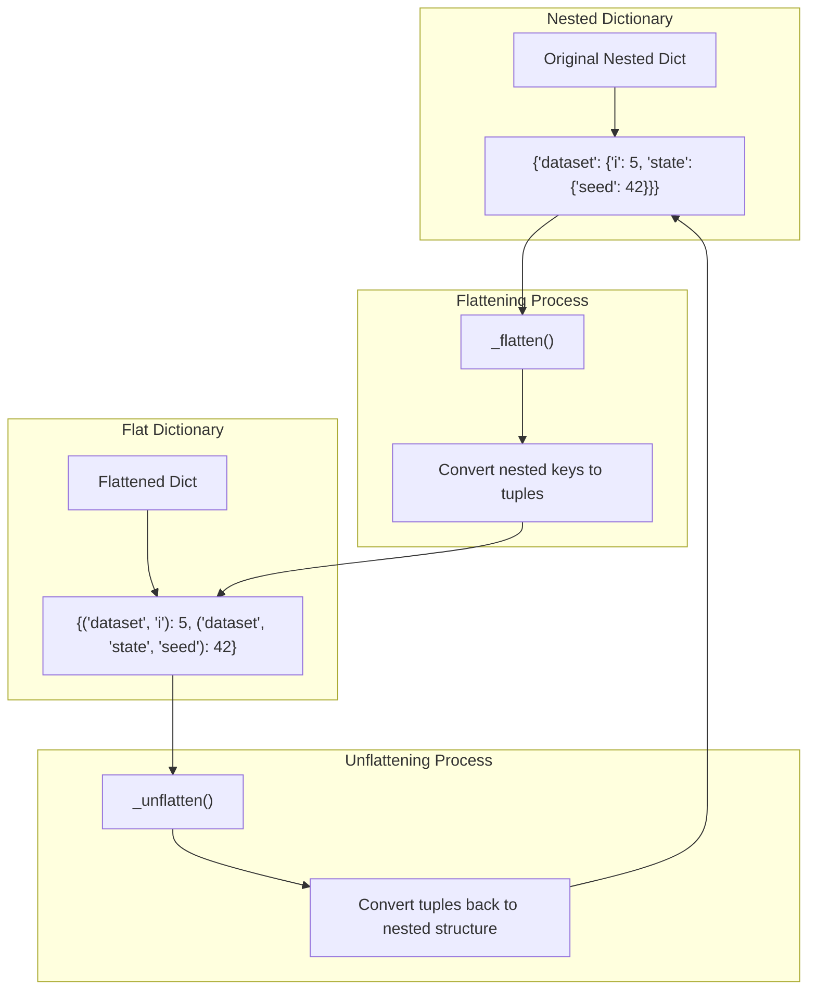
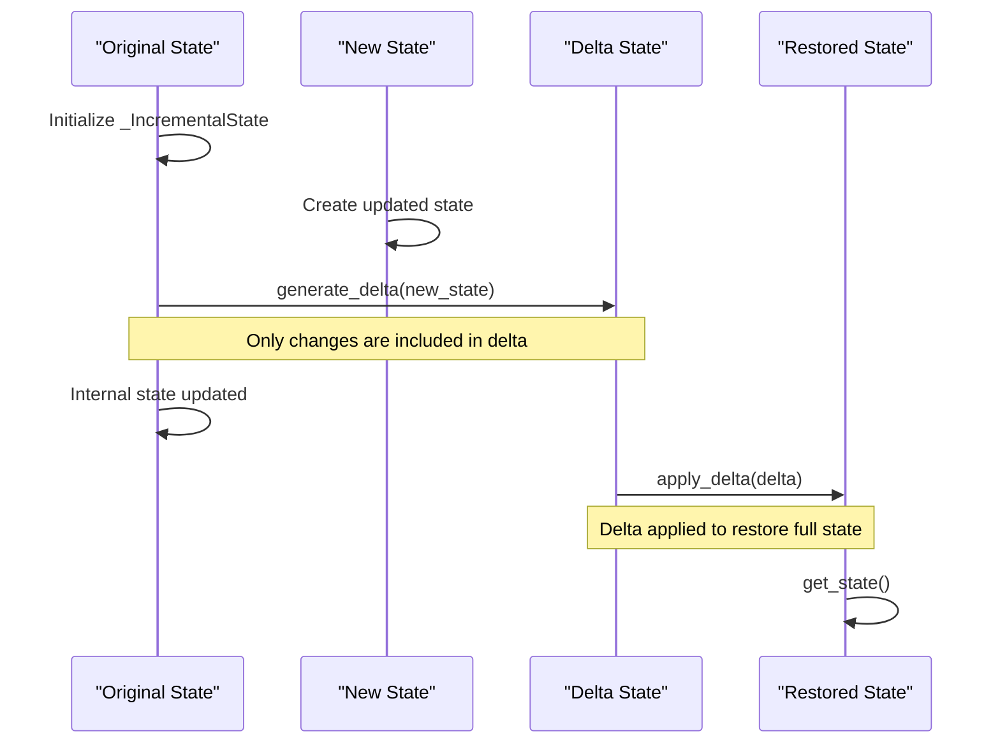
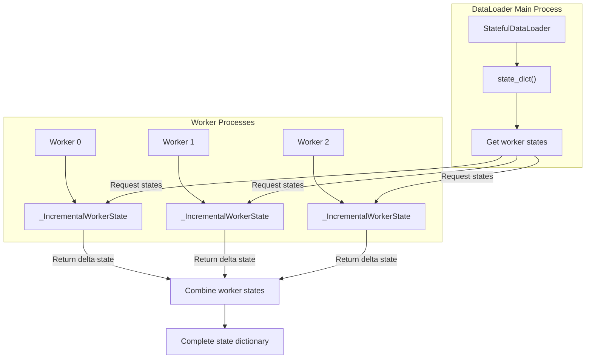
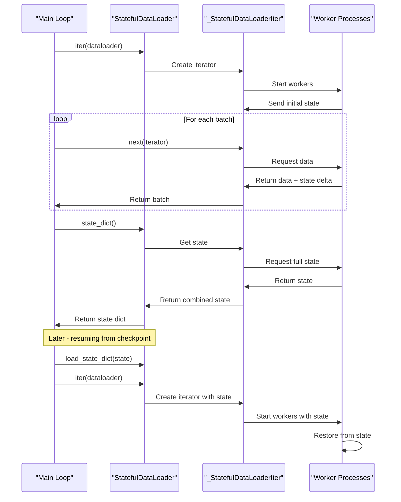
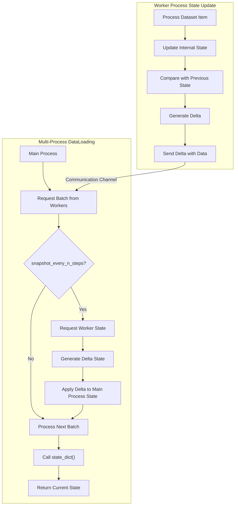
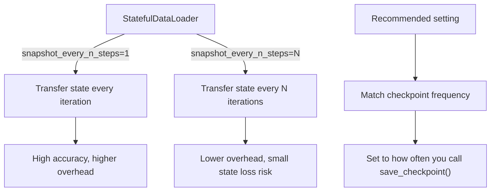

<!-- source: DeepWiki mcp.deepwiki.com · repo pytorch/data · page 2.1 Incremental State Management · fetched 2026-10-21 -->

# Incremental State Management

Relevant source files

The following files were used as context for generating this wiki page:

- [test/stateful_dataloader/test_incremental_state.py](test/stateful_dataloader/test_incremental_state.py)
- [test/stateful_dataloader/test_state_dict.py](test/stateful_dataloader/test_state_dict.py)
- [torchdata/stateful_dataloader/__init__.py](torchdata/stateful_dataloader/__init__.py)
- [torchdata/stateful_dataloader/incremental_state.py](torchdata/stateful_dataloader/incremental_state.py)
- [torchdata/stateful_dataloader/stateful_dataloader.py](torchdata/stateful_dataloader/stateful_dataloader.py)
- [torchdata/stateful_dataloader/worker.py](torchdata/stateful_dataloader/worker.py)

This document explains the incremental state management system used by the StatefulDataLoader in TorchData. This system enables efficient serialization, transfer, and restoration of state between worker processes and the main process, making checkpointing and resumption of data loading possible without transferring redundant data.

## Purpose and Scope

The incremental state management system allows TorchData to:

1. Track state changes across worker processes in a memory-efficient manner
2. Generate compact "delta" states that only contain the changes since the last snapshot
3. Efficiently reconstruct complete state dictionaries from incremental updates
4. Handle complex nested state structures including PyTorch tensors

This system is specifically used by the [StatefulDataLoader](#2) to implement checkpointing and resumption capabilities. It addresses the challenge of maintaining consistent state across multiple processes, especially in distributed training scenarios.

Sources: [torchdata/stateful_dataloader/incremental_state.py:1-182]()</source>

## Core Components

The incremental state management system consists of these key components:

1. `_IncrementalState`: Core class that tracks state and generates deltas
2. `_IncrementalWorkerState`: Specialized state manager for worker processes
3. `_Tombstone`: Marker class for deleted keys in state dictionaries
4. Helper functions for flattening and unflattening state dictionaries

Sources: 
- [torchdata/stateful_dataloader/incremental_state.py:60-111]()
- [torchdata/stateful_dataloader/incremental_state.py:113-181]()
- [torchdata/stateful_dataloader/incremental_state.py:56-57]()

## State Flattening Mechanism

A fundamental concept in the incremental state system is the flattening of nested dictionaries into a simple key-tuple/value structure.

This flattening approach enables:
1. Easier comparison between state dictionaries
2. Direct addressing of deeply nested values
3. Efficient detection of changes in complex structures

Sources:
- [torchdata/stateful_dataloader/incremental_state.py:18-53]()
- [test/stateful_dataloader/test_incremental_state.py:27-56]()

## Delta Generation and Application

The delta generation process:

1. A new state dictionary is compared against the current internal state
2. Only the keys with changed values are included in the delta
3. Keys present in the original but not in the new state are marked with `_Tombstone`
4. PyTorch tensors are compared using `torch.equal()`
5. The internal state is updated to match the new state

Sources:
- [torchdata/stateful_dataloader/incremental_state.py:64-96]()
- [torchdata/stateful_dataloader/incremental_state.py:98-110]()
- [test/stateful_dataloader/test_incremental_state.py:58-115]()

## Worker State Management

Worker state contains three primary components:

1. **Worker ID**: An identifier for the specific worker process
2. **Dataset State**: State of the dataset object in the worker
3. **Fetcher State**: State of the dataset iterator and fetch status

The `_IncrementalWorkerState` class manages these components separately, applying state changes to each component individually.

Sources:
- [torchdata/stateful_dataloader/incremental_state.py:113-181]()
- [torchdata/stateful_dataloader/worker.py:272-292]()
- [test/stateful_dataloader/test_incremental_state.py:118-210]()

## Integration with StatefulDataLoader

The `StatefulDataLoader` uses the incremental state system to:

1. Collect and combine state from multiple workers
2. Generate compact snapshots at configurable intervals (`snapshot_every_n_steps`)
3. Resume data loading from exactly where it left off
4. Maintain consistent state across worker processes

Sources:
- [torchdata/stateful_dataloader/stateful_dataloader.py:381-426]()
- [torchdata/stateful_dataloader/stateful_dataloader.py:581-866]()
- [test/stateful_dataloader/test_state_dict.py:203-270]()

## State Update Flow

The state update process:

1. Workers process data and update their internal state
2. Based on `snapshot_every_n_steps`, the main process may request state updates
3. Workers generate delta states and send them with the data
4. The main process applies these deltas to its snapshot of the worker states
5. When `state_dict()` is called, the complete state is returned

Sources:
- [torchdata/stateful_dataloader/stateful_dataloader.py:415-426]()
- [torchdata/stateful_dataloader/worker.py:250-262]()
- [test/stateful_dataloader/test_state_dict.py:945-995]()

## Special Case Handling

The incremental state system handles several special cases to ensure robust state management:

| Case | Handling Strategy |
|------|------------------|
| PyTorch Tensors | Compared using `torch.equal()` instead of `==` |
| Deleted Keys | Marked with `_Tombstone` objects in delta state |
| None Values | Properly tracked and updated in the state |
| Complex Nested Structures | Flattened to tuple-keys for efficient comparison |
| Large State Objects | Only changed components are transferred |
| Worker Process Death | Graceful recovery using last known state |

Sources:
- [torchdata/stateful_dataloader/incremental_state.py:83-93]()
- [torchdata/stateful_dataloader/incremental_state.py:78-80]()
- [test/stateful_dataloader/test_incremental_state.py:173-189]()
- [test/stateful_dataloader/test_incremental_state.py:96-115]()

## Performance Optimization

The `snapshot_every_n_steps` parameter in `StatefulDataLoader` controls how frequently state is transferred from workers to the main process. This provides a trade-off between:

1. Checkpoint accuracy (smaller values = more frequent updates)
2. Communication overhead (larger values = less frequent state transfers)

For optimal performance:
- Set `snapshot_every_n_steps` to match how frequently you checkpoint your training
- For very large datasets with small state, higher values are appropriate
- For critical jobs where every sample matters, use lower values

Sources:
- [torchdata/stateful_dataloader/stateful_dataloader.py:192-213]()
- [test/stateful_dataloader/test_state_dict.py:272-291]()

## Conclusion

The incremental state management system in TorchData provides an efficient and reliable mechanism for maintaining state across distributed and multiprocessing data loading scenarios. It minimizes communication overhead while ensuring that state can be properly saved and restored, enabling robust checkpointing and resumption of data loading.

This system is a key component of TorchData's ability to support long-running training jobs that may be interrupted and need to resume from exactly where they left off.

---

