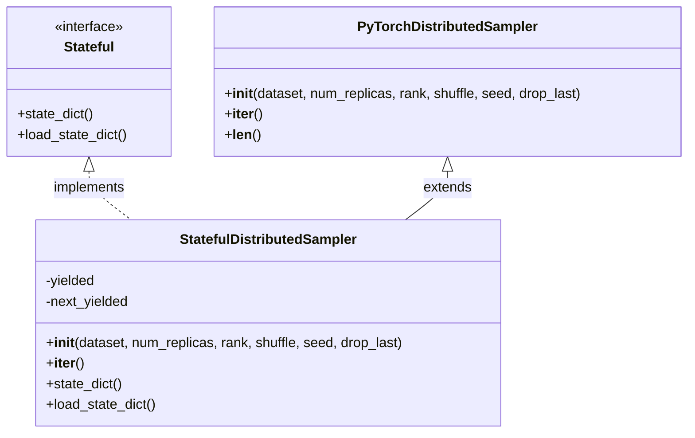
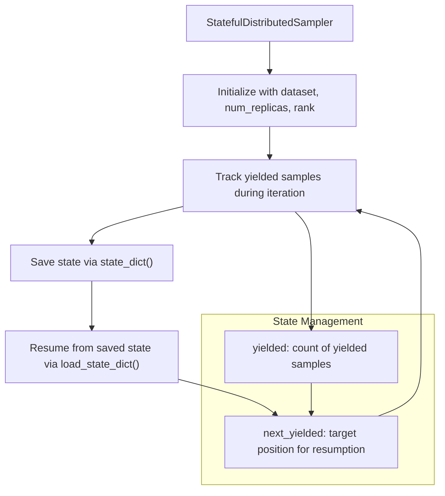
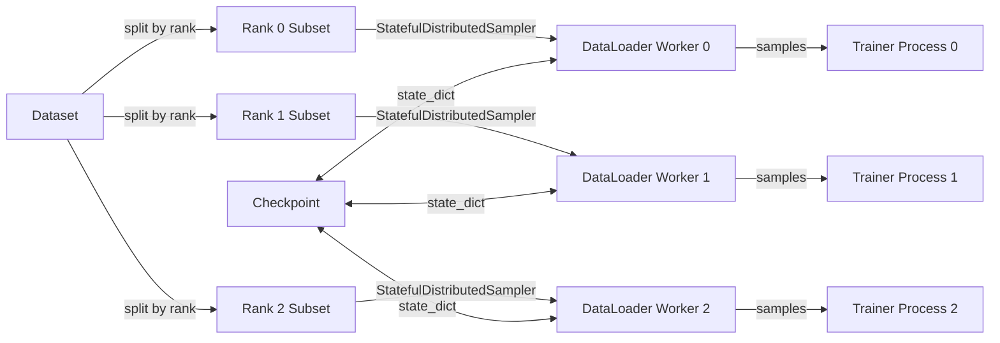
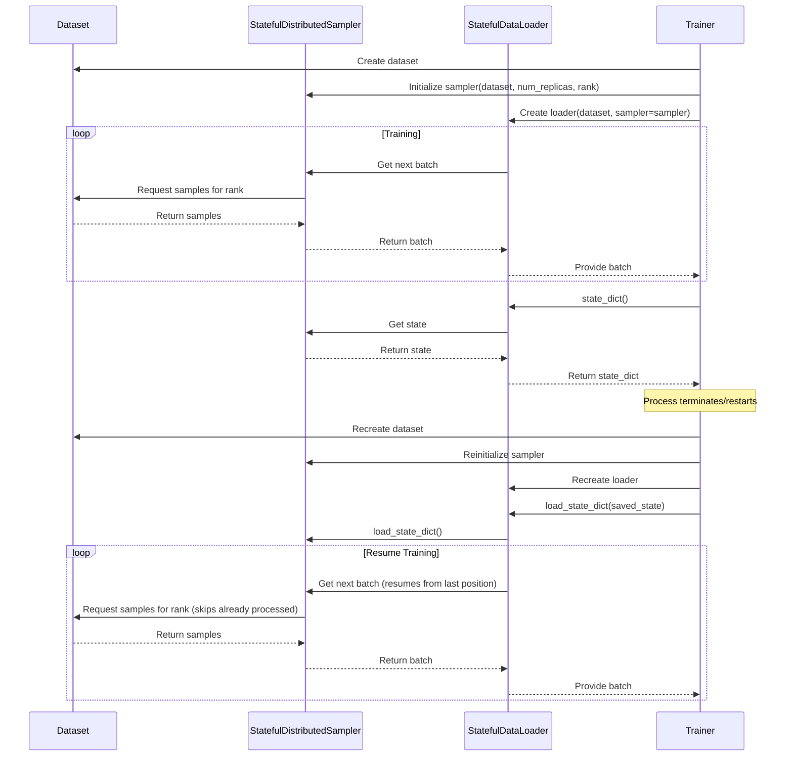

<!-- source: DeepWiki mcp.deepwiki.com · repo pytorch/data · page 2.2 Distributed Training Support · fetched 2026-10-21 -->

# Distributed Training Support

<details>
<summary>Relevant source files</summary>

The following files were used as context for generating this wiki page:

- [.github/workflows/nodes_ci.yml](.github/workflows/nodes_ci.yml)
- [.github/workflows/stateful_dataloader_ci.yml](.github/workflows/stateful_dataloader_ci.yml)
- [test/nodes/__init__.py](test/nodes/__init__.py)
- [test/requirements.txt](test/requirements.txt)
- [test/stateful_dataloader/test_dataloader.py](test/stateful_dataloader/test_dataloader.py)
- [test/stateful_dataloader/test_hugging_face.py](test/stateful_dataloader/test_hugging_face.py)
- [test/stateful_dataloader/test_sampler.py](test/stateful_dataloader/test_sampler.py)
- [torchdata/stateful_dataloader/sampler.py](torchdata/stateful_dataloader/sampler.py)
- [torchdata/stateful_dataloader/stateful.py](torchdata/stateful_dataloader/stateful.py)

</details>


This page documents the distributed training capabilities provided by TorchData's StatefulDataLoader system. It focuses on how TorchData extends PyTorch's data loading mechanisms to support stateful distributed training, allowing for checkpoint and resumption of training across multiple nodes and processes.

For general information about StatefulDataLoader, see [StatefulDataLoader](#2), and for information about incremental state management, see [Incremental State Management](#2.1).

## Overview of Distributed Training Support

TorchData enhances distributed training workflows by providing the StatefulDistributedSampler, which adds checkpointing capabilities to distributed data sampling. This allows training jobs to be paused and resumed without losing track of which samples have been processed by each worker in a distributed training setup.

### Key Components

- **StatefulDistributedSampler**: Extends PyTorch's DistributedSampler with state tracking for checkpointing
- **State Dictionary Interface**: Standardized interface for saving and loading sampler state
- **Integration with StatefulDataLoader**: Seamless interoperability with the checkpointing system

### Architectural Relationship



Sources: [torchdata/stateful_dataloader/sampler.py:182-216](), [torchdata/stateful_dataloader/stateful.py:10-16]()

## StatefulDistributedSampler

The `StatefulDistributedSampler` is the primary class enabling distributed training support in TorchData. It extends PyTorch's DistributedSampler with additional state tracking capabilities.

### Implementation Details



Sources: [torchdata/stateful_dataloader/sampler.py:182-216]()

### Key Features

1. **Stateful Iteration**: Tracks how many samples have been yielded during iteration.
2. **Checkpoint Support**: Provides state_dict() and load_state_dict() methods to save and restore iteration state.
3. **Distributed-Aware**: Maintains proper sample distribution across multiple workers/nodes.
4. **Consistent with PyTorch**: Supports the same configuration options as PyTorch's DistributedSampler (shuffle, seed, drop_last).

### State Tracking

The sampler maintains two key state variables:
- `yielded`: Counter for the number of samples yielded during iteration
- `next_yielded`: Position indicator used during state restoration

This state information can be saved and loaded through the standard Stateful interface, making it compatible with checkpointing systems.

Sources: [torchdata/stateful_dataloader/sampler.py:182-196]()

## Distributed Data Flow

The following diagram illustrates how data is distributed across workers in a distributed training setup using StatefulDistributedSampler:



Sources: [test/stateful_dataloader/test_sampler.py:194-208]()

## Using StatefulDistributedSampler

### Basic Usage

To use StatefulDistributedSampler in a distributed training setup:

1. Create the sampler with the appropriate parameters for your distributed environment
2. Pass the sampler to StatefulDataLoader
3. Use checkpoint/resume functionality through state_dict() and load_state_dict()

Here's a conceptual example of the workflow:



Sources: [test/stateful_dataloader/test_sampler.py:66-87]()

### Configuration Options

The StatefulDistributedSampler inherits all configuration options from PyTorch's DistributedSampler and can be initialized with:

| Parameter | Type | Description |
|-----------|------|-------------|
| dataset | Dataset | Dataset used for sampling |
| num_replicas | int | Number of distributed processes |
| rank | int | Rank of the current process |
| shuffle | bool | Whether to shuffle the data |
| seed | int | Random seed for reproducibility |
| drop_last | bool | Whether to drop the last incomplete batch |

Sources: [torchdata/stateful_dataloader/sampler.py:183-196](), [test/stateful_dataloader/test_sampler.py:47-64]()

## State Management in Distributed Training

### State Dictionary Format

The state dictionary for StatefulDistributedSampler is simple and contains:

```
{
    "yielded": <int>  # Number of samples yielded so far
}
```

This minimal representation ensures efficient serialization and storage of checkpoint state.

Sources: [torchdata/stateful_dataloader/sampler.py:208-216]()

### State Loading Process

When a state dictionary is loaded:

1. The next_yielded value is set to the loaded yielded count
2. On the next iteration, the sampler will skip to this position
3. The next_yielded is then reset to None after being applied

This approach ensures that when training resumes, the sampler continues from exactly where it left off, without duplicating or missing any samples.

Sources: [torchdata/stateful_dataloader/sampler.py:196-203](), [test/stateful_dataloader/test_sampler.py:104-116]()

## Effect of shuffle and drop_last Parameters

### Data Shuffling

When `shuffle=True`:
- Data is randomly shuffled for each epoch
- Each process gets a different subset of the data
- The seed parameter ensures reproducibility across runs

When `shuffle=False`:
- Data is processed in the original order
- Data is split evenly among processes based on rank
- Each process gets consecutive chunks of the dataset

Sources: [test/stateful_dataloader/test_sampler.py:154-192]()

### drop_last Parameter

The `drop_last` parameter controls how the dataset is divided among processes when the dataset size is not evenly divisible by the number of processes:

- `drop_last=True`: Drops the last incomplete batch, ensuring all batches across all processes have the same size
- `drop_last=False`: Keeps the last incomplete batch, ensuring all data points are used

This difference is particularly important in distributed training to ensure all processes remain in sync.

Sources: [test/stateful_dataloader/test_sampler.py:117-153]()

## Testing and Validation

The StatefulDistributedSampler functionality is rigorously tested to ensure:

1. Proper initialization with various parameters
2. Consistent state dict saving and loading
3. Correct behavior with different shuffle and drop_last settings
4. Even distribution of data across processes
5. Seed reproducibility for deterministic behavior

The test suite includes tests for both interaction with StatefulDataLoader and standalone sampler functionality.

Sources: [test/stateful_dataloader/test_sampler.py](), [test/stateful_dataloader/test_dataloader.py](), [test/stateful_dataloader/test_hugging_face.py]()

## Integration with Other Systems

The StatefulDistributedSampler can be integrated with various distributed training frameworks and data sources. For instance, the system has been tested with:

- HuggingFace datasets for NLP workloads
- Standard PyTorch datasets and samplers
- Multi-node distributed training setups

Sources: [test/stateful_dataloader/test_hugging_face.py]()

## Common Patterns and Best Practices

1. **Save Checkpoints Regularly**: In long-running distributed training jobs, save state_dict at regular intervals
2. **Use Consistent Seeds**: When resuming training, use the same seed to ensure consistent shuffling
3. **Handle Failures Gracefully**: Be prepared to resume from the latest checkpoint if any worker fails
4. **Consider Worker Count Changes**: If resuming with a different number of workers, you may need to adjust your approach

Sources: [test/stateful_dataloader/test_sampler.py:210-234]()

## Limitations and Considerations

- State tracking adds a small overhead to the sampling process
- Stateful samplers require more careful handling when used with dynamic datasets
- When used with multiple workers, all workers must resume from the same state

Sources: [torchdata/stateful_dataloader/sampler.py](), [test/stateful_dataloader/test_sampler.py]()

---

