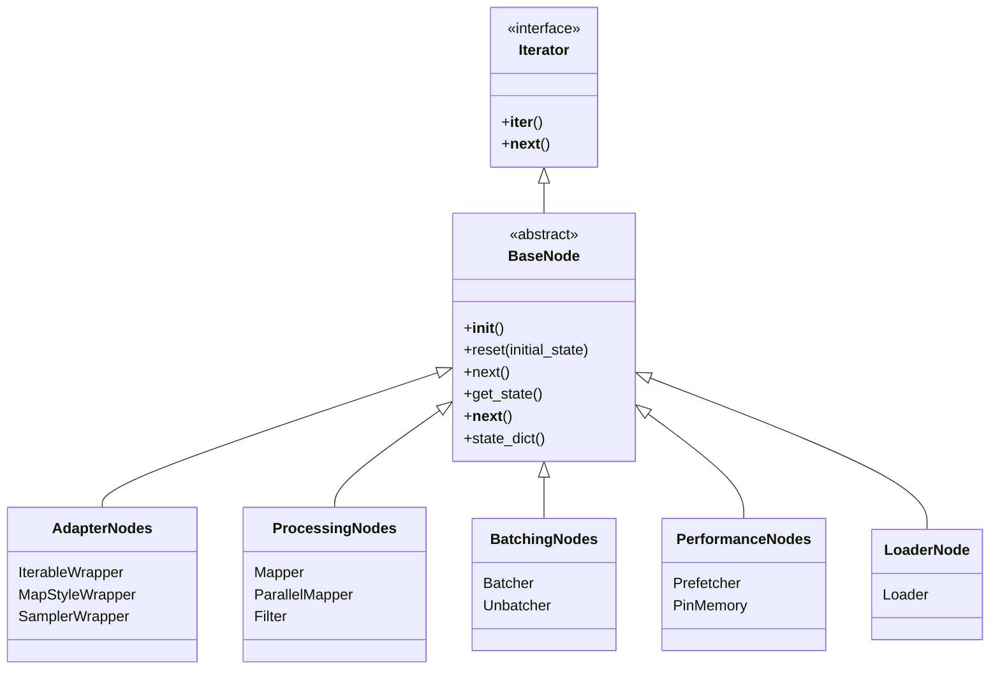
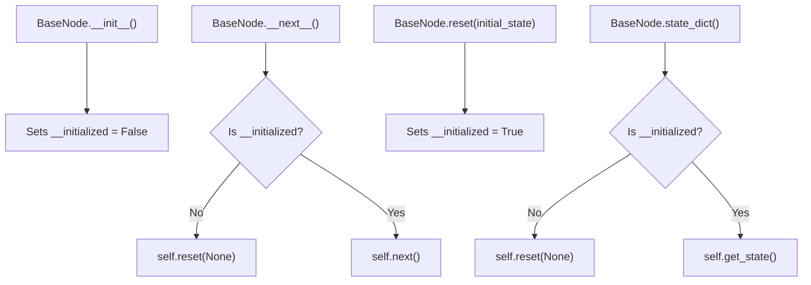
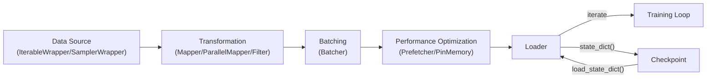
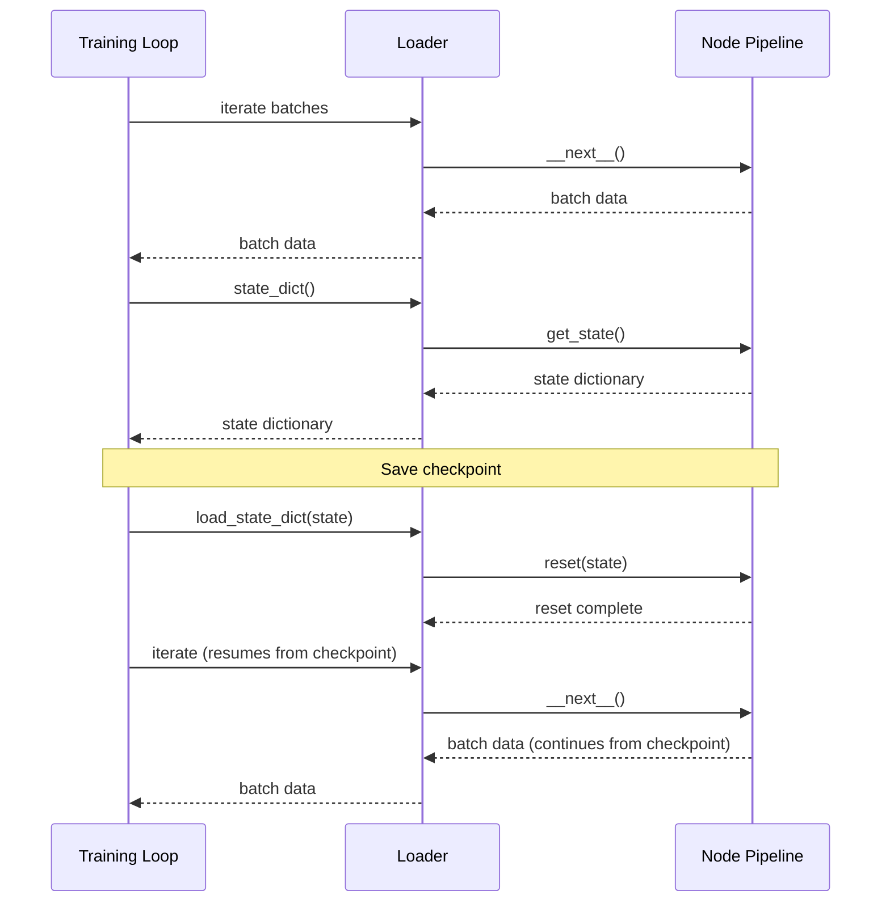

<!-- source: DeepWiki mcp.deepwiki.com · repo pytorch/data · page 3 torchdata.nodes Framework · fetched 2026-10-21 -->

# torchdata.nodes Framework

<details>
<summary>Relevant source files</summary>

The following files were used as context for generating this wiki page:

- [docs/source/getting_started_with_torchdata_nodes.rst](docs/source/getting_started_with_torchdata_nodes.rst)
- [docs/source/index.rst](docs/source/index.rst)
- [docs/source/migrate_to_nodes_from_utils.rst](docs/source/migrate_to_nodes_from_utils.rst)
- [docs/source/stateful_dataloader_tutorial.rst](docs/source/stateful_dataloader_tutorial.rst)
- [docs/source/torchdata.nodes.rst](docs/source/torchdata.nodes.rst)
- [docs/source/what_is_torchdata_nodes.rst](docs/source/what_is_torchdata_nodes.rst)
- [test/nodes/test_adapters.py](test/nodes/test_adapters.py)
- [test/nodes/test_base_node.py](test/nodes/test_base_node.py)
- [test/nodes/test_loader.py](test/nodes/test_loader.py)
- [torchdata/nodes/__init__.py](torchdata/nodes/__init__.py)
- [torchdata/nodes/adapters.py](torchdata/nodes/adapters.py)
- [torchdata/nodes/base_node.py](torchdata/nodes/base_node.py)

</details>


The `torchdata.nodes` framework is a library of composable iterators that provides a flexible, performant approach to data loading and processing in PyTorch. It offers a streaming programming model with first-class support for state management, enabling features like mid-epoch checkpointing and resumption of data loading operations. This document provides a technical overview of the framework's architecture, components, and usage patterns.

For information about the StatefulDataLoader, which is a separate component of TorchData, see [StatefulDataLoader](#2).

## Core Architecture

The foundation of the `torchdata.nodes` framework is the `BaseNode` interface, which all nodes implement. This architecture enables composable data processing pipelines through a series of connected nodes.



Sources: [torchdata/nodes/base_node.py:16-106](), [torchdata/nodes/__init__.py:7-38]()

### BaseNode Interface

The `BaseNode` class is the fundamental building block of the framework. It extends Python's `Iterator` interface and adds state management capabilities:



Key methods that must be implemented by subclasses:
- `next()`: Returns the next item in the sequence (not `__next__`)
- `get_state()`: Returns a state dictionary (not `state_dict`)
- `reset(initial_state)`: Resets the iterator, optionally with a provided state

The separation between public methods (`__next__`, `state_dict`) and implementation methods (`next`, `get_state`) ensures proper initialization before operation.

Sources: [torchdata/nodes/base_node.py:16-106](), [docs/source/what_is_torchdata_nodes.rst:17-21]()

## Node Types

The framework provides several categories of nodes for different data processing tasks:

### 1. Adapter Nodes

Adapter nodes bridge existing PyTorch data structures with the nodes framework:

| Node Type | Purpose | Key Features |
|-----------|---------|--------------|
| `IterableWrapper` | Converts an iterable to a `BaseNode` | Supports stateful iterables through state_dict protocol |
| `MapStyleWrapper` | Converts a map-style dataset to a `BaseNode` | Combines a sampler with a mapping function |
| `SamplerWrapper` | Converts a sampler to a `BaseNode` | Supports epoch updates for distributed sampling |

Sources: [torchdata/nodes/adapters.py:21-168](), [test/nodes/test_adapters.py:18-178]()

### 2. Processing Nodes

Nodes that transform data:

| Node Type | Purpose | Key Features |
|-----------|---------|--------------|
| `Mapper` | Applies a function to each element | Serial processing |
| `ParallelMapper` | Applies a function in parallel | Supports both thread and process-based parallelism |
| `Filter` | Removes elements based on a predicate | Stateful filtering |

Sources: [torchdata/nodes/__init__.py:12]()

### 3. Batching Nodes

Nodes for batch operations:

| Node Type | Purpose | Key Features |
|-----------|---------|--------------|
| `Batcher` | Groups elements into batches | Configurable batch size and drop_last behavior |
| `Unbatcher` | Splits batches into individual elements | Reverses batching operation |

Sources: [torchdata/nodes/__init__.py:9]()

### 4. Performance Optimization Nodes

Nodes that improve data loading performance:

| Node Type | Purpose | Key Features |
|-----------|---------|--------------|
| `Prefetcher` | Prefetches items ahead of time | Reduces waiting time between batches |
| `PinMemory` | Pins tensors in memory | Accelerates CPU-to-GPU transfers |

Sources: [torchdata/nodes/__init__.py:13-14]()

### 5. Terminal Node

The `Loader` node is typically the last node in a pipeline:

| Node Type | Purpose | Key Features |
|-----------|---------|--------------|
| `Loader` | Converts a `BaseNode` to an iterable | Handles iterator reset between epochs and provides state management |

Sources: [torchdata/nodes/__init__.py:11](), [test/nodes/test_loader.py:16-55]()

## Data Flow and Composition

A typical `torchdata.nodes` pipeline involves composing nodes in sequence, with data flowing from data source nodes through transformation nodes to a terminal `Loader` node.



Example pipeline construction:
```python
# Create a data source node
node = IterableWrapper(range(100))
# Add transformation
node = ParallelMapper(node, map_fn=lambda x: x**2, num_workers=4, method="thread")
# Add batching
node = Batcher(node, batch_size=16, drop_last=False)
# Add performance optimization
node = Prefetcher(node, prefetch_factor=2)
# Create loader for iteration
loader = Loader(node)
```

Sources: [docs/source/getting_started_with_torchdata_nodes.rst:15-24](), [docs/source/migrate_to_nodes_from_utils.rst:97-120]()

## State Management

One of the key features of the `torchdata.nodes` framework is state management, which enables checkpoint and resume capabilities.



Each node maintains its own state, which typically includes:
- Position in the iteration sequence
- Internal counter values
- State of underlying components (samplers, datasets, etc.)

When `state_dict()` is called on a `Loader`, it recursively collects state from all nodes in the pipeline. Similarly, `load_state_dict()` distributes state information to the appropriate nodes during reset.

Sources: [torchdata/nodes/base_node.py:67-105](), [test/nodes/test_base_node.py:13-15](), [docs/source/what_is_torchdata_nodes.rst:12-14]()

## Design Decisions

### Iterator vs. Generator Approach

The framework deliberately uses an Iterator-based approach rather than Generators, to make state management more explicit and reliable:

1. Generators store state implicitly on the stack, making explicit state handling challenging
2. End-of-iteration state management is clearer with Iterators
3. Iterators allow clearer handling of multiple live iterator scenarios
4. Reset behavior is more predictable with explicit Iterator state

The `BaseNode` class enforces this by requiring subclasses to implement `next()`, `get_state()`, and `reset()` methods rather than using generator functions.

Sources: [docs/source/what_is_torchdata_nodes.rst:118-167]()

## Comparison with torch.utils.data

The `torchdata.nodes` framework addresses several limitations of the standard `torch.utils.data` approach:

| Feature | torch.utils.data | torchdata.nodes |
|---------|------------------|----------------|
| Parallelism | Multi-processing only | Multi-threading and multi-processing |
| Memory Management | High memory usage due to object duplication | More efficient memory usage with thread-based parallelism |
| Data Access Pattern | Primarily random access | Streaming data model |
| Multi-dataset Support | Limited by sampler design | Natural composition of multiple data sources |
| State Management | Limited, requires custom implementation | First-class support for checkpointing |
| Performance | Good for in-memory datasets | Competitive with DataLoader, better for some workloads |

Sources: [docs/source/what_is_torchdata_nodes.rst:28-90](), [docs/source/what_is_torchdata_nodes.rst:93-112]()

## Usage Examples

### Basic Example with IterableWrapper

```python
from torchdata.nodes import IterableWrapper, ParallelMapper, Loader

node = IterableWrapper(range(10))
node = ParallelMapper(node, map_fn=lambda x: x**2, num_workers=3, method="thread")
loader = Loader(node)
result = list(loader)
print(result)  # [0, 1, 4, 9, 16, 25, 36, 49, 64, 81]
```

### Example with Map-Style Dataset and Sampler

```python
from torch.utils.data import RandomSampler
from torchdata.nodes import SamplerWrapper, ParallelMapper, Loader

class SquaredDataset(torch.utils.data.Dataset):
    def __getitem__(self, i: int) -> int:
        return i**2
    def __len__(self):
        return 10

dataset = SquaredDataset()
sampler = RandomSampler(dataset)
node = SamplerWrapper(sampler)
node = ParallelMapper(node, map_fn=dataset.__getitem__, num_workers=3, method="thread")
loader = Loader(node)
```

Sources: [docs/source/getting_started_with_torchdata_nodes.rst:10-57]()

## Conclusion

The `torchdata.nodes` framework provides a flexible, composable approach to data loading that builds upon and extends PyTorch's data utilities. With first-class support for state management, flexible parallelism options, and a streaming data model, it addresses many limitations of the standard approach while maintaining compatibility with existing PyTorch components.

---

