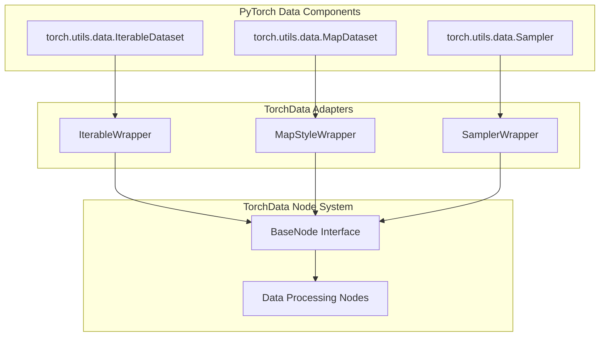
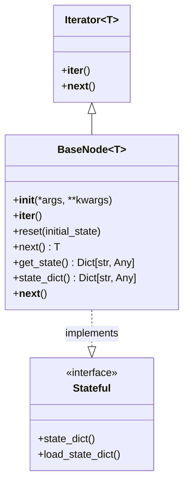
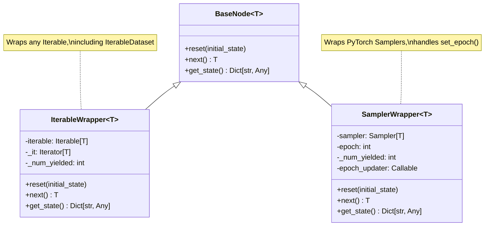
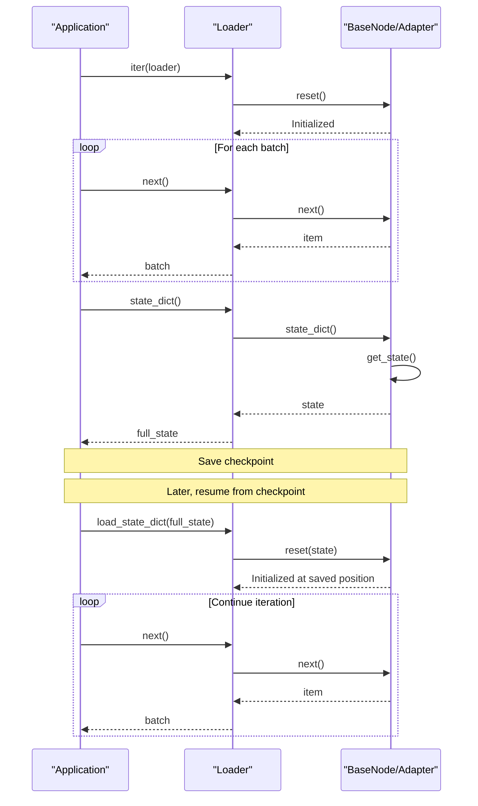
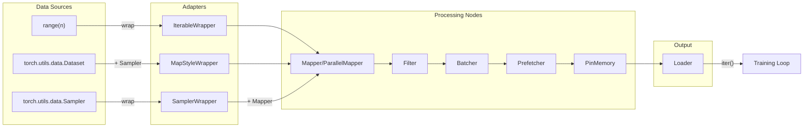

<!-- source: DeepWiki mcp.deepwiki.com · repo pytorch/data · page 3.1 BaseNode and Adapters · fetched 2026-10-21 -->

# BaseNode and Adapters

<details>
<summary>Relevant source files</summary>

The following files were used as context for generating this wiki page:

- [test/nodes/test_adapters.py](test/nodes/test_adapters.py)
- [test/nodes/test_base_node.py](test/nodes/test_base_node.py)
- [test/nodes/test_loader.py](test/nodes/test_loader.py)
- [torchdata/nodes/__init__.py](torchdata/nodes/__init__.py)
- [torchdata/nodes/adapters.py](torchdata/nodes/adapters.py)
- [torchdata/nodes/base_node.py](torchdata/nodes/base_node.py)

</details>


The BaseNode interface and adapter classes form the foundation of TorchData's composable data processing pipeline system. This document explains these core components, how they relate to PyTorch's existing data abstractions, and how they enable stateful, checkpointable data loading workflows.

For information about the higher-level nodes framework, see [torchdata.nodes Framework](#3).

## Purpose and Core Concepts

BaseNode is the fundamental building block for creating composable data loading pipelines in TorchData. Adapters are specialized BaseNode implementations that bridge existing PyTorch data abstractions (like Dataset and Sampler) to the TorchData nodes system.

Together, they enable:
- Creation of composable data processing pipelines
- State management for checkpointing and resumption
- Seamless integration with existing PyTorch data components



Sources: [torchdata/nodes/base_node.py:16-106](), [torchdata/nodes/adapters.py:21-168]()

## BaseNode Interface

The `BaseNode` class is an abstract interface that all data nodes in TorchData must implement. It inherits from Python's `Iterator`, making all BaseNode implementations iterable.



Sources: [torchdata/nodes/base_node.py:16-106]()

### Core Methods

The BaseNode interface defines several key methods:

- `__init__(*args, **kwargs)`: Initializes the node. Subclasses must call `super().__init__()`.
- `reset(initial_state)`: Resets the iterator, either to the beginning or to a state specified by `initial_state`.
- `next()`: Abstract method that returns the next value in the sequence. Subclasses must implement this.
- `get_state()`: Abstract method that returns the current state of the node. Subclasses must implement this.
- `state_dict()`: Returns a state dictionary that can be used for checkpointing.
- `__next__()`: Ensures proper initialization and delegates to `next()`.

BaseNode follows a lazy initialization pattern where expensive initialization is deferred until the first call to `__next__()` or `state_dict()`.

Sources: [torchdata/nodes/base_node.py:40-105]()

## Adapter Classes

TorchData provides three main adapter classes that bridge PyTorch data abstractions to the BaseNode interface:



Sources: [torchdata/nodes/adapters.py:21-168]()

### IterableWrapper

`IterableWrapper` converts any Python iterable (including `torch.utils.data.IterableDataset`) into a `BaseNode`:

```python
from torchdata.nodes import IterableWrapper

# Wrap a simple range
node = IterableWrapper(range(10))

# Wrap a PyTorch IterableDataset
node = IterableWrapper(my_iterable_dataset)
```

Key features:
- Supports stateful iterables through the `Stateful` protocol
- For non-stateful iterables, implements naive fast-forwarding for state restoration
- Tracks the number of yielded items for proper state management

Sources: [torchdata/nodes/adapters.py:21-75]()

### MapStyleWrapper

`MapStyleWrapper` converts a map-style dataset and a sampler into a `BaseNode`:

```python
from torchdata.nodes import MapStyleWrapper
from torch.utils.data import RandomSampler

# Use with a map-style dataset and a sampler
node = MapStyleWrapper(my_map_dataset, sampler=RandomSampler(my_map_dataset))
```

Under the hood, `MapStyleWrapper` is a function that combines:
1. A `SamplerWrapper` to handle the sampler
2. A `Mapper` to apply the dataset's `__getitem__` method to each index

Sources: [torchdata/nodes/adapters.py:78-88]()

### SamplerWrapper

`SamplerWrapper` converts a PyTorch sampler into a `BaseNode`, with special handling for the `set_epoch` method:

```python
from torchdata.nodes import SamplerWrapper
from torch.utils.data import DistributedSampler

# Wrap a sampler
node = SamplerWrapper(RandomSampler(my_dataset))

# Wrap a distributed sampler with epoch handling
node = SamplerWrapper(DistributedSampler(my_dataset), initial_epoch=0)
```

Key features:
- Handles samplers with `set_epoch` method (like `DistributedSampler`)
- Supports custom epoch updating logic through the `epoch_updater` callback
- Preserves sampler state through the `Stateful` protocol if implemented

Sources: [torchdata/nodes/adapters.py:91-168]()

## State Management and Checkpointing

One of the key features of BaseNode and adapters is state management, enabling checkpointing and resumption of data loading.



Sources: [torchdata/nodes/base_node.py:47-105](), [torchdata/nodes/adapters.py:44-75](), [torchdata/nodes/adapters.py:122-164]()

### State Management in Adapters

Each adapter implements state management differently:

- **IterableWrapper**:
  - For stateful iterables: Uses the iterable's `state_dict()`/`load_state_dict()`
  - For non-stateful iterables: Tracks the number of yielded items and fast-forwards

- **SamplerWrapper**:
  - For stateful samplers: Uses the sampler's `state_dict()`/`load_state_dict()`
  - For non-stateful samplers: Tracks the number of yielded items, epoch number, and calls `set_epoch()`

- **MapStyleWrapper**:
  - Inherits state management from the underlying `SamplerWrapper` and `Mapper`

Sources: [torchdata/nodes/adapters.py:44-75](), [torchdata/nodes/adapters.py:122-164]()

## Integration with TorchData Ecosystem

BaseNode and adapters are the building blocks for more complex data processing pipelines:



Sources: [torchdata/nodes/__init__.py:7-38]()

### Usage with Loader

While BaseNode and adapters can be used directly, they're typically wrapped in a `Loader` for ease of use:

```python
from torchdata.nodes import IterableWrapper, Mapper, Batcher, Loader

# Create a pipeline
source = IterableWrapper(range(100))
mapped = Mapper(source, lambda x: {"value": x * 2})
batched = Batcher(mapped, batch_size=16)

# Wrap in a Loader
loader = Loader(batched)

# Use in training loop
for epoch in range(10):
    for batch in loader:
        # Process batch
        pass
        
    # Save checkpoint
    state = loader.state_dict()
```

Sources: [test/nodes/test_loader.py:14-55]()

## Implementing Custom Nodes

To create a custom BaseNode:

1. Inherit from `BaseNode` 
2. Implement `__init__()` and call `super().__init__()`
3. Implement `reset(initial_state)` and call `super().reset(initial_state)`
4. Implement `next()` to return the next value
5. Implement `get_state()` to return the current state

Example skeleton:

```python
class MyCustomNode(BaseNode[T]):
    def __init__(self, *args, **kwargs):
        super().__init__()
        # Initialize your node
        
    def reset(self, initial_state=None):
        super().reset(initial_state)
        # Reset your node's state
        # Load from initial_state if provided
        
    def next(self) -> T:
        # Return the next value or raise StopIteration
        
    def get_state(self) -> Dict[str, Any]:
        # Return the current state
```

Sources: [torchdata/nodes/base_node.py:40-73]()

## Summary

BaseNode and adapters provide the foundation for TorchData's composable data processing system:

- **BaseNode**: Common interface for all data nodes with built-in state management
- **Adapters**: Bridge PyTorch data abstractions to the BaseNode interface
  - **IterableWrapper**: Wraps any iterable, including IterableDataset
  - **MapStyleWrapper**: Combines a map-style dataset and sampler
  - **SamplerWrapper**: Wraps a sampler with epoch handling

These components enable stateful, checkpointable data processing pipelines that can be composed to create complex data loading workflows, while seamlessly integrating with existing PyTorch components.

---

