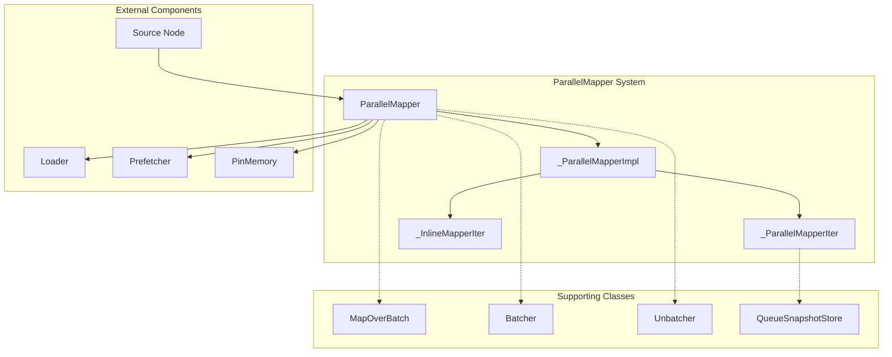
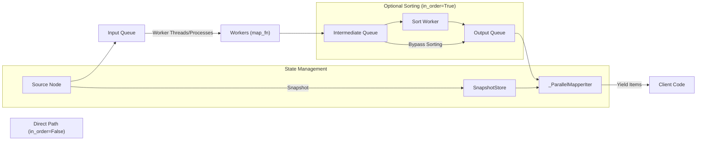
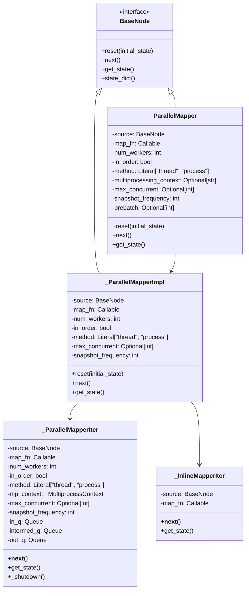
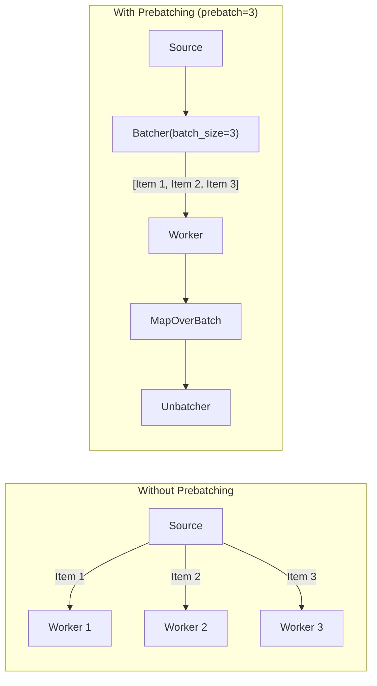
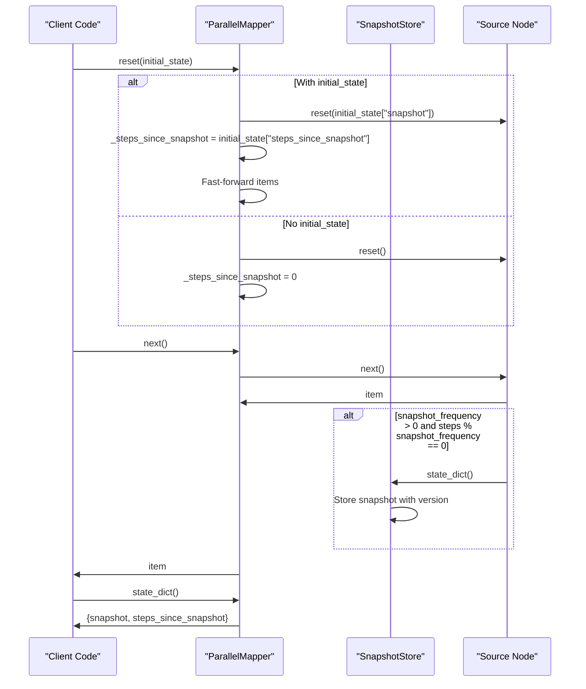
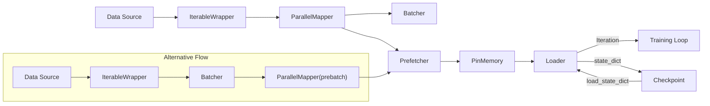

<!-- source: DeepWiki mcp.deepwiki.com · repo pytorch/data · page 3.2 ParallelMapper and Data Processing · fetched 2026-10-21 -->

# ParallelMapper and Data Processing

<details>
<summary>Relevant source files</summary>

The following files were used as context for generating this wiki page:

- [test/nodes/test_map.py](test/nodes/test_map.py)
- [test/nodes/test_pin_memory.py](test/nodes/test_pin_memory.py)
- [test/nodes/test_prefetch.py](test/nodes/test_prefetch.py)
- [test/nodes/test_snapshot_store.py](test/nodes/test_snapshot_store.py)
- [test/nodes/utils.py](test/nodes/utils.py)
- [torchdata/nodes/_populate_queue.py](torchdata/nodes/_populate_queue.py)
- [torchdata/nodes/batch.py](torchdata/nodes/batch.py)
- [torchdata/nodes/loader.py](torchdata/nodes/loader.py)
- [torchdata/nodes/map.py](torchdata/nodes/map.py)
- [torchdata/nodes/pin_memory.py](torchdata/nodes/pin_memory.py)
- [torchdata/nodes/prefetch.py](torchdata/nodes/prefetch.py)
- [torchdata/nodes/snapshot_store.py](torchdata/nodes/snapshot_store.py)

</details>


## Purpose and Scope

This document details the `ParallelMapper` component in TorchData, which provides efficient parallel execution of data transformation functions. The `ParallelMapper` is a core node in the data processing pipeline that enables both thread-based and process-based parallelism for applying mapping functions to data streams. For information about prefetching and memory pinning operations that often complement parallel mapping, see [Prefetcher and Memory Management](#3.3).

Sources: [torchdata/nodes/map.py:411-464]()

## Key Concepts

The `ParallelMapper` is designed to execute user-defined transformation functions across multiple threads or processes, significantly improving data processing throughput for CPU-bound operations. It supports:

- Thread and process-based execution models
- Ordered or unordered result delivery
- State management for checkpointing
- Pre-batching for fine-tuning performance
- Integration with PyTorch's multiprocessing capabilities

Sources: [torchdata/nodes/map.py:411-464](), [torchdata/nodes/map.py:41-55]()

## Architecture and Data Flow

### System Architecture



Sources: [torchdata/nodes/map.py:34-646](), [torchdata/nodes/loader.py:6-72](), [torchdata/nodes/prefetch.py:16-52](), [torchdata/nodes/pin_memory.py:97-157]()

### ParallelMapper Data Flow



Sources: [torchdata/nodes/map.py:147-198](), [torchdata/nodes/map.py:70-97](), [torchdata/nodes/map.py:242-305]()

## Class Structure and Implementation

### Core Classes

The `ParallelMapper` implementation consists of several nested classes:

1. **`ParallelMapper`**: The main user-facing class implementing the `BaseNode` interface
2. **`_ParallelMapperImpl`**: Internal implementation that manages executor creation
3. **`_ParallelMapperIter`**: Iterator for parallel execution with workers
4. **`_InlineMapperIter`**: Simpler iterator for single-threaded execution
5. **`MapOverBatch`**: Helper for applying functions to batched data



Sources: [torchdata/nodes/map.py:411-502](), [torchdata/nodes/map.py:336-409](), [torchdata/nodes/map.py:147-332](), [torchdata/nodes/map.py:119-145](), [torchdata/nodes/map.py:62-67]()

## Execution Models

The `ParallelMapper` supports three execution models:

1. **Inline (Sequential) Execution**: When `num_workers=0`, the mapping function is executed in the current thread with no parallelism.
2. **Thread-based Parallelism**: When `method="thread"`, the mapping function is executed across multiple threads using Python's `ThreadPoolExecutor`.
3. **Process-based Parallelism**: When `method="process"`, the mapping function is executed across multiple processes using PyTorch's multiprocessing implementation.

| Execution Model | Configuration | Best For |
|-----------------|---------------|----------|
| Inline | `num_workers=0` | Debugging, simple transformations |
| Thread-based | `method="thread", num_workers>0` | I/O-bound operations, GIL-free operations |
| Process-based | `method="process", num_workers>0` | CPU-bound operations, avoiding GIL, PyTorch transformations |

Sources: [torchdata/nodes/map.py:44-55](), [torchdata/nodes/map.py:437-452]()

## Pre-batching Mechanism

The `ParallelMapper` includes a pre-batching feature that can significantly improve performance for small items by reducing the overhead of worker creation and communication.



When prebatch is specified:
1. Source items are grouped by `Batcher` into mini-batches
2. Each mini-batch is sent to a worker as a single task
3. The worker applies the mapping function to each item in the mini-batch
4. The results are flattened back into individual items by `Unbatcher`

Sources: [torchdata/nodes/map.py:464-472](), [torchdata/nodes/map.py:486-489](), [torchdata/nodes/map.py:62-67]()

## State Management

ParallelMapper implements state management to support checkpointing and resumption of data processing. This is essential for long-running training jobs where fault tolerance is required.

State is captured through:
1. The `SnapshotStore` which periodically captures the state of the source node
2. Tracking of progress through the data stream via index tracking



Sources: [torchdata/nodes/map.py:185-199](), [torchdata/nodes/map.py:302-316](), [torchdata/nodes/snapshot_store.py:11-96]()

## Usage Examples

### Basic Usage of ParallelMapper

```python
from torchdata.nodes import IterableWrapper, ParallelMapper, Loader

# Create a source node
source = IterableWrapper(range(1000))

# Create a parallel mapper with 4 worker threads
def square(x):
    return x * x

node = ParallelMapper(
    source=source,
    map_fn=square,
    num_workers=4,
    method="thread"
)

# Wrap in a Loader for iterative access
loader = Loader(node)

# Iterate through transformed data
for item in loader:
    print(item)
```

### Complex Data Processing Pipeline with ParallelMapper

```python
from torchdata.nodes import (
    IterableWrapper, Batcher, ParallelMapper, 
    Prefetcher, PinMemory, Loader
)

# Create source data
source = IterableWrapper(range(10000))

# Batch data items
batched = Batcher(source, batch_size=32)

# Apply transformation in parallel
def transform_batch(batch):
    return [x * 2 for x in batch]

transformed = ParallelMapper(
    source=batched,
    map_fn=transform_batch,
    num_workers=8,
    method="process",
    multiprocessing_context="spawn",
    in_order=True
)

# Add prefetching for improved throughput
prefetched = Prefetcher(transformed, prefetch_factor=2)

# Pin tensors to GPU memory if using CUDA
pinned = PinMemory(prefetched)

# Create loader for iteration and state management
loader = Loader(pinned)

# Process data with checkpointing
for epoch in range(5):
    for batch in loader:
        # Process batch
        pass
    
    # Save state for potential resumption
    state = loader.state_dict()
    # ... save state to disk
```

Sources: [test/nodes/test_map.py:58-99](), [test/nodes/test_map.py:132-155](), [test/nodes/utils.py:151-212]()

## Performance Considerations

### Worker Count Optimization

The optimal number of workers depends on:
- CPU core count 
- I/O vs CPU bound nature of the mapping function
- GIL contention in thread mode

For CPU-bound operations, process-based parallelism often provides better scaling:

| Operation Type | Recommended Mode | Worker Count Guideline |
|----------------|------------------|------------------------|
| I/O-bound | Thread | 2-4x number of cores |
| Mixed I/O-CPU | Thread | 1-2x number of cores |
| CPU-bound | Process | Number of physical cores |
| GPU operations | Thread | 2-4 (limited by GPU throughput) |

### Memory Management

The `max_concurrent` parameter controls how many items can be in-flight at once, which impacts memory usage:
- If `max_concurrent` is None, it defaults to 2 * num_workers
- Setting a lower value reduces memory footprint but may impact throughput
- Setting too high a value may cause excessive memory consumption

Sources: [torchdata/nodes/map.py:182-184](), [torchdata/nodes/map.py:458-461]()

## Integration with Other Components

ParallelMapper is typically used as part of a larger data processing pipeline:



Common integration patterns include:
1. Applying ParallelMapper after individual item processing but before batching
2. Using ParallelMapper with prebatching for small item transformation 
3. Following ParallelMapper with Prefetcher to ensure continuous data flow
4. Using PinMemory after ParallelMapper for GPU workloads

Sources: [test/nodes/test_map.py:58-99](), [test/nodes/test_pin_memory.py:26-43](), [torchdata/nodes/loader.py:6-71]()

## Troubleshooting

### Common Issues and Solutions

| Issue | Possible Cause | Solution |
|-------|----------------|----------|
| Poor scaling with threads | GIL contention | Switch to process-based parallelism |
| High memory usage | Too many concurrent items | Reduce max_concurrent parameter |
| Out of order results | in_order=False | Set in_order=True if order matters |
| Process startup overhead | Process creation cost | Use thread mode for lightweight operations |
| Deadlocks in process mode | Improper resource sharing | Ensure map_fn is serializable and doesn't use shared resources |
| Exception handling issues | Errors in worker processes | Check exception handling, see tests for examples |

Sources: [test/nodes/test_map.py:24-56](), [torchdata/nodes/map.py:296-304](), [torchdata/nodes/map.py:318-332]()

---

