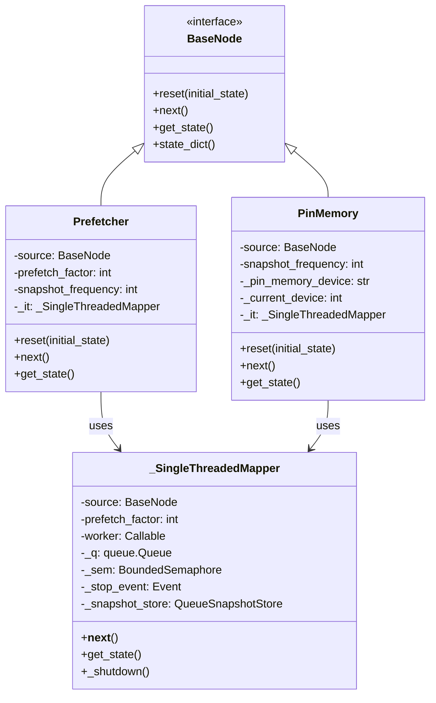
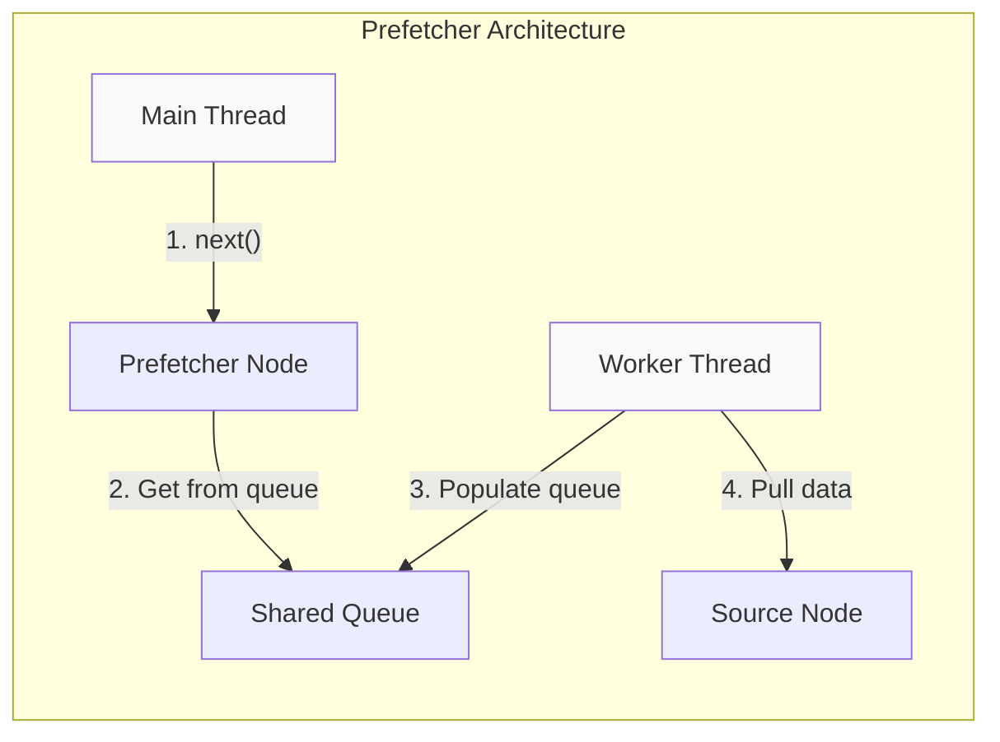
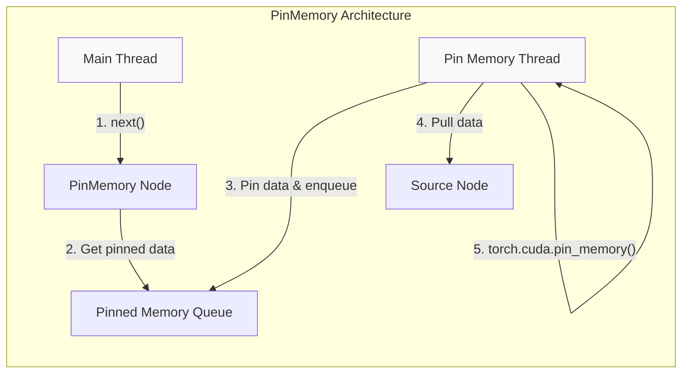
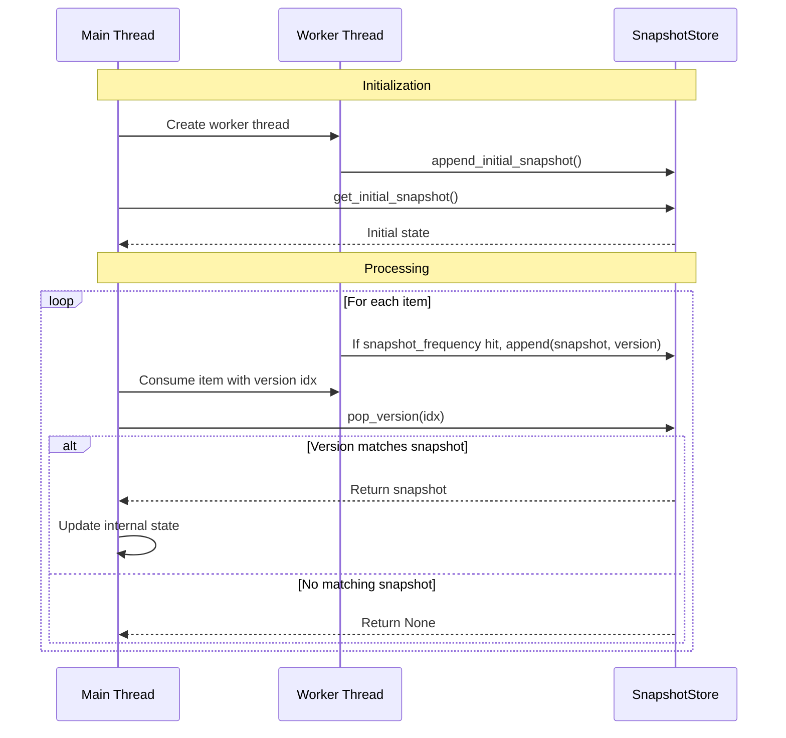
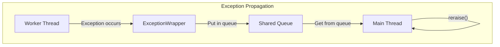

<!-- source: DeepWiki mcp.deepwiki.com · repo pytorch/data · page 3.3 Prefetcher and Memory Management · fetched 2026-10-21 -->

# Prefetcher and Memory Management

<details>
<summary>Relevant source files</summary>

The following files were used as context for generating this wiki page:

- [test/nodes/test_map.py](test/nodes/test_map.py)
- [test/nodes/test_pin_memory.py](test/nodes/test_pin_memory.py)
- [test/nodes/test_prefetch.py](test/nodes/test_prefetch.py)
- [test/nodes/test_snapshot_store.py](test/nodes/test_snapshot_store.py)
- [test/nodes/utils.py](test/nodes/utils.py)
- [torchdata/nodes/_populate_queue.py](torchdata/nodes/_populate_queue.py)
- [torchdata/nodes/batch.py](torchdata/nodes/batch.py)
- [torchdata/nodes/loader.py](torchdata/nodes/loader.py)
- [torchdata/nodes/map.py](torchdata/nodes/map.py)
- [torchdata/nodes/pin_memory.py](torchdata/nodes/pin_memory.py)
- [torchdata/nodes/prefetch.py](torchdata/nodes/prefetch.py)
- [torchdata/nodes/snapshot_store.py](torchdata/nodes/snapshot_store.py)

</details>


This document describes the prefetching and memory management components in TorchData, specifically focusing on the `Prefetcher` and `PinMemory` nodes. These components are designed to optimize data loading performance through asynchronous prefetching and efficient memory management for accelerated hardware.

## Overview

The TorchData framework provides specialized nodes to address two key performance bottlenecks in data loading pipelines:

1. **I/O Latency**: Addressed by `Prefetcher`, which asynchronously loads data ahead of time
2. **CPU-to-GPU Transfer Latency**: Addressed by `PinMemory`, which optimizes memory transfers to accelerator devices


Sources:
- [torchdata/nodes/prefetch.py]()
- [torchdata/nodes/pin_memory.py]()

## Core Design Principles

Both components utilize a common design pattern:

1. **Single-Threaded Asynchronous Processing**: Using a dedicated thread to perform work ahead of the main thread
2. **Bounded Queues**: Controlling memory usage with configurable limits on prefetched items
3. **Stateful Design**: Supporting checkpointing and resumption of data loading
4. **Exception Propagation**: Seamlessly propagating exceptions from worker threads to the main thread



Sources:
- [torchdata/nodes/map.py:518-646]()
- [torchdata/nodes/prefetch.py:16-52]()
- [torchdata/nodes/pin_memory.py:97-157]()

## Prefetcher

The `Prefetcher` node pulls data from a source node in advance, enabling the main thread to access data without waiting for I/O operations. This significantly improves throughput by overlapping data loading with computation.

### Architecture



Sources:
- [torchdata/nodes/prefetch.py:16-52]()
- [torchdata/nodes/_populate_queue.py:21-86]()

### Implementation Details

The `Prefetcher` uses a worker thread running `_populate_queue` to asynchronously fetch items from the source:

1. The worker thread acquires a semaphore (limiting the number of items in flight)
2. It pulls an item from the source node
3. It places the item in a shared queue with a monotonically increasing index
4. It periodically takes snapshots of the source node state for checkpointing
5. The main thread consumes items from the queue

Key parameters:
- `prefetch_factor`: Controls how many items to prefetch
- `snapshot_frequency`: Controls how often to save the source node's state

Sources:
- [torchdata/nodes/prefetch.py:16-52]()
- [torchdata/nodes/_populate_queue.py:21-86]()

### Usage Example

```python
# Create a data pipeline with prefetching
pipeline = Batcher(source_node, batch_size=32)
pipeline = Prefetcher(pipeline, prefetch_factor=2)  # Prefetch 2 batches ahead
```

## PinMemory

The `PinMemory` node optimizes memory transfers between CPU and accelerator devices (like GPUs) by pinning memory, which prevents the data from being paged out and enables direct memory transfers.

### Architecture



Sources:
- [torchdata/nodes/pin_memory.py:97-157]()
- [torchdata/nodes/pin_memory.py:24-95]()

### Implementation Details

The `PinMemory` node uses a worker thread running `_pin_memory_loop` to:

1. Pull items from the source node
2. Call `pin_memory` on these items to pin them to the specified device
3. Place the pinned items in a shared queue
4. Periodically take snapshots of the source node state

Key parameters:
- `pin_memory_device`: The device to pin memory to ("cuda", "xpu", etc.)
- `snapshot_frequency`: Controls how often to save the source node's state

The pinning operation is performed using PyTorch's `pin_memory` function which marks the memory allocation as non-pageable, allowing for faster GPU transfers.

Sources:
- [torchdata/nodes/pin_memory.py:24-95]()
- [torchdata/nodes/pin_memory.py:97-157]()

### Usage Example

```python
# Create a data pipeline with memory pinning
pipeline = Batcher(source_node, batch_size=32)
pipeline = PinMemory(pipeline, pin_memory_device="cuda")  # Pin memory for CUDA device
```

## State Management System

Both `Prefetcher` and `PinMemory` incorporate checkpoint and resume functionality by leveraging a snapshot system.

### Snapshot Store

The `QueueSnapshotStore` maintains snapshots of the source node's state at specified intervals, enabling state preservation across threads and processes.



Sources:
- [torchdata/nodes/snapshot_store.py:25-97]()
- [torchdata/nodes/map.py:634-638]()

### Exception Handling

Exceptions in worker threads are captured by `ExceptionWrapper` and propagated to the main thread, ensuring that errors do not get lost during asynchronous execution.



Sources:
- [torchdata/nodes/map.py:92-94]()
- [torchdata/nodes/pin_memory.py:71-73]()
- [torchdata/nodes/map.py:617-622]()

## Performance Considerations

### Optimal Prefetch Factor

The `prefetch_factor` determines how many items are prefetched ahead of time:
- Too small: Main thread may wait for data
- Too large: Excessive memory usage

A common pattern is to set `prefetch_factor` to 2-3× the number of GPU devices in use.

### Memory Usage

Memory pinning prevents page swapping but increases overall system memory usage. When using `PinMemory`:
- Use smaller batch sizes if facing memory issues
- Consider reducing `prefetch_factor` to limit memory footprint

### Common Pipeline Configurations

The most common and effective pipeline ordering is:
```
Source → ParallelMapper → Batcher → Prefetcher → PinMemory → Training Loop
```

This configuration:
1. Parallelizes data preprocessing
2. Batches individual items
3. Prefetches batches to hide I/O latency
4. Pins memory for optimal GPU transfer
5. Delivers the data to the training loop

Sources:
- [test/nodes/test_map.py:58-99]()
- [test/nodes/test_pin_memory.py:26-43]()

## Conclusion

The `Prefetcher` and `PinMemory` nodes provide essential performance optimizations for data loading pipelines in TorchData. By leveraging asynchronous loading and efficient memory transfer techniques, these components significantly reduce data loading bottlenecks, especially in GPU-accelerated training workflows.

---

