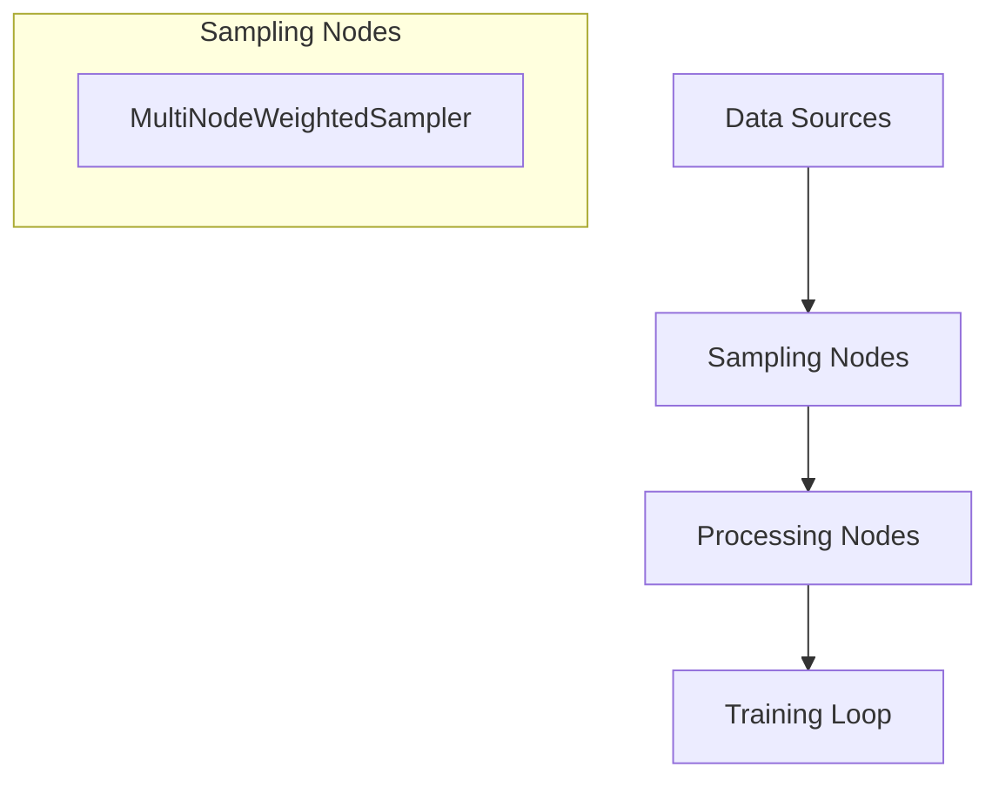
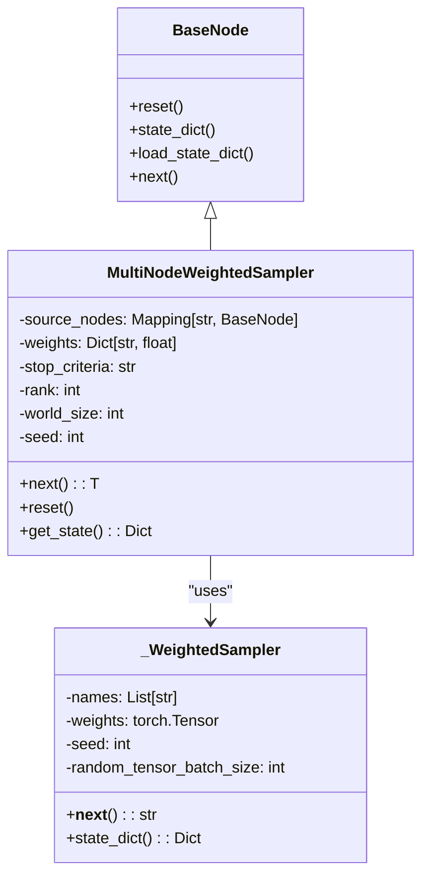
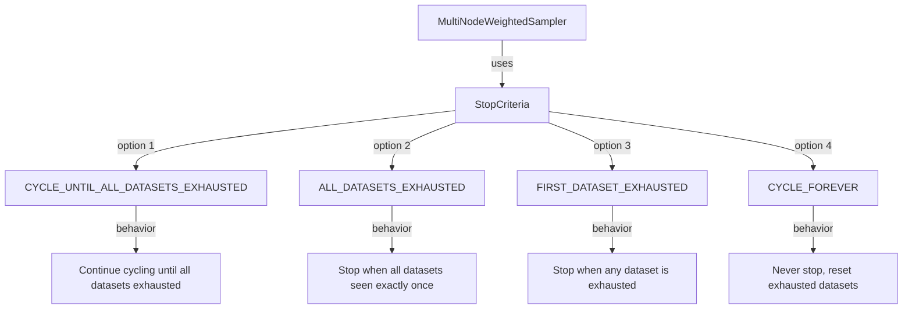
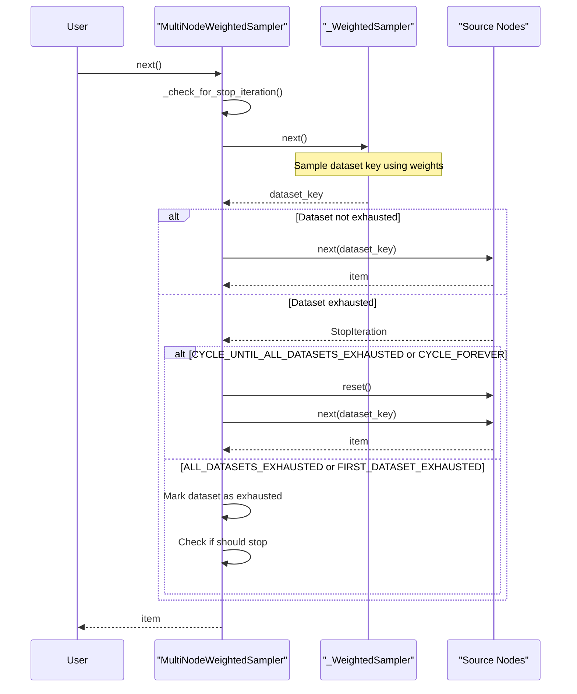

<!-- source: DeepWiki mcp.deepwiki.com · repo pytorch/data · page 3.4 Sampling Nodes · fetched 2026-10-21 -->

# Sampling Nodes

<details>
<summary>Relevant source files</summary>

The following files were used as context for generating this wiki page:

- [test/nodes/test_multi_node_weighted_sampler.py](test/nodes/test_multi_node_weighted_sampler.py)
- [torchdata/nodes/samplers/__init__.py](torchdata/nodes/samplers/__init__.py)
- [torchdata/nodes/samplers/multi_node_weighted_sampler.py](torchdata/nodes/samplers/multi_node_weighted_sampler.py)
- [torchdata/nodes/samplers/stop_criteria.py](torchdata/nodes/samplers/stop_criteria.py)
- [torchdata/nodes/samplers/utils.py](torchdata/nodes/samplers/utils.py)

</details>


This document provides technical documentation for the Sampling Nodes in TorchData, with a focus on the `MultiNodeWeightedSampler`. Sampling nodes are specialized components that control how items are sampled from multiple datasets based on configurable weights, enabling flexible dataset combination strategies.

## Overview

Sampling nodes in TorchData provide mechanisms to sample from multiple data sources with specified probabilities. They serve as intermediaries between data sources and other processing nodes in the data pipeline, allowing for controlled sampling from multiple datasets.



Sources: [torchdata/nodes/samplers/multi_node_weighted_sampler.py:17-51]()

## MultiNodeWeightedSampler

The `MultiNodeWeightedSampler` is the primary sampling node implementation in TorchData. It samples from multiple datasets with weights, allowing you to control the sampling probability for each dataset.

### Architecture and Integration



Sources: [torchdata/nodes/samplers/multi_node_weighted_sampler.py:17-51](), [torchdata/nodes/samplers/multi_node_weighted_sampler.py:209-288]()

### Key Parameters

The `MultiNodeWeightedSampler` takes the following parameters:

| Parameter | Type | Description |
|-----------|------|-------------|
| `source_nodes` | `Mapping[str, BaseNode[T]]` | Dictionary of source nodes (datasets) to sample from |
| `weights` | `Dict[str, float]` | Dictionary of weights for each source node (must be positive floats) |
| `stop_criteria` | `str` | Determines when to stop sampling (default: `CYCLE_UNTIL_ALL_DATASETS_EXHAUSTED`) |
| `rank` | `Optional[int]` | Process rank for distributed training (default: inferred from environment) |
| `world_size` | `Optional[int]` | World size for distributed training (default: inferred from environment) |
| `seed` | `int` | Seed for random number generation (default: 0) |

Sources: [torchdata/nodes/samplers/multi_node_weighted_sampler.py:59-67]()

## Stop Criteria

The sampler supports different stopping criteria defined in the `StopCriteria` class, which determine when the sampling should stop:



| Stop Criteria | Description | Use Case |
|---------------|-------------|----------|
| `CYCLE_UNTIL_ALL_DATASETS_EXHAUSTED` | Cycles through datasets until all are exhausted | Default behavior, ensures all datasets are processed |
| `ALL_DATASETS_EXHAUSTED` | Stops when all datasets are exhausted | Ensures each dataset is seen exactly once |
| `FIRST_DATASET_EXHAUSTED` | Stops when the first dataset is exhausted | Early stopping when any dataset is fully processed |
| `CYCLE_FOREVER` | Continuously cycles through datasets | When trainer needs control over steps rather than epochs |

Sources: [torchdata/nodes/samplers/stop_criteria.py:8-28](), [torchdata/nodes/samplers/multi_node_weighted_sampler.py:90-98]()

## Sampling Mechanism

The `MultiNodeWeightedSampler` uses a helper class `_WeightedSampler` that handles the weighted sampling logic using `torch.multinomial`. The sampling process works as follows:



The `_WeightedSampler` generates batches of indices for efficiency, using `torch.multinomial` with the provided weights. Each index corresponds to a dataset key, which the `MultiNodeWeightedSampler` uses to fetch items from the corresponding source node.

Sources: [torchdata/nodes/samplers/multi_node_weighted_sampler.py:165-197](), [torchdata/nodes/samplers/multi_node_weighted_sampler.py:209-288]()

## State Management

The `MultiNodeWeightedSampler` implements state management to support checkpointing and resumption, which is crucial for long-running training workloads:

| State Key | Description |
|-----------|-------------|
| `DATASET_NODE_STATES_KEY` | Dictionary of states for each source node |
| `DATASETS_EXHAUSTED_KEY` | Dictionary indicating whether each source node is exhausted |
| `EPOCH_KEY` | Epoch counter for the random number generator |
| `NUM_YIELDED_KEY` | Number of items yielded by the sampler |
| `WEIGHTED_SAMPLER_STATE_KEY` | State of the weighted sampler |

The state can be saved with `state_dict()` and loaded with `reset(initial_state)`, allowing for checkpointing and resumption of sampling:

```python
# Save state
state = sampler.state_dict()

# Reset and load state
sampler.reset(state)
```

Sources: [torchdata/nodes/samplers/multi_node_weighted_sampler.py:53-57](), [torchdata/nodes/samplers/multi_node_weighted_sampler.py:115-135](), [torchdata/nodes/samplers/multi_node_weighted_sampler.py:199-206]()

## Distributed Training Support

The `MultiNodeWeightedSampler` supports distributed training by ensuring different processes sample different items:

1. If `rank` and `world_size` are not provided, they are inferred from the distributed environment.
2. The sampler uses the `_get_rank_seed` function to generate a unique seed for each rank.
3. Each rank gets a different random sequence, ensuring no duplicate samples across processes.

```python
# Infer rank and world size if not provided
if rank is None or world_size is None:
    self.rank, self.world_size = get_rank_and_world_size()
```

Sources: [torchdata/nodes/samplers/multi_node_weighted_sampler.py:78-83](), [torchdata/nodes/samplers/utils.py:13-15](), [torchdata/nodes/samplers/utils.py:18-40]()

## Usage Example

Here's an example of using the `MultiNodeWeightedSampler`:

```python
from torchdata.nodes import MultiNodeWeightedSampler, StopCriteria
from torchdata.nodes.adapters import IterableWrapper

# Create source nodes
source_nodes = {
    "dataset1": IterableWrapper([1, 2, 3, 4, 5]),
    "dataset2": IterableWrapper([6, 7, 8, 9, 10]),
    "dataset3": IterableWrapper([11, 12, 13, 14, 15])
}

# Define weights (higher weights mean higher probability of sampling)
weights = {
    "dataset1": 0.2,  # 20% probability
    "dataset2": 0.3,  # 30% probability
    "dataset3": 0.5   # 50% probability
}

# Create sampler
sampler = MultiNodeWeightedSampler(
    source_nodes=source_nodes,
    weights=weights,
    stop_criteria=StopCriteria.ALL_DATASETS_EXHAUSTED,
    seed=42
)

# Sample items
for item in sampler:
    print(item)

# Save state for checkpointing
state = sampler.state_dict()

# Reset and load state to resume
sampler.reset(state)
```

Sources: [torchdata/nodes/samplers/multi_node_weighted_sampler.py:17-51](), [test/nodes/test_multi_node_weighted_sampler.py:40-47]()

## Validation and Error Handling

The `MultiNodeWeightedSampler` validates the inputs to ensure correct usage:

1. It validates that the stop criteria is one of the allowed values.
2. It checks that the keys in `source_nodes` and `weights` are the same.
3. It verifies that all weights are positive floats.

```python
# Validate if keys of source_nodes and weights are the same
if set(self.dataset_names) != set(self.weights.keys()):
    raise ValueError("Keys of source_nodes and weights must be the same")

# Validate weights are positive floats
for weight in self.weights.values():
    if not isinstance(weight, float) or weight <= 0:
        raise ValueError("Weights must be positive floats")
```

Sources: [torchdata/nodes/samplers/multi_node_weighted_sampler.py:89-113]()

## Performance Considerations

For efficiency, the `_WeightedSampler` generates batches of indices rather than one at a time:

1. It uses a parameter `random_tensor_batch_size` (default: 1000) to control the batch size.
2. When a batch is exhausted, it generates a new batch.
3. This approach is more efficient than generating individual random numbers for each sample.

Sources: [torchdata/nodes/samplers/multi_node_weighted_sampler.py:264-272](), [torchdata/nodes/samplers/multi_node_weighted_sampler.py:276-282]()

---

