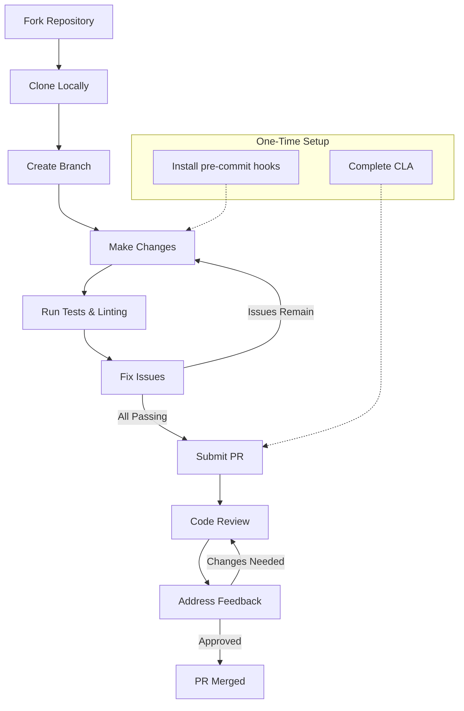
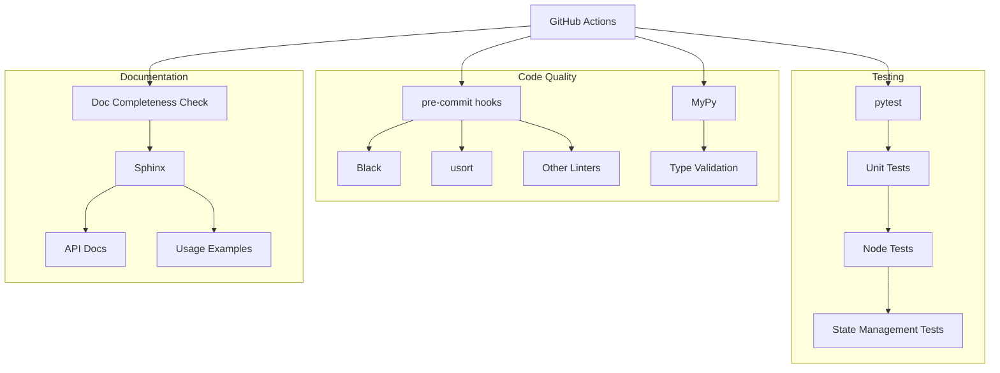
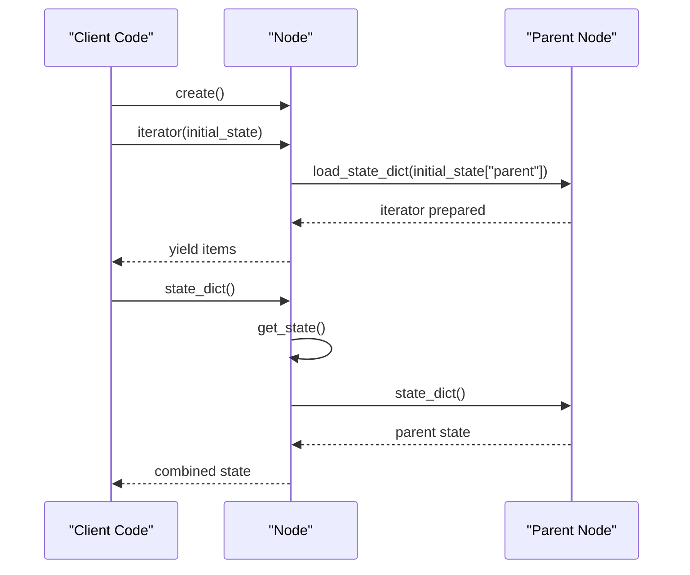
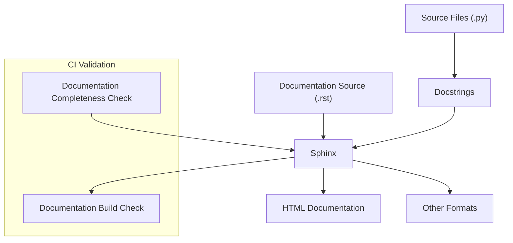
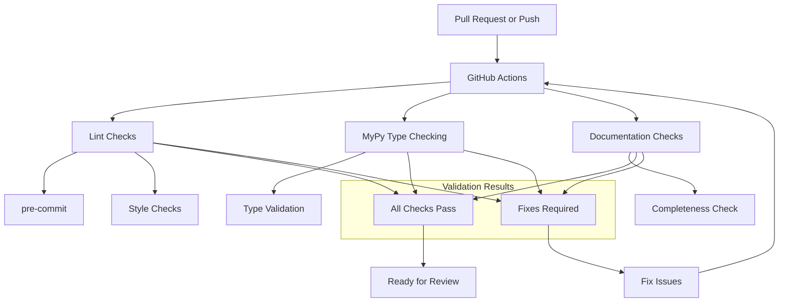

<!-- source: DeepWiki mcp.deepwiki.com · repo pytorch/data · page 4 Development and Contribution · fetched 2026-10-21 -->

# Development and Contribution

<details>
<summary>Relevant source files</summary>

The following files were used as context for generating this wiki page:

- [.github/workflows/lint.yml](.github/workflows/lint.yml)
- [CONTRIBUTING.md](CONTRIBUTING.md)
- [docs/Makefile](docs/Makefile)
- [docs/source/conf.py](docs/source/conf.py)
- [mypy.ini](mypy.ini)
- [pyproject.toml](pyproject.toml)

</details>


This page provides a comprehensive guide for developers interested in contributing to the TorchData repository. It covers the development environment setup, contribution workflow, code quality standards, testing procedures, and documentation system. For information about the build and release process, see [Build and Release Process](#4.1).

## Setting Up Development Environment

To begin contributing to TorchData, you need to set up a proper development environment.

### Installing Prerequisites

```bash
# Install PyTorch Nightly
conda install pytorch -c pytorch-nightly
# or with pip
pip install --pre torch --index-url https://download.pytorch.org/whl/nightly/cpu

# Clone and install TorchData in development mode
git clone https://github.com/pytorch/data.git
cd data
pip install -e .
pip install -r test/requirements.txt
```

Sources: [CONTRIBUTING.md:50-66]()

## Contribution Workflow

The following diagram illustrates the typical workflow for contributing to TorchData:



Sources: [CONTRIBUTING.md:38-46](), [CONTRIBUTING.md:69-78]()

### Pull Request Guidelines

When submitting a pull request:

1. Fork the repo and create your branch from `main`
2. Add tests for any new functionality
3. Update documentation for API changes
4. Ensure all tests pass
5. Complete the Contributor License Agreement (CLA) if you haven't already

Contributors must sign the CLA to have their contributions accepted: https://code.facebook.com/cla

Sources: [CONTRIBUTING.md:38-46](), [CONTRIBUTING.md:141-146]()

## Code Quality Standards

TorchData maintains high code quality standards through automated tools and processes.

### Code Formatting

TorchData uses `pre-commit` hooks to enforce consistent code formatting:

```bash
# Install pre-commit
conda install -c conda-forge pre-commit
# or
pip install pre-commit

# Install the hooks
cd data
pre-commit install --install-hooks
```

Sources: [CONTRIBUTING.md:69-78]()

### Type Checking with MyPy

TorchData uses MyPy for static type checking:

```bash
# Run MyPy type checking
mypy --config-file=mypy.ini
```

The MyPy configuration defines strict type checking rules and handles third-party dependencies:

| Setting | Value | Purpose |
|---------|-------|---------|
| `check_untyped_defs` | True | Checks the body of functions without type annotations |
| `show_error_codes` | True | Shows error codes for easier debugging |
| `exclude` | examples, test, packaging | Excludes specific directories from checking |
| `python_version` | 3.9 | Sets Python version for type checking |

Sources: [CONTRIBUTING.md:82-86](), [mypy.ini:1-67]()

## Development Tools and Processes

The following diagram shows the relationship between various development tools used in TorchData:



Sources: [.github/workflows/lint.yml:1-89](), [mypy.ini:1-67](), [CONTRIBUTING.md:82-90]()

### Running Tests

To run unit tests locally:

```bash
pytest --durations=0 --no-header -v test/nodes/
```

Sources: [CONTRIBUTING.md:89-90]()

## Adding New Components

### Guidelines for Adding New Nodes

When adding a new Node to TorchData, follow this checklist:

1. **Functionality**: Ensure your Node subclasses `BaseNode` and implements required methods:
   - `.iterator(self, initial_state: Optional[Dict[str, Any]])` 
   - `.get_state(self) -> Dict[str, Any]`

2. **Type Hints**: Include type annotations for all public functions and methods

3. **Testing**: Add unit tests to verify functionality and state management
   - Use `test.nodes.utils.run_test_save_load_state` for basic state testing

4. **Documentation**: Include docstrings and usage examples

5. **Import**: Add the Node to the appropriate `__init__.py` file

Sources: [CONTRIBUTING.md:92-140]()

### Node Implementation Rules

The following diagram illustrates the state management pattern for TorchData Nodes:



Key state management assumptions:
- State is managed solely by the BaseNode, not through any iterators returned from them
- `state_dict()` returns the state of the most recently requested iterator
- `load_state_dict()` will set the state for the next iterator

Sources: [CONTRIBUTING.md:96-101](), [CONTRIBUTING.md:112-131]()

## Documentation System

TorchData uses Sphinx for documentation generation. The documentation build process is as follows:



Sources: [docs/source/conf.py:1-119](), [docs/Makefile:1-44](), [.github/workflows/lint.yml:77-88]()

### Building Documentation Locally

To build the documentation locally:

```bash
cd docs
make html       # Full build with examples
# or
make html-noplot  # Faster build without running examples
```

Sources: [docs/Makefile:26-29]()

### Documentation Completeness Check

TorchData CI includes a check that verifies all public APIs are properly documented. This check runs automatically on pull requests.

```bash
python ./.github/scripts/check_complete_doc.py
```

Sources: [.github/workflows/lint.yml:77-88]()

## CI/CD Workflows

The following diagram shows the Continuous Integration workflow for TorchData:



Sources: [.github/workflows/lint.yml:1-89]()

## Common Issues and Solutions

Here are some common issues contributors might encounter and their solutions:

| Issue | Solution |
|-------|----------|
| Pre-commit hooks failing | Run `pre-commit run --all-files` to see the issues and fix them |
| MyPy errors | Check error codes and fix type annotations accordingly |
| Test failures | Run specific failing tests with more verbosity to debug |
| Documentation build errors | Check Sphinx warnings and fix documentation formatting |
| Missing CLA | Visit the CLA link and complete the agreement |

Sources: [CONTRIBUTING.md:69-86](), [.github/workflows/lint.yml:25-29]()

---

