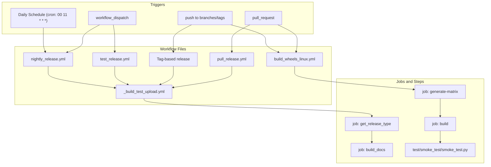
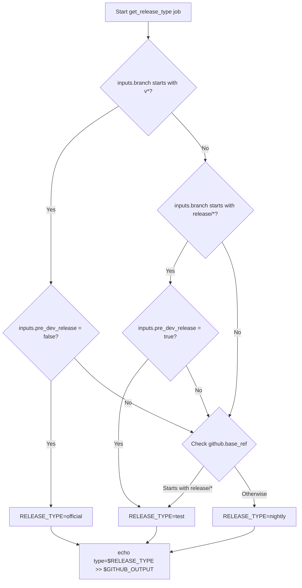
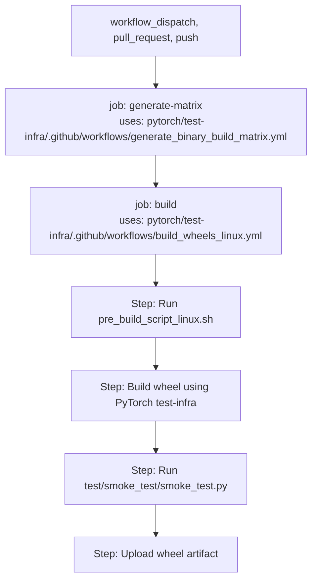
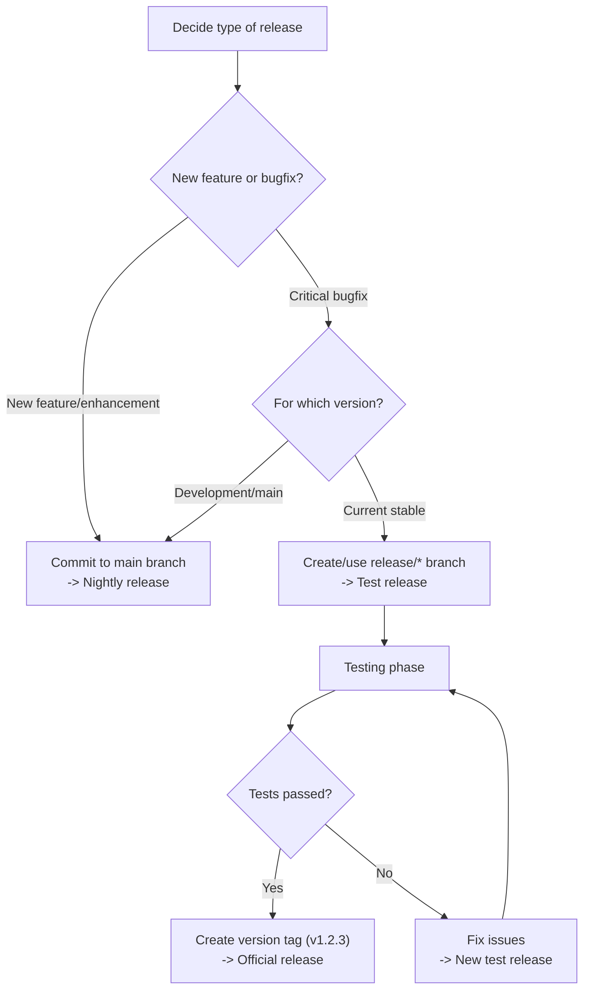

<!-- source: DeepWiki mcp.deepwiki.com · repo pytorch/data · page 4.1 Build and Release Process · fetched 2026-10-21 -->

# Build and Release Process

<details>
<summary>Relevant source files</summary>

The following files were used as context for generating this wiki page:

- [.github/workflows/_build_test_upload.yml](.github/workflows/_build_test_upload.yml)
- [.github/workflows/build_wheels_linux.yml](.github/workflows/build_wheels_linux.yml)
- [.github/workflows/nightly_release.yml](.github/workflows/nightly_release.yml)
- [.github/workflows/pull_release.yml](.github/workflows/pull_release.yml)
- [.github/workflows/test_release.yml](.github/workflows/test_release.yml)
- [packaging/env-var-script.txt](packaging/env-var-script.txt)
- [test/smoke_test/smoke_test.py](test/smoke_test/smoke_test.py)

</details>


## Purpose and Overview

This document outlines the automated build and release workflows for the TorchData library. It covers the different types of releases (nightly, test, and official), how they're triggered, and the GitHub Actions workflows that implement them. The page also details the wheel building process, testing, and documentation deployment mechanisms.

For information about code quality and testing frameworks, see the [Code Quality and Testing](#4.2) page. For details on how documentation is built and maintained, see the [Documentation System](#4.3) page.

## Types of Releases

TorchData supports three main types of releases, each serving a different purpose in the development lifecycle:

| Release Type | Source Branch | Purpose | Trigger |
|--------------|---------------|---------|---------|
| Nightly | `main` | Latest features and changes | Daily schedule or manual |
| Test | `release/*` | Pre-release testing | Manual |
| Official | Version tags (e.g., `v0.5.0`) | Stable releases | Tag push |

Sources: [.github/workflows/nightly_release.yml](), [.github/workflows/test_release.yml]()

## Release Workflow Architecture

The following diagram illustrates how the different GitHub Actions workflows interact to implement the release process:



Sources: [.github/workflows/_build_test_upload.yml](), [.github/workflows/test_release.yml](), [.github/workflows/nightly_release.yml](), [.github/workflows/pull_release.yml](), [.github/workflows/build_wheels_linux.yml]()

## Reusable Build Workflow

The core of the build and release process is the reusable workflow defined in `_build_test_upload.yml`. This workflow is called by the other release workflows with specific parameters.

### Release Type Determination

The first job in the reusable workflow determines the release type based on input parameters:



Sources: [.github/workflows/_build_test_upload.yml:21-41]()

### Documentation Building and Deployment

After determining the release type, the workflow builds and deploys documentation to GitHub Pages:

1. Sets up Python 3.9
2. Checks out the specified branch
3. Installs dependencies
4. Installs PyTorch and TorchData
5. Builds the documentation using Sphinx
6. Deploys to GitHub Pages under a folder determined by the branch name

The target folder for deployment depends on the branch name:
- For `release/*` branches, the folder is the part after `release/`
- For version tags with patch versions (v1.2.3), the patch version is removed (becomes 1.2)
- For official releases, the `v` prefix is removed

Sources: [.github/workflows/_build_test_upload.yml:43-113]()

## Nightly Release Process

The nightly release workflow is defined in `nightly_release.yml` and is triggered:
- Daily at 11:00 UTC via a cron job
- Manually via workflow dispatch

It calls the reusable build workflow with these parameters:
- `branch`: "main"
- `pre_dev_release`: true
- `pytorch_version`: "" (empty, uses latest)

This configuration builds from the `main` branch and marks it as a pre-development release.

Sources: [.github/workflows/nightly_release.yml:1-20]()

## Test Release Process

The test release workflow is defined in `test_release.yml` and is triggered manually. It runs only on `release/*` branches and calls the reusable build workflow with these parameters:

- `branch`: "release/0.11" (specific release branch)
- `pre_dev_release`: true
- `pytorch_version`: "2.6.0" (specific PyTorch version)

This ensures that test releases are built with compatible PyTorch versions.

Sources: [.github/workflows/test_release.yml:1-37]()

## Wheel Building Process

TorchData builds wheels for various platforms and Python versions. The Linux wheel building process is defined in `build_wheels_linux.yml`:



Key features of the wheel building process:
1. Uses PyTorch's test-infra repository for standardized builds
2. Currently builds for Python 3.9
3. Runs a smoke test to verify the built package works
4. Does not include CUDA or ROCm support by default

Sources: [.github/workflows/build_wheels_linux.yml:1-56]()

## Environment Variables and Platform-Specific Settings

TorchData uses specific environment variables for platform-specific builds. For macOS builds, `MACOSX_DEPLOYMENT_TARGET` is set to "10.13" to ensure compatibility with older macOS versions.

Sources: [packaging/env-var-script.txt]()

## Smoke Testing

After building the wheels, a simple smoke test (`test/smoke_test/smoke_test.py`) is run to verify that the package works. The smoke test imports key modules from the package:

```python
def stateful_dataloader_test():
    from torchdata.nodes import Loader
    from torchdata.stateful_dataloader import StatefulDataLoader
```

This test confirms that the built package can be imported and its core components are accessible.

Sources: [test/smoke_test/smoke_test.py:1-18]()

## Pull Request Testing

The `pull_release.yml` workflow tests the release pipelines when changes are made to the release workflow files. This helps ensure that changes to the release process don't break the build system. It calls the reusable build workflow with test parameters but without actually uploading artifacts.

Sources: [.github/workflows/pull_release.yml:1-23]()

## Release Decision Flow

The following diagram illustrates the decision flow for determining which type of release to create:



This diagram shows how code changes flow through the release process, from development in the main branch to eventual stable releases.

Sources: [.github/workflows/nightly_release.yml](), [.github/workflows/test_release.yml]()

---

