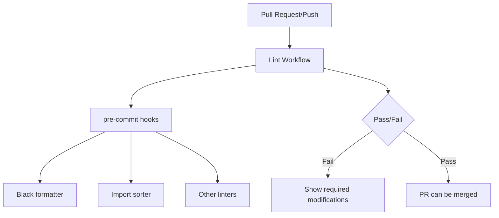
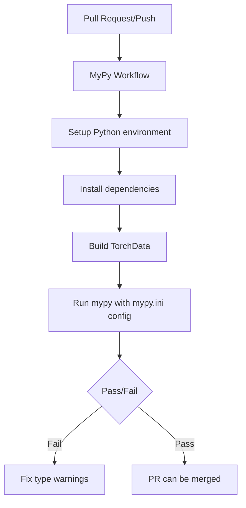
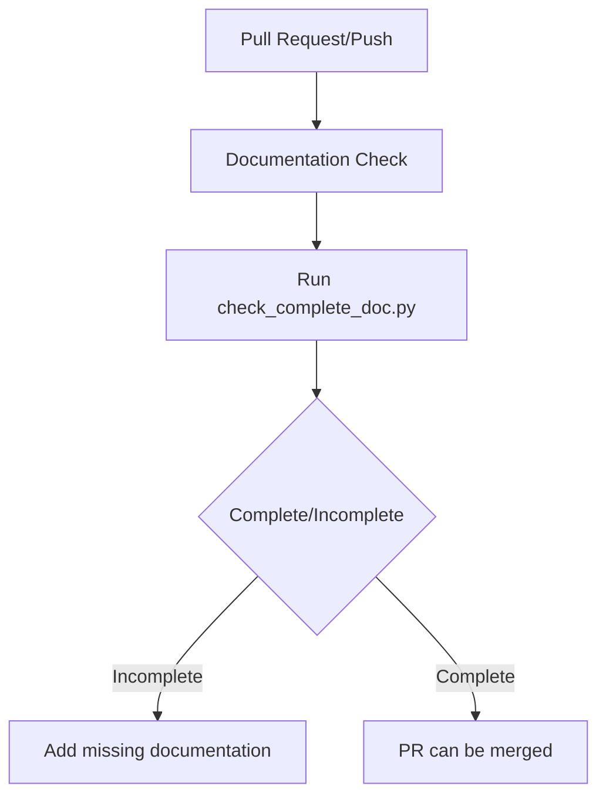
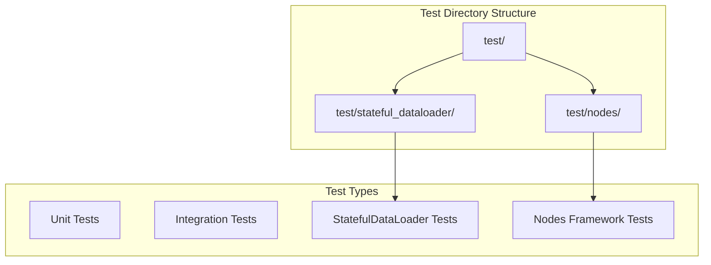
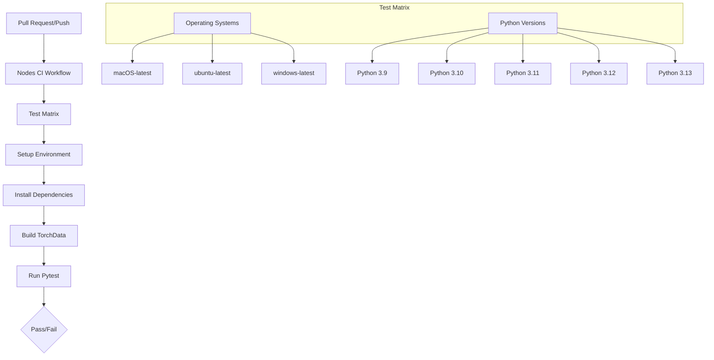
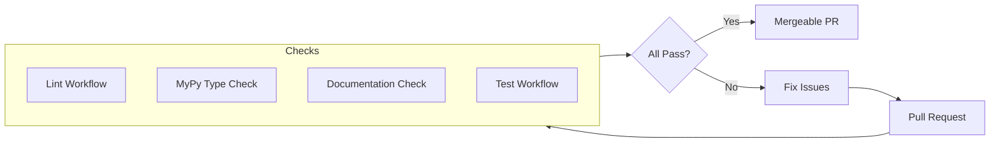

<!-- source: DeepWiki mcp.deepwiki.com · repo pytorch/data · page 4.2 Code Quality and Testing · fetched 2026-10-21 -->

# Code Quality and Testing

<details>
<summary>Relevant source files</summary>

The following files were used as context for generating this wiki page:

- [.github/workflows/lint.yml](.github/workflows/lint.yml)
- [.github/workflows/nodes_ci.yml](.github/workflows/nodes_ci.yml)
- [mypy.ini](mypy.ini)
- [pyproject.toml](pyproject.toml)
- [test/nodes/__init__.py](test/nodes/__init__.py)
- [test/requirements.txt](test/requirements.txt)
- [test/stateful_dataloader/test_hugging_face.py](test/stateful_dataloader/test_hugging_face.py)

</details>


This page documents the code quality tools and testing frameworks used in the TorchData repository. It covers the static analysis tools, type checking, testing infrastructure, and continuous integration workflows that ensure TorchData's reliability and maintainability. For information about the build and release process, see [Build and Release Process](#4.1), and for documentation systems, see [Documentation System](#4.3).

## Static Analysis and Code Quality Tools

TorchData employs several static analysis and code quality tools to maintain consistency and catch issues early in development.

### Linting and Code Formatting

The project uses pre-commit hooks, Black, and usort to ensure code style consistency:

1. **Black**: Configured for Python code formatting with a line length of 120 characters
2. **usort**: Used for import sorting 

These tools are configured in the project's `pyproject.toml` file:

```python
[tool.usort]
first_party_detection = false

[tool.black]
line-length = 120
target-version = ["py39"]
```

The GitHub Actions workflow runs linting on all PRs and pushes to main and release branches:



Sources: [.github/workflows/lint.yml:10-30](), [pyproject.toml:1-9]()

### Type Checking with mypy

TorchData uses mypy for static type checking, configured via `mypy.ini`:



Key mypy configuration settings include:

| Setting | Value | Purpose |
|---------|-------|---------|
| `check_untyped_defs` | `True` | Check function bodies even if they don't have type annotations |
| `warn_redundant_casts` | `True` | Warn about casting that doesn't change types |
| `show_error_codes` | `True` | Display error codes for easier diagnosis |
| `files` | `torchdata` | Limit type checking to source files |
| `exclude` | `examples, test, packaging` | Directories to exclude |
| `python_version` | `3.9` | Python version to target for typing |

The configuration also includes numerous third-party library imports marked with `ignore_missing_imports = True` for external packages that don't provide type stubs.

Sources: [.github/workflows/lint.yml:31-75](), [mypy.ini:1-67]()

### Documentation Completeness Check

The linting workflow includes a check to ensure documentation is complete:



Sources: [.github/workflows/lint.yml:77-88]()

## Testing Framework

TorchData uses pytest as its primary testing framework, with additional supporting libraries.

### Test Dependencies

The core test dependencies include:

| Dependency | Purpose |
|------------|---------|
| `pytest` | Testing framework |
| `expecttest` | Test assertions for expected outputs |
| `fsspec` | Filesystem interface tests |
| `datasets` | Test integration with HuggingFace datasets |
| `numpy` | Numerical computing support |
| `graphviz` | Graph visualization for testing |
| `parameterized` | Parameterized test support |
| `psutil` | System resource monitoring |

Sources: [test/requirements.txt:1-10]()

### Test Organization

Tests are organized by component, with separate directories for different subsystems:



Sources: [test/nodes/__init__.py](), [test/stateful_dataloader/test_hugging_face.py:1-114]()

### Test Case Example

Tests in TorchData typically follow this pattern:

1. Set up test scenarios
2. Run code with various parameters
3. Checkpoint and compare results
4. Verify expected behavior

For example, the `test_hugging_face.py` file demonstrates testing of the StatefulDataLoader with HuggingFace datasets, including checkpointing and state restoration.

Sources: [test/stateful_dataloader/test_hugging_face.py:34-113]()

## Continuous Integration

TorchData uses GitHub Actions for continuous integration, with dedicated workflows for testing across different environments.

### Matrix Testing

The CI system runs tests across multiple dimensions:



Tests are run on:
- Multiple operating systems (Ubuntu, macOS, Windows)
- Multiple Python versions (3.9, 3.10, 3.11, 3.12, 3.13 with some exclusions)
- Different PyTorch channels (nightly or test) depending on the branch

Sources: [.github/workflows/nodes_ci.yml:1-88]()

### CI Workflow

The complete CI workflow includes:

1. **Lint checks**: Ensuring code format and style
2. **Type checking**: Verifying type annotations with mypy
3. **Documentation check**: Ensuring documentation completeness
4. **Matrix testing**: Testing across various environments



Sources: [.github/workflows/lint.yml:1-88](), [.github/workflows/nodes_ci.yml:1-88]()

## Test Strategy and Coverage

TorchData employs a comprehensive testing strategy that focuses on several key areas:

1. **Unit testing**: Individual components and functions
2. **Integration testing**: Component interactions
3. **Cross-platform compatibility**: Testing across OS and Python versions
4. **State management testing**: Verifying stateful operations like checkpointing

A particular focus is placed on testing the stateful operations that are central to TorchData's purpose, such as the ability to checkpoint and resume data loading operations.

## Development Workflow with Testing

The recommended development workflow for TorchData includes:

1. Install development dependencies:
   ```bash
   pip install -r requirements.txt
   pip install -r test/requirements.txt
   ```

2. Set up pre-commit hooks:
   ```bash
   pip install pre-commit
   pre-commit install-hooks
   ```

3. Run linters before committing:
   ```bash
   pre-commit run --all-files
   ```

4. Run type checking:
   ```bash
   mypy --config=mypy.ini
   ```

5. Run the relevant tests for your changes:
   ```bash
   pytest test/path/to/relevant/tests
   ```

6. Submit a PR and ensure all CI checks pass

This workflow ensures that code quality is maintained and that new features or bug fixes don't break existing functionality.

---

