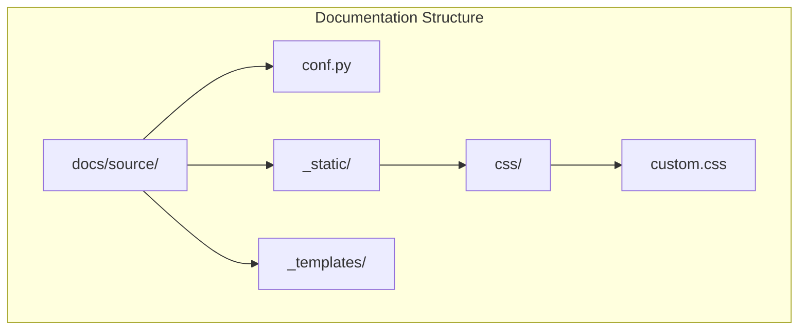
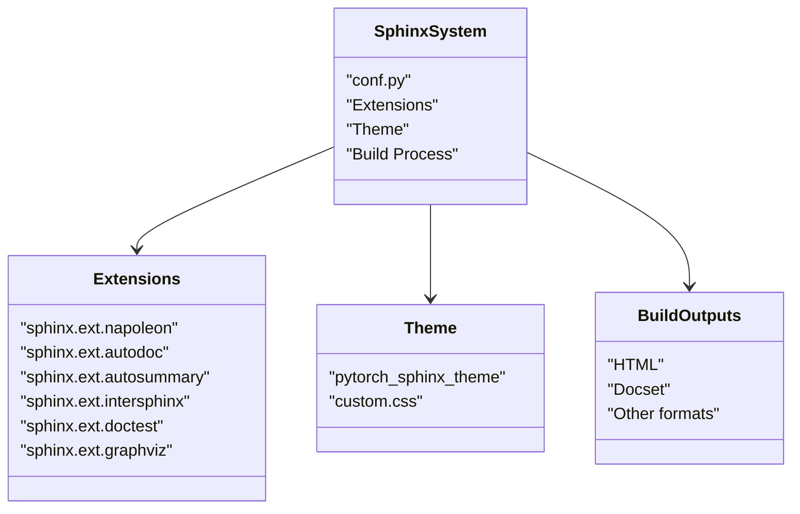
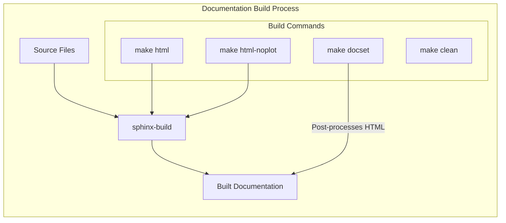
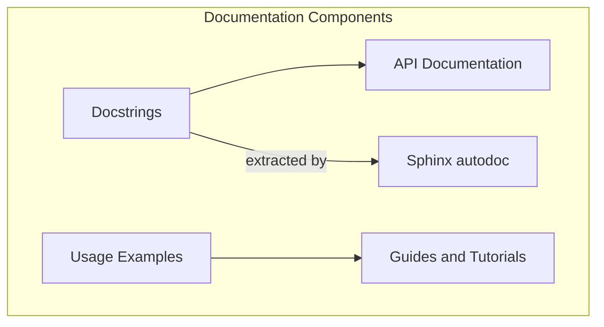
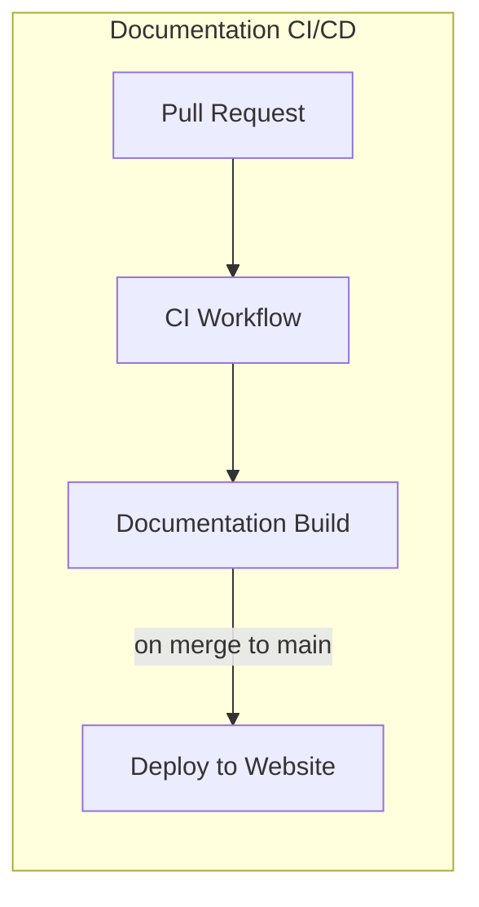

<!-- source: DeepWiki mcp.deepwiki.com · repo pytorch/data · page 4.3 Documentation System · fetched 2026-10-21 -->

# Documentation System

Relevant source files

The following files were used as context for generating this wiki page:

- [CONTRIBUTING.md](CONTRIBUTING.md)
- [docs/Makefile](docs/Makefile)
- [docs/README.md](docs/README.md)
- [docs/make.bat](docs/make.bat)
- [docs/requirements.txt](docs/requirements.txt)
- [docs/source/_static/css/custom.css](docs/source/_static/css/custom.css)
- [docs/source/conf.py](docs/source/conf.py)
- [docs/source/docutils.conf](docs/source/docutils.conf)

This page describes the documentation system used in the TorchData repository, including how it's structured, built, and maintained. It covers the tools, processes, and conventions used to generate the official documentation.

## Purpose and Scope

The TorchData documentation system serves to provide comprehensive, up-to-date technical documentation for users and contributors. This includes API references, usage guides, and development information. The system is built around Sphinx, a powerful documentation generator widely used in the Python ecosystem.

Sources: [docs/README.md](), [docs/source/conf.py:33-43]()

## Documentation Structure

TorchData's documentation follows a standard Sphinx-based structure, with source files organized in a specific hierarchy.

Sources: [docs/source/conf.py:64-65](), [docs/source/conf.py:94-98]()

The main components include:
- **Source files** - Located in `docs/source/`
- **Configuration** - Sphinx settings in `conf.py`
- **Static assets** - CSS, images, and other resources
- **Templates** - Custom HTML templates for the documentation

## Documentation Toolchain

TorchData uses a suite of documentation tools, centered around Sphinx, to generate comprehensive documentation from source code and manually written guides.

Sources: [docs/source/conf.py:51-58](), [docs/source/conf.py:79-89]()

### Sphinx Configuration

The Sphinx configuration in `conf.py` defines how the documentation is processed and rendered. Key configurations include:

- **Project Information**: Name, version, and author details
- **Extensions**: Additional Sphinx capabilities like autodoc and napoleon
- **Theme Settings**: PyTorch theme configuration
- **Path Setup**: Import paths for autogenerated API docs

Sources: [docs/source/conf.py:33-43](), [docs/source/conf.py:51-58]()

### Extensions

TorchData utilizes several important Sphinx extensions:

| Extension | Purpose |
|-----------|---------|
| `sphinx.ext.napoleon` | Support for Google/NumPy style docstrings |
| `sphinx.ext.autodoc` | API documentation from docstrings |
| `sphinx.ext.autosummary` | Generate summaries of modules |
| `sphinx.ext.intersphinx` | Link to other projects' documentation |
| `sphinx.ext.doctest` | Test code examples in docs |
| `sphinx.ext.graphviz` | Support for graphviz diagrams |

Sources: [docs/source/conf.py:51-58]()

### Theme and Styling

TorchData uses the PyTorch Sphinx theme for consistent branding with other PyTorch libraries, with additional customizations:

- **PyTorch Theme**: Base styling consistent with PyTorch ecosystem
- **Custom CSS**: Additional styling in `_static/css/custom.css`
- **Theme Options**: Navigation behavior, version display, logo settings

Sources: [docs/source/conf.py:79-89](), [docs/source/_static/css/custom.css:9-15]()

## Building the Documentation

The process of building the documentation converts source files into rendered output formats. This is typically done locally during development and by CI systems for deployment.

Sources: [docs/Makefile:8-37](), [docs/README.md:1-16]()

### Build Requirements

To build the documentation, you need:
- Python with Sphinx installed
- PyTorch Sphinx Theme
- Other dependencies listed in `docs/requirements.txt`

Sources: [docs/requirements.txt:1-6]()

### Build Commands

The documentation can be built using these make commands:

| Command | Description |
|---------|-------------|
| `make html` | Build HTML documentation |
| `make html-noplot` | Build HTML docs without running gallery examples |
| `make docset` | Build documentation for Dash/Zeal browsers |
| `make clean` | Remove built documentation |

Sources: [docs/Makefile:8-37](), [docs/README.md:9-15]()

## Writing Documentation

When contributing to TorchData, proper documentation is a key requirement. This includes:

Sources: [CONTRIBUTING.md:17-18](), [CONTRIBUTING.md:138]()

### Node Documentation Requirements

When adding a new Node to TorchData, there are specific documentation requirements:

1. **Docstrings**: Every Node must have proper docstrings
2. **Usage Example**: Include an example of how to use the Node
3. **Type Hints**: All public functions and methods must have type hints
4. **Import in __init__.py**: Ensure the Node is properly imported

Sources: [CONTRIBUTING.md:138-139]()

### Docstring Format

TorchData uses Google-style docstrings, which are processed by the Sphinx Napoleon extension. A proper Node docstring should include:

- Description of what the Node does
- Parameters with types and descriptions
- Return values with types and descriptions
- Examples of usage

Sources: [docs/source/conf.py:51-58]()

## Documentation CI/CD

The documentation is built and deployed automatically as part of the continuous integration and delivery process.

Sources: [CONTRIBUTING.md:10-28]()

### CI Documentation Checks

Pull requests that affect documentation are subject to automatic checks:
- Documentation builds successfully without errors
- Links are valid
- Examples run correctly

This ensures that documentation remains consistent and functional as the codebase evolves.

Sources: [CONTRIBUTING.md:22-24]()

## Improving Documentation

TorchData welcomes contributions to improve documentation. Common improvements include:

1. Fixing typos or grammatical errors
2. Clarifying explanations
3. Adding examples
4. Expanding coverage of features

Documentation improvements follow the same pull request process as code contributions.

Sources: [CONTRIBUTING.md:17-18](), [docs/README.md:17-20]()