# Page: Overview

# Overview

<details>
<summary>Relevant source files</summary>

The following files were used as context for generating this wiki page:

- [README.md](README.md)
- [docs/source/getting_started_with_torchdata_nodes.rst](docs/source/getting_started_with_torchdata_nodes.rst)
- [docs/source/index.rst](docs/source/index.rst)
- [docs/source/migrate_to_nodes_from_utils.rst](docs/source/migrate_to_nodes_from_utils.rst)
- [docs/source/stateful_dataloader_tutorial.rst](docs/source/stateful_dataloader_tutorial.rst)
- [docs/source/torchdata.nodes.rst](docs/source/torchdata.nodes.rst)
- [docs/source/what_is_torchdata_nodes.rst](docs/source/what_is_torchdata_nodes.rst)
- [setup.py](setup.py)
- [version.txt](version.txt)

</details>


TorchData is a Python library that extends PyTorch's data loading capabilities to make them more scalable and performant. This document provides a high-level overview of the TorchData repository, its purpose, architecture, and main components.

## Purpose and Scope

TorchData aims to enhance PyTorch's existing `torch.utils.data.DataLoader` and `torch.utils.data.Dataset/IterableDataset` by adding features that address common challenges in data loading for machine learning workflows. It focuses on two main components:

1. **StatefulDataLoader**: A drop-in replacement for the standard PyTorch DataLoader that adds checkpointing capabilities
2. **torchdata.nodes**: A framework of composable iterators that allows for flexible construction of data processing pipelines

For detailed instructions on installation, see [Installation and Getting Started](#1.2).

Sources: [README.md:8-32]()

## Core Architecture

The TorchData library consists of two primary systems: StatefulDataLoader and the nodes framework. These systems can be used independently or together, depending on your requirements.

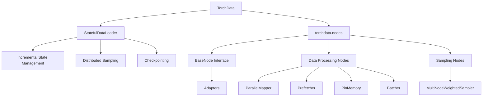

**Core Architecture Diagram: TorchData Main Components**

Sources: [README.md:8-32](), [docs/source/index.rst:12-32]()

## Key Components

### StatefulDataLoader

`StatefulDataLoader` extends PyTorch's `DataLoader` by adding state management capabilities through `state_dict()` and `load_state_dict()` methods. This enables:

- Mid-epoch checkpointing for resuming training from exact positions
- Tracking custom iteration progress
- Capturing custom states from dataloader workers (e.g., token buffers, RNG states)

The StatefulDataLoader is designed as a drop-in replacement for the standard DataLoader, meaning it maintains the same interface while adding the stateful functionality.

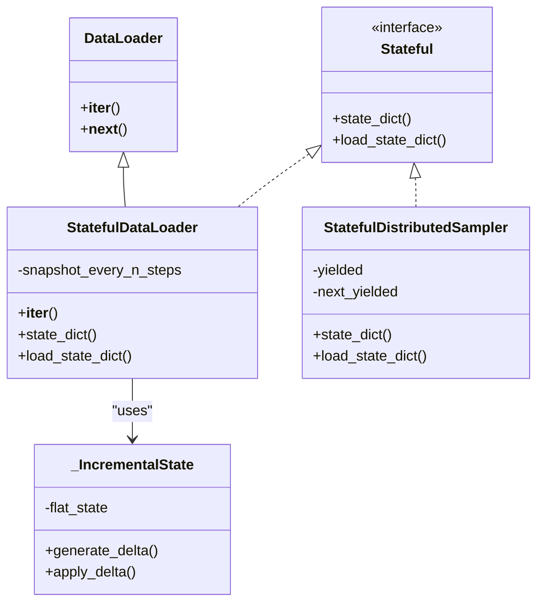

**Class Diagram: StatefulDataLoader Architecture**

Sources: [README.md:19-25](), [docs/source/stateful_dataloader_tutorial.rst:1-27]()

### torchdata.nodes Framework

The `torchdata.nodes` framework provides a library of composable iterators (not iterables) that allow you to chain together common data loading and preprocessing operations. It follows a streaming programming model but also supports the traditional "sampler + Map-style" approach if needed.

Key features of the nodes framework include:

- `BaseNode` interface that all nodes implement
- Explicit state handling for checkpointing and resumption
- Parallel processing capabilities (both thread and process-based)
- Memory optimization through prefetching and pinning

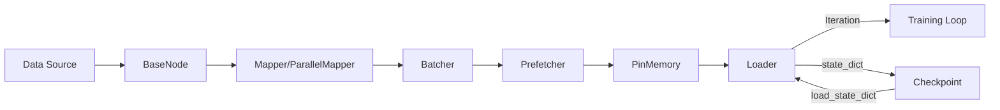

**Flow Diagram: Data Processing Pipeline with torchdata.nodes**

Sources: [README.md:27-32](), [docs/source/what_is_torchdata_nodes.rst:1-167]()

## Relationship to PyTorch Ecosystem

TorchData is designed to integrate seamlessly with the existing PyTorch ecosystem, extending and enhancing its data loading capabilities rather than replacing them.

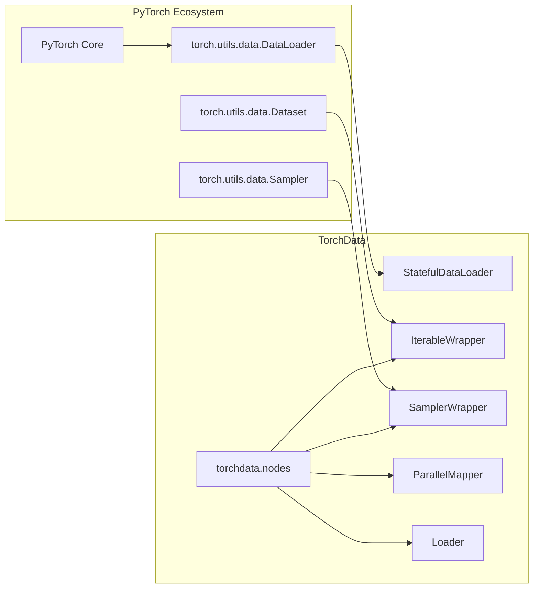

**Component Diagram: TorchData Integration with PyTorch**

Sources: [README.md:8-17](), [docs/source/getting_started_with_torchdata_nodes.rst:26-58]()

## Key Advantages

### 1. Stateful Operations

TorchData's state management capabilities allow for checkpointing and resuming data loading at precise points, which is critical for long-running training workloads that may be interrupted.

### 2. Flexible Parallelism

The nodes framework supports both thread-based and process-based parallelism, allowing users to choose the most appropriate method for their specific workload:

- **Multi-processing**: Similar to PyTorch's DataLoader, good for CPU-bound operations
- **Multi-threading**: Can be more efficient for I/O-bound operations and reduces memory overhead

### 3. Composable Design

The nodes framework provides a composable approach to building data pipelines, allowing for flexible combinations of data loading, preprocessing, and augmentation steps.

Sources: [docs/source/what_is_torchdata_nodes.rst:94-112]()

## Version Compatibility

TorchData maintains compatibility with specific versions of PyTorch and Python:

| `torch` | `torchdata` | `python` |
|---------|-------------|----------|
| `master` / `nightly` | `main` / `nightly` | `>=3.9`, `<=3.13` |
| `2.6.0` | `0.11.0` | `>=3.9`, `<=3.13` |
| `2.5.0` | `0.10.0` | `>=3.9`, `<=3.12` |
| `2.5.0` | `0.9.0` | `>=3.9`, `<=3.12` |
| `2.4.0` | `0.8.0` | `>=3.8`, `<=3.12` |
| `2.0.0` | `0.6.0` | `>=3.8`, `<=3.11` |
| `1.13.1` | `0.5.1` | `>=3.7`, `<=3.10` |

Sources: [README.md:36-51](), [setup.py:117-130]()

## Feature Status

The features in TorchData are classified into different development stages:

- **Stable**: Long-term maintained features with good performance and documentation
- **Beta**: Features that may change based on user feedback, but the team is committed to seeing them through to stability
- **Prototype**: Early-stage features for feedback and testing

Currently, both the StatefulDataLoader and torchdata.nodes framework are in Beta status.

Sources: [docs/source/index.rst:12-32]()

## Conclusion

TorchData extends PyTorch's data loading capabilities with stateful operations and a flexible, composable nodes framework. It aims to address common challenges in data loading for machine learning, particularly around checkpointing, parallelism, and complex data pipeline construction. The library is designed to integrate seamlessly with the existing PyTorch ecosystem while adding valuable new capabilities.

---

# Page: Key Features and Components

# Key Features and Components

<details>
<summary>Relevant source files</summary>

The following files were used as context for generating this wiki page:

- [README.md](README.md)
- [docs/source/getting_started_with_torchdata_nodes.rst](docs/source/getting_started_with_torchdata_nodes.rst)
- [docs/source/index.rst](docs/source/index.rst)
- [docs/source/migrate_to_nodes_from_utils.rst](docs/source/migrate_to_nodes_from_utils.rst)
- [docs/source/stateful_dataloader_tutorial.rst](docs/source/stateful_dataloader_tutorial.rst)
- [docs/source/torchdata.nodes.rst](docs/source/torchdata.nodes.rst)
- [docs/source/what_is_torchdata_nodes.rst](docs/source/what_is_torchdata_nodes.rst)
- [setup.py](setup.py)
- [version.txt](version.txt)

</details>


## Purpose and Scope

This document provides an overview of the primary features and components of the TorchData library. It summarizes the core architectural elements and explains how they relate to each other. For installation instructions, see [Installation and Getting Started](#1.2).

## Overview of TorchData

TorchData is an extension library for PyTorch that enhances data loading capabilities by providing scalable and performant solutions beyond the standard `torch.utils.data` module. It consists of two primary systems:

1. `StatefulDataLoader`: A drop-in replacement for PyTorch's DataLoader with checkpointing capabilities
2. `torchdata.nodes`: A framework of composable iterators for building flexible data processing pipelines

## Core Architecture Diagram


Sources: [README.md:8-32]()

## StatefulDataLoader

The `StatefulDataLoader` is a drop-in replacement for PyTorch's standard DataLoader that adds state management capabilities. It provides functionality to checkpoint and resume data loading operations, which is particularly valuable for long-running training processes.

### Key Features of StatefulDataLoader

1. **State Management**: Enables mid-epoch checkpointing through `state_dict()` and `load_state_dict()` methods
2. **Custom State Tracking**: Allows tracking custom iteration progress and worker-specific states (like token buffers and RNG states)
3. **Compatibility**: Works as a direct replacement for `torch.utils.data.DataLoader`
4. **Distributed Training Support**: Handles state properly in distributed training scenarios


Sources: [README.md:14-25](), [docs/source/stateful_dataloader_tutorial.rst:1-29]()

## torchdata.nodes Framework

The `torchdata.nodes` framework provides a library of composable iterators (not iterables) that enable the construction of flexible data loading and processing pipelines. It follows a streaming programming model but also supports the "sampler + Map-style" approach.

### Key Features of torchdata.nodes

1. **Composable Iterators**: Chain together common data loading and pre-processing operations
2. **Parallelism Options**: Supports both multi-threading and multi-processing approaches
3. **State Management**: First-class support for checkpointing through `state_dict`/`load_state_dict` interface
4. **Performance Optimizations**: Includes prefetching and memory management optimizations

### Core Components of torchdata.nodes

#### BaseNode Interface

The foundation of the nodes framework is the `BaseNode` interface, which all nodes must implement. It defines the core operations:

- `next()`: Get the next item
- `reset(initial_state)`: Reset the node to its initial state or a provided state
- `get_state()`: Retrieve the current state for checkpointing

#### Adapters

Adapters bridge existing PyTorch data structures with the nodes framework:

- `IterableWrapper`: Wraps any iterable (including generators) to convert it to a BaseNode
- `SamplerWrapper`: Converts a PyTorch Sampler to a BaseNode

#### Processing Nodes

These nodes handle data transformation and processing:

- `ParallelMapper`: Applies a mapping function in parallel using either threads or processes
- `Batcher`: Groups items into batches
- `Prefetcher`: Prefetches data to improve throughput
- `PinMemory`: Pins memory for faster GPU transfer

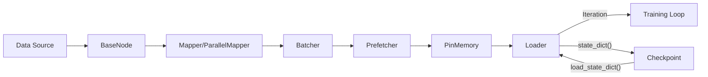

Sources: [README.md:27-32](), [docs/source/what_is_torchdata_nodes.rst:1-167](), [docs/source/getting_started_with_torchdata_nodes.rst:1-58]()

## Component Relationships with PyTorch Ecosystem

The following diagram illustrates how TorchData components integrate with the PyTorch ecosystem:

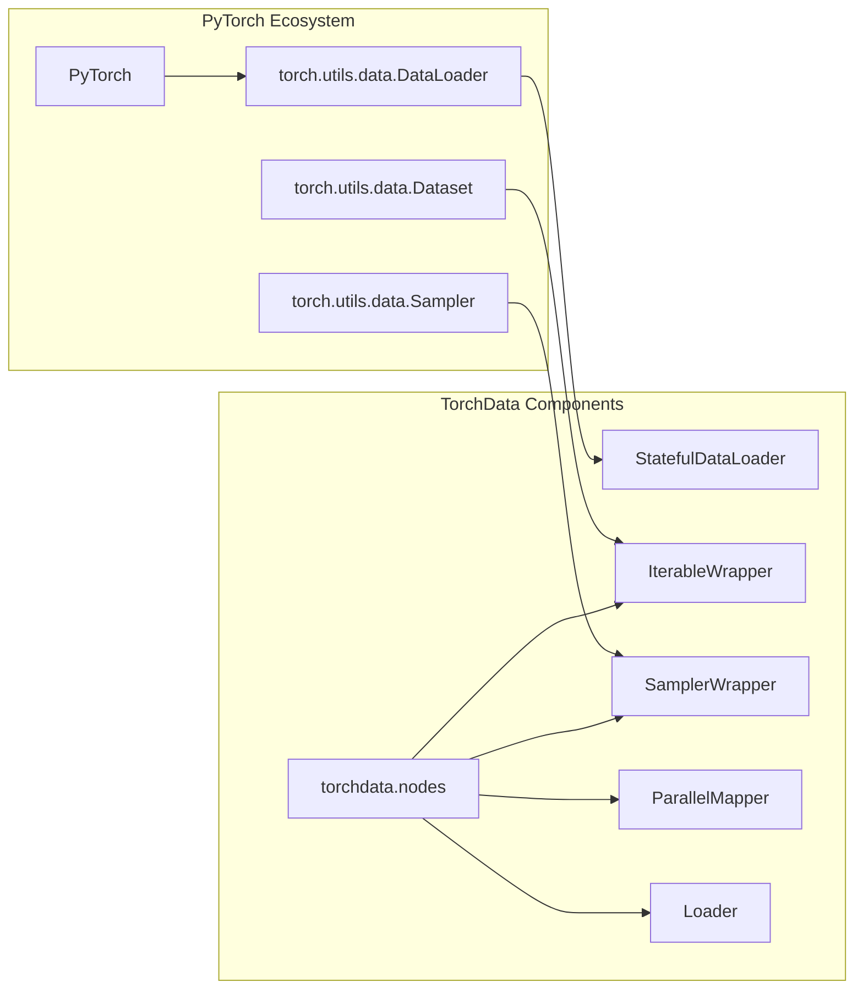

Sources: [README.md:8-32]()

## Version Compatibility

TorchData is designed to work with specific versions of PyTorch and Python:

| torch | torchdata | python |
|-------|-----------|--------|
| master / nightly | main / nightly | >=3.9, <=3.13 |
| 2.6.0 | 0.11.0 | >=3.9, <=3.13 |
| 2.5.0 | 0.10.0 | >=3.9, <=3.12 |
| 2.5.0 | 0.9.0 | >=3.9, <=3.12 |
| 2.4.0 | 0.8.0 | >=3.8, <=3.12 |
| 2.0.0 | 0.6.0 | >=3.8, <=3.11 |
| 1.13.1 | 0.5.1 | >=3.7, <=3.10 |
| 1.12.1 | 0.4.1 | >=3.7, <=3.10 |
| 1.12.0 | 0.4.0 | >=3.7, <=3.10 |
| 1.11.0 | 0.3.0 | >=3.7, <=3.10 |

Sources: [README.md:38-52](), [version.txt:1-2](), [setup.py:101-138]()

## Why Use TorchData?

### Advantages Over Standard PyTorch DataLoading

1. **Mid-Epoch Checkpointing**: Both systems in TorchData provide robust checkpoint and resumption capabilities, critical for long-running workloads.

2. **Flexible Parallel Processing**: `torchdata.nodes` offers both multi-threading and multi-processing options, whereas standard `DataLoader` only supports multi-processing.

3. **Multi-Dataset Handling**: The `torchdata.nodes` framework makes it easier to combine multiple datasets with different sampling strategies.

4. **Composable Pipeline Design**: The nodes-based approach allows you to build complex data processing pipelines with simple, reusable components.

5. **Performance Optimizations**: With Free-Threaded Python (3.13+), the threading model can be more efficient than the multiprocessing approach, especially for I/O-bound operations.

Sources: [docs/source/what_is_torchdata_nodes.rst:25-111]()

### When to Use Each Component

- **StatefulDataLoader**: When you need checkpoint capabilities but want to maintain compatibility with existing code that uses PyTorch's DataLoader.

- **torchdata.nodes Framework**: When you need more flexible data processing pipelines, better performance control, or are working with multiple datasets.

## Usage Examples

Basic examples of using both components:

**StatefulDataLoader**:
```python
from torchdata.stateful_dataloader import StatefulDataLoader

dataloader = StatefulDataLoader(dataset, num_workers=2)
for i, batch in enumerate(dataloader):
    # Process batch
    if i == 10:
        state_dict = dataloader.state_dict()
        # Save checkpoint

# Resume from checkpoint
dataloader = StatefulDataLoader(dataset, num_workers=2)
dataloader.load_state_dict(state_dict)
```

**torchdata.nodes**:
```python
from torchdata.nodes import IterableWrapper, ParallelMapper, Loader

node = IterableWrapper(range(10))
node = ParallelMapper(node, map_fn=lambda x: x**2, num_workers=3, method="thread")
loader = Loader(node)
result = list(loader)  # [0, 1, 4, 9, 16, 25, 36, 49, 64, 81]
```

Sources: [docs/source/getting_started_with_torchdata_nodes.rst:10-25](), [docs/source/stateful_dataloader_tutorial.rst:4-26]()

---

# Page: Installation and Getting Started

# Installation and Getting Started

<details>
<summary>Relevant source files</summary>

The following files were used as context for generating this wiki page:

- [README.md](README.md)
- [packaging/torchdata/meta.yaml](packaging/torchdata/meta.yaml)
- [setup.py](setup.py)
- [test/_utils/_common_utils_for_test.py](test/_utils/_common_utils_for_test.py)
- [version.txt](version.txt)

</details>


This document provides comprehensive instructions for installing TorchData and guides users through initial setup and basic usage. TorchData is a PyTorch extension library that provides composable data loading and processing primitives designed to enable flexible and high-performance data pipelines. For details about the specific components of TorchData, see [Key Features and Components](#1.1) and for in-depth usage of StatefulDataLoader, see [StatefulDataLoader](#2).

## Version Compatibility

Before installation, ensure compatibility between TorchData, PyTorch, and Python versions. The table below shows the supported version combinations:

| `torch` | `torchdata` | `python` |
| ------- | ----------- | -------- |
| `master` / `nightly` | `main` / `nightly` | `>=3.9`, `<=3.13` |
| `2.6.0` | `0.11.0` | `>=3.9`, `<=3.13` |
| `2.5.0` | `0.10.0` | `>=3.9`, `<=3.12` |
| `2.5.0` | `0.9.0` | `>=3.9`, `<=3.12` |
| `2.4.0` | `0.8.0` | `>=3.8`, `<=3.12` |
| `2.0.0` | `0.6.0` | `>=3.8`, `<=3.11` |
| `1.13.1` | `0.5.1` | `>=3.7`, `<=3.10` |
| `1.12.1` | `0.4.1` | `>=3.7`, `<=3.10` |

Sources: [README.md:36-51]()

## Installation Methods

TorchData can be installed through several methods, as illustrated in the following diagram:

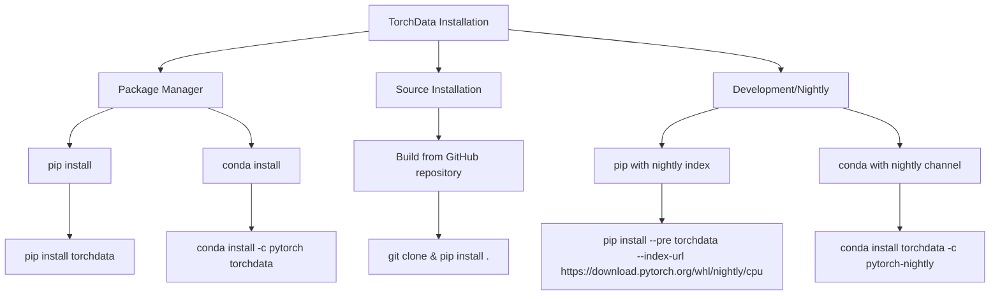

Sources: [README.md:52-107](), [setup.py:100-138]()

### Using pip

For most users, installing via pip is the simplest approach:

```bash
pip install torchdata
```

### Using conda

For conda users, install from the PyTorch channel:

```bash
conda install -c pytorch torchdata
```

### From Source

For the latest features or to contribute, you can install from source:

1. Clone the repository
2. Install from the local copy:

```bash
pip install .
```

If you encounter build errors, installing the nightly version of PyTorch may resolve compatibility issues.

### From Nightly Builds

For access to the latest developments (potentially unstable):

Using pip:
```bash
pip install --pre torchdata --index-url https://download.pytorch.org/whl/nightly/cpu
```

Using conda:
```bash
conda install torchdata -c pytorch-nightly
```

Sources: [README.md:52-107](), [setup.py:100-138]()

## Environment Setup

Before installing TorchData, it's recommended to set up a dedicated environment:

### Using conda
```bash
conda create --name torchdata
conda activate torchdata
```

### Using venv
```bash
python -m venv torchdata-env
source torchdata-env/bin/activate  # On Windows, use: torchdata-env\Scripts\activate
```

Sources: [README.md:52-68]()

## Dependencies

TorchData relies on the following key dependencies:

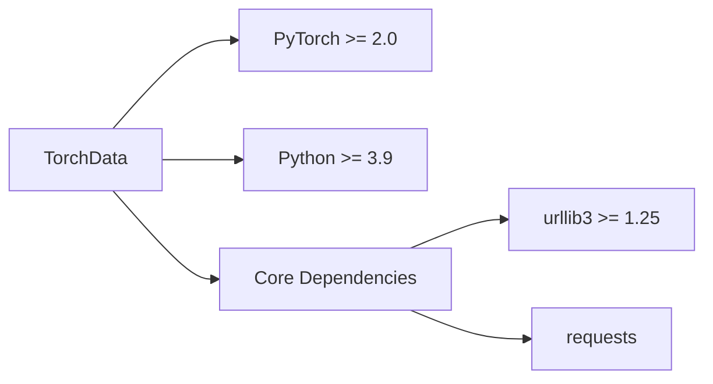

Sources: [setup.py:69-73](), [packaging/torchdata/meta.yaml:10-24]()

## Verifying Installation

After installation, you can verify TorchData is working correctly by importing its main components:

```python
import torchdata
from torchdata.stateful_dataloader import StatefulDataLoader

print(f"TorchData version: {torchdata.__version__}")
```

Sources: [packaging/torchdata/meta.yaml:32-34]()

## Getting Started

Once TorchData is installed, you can begin using its two primary components:

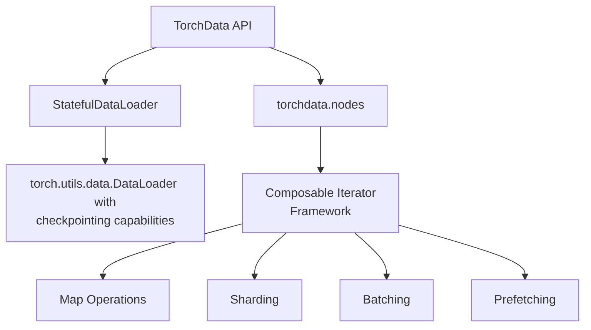

Sources: [README.md:8-32]()

### Using StatefulDataLoader

StatefulDataLoader is a drop-in replacement for PyTorch's DataLoader that adds checkpointing functionality:

```python
from torchdata.stateful_dataloader import StatefulDataLoader
import torch.utils.data as data

# Create a dataset
dataset = data.TensorDataset(torch.randn(100, 3), torch.randint(0, 2, (100,)))

# Use StatefulDataLoader instead of DataLoader
dataloader = StatefulDataLoader(
    dataset,
    batch_size=16,
    shuffle=True
)

# Train with checkpointing
for epoch in range(epochs):
    for batch_idx, (data, target) in enumerate(dataloader):
        # Training code here
        
        # Periodically save state
        if batch_idx % save_interval == 0:
            checkpoint = {
                "model": model.state_dict(),
                "optimizer": optimizer.state_dict(),
                "dataloader": dataloader.state_dict(),  # Save dataloader state
            }
            torch.save(checkpoint, f"checkpoint_e{epoch}_b{batch_idx}.pt")
```

### Using torchdata.nodes

The nodes framework provides composable iterators for building efficient data pipelines:

```python
from torchdata.nodes import IterableWrapper, Mapper, Batcher, Prefetcher

# Create a simple pipeline
data_source = range(1000)
pipeline = IterableWrapper(data_source)
pipeline = Mapper(pipeline, lambda x: x * 2)    # Map operation
pipeline = Batcher(pipeline, batch_size=32)     # Batch data
pipeline = Prefetcher(pipeline)                 # Prefetch batches

# Iterate through the pipeline
for batch in pipeline:
    # Use batch for training
    pass
```

## Platform Support

TorchData is compatible with the following platforms:

- Linux
- macOS (including Apple Silicon M1)
- Windows

Sources: [setup.py:122-124](), [test/_utils/_common_utils_for_test.py:17-21]()

## Next Steps

To learn more about TorchData's capabilities:

1. For in-depth usage of StatefulDataLoader, see [StatefulDataLoader](#2)
2. For details on the nodes framework, see [torchdata.nodes Framework](#3)
3. For contributing to TorchData, see [Development and Contribution](#4)

---

# Page: StatefulDataLoader

# StatefulDataLoader

<details>
<summary>Relevant source files</summary>

The following files were used as context for generating this wiki page:

- [.github/workflows/stateful_dataloader_ci.yml](.github/workflows/stateful_dataloader_ci.yml)
- [test/stateful_dataloader/test_dataloader.py](test/stateful_dataloader/test_dataloader.py)
- [test/stateful_dataloader/test_incremental_state.py](test/stateful_dataloader/test_incremental_state.py)
- [test/stateful_dataloader/test_sampler.py](test/stateful_dataloader/test_sampler.py)
- [test/stateful_dataloader/test_state_dict.py](test/stateful_dataloader/test_state_dict.py)
- [torchdata/stateful_dataloader/__init__.py](torchdata/stateful_dataloader/__init__.py)
- [torchdata/stateful_dataloader/incremental_state.py](torchdata/stateful_dataloader/incremental_state.py)
- [torchdata/stateful_dataloader/sampler.py](torchdata/stateful_dataloader/sampler.py)
- [torchdata/stateful_dataloader/stateful.py](torchdata/stateful_dataloader/stateful.py)
- [torchdata/stateful_dataloader/stateful_dataloader.py](torchdata/stateful_dataloader/stateful_dataloader.py)
- [torchdata/stateful_dataloader/worker.py](torchdata/stateful_dataloader/worker.py)

</details>


The StatefulDataLoader is a drop-in replacement for PyTorch's DataLoader that adds checkpointing and state management capabilities. It enables mid-epoch resumption of data loading through the implementation of state serialization and deserialization methods.

## Overview

StatefulDataLoader maintains the same API as the PyTorch DataLoader while adding the ability to save and restore the internal state of data loading processes. This is particularly useful for long-running training jobs where checkpointing is needed to resume from the exact position in the data iteration sequence.

Sources: [torchdata/stateful_dataloader/stateful_dataloader.py:93-188](). [torchdata/stateful_dataloader/__init__.py:8-10]()

## Architecture

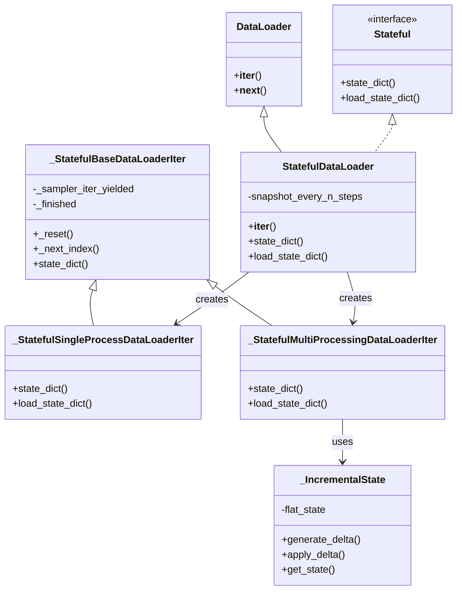

Sources: [torchdata/stateful_dataloader/stateful_dataloader.py:93-188](), [torchdata/stateful_dataloader/stateful_dataloader.py:429-580](), [torchdata/stateful_dataloader/incremental_state.py:60-110]()

## Key Features

### Incremental State Management

StatefulDataLoader uses an incremental state system that efficiently tracks changes to the dataloader's state. Instead of serializing the entire state on every checkpoint, it generates deltas (changes) between states, making state transfer more efficient.

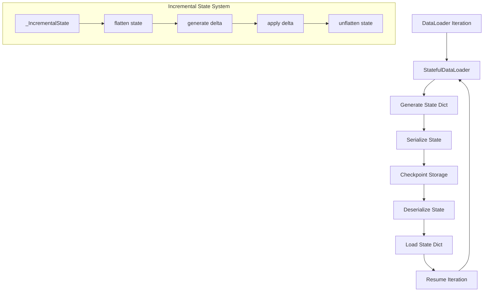

Sources: [torchdata/stateful_dataloader/incremental_state.py:60-110](), [torchdata/stateful_dataloader/incremental_state.py:113-181]()

### Distributed Sampling

StatefulDataLoader supports distributed training through `StatefulDistributedSampler`, which extends PyTorch's DistributedSampler with state management capabilities.

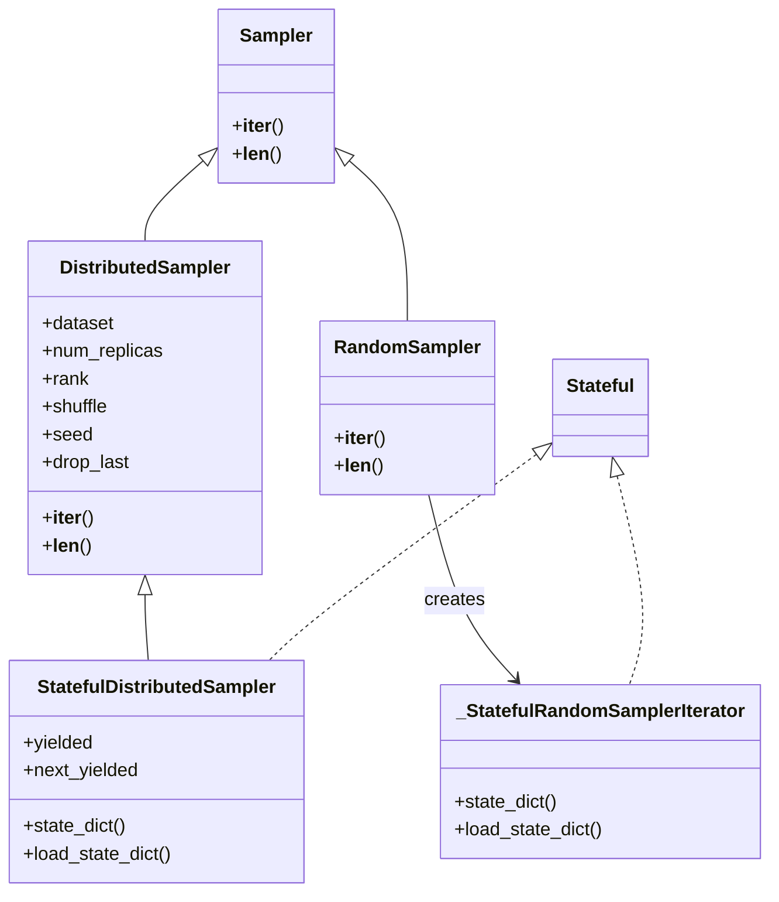

Sources: [torchdata/stateful_dataloader/sampler.py:77-112](), [torchdata/stateful_dataloader/sampler.py:182-217]()

### Worker State Management

StatefulDataLoader handles complex state management across multiple worker processes:

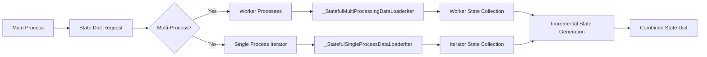

Sources: [torchdata/stateful_dataloader/stateful_dataloader.py:415-426](), [torchdata/stateful_dataloader/stateful_dataloader.py:429-580](), [torchdata/stateful_dataloader/worker.py:71-270]()

## Usage

### Basic Usage

StatefulDataLoader can be used as a direct replacement for torch's DataLoader:

```python
from torchdata.stateful_dataloader import StatefulDataLoader

# Create a StatefulDataLoader
dataloader = StatefulDataLoader(
    dataset=my_dataset,
    batch_size=32,
    shuffle=True
)

# Train for a few batches
for i, batch in enumerate(dataloader):
    if i > 10:
        break
    # Process batch...

# Save the state
state_dict = dataloader.state_dict()
torch.save(state_dict, "dataloader_checkpoint.pt")

# Resume from the saved state
new_dataloader = StatefulDataLoader(
    dataset=my_dataset,
    batch_size=32,
    shuffle=True
)
new_dataloader.load_state_dict(torch.load("dataloader_checkpoint.pt"))

# Continue training from where you left off
for batch in new_dataloader:
    # Process batch...
```

### Configuration Options

StatefulDataLoader accepts all the parameters of PyTorch's DataLoader plus:

| Parameter | Description | Default |
|-----------|-------------|---------|
| `snapshot_every_n_steps` | How often to transfer state from workers to the dataloader | 1 |

The `snapshot_every_n_steps` parameter is particularly useful for controlling the overhead of state transfer when working with large states or many workers.

Sources: [torchdata/stateful_dataloader/stateful_dataloader.py:93-188](), [torchdata/stateful_dataloader/stateful_dataloader.py:212-213]()

## Implementation Details

### Stateful Interface

The `Stateful` protocol defines the interface for objects that can serialize and deserialize their state:

```python
@runtime_checkable
class Stateful(Protocol):
    def state_dict(self) -> Dict[str, Any]:
        ...

    def load_state_dict(self, state_dict: Dict[str, Any]) -> None:
        ...
```

Sources: [torchdata/stateful_dataloader/stateful.py:10-16]()

### State Dictionary Structure

The state dictionary contains information about:

1. The current iterator position
2. Sampler state (if applicable)
3. Dataset state (if the dataset implements `Stateful`)
4. Worker states (for multi-processing)

### Data Flow and Processing

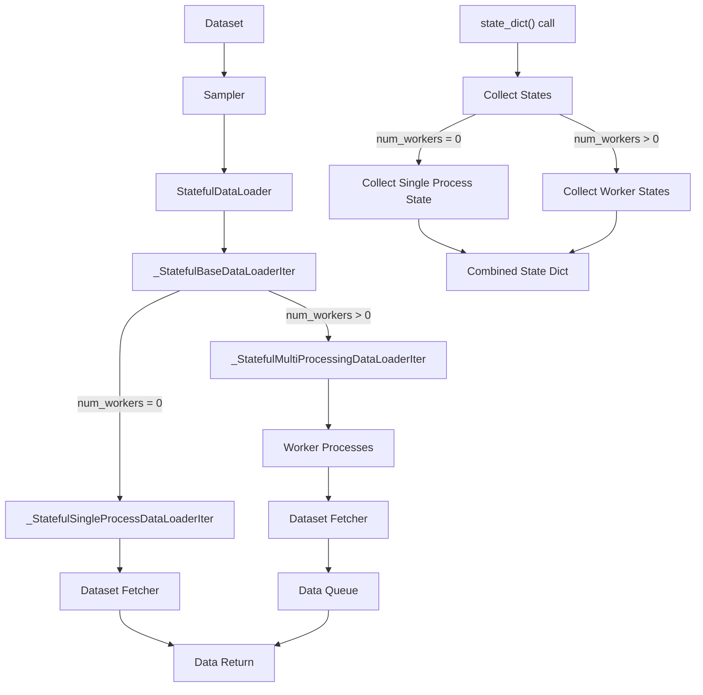

Sources: [torchdata/stateful_dataloader/stateful_dataloader.py:381-409](), [torchdata/stateful_dataloader/stateful_dataloader.py:581-714]()

### Incremental State Management

The `_IncrementalState` class provides efficient state tracking by:

1. Flattening nested dictionaries
2. Tracking changes between states
3. Generating delta updates
4. Applying deltas to restore states

This approach minimizes the amount of data transferred between workers and the main process.

Sources: [torchdata/stateful_dataloader/incremental_state.py:18-53](), [torchdata/stateful_dataloader/incremental_state.py:60-110]()

### Worker Communication

For multi-process data loading, StatefulDataLoader handles communication with worker processes through:

1. Queue-based message passing
2. Incremental state deltas to minimize transfer overhead
3. Proper synchronization to ensure state consistency

Sources: [torchdata/stateful_dataloader/worker.py:71-270](), [torchdata/stateful_dataloader/stateful_dataloader.py:581-714]()

## Testing and Compatibility

StatefulDataLoader is extensively tested across different platforms (Windows, macOS, Linux) and Python versions (3.9-3.13). The tests verify the correct behavior in various scenarios:

- Single-process vs multi-process data loading
- Different types of datasets (Map-style, Iterable)
- Different samplers
- Interrupted iterations
- State saving and loading

Sources: [test/stateful_dataloader/test_state_dict.py:23-1116](), [test/stateful_dataloader/test_sampler.py:19-237](), [.github/workflows/stateful_dataloader_ci.yml:1-106]()

---

# Page: Incremental State Management

# Incremental State Management

<details>
<summary>Relevant source files</summary>

The following files were used as context for generating this wiki page:

- [test/stateful_dataloader/test_incremental_state.py](test/stateful_dataloader/test_incremental_state.py)
- [test/stateful_dataloader/test_state_dict.py](test/stateful_dataloader/test_state_dict.py)
- [torchdata/stateful_dataloader/__init__.py](torchdata/stateful_dataloader/__init__.py)
- [torchdata/stateful_dataloader/incremental_state.py](torchdata/stateful_dataloader/incremental_state.py)
- [torchdata/stateful_dataloader/stateful_dataloader.py](torchdata/stateful_dataloader/stateful_dataloader.py)
- [torchdata/stateful_dataloader/worker.py](torchdata/stateful_dataloader/worker.py)

</details>


This document explains the incremental state management system used by the StatefulDataLoader in TorchData. This system enables efficient serialization, transfer, and restoration of state between worker processes and the main process, making checkpointing and resumption of data loading possible without transferring redundant data.

## Purpose and Scope

The incremental state management system allows TorchData to:

1. Track state changes across worker processes in a memory-efficient manner
2. Generate compact "delta" states that only contain the changes since the last snapshot
3. Efficiently reconstruct complete state dictionaries from incremental updates
4. Handle complex nested state structures including PyTorch tensors

This system is specifically used by the [StatefulDataLoader](#2) to implement checkpointing and resumption capabilities. It addresses the challenge of maintaining consistent state across multiple processes, especially in distributed training scenarios.

Sources: [torchdata/stateful_dataloader/incremental_state.py:1-182]()</source>

## Core Components

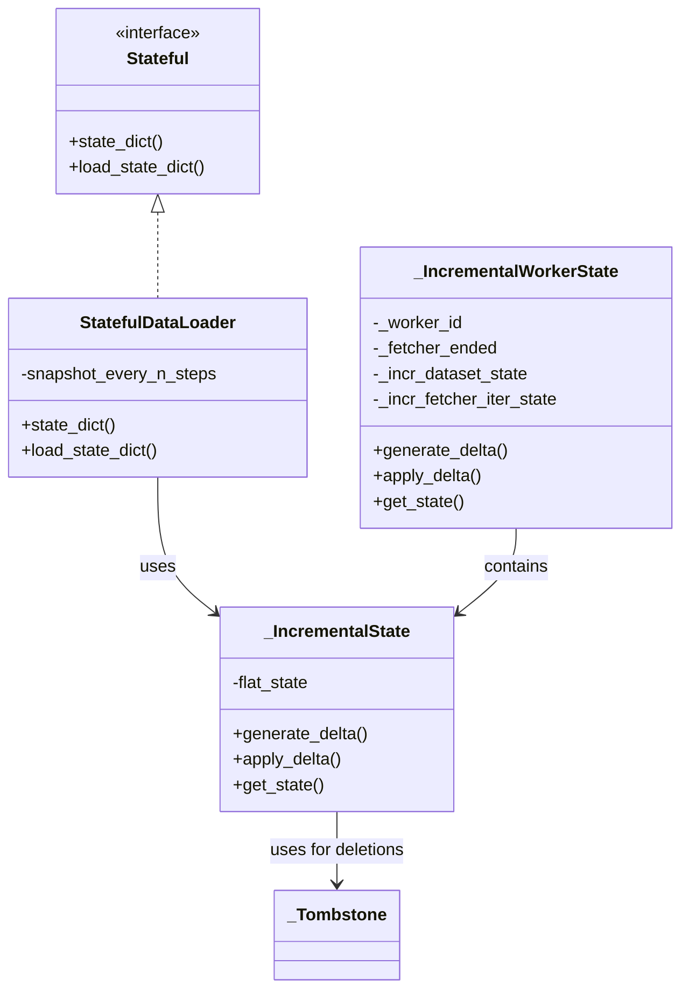

The incremental state management system consists of these key components:

1. `_IncrementalState`: Core class that tracks state and generates deltas
2. `_IncrementalWorkerState`: Specialized state manager for worker processes
3. `_Tombstone`: Marker class for deleted keys in state dictionaries
4. Helper functions for flattening and unflattening state dictionaries

Sources: 
- [torchdata/stateful_dataloader/incremental_state.py:60-111]()
- [torchdata/stateful_dataloader/incremental_state.py:113-181]()
- [torchdata/stateful_dataloader/incremental_state.py:56-57]()

## State Flattening Mechanism

A fundamental concept in the incremental state system is the flattening of nested dictionaries into a simple key-tuple/value structure.

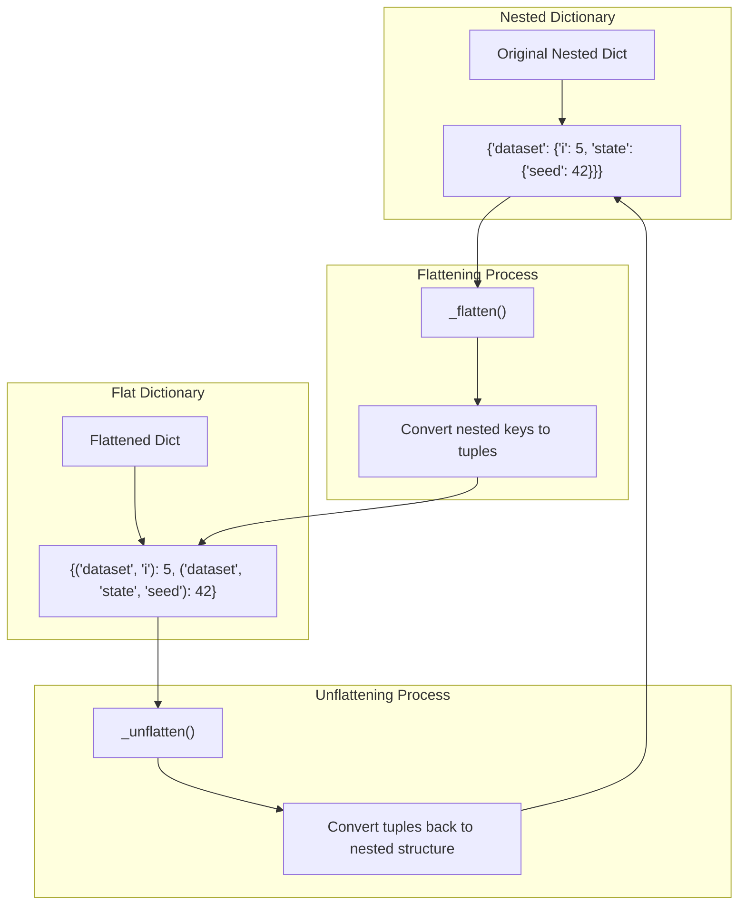

This flattening approach enables:
1. Easier comparison between state dictionaries
2. Direct addressing of deeply nested values
3. Efficient detection of changes in complex structures

Sources:
- [torchdata/stateful_dataloader/incremental_state.py:18-53]()
- [test/stateful_dataloader/test_incremental_state.py:27-56]()

## Delta Generation and Application

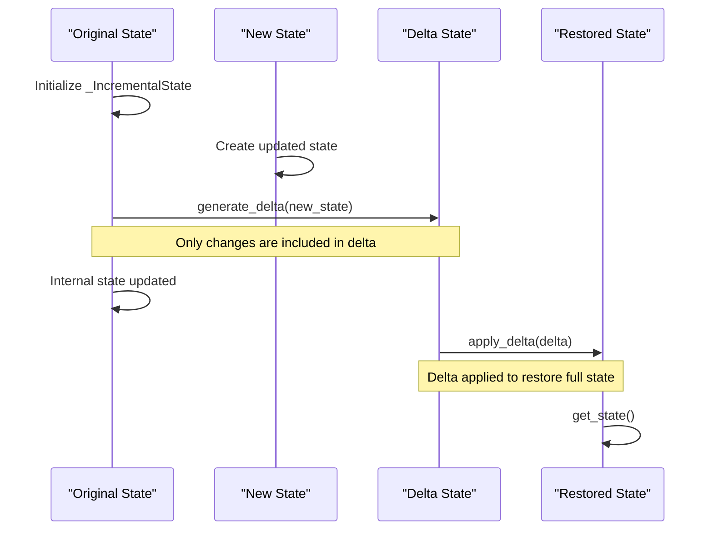

The delta generation process:

1. A new state dictionary is compared against the current internal state
2. Only the keys with changed values are included in the delta
3. Keys present in the original but not in the new state are marked with `_Tombstone`
4. PyTorch tensors are compared using `torch.equal()`
5. The internal state is updated to match the new state

Sources:
- [torchdata/stateful_dataloader/incremental_state.py:64-96]()
- [torchdata/stateful_dataloader/incremental_state.py:98-110]()
- [test/stateful_dataloader/test_incremental_state.py:58-115]()

## Worker State Management

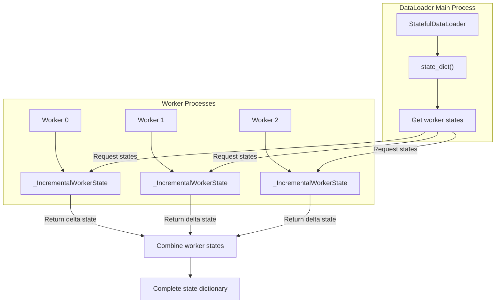

Worker state contains three primary components:

1. **Worker ID**: An identifier for the specific worker process
2. **Dataset State**: State of the dataset object in the worker
3. **Fetcher State**: State of the dataset iterator and fetch status

The `_IncrementalWorkerState` class manages these components separately, applying state changes to each component individually.

Sources:
- [torchdata/stateful_dataloader/incremental_state.py:113-181]()
- [torchdata/stateful_dataloader/worker.py:272-292]()
- [test/stateful_dataloader/test_incremental_state.py:118-210]()

## Integration with StatefulDataLoader

```mermaid
sequenceDiagram
    participant ML as "Main Loop"
    participant SDL as "StatefulDataLoader"
    participant ITER as "_StatefulDataLoaderIter"
    participant W as "Worker Processes"
    
    ML->>SDL: iter(dataloader)
    SDL->>ITER: Create iterator
    ITER->>W: Start workers
    W->>ITER: Send initial state
    
    loop For each batch
        ML->>ITER: next(iterator)
        ITER->>W: Request data
        W->>ITER: Return data + state delta
        ITER->>ML: Return batch
    end
    
    ML->>SDL: state_dict()
    SDL->>ITER: Get state
    ITER->>W: Request full state
    W->>ITER: Return state
    ITER->>SDL: Return combined state
    SDL->>ML: Return state dict
    
    Note over ML,SDL: Later - resuming from checkpoint
    
    ML->>SDL: load_state_dict(state)
    ML->>SDL: iter(dataloader)
    SDL->>ITER: Create iterator with state
    ITER->>W: Start workers with state
    W->>W: Restore from state
```

The `StatefulDataLoader` uses the incremental state system to:

1. Collect and combine state from multiple workers
2. Generate compact snapshots at configurable intervals (`snapshot_every_n_steps`)
3. Resume data loading from exactly where it left off
4. Maintain consistent state across worker processes

Sources:
- [torchdata/stateful_dataloader/stateful_dataloader.py:381-426]()
- [torchdata/stateful_dataloader/stateful_dataloader.py:581-866]()
- [test/stateful_dataloader/test_state_dict.py:203-270]()

## State Update Flow

```mermaid
flowchart TD
    subgraph "Multi-Process DataLoading"
        A["Main Process"] --> B["Request Batch from Workers"]
        B --> C{"snapshot_every_n_steps?"}
        C -->|"Yes"| D["Request Worker State"]
        C -->|"No"| E["Process Next Batch"]
        
        D --> F["Generate Delta State"]
        F --> G["Apply Delta to Main Process State"]
        G --> E
        
        E --> H["Call state_dict()"]
        H --> I["Return Current State"]
    end
    
    subgraph "Worker Process State Update"
        J["Process Dataset Item"] --> K["Update Internal State"]
        K --> L["Compare with Previous State"]
        L --> M["Generate Delta"]
        M --> N["Send Delta with Data"]
    end
    
    N -->|"Communication Channel"| B
```

The state update process:

1. Workers process data and update their internal state
2. Based on `snapshot_every_n_steps`, the main process may request state updates
3. Workers generate delta states and send them with the data
4. The main process applies these deltas to its snapshot of the worker states
5. When `state_dict()` is called, the complete state is returned

Sources:
- [torchdata/stateful_dataloader/stateful_dataloader.py:415-426]()
- [torchdata/stateful_dataloader/worker.py:250-262]()
- [test/stateful_dataloader/test_state_dict.py:945-995]()

## Special Case Handling

The incremental state system handles several special cases to ensure robust state management:

| Case | Handling Strategy |
|------|------------------|
| PyTorch Tensors | Compared using `torch.equal()` instead of `==` |
| Deleted Keys | Marked with `_Tombstone` objects in delta state |
| None Values | Properly tracked and updated in the state |
| Complex Nested Structures | Flattened to tuple-keys for efficient comparison |
| Large State Objects | Only changed components are transferred |
| Worker Process Death | Graceful recovery using last known state |

Sources:
- [torchdata/stateful_dataloader/incremental_state.py:83-93]()
- [torchdata/stateful_dataloader/incremental_state.py:78-80]()
- [test/stateful_dataloader/test_incremental_state.py:173-189]()
- [test/stateful_dataloader/test_incremental_state.py:96-115]()

## Performance Optimization

The `snapshot_every_n_steps` parameter in `StatefulDataLoader` controls how frequently state is transferred from workers to the main process. This provides a trade-off between:

1. Checkpoint accuracy (smaller values = more frequent updates)
2. Communication overhead (larger values = less frequent state transfers)

```mermaid
graph TD
    A["StatefulDataLoader"] -->|"snapshot_every_n_steps=1"| B["Transfer state every iteration"]
    A -->|"snapshot_every_n_steps=N"| C["Transfer state every N iterations"]
    
    B --> D["High accuracy, higher overhead"]
    C --> E["Lower overhead, small state loss risk"]
    
    F["Recommended setting"] --> G["Match checkpoint frequency"]
    G --> H["Set to how often you call save_checkpoint()"]
```

For optimal performance:
- Set `snapshot_every_n_steps` to match how frequently you checkpoint your training
- For very large datasets with small state, higher values are appropriate
- For critical jobs where every sample matters, use lower values

Sources:
- [torchdata/stateful_dataloader/stateful_dataloader.py:192-213]()
- [test/stateful_dataloader/test_state_dict.py:272-291]()

## Conclusion

The incremental state management system in TorchData provides an efficient and reliable mechanism for maintaining state across distributed and multiprocessing data loading scenarios. It minimizes communication overhead while ensuring that state can be properly saved and restored, enabling robust checkpointing and resumption of data loading.

This system is a key component of TorchData's ability to support long-running training jobs that may be interrupted and need to resume from exactly where they left off.

---

# Page: Distributed Training Support

# Distributed Training Support

<details>
<summary>Relevant source files</summary>

The following files were used as context for generating this wiki page:

- [.github/workflows/nodes_ci.yml](.github/workflows/nodes_ci.yml)
- [.github/workflows/stateful_dataloader_ci.yml](.github/workflows/stateful_dataloader_ci.yml)
- [test/nodes/__init__.py](test/nodes/__init__.py)
- [test/requirements.txt](test/requirements.txt)
- [test/stateful_dataloader/test_dataloader.py](test/stateful_dataloader/test_dataloader.py)
- [test/stateful_dataloader/test_hugging_face.py](test/stateful_dataloader/test_hugging_face.py)
- [test/stateful_dataloader/test_sampler.py](test/stateful_dataloader/test_sampler.py)
- [torchdata/stateful_dataloader/sampler.py](torchdata/stateful_dataloader/sampler.py)
- [torchdata/stateful_dataloader/stateful.py](torchdata/stateful_dataloader/stateful.py)

</details>


This page documents the distributed training capabilities provided by TorchData's StatefulDataLoader system. It focuses on how TorchData extends PyTorch's data loading mechanisms to support stateful distributed training, allowing for checkpoint and resumption of training across multiple nodes and processes.

For general information about StatefulDataLoader, see [StatefulDataLoader](#2), and for information about incremental state management, see [Incremental State Management](#2.1).

## Overview of Distributed Training Support

TorchData enhances distributed training workflows by providing the StatefulDistributedSampler, which adds checkpointing capabilities to distributed data sampling. This allows training jobs to be paused and resumed without losing track of which samples have been processed by each worker in a distributed training setup.

### Key Components

- **StatefulDistributedSampler**: Extends PyTorch's DistributedSampler with state tracking for checkpointing
- **State Dictionary Interface**: Standardized interface for saving and loading sampler state
- **Integration with StatefulDataLoader**: Seamless interoperability with the checkpointing system

### Architectural Relationship

```mermaid
classDiagram
    class Stateful {
        <<interface>>
        +state_dict()
        +load_state_dict()
    }
    
    class PyTorchDistributedSampler {
        +__init__(dataset, num_replicas, rank, shuffle, seed, drop_last)
        +__iter__()
        +__len__()
    }
    
    class StatefulDistributedSampler {
        -yielded
        -next_yielded
        +__init__(dataset, num_replicas, rank, shuffle, seed, drop_last)
        +__iter__()
        +state_dict()
        +load_state_dict()
    }
    
    Stateful <|.. StatefulDistributedSampler : implements
    PyTorchDistributedSampler <|-- StatefulDistributedSampler : extends
```

Sources: [torchdata/stateful_dataloader/sampler.py:182-216](), [torchdata/stateful_dataloader/stateful.py:10-16]()

## StatefulDistributedSampler

The `StatefulDistributedSampler` is the primary class enabling distributed training support in TorchData. It extends PyTorch's DistributedSampler with additional state tracking capabilities.

### Implementation Details

```mermaid
flowchart TD
    A["StatefulDistributedSampler"] --> B["Initialize with dataset, num_replicas, rank"]
    B --> C["Track yielded samples during iteration"]
    C --> D["Save state via state_dict()"]
    D --> E["Resume from saved state via load_state_dict()"]
    
    subgraph "State Management"
    F["yielded: count of yielded samples"] --> G["next_yielded: target position for resumption"]
    end
    
    C --> F
    E --> G
    G --> C
```

Sources: [torchdata/stateful_dataloader/sampler.py:182-216]()

### Key Features

1. **Stateful Iteration**: Tracks how many samples have been yielded during iteration.
2. **Checkpoint Support**: Provides state_dict() and load_state_dict() methods to save and restore iteration state.
3. **Distributed-Aware**: Maintains proper sample distribution across multiple workers/nodes.
4. **Consistent with PyTorch**: Supports the same configuration options as PyTorch's DistributedSampler (shuffle, seed, drop_last).

### State Tracking

The sampler maintains two key state variables:
- `yielded`: Counter for the number of samples yielded during iteration
- `next_yielded`: Position indicator used during state restoration

This state information can be saved and loaded through the standard Stateful interface, making it compatible with checkpointing systems.

Sources: [torchdata/stateful_dataloader/sampler.py:182-196]()

## Distributed Data Flow

The following diagram illustrates how data is distributed across workers in a distributed training setup using StatefulDistributedSampler:

```mermaid
flowchart LR
    DS["Dataset"] --> |"split by rank"| DS1["Rank 0 Subset"]
    DS --> |"split by rank"| DS2["Rank 1 Subset"]
    DS --> |"split by rank"| DS3["Rank 2 Subset"]
    
    DS1 --> |"StatefulDistributedSampler"| DL1["DataLoader Worker 0"]
    DS2 --> |"StatefulDistributedSampler"| DL2["DataLoader Worker 1"]
    DS3 --> |"StatefulDistributedSampler"| DL3["DataLoader Worker 2"]
    
    DL1 --> |"samples"| T1["Trainer Process 0"]
    DL2 --> |"samples"| T2["Trainer Process 1"]
    DL3 --> |"samples"| T3["Trainer Process 2"]
    
    CP["Checkpoint"] <--> |"state_dict"| DL1
    CP <--> |"state_dict"| DL2
    CP <--> |"state_dict"| DL3
```

Sources: [test/stateful_dataloader/test_sampler.py:194-208]()

## Using StatefulDistributedSampler

### Basic Usage

To use StatefulDistributedSampler in a distributed training setup:

1. Create the sampler with the appropriate parameters for your distributed environment
2. Pass the sampler to StatefulDataLoader
3. Use checkpoint/resume functionality through state_dict() and load_state_dict()

Here's a conceptual example of the workflow:

```mermaid
sequenceDiagram
    participant D as Dataset
    participant S as StatefulDistributedSampler
    participant L as StatefulDataLoader
    participant T as Trainer
    
    T->>D: Create dataset
    T->>S: Initialize sampler(dataset, num_replicas, rank)
    T->>L: Create loader(dataset, sampler=sampler)
    
    loop Training
        L->>S: Get next batch
        S->>D: Request samples for rank
        D-->>S: Return samples
        S-->>L: Return batch
        L-->>T: Provide batch
    end
    
    T->>L: state_dict()
    L->>S: Get state
    S-->>L: Return state
    L-->>T: Return state_dict
    
    Note over T: Process terminates/restarts
    
    T->>D: Recreate dataset
    T->>S: Reinitialize sampler
    T->>L: Recreate loader
    T->>L: load_state_dict(saved_state)
    L->>S: load_state_dict()
    
    loop Resume Training
        L->>S: Get next batch (resumes from last position)
        S->>D: Request samples for rank (skips already processed)
        D-->>S: Return samples
        S-->>L: Return batch
        L-->>T: Provide batch
    end
```

Sources: [test/stateful_dataloader/test_sampler.py:66-87]()

### Configuration Options

The StatefulDistributedSampler inherits all configuration options from PyTorch's DistributedSampler and can be initialized with:

| Parameter | Type | Description |
|-----------|------|-------------|
| dataset | Dataset | Dataset used for sampling |
| num_replicas | int | Number of distributed processes |
| rank | int | Rank of the current process |
| shuffle | bool | Whether to shuffle the data |
| seed | int | Random seed for reproducibility |
| drop_last | bool | Whether to drop the last incomplete batch |

Sources: [torchdata/stateful_dataloader/sampler.py:183-196](), [test/stateful_dataloader/test_sampler.py:47-64]()

## State Management in Distributed Training

### State Dictionary Format

The state dictionary for StatefulDistributedSampler is simple and contains:

```
{
    "yielded": <int>  # Number of samples yielded so far
}
```

This minimal representation ensures efficient serialization and storage of checkpoint state.

Sources: [torchdata/stateful_dataloader/sampler.py:208-216]()

### State Loading Process

When a state dictionary is loaded:

1. The next_yielded value is set to the loaded yielded count
2. On the next iteration, the sampler will skip to this position
3. The next_yielded is then reset to None after being applied

This approach ensures that when training resumes, the sampler continues from exactly where it left off, without duplicating or missing any samples.

Sources: [torchdata/stateful_dataloader/sampler.py:196-203](), [test/stateful_dataloader/test_sampler.py:104-116]()

## Effect of shuffle and drop_last Parameters

### Data Shuffling

When `shuffle=True`:
- Data is randomly shuffled for each epoch
- Each process gets a different subset of the data
- The seed parameter ensures reproducibility across runs

When `shuffle=False`:
- Data is processed in the original order
- Data is split evenly among processes based on rank
- Each process gets consecutive chunks of the dataset

Sources: [test/stateful_dataloader/test_sampler.py:154-192]()

### drop_last Parameter

The `drop_last` parameter controls how the dataset is divided among processes when the dataset size is not evenly divisible by the number of processes:

- `drop_last=True`: Drops the last incomplete batch, ensuring all batches across all processes have the same size
- `drop_last=False`: Keeps the last incomplete batch, ensuring all data points are used

This difference is particularly important in distributed training to ensure all processes remain in sync.

Sources: [test/stateful_dataloader/test_sampler.py:117-153]()

## Testing and Validation

The StatefulDistributedSampler functionality is rigorously tested to ensure:

1. Proper initialization with various parameters
2. Consistent state dict saving and loading
3. Correct behavior with different shuffle and drop_last settings
4. Even distribution of data across processes
5. Seed reproducibility for deterministic behavior

The test suite includes tests for both interaction with StatefulDataLoader and standalone sampler functionality.

Sources: [test/stateful_dataloader/test_sampler.py](), [test/stateful_dataloader/test_dataloader.py](), [test/stateful_dataloader/test_hugging_face.py]()

## Integration with Other Systems

The StatefulDistributedSampler can be integrated with various distributed training frameworks and data sources. For instance, the system has been tested with:

- HuggingFace datasets for NLP workloads
- Standard PyTorch datasets and samplers
- Multi-node distributed training setups

Sources: [test/stateful_dataloader/test_hugging_face.py]()

## Common Patterns and Best Practices

1. **Save Checkpoints Regularly**: In long-running distributed training jobs, save state_dict at regular intervals
2. **Use Consistent Seeds**: When resuming training, use the same seed to ensure consistent shuffling
3. **Handle Failures Gracefully**: Be prepared to resume from the latest checkpoint if any worker fails
4. **Consider Worker Count Changes**: If resuming with a different number of workers, you may need to adjust your approach

Sources: [test/stateful_dataloader/test_sampler.py:210-234]()

## Limitations and Considerations

- State tracking adds a small overhead to the sampling process
- Stateful samplers require more careful handling when used with dynamic datasets
- When used with multiple workers, all workers must resume from the same state

Sources: [torchdata/stateful_dataloader/sampler.py](), [test/stateful_dataloader/test_sampler.py]()

---

# Page: torchdata.nodes Framework

# torchdata.nodes Framework

<details>
<summary>Relevant source files</summary>

The following files were used as context for generating this wiki page:

- [docs/source/getting_started_with_torchdata_nodes.rst](docs/source/getting_started_with_torchdata_nodes.rst)
- [docs/source/index.rst](docs/source/index.rst)
- [docs/source/migrate_to_nodes_from_utils.rst](docs/source/migrate_to_nodes_from_utils.rst)
- [docs/source/stateful_dataloader_tutorial.rst](docs/source/stateful_dataloader_tutorial.rst)
- [docs/source/torchdata.nodes.rst](docs/source/torchdata.nodes.rst)
- [docs/source/what_is_torchdata_nodes.rst](docs/source/what_is_torchdata_nodes.rst)
- [test/nodes/test_adapters.py](test/nodes/test_adapters.py)
- [test/nodes/test_base_node.py](test/nodes/test_base_node.py)
- [test/nodes/test_loader.py](test/nodes/test_loader.py)
- [torchdata/nodes/__init__.py](torchdata/nodes/__init__.py)
- [torchdata/nodes/adapters.py](torchdata/nodes/adapters.py)
- [torchdata/nodes/base_node.py](torchdata/nodes/base_node.py)

</details>


The `torchdata.nodes` framework is a library of composable iterators that provides a flexible, performant approach to data loading and processing in PyTorch. It offers a streaming programming model with first-class support for state management, enabling features like mid-epoch checkpointing and resumption of data loading operations. This document provides a technical overview of the framework's architecture, components, and usage patterns.

For information about the StatefulDataLoader, which is a separate component of TorchData, see [StatefulDataLoader](#2).

## Core Architecture

The foundation of the `torchdata.nodes` framework is the `BaseNode` interface, which all nodes implement. This architecture enables composable data processing pipelines through a series of connected nodes.

```mermaid
classDiagram
    class Iterator {
        <<interface>>
        +__iter__()
        +__next__()
    }
    
    class BaseNode {
        <<abstract>>
        +__init__()
        +reset(initial_state)
        +next()
        +get_state()
        +__next__()
        +state_dict()
    }
    
    class AdapterNodes {
        IterableWrapper
        MapStyleWrapper
        SamplerWrapper
    }
    
    class ProcessingNodes {
        Mapper
        ParallelMapper
        Filter
    }
    
    class BatchingNodes {
        Batcher
        Unbatcher
    }
    
    class PerformanceNodes {
        Prefetcher
        PinMemory
    }
    
    class LoaderNode {
        Loader
    }
    
    Iterator <|-- BaseNode
    BaseNode <|-- AdapterNodes
    BaseNode <|-- ProcessingNodes
    BaseNode <|-- BatchingNodes
    BaseNode <|-- PerformanceNodes
    BaseNode <|-- LoaderNode
```

Sources: [torchdata/nodes/base_node.py:16-106](), [torchdata/nodes/__init__.py:7-38]()

### BaseNode Interface

The `BaseNode` class is the fundamental building block of the framework. It extends Python's `Iterator` interface and adds state management capabilities:

```mermaid
flowchart TD
    A["BaseNode.__init__()"] --> B["Sets __initialized = False"]
    C["BaseNode.__next__()"] --> D{"Is __initialized?"}
    D -->|"No"| E["self.reset(None)"]
    D -->|"Yes"| F["self.next()"]
    G["BaseNode.reset(initial_state)"] --> H["Sets __initialized = True"]
    I["BaseNode.state_dict()"] --> J{"Is __initialized?"}
    J -->|"No"| K["self.reset(None)"]
    J -->|"Yes"| L["self.get_state()"]
```

Key methods that must be implemented by subclasses:
- `next()`: Returns the next item in the sequence (not `__next__`)
- `get_state()`: Returns a state dictionary (not `state_dict`)
- `reset(initial_state)`: Resets the iterator, optionally with a provided state

The separation between public methods (`__next__`, `state_dict`) and implementation methods (`next`, `get_state`) ensures proper initialization before operation.

Sources: [torchdata/nodes/base_node.py:16-106](), [docs/source/what_is_torchdata_nodes.rst:17-21]()

## Node Types

The framework provides several categories of nodes for different data processing tasks:

### 1. Adapter Nodes

Adapter nodes bridge existing PyTorch data structures with the nodes framework:

| Node Type | Purpose | Key Features |
|-----------|---------|--------------|
| `IterableWrapper` | Converts an iterable to a `BaseNode` | Supports stateful iterables through state_dict protocol |
| `MapStyleWrapper` | Converts a map-style dataset to a `BaseNode` | Combines a sampler with a mapping function |
| `SamplerWrapper` | Converts a sampler to a `BaseNode` | Supports epoch updates for distributed sampling |

Sources: [torchdata/nodes/adapters.py:21-168](), [test/nodes/test_adapters.py:18-178]()

### 2. Processing Nodes

Nodes that transform data:

| Node Type | Purpose | Key Features |
|-----------|---------|--------------|
| `Mapper` | Applies a function to each element | Serial processing |
| `ParallelMapper` | Applies a function in parallel | Supports both thread and process-based parallelism |
| `Filter` | Removes elements based on a predicate | Stateful filtering |

Sources: [torchdata/nodes/__init__.py:12]()

### 3. Batching Nodes

Nodes for batch operations:

| Node Type | Purpose | Key Features |
|-----------|---------|--------------|
| `Batcher` | Groups elements into batches | Configurable batch size and drop_last behavior |
| `Unbatcher` | Splits batches into individual elements | Reverses batching operation |

Sources: [torchdata/nodes/__init__.py:9]()

### 4. Performance Optimization Nodes

Nodes that improve data loading performance:

| Node Type | Purpose | Key Features |
|-----------|---------|--------------|
| `Prefetcher` | Prefetches items ahead of time | Reduces waiting time between batches |
| `PinMemory` | Pins tensors in memory | Accelerates CPU-to-GPU transfers |

Sources: [torchdata/nodes/__init__.py:13-14]()

### 5. Terminal Node

The `Loader` node is typically the last node in a pipeline:

| Node Type | Purpose | Key Features |
|-----------|---------|--------------|
| `Loader` | Converts a `BaseNode` to an iterable | Handles iterator reset between epochs and provides state management |

Sources: [torchdata/nodes/__init__.py:11](), [test/nodes/test_loader.py:16-55]()

## Data Flow and Composition

A typical `torchdata.nodes` pipeline involves composing nodes in sequence, with data flowing from data source nodes through transformation nodes to a terminal `Loader` node.

```mermaid
flowchart LR
    A["Data Source\n(IterableWrapper/SamplerWrapper)"] --> B["Transformation\n(Mapper/ParallelMapper/Filter)"]
    B --> C["Batching\n(Batcher)"]
    C --> D["Performance Optimization\n(Prefetcher/PinMemory)"]
    D --> E["Loader"]
    E --> |"iterate"| F["Training Loop"]
    E --> |"state_dict()"| G["Checkpoint"]
    G --> |"load_state_dict()"| E
```

Example pipeline construction:
```python
# Create a data source node
node = IterableWrapper(range(100))
# Add transformation
node = ParallelMapper(node, map_fn=lambda x: x**2, num_workers=4, method="thread")
# Add batching
node = Batcher(node, batch_size=16, drop_last=False)
# Add performance optimization
node = Prefetcher(node, prefetch_factor=2)
# Create loader for iteration
loader = Loader(node)
```

Sources: [docs/source/getting_started_with_torchdata_nodes.rst:15-24](), [docs/source/migrate_to_nodes_from_utils.rst:97-120]()

## State Management

One of the key features of the `torchdata.nodes` framework is state management, which enables checkpoint and resume capabilities.

```mermaid
sequenceDiagram
    participant A as Training Loop
    participant B as Loader
    participant C as Node Pipeline
    
    A->>B: iterate batches
    B->>C: __next__()
    C-->>B: batch data
    B-->>A: batch data
    A->>B: state_dict()
    B->>C: get_state()
    C-->>B: state dictionary
    B-->>A: state dictionary
    
    Note over A,C: Save checkpoint
    
    A->>B: load_state_dict(state)
    B->>C: reset(state)
    C-->>B: reset complete
    A->>B: iterate (resumes from checkpoint)
    B->>C: __next__()
    C-->>B: batch data (continues from checkpoint)
    B-->>A: batch data
```

Each node maintains its own state, which typically includes:
- Position in the iteration sequence
- Internal counter values
- State of underlying components (samplers, datasets, etc.)

When `state_dict()` is called on a `Loader`, it recursively collects state from all nodes in the pipeline. Similarly, `load_state_dict()` distributes state information to the appropriate nodes during reset.

Sources: [torchdata/nodes/base_node.py:67-105](), [test/nodes/test_base_node.py:13-15](), [docs/source/what_is_torchdata_nodes.rst:12-14]()

## Design Decisions

### Iterator vs. Generator Approach

The framework deliberately uses an Iterator-based approach rather than Generators, to make state management more explicit and reliable:

1. Generators store state implicitly on the stack, making explicit state handling challenging
2. End-of-iteration state management is clearer with Iterators
3. Iterators allow clearer handling of multiple live iterator scenarios
4. Reset behavior is more predictable with explicit Iterator state

The `BaseNode` class enforces this by requiring subclasses to implement `next()`, `get_state()`, and `reset()` methods rather than using generator functions.

Sources: [docs/source/what_is_torchdata_nodes.rst:118-167]()

## Comparison with torch.utils.data

The `torchdata.nodes` framework addresses several limitations of the standard `torch.utils.data` approach:

| Feature | torch.utils.data | torchdata.nodes |
|---------|------------------|----------------|
| Parallelism | Multi-processing only | Multi-threading and multi-processing |
| Memory Management | High memory usage due to object duplication | More efficient memory usage with thread-based parallelism |
| Data Access Pattern | Primarily random access | Streaming data model |
| Multi-dataset Support | Limited by sampler design | Natural composition of multiple data sources |
| State Management | Limited, requires custom implementation | First-class support for checkpointing |
| Performance | Good for in-memory datasets | Competitive with DataLoader, better for some workloads |

Sources: [docs/source/what_is_torchdata_nodes.rst:28-90](), [docs/source/what_is_torchdata_nodes.rst:93-112]()

## Usage Examples

### Basic Example with IterableWrapper

```python
from torchdata.nodes import IterableWrapper, ParallelMapper, Loader

node = IterableWrapper(range(10))
node = ParallelMapper(node, map_fn=lambda x: x**2, num_workers=3, method="thread")
loader = Loader(node)
result = list(loader)
print(result)  # [0, 1, 4, 9, 16, 25, 36, 49, 64, 81]
```

### Example with Map-Style Dataset and Sampler

```python
from torch.utils.data import RandomSampler
from torchdata.nodes import SamplerWrapper, ParallelMapper, Loader

class SquaredDataset(torch.utils.data.Dataset):
    def __getitem__(self, i: int) -> int:
        return i**2
    def __len__(self):
        return 10

dataset = SquaredDataset()
sampler = RandomSampler(dataset)
node = SamplerWrapper(sampler)
node = ParallelMapper(node, map_fn=dataset.__getitem__, num_workers=3, method="thread")
loader = Loader(node)
```

Sources: [docs/source/getting_started_with_torchdata_nodes.rst:10-57]()

## Conclusion

The `torchdata.nodes` framework provides a flexible, composable approach to data loading that builds upon and extends PyTorch's data utilities. With first-class support for state management, flexible parallelism options, and a streaming data model, it addresses many limitations of the standard approach while maintaining compatibility with existing PyTorch components.

---

# Page: BaseNode and Adapters

# BaseNode and Adapters

<details>
<summary>Relevant source files</summary>

The following files were used as context for generating this wiki page:

- [test/nodes/test_adapters.py](test/nodes/test_adapters.py)
- [test/nodes/test_base_node.py](test/nodes/test_base_node.py)
- [test/nodes/test_loader.py](test/nodes/test_loader.py)
- [torchdata/nodes/__init__.py](torchdata/nodes/__init__.py)
- [torchdata/nodes/adapters.py](torchdata/nodes/adapters.py)
- [torchdata/nodes/base_node.py](torchdata/nodes/base_node.py)

</details>


The BaseNode interface and adapter classes form the foundation of TorchData's composable data processing pipeline system. This document explains these core components, how they relate to PyTorch's existing data abstractions, and how they enable stateful, checkpointable data loading workflows.

For information about the higher-level nodes framework, see [torchdata.nodes Framework](#3).

## Purpose and Core Concepts

BaseNode is the fundamental building block for creating composable data loading pipelines in TorchData. Adapters are specialized BaseNode implementations that bridge existing PyTorch data abstractions (like Dataset and Sampler) to the TorchData nodes system.

Together, they enable:
- Creation of composable data processing pipelines
- State management for checkpointing and resumption
- Seamless integration with existing PyTorch data components

```mermaid
graph TD
    subgraph "PyTorch Data Components"
        IDataset["torch.utils.data.IterableDataset"]
        MDataset["torch.utils.data.MapDataset"]
        Sampler["torch.utils.data.Sampler"]
    end
    
    subgraph "TorchData Adapters"
        IWrapper["IterableWrapper"]
        MWrapper["MapStyleWrapper"]
        SWrapper["SamplerWrapper"]
    end
    
    subgraph "TorchData Node System"
        BaseNode["BaseNode Interface"]
        ProcessingNodes["Data Processing Nodes"]
    end
    
    IDataset --> IWrapper
    MDataset --> MWrapper
    Sampler --> SWrapper
    
    IWrapper --> BaseNode
    MWrapper --> BaseNode
    SWrapper --> BaseNode
    
    BaseNode --> ProcessingNodes
```

Sources: [torchdata/nodes/base_node.py:16-106](), [torchdata/nodes/adapters.py:21-168]()

## BaseNode Interface

The `BaseNode` class is an abstract interface that all data nodes in TorchData must implement. It inherits from Python's `Iterator`, making all BaseNode implementations iterable.

```mermaid
classDiagram
    class Iterator~T~ {
        +__iter__()
        +__next__()
    }
    
    class BaseNode~T~ {
        +__init__(*args, **kwargs)
        +__iter__()
        +reset(initial_state)
        +next() T
        +get_state() Dict[str, Any]
        +state_dict() Dict[str, Any]
        +__next__()
    }
    
    Iterator <|-- BaseNode
    
    class Stateful {
        <<interface>>
        +state_dict()
        +load_state_dict()
    }
    
    BaseNode ..|> Stateful : implements
```

Sources: [torchdata/nodes/base_node.py:16-106]()

### Core Methods

The BaseNode interface defines several key methods:

- `__init__(*args, **kwargs)`: Initializes the node. Subclasses must call `super().__init__()`.
- `reset(initial_state)`: Resets the iterator, either to the beginning or to a state specified by `initial_state`.
- `next()`: Abstract method that returns the next value in the sequence. Subclasses must implement this.
- `get_state()`: Abstract method that returns the current state of the node. Subclasses must implement this.
- `state_dict()`: Returns a state dictionary that can be used for checkpointing.
- `__next__()`: Ensures proper initialization and delegates to `next()`.

BaseNode follows a lazy initialization pattern where expensive initialization is deferred until the first call to `__next__()` or `state_dict()`.

Sources: [torchdata/nodes/base_node.py:40-105]()

## Adapter Classes

TorchData provides three main adapter classes that bridge PyTorch data abstractions to the BaseNode interface:

```mermaid
classDiagram
    class BaseNode~T~ {
        +reset(initial_state)
        +next() T
        +get_state() Dict[str, Any]
    }
    
    class IterableWrapper~T~ {
        -iterable: Iterable[T]
        -_it: Iterator[T]
        -_num_yielded: int
        +reset(initial_state)
        +next() T
        +get_state() Dict[str, Any]
    }
    
    class SamplerWrapper~T~ {
        -sampler: Sampler[T]
        -epoch: int
        -_num_yielded: int
        -epoch_updater: Callable
        +reset(initial_state)
        +next() T
        +get_state() Dict[str, Any]
    }
    
    BaseNode <|-- IterableWrapper
    BaseNode <|-- SamplerWrapper
    
    note for IterableWrapper "Wraps any Iterable,\nincluding IterableDataset"
    note for SamplerWrapper "Wraps PyTorch Samplers,\nhandles set_epoch()"
```

Sources: [torchdata/nodes/adapters.py:21-168]()

### IterableWrapper

`IterableWrapper` converts any Python iterable (including `torch.utils.data.IterableDataset`) into a `BaseNode`:

```python
from torchdata.nodes import IterableWrapper

# Wrap a simple range
node = IterableWrapper(range(10))

# Wrap a PyTorch IterableDataset
node = IterableWrapper(my_iterable_dataset)
```

Key features:
- Supports stateful iterables through the `Stateful` protocol
- For non-stateful iterables, implements naive fast-forwarding for state restoration
- Tracks the number of yielded items for proper state management

Sources: [torchdata/nodes/adapters.py:21-75]()

### MapStyleWrapper

`MapStyleWrapper` converts a map-style dataset and a sampler into a `BaseNode`:

```python
from torchdata.nodes import MapStyleWrapper
from torch.utils.data import RandomSampler

# Use with a map-style dataset and a sampler
node = MapStyleWrapper(my_map_dataset, sampler=RandomSampler(my_map_dataset))
```

Under the hood, `MapStyleWrapper` is a function that combines:
1. A `SamplerWrapper` to handle the sampler
2. A `Mapper` to apply the dataset's `__getitem__` method to each index

Sources: [torchdata/nodes/adapters.py:78-88]()

### SamplerWrapper

`SamplerWrapper` converts a PyTorch sampler into a `BaseNode`, with special handling for the `set_epoch` method:

```python
from torchdata.nodes import SamplerWrapper
from torch.utils.data import DistributedSampler

# Wrap a sampler
node = SamplerWrapper(RandomSampler(my_dataset))

# Wrap a distributed sampler with epoch handling
node = SamplerWrapper(DistributedSampler(my_dataset), initial_epoch=0)
```

Key features:
- Handles samplers with `set_epoch` method (like `DistributedSampler`)
- Supports custom epoch updating logic through the `epoch_updater` callback
- Preserves sampler state through the `Stateful` protocol if implemented

Sources: [torchdata/nodes/adapters.py:91-168]()

## State Management and Checkpointing

One of the key features of BaseNode and adapters is state management, enabling checkpointing and resumption of data loading.

```mermaid
sequenceDiagram
    participant App as "Application"
    participant Loader as "Loader"
    participant Node as "BaseNode/Adapter"
    
    App->>Loader: iter(loader)
    Loader->>Node: reset()
    Node-->>Loader: Initialized
    
    loop For each batch
        App->>Loader: next()
        Loader->>Node: next()
        Node-->>Loader: item
        Loader-->>App: batch
    end
    
    App->>Loader: state_dict()
    Loader->>Node: state_dict()
    Node->>Node: get_state()
    Node-->>Loader: state
    Loader-->>App: full_state
    
    Note over App,Node: Save checkpoint
    
    Note over App,Node: Later, resume from checkpoint
    
    App->>Loader: load_state_dict(full_state)
    Loader->>Node: reset(state)
    Node-->>Loader: Initialized at saved position
    
    loop Continue iteration
        App->>Loader: next()
        Loader->>Node: next()
        Node-->>Loader: item
        Loader-->>App: batch
    end
```

Sources: [torchdata/nodes/base_node.py:47-105](), [torchdata/nodes/adapters.py:44-75](), [torchdata/nodes/adapters.py:122-164]()

### State Management in Adapters

Each adapter implements state management differently:

- **IterableWrapper**:
  - For stateful iterables: Uses the iterable's `state_dict()`/`load_state_dict()`
  - For non-stateful iterables: Tracks the number of yielded items and fast-forwards

- **SamplerWrapper**:
  - For stateful samplers: Uses the sampler's `state_dict()`/`load_state_dict()`
  - For non-stateful samplers: Tracks the number of yielded items, epoch number, and calls `set_epoch()`

- **MapStyleWrapper**:
  - Inherits state management from the underlying `SamplerWrapper` and `Mapper`

Sources: [torchdata/nodes/adapters.py:44-75](), [torchdata/nodes/adapters.py:122-164]()

## Integration with TorchData Ecosystem

BaseNode and adapters are the building blocks for more complex data processing pipelines:

```mermaid
flowchart LR
    subgraph "Data Sources"
        Range["range(n)"]
        Dataset["torch.utils.data.Dataset"]
        Sampler["torch.utils.data.Sampler"]
    end
    
    subgraph "Adapters"
        IW["IterableWrapper"]
        MSW["MapStyleWrapper"]
        SW["SamplerWrapper"]
    end
    
    subgraph "Processing Nodes"
        Mapper["Mapper/ParallelMapper"]
        Filter["Filter"]
        Batcher["Batcher"]
        Prefetcher["Prefetcher"]
        PinMem["PinMemory"]
    end
    
    subgraph "Output"
        Loader["Loader"]
    end
    
    Range -->|"wrap"| IW
    Dataset -->|"+ Sampler"| MSW
    Sampler -->|"wrap"| SW
    
    IW --> Mapper
    MSW --> Mapper
    SW -->|"+ Mapper"| Mapper
    
    Mapper --> Filter
    Filter --> Batcher
    Batcher --> Prefetcher
    Prefetcher --> PinMem
    PinMem --> Loader
    
    Loader -->|"iter()"| Training["Training Loop"]
```

Sources: [torchdata/nodes/__init__.py:7-38]()

### Usage with Loader

While BaseNode and adapters can be used directly, they're typically wrapped in a `Loader` for ease of use:

```python
from torchdata.nodes import IterableWrapper, Mapper, Batcher, Loader

# Create a pipeline
source = IterableWrapper(range(100))
mapped = Mapper(source, lambda x: {"value": x * 2})
batched = Batcher(mapped, batch_size=16)

# Wrap in a Loader
loader = Loader(batched)

# Use in training loop
for epoch in range(10):
    for batch in loader:
        # Process batch
        pass
        
    # Save checkpoint
    state = loader.state_dict()
```

Sources: [test/nodes/test_loader.py:14-55]()

## Implementing Custom Nodes

To create a custom BaseNode:

1. Inherit from `BaseNode` 
2. Implement `__init__()` and call `super().__init__()`
3. Implement `reset(initial_state)` and call `super().reset(initial_state)`
4. Implement `next()` to return the next value
5. Implement `get_state()` to return the current state

Example skeleton:

```python
class MyCustomNode(BaseNode[T]):
    def __init__(self, *args, **kwargs):
        super().__init__()
        # Initialize your node
        
    def reset(self, initial_state=None):
        super().reset(initial_state)
        # Reset your node's state
        # Load from initial_state if provided
        
    def next(self) -> T:
        # Return the next value or raise StopIteration
        
    def get_state(self) -> Dict[str, Any]:
        # Return the current state
```

Sources: [torchdata/nodes/base_node.py:40-73]()

## Summary

BaseNode and adapters provide the foundation for TorchData's composable data processing system:

- **BaseNode**: Common interface for all data nodes with built-in state management
- **Adapters**: Bridge PyTorch data abstractions to the BaseNode interface
  - **IterableWrapper**: Wraps any iterable, including IterableDataset
  - **MapStyleWrapper**: Combines a map-style dataset and sampler
  - **SamplerWrapper**: Wraps a sampler with epoch handling

These components enable stateful, checkpointable data processing pipelines that can be composed to create complex data loading workflows, while seamlessly integrating with existing PyTorch components.

---

# Page: ParallelMapper and Data Processing

# ParallelMapper and Data Processing

<details>
<summary>Relevant source files</summary>

The following files were used as context for generating this wiki page:

- [test/nodes/test_map.py](test/nodes/test_map.py)
- [test/nodes/test_pin_memory.py](test/nodes/test_pin_memory.py)
- [test/nodes/test_prefetch.py](test/nodes/test_prefetch.py)
- [test/nodes/test_snapshot_store.py](test/nodes/test_snapshot_store.py)
- [test/nodes/utils.py](test/nodes/utils.py)
- [torchdata/nodes/_populate_queue.py](torchdata/nodes/_populate_queue.py)
- [torchdata/nodes/batch.py](torchdata/nodes/batch.py)
- [torchdata/nodes/loader.py](torchdata/nodes/loader.py)
- [torchdata/nodes/map.py](torchdata/nodes/map.py)
- [torchdata/nodes/pin_memory.py](torchdata/nodes/pin_memory.py)
- [torchdata/nodes/prefetch.py](torchdata/nodes/prefetch.py)
- [torchdata/nodes/snapshot_store.py](torchdata/nodes/snapshot_store.py)

</details>


## Purpose and Scope

This document details the `ParallelMapper` component in TorchData, which provides efficient parallel execution of data transformation functions. The `ParallelMapper` is a core node in the data processing pipeline that enables both thread-based and process-based parallelism for applying mapping functions to data streams. For information about prefetching and memory pinning operations that often complement parallel mapping, see [Prefetcher and Memory Management](#3.3).

Sources: [torchdata/nodes/map.py:411-464]()

## Key Concepts

The `ParallelMapper` is designed to execute user-defined transformation functions across multiple threads or processes, significantly improving data processing throughput for CPU-bound operations. It supports:

- Thread and process-based execution models
- Ordered or unordered result delivery
- State management for checkpointing
- Pre-batching for fine-tuning performance
- Integration with PyTorch's multiprocessing capabilities

Sources: [torchdata/nodes/map.py:411-464](), [torchdata/nodes/map.py:41-55]()

## Architecture and Data Flow

### System Architecture

```mermaid
flowchart TD
    subgraph "ParallelMapper System"
        direction LR
        PM["ParallelMapper"]
        PImpl["_ParallelMapperImpl"]
        PMIter["_ParallelMapperIter"]
        InlineIter["_InlineMapperIter"]
        
        PM --> PImpl
        PImpl --> PMIter
        PImpl --> InlineIter
    end
    
    subgraph "External Components"
        Source["Source Node"]
        LoaderNode["Loader"]
        PrefetchNode["Prefetcher"]
        PinMemNode["PinMemory"]
    end
    
    Source --> PM
    PM --> LoaderNode
    PM --> PrefetchNode
    PM --> PinMemNode

    subgraph "Supporting Classes"
        MapOverBatch["MapOverBatch"]
        Batcher["Batcher"]
        Unbatcher["Unbatcher"]
        SnapshotStore["QueueSnapshotStore"]
    end
    
    PM -.-> Batcher
    PM -.-> Unbatcher
    PM -.-> MapOverBatch
    PMIter -.-> SnapshotStore
```

Sources: [torchdata/nodes/map.py:34-646](), [torchdata/nodes/loader.py:6-72](), [torchdata/nodes/prefetch.py:16-52](), [torchdata/nodes/pin_memory.py:97-157]()

### ParallelMapper Data Flow

```mermaid
flowchart LR
    Source["Source Node"] --> InQ["Input Queue"]
    InQ --> |"Worker Threads/Processes"| Workers["Workers (map_fn)"]
    Workers --> InterQ["Intermediate Queue"]
    
    subgraph "Optional Sorting (in_order=True)"
        InterQ --> SortWorker["Sort Worker"]
        SortWorker --> OutQ["Output Queue"]
    end
    
    subgraph "Direct Path (in_order=False)"
        InterQ --> |"Bypass Sorting"| OutQ
    end
    
    OutQ --> PMIter["_ParallelMapperIter"]
    PMIter --> |"Yield Items"| Client["Client Code"]
    
    subgraph "State Management"
        Source --> |"Snapshot"| StateStore["SnapshotStore"]
        StateStore --> PMIter
    end
```

Sources: [torchdata/nodes/map.py:147-198](), [torchdata/nodes/map.py:70-97](), [torchdata/nodes/map.py:242-305]()

## Class Structure and Implementation

### Core Classes

The `ParallelMapper` implementation consists of several nested classes:

1. **`ParallelMapper`**: The main user-facing class implementing the `BaseNode` interface
2. **`_ParallelMapperImpl`**: Internal implementation that manages executor creation
3. **`_ParallelMapperIter`**: Iterator for parallel execution with workers
4. **`_InlineMapperIter`**: Simpler iterator for single-threaded execution
5. **`MapOverBatch`**: Helper for applying functions to batched data

```mermaid
classDiagram
    class BaseNode {
        <<interface>>
        +reset(initial_state)
        +next()
        +get_state()
        +state_dict()
    }
    
    class ParallelMapper {
        -source: BaseNode
        -map_fn: Callable
        -num_workers: int
        -in_order: bool
        -method: Literal["thread", "process"]
        -multiprocessing_context: Optional[str]
        -max_concurrent: Optional[int]
        -snapshot_frequency: int
        -prebatch: Optional[int]
        +reset(initial_state)
        +next()
        +get_state()
    }
    
    class _ParallelMapperImpl {
        -source: BaseNode
        -map_fn: Callable
        -num_workers: int
        -in_order: bool
        -method: Literal["thread", "process"]
        -max_concurrent: Optional[int]
        -snapshot_frequency: int
        +reset(initial_state)
        +next()
        +get_state()
    }
    
    class _ParallelMapperIter {
        -source: BaseNode
        -map_fn: Callable
        -num_workers: int
        -in_order: bool
        -method: Literal["thread", "process"]
        -mp_context: _MultiprocessContext
        -max_concurrent: Optional[int]
        -snapshot_frequency: int
        -in_q: Queue
        -intermed_q: Queue
        -out_q: Queue
        +__next__()
        +get_state()
        +_shutdown()
    }
    
    class _InlineMapperIter {
        -source: BaseNode
        -map_fn: Callable
        +__next__()
        +get_state()
    }
    
    BaseNode <|-- ParallelMapper
    BaseNode <|-- _ParallelMapperImpl
    ParallelMapper --> _ParallelMapperImpl
    _ParallelMapperImpl --> _ParallelMapperIter
    _ParallelMapperImpl --> _InlineMapperIter
```

Sources: [torchdata/nodes/map.py:411-502](), [torchdata/nodes/map.py:336-409](), [torchdata/nodes/map.py:147-332](), [torchdata/nodes/map.py:119-145](), [torchdata/nodes/map.py:62-67]()

## Execution Models

The `ParallelMapper` supports three execution models:

1. **Inline (Sequential) Execution**: When `num_workers=0`, the mapping function is executed in the current thread with no parallelism.
2. **Thread-based Parallelism**: When `method="thread"`, the mapping function is executed across multiple threads using Python's `ThreadPoolExecutor`.
3. **Process-based Parallelism**: When `method="process"`, the mapping function is executed across multiple processes using PyTorch's multiprocessing implementation.

| Execution Model | Configuration | Best For |
|-----------------|---------------|----------|
| Inline | `num_workers=0` | Debugging, simple transformations |
| Thread-based | `method="thread", num_workers>0` | I/O-bound operations, GIL-free operations |
| Process-based | `method="process", num_workers>0` | CPU-bound operations, avoiding GIL, PyTorch transformations |

Sources: [torchdata/nodes/map.py:44-55](), [torchdata/nodes/map.py:437-452]()

## Pre-batching Mechanism

The `ParallelMapper` includes a pre-batching feature that can significantly improve performance for small items by reducing the overhead of worker creation and communication.

```mermaid
flowchart LR
    subgraph "Without Prebatching"
        Source1["Source"] --> |"Item 1"| Worker1["Worker 1"]
        Source1 --> |"Item 2"| Worker2["Worker 2"]
        Source1 --> |"Item 3"| Worker3["Worker 3"]
    end
    
    subgraph "With Prebatching (prebatch=3)"
        Source2["Source"] --> Batcher["Batcher(batch_size=3)"]
        Batcher --> |"[Item 1, Item 2, Item 3]"| Worker["Worker"]
        Worker --> MapOverBatch["MapOverBatch"]
        MapOverBatch --> Unbatcher["Unbatcher"]
    end
```

When prebatch is specified:
1. Source items are grouped by `Batcher` into mini-batches
2. Each mini-batch is sent to a worker as a single task
3. The worker applies the mapping function to each item in the mini-batch
4. The results are flattened back into individual items by `Unbatcher`

Sources: [torchdata/nodes/map.py:464-472](), [torchdata/nodes/map.py:486-489](), [torchdata/nodes/map.py:62-67]()

## State Management

ParallelMapper implements state management to support checkpointing and resumption of data processing. This is essential for long-running training jobs where fault tolerance is required.

State is captured through:
1. The `SnapshotStore` which periodically captures the state of the source node
2. Tracking of progress through the data stream via index tracking

```mermaid
sequenceDiagram
    participant Client as "Client Code"
    participant PM as "ParallelMapper"
    participant SS as "SnapshotStore"
    participant Source as "Source Node"
    
    Client->>PM: reset(initial_state)
    
    alt With initial_state
        PM->>Source: reset(initial_state["snapshot"])
        PM->>PM: _steps_since_snapshot = initial_state["steps_since_snapshot"]
        PM->>PM: Fast-forward items
    else No initial_state 
        PM->>Source: reset()
        PM->>PM: _steps_since_snapshot = 0
    end
    
    Client->>PM: next()
    PM->>Source: next()
    Source->>PM: item
    
    alt snapshot_frequency > 0 and steps % snapshot_frequency == 0
        Source->>SS: state_dict()
        SS->>SS: Store snapshot with version
    end
    
    PM->>Client: item
    
    Client->>PM: state_dict()
    PM->>Client: {snapshot, steps_since_snapshot}
```

Sources: [torchdata/nodes/map.py:185-199](), [torchdata/nodes/map.py:302-316](), [torchdata/nodes/snapshot_store.py:11-96]()

## Usage Examples

### Basic Usage of ParallelMapper

```python
from torchdata.nodes import IterableWrapper, ParallelMapper, Loader

# Create a source node
source = IterableWrapper(range(1000))

# Create a parallel mapper with 4 worker threads
def square(x):
    return x * x

node = ParallelMapper(
    source=source,
    map_fn=square,
    num_workers=4,
    method="thread"
)

# Wrap in a Loader for iterative access
loader = Loader(node)

# Iterate through transformed data
for item in loader:
    print(item)
```

### Complex Data Processing Pipeline with ParallelMapper

```python
from torchdata.nodes import (
    IterableWrapper, Batcher, ParallelMapper, 
    Prefetcher, PinMemory, Loader
)

# Create source data
source = IterableWrapper(range(10000))

# Batch data items
batched = Batcher(source, batch_size=32)

# Apply transformation in parallel
def transform_batch(batch):
    return [x * 2 for x in batch]

transformed = ParallelMapper(
    source=batched,
    map_fn=transform_batch,
    num_workers=8,
    method="process",
    multiprocessing_context="spawn",
    in_order=True
)

# Add prefetching for improved throughput
prefetched = Prefetcher(transformed, prefetch_factor=2)

# Pin tensors to GPU memory if using CUDA
pinned = PinMemory(prefetched)

# Create loader for iteration and state management
loader = Loader(pinned)

# Process data with checkpointing
for epoch in range(5):
    for batch in loader:
        # Process batch
        pass
    
    # Save state for potential resumption
    state = loader.state_dict()
    # ... save state to disk
```

Sources: [test/nodes/test_map.py:58-99](), [test/nodes/test_map.py:132-155](), [test/nodes/utils.py:151-212]()

## Performance Considerations

### Worker Count Optimization

The optimal number of workers depends on:
- CPU core count 
- I/O vs CPU bound nature of the mapping function
- GIL contention in thread mode

For CPU-bound operations, process-based parallelism often provides better scaling:

| Operation Type | Recommended Mode | Worker Count Guideline |
|----------------|------------------|------------------------|
| I/O-bound | Thread | 2-4x number of cores |
| Mixed I/O-CPU | Thread | 1-2x number of cores |
| CPU-bound | Process | Number of physical cores |
| GPU operations | Thread | 2-4 (limited by GPU throughput) |

### Memory Management

The `max_concurrent` parameter controls how many items can be in-flight at once, which impacts memory usage:
- If `max_concurrent` is None, it defaults to 2 * num_workers
- Setting a lower value reduces memory footprint but may impact throughput
- Setting too high a value may cause excessive memory consumption

Sources: [torchdata/nodes/map.py:182-184](), [torchdata/nodes/map.py:458-461]()

## Integration with Other Components

ParallelMapper is typically used as part of a larger data processing pipeline:

```mermaid
flowchart LR
    Source["Data Source"] --> BaseNode["IterableWrapper"]
    BaseNode --> MapperNode["ParallelMapper"]
    MapperNode --> BatchNode["Batcher"]
    
    subgraph "Alternative Flow"
        direction LR
        Source2["Data Source"] --> BaseNode2["IterableWrapper"]
        BaseNode2 --> BatchNode2["Batcher"]
        BatchNode2 --> MapperNode2["ParallelMapper(prebatch)"]
    end
    
    MapperNode --> PrefetchNode["Prefetcher"]
    MapperNode2 --> PrefetchNode
    PrefetchNode --> PinMemNode["PinMemory"]
    PinMemNode --> LoaderNode["Loader"]
    
    LoaderNode --> |"Iteration"| Training["Training Loop"]
    LoaderNode --> |"state_dict"| Checkpoint["Checkpoint"]
    Checkpoint --> |"load_state_dict"| LoaderNode
```

Common integration patterns include:
1. Applying ParallelMapper after individual item processing but before batching
2. Using ParallelMapper with prebatching for small item transformation 
3. Following ParallelMapper with Prefetcher to ensure continuous data flow
4. Using PinMemory after ParallelMapper for GPU workloads

Sources: [test/nodes/test_map.py:58-99](), [test/nodes/test_pin_memory.py:26-43](), [torchdata/nodes/loader.py:6-71]()

## Troubleshooting

### Common Issues and Solutions

| Issue | Possible Cause | Solution |
|-------|----------------|----------|
| Poor scaling with threads | GIL contention | Switch to process-based parallelism |
| High memory usage | Too many concurrent items | Reduce max_concurrent parameter |
| Out of order results | in_order=False | Set in_order=True if order matters |
| Process startup overhead | Process creation cost | Use thread mode for lightweight operations |
| Deadlocks in process mode | Improper resource sharing | Ensure map_fn is serializable and doesn't use shared resources |
| Exception handling issues | Errors in worker processes | Check exception handling, see tests for examples |

Sources: [test/nodes/test_map.py:24-56](), [torchdata/nodes/map.py:296-304](), [torchdata/nodes/map.py:318-332]()

---

# Page: Prefetcher and Memory Management

# Prefetcher and Memory Management

<details>
<summary>Relevant source files</summary>

The following files were used as context for generating this wiki page:

- [test/nodes/test_map.py](test/nodes/test_map.py)
- [test/nodes/test_pin_memory.py](test/nodes/test_pin_memory.py)
- [test/nodes/test_prefetch.py](test/nodes/test_prefetch.py)
- [test/nodes/test_snapshot_store.py](test/nodes/test_snapshot_store.py)
- [test/nodes/utils.py](test/nodes/utils.py)
- [torchdata/nodes/_populate_queue.py](torchdata/nodes/_populate_queue.py)
- [torchdata/nodes/batch.py](torchdata/nodes/batch.py)
- [torchdata/nodes/loader.py](torchdata/nodes/loader.py)
- [torchdata/nodes/map.py](torchdata/nodes/map.py)
- [torchdata/nodes/pin_memory.py](torchdata/nodes/pin_memory.py)
- [torchdata/nodes/prefetch.py](torchdata/nodes/prefetch.py)
- [torchdata/nodes/snapshot_store.py](torchdata/nodes/snapshot_store.py)

</details>


This document describes the prefetching and memory management components in TorchData, specifically focusing on the `Prefetcher` and `PinMemory` nodes. These components are designed to optimize data loading performance through asynchronous prefetching and efficient memory management for accelerated hardware.

## Overview

The TorchData framework provides specialized nodes to address two key performance bottlenecks in data loading pipelines:

1. **I/O Latency**: Addressed by `Prefetcher`, which asynchronously loads data ahead of time
2. **CPU-to-GPU Transfer Latency**: Addressed by `PinMemory`, which optimizes memory transfers to accelerator devices

```mermaid
flowchart LR
    subgraph "Data Pipeline"
        direction LR
        Source["Data Source"]
        Mapper["Mapper/ParallelMapper"]
        Batcher["Batcher"]
        Prefetcher["Prefetcher"]
        PinMemory["PinMemory"]
        Training["Training Loop"]
    end
    
    Source --> Mapper
    Mapper --> Batcher
    Batcher --> Prefetcher
    Prefetcher --> PinMemory
    PinMemory --> Training
    
    classDef focus stroke-width:3px,stroke-dasharray: 5 5;
    class Prefetcher,PinMemory focus
```

Sources:
- [torchdata/nodes/prefetch.py]()
- [torchdata/nodes/pin_memory.py]()

## Core Design Principles

Both components utilize a common design pattern:

1. **Single-Threaded Asynchronous Processing**: Using a dedicated thread to perform work ahead of the main thread
2. **Bounded Queues**: Controlling memory usage with configurable limits on prefetched items
3. **Stateful Design**: Supporting checkpointing and resumption of data loading
4. **Exception Propagation**: Seamlessly propagating exceptions from worker threads to the main thread

```mermaid
classDiagram
    class BaseNode {
        <<interface>>
        +reset(initial_state)
        +next()
        +get_state()
        +state_dict()
    }
    
    class _SingleThreadedMapper {
        -source: BaseNode
        -prefetch_factor: int
        -worker: Callable
        -_q: queue.Queue
        -_sem: BoundedSemaphore
        -_stop_event: Event
        -_snapshot_store: QueueSnapshotStore
        +__next__()
        +get_state()
        +_shutdown()
    }
    
    class Prefetcher {
        -source: BaseNode
        -prefetch_factor: int
        -snapshot_frequency: int
        -_it: _SingleThreadedMapper
        +reset(initial_state)
        +next()
        +get_state()
    }
    
    class PinMemory {
        -source: BaseNode
        -snapshot_frequency: int
        -_pin_memory_device: str
        -_current_device: int
        -_it: _SingleThreadedMapper
        +reset(initial_state)
        +next()
        +get_state()
    }
    
    BaseNode <|-- Prefetcher
    BaseNode <|-- PinMemory
    Prefetcher --> _SingleThreadedMapper: uses
    PinMemory --> _SingleThreadedMapper: uses
```

Sources:
- [torchdata/nodes/map.py:518-646]()
- [torchdata/nodes/prefetch.py:16-52]()
- [torchdata/nodes/pin_memory.py:97-157]()

## Prefetcher

The `Prefetcher` node pulls data from a source node in advance, enabling the main thread to access data without waiting for I/O operations. This significantly improves throughput by overlapping data loading with computation.

### Architecture

```mermaid
flowchart TB
    subgraph "Prefetcher Architecture"
        direction TB
        Source["Source Node"]
        PrefetcherNode["Prefetcher Node"]
        MainThread["Main Thread"]
        ThreadPool["Worker Thread"]
        Queue["Shared Queue"]
        
        MainThread -->|"1. next()"| PrefetcherNode
        PrefetcherNode -->|"2. Get from queue"| Queue
        ThreadPool -->|"3. Populate queue"| Queue
        ThreadPool -->|"4. Pull data"| Source
    end
    
    classDef thread fill:#f9f9f9;
    class MainThread,ThreadPool thread
```

Sources:
- [torchdata/nodes/prefetch.py:16-52]()
- [torchdata/nodes/_populate_queue.py:21-86]()

### Implementation Details

The `Prefetcher` uses a worker thread running `_populate_queue` to asynchronously fetch items from the source:

1. The worker thread acquires a semaphore (limiting the number of items in flight)
2. It pulls an item from the source node
3. It places the item in a shared queue with a monotonically increasing index
4. It periodically takes snapshots of the source node state for checkpointing
5. The main thread consumes items from the queue

Key parameters:
- `prefetch_factor`: Controls how many items to prefetch
- `snapshot_frequency`: Controls how often to save the source node's state

Sources:
- [torchdata/nodes/prefetch.py:16-52]()
- [torchdata/nodes/_populate_queue.py:21-86]()

### Usage Example

```python
# Create a data pipeline with prefetching
pipeline = Batcher(source_node, batch_size=32)
pipeline = Prefetcher(pipeline, prefetch_factor=2)  # Prefetch 2 batches ahead
```

## PinMemory

The `PinMemory` node optimizes memory transfers between CPU and accelerator devices (like GPUs) by pinning memory, which prevents the data from being paged out and enables direct memory transfers.

### Architecture

```mermaid
flowchart TB
    subgraph "PinMemory Architecture"
        direction TB
        Source["Source Node"]
        PinMemoryNode["PinMemory Node"]
        MainThread["Main Thread"]
        PinThread["Pin Memory Thread"]
        PinnedQueue["Pinned Memory Queue"]
        
        MainThread -->|"1. next()"| PinMemoryNode
        PinMemoryNode -->|"2. Get pinned data"| PinnedQueue
        PinThread -->|"3. Pin data & enqueue"| PinnedQueue
        PinThread -->|"4. Pull data"| Source
        PinThread -->|"5. torch.cuda.pin_memory()"| PinThread
    end
    
    classDef thread fill:#f9f9f9;
    class MainThread,PinThread thread
```

Sources:
- [torchdata/nodes/pin_memory.py:97-157]()
- [torchdata/nodes/pin_memory.py:24-95]()

### Implementation Details

The `PinMemory` node uses a worker thread running `_pin_memory_loop` to:

1. Pull items from the source node
2. Call `pin_memory` on these items to pin them to the specified device
3. Place the pinned items in a shared queue
4. Periodically take snapshots of the source node state

Key parameters:
- `pin_memory_device`: The device to pin memory to ("cuda", "xpu", etc.)
- `snapshot_frequency`: Controls how often to save the source node's state

The pinning operation is performed using PyTorch's `pin_memory` function which marks the memory allocation as non-pageable, allowing for faster GPU transfers.

Sources:
- [torchdata/nodes/pin_memory.py:24-95]()
- [torchdata/nodes/pin_memory.py:97-157]()

### Usage Example

```python
# Create a data pipeline with memory pinning
pipeline = Batcher(source_node, batch_size=32)
pipeline = PinMemory(pipeline, pin_memory_device="cuda")  # Pin memory for CUDA device
```

## State Management System

Both `Prefetcher` and `PinMemory` incorporate checkpoint and resume functionality by leveraging a snapshot system.

### Snapshot Store

The `QueueSnapshotStore` maintains snapshots of the source node's state at specified intervals, enabling state preservation across threads and processes.

```mermaid
sequenceDiagram
    participant MT as Main Thread
    participant WO as Worker Thread
    participant SS as SnapshotStore
    
    Note over MT,SS: Initialization
    MT->>WO: Create worker thread
    WO->>SS: append_initial_snapshot()
    MT->>SS: get_initial_snapshot()
    SS-->>MT: Initial state
    
    Note over MT,SS: Processing
    loop For each item
        WO->>SS: If snapshot_frequency hit, append(snapshot, version)
        MT->>WO: Consume item with version idx
        MT->>SS: pop_version(idx)
        alt Version matches snapshot
            SS-->>MT: Return snapshot
            MT->>MT: Update internal state
        else No matching snapshot
            SS-->>MT: Return None
        end
    end
```

Sources:
- [torchdata/nodes/snapshot_store.py:25-97]()
- [torchdata/nodes/map.py:634-638]()

### Exception Handling

Exceptions in worker threads are captured by `ExceptionWrapper` and propagated to the main thread, ensuring that errors do not get lost during asynchronous execution.

```mermaid
flowchart LR
    subgraph "Exception Propagation"
        direction LR
        Worker["Worker Thread"]
        Queue["Shared Queue"]
        Main["Main Thread"]
        ExcWrapper["ExceptionWrapper"]
        
        Worker -->|"Exception occurs"| ExcWrapper
        ExcWrapper -->|"Put in queue"| Queue
        Queue -->|"Get from queue"| Main
        Main -->|"reraise()"| Main
    end
```

Sources:
- [torchdata/nodes/map.py:92-94]()
- [torchdata/nodes/pin_memory.py:71-73]()
- [torchdata/nodes/map.py:617-622]()

## Performance Considerations

### Optimal Prefetch Factor

The `prefetch_factor` determines how many items are prefetched ahead of time:
- Too small: Main thread may wait for data
- Too large: Excessive memory usage

A common pattern is to set `prefetch_factor` to 2-3× the number of GPU devices in use.

### Memory Usage

Memory pinning prevents page swapping but increases overall system memory usage. When using `PinMemory`:
- Use smaller batch sizes if facing memory issues
- Consider reducing `prefetch_factor` to limit memory footprint

### Common Pipeline Configurations

The most common and effective pipeline ordering is:
```
Source → ParallelMapper → Batcher → Prefetcher → PinMemory → Training Loop
```

This configuration:
1. Parallelizes data preprocessing
2. Batches individual items
3. Prefetches batches to hide I/O latency
4. Pins memory for optimal GPU transfer
5. Delivers the data to the training loop

Sources:
- [test/nodes/test_map.py:58-99]()
- [test/nodes/test_pin_memory.py:26-43]()

## Conclusion

The `Prefetcher` and `PinMemory` nodes provide essential performance optimizations for data loading pipelines in TorchData. By leveraging asynchronous loading and efficient memory transfer techniques, these components significantly reduce data loading bottlenecks, especially in GPU-accelerated training workflows.

---

# Page: Sampling Nodes

# Sampling Nodes

<details>
<summary>Relevant source files</summary>

The following files were used as context for generating this wiki page:

- [test/nodes/test_multi_node_weighted_sampler.py](test/nodes/test_multi_node_weighted_sampler.py)
- [torchdata/nodes/samplers/__init__.py](torchdata/nodes/samplers/__init__.py)
- [torchdata/nodes/samplers/multi_node_weighted_sampler.py](torchdata/nodes/samplers/multi_node_weighted_sampler.py)
- [torchdata/nodes/samplers/stop_criteria.py](torchdata/nodes/samplers/stop_criteria.py)
- [torchdata/nodes/samplers/utils.py](torchdata/nodes/samplers/utils.py)

</details>


This document provides technical documentation for the Sampling Nodes in TorchData, with a focus on the `MultiNodeWeightedSampler`. Sampling nodes are specialized components that control how items are sampled from multiple datasets based on configurable weights, enabling flexible dataset combination strategies.

## Overview

Sampling nodes in TorchData provide mechanisms to sample from multiple data sources with specified probabilities. They serve as intermediaries between data sources and other processing nodes in the data pipeline, allowing for controlled sampling from multiple datasets.

```mermaid
graph TD
    A["Data Sources"] --> B["Sampling Nodes"]
    B --> C["Processing Nodes"]
    C --> D["Training Loop"]
    
    subgraph "Sampling Nodes"
        B1["MultiNodeWeightedSampler"]
    end
```

Sources: [torchdata/nodes/samplers/multi_node_weighted_sampler.py:17-51]()

## MultiNodeWeightedSampler

The `MultiNodeWeightedSampler` is the primary sampling node implementation in TorchData. It samples from multiple datasets with weights, allowing you to control the sampling probability for each dataset.

### Architecture and Integration

```mermaid
classDiagram
    class BaseNode {
        +reset()
        +state_dict()
        +load_state_dict()
        +next()
    }
    
    class MultiNodeWeightedSampler {
        -source_nodes: Mapping[str, BaseNode]
        -weights: Dict[str, float]
        -stop_criteria: str
        -rank: int
        -world_size: int
        -seed: int
        +next(): T
        +reset()
        +get_state(): Dict
    }
    
    class _WeightedSampler {
        -names: List[str]
        -weights: torch.Tensor
        -seed: int
        -random_tensor_batch_size: int
        +__next__(): str
        +state_dict(): Dict
    }
    
    BaseNode <|-- MultiNodeWeightedSampler
    MultiNodeWeightedSampler --> _WeightedSampler: "uses"
```

Sources: [torchdata/nodes/samplers/multi_node_weighted_sampler.py:17-51](), [torchdata/nodes/samplers/multi_node_weighted_sampler.py:209-288]()

### Key Parameters

The `MultiNodeWeightedSampler` takes the following parameters:

| Parameter | Type | Description |
|-----------|------|-------------|
| `source_nodes` | `Mapping[str, BaseNode[T]]` | Dictionary of source nodes (datasets) to sample from |
| `weights` | `Dict[str, float]` | Dictionary of weights for each source node (must be positive floats) |
| `stop_criteria` | `str` | Determines when to stop sampling (default: `CYCLE_UNTIL_ALL_DATASETS_EXHAUSTED`) |
| `rank` | `Optional[int]` | Process rank for distributed training (default: inferred from environment) |
| `world_size` | `Optional[int]` | World size for distributed training (default: inferred from environment) |
| `seed` | `int` | Seed for random number generation (default: 0) |

Sources: [torchdata/nodes/samplers/multi_node_weighted_sampler.py:59-67]()

## Stop Criteria

The sampler supports different stopping criteria defined in the `StopCriteria` class, which determine when the sampling should stop:

```mermaid
graph TD
    A["MultiNodeWeightedSampler"] -->|"uses"| B["StopCriteria"]
    
    B -->|"option 1"| C1["CYCLE_UNTIL_ALL_DATASETS_EXHAUSTED"]
    B -->|"option 2"| C2["ALL_DATASETS_EXHAUSTED"]
    B -->|"option 3"| C3["FIRST_DATASET_EXHAUSTED"]
    B -->|"option 4"| C4["CYCLE_FOREVER"]
    
    C1 -->|"behavior"| D1["Continue cycling until all datasets exhausted"]
    C2 -->|"behavior"| D2["Stop when all datasets seen exactly once"]
    C3 -->|"behavior"| D3["Stop when any dataset is exhausted"]
    C4 -->|"behavior"| D4["Never stop, reset exhausted datasets"]
```

| Stop Criteria | Description | Use Case |
|---------------|-------------|----------|
| `CYCLE_UNTIL_ALL_DATASETS_EXHAUSTED` | Cycles through datasets until all are exhausted | Default behavior, ensures all datasets are processed |
| `ALL_DATASETS_EXHAUSTED` | Stops when all datasets are exhausted | Ensures each dataset is seen exactly once |
| `FIRST_DATASET_EXHAUSTED` | Stops when the first dataset is exhausted | Early stopping when any dataset is fully processed |
| `CYCLE_FOREVER` | Continuously cycles through datasets | When trainer needs control over steps rather than epochs |

Sources: [torchdata/nodes/samplers/stop_criteria.py:8-28](), [torchdata/nodes/samplers/multi_node_weighted_sampler.py:90-98]()

## Sampling Mechanism

The `MultiNodeWeightedSampler` uses a helper class `_WeightedSampler` that handles the weighted sampling logic using `torch.multinomial`. The sampling process works as follows:

```mermaid
sequenceDiagram
    participant User
    participant MWS as "MultiNodeWeightedSampler"
    participant WS as "_WeightedSampler"
    participant SN as "Source Nodes"
    
    User->>MWS: next()
    MWS->>MWS: _check_for_stop_iteration()
    MWS->>WS: next()
    Note over WS: Sample dataset key using weights
    WS-->>MWS: dataset_key
    alt Dataset not exhausted
        MWS->>SN: next(dataset_key)
        SN-->>MWS: item
    else Dataset exhausted
        SN-->>MWS: StopIteration
        alt CYCLE_UNTIL_ALL_DATASETS_EXHAUSTED or CYCLE_FOREVER
            MWS->>SN: reset()
            MWS->>SN: next(dataset_key)
            SN-->>MWS: item
        else ALL_DATASETS_EXHAUSTED or FIRST_DATASET_EXHAUSTED
            MWS->>MWS: Mark dataset as exhausted
            MWS->>MWS: Check if should stop
        end
    end
    MWS-->>User: item
```

The `_WeightedSampler` generates batches of indices for efficiency, using `torch.multinomial` with the provided weights. Each index corresponds to a dataset key, which the `MultiNodeWeightedSampler` uses to fetch items from the corresponding source node.

Sources: [torchdata/nodes/samplers/multi_node_weighted_sampler.py:165-197](), [torchdata/nodes/samplers/multi_node_weighted_sampler.py:209-288]()

## State Management

The `MultiNodeWeightedSampler` implements state management to support checkpointing and resumption, which is crucial for long-running training workloads:

| State Key | Description |
|-----------|-------------|
| `DATASET_NODE_STATES_KEY` | Dictionary of states for each source node |
| `DATASETS_EXHAUSTED_KEY` | Dictionary indicating whether each source node is exhausted |
| `EPOCH_KEY` | Epoch counter for the random number generator |
| `NUM_YIELDED_KEY` | Number of items yielded by the sampler |
| `WEIGHTED_SAMPLER_STATE_KEY` | State of the weighted sampler |

The state can be saved with `state_dict()` and loaded with `reset(initial_state)`, allowing for checkpointing and resumption of sampling:

```python
# Save state
state = sampler.state_dict()

# Reset and load state
sampler.reset(state)
```

Sources: [torchdata/nodes/samplers/multi_node_weighted_sampler.py:53-57](), [torchdata/nodes/samplers/multi_node_weighted_sampler.py:115-135](), [torchdata/nodes/samplers/multi_node_weighted_sampler.py:199-206]()

## Distributed Training Support

The `MultiNodeWeightedSampler` supports distributed training by ensuring different processes sample different items:

1. If `rank` and `world_size` are not provided, they are inferred from the distributed environment.
2. The sampler uses the `_get_rank_seed` function to generate a unique seed for each rank.
3. Each rank gets a different random sequence, ensuring no duplicate samples across processes.

```python
# Infer rank and world size if not provided
if rank is None or world_size is None:
    self.rank, self.world_size = get_rank_and_world_size()
```

Sources: [torchdata/nodes/samplers/multi_node_weighted_sampler.py:78-83](), [torchdata/nodes/samplers/utils.py:13-15](), [torchdata/nodes/samplers/utils.py:18-40]()

## Usage Example

Here's an example of using the `MultiNodeWeightedSampler`:

```python
from torchdata.nodes import MultiNodeWeightedSampler, StopCriteria
from torchdata.nodes.adapters import IterableWrapper

# Create source nodes
source_nodes = {
    "dataset1": IterableWrapper([1, 2, 3, 4, 5]),
    "dataset2": IterableWrapper([6, 7, 8, 9, 10]),
    "dataset3": IterableWrapper([11, 12, 13, 14, 15])
}

# Define weights (higher weights mean higher probability of sampling)
weights = {
    "dataset1": 0.2,  # 20% probability
    "dataset2": 0.3,  # 30% probability
    "dataset3": 0.5   # 50% probability
}

# Create sampler
sampler = MultiNodeWeightedSampler(
    source_nodes=source_nodes,
    weights=weights,
    stop_criteria=StopCriteria.ALL_DATASETS_EXHAUSTED,
    seed=42
)

# Sample items
for item in sampler:
    print(item)

# Save state for checkpointing
state = sampler.state_dict()

# Reset and load state to resume
sampler.reset(state)
```

Sources: [torchdata/nodes/samplers/multi_node_weighted_sampler.py:17-51](), [test/nodes/test_multi_node_weighted_sampler.py:40-47]()

## Validation and Error Handling

The `MultiNodeWeightedSampler` validates the inputs to ensure correct usage:

1. It validates that the stop criteria is one of the allowed values.
2. It checks that the keys in `source_nodes` and `weights` are the same.
3. It verifies that all weights are positive floats.

```python
# Validate if keys of source_nodes and weights are the same
if set(self.dataset_names) != set(self.weights.keys()):
    raise ValueError("Keys of source_nodes and weights must be the same")

# Validate weights are positive floats
for weight in self.weights.values():
    if not isinstance(weight, float) or weight <= 0:
        raise ValueError("Weights must be positive floats")
```

Sources: [torchdata/nodes/samplers/multi_node_weighted_sampler.py:89-113]()

## Performance Considerations

For efficiency, the `_WeightedSampler` generates batches of indices rather than one at a time:

1. It uses a parameter `random_tensor_batch_size` (default: 1000) to control the batch size.
2. When a batch is exhausted, it generates a new batch.
3. This approach is more efficient than generating individual random numbers for each sample.

Sources: [torchdata/nodes/samplers/multi_node_weighted_sampler.py:264-272](), [torchdata/nodes/samplers/multi_node_weighted_sampler.py:276-282]()

---

# Page: Development and Contribution

# Development and Contribution

<details>
<summary>Relevant source files</summary>

The following files were used as context for generating this wiki page:

- [.github/workflows/lint.yml](.github/workflows/lint.yml)
- [CONTRIBUTING.md](CONTRIBUTING.md)
- [docs/Makefile](docs/Makefile)
- [docs/source/conf.py](docs/source/conf.py)
- [mypy.ini](mypy.ini)
- [pyproject.toml](pyproject.toml)

</details>


This page provides a comprehensive guide for developers interested in contributing to the TorchData repository. It covers the development environment setup, contribution workflow, code quality standards, testing procedures, and documentation system. For information about the build and release process, see [Build and Release Process](#4.1).

## Setting Up Development Environment

To begin contributing to TorchData, you need to set up a proper development environment.

### Installing Prerequisites

```bash
# Install PyTorch Nightly
conda install pytorch -c pytorch-nightly
# or with pip
pip install --pre torch --index-url https://download.pytorch.org/whl/nightly/cpu

# Clone and install TorchData in development mode
git clone https://github.com/pytorch/data.git
cd data
pip install -e .
pip install -r test/requirements.txt
```

Sources: [CONTRIBUTING.md:50-66]()

## Contribution Workflow

The following diagram illustrates the typical workflow for contributing to TorchData:

```mermaid
flowchart TD
    A["Fork Repository"] --> B["Clone Locally"]
    B --> C["Create Branch"]
    C --> D["Make Changes"]
    D --> E["Run Tests & Linting"]
    E --> F["Fix Issues"]
    F -->|All Passing| G["Submit PR"]
    F -->|Issues Remain| D
    G --> H["Code Review"]
    H --> I["Address Feedback"]
    I -->|Changes Needed| H
    I -->|Approved| J["PR Merged"]
    
    subgraph "One-Time Setup"
        K["Complete CLA"]
        L["Install pre-commit hooks"]
    end
    
    K -.-> G
    L -.-> D
```

Sources: [CONTRIBUTING.md:38-46](), [CONTRIBUTING.md:69-78]()

### Pull Request Guidelines

When submitting a pull request:

1. Fork the repo and create your branch from `main`
2. Add tests for any new functionality
3. Update documentation for API changes
4. Ensure all tests pass
5. Complete the Contributor License Agreement (CLA) if you haven't already

Contributors must sign the CLA to have their contributions accepted: https://code.facebook.com/cla

Sources: [CONTRIBUTING.md:38-46](), [CONTRIBUTING.md:141-146]()

## Code Quality Standards

TorchData maintains high code quality standards through automated tools and processes.

### Code Formatting

TorchData uses `pre-commit` hooks to enforce consistent code formatting:

```bash
# Install pre-commit
conda install -c conda-forge pre-commit
# or
pip install pre-commit

# Install the hooks
cd data
pre-commit install --install-hooks
```

Sources: [CONTRIBUTING.md:69-78]()

### Type Checking with MyPy

TorchData uses MyPy for static type checking:

```bash
# Run MyPy type checking
mypy --config-file=mypy.ini
```

The MyPy configuration defines strict type checking rules and handles third-party dependencies:

| Setting | Value | Purpose |
|---------|-------|---------|
| `check_untyped_defs` | True | Checks the body of functions without type annotations |
| `show_error_codes` | True | Shows error codes for easier debugging |
| `exclude` | examples, test, packaging | Excludes specific directories from checking |
| `python_version` | 3.9 | Sets Python version for type checking |

Sources: [CONTRIBUTING.md:82-86](), [mypy.ini:1-67]()

## Development Tools and Processes

The following diagram shows the relationship between various development tools used in TorchData:

```mermaid
graph TD
    subgraph "Code Quality"
        A["pre-commit hooks"] --> B["Black"]
        A --> C["usort"]
        A --> D["Other Linters"]
        E["MyPy"] --> F["Type Validation"]
    end
    
    subgraph "Testing"
        G["pytest"] --> H["Unit Tests"]
        H --> I["Node Tests"]
        I --> J["State Management Tests"]
    end
    
    subgraph "Documentation"
        K["Sphinx"] --> L["API Docs"]
        K --> M["Usage Examples"]
        N["Doc Completeness Check"] --> K
    end
    
    O["GitHub Actions"] --> A
    O --> E
    O --> G
    O --> N
```

Sources: [.github/workflows/lint.yml:1-89](), [mypy.ini:1-67](), [CONTRIBUTING.md:82-90]()

### Running Tests

To run unit tests locally:

```bash
pytest --durations=0 --no-header -v test/nodes/
```

Sources: [CONTRIBUTING.md:89-90]()

## Adding New Components

### Guidelines for Adding New Nodes

When adding a new Node to TorchData, follow this checklist:

1. **Functionality**: Ensure your Node subclasses `BaseNode` and implements required methods:
   - `.iterator(self, initial_state: Optional[Dict[str, Any]])` 
   - `.get_state(self) -> Dict[str, Any]`

2. **Type Hints**: Include type annotations for all public functions and methods

3. **Testing**: Add unit tests to verify functionality and state management
   - Use `test.nodes.utils.run_test_save_load_state` for basic state testing

4. **Documentation**: Include docstrings and usage examples

5. **Import**: Add the Node to the appropriate `__init__.py` file

Sources: [CONTRIBUTING.md:92-140]()

### Node Implementation Rules

The following diagram illustrates the state management pattern for TorchData Nodes:

```mermaid
sequenceDiagram
    participant C as "Client Code"
    participant N as "Node"
    participant P as "Parent Node"
    
    C->>N: create()
    C->>N: iterator(initial_state)
    N->>P: load_state_dict(initial_state["parent"])
    P-->>N: iterator prepared
    N-->>C: yield items
    
    C->>N: state_dict()
    N->>N: get_state()
    N->>P: state_dict()
    P-->>N: parent state
    N-->>C: combined state
```

Key state management assumptions:
- State is managed solely by the BaseNode, not through any iterators returned from them
- `state_dict()` returns the state of the most recently requested iterator
- `load_state_dict()` will set the state for the next iterator

Sources: [CONTRIBUTING.md:96-101](), [CONTRIBUTING.md:112-131]()

## Documentation System

TorchData uses Sphinx for documentation generation. The documentation build process is as follows:

```mermaid
flowchart TD
    A["Source Files (.py)"] --> B["Docstrings"]
    C["Documentation Source (.rst)"] --> D["Sphinx"]
    B --> D
    D --> E["HTML Documentation"]
    D --> F["Other Formats"]
    
    subgraph "CI Validation"
        G["Documentation Completeness Check"]
        H["Documentation Build Check"]
    end
    
    G --> D
    D --> H
```

Sources: [docs/source/conf.py:1-119](), [docs/Makefile:1-44](), [.github/workflows/lint.yml:77-88]()

### Building Documentation Locally

To build the documentation locally:

```bash
cd docs
make html       # Full build with examples
# or
make html-noplot  # Faster build without running examples
```

Sources: [docs/Makefile:26-29]()

### Documentation Completeness Check

TorchData CI includes a check that verifies all public APIs are properly documented. This check runs automatically on pull requests.

```bash
python ./.github/scripts/check_complete_doc.py
```

Sources: [.github/workflows/lint.yml:77-88]()

## CI/CD Workflows

The following diagram shows the Continuous Integration workflow for TorchData:

```mermaid
flowchart TD
    A["Pull Request or Push"] --> B["GitHub Actions"]
    
    B --> C["Lint Checks"]
    B --> D["MyPy Type Checking"]
    B --> E["Documentation Checks"]
    
    C --> C1["pre-commit"]
    C --> C2["Style Checks"]
    
    D --> D1["Type Validation"]
    
    E --> E1["Completeness Check"]
    
    subgraph "Validation Results"
        F["All Checks Pass"]
        G["Fixes Required"]
    end
    
    C --> F
    C --> G
    D --> F
    D --> G
    E --> F
    E --> G
    
    F --> H["Ready for Review"]
    G --> I["Fix Issues"]
    I --> B
```

Sources: [.github/workflows/lint.yml:1-89]()

## Common Issues and Solutions

Here are some common issues contributors might encounter and their solutions:

| Issue | Solution |
|-------|----------|
| Pre-commit hooks failing | Run `pre-commit run --all-files` to see the issues and fix them |
| MyPy errors | Check error codes and fix type annotations accordingly |
| Test failures | Run specific failing tests with more verbosity to debug |
| Documentation build errors | Check Sphinx warnings and fix documentation formatting |
| Missing CLA | Visit the CLA link and complete the agreement |

Sources: [CONTRIBUTING.md:69-86](), [.github/workflows/lint.yml:25-29]()

---

# Page: Build and Release Process

# Build and Release Process

<details>
<summary>Relevant source files</summary>

The following files were used as context for generating this wiki page:

- [.github/workflows/_build_test_upload.yml](.github/workflows/_build_test_upload.yml)
- [.github/workflows/build_wheels_linux.yml](.github/workflows/build_wheels_linux.yml)
- [.github/workflows/nightly_release.yml](.github/workflows/nightly_release.yml)
- [.github/workflows/pull_release.yml](.github/workflows/pull_release.yml)
- [.github/workflows/test_release.yml](.github/workflows/test_release.yml)
- [packaging/env-var-script.txt](packaging/env-var-script.txt)
- [test/smoke_test/smoke_test.py](test/smoke_test/smoke_test.py)

</details>


## Purpose and Overview

This document outlines the automated build and release workflows for the TorchData library. It covers the different types of releases (nightly, test, and official), how they're triggered, and the GitHub Actions workflows that implement them. The page also details the wheel building process, testing, and documentation deployment mechanisms.

For information about code quality and testing frameworks, see the [Code Quality and Testing](#4.2) page. For details on how documentation is built and maintained, see the [Documentation System](#4.3) page.

## Types of Releases

TorchData supports three main types of releases, each serving a different purpose in the development lifecycle:

| Release Type | Source Branch | Purpose | Trigger |
|--------------|---------------|---------|---------|
| Nightly | `main` | Latest features and changes | Daily schedule or manual |
| Test | `release/*` | Pre-release testing | Manual |
| Official | Version tags (e.g., `v0.5.0`) | Stable releases | Tag push |

Sources: [.github/workflows/nightly_release.yml](), [.github/workflows/test_release.yml]()

## Release Workflow Architecture

The following diagram illustrates how the different GitHub Actions workflows interact to implement the release process:

```mermaid
flowchart TD
    subgraph "Triggers"
        Schedule["Daily Schedule (cron: 00 11 * * *)"]
        Manual["workflow_dispatch"]
        Push["push to branches/tags"]
        PR["pull_request"]
    end

    subgraph "Workflow Files"
        NightlyRelease["nightly_release.yml"]
        TestRelease["test_release.yml"]
        OfficialRelease["Tag-based release"]
        PullRelease["pull_release.yml"]
        BuildTestUpload["_build_test_upload.yml"]
        BuildWheelsLinux["build_wheels_linux.yml"]
    end

    subgraph "Jobs and Steps"
        get_release_type["job: get_release_type"]
        build_docs["job: build_docs"]
        generate_matrix["job: generate-matrix"]
        build["job: build"]
        smoke_test["test/smoke_test/smoke_test.py"]
    end

    Schedule --> NightlyRelease
    Manual --> NightlyRelease
    Manual --> TestRelease
    Push --> OfficialRelease
    Push --> BuildWheelsLinux
    PR --> PullRelease
    PR --> BuildWheelsLinux

    NightlyRelease --> BuildTestUpload
    TestRelease --> BuildTestUpload
    OfficialRelease --> BuildTestUpload
    PullRelease --> BuildTestUpload

    BuildTestUpload --> get_release_type
    get_release_type --> build_docs
    
    BuildWheelsLinux --> generate_matrix
    generate_matrix --> build
    build --> smoke_test
```

Sources: [.github/workflows/_build_test_upload.yml](), [.github/workflows/test_release.yml](), [.github/workflows/nightly_release.yml](), [.github/workflows/pull_release.yml](), [.github/workflows/build_wheels_linux.yml]()

## Reusable Build Workflow

The core of the build and release process is the reusable workflow defined in `_build_test_upload.yml`. This workflow is called by the other release workflows with specific parameters.

### Release Type Determination

The first job in the reusable workflow determines the release type based on input parameters:

```mermaid
flowchart TD
    Start["Start get_release_type job"] --> CheckBranch{"inputs.branch starts with v*?"}
    CheckBranch -- "Yes" --> CheckPreDev{"inputs.pre_dev_release = false?"}
    CheckBranch -- "No" --> CheckReleaseBranch{"inputs.branch starts with release/*?"}
    
    CheckPreDev -- "Yes" --> Official["RELEASE_TYPE=official"]
    CheckPreDev -- "No" --> CheckBaseRef{"Check github.base_ref"}
    
    CheckReleaseBranch -- "Yes" --> CheckPreDevRelease{"inputs.pre_dev_release = true?"}
    CheckReleaseBranch -- "No" --> CheckBaseRef
    
    CheckPreDevRelease -- "Yes" --> Test["RELEASE_TYPE=test"]
    CheckPreDevRelease -- "No" --> CheckBaseRef
    
    CheckBaseRef -- "Starts with release/*" --> Test
    CheckBaseRef -- "Otherwise" --> Nightly["RELEASE_TYPE=nightly"]
    
    Official --> Output["echo type=$RELEASE_TYPE >> $GITHUB_OUTPUT"]
    Test --> Output
    Nightly --> Output
```

Sources: [.github/workflows/_build_test_upload.yml:21-41]()

### Documentation Building and Deployment

After determining the release type, the workflow builds and deploys documentation to GitHub Pages:

1. Sets up Python 3.9
2. Checks out the specified branch
3. Installs dependencies
4. Installs PyTorch and TorchData
5. Builds the documentation using Sphinx
6. Deploys to GitHub Pages under a folder determined by the branch name

The target folder for deployment depends on the branch name:
- For `release/*` branches, the folder is the part after `release/`
- For version tags with patch versions (v1.2.3), the patch version is removed (becomes 1.2)
- For official releases, the `v` prefix is removed

Sources: [.github/workflows/_build_test_upload.yml:43-113]()

## Nightly Release Process

The nightly release workflow is defined in `nightly_release.yml` and is triggered:
- Daily at 11:00 UTC via a cron job
- Manually via workflow dispatch

It calls the reusable build workflow with these parameters:
- `branch`: "main"
- `pre_dev_release`: true
- `pytorch_version`: "" (empty, uses latest)

This configuration builds from the `main` branch and marks it as a pre-development release.

Sources: [.github/workflows/nightly_release.yml:1-20]()

## Test Release Process

The test release workflow is defined in `test_release.yml` and is triggered manually. It runs only on `release/*` branches and calls the reusable build workflow with these parameters:

- `branch`: "release/0.11" (specific release branch)
- `pre_dev_release`: true
- `pytorch_version`: "2.6.0" (specific PyTorch version)

This ensures that test releases are built with compatible PyTorch versions.

Sources: [.github/workflows/test_release.yml:1-37]()

## Wheel Building Process

TorchData builds wheels for various platforms and Python versions. The Linux wheel building process is defined in `build_wheels_linux.yml`:

```mermaid
flowchart TD
    Trigger["workflow_dispatch, pull_request, push"] --> generate_matrix["job: generate-matrix
    uses: pytorch/test-infra/.github/workflows/generate_binary_build_matrix.yml"]
    
    generate_matrix --> build["job: build
    uses: pytorch/test-infra/.github/workflows/build_wheels_linux.yml"]
    
    build --> pre_script["Step: Run pre_build_script_linux.sh"]
    pre_script --> build_wheel["Step: Build wheel using PyTorch test-infra"]
    build_wheel --> smoke_test["Step: Run test/smoke_test/smoke_test.py"]
    smoke_test --> upload["Step: Upload wheel artifact"]
```

Key features of the wheel building process:
1. Uses PyTorch's test-infra repository for standardized builds
2. Currently builds for Python 3.9
3. Runs a smoke test to verify the built package works
4. Does not include CUDA or ROCm support by default

Sources: [.github/workflows/build_wheels_linux.yml:1-56]()

## Environment Variables and Platform-Specific Settings

TorchData uses specific environment variables for platform-specific builds. For macOS builds, `MACOSX_DEPLOYMENT_TARGET` is set to "10.13" to ensure compatibility with older macOS versions.

Sources: [packaging/env-var-script.txt]()

## Smoke Testing

After building the wheels, a simple smoke test (`test/smoke_test/smoke_test.py`) is run to verify that the package works. The smoke test imports key modules from the package:

```python
def stateful_dataloader_test():
    from torchdata.nodes import Loader
    from torchdata.stateful_dataloader import StatefulDataLoader
```

This test confirms that the built package can be imported and its core components are accessible.

Sources: [test/smoke_test/smoke_test.py:1-18]()

## Pull Request Testing

The `pull_release.yml` workflow tests the release pipelines when changes are made to the release workflow files. This helps ensure that changes to the release process don't break the build system. It calls the reusable build workflow with test parameters but without actually uploading artifacts.

Sources: [.github/workflows/pull_release.yml:1-23]()

## Release Decision Flow

The following diagram illustrates the decision flow for determining which type of release to create:

```mermaid
flowchart TD
    Start["Decide type of release"] --> Question1{"New feature or bugfix?"}
    Question1 -- "New feature/enhancement" --> Nightly["Commit to main branch
    -> Nightly release"]
    Question1 -- "Critical bugfix" --> Question2{"For which version?"}
    
    Question2 -- "Current stable" --> ReleaseBranch["Create/use release/* branch
    -> Test release"]
    Question2 -- "Development/main" --> Nightly
    
    ReleaseBranch --> Testing["Testing phase"]
    Testing --> Question3{"Tests passed?"}
    
    Question3 -- "Yes" --> TagRelease["Create version tag (v1.2.3)
    -> Official release"]
    Question3 -- "No" --> FixIssues["Fix issues
    -> New test release"]
    
    FixIssues --> Testing
```

This diagram shows how code changes flow through the release process, from development in the main branch to eventual stable releases.

Sources: [.github/workflows/nightly_release.yml](), [.github/workflows/test_release.yml]()

---

# Page: Code Quality and Testing

# Code Quality and Testing

<details>
<summary>Relevant source files</summary>

The following files were used as context for generating this wiki page:

- [.github/workflows/lint.yml](.github/workflows/lint.yml)
- [.github/workflows/nodes_ci.yml](.github/workflows/nodes_ci.yml)
- [mypy.ini](mypy.ini)
- [pyproject.toml](pyproject.toml)
- [test/nodes/__init__.py](test/nodes/__init__.py)
- [test/requirements.txt](test/requirements.txt)
- [test/stateful_dataloader/test_hugging_face.py](test/stateful_dataloader/test_hugging_face.py)

</details>


This page documents the code quality tools and testing frameworks used in the TorchData repository. It covers the static analysis tools, type checking, testing infrastructure, and continuous integration workflows that ensure TorchData's reliability and maintainability. For information about the build and release process, see [Build and Release Process](#4.1), and for documentation systems, see [Documentation System](#4.3).

## Static Analysis and Code Quality Tools

TorchData employs several static analysis and code quality tools to maintain consistency and catch issues early in development.

### Linting and Code Formatting

The project uses pre-commit hooks, Black, and usort to ensure code style consistency:

1. **Black**: Configured for Python code formatting with a line length of 120 characters
2. **usort**: Used for import sorting 

These tools are configured in the project's `pyproject.toml` file:

```python
[tool.usort]
first_party_detection = false

[tool.black]
line-length = 120
target-version = ["py39"]
```

The GitHub Actions workflow runs linting on all PRs and pushes to main and release branches:

```mermaid
flowchart TD
    PR["Pull Request/Push"] --> Lint["Lint Workflow"]
    Lint --> PreCommit["pre-commit hooks"]
    PreCommit --> Black["Black formatter"]
    PreCommit --> Usort["Import sorter"]
    PreCommit --> Other["Other linters"]
    Lint --> Result{"Pass/Fail"}
    Result -->|"Fail"| ShowDiff["Show required modifications"]
    Result -->|"Pass"| MergePossible["PR can be merged"]
```

Sources: [.github/workflows/lint.yml:10-30](), [pyproject.toml:1-9]()

### Type Checking with mypy

TorchData uses mypy for static type checking, configured via `mypy.ini`:

```mermaid
flowchart TD
    PR["Pull Request/Push"] --> MyPy["MyPy Workflow"]
    MyPy --> Setup["Setup Python environment"]
    Setup --> InstallDeps["Install dependencies"]
    InstallDeps --> BuildTorchData["Build TorchData"]
    BuildTorchData --> RunMyPy["Run mypy with mypy.ini config"]
    RunMyPy --> Result{"Pass/Fail"}
    Result -->|"Fail"| FixWarnings["Fix type warnings"]
    Result -->|"Pass"| MergePossible["PR can be merged"]
```

Key mypy configuration settings include:

| Setting | Value | Purpose |
|---------|-------|---------|
| `check_untyped_defs` | `True` | Check function bodies even if they don't have type annotations |
| `warn_redundant_casts` | `True` | Warn about casting that doesn't change types |
| `show_error_codes` | `True` | Display error codes for easier diagnosis |
| `files` | `torchdata` | Limit type checking to source files |
| `exclude` | `examples, test, packaging` | Directories to exclude |
| `python_version` | `3.9` | Python version to target for typing |

The configuration also includes numerous third-party library imports marked with `ignore_missing_imports = True` for external packages that don't provide type stubs.

Sources: [.github/workflows/lint.yml:31-75](), [mypy.ini:1-67]()

### Documentation Completeness Check

The linting workflow includes a check to ensure documentation is complete:

```mermaid
flowchart TD
    PR["Pull Request/Push"] --> DocCheck["Documentation Check"]
    DocCheck --> CheckScript["Run check_complete_doc.py"]
    CheckScript --> Result{"Complete/Incomplete"}
    Result -->|"Incomplete"| AddDocs["Add missing documentation"]
    Result -->|"Complete"| MergePossible["PR can be merged"]
```

Sources: [.github/workflows/lint.yml:77-88]()

## Testing Framework

TorchData uses pytest as its primary testing framework, with additional supporting libraries.

### Test Dependencies

The core test dependencies include:

| Dependency | Purpose |
|------------|---------|
| `pytest` | Testing framework |
| `expecttest` | Test assertions for expected outputs |
| `fsspec` | Filesystem interface tests |
| `datasets` | Test integration with HuggingFace datasets |
| `numpy` | Numerical computing support |
| `graphviz` | Graph visualization for testing |
| `parameterized` | Parameterized test support |
| `psutil` | System resource monitoring |

Sources: [test/requirements.txt:1-10]()

### Test Organization

Tests are organized by component, with separate directories for different subsystems:

```mermaid
graph TD
    subgraph "Test Directory Structure"
        Test["test/"]
        NodesTest["test/nodes/"]
        StatefulTest["test/stateful_dataloader/"]
    end
    
    Test --> NodesTest
    Test --> StatefulTest
    
    subgraph "Test Types"
        Unit["Unit Tests"]
        Integration["Integration Tests"]
        StatefulDLTests["StatefulDataLoader Tests"]
        NodesFrameworkTests["Nodes Framework Tests"]
    end
    
    NodesTest --> NodesFrameworkTests
    StatefulTest --> StatefulDLTests
```

Sources: [test/nodes/__init__.py](), [test/stateful_dataloader/test_hugging_face.py:1-114]()

### Test Case Example

Tests in TorchData typically follow this pattern:

1. Set up test scenarios
2. Run code with various parameters
3. Checkpoint and compare results
4. Verify expected behavior

For example, the `test_hugging_face.py` file demonstrates testing of the StatefulDataLoader with HuggingFace datasets, including checkpointing and state restoration.

Sources: [test/stateful_dataloader/test_hugging_face.py:34-113]()

## Continuous Integration

TorchData uses GitHub Actions for continuous integration, with dedicated workflows for testing across different environments.

### Matrix Testing

The CI system runs tests across multiple dimensions:

```mermaid
flowchart TD
    PR["Pull Request/Push"] --> NodeCI["Nodes CI Workflow"]
    NodeCI --> Matrix["Test Matrix"]
    
    subgraph "Test Matrix"
        OS["Operating Systems"]
        PythonVersions["Python Versions"]
    end
    
    OS --> MacOS["macOS-latest"]
    OS --> Ubuntu["ubuntu-latest"]
    OS --> Windows["windows-latest"]
    
    PythonVersions --> Python39["Python 3.9"]
    PythonVersions --> Python310["Python 3.10"]
    PythonVersions --> Python311["Python 3.11"] 
    PythonVersions --> Python312["Python 3.12"]
    PythonVersions --> Python313["Python 3.13"]
    
    Matrix --> SetupEnv["Setup Environment"]
    SetupEnv --> InstallDeps["Install Dependencies"]
    InstallDeps --> BuildTD["Build TorchData"]
    BuildTD --> RunTests["Run Pytest"]
    RunTests --> TestResults{"Pass/Fail"}
```

Tests are run on:
- Multiple operating systems (Ubuntu, macOS, Windows)
- Multiple Python versions (3.9, 3.10, 3.11, 3.12, 3.13 with some exclusions)
- Different PyTorch channels (nightly or test) depending on the branch

Sources: [.github/workflows/nodes_ci.yml:1-88]()

### CI Workflow

The complete CI workflow includes:

1. **Lint checks**: Ensuring code format and style
2. **Type checking**: Verifying type annotations with mypy
3. **Documentation check**: Ensuring documentation completeness
4. **Matrix testing**: Testing across various environments

```mermaid
flowchart LR
    PR["Pull Request"] --> Checks

    subgraph "Checks"
        Lint["Lint Workflow"]
        Type["MyPy Type Check"]
        Doc["Documentation Check"]
        Tests["Test Workflow"]
    end
    
    Checks --> Results{"All Pass?"}
    Results -->|"Yes"| Merge["Mergeable PR"]
    Results -->|"No"| FixIssues["Fix Issues"]
    FixIssues --> PR
```

Sources: [.github/workflows/lint.yml:1-88](), [.github/workflows/nodes_ci.yml:1-88]()

## Test Strategy and Coverage

TorchData employs a comprehensive testing strategy that focuses on several key areas:

1. **Unit testing**: Individual components and functions
2. **Integration testing**: Component interactions
3. **Cross-platform compatibility**: Testing across OS and Python versions
4. **State management testing**: Verifying stateful operations like checkpointing

A particular focus is placed on testing the stateful operations that are central to TorchData's purpose, such as the ability to checkpoint and resume data loading operations.

## Development Workflow with Testing

The recommended development workflow for TorchData includes:

1. Install development dependencies:
   ```bash
   pip install -r requirements.txt
   pip install -r test/requirements.txt
   ```

2. Set up pre-commit hooks:
   ```bash
   pip install pre-commit
   pre-commit install-hooks
   ```

3. Run linters before committing:
   ```bash
   pre-commit run --all-files
   ```

4. Run type checking:
   ```bash
   mypy --config=mypy.ini
   ```

5. Run the relevant tests for your changes:
   ```bash
   pytest test/path/to/relevant/tests
   ```

6. Submit a PR and ensure all CI checks pass

This workflow ensures that code quality is maintained and that new features or bug fixes don't break existing functionality.

---

# Page: Documentation System

# Documentation System

<details>
<summary>Relevant source files</summary>

The following files were used as context for generating this wiki page:

- [CONTRIBUTING.md](CONTRIBUTING.md)
- [docs/Makefile](docs/Makefile)
- [docs/README.md](docs/README.md)
- [docs/make.bat](docs/make.bat)
- [docs/requirements.txt](docs/requirements.txt)
- [docs/source/_static/css/custom.css](docs/source/_static/css/custom.css)
- [docs/source/conf.py](docs/source/conf.py)
- [docs/source/docutils.conf](docs/source/docutils.conf)

</details>


This page describes the documentation system used in the TorchData repository, including how it's structured, built, and maintained. It covers the tools, processes, and conventions used to generate the official documentation.

## Purpose and Scope

The TorchData documentation system serves to provide comprehensive, up-to-date technical documentation for users and contributors. This includes API references, usage guides, and development information. The system is built around Sphinx, a powerful documentation generator widely used in the Python ecosystem.

Sources: [docs/README.md](), [docs/source/conf.py:33-43]()

## Documentation Structure

TorchData's documentation follows a standard Sphinx-based structure, with source files organized in a specific hierarchy.

```mermaid
flowchart TD
    subgraph "Documentation Structure"
        sourcedir["docs/source/"]
        sourceconf["conf.py"]
        staticdir["_static/"]
        templates["_templates/"]
        css["css/"]
        customcss["custom.css"]
        
        sourcedir --> sourceconf
        sourcedir --> staticdir
        sourcedir --> templates
        staticdir --> css
        css --> customcss
    end
```

Sources: [docs/source/conf.py:64-65](), [docs/source/conf.py:94-98]()

The main components include:
- **Source files** - Located in `docs/source/`
- **Configuration** - Sphinx settings in `conf.py`
- **Static assets** - CSS, images, and other resources
- **Templates** - Custom HTML templates for the documentation

## Documentation Toolchain

TorchData uses a suite of documentation tools, centered around Sphinx, to generate comprehensive documentation from source code and manually written guides.

```mermaid
classDiagram
    class SphinxSystem {
        "conf.py"
        "Extensions"
        "Theme"
        "Build Process"
    }
    
    class Extensions {
        "sphinx.ext.napoleon"
        "sphinx.ext.autodoc"
        "sphinx.ext.autosummary"
        "sphinx.ext.intersphinx"
        "sphinx.ext.doctest"
        "sphinx.ext.graphviz"
    }
    
    class Theme {
        "pytorch_sphinx_theme"
        "custom.css"
    }
    
    class BuildOutputs {
        "HTML"
        "Docset"
        "Other formats"
    }
    
    SphinxSystem --> Extensions
    SphinxSystem --> Theme
    SphinxSystem --> BuildOutputs
```

Sources: [docs/source/conf.py:51-58](), [docs/source/conf.py:79-89]()

### Sphinx Configuration

The Sphinx configuration in `conf.py` defines how the documentation is processed and rendered. Key configurations include:

- **Project Information**: Name, version, and author details
- **Extensions**: Additional Sphinx capabilities like autodoc and napoleon
- **Theme Settings**: PyTorch theme configuration
- **Path Setup**: Import paths for autogenerated API docs

Sources: [docs/source/conf.py:33-43](), [docs/source/conf.py:51-58]()

### Extensions

TorchData utilizes several important Sphinx extensions:

| Extension | Purpose |
|-----------|---------|
| `sphinx.ext.napoleon` | Support for Google/NumPy style docstrings |
| `sphinx.ext.autodoc` | API documentation from docstrings |
| `sphinx.ext.autosummary` | Generate summaries of modules |
| `sphinx.ext.intersphinx` | Link to other projects' documentation |
| `sphinx.ext.doctest` | Test code examples in docs |
| `sphinx.ext.graphviz` | Support for graphviz diagrams |

Sources: [docs/source/conf.py:51-58]()

### Theme and Styling

TorchData uses the PyTorch Sphinx theme for consistent branding with other PyTorch libraries, with additional customizations:

- **PyTorch Theme**: Base styling consistent with PyTorch ecosystem
- **Custom CSS**: Additional styling in `_static/css/custom.css`
- **Theme Options**: Navigation behavior, version display, logo settings

Sources: [docs/source/conf.py:79-89](), [docs/source/_static/css/custom.css:9-15]()

## Building the Documentation

The process of building the documentation converts source files into rendered output formats. This is typically done locally during development and by CI systems for deployment.

```mermaid
flowchart LR
    subgraph "Documentation Build Process"
        source["Source Files"]
        sphinx["sphinx-build"]
        built["Built Documentation"]
        
        source --> sphinx
        sphinx --> built
        
        subgraph "Build Commands"
            make["make html"]
            make_noplot["make html-noplot"]
            make_docset["make docset"]
            make_clean["make clean"]
        end
        
        make --> sphinx
        make_noplot --> sphinx
        make_docset --> |"Post-processes HTML"| built
    end
```

Sources: [docs/Makefile:8-37](), [docs/README.md:1-16]()

### Build Requirements

To build the documentation, you need:
- Python with Sphinx installed
- PyTorch Sphinx Theme
- Other dependencies listed in `docs/requirements.txt`

Sources: [docs/requirements.txt:1-6]()

### Build Commands

The documentation can be built using these make commands:

| Command | Description |
|---------|-------------|
| `make html` | Build HTML documentation |
| `make html-noplot` | Build HTML docs without running gallery examples |
| `make docset` | Build documentation for Dash/Zeal browsers |
| `make clean` | Remove built documentation |

Sources: [docs/Makefile:8-37](), [docs/README.md:9-15]()

## Writing Documentation

When contributing to TorchData, proper documentation is a key requirement. This includes:

```mermaid
flowchart TD
    subgraph "Documentation Components"
        docstrings["Docstrings"]
        examples["Usage Examples"]
        apidoc["API Documentation"]
        guides["Guides and Tutorials"]
        
        docstrings --> apidoc
        examples --> guides
        docstrings --> |"extracted by"| sphinx["Sphinx autodoc"]
    end
```

Sources: [CONTRIBUTING.md:17-18](), [CONTRIBUTING.md:138]()

### Node Documentation Requirements

When adding a new Node to TorchData, there are specific documentation requirements:

1. **Docstrings**: Every Node must have proper docstrings
2. **Usage Example**: Include an example of how to use the Node
3. **Type Hints**: All public functions and methods must have type hints
4. **Import in __init__.py**: Ensure the Node is properly imported

Sources: [CONTRIBUTING.md:138-139]()

### Docstring Format

TorchData uses Google-style docstrings, which are processed by the Sphinx Napoleon extension. A proper Node docstring should include:

- Description of what the Node does
- Parameters with types and descriptions
- Return values with types and descriptions
- Examples of usage

Sources: [docs/source/conf.py:51-58]()

## Documentation CI/CD

The documentation is built and deployed automatically as part of the continuous integration and delivery process.

```mermaid
flowchart LR
    subgraph "Documentation CI/CD"
        pr["Pull Request"]
        ci["CI Workflow"]
        docbuild["Documentation Build"]
        deploy["Deploy to Website"]
        
        pr --> ci
        ci --> docbuild
        docbuild --> |"on merge to main"| deploy
    end
```

Sources: [CONTRIBUTING.md:10-28]()

### CI Documentation Checks

Pull requests that affect documentation are subject to automatic checks:
- Documentation builds successfully without errors
- Links are valid
- Examples run correctly

This ensures that documentation remains consistent and functional as the codebase evolves.

Sources: [CONTRIBUTING.md:22-24]()

## Improving Documentation

TorchData welcomes contributions to improve documentation. Common improvements include:

1. Fixing typos or grammatical errors
2. Clarifying explanations
3. Adding examples
4. Expanding coverage of features

Documentation improvements follow the same pull request process as code contributions.

Sources: [CONTRIBUTING.md:17-18](), [docs/README.md:17-20]()