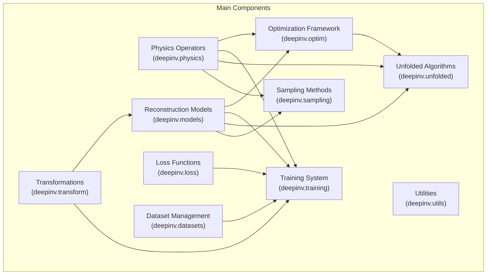
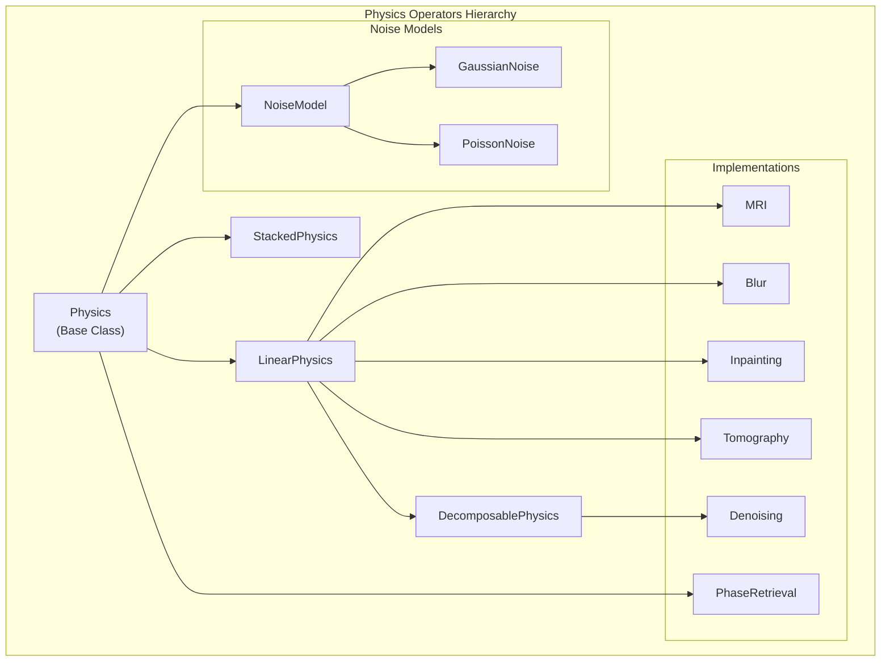
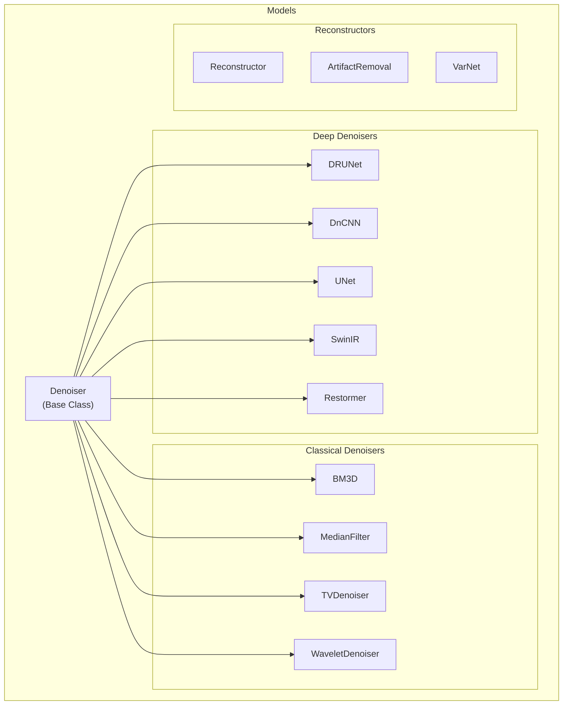
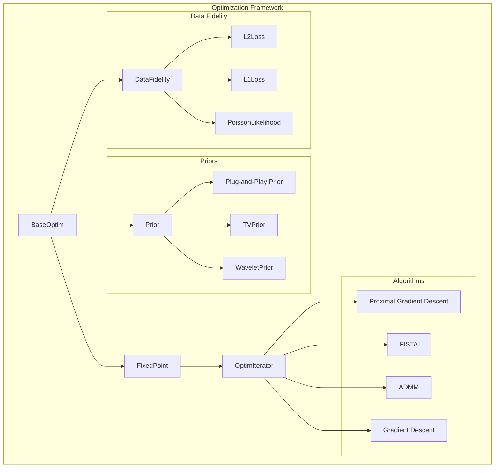
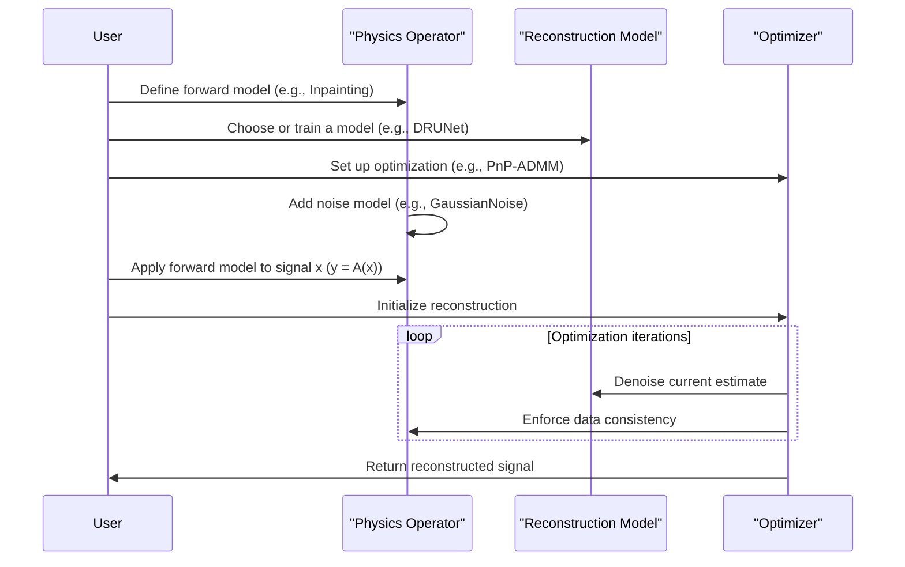

<!-- source: DeepWiki mcp.deepwiki.com · repo deepinv/deepinv · page 1 Overview · fetched 2026-10-21 -->

# Overview

<details>
<summary>Relevant source files</summary>

The following files were used as context for generating this wiki page:

- [.github/workflows/documentation.yml](.github/workflows/documentation.yml)
- [.github/workflows/lint.yml](.github/workflows/lint.yml)
- [.github/workflows/test.yml](.github/workflows/test.yml)
- [README.rst](README.rst)
- [deepinv/__init__.py](deepinv/__init__.py)
- [docs/source/user_guide/reconstruction/denoisers.rst](docs/source/user_guide/reconstruction/denoisers.rst)
- [pyproject.toml](pyproject.toml)

</details>


DeepInv (DeepInverse) is an open-source PyTorch-based library for solving imaging inverse problems using deep learning. This document provides a high-level overview of the library's purpose, architecture, and main components.

## Purpose and Scope

DeepInv aims to accelerate the development of deep learning methods for imaging inverse problems by:

1. Combining popular learning-based reconstruction approaches in a common framework
2. Standardizing forward imaging models (physics operators)
3. Simplifying the creation of imaging datasets
4. Providing pretrained models and optimization algorithms

The library addresses various imaging inverse problems such as image deblurring, inpainting, MRI reconstruction, CT reconstruction, and more. For detailed guides on specific components, refer to other wiki pages in this documentation.

Sources: [README.rst:10-23]()

## Library Architecture

DeepInv is organized into several interconnected modules that work together to provide a comprehensive toolkit for solving inverse problems. The following diagram illustrates the main components and their relationships:



Sources: [deepinv/__init__.py:1-60](), [README.rst:12-23]()

## Core Components

### Physics Operators (`deepinv.physics`)

Physics operators define the forward model of inverse problems - they describe how measurements are generated from the original signal. The library provides implementations for common imaging operators such as:

- MRI sampling
- Blurring 
- Inpainting
- Tomography
- Denoising
- Phase retrieval
- And more

These operators also integrate with various noise models (Gaussian, Poisson, etc.) to simulate realistic measurement scenarios.



For a detailed explanation of physics operators, see [Physics Operators Framework](#2.1).

Sources: [README.rst:17]()

### Reconstruction Models (`deepinv.models`)

The library provides various models for image reconstruction, including:

- Deep denoisers (DRUNet, DnCNN, UNet, SwinIR, Restormer, etc.)
- Classical denoisers (BM3D, MedianFilter, TVDenoiser, WaveletDenoiser, etc.)
- Specialized reconstructors for specific inverse problems



For more details on available models, see [Model Zoo](#3).

Sources: [docs/source/user_guide/reconstruction/denoisers.rst:1-170]()

### Optimization Framework (`deepinv.optim`)

The optimization framework provides iterative solvers for inverse problems, combining data fidelity terms with regularization priors:

- Data fidelity terms (L2, L1, Poisson likelihood, etc.)
- Priors (Plug-and-Play, Tikhonov, TV, Wavelet, etc.)
- Optimization algorithms (PGD, FISTA, ADMM, GD, etc.)



For more details on the optimization framework, see [Optimization Framework](#2.3).

Sources: [README.rst:19]()

### Training System (`deepinv.training`)

The training system provides tools for training reconstruction models:

- Supervised and self-supervised loss functions
- Dataset management
- Performance metrics (PSNR, SSIM, LPIPS)
- Trainer class for orchestrating the training process

For more details on training, see [Training System](#2.5).

Sources: [README.rst:18](), [deepinv/__init__.py:57-61]()

### Unfolded Algorithms (`deepinv.unfolded`)

Unfolded algorithms are neural networks that mimic the structure of iterative optimization algorithms:

- ADMM-based unfolded networks
- Forward-backward unfolded networks
- Deep equilibrium models (DEQ)

For more details on unfolded algorithms, see [Unfolded Algorithms](#3.2).

Sources: [README.rst:21]()

### Sampling Methods (`deepinv.sampling`)

Sampling methods for uncertainty quantification:

- Langevin sampling
- Diffusion models
- MCMC methods

For more details on sampling methods, see [Sampling Methods](#4.3).

Sources: [README.rst:22]()

## Workflow Example

The following diagram illustrates a typical workflow for solving an inverse problem using DeepInv:



## Code Example

Here's a simplified example of using DeepInv for image inpainting, as shown in the README:

```python
import deepinv as dinv
from deepinv.utils import load_url_image

# Load image
url = "https://huggingface.co/datasets/deepinv/images/resolve/main/cameraman.png?download=true"
x = load_url_image(url=url, img_size=512, grayscale=True, device='cpu')

# Define physics operator (forward model)
physics = dinv.physics.Inpainting((1, 512, 512), mask=0.5,
                                 noise_model=dinv.physics.GaussianNoise(sigma=0.01))

# Set up optimization
data_fidelity = dinv.optim.data_fidelity.L2()
prior = dinv.optim.prior.PnP(denoiser=dinv.models.MedianFilter())
model = dinv.optim.optim_builder(iteration="HQS", prior=prior, data_fidelity=data_fidelity,
                                params_algo={"stepsize": 1.0, "g_param": 0.1})

# Apply forward model and reconstruction
y = physics(x)
x_hat = model(y, physics)
```

Sources: [README.rst:70-89]()

## Installation

DeepInv can be installed using pip:

```bash
# Install basic package
pip install deepinv

# Install with additional dependencies for datasets and denoisers
pip install deepinv[dataset,denoisers]
```

For development or latest features, install directly from GitHub:

```bash
pip install git+https://github.com/deepinv/deepinv.git#egg=deepinv
```

Sources: [README.rst:39-59](), [pyproject.toml:1-90]()

## Additional Resources

- For detailed documentation and examples, visit the [DeepInv website](https://deepinv.github.io/)
- For help, join the [Discord server](https://discord.gg/qBqY5jKw3p) or open an [issue](https://github.com/deepinv/deepinv/issues)
- For more information about specific components, see other sections of this wiki

Sources: [README.rst:31-111]()

---

