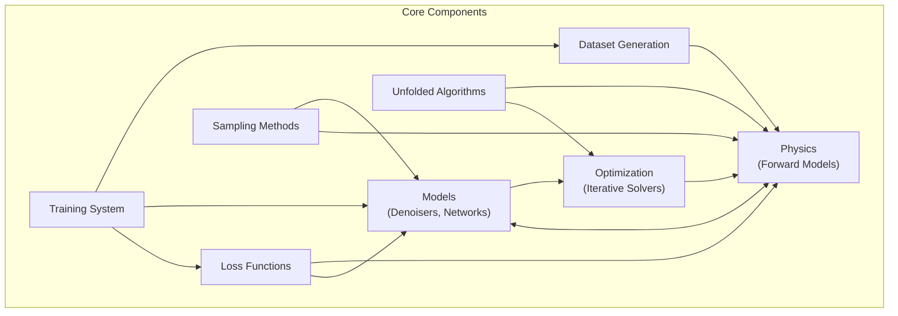
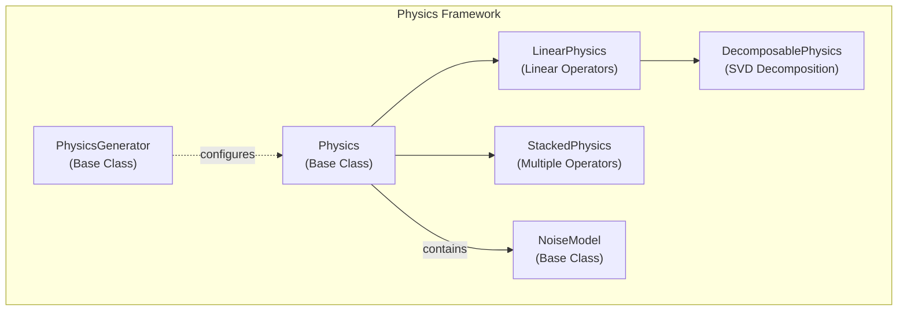
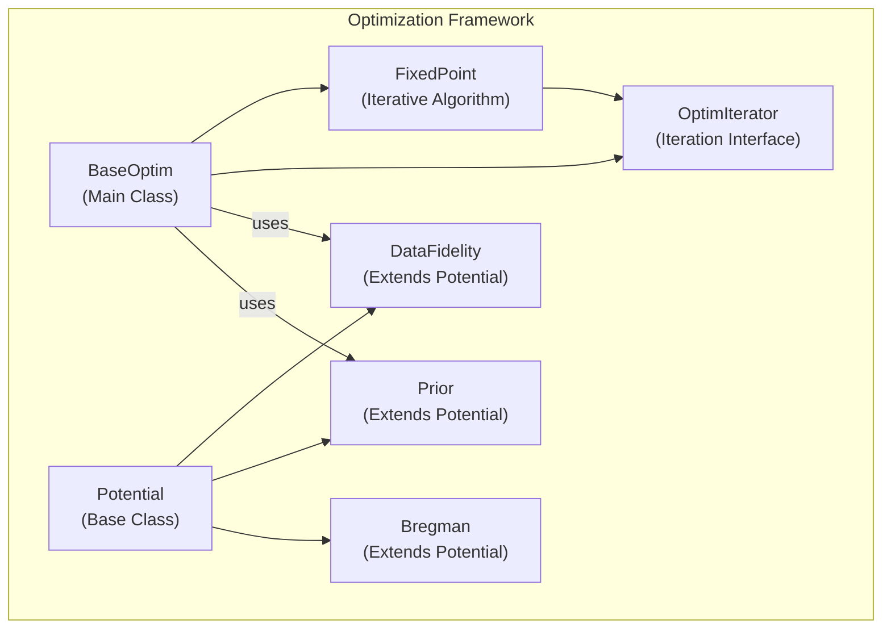
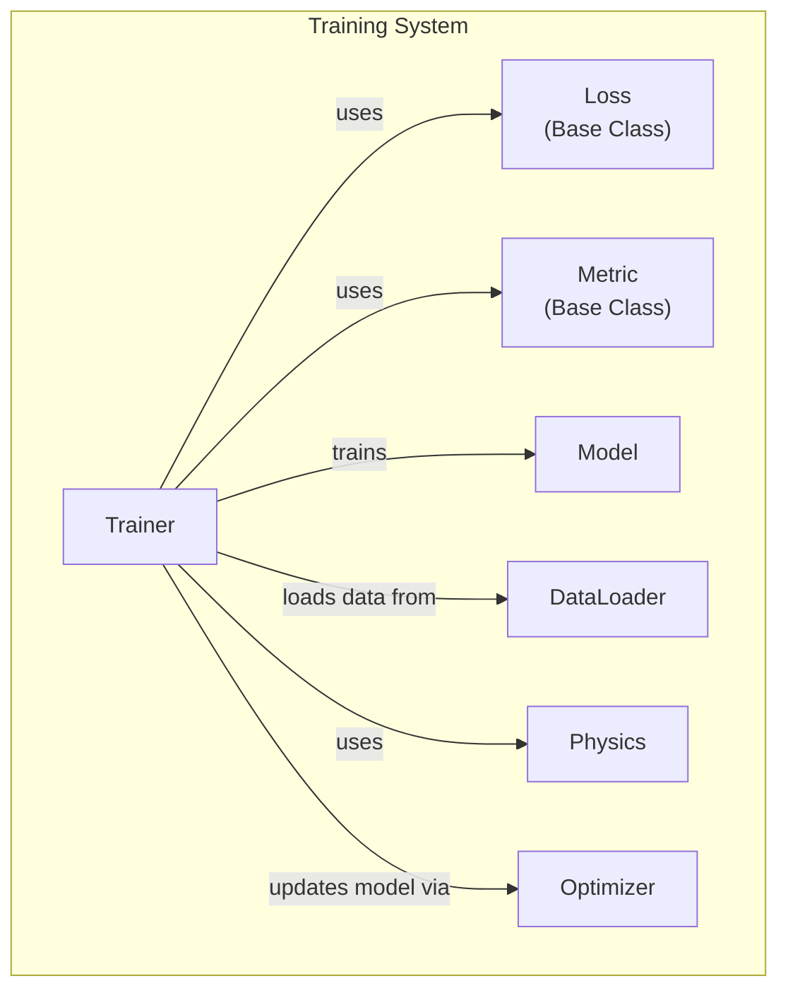
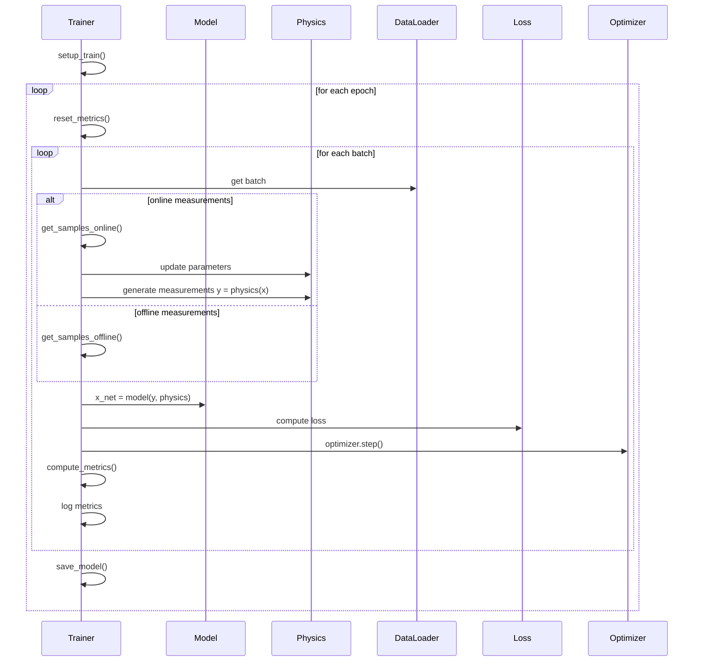
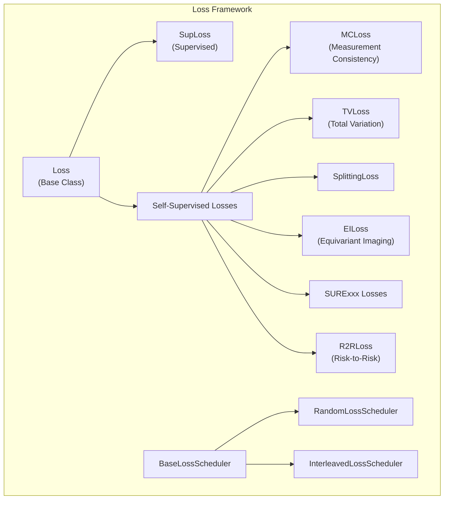

<!-- source: DeepWiki mcp.deepwiki.com · repo deepinv/deepinv · page 2 Core Architecture · fetched 2026-10-21 -->

# Core Architecture

<details>
<summary>Relevant source files</summary>

The following files were used as context for generating this wiki page:

- [CHANGELOG.rst](CHANGELOG.rst)
- [README.rst](README.rst)
- [deepinv/__init__.py](deepinv/__init__.py)
- [deepinv/tests/test_loss.py](deepinv/tests/test_loss.py)
- [deepinv/training/trainer.py](deepinv/training/trainer.py)

</details>


This page provides an overview of DeepInv's core architectural components and their relationships. It serves as a foundation for understanding how the library is structured to solve imaging inverse problems using deep learning.

For specific implementations of physics operators, see [Physics Implementations](#2.2). For details on optimization algorithms, see [Optimization Algorithms](#2.4).

## System Overview

DeepInv is built around several interconnected components that work together to provide a flexible framework for solving inverse problems through deep learning. The core architecture establishes the relationships between these components while maintaining modularity.

### Core Components Diagram



Sources: [deepinv/__init__.py:1-66](), [README.rst:10-28]()

## Module Structure

DeepInv is organized into several Python modules, each handling specific functionality in the inverse problem pipeline:

| Module | Description | Key Base Classes |
|--------|-------------|------------------|
| `deepinv.physics` | Forward operators and measurement models | `Physics`, `LinearPhysics` |
| `deepinv.optim` | Optimization algorithms and regularization | `BaseOptim`, `DataFidelity`, `Prior` |
| `deepinv.models` | Neural networks and reconstructors | `Denoiser`, `Reconstructor` |
| `deepinv.loss` | Loss functions for training | `Loss`, `Metric` |
| `deepinv.training` | Training pipeline | `Trainer` |
| `deepinv.datasets` | Dataset generation and management | `HDF5Dataset` |
| `deepinv.sampling` | Sampling methods | Various MCMC, SDE implementations |
| `deepinv.unfolded` | Unfolded optimization algorithms | `BaseUnfold`, `BaseDEQ` |
| `deepinv.transform` | Data transformations | `Transform` |
| `deepinv.utils` | Utility functions | Various plotting and helper functions |

Sources: [deepinv/__init__.py:1-66]()

## Physics Framework

The Physics framework provides base classes for modeling forward operators that transform clean signals into measurements. These operators can represent various imaging modalities and support the addition of noise.

### Physics Class Hierarchy



Sources: [README.rst:17]()

## Optimization Framework

The Optimization Framework provides algorithms for solving inverse problems based on regularization techniques. It includes various optimization algorithms, data fidelity terms, and prior terms.

### Optimization Framework Structure



Sources: [CHANGELOG.rst:166-167]()

## Training System

The Training System coordinates the model training process, handling data loading, loss computation, metrics evaluation, and model saving.

### Trainer Class Diagram



Sources: [deepinv/training/trainer.py:1-76](), [deepinv/training/trainer.py:196-234]()

### Trainer Workflow



Sources: [deepinv/training/trainer.py:1016-1152]()

## Model Framework

The Model framework provides neural networks for image reconstruction, denoising, and other image processing tasks.

### Model Types

DeepInv provides several types of models:

1. **Denoisers**: Neural networks that remove noise from images (DnCNN, DRUNet, etc.)
2. **Reconstructors**: Models that reconstruct clean signals from measurements (ArtifactRemoval, VarNet, etc.)
3. **Unfolded Algorithms**: Models that unfold iterative optimization algorithms into neural networks

## Loss and Metric Framework

The Loss framework provides loss functions for training reconstruction models, while the Metric framework provides evaluation metrics.

### Loss Types



Sources: [deepinv/tests/test_loss.py:16-31](), [deepinv/tests/test_loss.py:440-442]()

## Integration Patterns

The core components in DeepInv are designed to work together through standardized interfaces, allowing for flexible combinations of different modules.

### Simplified Workflow

```mermaid
flowchart LR
    subgraph "Data Preparation"
        direction TB
        RawDataset["Raw Dataset"]
        Physics["Physics Operator"]
        Dataset["Training Dataset"]
        
        RawDataset -->|"generate_dataset()"| Dataset
        Physics -->|"Forward Model"| Dataset
    end
    
    subgraph "Model Training"
        direction TB
        Trainer["Trainer"]
        Model["Model"]
        Loss["Loss Functions"]
        
        Trainer -->|"train()"| Model
        Loss -->|"compute loss"| Trainer
    end
    
    subgraph "Inference"
        direction TB
        TrainedModel["Trained Model"]
        TestData["Test Measurements"]
        RecoveredSignal["Recovered Signal"]
        
        TrainedModel -->|"model(y, physics)"| RecoveredSignal
        TestData -->|"input"| TrainedModel
    end
    
    Data Preparation -->|"dataloader"| Model Training
    Model Training -->|"model"| Inference
```

Sources: [README.rst:70-89]()

## Code Example

Below is a simplified example that demonstrates how the core components interact:

```python
# Create a physics operator
physics = dinv.physics.Inpainting((1, 512, 512), mask=0.5, 
                                 noise_model=dinv.physics.GaussianNoise(sigma=0.01))

# Define data fidelity and prior terms
data_fidelity = dinv.optim.data_fidelity.L2()
prior = dinv.optim.prior.PnP(denoiser=dinv.models.MedianFilter())

# Build optimization model
model = dinv.optim.optim_builder(iteration="HQS", prior=prior, data_fidelity=data_fidelity,
                                params_algo={"stepsize": 1.0, "g_param": 0.1})

# Apply forward model to get measurements
y = physics(x)

# Recover the signal
x_hat = model(y, physics)
```

Sources: [README.rst:70-89]()

## Training Example

An example of how to use the training system:

```python
# Define model, physics, and optimizer
model = dinv.models.ArtifactRemoval(backbone)
physics = dinv.physics.Inpainting(tensor_size=imsize, mask=0.5)
optimizer = torch.optim.Adam(model.parameters(), lr=5e-4)

# Create dataloaders
train_dataloader = DataLoader(train_dataset, batch_size=16)
eval_dataloader = DataLoader(eval_dataset, batch_size=16)

# Define trainer
trainer = dinv.Trainer(
    model=model,
    physics=physics,
    optimizer=optimizer,
    train_dataloader=train_dataloader,
    eval_dataloader=eval_dataloader,
    epochs=100,
    losses=dinv.loss.SupLoss(),
    metrics=[dinv.metric.PSNR(), dinv.metric.SSIM()],
    device="cuda"
)

# Train the model
trained_model = trainer.train()
```

Sources: [deepinv/training/trainer.py:1228-1275](), [deepinv/tests/test_loss.py:276-323]()

## Summary

The core architecture of DeepInv provides a modular and extensible framework for solving inverse problems in imaging using deep learning. The main components are:

1. **Physics Operators**: Forward models that transform clean signals to measurements
2. **Optimization Framework**: Algorithms for solving inverse problems
3. **Models**: Neural networks for reconstruction and denoising
4. **Training System**: Orchestrates the training of models
5. **Loss Functions**: Define the training objectives
6. **Dataset Management**: Tools for creating and managing datasets

These components can be combined in various ways to implement different approaches to inverse problems, from traditional optimization methods to learning-based techniques and hybrid approaches.

---

