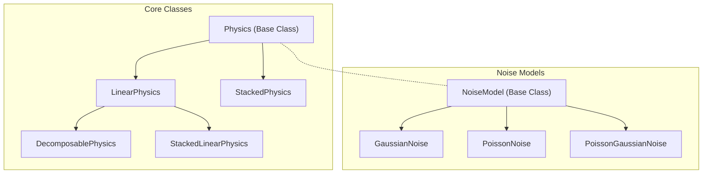
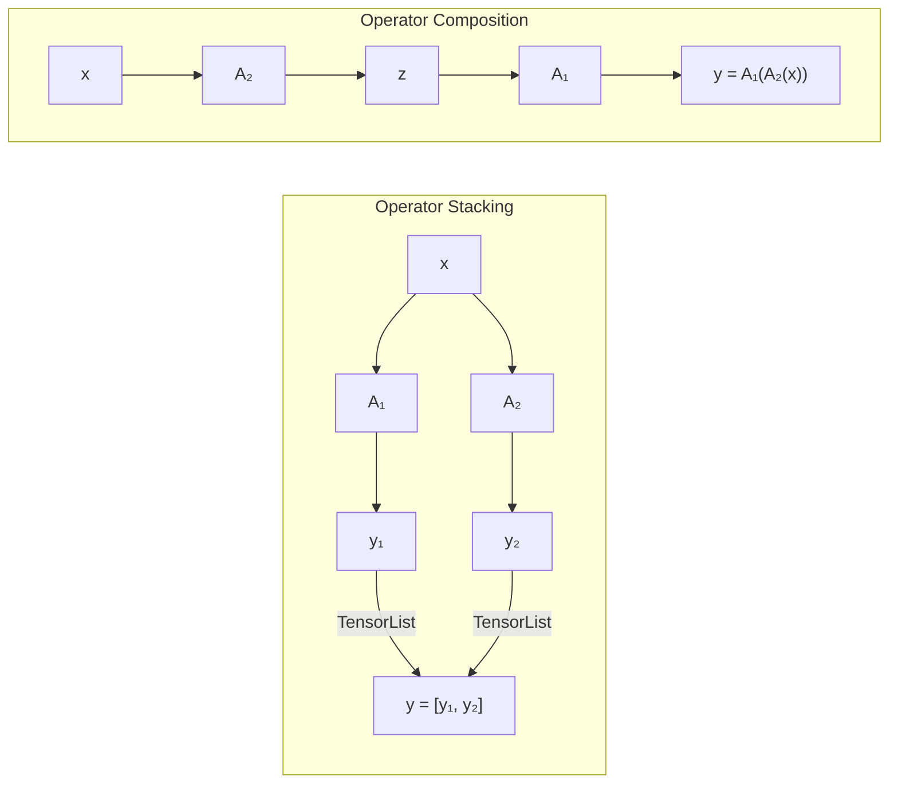
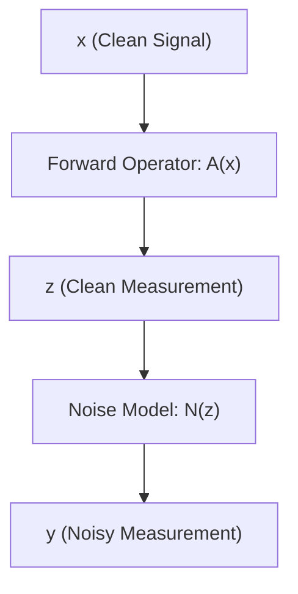
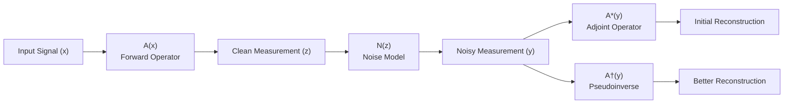
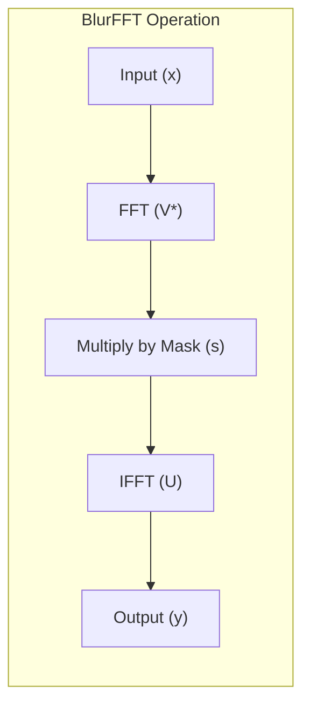

<!-- source: DeepWiki mcp.deepwiki.com · repo deepinv/deepinv · page 2.1 Physics Operators Framework · fetched 2026-10-21 -->

# Physics Operators Framework

<details>
<summary>Relevant source files</summary>

The following files were used as context for generating this wiki page:

- [deepinv/physics/__init__.py](deepinv/physics/__init__.py)
- [deepinv/physics/blur.py](deepinv/physics/blur.py)
- [deepinv/physics/forward.py](deepinv/physics/forward.py)
- [deepinv/physics/generator/inpainting.py](deepinv/physics/generator/inpainting.py)
- [deepinv/physics/noise.py](deepinv/physics/noise.py)
- [deepinv/physics/range.py](deepinv/physics/range.py)
- [deepinv/physics/remote_sensing.py](deepinv/physics/remote_sensing.py)
- [deepinv/tests/test_noise_model.py](deepinv/tests/test_noise_model.py)
- [deepinv/tests/test_physics.py](deepinv/tests/test_physics.py)
- [docs/source/api/deepinv.physics.rst](docs/source/api/deepinv.physics.rst)
- [docs/source/user_guide/physics/physics.rst](docs/source/user_guide/physics/physics.rst)

</details>


## Purpose and Scope

The Physics Operators Framework in DeepInv provides a structured approach to modeling forward operators in computational imaging and inverse problems. It serves as a foundation for representing the mathematical transformations that map signals to measurements, including both the deterministic physical process and stochastic noise components.

This page focuses on the core architecture and base classes of the framework. For implementations of specific physics operators like MRI, blur, inpainting, etc., see [Physics Implementations](#2.2). For details on optimization algorithms that use these operators, see [Optimization Framework](#2.3).

## Core Framework Structure

The Physics Operators Framework consists of a hierarchy of classes that represent different types of forward operators, along with a complementary set of noise models.



Sources: [deepinv/physics/forward.py:10-617](). [deepinv/physics/noise.py:7-493]().

## Base Classes and Their Roles

### Physics Class

The `Physics` class is the foundation of the framework, representing a general forward operator with the measurement process:

$$y = N(A(x))$$

where $x$ is the input signal, $A$ is the forward operator, $N$ is the noise model, and $y$ is the noisy measurement.

Key methods include:

| Method | Description |
|--------|-------------|
| `A(x)` | Applies the deterministic forward operator |
| `forward(x)` | Complete forward process including noise |
| `A_dagger(y)` | Computes the pseudoinverse (basic reconstruction) |
| `A_vjp(x, v)` | Vector-Jacobian product for autodifferentiation |
| `update(**kwargs)` | Updates operator parameters |

Sources: [deepinv/physics/forward.py:10-102](). [deepinv/physics/forward.py:109-117](). [deepinv/physics/forward.py:148-182]().

### LinearPhysics Class

The `LinearPhysics` class extends `Physics` for linear operators, which follow the form:

$$A(x) = Mx$$

where $M$ is a linear transformation matrix.

Additional methods include:

| Method | Description |
|--------|-------------|
| `A_adjoint(y)` | Applies the adjoint (transpose) of the forward operator |
| `compute_norm(x)` | Calculates the spectral norm of the operator |
| `prox_l2(z, y, gamma)` | Proximal operator for L2 data fidelity |
| `adjointness_test(u)` | Checks if A* is correctly implemented as the adjoint of A |

Sources: [deepinv/physics/forward.py:248-616](). [deepinv/tests/test_physics.py:452-470]().

### DecomposablePhysics Class

The `DecomposablePhysics` class represents linear operators that can be decomposed using singular value decomposition (SVD):

$$A = U \text{diag}(s) V^T$$

This structure allows for efficient computation of adjoints, pseudoinverses, and proximal operators.

Key methods include:

| Method | Description |
|--------|-------------|
| `U(x)`, `V(x)` | Apply the orthogonal transformations from the SVD |
| `U_adjoint(x)`, `V_adjoint(x)` | Apply the adjoints of U and V |
| `prox_l2(z, y, gamma)` | Efficient proximal operator via SVD |

Sources: [deepinv/physics/forward.py:619-802](). [deepinv/tests/test_physics.py:564-581]().

### Stacked Operators

The framework provides two ways to combine physics operators:

1. **Stacking (Parallel)**: Created via `stack()` method to apply multiple operators to the same input
2. **Composition (Sequential)**: Created via `__mul__` method to apply operators in sequence



Sources: [deepinv/physics/forward.py:56-92](). [deepinv/physics/forward.py:410-433](). [deepinv/tests/test_physics.py:416-448]().

## Noise Models

Noise models represent the stochastic part of the measurement process. They inherit from the `NoiseModel` base class and can be combined via multiplication.



Common noise models include:

| Noise Model | Mathematical Form |
|-------------|-------------------|
| `GaussianNoise` | $y = z + \epsilon$ where $\epsilon \sim \mathcal{N}(0, \sigma^2I)$ |
| `PoissonNoise` | $y = \mathcal{P}(z/\gamma)$ |
| `PoissonGaussianNoise` | $y = \gamma\mathcal{P}(z/\gamma) + \epsilon$ |
| `UniformNoise` | $y = z + \epsilon$ where $\epsilon \sim \mathcal{U}(-a, a)$ |

Sources: [deepinv/physics/noise.py:7-83](). [deepinv/physics/noise.py:94-242](). [deepinv/physics/noise.py:299-368](). [deepinv/physics/noise.py:416-492]().

## Implementation Patterns

### Forward and Inverse Transformations

The complete measurement process involves multiple transformations:



Sources: [deepinv/physics/forward.py:94-107](). [deepinv/physics/forward.py:148-182](). [deepinv/physics/forward.py:584-616]().

### Physics Parameters and Updates

Physics operators can have parameters that affect their behavior. These can be updated dynamically:

```python
# Update parameters example
physics.update(filter=new_filter, sigma=new_noise_level)
```

This is crucial for applications like unrolled optimization algorithms where physics parameters might change between iterations.

Sources: [deepinv/physics/forward.py:221-246](). [deepinv/physics/blur.py:298-311](). [deepinv/physics/noise.py:234-241]().

## Key Implementation Examples

### Linear Operators in the Framework

The framework provides specialized implementations for common linear operations:

| Operator | Description | Class |
|----------|-------------|-------|
| Blur | Convolution with a kernel | `Blur`, `BlurFFT` |
| Downsampling | Super-resolution forward model | `Downsampling` |
| Inpainting | Masked measurements | `Inpainting` |
| MRI | Fourier domain sampling | `MRI`, `MultiCoilMRI` |
| Compressed Sensing | Random projections | `CompressedSensing` |

Sources: [deepinv/physics/blur.py:20-204](). [deepinv/physics/blur.py:207-312](). [deepinv/physics/__init__.py:1-44]().

### Decomposable Physics Example

The `BlurFFT` class is an example of a decomposable physics operator that utilizes FFT for efficient computation:



Sources: [deepinv/physics/blur.py:313-412](). [deepinv/tests/test_physics.py:910-946]().

## Testing and Validation

The framework provides methods to validate the correctness of operator implementations:

1. **Adjointness Test**: Verifies that `A_adjoint` is properly implemented
2. **Norm Computation**: Ensures the operator is properly normalized
3. **Pseudoinverse Test**: Checks that `A_dagger` correctly inverts the forward operation

Sources: [deepinv/tests/test_physics.py:452-470](). [deepinv/tests/test_physics.py:483-520](). [deepinv/tests/test_physics.py:540-561]().

## Conclusion

The Physics Operators Framework provides a flexible foundation for modeling forward processes in inverse problems. By separating the deterministic physics from the stochastic noise, it enables a modular approach to forward modeling while providing necessary tools for reconstruction algorithms.

---

