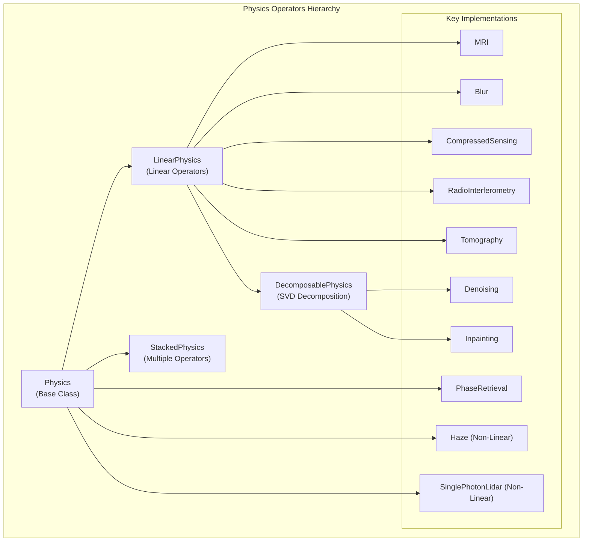
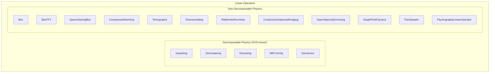
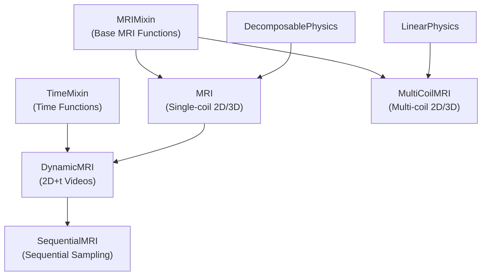
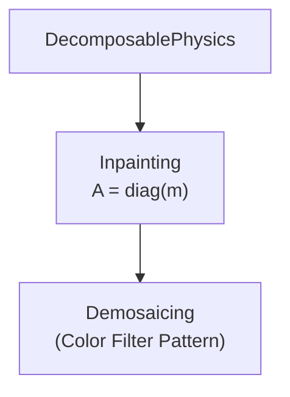
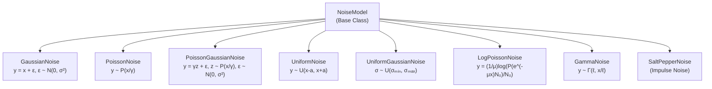

<!-- source: DeepWiki mcp.deepwiki.com · repo deepinv/deepinv · page 2.2 Physics Implementations · fetched 2026-10-21 -->

# Physics Implementations

<details>
<summary>Relevant source files</summary>

The following files were used as context for generating this wiki page:

- [.gitignore](.gitignore)
- [deepinv/physics/__init__.py](deepinv/physics/__init__.py)
- [deepinv/physics/generator/__init__.py](deepinv/physics/generator/__init__.py)
- [deepinv/physics/generator/inpainting.py](deepinv/physics/generator/inpainting.py)
- [deepinv/physics/generator/mri.py](deepinv/physics/generator/mri.py)
- [deepinv/physics/generator/noise.py](deepinv/physics/generator/noise.py)
- [deepinv/physics/inpainting.py](deepinv/physics/inpainting.py)
- [deepinv/physics/mri.py](deepinv/physics/mri.py)
- [deepinv/physics/noise.py](deepinv/physics/noise.py)
- [deepinv/tests/test_generators.py](deepinv/tests/test_generators.py)
- [deepinv/tests/test_noise_model.py](deepinv/tests/test_noise_model.py)
- [deepinv/tests/test_physics.py](deepinv/tests/test_physics.py)
- [docs/source/api/deepinv.physics.rst](docs/source/api/deepinv.physics.rst)
- [docs/source/user_guide/physics/physics.rst](docs/source/user_guide/physics/physics.rst)

</details>


This page details the specific implementations of physics operators available in the DeepInv library. It covers the various forward models used in imaging inverse problems, including both linear and non-linear operators, along with their properties and usage. For information about the overall Physics Operators Framework architecture, see [Physics Operators Framework](#2.1).

## Physics Operator Overview

The DeepInv library provides a rich collection of physics operators for modeling various imaging modalities and degradation processes. These operators represent the forward model in inverse problems and are used to generate measurements from clean signals as well as to perform reconstruction.



Sources:
- [deepinv/physics/__init__.py:1-47]()
- [deepinv/tests/test_physics.py:13-68]()

## Linear Physics Operators

Linear physics operators are the most common type of forward models in DeepInv. They represent linear transformations of the input signal.

### Decomposable vs Non-Decomposable Linear Operators

Linear operators in DeepInv are categorized as either decomposable or non-decomposable:

- **Decomposable Operators**: Have a known singular value decomposition (SVD), enabling fast computation of pseudo-inverse and proximal operators. They inherit from `DecomposablePhysics`.
- **Non-Decomposable Operators**: Don't have a readily available SVD. They inherit directly from `LinearPhysics`.



Sources:
- [deepinv/physics/__init__.py:1-47]()
- [deepinv/tests/test_physics.py:450-562]()

### MRI Operators

DeepInv provides a comprehensive set of MRI operators for various MRI acquisition scenarios:



The MRI operators are implemented with the following key features:

- **MRI**: Single-coil accelerated 2D or 3D MRI with subsampling masks
- **MultiCoilMRI**: Multi-coil 2D or 3D MRI with coil sensitivity maps
- **DynamicMRI**: Single-coil accelerated dynamic (2D+t) MRI with time-varying masks
- **SequentialMRI**: Single-coil MRI with sequential sampling patterns

These operators support various mask patterns for k-space acceleration, coil simulations for parallel imaging, and can handle both 2D and 3D data.

Sources:
- [deepinv/physics/mri.py:12-647]()
- [deepinv/tests/test_physics.py:589-672]()

### Inpainting Operators

The `Inpainting` operator keeps a subset of entries from the input signal, determined by a binary mask:



Key features:

- Masks can be created from Bernoulli distributions with specified probabilities
- Support for pixelwise masking (zeroing all channels at specific pixel locations)
- `Demosaicing` is a specialized inpainting operator for color filter arrays (e.g., Bayer pattern)

Sources:
- [deepinv/physics/inpainting.py:7-211]()
- [deepinv/physics/generator/inpainting.py:8-204]()

### Blur and Super-Resolution

DeepInv offers multiple blur implementations:

- **Blur**: Spatial domain convolution with various padding options
- **BlurFFT**: Efficient Fourier domain convolution
- **SpaceVaryingBlur**: Non-stationary blur that varies spatially
- **Downsampling**: Blur followed by subsampling, used for super-resolution

These operators can be configured with various filter types like Gaussian, bilinear, and bicubic.

Sources:
- [deepinv/tests/test_physics.py:224-255]()
- [deepinv/tests/test_physics.py:910-946]()

### Compressed Sensing

Compressed sensing implementations include:

- **CompressedSensing**: Random projection operator
- **SinglePixelCamera**: Simulates single-pixel camera acquisition
- **StructuredRandom**: Structured random measurements

These operators support both regular and fast implementations, with optional complex-valued signals.

Sources:
- [deepinv/tests/test_physics.py:102-117]()
- [deepinv/tests/test_physics.py:206-217]()

### Other Linear Operators

Additional linear operators in DeepInv include:

- **Tomography**: Radon transform for CT imaging
- **RadioInterferometry**: Non-uniform Fourier transform for radio astronomy
- **Pansharpen**: Multi-resolution sensing for remote sensing
- **CompressiveSpectralImaging**: Compressive sensing for hyperspectral imaging
- **HyperSpectralUnmixing**: Unmixing for hyperspectral data

Sources:
- [deepinv/tests/test_physics.py:980-1011]()
- [deepinv/tests/test_physics.py:302-340]()

## Nonlinear Physics Operators

DeepInv also supports nonlinear physics operators that don't follow linear transformations:

- **Haze**: Atmospheric scattering model for dehazing
- **SinglePhotonLidar**: Single-photon Lidar imaging model

These operators override standard methods like `A`, `A_adjoint`, and `A_dagger` to implement their nonlinear behavior.

Sources:
- [deepinv/tests/test_physics.py:361-383]()
- [deepinv/tests/test_physics.py:524-536]()

## Phase Retrieval Operators

Phase retrieval operators form a special class of operators that only measure the magnitude of complex-valued signals:

- **PhaseRetrieval**: Base class for phase retrieval
- **RandomPhaseRetrieval**: Random phase retrieval with Gaussian measurement matrices
- **StructuredRandomPhaseRetrieval**: Structured random phase measurements
- **Ptychography**: Implementation of ptychographic imaging
- **PtychographyLinearOperator**: Linear approximation of ptychography

These operators have special properties, such as producing the same output for inputs `x` and `-x`.

Sources:
- [deepinv/tests/test_physics.py:754-769]()
- [deepinv/tests/test_physics.py:771-788]()
- [deepinv/tests/test_physics.py:347-355]()

## Noise Models

Physics operators in DeepInv can be combined with various noise models to simulate realistic measurement processes:



Key features:

- Noise models can be attached to any physics operator via the `noise_model` attribute
- Multiple noise models can be combined using multiplication (`*` operator)
- Noise parameters can be updated on-the-fly
- Domain-specific noise handling (e.g., applying noise only where the mask is non-zero for inpainting)

Sources:
- [deepinv/physics/noise.py:7-638]()
- [deepinv/tests/test_noise_model.py:23-45]()
- [deepinv/tests/test_physics.py:884-907]()

## Physics Generators

DeepInv includes generators for creating random parameters for physics operators:

```mermaid
graph TD
    PhysicsGenerator["PhysicsGenerator<br>(Base Class)"]
    
    subgraph "Mask Generators"
        BernoulliSplittingMaskGenerator["BernoulliSplittingMaskGenerator"]
        GaussianSplittingMaskGenerator["GaussianSplittingMaskGenerator"]
        GaussianMaskGenerator["GaussianMaskGenerator<br>(MRI)"]
        RandomMaskGenerator["RandomMaskGenerator<br>(MRI)"]
        EquispacedMaskGenerator["EquispacedMaskGenerator<br>(MRI)"]
    end
    
    subgraph "Blur Generators"
        PSFGenerator["PSFGenerator"]
        MotionBlurGenerator["MotionBlurGenerator"]
        DiffractionBlurGenerator["DiffractionBlurGenerator"]
    end
    
    subgraph "Noise Generators"
        SigmaGenerator["SigmaGenerator<br>(Gaussian σ)"]
        GainGenerator["GainGenerator<br>(Poisson γ)"]
    end
    
    PhysicsGenerator --> BernoulliSplittingMaskGenerator
    PhysicsGenerator --> GaussianSplittingMaskGenerator
    PhysicsGenerator --> GaussianMaskGenerator
    PhysicsGenerator --> RandomMaskGenerator
    PhysicsGenerator --> EquispacedMaskGenerator
    PhysicsGenerator --> PSFGenerator
    PhysicsGenerator --> MotionBlurGenerator
    PhysicsGenerator --> DiffractionBlurGenerator
    PhysicsGenerator --> SigmaGenerator
    PhysicsGenerator --> GainGenerator
```



Physics generators provide a convenient way to create random parameters for physics operators:

1. **Mask Generators**:
   - **BernoulliSplittingMaskGenerator**: Generates binary masks with Bernoulli distribution
   - **GaussianSplittingMaskGenerator**: Generates masks with Gaussian spatial weighting
   - **MRI-specific generators**: Generate various k-space sampling patterns

2. **Blur Generators**:
   - **MotionBlurGenerator**: Generates motion blur kernels
   - **DiffractionBlurGenerator**: Generates diffraction blur kernels

3. **Noise Generators**:
   - **SigmaGenerator**: Generates noise levels for Gaussian noise
   - **GainGenerator**: Generates gain parameters for Poisson noise

Sources:
- [deepinv/physics/generator/__init__.py:1-24]()
- [deepinv/physics/generator/inpainting.py:8-204]()
- [deepinv/physics/generator/mri.py:15-280]()
- [deepinv/physics/generator/noise.py:5-116]()

## Usage Examples and Integration

Physics operators in DeepInv are designed to be composable and extensible. Here are common usage patterns:

### Basic Usage

Physics operators can be applied directly to input tensors:

```python
# Create a physics operator
physics = dinv.physics.MRI(img_size=(2, 320, 320))

# Apply forward operator to input tensor
y = physics(x)  # or physics.A(x)

# Apply adjoint operator
x_hat = physics.A_adjoint(y)

# Apply pseudo-inverse
x_hat = physics.A_dagger(y)
```

### Adding Noise

Noise models can be attached to physics operators:

```python
# Create a physics operator with Gaussian noise
physics = dinv.physics.Inpainting(tensor_size=(3, 256, 256), mask=0.8)
physics.noise_model = dinv.physics.GaussianNoise(sigma=0.1)

# Apply forward operator with noise
y = physics(x)  # Includes noise
```

### Using Generators

Generators can be used to create random parameters:

```python
# Create a mask generator
gen = dinv.physics.generator.BernoulliSplittingMaskGenerator(
    tensor_size=(3, 256, 256), 
    split_ratio=0.7
)

# Generate random mask
params = gen.step(batch_size=1)

# Apply physics with generated parameters
physics = dinv.physics.Inpainting(tensor_size=(3, 256, 256))
y = physics(x, **params)  # Using the generated mask
```

### Operator Composition

Physics operators can be composed using multiplication:

```python
# Create two physics operators
p1 = dinv.physics.Blur(filter=h)
p2 = dinv.physics.Inpainting(mask=m)

# Compose them (p = p2 ∘ p1)
p = p2 * p1

# Apply composed operator
y = p(x)  # Equivalent to p2(p1(x))
```

Sources:
- [deepinv/tests/test_physics.py:416-448]()
- [deepinv/tests/test_physics.py:733-751]()
- [deepinv/tests/test_physics.py:947-969]()

## Common Properties and Methods

All physics operators in DeepInv share common properties and methods:

- **A/forward**: Apply the forward operator
- **A_adjoint**: Apply the adjoint operator
- **A_dagger**: Apply the pseudo-inverse operator
- **compute_norm**: Compute the operator norm
- **prox_l2**: Compute the proximal operator for L2 data fidelity
- **update_parameters**: Update operator parameters on-the-fly

Additionally, `LinearPhysics` operators can be tested for:
- **Adjointness**: Verify that `<Ax,y> = <x,A^*y>`
- **Decomposability**: Check if SVD decomposition is available

Sources:
- [deepinv/tests/test_physics.py:452-519]()
- [deepinv/tests/test_physics.py:540-562]()
- [deepinv/tests/test_physics.py:566-581]()

This comprehensive set of physics implementations allows DeepInv to model a wide range of inverse problems in imaging, making it a versatile framework for developing and testing reconstruction algorithms.

---

