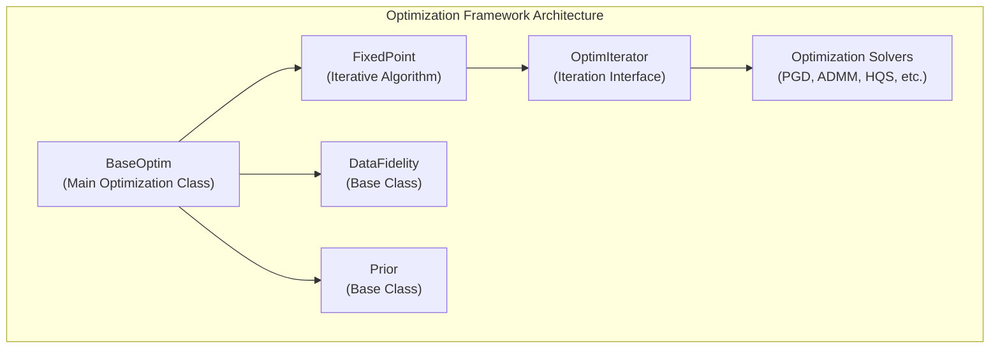
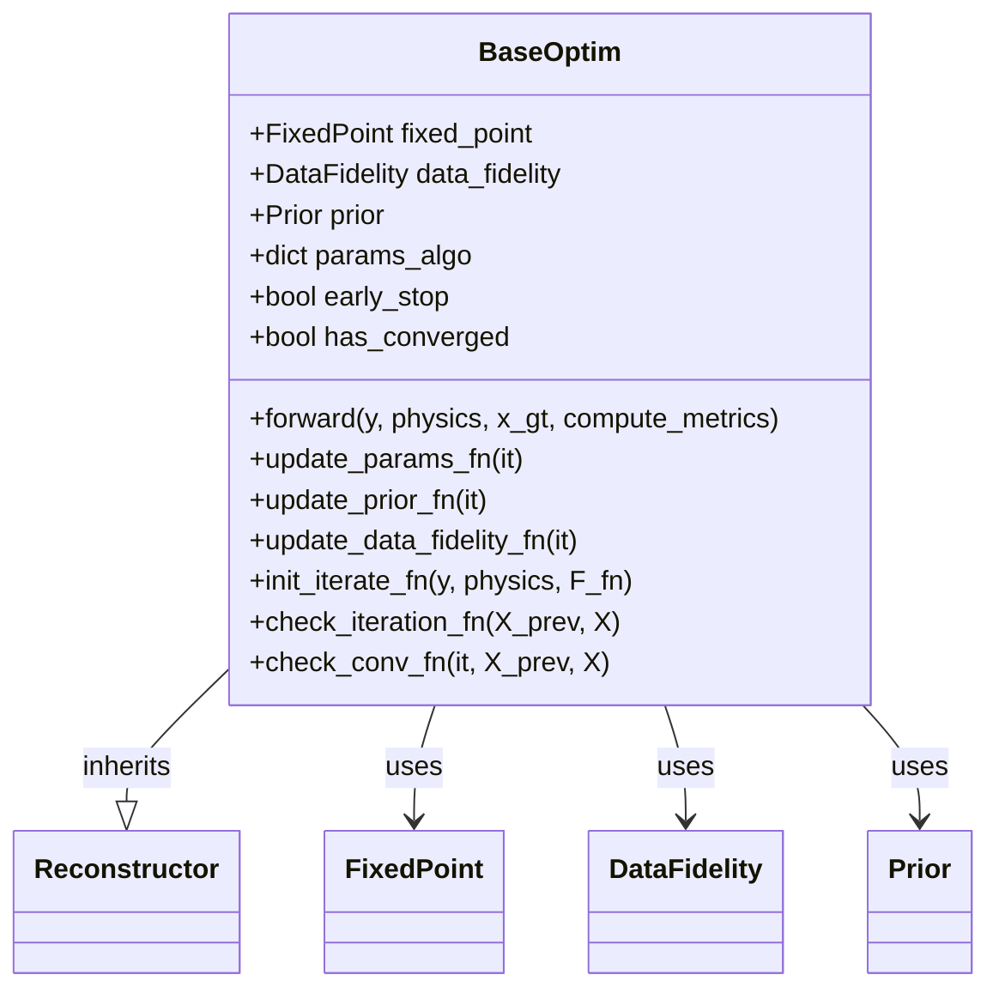
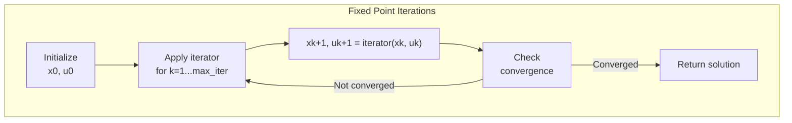
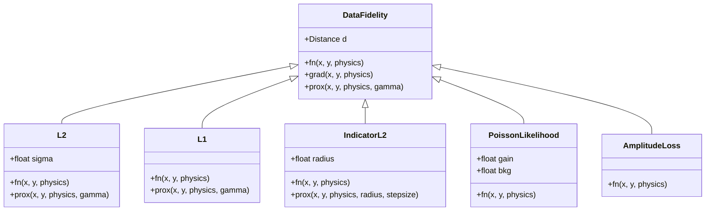
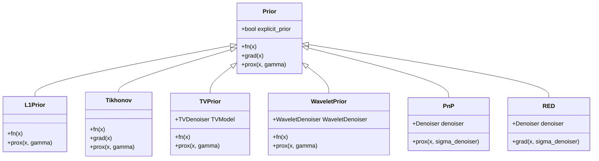
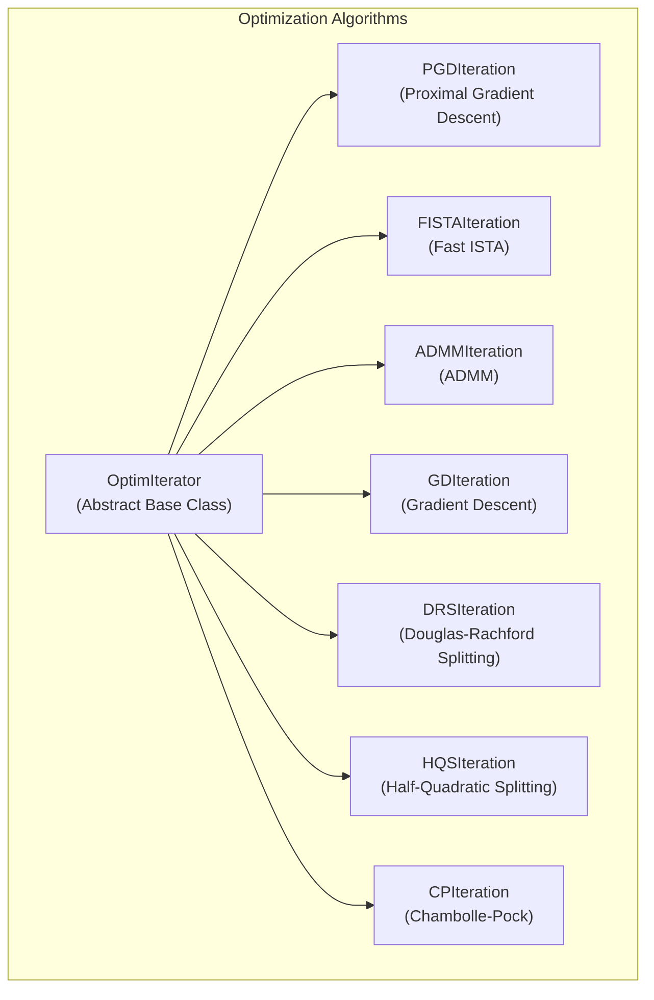
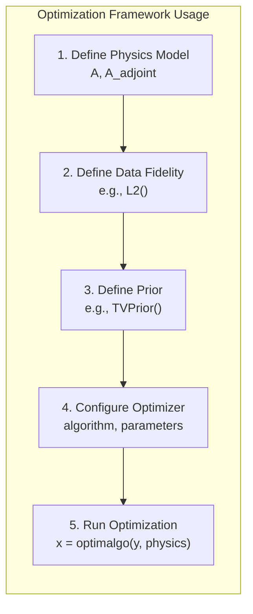

<!-- source: DeepWiki mcp.deepwiki.com · repo deepinv/deepinv · page 2.3 Optimization Framework · fetched 2026-10-21 -->

# Optimization Framework

<details>
<summary>Relevant source files</summary>

The following files were used as context for generating this wiki page:

- [deepinv/optim/__init__.py](deepinv/optim/__init__.py)
- [deepinv/optim/data_fidelity.py](deepinv/optim/data_fidelity.py)
- [deepinv/optim/fixed_point.py](deepinv/optim/fixed_point.py)
- [deepinv/optim/optimizers.py](deepinv/optim/optimizers.py)
- [deepinv/optim/prior.py](deepinv/optim/prior.py)
- [deepinv/tests/test_optim.py](deepinv/tests/test_optim.py)

</details>


The DeepInv Optimization Framework provides a flexible and extensible system for solving inverse problems using optimization algorithms. It enables users to formulate and solve optimization problems in the form:

$$\min_x f(x, y) + \lambda g(x)$$

where $f(x, y)$ is a data fidelity term measuring the discrepancy between the forward model applied to $x$ and the measurements $y$, and $g(x)$ is a regularization prior. The framework implements various optimization algorithms such as Proximal Gradient Descent (PGD), Alternating Direction Method of Multipliers (ADMM), Half-Quadratic Splitting (HQS), and more.

For details on specific optimization algorithms, see [Optimization Algorithms](#2.4).

## Overview

The Optimization Framework is built around the concept of fixed-point iterations, which are used to solve optimization problems iteratively. It provides a modular design where different data fidelity terms, regularization priors, and optimization algorithms can be combined to solve specific inverse problems.



Sources: [deepinv/optim/optimizers.py:12-494](), [deepinv/optim/fixed_point.py:7-301]()

## Key Components

### BaseOptim Class

The `BaseOptim` class is the main entry point for using the optimization framework. It is a `Reconstructor` that solves the problem:

$$\min_x f(Ax, y) + \lambda g(x)$$

This class encapsulates:
- Fixed point iterations to solve the optimization problem
- Management of algorithm parameters (step sizes, regularization strengths)
- Convergence checking and early stopping
- Optional backtracking for stepsize selection
- Anderson acceleration for faster convergence



Sources: [deepinv/optim/optimizers.py:12-494]()

### Fixed Point Iterations

The `FixedPoint` class implements the iterative algorithm that converges to a fixed point. It repeatedly applies a fixed-point operator until convergence:

$$(x_{k+1}, u_{k+1}) = \text{FixedPoint}(x_k, u_k, f, g, A, y, ...)$$

Key features include:
- Support for various fixed-point operators through the `OptimIterator` interface
- Anderson acceleration for faster convergence
- Convergence criteria and early stopping
- Metric tracking (e.g., PSNR) during iterations



Sources: [deepinv/optim/fixed_point.py:7-301]()

### Data Fidelity Terms

The `DataFidelity` class hierarchy defines different ways to measure the discrepancy between the forward model output $Ax$ and the measurements $y$. The framework provides various implementations for different noise models and applications.



The table below summarizes the main data fidelity terms:

| Data Fidelity Class | Description | Typical Noise Model |
|-----------------|-------------|------------------|
| `L2` | Squared Euclidean norm: $\frac{1}{2\sigma^2}\\|Ax-y\\|^2$ | Gaussian noise |
| `L1` | L1 norm: $\\|Ax-y\\|_1$ | Impulse noise |
| `IndicatorL2` | Indicator of L2 ball: $\iota_{B(y,r)}(Ax)$ | Bounded noise |
| `PoissonLikelihood` | $-y^T \log(Ax+\beta)+1^T(Ax)$ | Poisson noise (e.g., photon counting) |
| `AmplitudeLoss` | $\sum_i(\sqrt{\\|b_i x\\|^2}-\sqrt{y_i})^2$ | Phase retrieval |

Sources: [deepinv/optim/data_fidelity.py:15-561]()

### Prior Terms

The `Prior` class hierarchy defines different regularization terms that encode prior knowledge about the signal to be recovered. The framework provides both explicit priors (with a defined functional form) and implicit priors (defined through an operator, such as a denoiser).



The table below summarizes the main prior terms:

| Prior Class | Description | Type |
|-------------|-------------|------|
| `L1Prior` | L1 norm: $\\|x\\|_1$ | Explicit |
| `Tikhonov` | Squared L2 norm: $\frac{1}{2}\\|x\\|_2^2$ | Explicit |
| `TVPrior` | Total Variation: $\\|Dx\\|_{1,2}$ | Explicit |
| `WaveletPrior` | Wavelet sparsity: $\\|\Psi x\\|_p$ | Explicit |
| `PnP` | Plug-and-Play: $\text{prox}_{\gamma g}(x) = D_{\sigma}(x)$ | Implicit |
| `RED` | Regularization by Denoising: $\nabla g(x) = x - D_{\sigma}(x)$ | Implicit |

Sources: [deepinv/optim/prior.py:19-701]()

### Optimization Algorithms

The framework implements various optimization algorithms through different `OptimIterator` classes. These define how to update the variables in each iteration to minimize the objective function.



All these algorithms are exposed through the `optim_builder` function, which creates a `BaseOptim` instance with the specified algorithm:

```python
optimalgo = optim_builder(
    algorithm_name,
    prior=prior,
    data_fidelity=data_fidelity,
    max_iter=max_iter,
    params_algo=params_algo
)
```

Sources: [deepinv/optim/optimizers.py:497-614]()

## Usage Workflow



A typical workflow for using the Optimization Framework involves:

1. **Define the physics model**: Create a `Physics` object that models the forward operation $A$ and its adjoint $A^*$.
2. **Choose a data fidelity term**: Select a `DataFidelity` subclass that matches your noise model.
3. **Choose a regularization prior**: Select a `Prior` subclass that encodes prior knowledge about your signal.
4. **Configure the optimization algorithm**: Choose an algorithm and set its parameters (step sizes, regularization strength, etc.).
5. **Run the optimization**: Apply the algorithm to your measurements to obtain the reconstructed signal.

Example:

```python
# 1. Define physics model
physics = dinv.physics.Blur(
    dinv.physics.blur.gaussian_blur(sigma=(2, 0.1)),
    noise_model=dinv.physics.GaussianNoise(0.1)
)

# 2. Choose data fidelity term
data_fidelity = dinv.optim.L2()

# 3. Choose regularization prior
prior = dinv.optim.TVPrior()

# 4. Configure optimization algorithm
params_algo = {
    "stepsize": 1.0,
    "lambda": 0.1
}

# 5. Create and run optimization algorithm
optimalgo = dinv.optim.optim_builder(
    "PGD",
    prior=prior,
    data_fidelity=data_fidelity,
    max_iter=100,
    params_algo=params_algo,
    verbose=True
)

# Apply to measurements
x = optimalgo(y, physics)
```

Sources: [deepinv/tests/test_optim.py:295-364]()

## Customization

The framework is designed to be highly customizable. Users can:

1. **Create custom data fidelity terms** by subclassing `DataFidelity` and implementing the required methods.
2. **Create custom priors** by subclassing `Prior` and implementing the required methods.
3. **Combine different data fidelity terms and priors** with various optimization algorithms.
4. **Set algorithm-specific parameters** through the `params_algo` dictionary.
5. **Monitor convergence** by specifying convergence criteria and thresholds.

This flexibility allows researchers and practitioners to implement and experiment with a wide range of optimization-based approaches for solving inverse problems.

Sources: [deepinv/optim/optimizers.py:12-494]()

---

