<!-- source: DeepWiki mcp.deepwiki.com · repo deepinv/deepinv · page 2.4 Optimization Algorithms · fetched 2026-10-21 -->

# Optimization Algorithms

Relevant source files

The following files were used as context for generating this wiki page:

- [deepinv/optim/optim_iterators/__init__.py](deepinv/optim/optim_iterators/__init__.py)
- [deepinv/optim/optim_iterators/admm.py](deepinv/optim/optim_iterators/admm.py)
- [deepinv/optim/optim_iterators/drs.py](deepinv/optim/optim_iterators/drs.py)
- [deepinv/optim/optim_iterators/gradient_descent.py](deepinv/optim/optim_iterators/gradient_descent.py)
- [deepinv/optim/optim_iterators/hqs.py](deepinv/optim/optim_iterators/hqs.py)
- [deepinv/optim/optim_iterators/optim_iterator.py](deepinv/optim/optim_iterators/optim_iterator.py)
- [deepinv/optim/optim_iterators/pgd.py](deepinv/optim/optim_iterators/pgd.py)
- [deepinv/optim/utils.py](deepinv/optim/utils.py)
- [docs/source/api/deepinv.optim.rst](docs/source/api/deepinv.optim.rst)
- [docs/source/user_guide/physics/intro.rst](docs/source/user_guide/physics/intro.rst)

This page documents the optimization algorithms implemented in DeepInv for solving inverse problems. It provides a detailed overview of the iterative algorithms used to minimize objective functions of the form `f(x) + λg(x)`, where `f` represents a data fidelity term and `g` represents a regularization or prior term. For information about the overall optimization framework, see [Optimization Framework](#2.3).

## 1. Overview of Optimization Iterators

DeepInv implements optimization algorithms through a modular, component-based approach centered around the concept of optimization iterators. Each iterator represents a single iteration of an algorithm for minimizing the objective function.

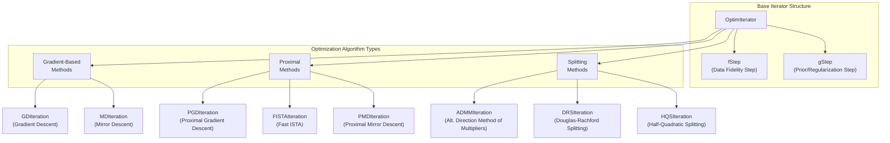

Sources: [deepinv/optim/optim_iterators/optim_iterator.py](), [deepinv/optim/optim_iterators/__init__.py]()

The `OptimIterator` base class defines a general fixed-point iteration structure for minimizing `f(x) + λg(x)` by alternating between steps on the data fidelity term `f` and the regularization term `g`. Each specific algorithm implements this structure differently.

## 2. Gradient-Based Methods

Gradient-based methods directly use the gradients of the objective function components to update the solution.

### 2.1 Gradient Descent (GD)

Gradient Descent is the most basic iterative optimization algorithm that updates the solution by moving in the direction of the negative gradient.

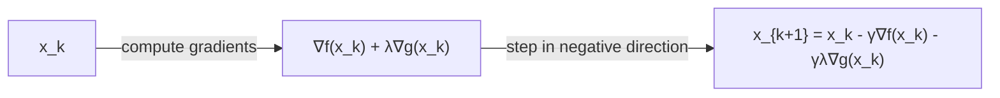

**Implementation Details:**
- For the data fidelity term `f`, computes `∇f(x)` using `cur_data_fidelity.grad()`
- For the prior term `g`, computes `λ∇g(x)` using `cur_prior.grad()`
- Updates using `x = x_prev - γ(∇f(x_prev) + λ∇g(x_prev))`

Sources: [deepinv/optim/optim_iterators/gradient_descent.py:5-57]()

### 2.2 Mirror Descent (MD)

Mirror Descent generalizes gradient descent using a Bregman divergence, which is useful when the solution space has a non-Euclidean geometry.

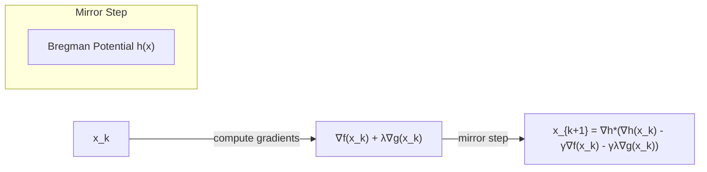

**Implementation Details:**
- Builds on Gradient Descent but maps through a Bregman potential `h`
- Uses `bregman_potential.grad_conj(bregman_potential.grad(x_prev) - grad)` for the mirror step

Sources: [deepinv/optim/optim_iterators/gradient_descent.py:60-117]()

## 3. Proximal Methods

Proximal methods use the proximal operator, which combines a gradient step with a "proximal" regularization.

### 3.1 Proximal Gradient Descent (PGD)

PGD alternates between a gradient step on the differentiable term `f` and a proximal step on the potentially non-differentiable term `g`.

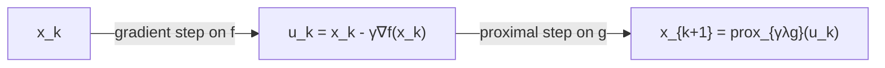

**Implementation Details:**
- First computes `u = x - γ∇f(x)` using the gradient of the data fidelity term
- Then applies the proximal operator of `g`: `x = prox_{γλg}(u)`

Sources: [deepinv/optim/optim_iterators/pgd.py:5-160]()

### 3.2 Fast Iterative Soft Thresholding Algorithm (FISTA)

FISTA accelerates the convergence of PGD using a momentum-like technique.

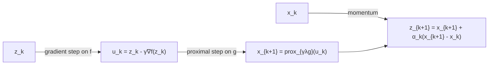

**Implementation Details:**
- Similar to PGD but with an additional momentum step
- Uses acceleration parameter `α_k = (k+a-1)/(k+a)` where `a > 2`
- Stores and updates both primal variable `x` and extrapolated point `z`

Sources: [deepinv/optim/optim_iterators/pgd.py:36-104]()

### 3.3 Proximal Mirror Descent (PMD)

PMD combines the ideas of proximal methods and mirror descent.

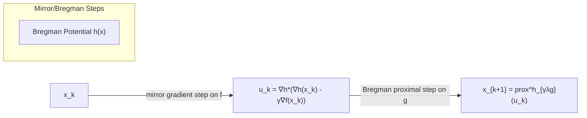

**Implementation Details:**
- Like PGD but uses a Bregman divergence instead of Euclidean distance
- Requires Bregman proximal operators for both `f` and `g`

Sources: [deepinv/optim/optim_iterators/pgd.py:163-286]()

## 4. Splitting Methods

Splitting methods decompose the optimization problem into simpler subproblems that can be solved more efficiently.

### 4.1 Alternating Direction Method of Multipliers (ADMM)

ADMM solves problems by introducing an auxiliary variable and alternating between updates.

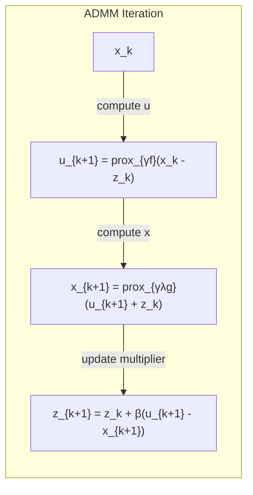

**Implementation Details:**
- Updates three variables in sequence: auxiliary variable `u`, primal variable `x`, and dual variable `z`
- Uses relaxation parameter `β` to control convergence
- Requires proximal operators for both `f` and `g`

Sources: [deepinv/optim/optim_iterators/admm.py]()

### 4.2 Douglas-Rachford Splitting (DRS)

DRS is another splitting method that is closely related to ADMM but with a different variable update sequence.

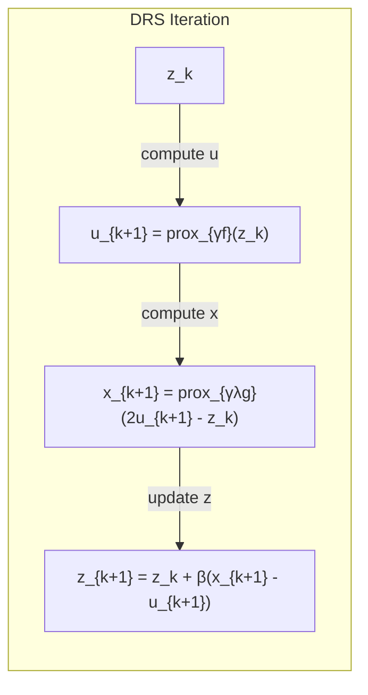

**Implementation Details:**
- Similar structure to ADMM but with modified update equations
- Uses a relaxation parameter `β` similar to ADMM
- The "dual" variable `z` in DRS lives in the primal space

Sources: [deepinv/optim/optim_iterators/drs.py]()

### 4.3 Half-Quadratic Splitting (HQS)

HQS is a simpler splitting method that alternates between two proximal steps without maintaining a dual variable.

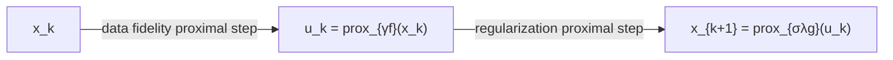

**Implementation Details:**
- Simplest splitting method with just two proximal operations
- No dual variable or relaxation parameter
- Note that HQS doesn't generally converge to a minimizer of `f(x) + λg(x)` but rather to a minimizer of the Moreau envelope

Sources: [deepinv/optim/optim_iterators/hqs.py]()

## 5. Linear System Solvers

DeepInv provides several methods for solving linear systems of the form `Ax = b`, which arise in many inverse problems.

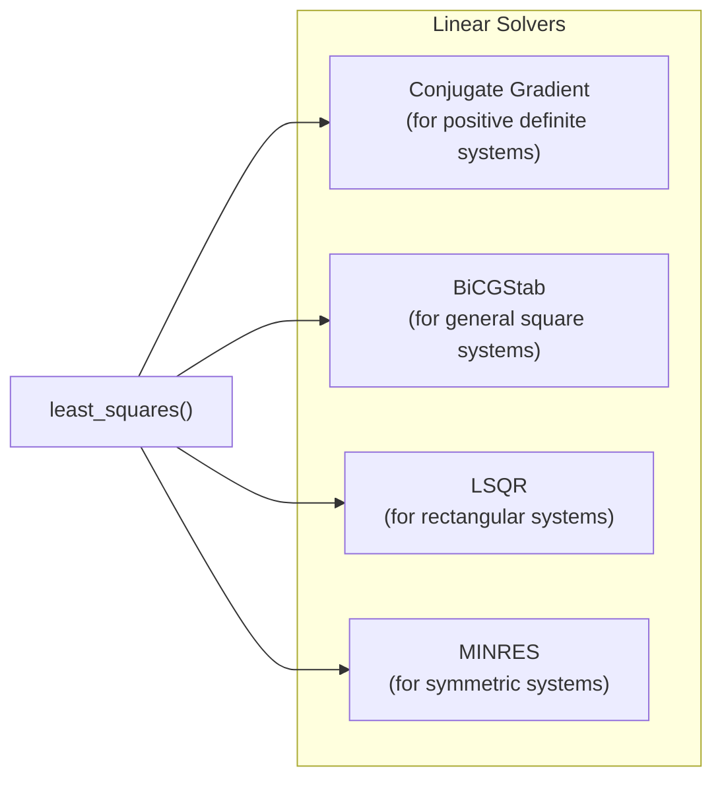

### 5.1 Conjugate Gradient (CG)

The Conjugate Gradient method solves positive definite systems iteratively using conjugate search directions.

**Implementation Details:**
- Designed for symmetric positive definite systems
- Efficiently computes the solution by searching along conjugate directions
- Convergence is guaranteed in at most n iterations for an n×n matrix (in exact arithmetic)

Sources: [deepinv/optim/utils.py:185-251]()

### 5.2 Biconjugate Gradient Stabilized (BiCGStab)

BiCGStab generalizes CG to non-symmetric systems with enhanced stability.

**Implementation Details:**
- Can solve general square linear systems, not just symmetric positive definite ones
- More stable than the basic Biconjugate Gradient method
- Supports preconditioning to improve convergence

Sources: [deepinv/optim/utils.py:254-337]()

### 5.3 LSQR

LSQR is specialized for solving least squares problems of the form `min ‖Ax-b‖² + η‖x-z‖²`.

**Implementation Details:**
- Designed for rectangular systems (overdetermined or underdetermined)
- Based on the bidiagonalization procedure of Golub and Kahan
- Provides good numerical stability and accuracy for ill-conditioned systems

Sources: [deepinv/optim/utils.py:369-577]()

### 5.4 MINRES

The Minimal Residual method is designed for symmetric systems but doesn't require positive definiteness.

**Implementation Details:**
- Minimizes the residual norm ‖Ax-b‖ for each iteration
- Particularly useful for indefinite systems where CG may struggle
- Supports preconditioning like other methods

Sources: [deepinv/optim/utils.py:580-744]()

## 6. Integration with the DeepInv Framework

Optimization algorithms in DeepInv are integrated into the larger framework through the `BaseOptim` and `FixedPoint` classes.

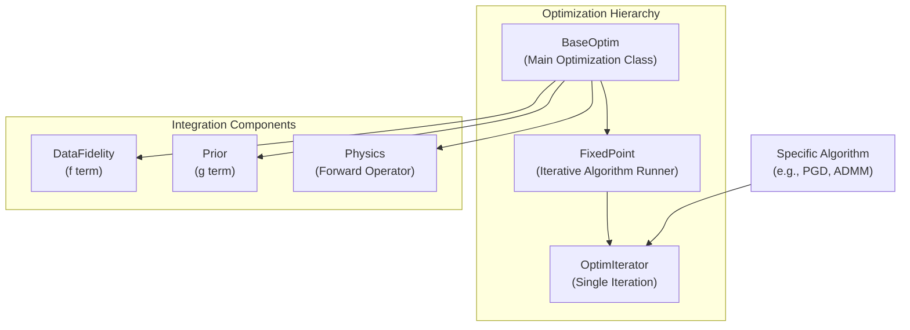

The optimization algorithms are used by:

1. Selecting an appropriate iterator (e.g., `PGDIteration`, `ADMMIteration`)
2. Configuring it with appropriate parameters
3. Running it through the `FixedPoint` class which handles the iteration loop
4. Using results via the `BaseOptim` interface

Sources: [deepinv/optim/optim_iterators/optim_iterator.py](), [docs/source/api/deepinv.optim.rst]()

## 7. Table of Optimization Algorithms

| Algorithm | Class | Key Characteristics | Requirements |
|-----------|-------|---------------------|-------------|
| Gradient Descent | `GDIteration` | Basic algorithm using gradients | Both terms must be differentiable |
| Mirror Descent | `MDIteration` | GD in non-Euclidean spaces | Both terms must be differentiable, requires Bregman potential |
| Proximal GD | `PGDIteration` | Handles non-differentiable regularization | `f` must be differentiable, `g` needs proximal operator |
| FISTA | `FISTAIteration` | Accelerated PGD | Same as PGD, plus momentum term |
| Proximal Mirror Descent | `PMDIteration` | PGD in non-Euclidean spaces | Requires Bregman potential and proximal operators |
| ADMM | `ADMMIteration` | Handles complex constraints via splitting | Both terms need proximal operators |
| Douglas-Rachford | `DRSIteration` | Alternative to ADMM | Both terms need proximal operators |
| Half-Quadratic Splitting | `HQSIteration` | Simple alternating proximal steps | Both terms need proximal operators |

Sources: [deepinv/optim/optim_iterators/__init__.py]()

## 8. Utility Functions for Optimization

Besides the main optimization algorithms, DeepInv provides several utility functions to support the optimization process:

- `least_squares`: General interface for solving linear systems with various solvers
- `gradient_descent`: Simple implementation of gradient descent for minimizing a function
- `check_conv`: Function to check convergence of iterative methods
- `GaussianMixtureModel`: Implements a Gaussian mixture model for certain prior distributions

Sources: [deepinv/optim/utils.py:9-31](), [deepinv/optim/utils.py:32-169](), [deepinv/optim/utils.py:747-764](), [deepinv/optim/utils.py:767-1033]()

## Conclusion

The optimization algorithms in DeepInv provide a comprehensive toolkit for solving inverse problems with various characteristics. The modular design allows users to easily swap different algorithms to find the best approach for their specific problem. By leveraging the integration with the broader DeepInv framework, these algorithms enable effective and efficient solutions for a wide range of inverse problems in imaging and other domains.

---

