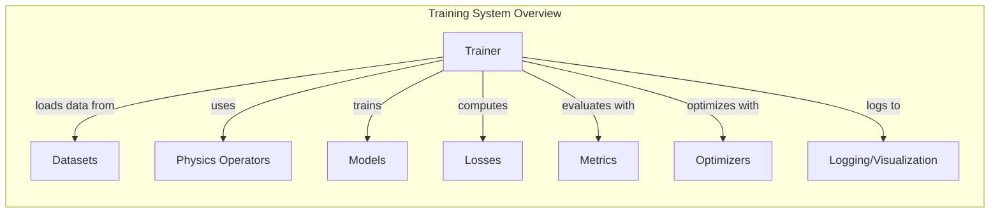
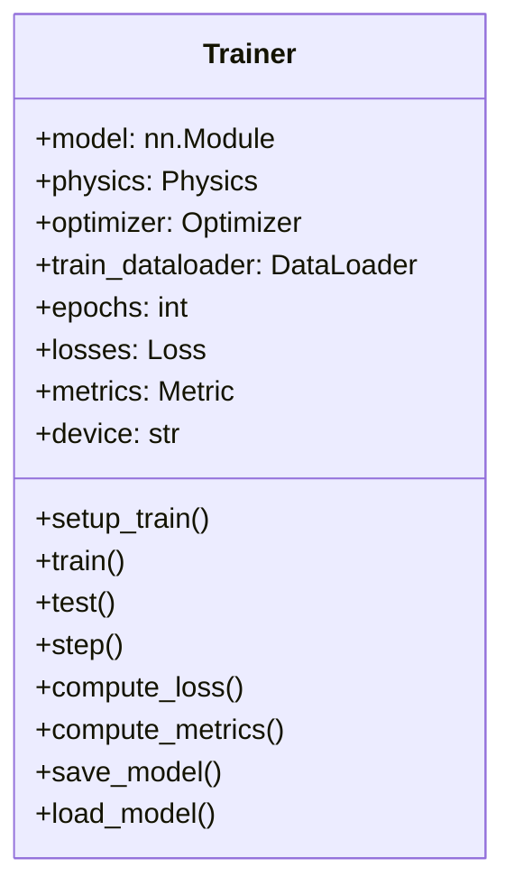
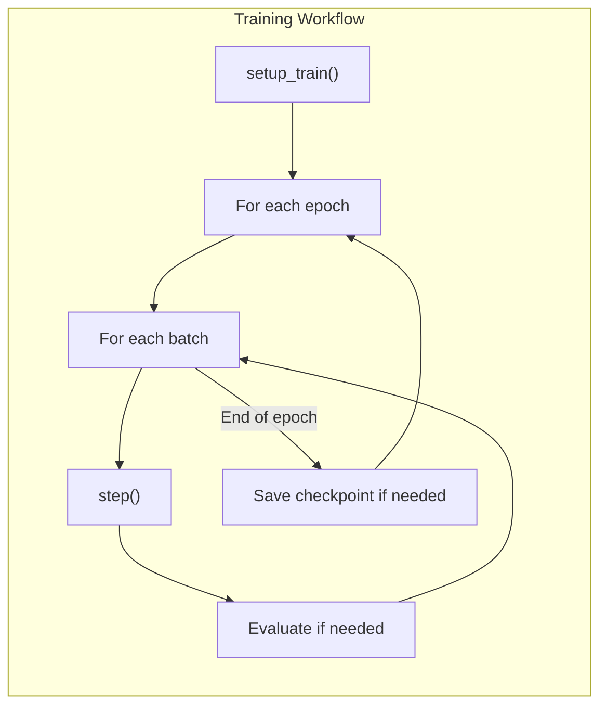
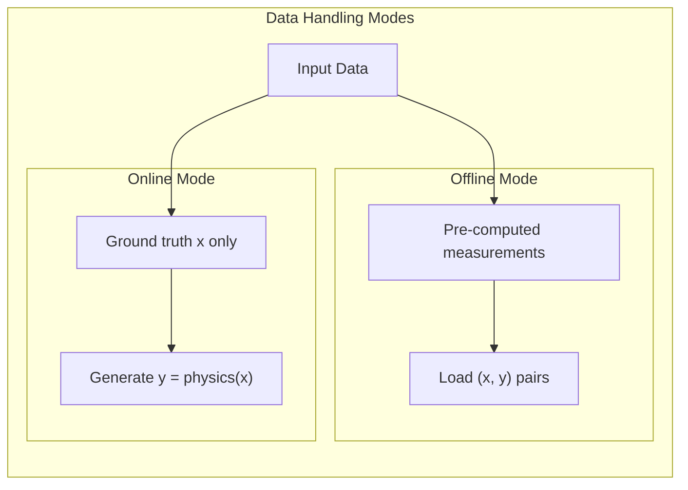
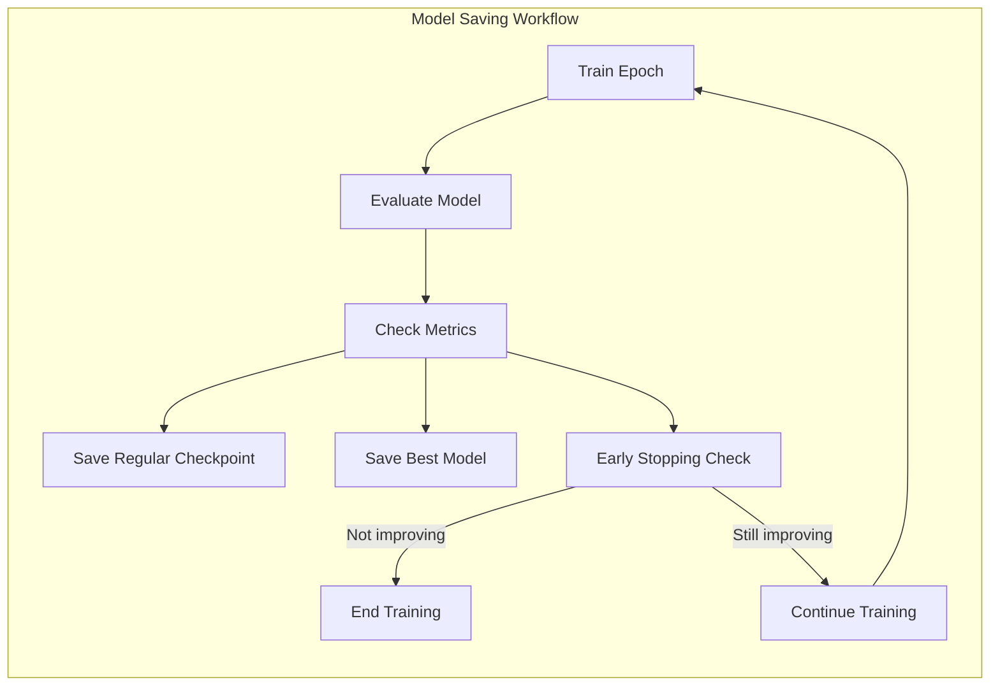
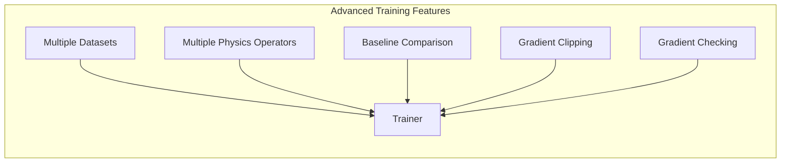
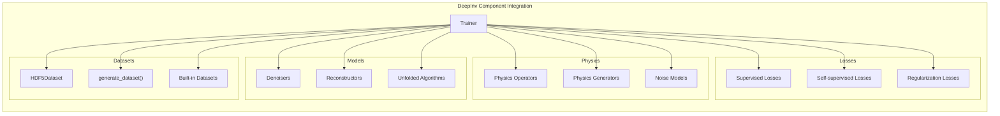

<!-- source: DeepWiki mcp.deepwiki.com · repo deepinv/deepinv · page 2.5 Training System · fetched 2026-10-21 -->

# Training System

Relevant source files

The following files were used as context for generating this wiki page:

- [CHANGELOG.rst](CHANGELOG.rst)
- [deepinv/tests/test_loss.py](deepinv/tests/test_loss.py)
- [deepinv/training/trainer.py](deepinv/training/trainer.py)

The DeepInv Training System provides a comprehensive framework for training deep learning models for inverse problems. It handles the entire training pipeline, including data loading, loss computation, optimization, evaluation, and model saving. This page focuses on the `Trainer` class and its capabilities for training reconstruction networks across various inverse problems.

For details about specific loss functions used during training, see [Loss Functions](#4.1). For dataset management, see [Dataset Management](#4.2).

## Core Concepts

The Training System revolves around the `Trainer` class, which orchestrates the training process for inverse problem reconstruction models. It is designed to work with various types of physics operators, loss functions, and dataset configurations, providing flexibility for different training scenarios.

Sources: [deepinv/training/trainer.py:20-193](deepinv/training/trainer.py:20-193)

## Trainer Class

The `Trainer` class is the central component of the training system. It's implemented as a Python dataclass that accepts numerous parameters to configure the training process.

### Configuration Parameters

The Trainer accepts parameters in several categories:

| Category | Key Parameters | Description |
|----------|----------------|-------------|
| Basics | model, physics, train_dataloader, device | The model to train, physics operators, training data, and device (CPU/GPU) |
| Optimization | optimizer, epochs, losses, scheduler, grad_clip | Optimizer configuration, training duration, loss functions, and optional gradient clipping |
| Evaluation | eval_dataloader, metrics, eval_interval | Validation data, evaluation metrics, and how often to evaluate |
| Physics Generators | physics_generator, online_measurements | Optional generators for dynamic physics operators |
| Model Saving | save_path, ckp_interval | Where to save models and how often |
| Visualization | plot_images, wandb_vis | Options for visualizing results and logging to Weights & Biases |

Sources: [deepinv/training/trainer.py:196-234](deepinv/training/trainer.py:196-234)

## Training Workflow

The training process follows a structured workflow, managed by the `Trainer.train()` method:

The `step()` method is responsible for processing each batch during training:

1. Get samples from the dataloader
2. Perform model inference
3. Compute loss and backpropagate
4. Compute evaluation metrics
5. Update progress and visualize results

Sources: [deepinv/training/trainer.py:1017-1147](deepinv/training/trainer.py:1017-1147), [deepinv/training/trainer.py:732-826](deepinv/training/trainer.py:732-826)

## Data Handling

The Trainer supports various data handling modes:

### Online vs. Offline Measurements

The system supports two main approaches for obtaining measurement data:

1. **Offline measurements** (default): Measurements `y` are pre-computed and loaded from the dataset.
2. **Online measurements**: Measurements are generated on-the-fly during training by applying the physics operator to the ground truth.

Sources: [deepinv/training/trainer.py:433-552](deepinv/training/trainer.py:433-552)

### Physics Generators

When using online measurements, the system allows for dynamically generated physics operators through the `physics_generator` parameter. This enables training on a variety of different measurement settings.

For example, different mask patterns for MRI or different blur kernels can be generated during training. The `loop_random_online_physics` option controls whether the same physics parameters are used in each epoch.

Sources: [deepinv/training/trainer.py:126-147](deepinv/training/trainer.py:126-147), [deepinv/training/trainer.py:465-475](deepinv/training/trainer.py:465-475)

## Loss and Metrics Computation

The Trainer supports multiple loss functions and evaluation metrics:

### Loss Computation

Loss computation is handled by the `compute_loss()` method, which:

1. Performs model inference to get reconstructed images
2. Applies one or more loss functions
3. Combines losses and performs backward pass
4. Returns the loss value and reconstructed images

The system supports using multiple loss functions simultaneously, which are summed together for optimization.

Sources: [deepinv/training/trainer.py:586-647](deepinv/training/trainer.py:586-647)

### Metrics Evaluation

Metrics are computed by the `compute_metrics()` method:

1. Takes ground truth, reconstructed images, measurements, and physics operators
2. Applies one or more evaluation metrics
3. Optionally compares with non-learning baseline reconstructions
4. Returns metric values for logging and visualization

Metrics are computed on both training and validation data, but do not affect the optimization process.

Sources: [deepinv/training/trainer.py:649-692](deepinv/training/trainer.py:649-692)

## Model Saving and Checkpointing

The Trainer provides several options for saving models during training:

### Regular Checkpoints

Models are saved at regular intervals specified by the `ckp_interval` parameter. Each checkpoint contains:
- Model state dictionary
- Optimizer state
- Current epoch
- Loss history
- Evaluation metrics history

### Best Model Saving

When a validation dataset is provided, the Trainer automatically saves the best model based on the first evaluation metric. The default behavior can be customized by overriding the `save_best_model()` method.

### Early Stopping

The Trainer supports early stopping to prevent overfitting. By default, training stops when the first evaluation metric doesn't improve for 3 consecutive validations. This can be customized by overriding the `stop_criterion()` method.

Sources: [deepinv/training/trainer.py:892-1016](deepinv/training/trainer.py:892-1016)

## Visualization and Logging

The Trainer provides extensive visualization and logging capabilities:

### Image Plotting

Results can be visualized through the `plot()` method, which shows:
- Ground truth images
- Measurements
- Reconstructed images
- Optionally, non-learning baseline reconstructions

### Weights & Biases Integration

When `wandb_vis` is set to `True`, the Trainer logs metrics, images, and other information to Weights & Biases for monitoring and analysis.

### Progress Tracking

Training progress is tracked and displayed through:
- Progress bars (using tqdm)
- Printed metrics
- Loss curves
- Learning curves

Sources: [deepinv/training/trainer.py:828-891](deepinv/training/trainer.py:828-891), [deepinv/training/trainer.py:391-408](deepinv/training/trainer.py:391-408)

## Advanced Features

The Trainer includes several advanced features for more complex training scenarios:

### Multi-Dataset Training

Multiple training and evaluation datasets can be used simultaneously by providing lists of dataloaders.

### Multi-Physics Training

Multiple physics operators can be used by providing a list of physics objects, allowing for training across different inverse problems.

### Comparison with Baselines

The `compare_no_learning` option enables comparison with non-learning reconstruction methods like pseudoinverse reconstructions.

### Gradient Clipping

Gradient values can be clipped during training to prevent exploding gradients.

Sources: [deepinv/training/trainer.py:409-431](deepinv/training/trainer.py:409-431), [deepinv/training/trainer.py:693-730](deepinv/training/trainer.py:693-730)

## Usage Examples

Here's a typical usage pattern for the Trainer class:

1. Create a model, physics operator, and dataset
2. Configure losses and optimizer
3. Initialize the Trainer with desired parameters
4. Call the `train()` method
5. Optionally test the model with the `test()` method

The Trainer can be used for various training scenarios:

- Supervised training with ground truth data
- Self-supervised training without ground truth
- Online training with dynamically generated measurements
- Training with multiple physics operators
- Training with multiple losses

Sources: [deepinv/tests/test_loss.py:276-323](deepinv/tests/test_loss.py:276-323)

## Recent Developments

According to the changelog, recent improvements to the Training System include:

- Added early-stopping callback and best model saving
- Support for logging train progress per batch or per epoch
- Online training with noisy physics now can repeat the same noise each epoch
- Trainer test can return unaggregated metrics
- Support for multi-physics/multi-dataset during training

Sources: [CHANGELOG.rst:30-33](CHANGELOG.rst:30-33), [CHANGELOG.rst:48-52](CHANGELOG.rst:48-52), [CHANGELOG.rst:55-62](CHANGELOG.rst:55-62)

## Integration with Other DeepInv Components

The Training System is designed to work seamlessly with other components of the DeepInv library:

This integration makes the Training System a versatile component for developing and training models for various inverse problems.

Sources: [deepinv/training/trainer.py:1-19](deepinv/training/trainer.py:1-19)

---

