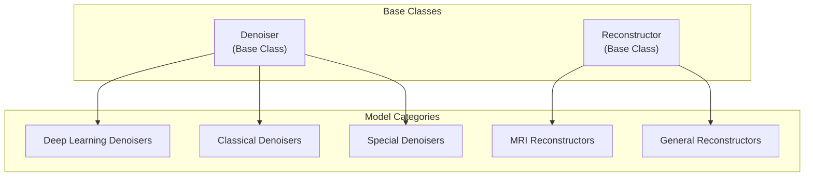
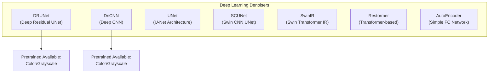
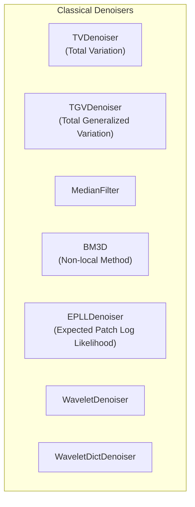
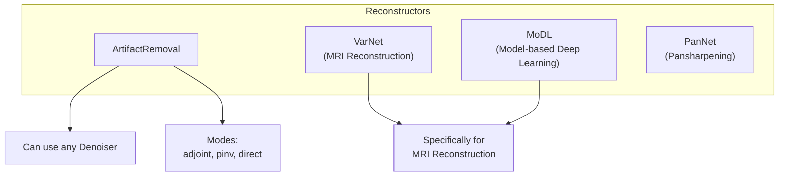

<!-- source: DeepWiki mcp.deepwiki.com · repo deepinv/deepinv · page 3 Model Zoo · fetched 2026-10-21 -->

# Model Zoo

<details>
<summary>Relevant source files</summary>

The following files were used as context for generating this wiki page:

- [deepinv/models/GSPnP.py](deepinv/models/GSPnP.py)
- [deepinv/models/__init__.py](deepinv/models/__init__.py)
- [deepinv/models/ae.py](deepinv/models/ae.py)
- [deepinv/models/artifactremoval.py](deepinv/models/artifactremoval.py)
- [deepinv/models/dncnn.py](deepinv/models/dncnn.py)
- [deepinv/models/drunet.py](deepinv/models/drunet.py)
- [deepinv/tests/test_models.py](deepinv/tests/test_models.py)
- [deepinv/utils/parameters.py](deepinv/utils/parameters.py)

</details>


The DeepInv Model Zoo contains a comprehensive collection of models for solving inverse problems in imaging. This page provides an overview of the available model architectures, their capabilities, and guidance on how to use them effectively. For information on optimization algorithms that can be used with these models, see [Optimization Framework](#2.3) and [Optimization Algorithms](#2.4).

## Model Architecture Overview

The DeepInv library organizes models into a hierarchy with base classes that define common interfaces. The two fundamental base classes are:

1. `Denoiser`: Base class for all image denoising models
2. `Reconstructor`: Base class for models that reconstruct images from measurements



Sources: [deepinv/models/__init__.py:1-2](), [deepinv/models/base.py]()

## Deep Learning Denoisers

DeepInv provides a variety of deep learning-based denoisers, all following the same interface for ease of use.



Sources: [deepinv/models/__init__.py:2-36](), [deepinv/tests/test_models.py:10-30]()

### DRUNet

DRUNet is a U-Net-like architecture with convolutional blocks in the encoder and decoder parts. It was introduced in the paper "Plug-and-Play Image Restoration with Deep Denoiser Prior" and encodes the noise level as an additional input channel.

**Key features:**
- U-Net structure with residual blocks
- Takes noise level as input channel
- Supports both color and grayscale images
- Pretrained weights available

**Example usage:**
```python
from deepinv.models import DRUNet

# Create a DRUNet model for color images with pretrained weights
model = DRUNet(in_channels=3, out_channels=3, pretrained='download')

# Denoise an image
denoised_image = model(noisy_image, sigma=0.1)
```

Sources: [deepinv/models/drunet.py:11-203](), [deepinv/tests/test_models.py:56-66]()

### DnCNN

DnCNN is a convolutional denoiser introduced in "Beyond a Gaussian Denoiser: Residual Learning of Deep CNN for Image Denoising". It consists of a series of convolutional layers with ReLU activations.

**Key features:**
- Simple series of convolutional layers
- Residual learning approach
- Configurable depth
- Pretrained weights available

**Example usage:**
```python
from deepinv.models import DnCNN

# Create a DnCNN model with pretrained weights
model = DnCNN(in_channels=3, out_channels=3, depth=20, pretrained='download')

# Denoise an image
denoised_image = model(noisy_image, sigma=0.1)
```

Sources: [deepinv/models/dncnn.py:8-113](), [deepinv/tests/test_models.py:64-65]()

## Classical Denoisers

DeepInv includes various classical denoising algorithms that follow the same interface as deep learning models.



Sources: [deepinv/models/__init__.py:7-10](), [deepinv/tests/test_models.py:10-30]()

### TVDenoiser and TGVDenoiser

Total Variation (TV) and Total Generalized Variation (TGV) denoisers implement variational methods that promote piecewise smooth images.

**Example usage:**
```python
from deepinv.models import TVDenoiser, TGVDenoiser

# Create TV and TGV denoisers
tv_model = TVDenoiser(n_it_max=10)
tgv_model = TGVDenoiser(n_it_max=10)

# Denoise an image
tv_denoised = tv_model(noisy_image, reg_param=0.1)
tgv_denoised = tgv_model(noisy_image, reg_param=0.1)
```

Sources: [deepinv/tests/test_models.py:94-254]()

### Wavelet Denoisers

Wavelet-based denoisers apply thresholding in the wavelet domain to remove noise.

**Example usage:**
```python
from deepinv.models import WaveletDenoiser, WaveletDictDenoiser

# Create wavelet denoisers
wavelet_model = WaveletDenoiser(non_linearity="soft")
wavelet_dict_model = WaveletDictDenoiser(list_wv=["haar", "db3", "db8"])

# Denoise an image
wavelet_denoised = wavelet_model(noisy_image, threshold=0.1)
wavelet_dict_denoised = wavelet_dict_model(noisy_image, threshold=0.1)
```

Sources: [deepinv/tests/test_models.py:127-217]()

### BM3D

BM3D is a powerful non-local denoising algorithm that groups similar patches in the image.

**Example usage:**
```python
from deepinv.models import BM3D

# Create a BM3D denoiser
model = BM3D()

# Denoise an image
denoised_image = model(noisy_image, sigma=0.1)
```

Sources: [deepinv/tests/test_models.py:63](), [deepinv/models/__init__.py:16]()

## Special Denoisers

### GSDRUNet (Gradient Step Denoiser)

GSDRUNet implements the Gradient Step Denoiser architecture with a DRUNet backbone, based on the paper "Gradient Step Denoiser for convergent Plug-and-Play".

**Key features:**
- Improved convergence properties for plug-and-play methods
- Built on DRUNet architecture
- Pretrained weights available

**Example usage:**
```python
from deepinv.models import GSDRUNet

# Create a GSDRUNet model with pretrained weights
model = GSDRUNet(in_channels=3, out_channels=3, pretrained='download')

# Denoise an image
denoised_image = model(noisy_image, sigma=0.1)
```

Sources: [deepinv/models/GSPnP.py:16-131](), [deepinv/tests/test_models.py:60-61]()

### EquivariantDenoiser

Wrapper that makes any denoiser equivariant to geometric transformations like rotations and reflections.

**Example usage:**
```python
from deepinv.models import EquivariantDenoiser, DRUNet
from deepinv.transform import Rotate

# Create a base denoiser
base_model = DRUNet(in_channels=3, out_channels=3)

# Create an equivariant denoiser with rotations
model = EquivariantDenoiser(
    base_model, 
    transform=Rotate(multiples=90, positive=True, n_trans=4)
)
```

Sources: [deepinv/tests/test_models.py:286-340]()

## Reconstructors

Reconstructor models are designed to reconstruct images from measurements using knowledge of the forward model (physics).



Sources: [deepinv/models/__init__.py:1-2](), [deepinv/models/artifactremoval.py:14-115]()

### ArtifactRemoval

Transforms a denoiser into a reconstruction network using different modes:
- **adjoint**: Uses the adjoint operator `A^T`
- **pinv**: Uses the pseudoinverse operator `A^†`
- **direct**: Uses the measurements directly

**Example usage:**
```python
from deepinv.models import ArtifactRemoval, DRUNet

# Create a base denoiser
base_model = DRUNet(in_channels=3, out_channels=3)

# Create an artifact removal model with adjoint mode
model = ArtifactRemoval(backbone_net=base_model, mode='adjoint')

# Reconstruct an image
reconstructed = model(measurements, physics)
```

Sources: [deepinv/models/artifactremoval.py:14-115]()

### VarNet and MoDL

Variational Network (VarNet) and Model-based Deep Learning (MoDL) are specialized reconstructors for MRI data.

**Example usage:**
```python
from deepinv.models import VarNet, MoDL, DnCNN

# Create a base denoiser
denoiser = DnCNN(in_channels=2, out_channels=2)

# Create reconstruction models
varnet = VarNet(num_cascades=3, denoiser=denoiser)
modl = MoDL(denoiser=denoiser, num_iter=3)

# Reconstruct an image
varnet_recon = varnet(measurements, physics)
modl_recon = modl(measurements, physics)
```

Sources: [deepinv/tests/test_models.py:602-652]()

## Model Compatibility Table

This table shows which models work with different data types and if pretrained weights are available.

| Model | Color | Grayscale | Pretrained | Optional Dependencies |
|-------|:-----:|:---------:|:----------:|:---------------------:|
| DRUNet | ✓ | ✓ | ✓ | None |
| DnCNN | ✓ | ✓ | ✓ | None |
| UNet | ✓ | ✓ | ✗ | None |
| SCUNet | ✓ | ✗ | ✗ | timm |
| SwinIR | ✓ | ✓ | ✗ | timm |
| BM3D | ✓ | ✓ | ✗ | bm3d |
| TVDenoiser | ✓ | ✓ | ✗ | None |
| TGVDenoiser | ✓ | ✓ | ✗ | None |
| WaveletDenoiser | ✓ | ✓ | ✗ | ptwt |
| GSDRUNet | ✓ | ✓ | ✓ | None |
| Restormer | ✓ | ✓ | ✗ | None |

Sources: [deepinv/tests/test_models.py:257-282](), [deepinv/tests/test_models.py:541-558]()

## Using Models for Denoising

All denoisers in DeepInv follow a common interface where they take a noisy image and a noise level parameter:

```python
# Step 1: Import the model
from deepinv.models import DRUNet

# Step 2: Create a physics model for the inverse problem
import deepinv as dinv
sigma = 0.1
physics = dinv.physics.Denoising(dinv.physics.GaussianNoise(sigma))

# Step 3: Create the denoiser
model = DRUNet(in_channels=3, out_channels=3, pretrained='download')

# Step 4: Apply the model to a noisy image
x = torch.randn(1, 3, 256, 256)  # Clean image
y = physics(x)  # Noisy image
x_hat = model(y, sigma)  # Denoised image
```

Sources: [deepinv/tests/test_models.py:260-282]()

## Using Models for Reconstruction

Reconstructors take measurements and a physics object to reconstruct the original image:

```python
# Step 1: Import the model
from deepinv.models import ArtifactRemoval, DRUNet

# Step 2: Create a physics model
import deepinv as dinv
mask = dinv.physics.generator.GaussianMaskGenerator(acceleration=4).step()['mask']
physics = dinv.physics.MRI(mask)

# Step 3: Create the reconstructor
backbone = DRUNet(in_channels=2, out_channels=2)
model = ArtifactRemoval(backbone_net=backbone, mode='pinv')

# Step 4: Apply the model to measurements
x = torch.randn(1, 2, 256, 256)  # Original image
y = physics(x)  # Measurements
x_hat = model(y, physics)  # Reconstructed image
```

Sources: [deepinv/models/artifactremoval.py:86-115]()

## Integration with Plug-and-Play Methods

Models from the Model Zoo can be used as denoisers in plug-and-play optimization algorithms:

```python
import deepinv as dinv

# Create a denoiser
denoiser = dinv.models.DRUNet(in_channels=3, out_channels=3, pretrained='download')

# Set up parameters for specific problems
problem = "deblur"
noise_level = 0.1
lambda_, sigma_denoiser, stepsize, max_iter = dinv.utils.get_GSPnP_params(problem, noise_level)

# Create a plug-and-play optimizer with the denoiser
optimizer = dinv.optim.PnP(
    f=dinv.optim.L2(),
    g=dinv.optim.PnP_DRUNet(denoiser),
    lamb=lambda_,
    max_iter=max_iter
)

# Run the optimization
x_recon = optimizer.fit(measurements, physics)
```

Sources: [deepinv/utils/parameters.py:4-26]()

This Model Zoo provides a comprehensive set of tools for solving inverse problems in imaging, from simple denoising to complex reconstruction tasks. The common interfaces make it easy to swap different models and compare their performance on the same task.

---

