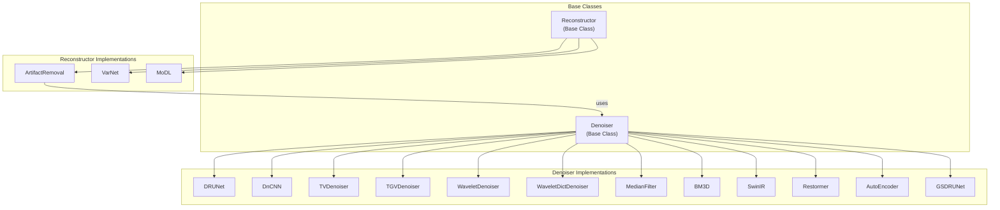
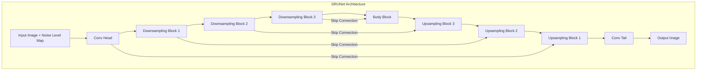
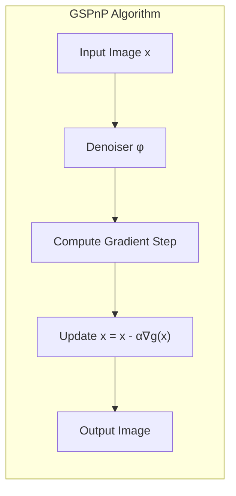
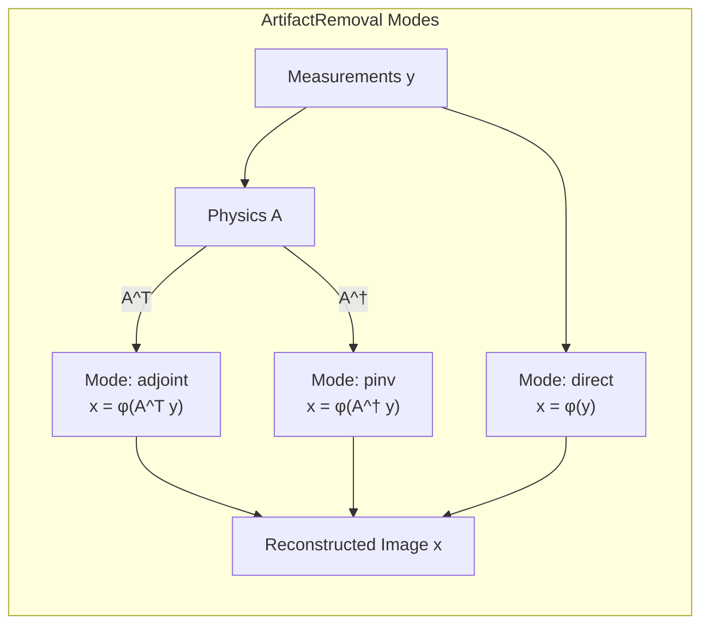

<!-- source: DeepWiki mcp.deepwiki.com · repo deepinv/deepinv · page 3.1 Denoisers and Reconstructors · fetched 2026-10-21 -->

# Denoisers and Reconstructors

<details>
<summary>Relevant source files</summary>

The following files were used as context for generating this wiki page:

- [deepinv/models/GSPnP.py](deepinv/models/GSPnP.py)
- [deepinv/models/__init__.py](deepinv/models/__init__.py)
- [deepinv/models/ae.py](deepinv/models/ae.py)
- [deepinv/models/artifactremoval.py](deepinv/models/artifactremoval.py)
- [deepinv/models/dncnn.py](deepinv/models/dncnn.py)
- [deepinv/models/drunet.py](deepinv/models/drunet.py)
- [deepinv/models/tgv.py](deepinv/models/tgv.py)
- [deepinv/tests/test_models.py](deepinv/tests/test_models.py)
- [deepinv/utils/metric.py](deepinv/utils/metric.py)
- [deepinv/utils/parameters.py](deepinv/utils/parameters.py)

</details>


This page documents the denoiser and reconstructor models available in DeepInv. These components are crucial for solving inverse problems by removing noise from images or reconstructing signals from measurements. For information about how these models are integrated into optimization algorithms, see the [Optimization Framework](#2.3).

## Base Classes and Architecture

DeepInv follows an object-oriented architecture with two main base classes: `Denoiser` and `Reconstructor`. These classes define interfaces that all specific implementations must follow.



Sources: [deepinv/models/__init__.py:1-37](), [deepinv/models/artifactremoval.py:14-116]()

### Denoiser Interface

All denoisers implement a common interface through the `Denoiser` base class:

```python
class Denoiser(nn.Module):
    def forward(self, x, sigma):
        """
        x: noisy input image
        sigma: noise level (std)
        returns: denoised image
        """
```

The denoiser accepts a noisy image `x` and a noise level `sigma`, then returns a denoised version. Noise level can be a float or tensor (per-batch values).

### Reconstructor Interface

Reconstructors implement a different interface through the `Reconstructor` base class:

```python
class Reconstructor(nn.Module):
    def forward(self, y, physics, **kwargs):
        """
        y: measurements
        physics: forward operator
        returns: reconstructed image
        """
```

The reconstructor accepts measurements `y` and a physics operator `physics`, then returns a reconstructed image. Some reconstructors may use denoisers internally.

Sources: [deepinv/models/artifactremoval.py:14-116]()

## Denoiser Implementations

DeepInv provides a comprehensive collection of denoising models. These span from classical methods to state-of-the-art deep learning approaches.

### Deep Learning-Based Denoisers

#### DRUNet

DRUNet is a U-Net based denoising network with residual connections. It takes the noise level as an additional input channel, allowing it to adapt to different noise levels.



Key features:
- U-Net like structure with residual blocks
- Accepts noise level as input for adaptive denoising
- Pretrained weights available for grayscale and color images
- Handles arbitrary image sizes with appropriate padding

Sources: [deepinv/models/drunet.py:11-203]()

#### DnCNN

DnCNN is a simple convolutional neural network for denoising. It consists of a series of convolutional layers followed by ReLU activations.

Key features:
- Minimalistic architecture with convolutional layers and ReLU activations
- Optional pretrained weights
- Residual connection between input and output

Sources: [deepinv/models/dncnn.py:8-126]()

#### Other Neural Network Denoisers

DeepInv includes several other state-of-the-art denoising networks:

| Denoiser | Description | Key Features |
|----------|-------------|--------------|
| `SwinIR` | Transformer-based architecture | Uses Swin Transformer blocks |
| `Restormer` | Transformer with efficient self-attention | Performs well on various restoration tasks |
| `SCUNet` | CNN-based architecture | Combines CNN and transformer concepts |
| `AutoEncoder` | Simple fully connected architecture | Useful for debugging and prototyping |

Sources: [deepinv/models/__init__.py:1-37](), [deepinv/models/ae.py:5-46]()

### Variational and Transform-Based Denoisers

#### TVDenoiser and TGVDenoiser

These denoisers are based on variational methods that minimize energy functionals:

- `TVDenoiser`: Uses Total Variation regularization, which promotes piecewise constant solutions
- `TGVDenoiser`: Uses Total Generalized Variation, which better preserves smooth transitions than TV

The TGV denoiser solves the following minimization problem:

```
min_x,r  (1/2)||x-y||_2^2 + λ₁||r||_{1,2} + λ₂||J(Dx-r)||_{1,F}
```

Where `D` is the gradient operator and `J` is the Jacobian.

Sources: [deepinv/models/tgv.py:6-231]()

#### WaveletDenoiser and WaveletDictDenoiser

These denoisers operate in the wavelet domain:

- `WaveletDenoiser`: Performs denoising by thresholding wavelet coefficients
- `WaveletDictDenoiser`: Uses multiple wavelet bases for improved denoising

Sources: [deepinv/tests/test_models.py:67-74]()

### Classical and Patch-Based Denoisers

DeepInv also includes classical denoising methods:

- `MedianFilter`: Simple median filtering for denoising
- `BM3D`: Block-matching and 3D filtering, a non-local patch-based algorithm
- `EPLLDenoiser`: Expected Patch Log Likelihood, a patch-based method

Sources: [deepinv/tests/test_models.py:75-78]()

### Advanced Denoising Concepts

#### GSDRUNet

GSDRUNet is an implementation of the Gradient Step Plug-and-Play (GSPnP) method. It wraps a denoiser (typically DRUNet) and interprets it as a gradient step in an optimization algorithm.



The GSPnP method uses a denoiser to approximate the gradient of a regularization term:

```python
x_hat = x - α * potential_grad(x, sigma)
```

Sources: [deepinv/models/GSPnP.py:16-131]()

## Reconstructor Implementations

### ArtifactRemoval

`ArtifactRemoval` is a flexible reconstructor that uses a denoiser as a backbone. It supports three modes of operation:



- **Adjoint mode**: Applies the denoiser to the adjoint of the physics operator: `x = φ(A^T y)`
- **Pinv mode**: Applies the denoiser to the pseudoinverse: `x = φ(A^† y)`
- **Direct mode**: Applies the denoiser directly to the measurements: `x = φ(y)`

Sources: [deepinv/models/artifactremoval.py:14-116]()

### VarNet and MoDL

`VarNet` (Variational Network) and `MoDL` (Model-based Deep Learning) are unrolled reconstruction networks that iteratively solve inverse problems.

These architectures combine traditional optimization algorithms with learned components, creating end-to-end trainable networks that benefit from both model-based methods and deep learning.

Sources: [deepinv/tests/test_models.py:592-653]()

## Usage Examples

### Using a Denoiser

```python
import deepinv as dinv
import torch

# Create a noisy image
x = torch.randn(1, 3, 64, 64)  # [B, C, H, W]
sigma = 0.1  # Noise level

# Initialize a denoiser
denoiser = dinv.models.DRUNet(in_channels=3, out_channels=3, pretrained="download")

# Denoise the image
x_clean = denoiser(x, sigma)
```

### Using a Reconstructor

```python
import deepinv as dinv
import torch

# Create measurements and a physics operator
y = torch.randn(1, 3, 64, 64)  # [B, C, H, W]
physics = dinv.physics.Denoising(dinv.physics.GaussianNoise(0.1))

# Initialize a reconstructor with a denoiser backbone
backbone = dinv.models.DRUNet(in_channels=3, out_channels=3, pretrained="download")
reconstructor = dinv.models.ArtifactRemoval(backbone_net=backbone, mode="adjoint")

# Reconstruct the image
x_recon = reconstructor(y, physics)
```

Sources: [deepinv/tests/test_models.py:257-282]()

## Conclusion

The DeepInv library provides a comprehensive set of denoisers and reconstructors for solving inverse problems. These models range from classical methods to state-of-the-art deep learning approaches, and they can be used independently or as building blocks in more complex algorithms.

When selecting a model, consider:
- The nature of your inverse problem
- Computational constraints
- Whether you need adaptive noise handling
- Availability of pretrained weights

---

