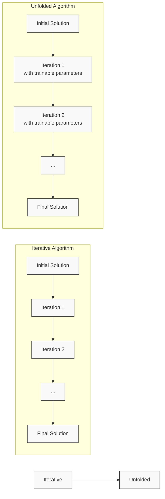
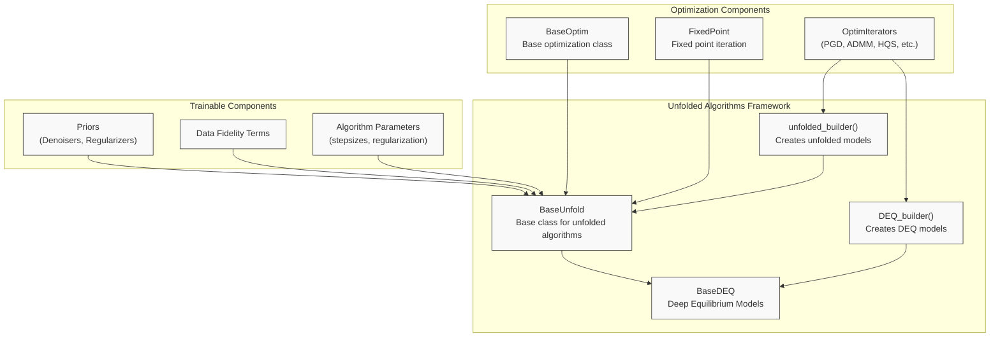
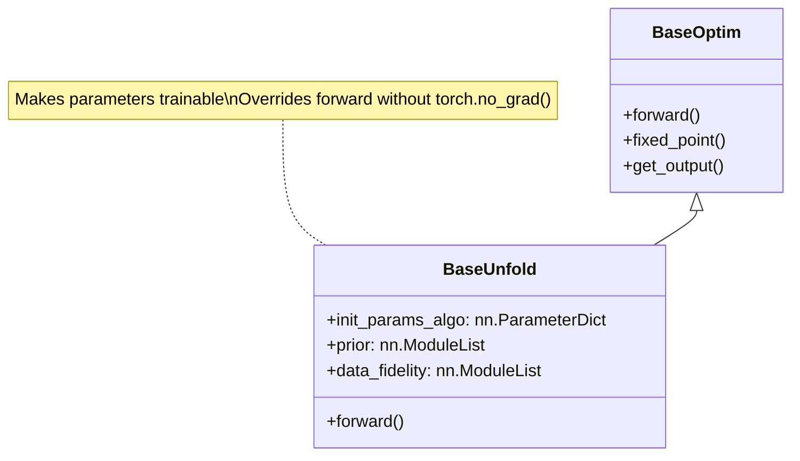
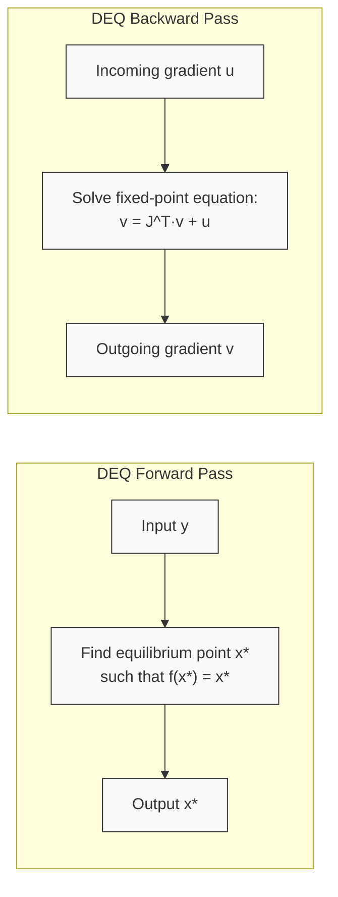
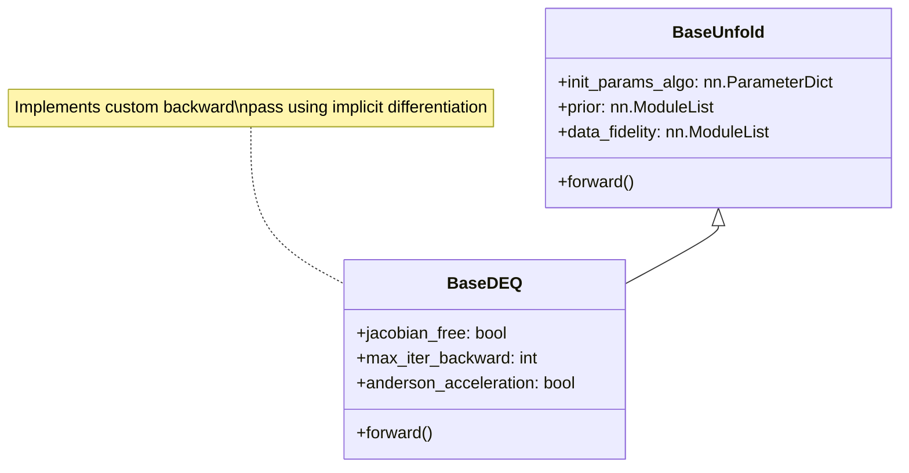

<!-- source: DeepWiki mcp.deepwiki.com · repo deepinv/deepinv · page 3.2 Unfolded Algorithms · fetched 2026-10-21 -->

# Unfolded Algorithms

<details>
<summary>Relevant source files</summary>

The following files were used as context for generating this wiki page:

- [deepinv/unfolded/__init__.py](deepinv/unfolded/__init__.py)
- [deepinv/unfolded/deep_equilibrium.py](deepinv/unfolded/deep_equilibrium.py)
- [deepinv/unfolded/unfolded.py](deepinv/unfolded/unfolded.py)

</details>


## Purpose and Scope

This page documents the unfolded algorithms framework in DeepInv, which enables the transformation of iterative optimization algorithms into trainable neural network architectures. Unfolded algorithms leverage the structure of optimization methods while adding learnable parameters, creating models that can be trained end-to-end. This document covers both standard algorithm unfolding and Deep Equilibrium Models (DEQ), which extend unfolding through implicit differentiation.

For information about the base optimization algorithms that can be unfolded, see [Optimization Framework](#2.3) and [Optimization Algorithms](#2.4). For details on models that can be used within unfolded algorithms, see [Denoisers and Reconstructors](#3.1).

## Concept Overview

Algorithm unfolding (or unrolling) transforms iterative optimization algorithms into trainable neural networks by replacing fixed parameters with learnable ones and incorporating neural networks as components. This approach combines the interpretability and mathematical foundations of optimization with the flexibility and expressiveness of deep learning.



**Diagram: Algorithm Unfolding Concept**

Sources: [deepinv/unfolded/unfolded.py:6-48]()

## Architecture Overview

In DeepInv, unfolded algorithms build upon the optimization framework, allowing optimization algorithms to be converted into trainable neural networks.



**Diagram: Unfolded Algorithms Architecture**

Sources: [deepinv/unfolded/unfolded.py:1-5](), [deepinv/unfolded/deep_equilibrium.py:1-7](), [deepinv/unfolded/__init__.py:1-2]()

## BaseUnfold Class

The `BaseUnfold` class is the foundation for unfolded algorithms in DeepInv. It inherits from `BaseOptim` and converts iterative optimization algorithms into trainable neural networks by making certain parameters learnable.

### Key Features

- Inherits from `BaseOptim` to leverage existing optimization algorithms
- Converts specified algorithm parameters into trainable parameters using PyTorch's `nn.Parameter`
- Supports both weight-tied (same parameters across iterations) and weight-untied (different parameters per iteration) configurations
- Enables end-to-end training

### Class Structure



**Diagram: BaseUnfold Inheritance Structure**

Sources: [deepinv/unfolded/unfolded.py:6-110]()

### Key Parameters

The `BaseUnfold` class accepts the following important parameters:

| Parameter | Type | Description |
|-----------|------|-------------|
| `iterator` | str or OptimIterator | The optimization algorithm to unfold (e.g., "PGD", "HQS", "ADMM") |
| `params_algo` | dict | Dictionary of algorithm parameters that can be made trainable |
| `data_fidelity` | DataFidelity instance(s) | Data fidelity term(s) to use in optimization |
| `prior` | Prior instance(s) | Regularization prior(s) to use in optimization |
| `max_iter` | int | Number of iterations to unfold |
| `trainable_params` | list | List of parameter names from `params_algo` to make trainable |

Sources: [deepinv/unfolded/unfolded.py:24-47]()

## Building Unfolded Models

The `unfolded_builder` function provides a convenient way to create unfolded algorithm instances.

### Function Signature and Usage

```python
def unfolded_builder(
    iteration,
    params_algo={"lambda": 1.0, "stepsize": 1.0},
    data_fidelity=None,
    prior=None,
    max_iter=5,
    trainable_params=["lambda", "stepsize"],
    device=torch.device("cpu"),
    F_fn=None,
    g_first=False,
    bregman_potential=None,
    **kwargs
):
    # creates and returns a BaseUnfold instance
```

Sources: [deepinv/unfolded/unfolded.py:113-125](), [deepinv/unfolded/unfolded.py:181-199]()

### Common Usage Pattern

```python
# Create a trainable unfolded PGD with a DnCNN denoiser as the prior
model = unfolded_builder(
    iteration="PGD",
    data_fidelity=L2(),
    prior=PnP(DnCNN(in_channels=1, out_channels=1)),
    params_algo={"stepsize": 1.0, "g_param": 1.0},
    trainable_params=["stepsize", "g_param"],
    max_iter=10
)

# Forward pass
x_hat = model(y, physics)
```

Sources: [deepinv/unfolded/unfolded.py:159-179]()

## Deep Equilibrium Models (DEQ)

Deep Equilibrium Models extend unfolding by virtually unrolling the algorithm to infinite iterations using the implicit function theorem. Instead of explicitly unrolling for a fixed number of steps, DEQ solves for the equilibrium point directly in the forward pass and uses implicit differentiation in the backward pass.

### Key Advantages

1. Model size independent of "depth" (number of iterations)
2. Potentially better convergence by finding true equilibrium points
3. Memory efficiency during training

### Theoretical Foundation

DEQ models leverage the following concepts:

1. Forward pass: Find the equilibrium point x* where f(x*) = x*
2. Backward pass: Use implicit differentiation via fixed-point iteration



**Diagram: DEQ Forward and Backward Passes**

Sources: [deepinv/unfolded/deep_equilibrium.py:9-48]()

## BaseDEQ Class

The `BaseDEQ` class inherits from `BaseUnfold` and implements the DEQ approach for optimization algorithms.

### Key Features

- Inherits from `BaseUnfold`
- Performs the forward pass with fixed-point iterations without gradient tracking
- Implements a custom backward pass using implicit differentiation
- Supports Jacobian-free option for more efficient backpropagation

### Class Structure



**Diagram: BaseDEQ Inheritance Structure**

Sources: [deepinv/unfolded/deep_equilibrium.py:9-145]()

### Key Parameters

The `BaseDEQ` class adds the following parameters to those inherited from `BaseUnfold`:

| Parameter | Type | Description |
|-----------|------|-------------|
| `jacobian_free` | bool | If True, uses a simpler approximation in the backward pass |
| `max_iter_backward` | int | Maximum number of iterations for the backward fixed-point solve |
| `anderson_acceleration_backward` | bool | Whether to use Anderson acceleration in the backward pass |
| `history_size_backward` | int | Size of history for Anderson acceleration in backward pass |

Sources: [deepinv/unfolded/deep_equilibrium.py:32-37]()

### Forward and Backward Pass

The `forward` method in `BaseDEQ` is significantly different from `BaseUnfold`:

1. **Forward Pass**:
   - Computes the equilibrium point without tracking gradients
   - Performs one additional iteration with gradient tracking

2. **Backward Pass**:
   - Implements a custom backward hook that solves the fixed-point equation
   - Either uses Jacobian-based iteration or Jacobian-free approximation

Sources: [deepinv/unfolded/deep_equilibrium.py:59-145]()

## Building DEQ Models

The `DEQ_builder` function provides a convenient way to create DEQ instances.

### Function Signature and Usage

```python
def DEQ_builder(
    iteration,
    params_algo={"lambda": 1.0, "stepsize": 1.0},
    data_fidelity=L2(),
    prior=None,
    F_fn=None,
    g_first=False,
    bregman_potential=None,
    **kwargs
):
    # creates and returns a BaseDEQ instance
```

Sources: [deepinv/unfolded/deep_equilibrium.py:148-199]()

### Limitations

Currently, DEQ is only compatible with the following optimization algorithms:
- Proximal Gradient Descent (PGD)
- Gradient Descent (GD)
- Half-Quadratic Splitting (HQS)

Sources: [deepinv/unfolded/deep_equilibrium.py:29-31](), [deepinv/unfolded/deep_equilibrium.py:162-163]()

## Usage Examples and Best Practices

### Standard Unfolding Example

```python
# Create a PnP-PGD unfolded model with 10 iterations
unfolded_model = unfolded_builder(
    iteration="PGD",
    data_fidelity=L2(),
    prior=PnP(DnCNN()),
    params_algo={"stepsize": [0.1] * 10, "g_param": [1.0] * 10},
    trainable_params=["stepsize", "g_param"],
    max_iter=10
)
```

### Deep Equilibrium Example

```python
# Create a DEQ model based on HQS
deq_model = DEQ_builder(
    iteration="HQS",
    data_fidelity=L2(),
    prior=PnP(DRUNet()),
    params_algo={"lambda": 1.0, "g_param": 0.1},
    trainable_params=["lambda", "g_param"],
    max_iter=50,  # iterations for forward pass
    max_iter_backward=30,  # iterations for backward pass
    anderson_acceleration_backward=True
)
```

### Best Practices

1. **Weight Tying**: Using the same parameters across iterations (weight-tied) results in smaller models but may reduce expressiveness.

2. **Optimization Algorithm Selection**:
   - PGD is a good general-purpose choice
   - HQS works well with plug-and-play denoisers
   - ADMM can handle more complex constraints

3. **Trainable Parameters**:
   - Common trainable parameters include `stepsize`, `lambda` (regularization strength), and `g_param` (prior parameters)
   - Different parameters may be more important depending on the algorithm chosen

4. **DEQ vs. Standard Unfolding**:
   - Standard unfolding is more stable during training
   - DEQ can achieve better performance with fewer parameters
   - Consider memory constraints when choosing between them

Sources: [deepinv/unfolded/unfolded.py:159-179](), [deepinv/unfolded/deep_equilibrium.py:148-199]()

---

